# Architecture — ithildin-runtime slice 1

Seven module issues are about to be built by seven separate sessions, and the
pieces they share are the expensive thing to change later. A bar type, an
order type and the one path an order takes to the broker are read by every
module. Getting one wrong after four modules use it means four rewrites. This
doc draws those shared pieces now, while disagreeing with them costs an edit.

Slice 1 is the walking skeleton on
[#4](https://github.com/l3a0/ithildin-runtime/issues/4): the first version of
the platform in which every module exists in its simplest form and one
strategy runs end to end, every trading day, on a broker's paper account, a
practice account that trades with no real money. Each
module issue, [#5](https://github.com/l3a0/ithildin-runtime/issues/5) to
[#11](https://github.com/l3a0/ithildin-runtime/issues/11), still decides what
its module must do. Where this doc and an issue disagree, the issue wins.

The owner ruled on 2026-10-29 that each component runs as its own process and
passes everything to the others through files, so a failure stays inside one
process and every input and output can be read afterwards. So the diagrams draw one worker per module, each a process the host keeps running and the supervisor only messages, rather than one program calling each module in turn. The owner added the same day that the platform
is an event pipeline with a queue per component: each component listens for
events on its queue, and a message reaches a component's queue whenever there
is something new for it. Every file is a blob in S3, written once at a key
fixed by the run, the stage and the decision, and the VM keeps no state.
The journal is the one numbered log.
[design.md](design.md#processes-and-files)'s `## Processes and files` carries
the rules the workers follow.

The owner's part in reviewing this doc is two sections at the end.

1. [Decisions](#decisions), a table where each row says what this doc chose, what it
   turned down and where the choice gets settled. Object to a row there.
2. [Questions for the owner](#questions-for-the-owner), twelve questions the build depends on. Each says what was recommended and how the owner ruled. The owner has answered all twelve, the last two on 2026-10-30.

The diagrams are Mermaid, which GitHub draws in place. Each one is followed by
what it shows and what to look for. Nothing here is built yet.

## Contents

- [The strategy the skeleton runs](#the-strategy-the-skeleton-runs)
- [Context: what the platform talks to](#context-what-the-platform-talks-to)
- [The loop and its adapters](#the-loop-and-its-adapters)
- [Data flow](#data-flow)
- [One trading day](#one-trading-day)
- [When something is wrong](#when-something-is-wrong)
- [What a person runs](#what-a-person-runs)
- [Types and interfaces](#types-and-interfaces)
- [The life of an order](#the-life-of-an-order)
- [The life of a run](#the-life-of-a-run)
- [What is stored](#what-is-stored), with [File formats and keys](#file-formats-and-keys)

- [Where it runs](#where-it-runs), with [Four environments](#four-environments)

- [Package layout and the import rule](#package-layout-and-the-import-rule)
- [How the four acceptance tests exercise it](#how-the-four-acceptance-tests-exercise-it)
- [Decisions](#decisions)
- [Questions for the owner](#questions-for-the-owner)

## The strategy the skeleton runs

Acceptance test 1 asks the backtest to reproduce a strategy that
[quantitative-trading](https://github.com/l3a0/quantitative-trading) has
already replicated. A mismatch then points at the platform rather than the
idea, because the strategy's numbers are already pinned there.

The proposal is Chan's Bollinger band on the price spread between GLD, a gold
ETF, and USO, an oil ETF. It is Example 3.2 of *Algorithmic Trading* and
Entry 26 of that repository's replication log. A Bollinger band is a moving
average with a band of one standard deviation on each side, and this strategy
trades when the spread leaves its band. Read at quantitative-trading's commit
`19aadbeb`, the rule is four steps.

1. Each day, fit the hedge ratio `h`, the number of GLD shares that offset one
   USO share. It is the slope of a regression of USO's close on GLD's close
   and a constant, over the last 20 closes.
2. Form the spread `USO − h·GLD`.
3. Measure how many standard deviations the spread sits from its own 20-day
   mean. That count is the spread's z-score.
4. Go long one unit of the spread when the z-score falls below −1, and exit
   when it rises above 0. Go short one unit above +1, and exit below 0.
   Otherwise hold. One unit is `+1` share of USO and `−h` shares of GLD.

Four facts make it the simplest candidate there.

1. **Two liquid ETFs, daily closes.** The backtest reads daily closes only,
   with no futures rolls and no stock panel. The paper decision also reads one
   quote per ETF at 15:40, from marketlake's segments.
2. **One committed source.** `data/inputdata_etf/gld.csv` and
   `data/inputdata_etf/uso.csv` were lifted from Chan's `inputData_ETF.mat`, cover
   2006-04-26 to 2012-04-09, and each has a recorded SHA-256 checksum. Each
   file is a vintage, meaning one source's copy of a series stored once and
   never changed, as [design.md](design.md#vocabulary) defines it.
3. **A discrete unit.** The number of spread units held is only ever −1, 0 or
   +1, so a test can check it on each day, not only a summary ratio. The share
   counts are not discrete. One unit holds `−h` shares of GLD, and `h` is a
   regression slope refitted daily, so the GLD leg is fractional on every day
   the strategy holds a position. The replication never deals in shares. It
   turns units, the hedge ratio and prices into a dollar position per leg, so
   test 1 checks the unit and the dollars, never a share count.
4. **Tight pins.** `tests/test_bollinger.py` pins the APR at 0.17824928 and the
   Sharpe ratio at 0.96467289, both to 5e-9, over 1,480 rows. It also pins 162
   changes of unit, made of 77 entries, 76 exits and 9 reversals.

The engine has to carry four quirks of the replication rather than tidy them
away.

1. The strategy refits the hedge ratio every day, so it resizes the GLD leg
   even on days the unit does not change.
2. The return is profit over the gross dollars held, with no capital account.
3. The moving standard deviation divides by `n − 1`, as MATLAB does. Dividing
   by `n` moves the APR to 0.183306.
4. The replication charges no transaction cost, so the cost model in
   [#8](https://github.com/l3a0/ithildin-runtime/issues/8) runs at zero for
   test 1. Paper trading then charges a flat or linear cost.

Each quirk lives in the strategy's own pieces rather than in a shared module,
so a second strategy changes none of them. The daily refit and the `n − 1`
live in the alpha model. The zero cost lives in the cost model's
configuration for this strategy. The return over gross dollars lives in test
1's own comparison and in a reporting setting of the strategy, never as a
shared default.

Every quantitative-trading result is exploratory, meaning found by looking at
the data, and this one is too. Test 1 uses it as a known answer for checking
the engine. Running it on paper promotes the platform's version, not the
strategy, because the charter's backtest gate for a strategy also needs a
registered out-of-sample test, which this one has not passed. Registered means
the hypothesis was committed in writing before the number was seen.

## Context: what the platform talks to

A context diagram shows the platform as one box and everything outside it that
it talks to.

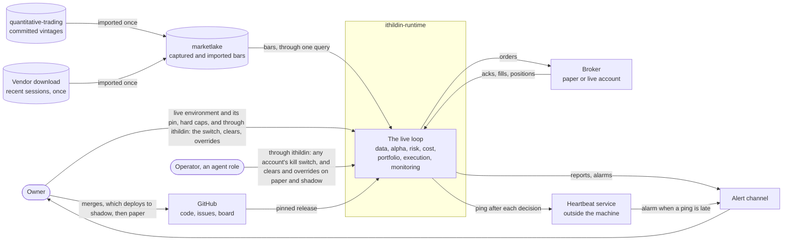

The platform reads bars from one place, marketlake, the sibling repository
that captures market data before anything computes on it. The sources differ
in volume, cadence and shape, so each is transformed into marketlake once,
stored durably there, and read by every mode through one query. The runtime
runs on a VM of its own and reads a local mirror of the partitions it
downloads from marketlake's bucket, as `## Where it runs` says. The owner ruled
so on 2026-10-29, and [l3a0/marketlake#938](https://github.com/l3a0/marketlake/issues/938) builds it. marketlake then holds three kinds of
bar.

1. **Captured bars,** which shadow, paper and live trading read.
   [l3a0/marketlake PR #928](https://github.com/l3a0/marketlake/pull/928) added GLD and USO, with daily and minute bars, to
   marketlake's roster on 2026-10-29. The owner onboarded both on marketlake's
   VM on 2026-10-30, so capture starts with Monday 2026-11-02's session,
   which [l3a0/marketlake#961](https://github.com/l3a0/marketlake/issues/961) tracks.
2. **quantitative-trading's committed vintages,** imported once, which the
   backtest reads.
3. **A one-time vendor download** of the most recent sessions, imported once.
   The strategy's first z-score needs about 40 sessions of closes: 20 to fit
   the first hedge ratio, which Chan's script then drops with the first 20
   rows, and 20 more spreads to fill the z-score's 20-day window. Without the
   drop it is 39. This download covers them until capture does.

Every bar says whether it was captured or imported, and where an imported one
came from, so a consumer can refuse imported history where only captured data
will do. Imported history never overwrites a captured partition.

How long marketlake keeps data needs no change for the runtime. marketlake's
VM deletes older partitions from its own disk once its backup bucket holds
them, but the runtime reads a mirror of that bucket, which keeps every
session, and never the VM's disk. So the 2006 to 2012 history and a lookback
of any length stay readable.
[l3a0/marketlake#938](https://github.com/l3a0/marketlake/issues/938) recorded this on 2026-10-30, which corrects an earlier reading here that the VM's 22-session window
would drop them. The owner's ruling of 2026-10-29 to make that window
configurable went ahead in marketlake for its own readers.
[l3a0/marketlake PR #959](https://github.com/l3a0/marketlake/pull/959), which closes
[l3a0/marketlake#953](https://github.com/l3a0/marketlake/issues/953), gives option chains,
quotes and bars their own windows on the VM and keeps every bars session
there. The override per ticker is deferred as
[l3a0/marketlake#954](https://github.com/l3a0/marketlake/issues/954), since nothing reads it.

The owner ruled on 2026-10-29 that the runtime may read the day's data before
marketlake seals it. marketlake's capture daemon already writes a segment
each cycle and never rewrites it once its manifest entry lands, so marketlake
uploads each segment to its bucket as soon as that entry lands, refusing to
replace an existing key. Any decision time inside marketlake's capture
hours reads those segments, and the decision minute
[#16](https://github.com/l3a0/ithildin-runtime/issues/16) sets for shadow
running, ten minutes before the close, is one such time. The data worker reads
the segments up to the decision time, as a provisional read, because marketlake's validation
battery runs only when it seals a day at the close plus fifteen minutes. So the data worker runs its own minimum checks before anything decides. The
owner ruled on 2026-10-30 that the runtime turns the segments into quote rows
itself, when it reads what it needs, with marketlake's package, which the
Decisions table records as a dependency at a pinned commit. Once a downloaded
segment matches the SHA-256 in its manifest entry, as rule 8 of
`## Where it runs` requires, that package's
`lake.journal.read_segment(path)` reads it and refuses a damaged file or bytes
after the segment's end-of-stream marker. Joining a ticker-day's segments is
the runtime's own code. marketlake's internal joiner,
`measure.read_surface_cycles`, breaks when a day's schema changes partway
through, which is [l3a0/marketlake#143](https://github.com/l3a0/marketlake/issues/143), so this
doc proposes a test of that case for
[#5](https://github.com/l3a0/ithildin-runtime/issues/5). A
missing or stale quote at the decision time halts the decision, and a price
spike is flagged in the snapshot without halting. The owner ruled on question 10 that the skeleton's strategy trades the close and decides this way, and this doc proposes 15:40 as its decision time. A decision
after marketlake has sealed and uploaded the day reads sealed partitions and
needs none of this. The snapshot names each segment it read by key
and SHA-256 and marks the read provisional. Once marketlake seals the day,
monitoring compares the sealed partition with what the snapshot read, and
journals and alarms any difference. It also reports the gap between the
price the decision used and the official close, and between each
market-on-close fill and that close, as report lines rather than alarms,
since the two differ by design. This is proposed for
[#5](https://github.com/l3a0/ithildin-runtime/issues/5) and
[#16](https://github.com/l3a0/ithildin-runtime/issues/16), with marketlake's
uploader on [l3a0/marketlake#943](https://github.com/l3a0/marketlake/issues/943).
[#5](https://github.com/l3a0/ithildin-runtime/issues/5) also waits on two
marketlake fixes to the daily bars it reads. [l3a0/marketlake#380](https://github.com/l3a0/marketlake/issues/380) stalls the daily fetch for a session whose bar the vendor stamps at the wrong seasonal offset, so that session gets no bar, and Eastern time returns to standard time on 2026-11-01.
[l3a0/marketlake#947](https://github.com/l3a0/marketlake/issues/947) leaves a session with no daily
bar when its 16:15 quote was missed.

The 15:40 decision on a session needs the previous session's official daily
bar for its lookback. Until now marketlake fetched a session's bar only after
the next session's quotes sealed, so at 15:40 the newest bar in the lake was
two sessions old, and the lookback would halt for the missing one, as data not ready under rule 8 of `## Where it runs`. On
2026-10-30 the owner chose to remove that wait rather than serve a provisional
bar. [l3a0/marketlake#952](https://github.com/l3a0/marketlake/issues/952) is closed as not planned,
and [l3a0/marketlake#962](https://github.com/l3a0/marketlake/issues/962) fetches each bar at its own
session's 18:30 sweep, still checked against that session's 16:15 quote.
Once it ships, the 15:40 decision reads the previous session's official bar
through `load_bars`, so a 15:40 decision needs [l3a0/marketlake#962](https://github.com/l3a0/marketlake/issues/962) to have shipped. [#5](https://github.com/l3a0/ithildin-runtime/issues/5) waits on it for that read, and [#16](https://github.com/l3a0/ithildin-runtime/issues/16)'s shadow run, which reads the previous session's official close the same way, waits on it too. That bar
is Schwab's daily candle as fetched at the session's own 18:30 sweep. A
correction Schwab publishes later is not picked up, and nothing measured has
shown one, which [l3a0/marketlake#962](https://github.com/l3a0/marketlake/issues/962) records as its price. The lookback stays on daily
closes, and the 15:40 quote stands where the backtest uses the session's
close. That is the timing gap item 1 of
`## How the four acceptance tests exercise it` names, which shadow running
measures.

It sends orders to one place, the broker's paper account.

Two switches come from outside the loop.

1. **The live switch** is the live environment, which only the owner builds, gives the live key and pins a release in, which is hard limit 1 in [CLAUDE.md](../CLAUDE.md). Paper and live never share a VM, a bucket or a key, as `### Four environments` says.
2. **The kill switch** halts trading. The owner ruled on 2026-10-28 that the
   risk engineer builds it and writes when to pull it, and the operator pulls
   it by that guidance. The owner can pull it too.

A dead-man check raises an alarm when a ping it expects fails to arrive. Here
monitoring pings a heartbeat service as each decision's last step, and the
service alarms when a ping is late against the deployment's schedule. The service sits outside the machine because a
check on the same machine dies with it, and a machine where nothing runs is
the failure the check exists for.

## The loop and its adapters

[design.md](design.md#one-runtime)'s `## One runtime` says backtest, paper and
live run the same modules and differ only in adapters at the edges. The usual
name for that shape is ports and adapters. A port is an interface the modules
define, and an adapter is one implementation of it that talks to the outside
world. No module imports an adapter.

The owner ruled on 2026-10-29 that each component runs as its own process,
that processes pass everything through files, and that the platform is an
event pipeline. [design.md](design.md#processes-and-files)'s
`## Processes and files` gives the reasoning and the rules. So each module
here runs as one worker, a process of its own that the host keeps running.
The supervisor writes the run's plan and messages every worker, and each one
listens on its own queue. A message there names a blob to read: an input's decision result, the plan, the run's halt or stop, or the kill switch, and the worker then
reads the output files that result lists, writes its own output files, and
writes its own decision result last. A worker's entry point builds the
adapters for the mode it is given and hands them to the module, so the module
never learns which mode it is in.

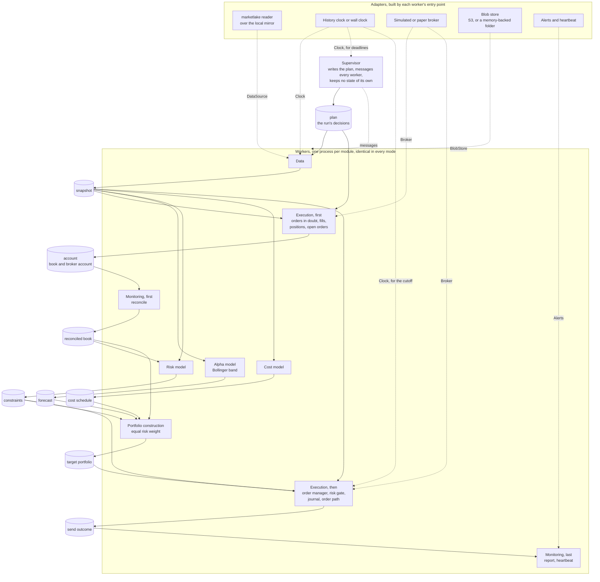

Each cylinder is one component's output files for a decision, and the decision
result that lists them, each a blob written once at a key fixed by the run,
the stage and the decision. A solid arrow into a worker is an output it
reads. When a worker writes its decision result, a message goes to the queue
of each worker that reads it, which runs that worker's processing loop. Every
worker reads the plan, which the diagram draws only into the two that start
the day, and monitoring reads every component's results, which the diagram
leaves out to stay legible. Each dotted arrow from an adapter is a port,
labelled with its name, and each mode is one choice of adapter for each port.
Execution and monitoring each appear twice because each has two stages in one
process, and each stage writes its own decision result. Execution recovers first and then, once the target portfolio
exists, sends. Monitoring reconciles first and reports last.

Two groups of workers run at the same time.

1. Execution's recovery for a decision waits for data's snapshot and for its
   own send result for the decision before, so it reads the broker at the
   decision's own time. Monitoring's reconcile follows it.
2. Alpha and cost need only the snapshot, and risk also needs the reconciled
   book, so the three models overlap.

Execution sends only what the target portfolio asks for, so nothing it sends
can come from a snapshot or a book that is not stored yet. When it sends, it
checks each order against the book it replays from the journal at that
moment, not against a blob.

| Mode | Data source | Clock | Broker, and when it fills | Blob store and journal | Alerts and heartbeat |
| --- | --- | --- | --- | --- | --- |
| Backtest | marketlake reader, the bars a test names | History clock | Simulated, by order type: a market order at the decision quote, a buy at the ask and a sell at the bid, and a market-on-close order at the official close | A memory-backed folder, holding the backtest's own journal, gone when it ends, in the test environment or on a developer's machine | Recorded, not sent |
| Shadow | marketlake reader, captured bars, plus the imported download until capture covers the lookback | Wall clock | Simulated, by order type, the same rule as the backtest, except that a market-on-close order fills at the last price of marketlake's 16:00 cycle, marked provisional until the official close arrives | The shadow environment's bucket, with the shadow journal | Sent |
| Paper | marketlake reader, captured bars, plus the imported download until capture covers the lookback | Wall clock | Paper broker, at its own simulated fill, which for a market-on-close order is the quote near the close rather than the auction price | The paper environment's bucket, with the paper journal | Sent |
| Live | marketlake reader, captured bars, plus the imported download until capture covers the lookback | Wall clock | Live broker, at its own fill | The live environment's bucket, with the live journal | Sent |

Every mode reads bars through the same marketlake reader. The modes differ in
which bars they read and which clock drives them, not in how they read. Shadow
reads live bars and decides real orders, but fills them in the simulated
broker, so no order reaches any broker. The diagram leaves out the
live broker, because only the owner switches to it.

[design.md](design.md#one-runtime) names three adapters, the ones that change
what a strategy sees.

1. The data source.
2. The clock.
3. The broker.

The blob store, which holds the journal too, and the alert channel also differ
by mode, but they change only where records go. A backtest of 1,480 decisions
must not append to the paper journal or page the owner. The Decisions table
proposes adding those two to design.md's `## One runtime`.

A module that asks which mode it is in has broken the shape, because its
backtest would then test a branch the paper run never takes. The account a
worker's lease and kill switch belong to comes from its broker adapter, so a
backtest's simulated account never shares the paper account's lease. The
simulated broker keeps its resting orders and positions as one blob per account per call, written before the call returns, outside any run's prefix, so a shadow order still resting when one run ends is there to fill
in the next, in a new process or on a new VM. One simulator serves backtest
and shadow, and it fills by the order's type and time in force rather than
by mode. It can also fill one leg of a pair in part, or not at all, on a
seeded fault, so a replay runs the stranded-leg path paper trading will. The event that design.md says
modules are written against is one decision result. In a backtest each worker
works through every decision of the span in turn, and in the other modes
through one trading day's decisions, as design.md's
`### A worker works through a span of decisions` says.

## Data flow

A data flow diagram shows where data comes from, which process changes it, and
where it is kept, with no sense of time. The cylinders are stores, the boxes
are processes, and the rounded boxes are things outside the platform. The
numbers name the processes, not their order. The next section gives the order.

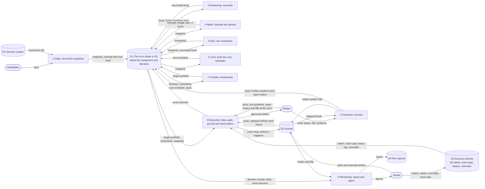

Every arrow into or out of D1 is a blob kept after the run, whose header
names the blobs it came from. That is what makes each decision
readable afterwards. The security master is the table that maps each ticker to
the platform's own instrument id, so a vendor's renamed ticker does not become
a new instrument.

Three things the diagram rules out.

1. **Only execution talks to the broker.** Processes 2 and 8 are the one
   execution worker. Orders go out through it, and the broker's acks, fills,
   positions and open orders come back through it. Monitoring reconciles
   against the account file execution wrote rather than asking the broker itself.
   Execution journals a fill only when its client order id has a `sending`
   entry in the journal and the fill does not take that order past its
   quantity. Any other fill halts, because a fill nobody journaled would
   otherwise enter the book and agree with the broker.
2. **The current book comes from the journal.** The book is the platform's own
   record of what it holds and what orders are open. Process 2 replays it from the journal, and the broker's positions and open orders are used only at process 3 and at the sync that opens process 8. A disagreement at either one halts trading rather than quietly replacing the platform's record.
3. **Bars reach the models only after process 1 has recorded which ones were
   read.** A model never reads a feed directly, so every number it acted on can
   be read back later from marketlake. Captured market data is the first of the
   three things [design.md](design.md#premise) says cannot be recovered, and
   marketlake is where it is kept.

## One trading day

A sequence diagram shows the same pieces in time order. This is one paper
decision with nothing wrong, for the skeleton's daily strategy. The owner
ruled on 2026-10-29 that the platform trades at any time of day and as often
as a strategy needs, so the time comes from the strategy's schedule, as
design.md's `### Strategies, schedules and decisions` says. The owner ruled on
question 10 that the skeleton trades the close, so the diagram draws its
decision at 15:40, on marketlake's segments read before sealing, with
market-on-close orders that fill at the close. A strategy that decides
several times a day runs the same three phases once per decision, with the
workers left running between. The notes split it into three phases. The host
keeps every worker running, the supervisor's plan starts the decision, and a
`par` block marks workers working at the same time. Each dashed arrow from
the blob store to a worker is a message on that worker's queue.

Alpaca rejects a market-on-close order "submitted after 3:50pm but before
7:00pm ET", so every order goes out by 15:48, a cutoff the owner's hard caps
hold, as design.md's `### Strategies, schedules and decisions` says. That rule
also checks the cutoff again just before each broker call, and keeps a pair
whole by cancelling an accepted leg whose partner fails. The session's official daily bar arrives at marketlake's 18:30 sweep that evening once [l3a0/marketlake#962](https://github.com/l3a0/marketlake/issues/962) ships, and the next evening until then. Monitoring then reports how far the decision's price and the fills sat from it.

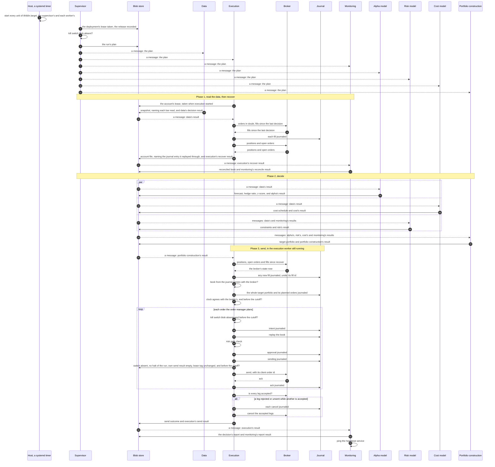

The phases in order.

1. **Read the data and recover.** Data reads the bars the decision's lookback
   needs from marketlake, about 40 sessions of each ETF, and records which ones
   it read before any model sees them. Execution, which took the broker
   account's lease when it started, waits for that snapshot, so it reads the
   broker at the decision's own time. It settles any order a crash left in
   doubt, journals the fills that arrived since the last decision, and writes
   the book it replays
   from the journal beside the broker's positions and open orders. Monitoring
   then checks the two agree, position by position and order by order. A run that starts on a book the broker disagrees with would trade
   the wrong difference.
2. **Decide.** The alpha, risk and cost models run at once, each on the blobs
   it needs. The risk model sets the constraints, meaning the limits for this
   decision. Portfolio construction builds the target portfolio within them.
3. **Send.** Execution, which has held the account's lease since phase 1, reads
   the target portfolio its result lists. Following the owner's ruling to
   fetch and sync before changing state, it first fetches the broker's
   positions, open orders and fills again, journals any fill that arrived
   since phase 1, and checks the journal's book against the broker. A fill of
   its own order brings the book up to date, and any other difference halts
   for a person. Only then does it journal the target whole, with the planned
   orders and their client order ids, the journal entry it synced through and
   a hash of the broker state it fetched, in one stored entry. A target portfolio names every
   instrument the book holds or the forecast names, with a flat leg as an
   explicit zero, and execution halts on one that leaves an instrument out.
   Its order manager turns the target minus the positions and the open orders
   into orders. Each order goes through the order path alone. The order path
   checks the kill switch again, journals the intent, replays the book from the
   journal so the risk gate sees every order already approved, asks the gate,
   journals the approval and journals that it is sending. Right before the broker call it checks five things: the kill switch is absent, no halt of the run is stored, its own send result is still empty, the account's lease still carries its tag, and the market-on-close cutoff has not passed. Only then does it send. Any check that fails journals the order `Abandoned` and halts the decision. After the loop
   it looks up each leg, and cancels any accepted leg whose partner was
   rejected or never sent.
   Monitoring writes the decision's report and pings the heartbeat service
   last, so a decision that dies or hangs never pings.

The journal entries carry the weight of hard limit 4, which says every order is
journaled before it is sent. If the execution worker dies after "sending
journaled" and before the ack, the journal holds an order in doubt. The next
execution worker asks the broker for it by its client order id, an id the
platform chooses and sends with the order, rather than sending it again.
Alpaca, the paper broker the owner chose on 2026-10-30,
accepts a client order id and can look an order up by it. Whether it refuses a
second order with the same id needs confirming on the paper account before
[#10](https://github.com/l3a0/ithildin-runtime/issues/10) relies on it.

## When something is wrong

Hard limit 3 says missing input means stop, not flatten. One firm's execution
server rebooted before its alpha server, read "no signals" as "hold nothing",
and sold most of its book. The [charter](team-charter.md) cites it at L4690, a
Kindle location in the owner's highlights of Narang's *Inside the Black Box*.
Each diagram below is one way a day goes wrong, and each ends with no new
orders and the positions left as they were.

Every halt takes the same route.

1. The worker that finds the problem writes a halt as its decision result,
   with the reason, in place of its outputs.
2. Every worker downstream finds that halt as its input's result, writes its
   own halt naming it, skips the decision and goes on to its next one.
3. Monitoring, which reads every component's results, journals every halt,
   raises an alarm on the halt that names no earlier one, once per reason in
   a run until a decision succeeds, writes the decision's report and pings the
   heartbeat service's failure address.

The same route runs in every mode, and the run goes on to its next decision,
which halts again if the cause is still there. A single crash is not a
failure: the host restarts the worker, which resumes from storage. A
failure is a missed deadline, a heartbeat stopped for more than a minute, or
a worker past its restart limit, and it takes the same route. The supervisor
writes the halt as the failed worker's result, stores a halt of the whole
run, writes a halt for every decision left in the plan, and messages every
worker, and monitoring reports.

### A missing or stale bar

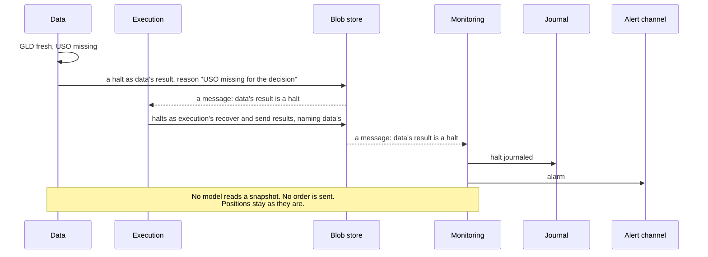

A stale bar takes the same path. Stale means the newest bar is older than the
decision time allows, which is how a feed that stopped looks when it keeps
answering. Data reports the gap and never fills it with the last close.
The charter gives the risk engineer the halt on stale data, so
[#7](https://github.com/l3a0/ithildin-runtime/issues/7) decides how old is too
old. Data applies that rule.

An empty answer halts the same way. If the alpha model writes a forecast file
with no entries and no "trade nothing" mark, portfolio construction halts rather
than reading the silence as a target of zero. A flat position is a forecast
with direction 0, never a missing forecast.

### A restart before the data is ready

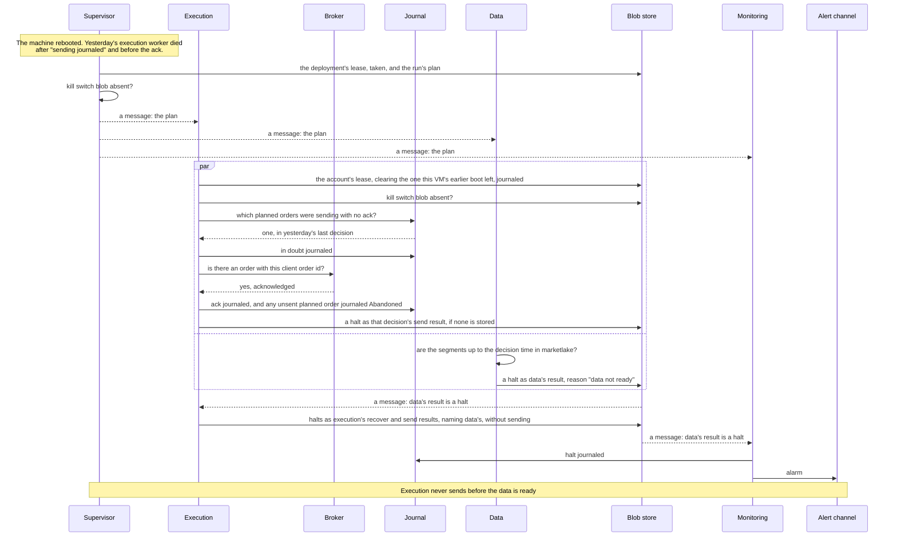

The restart runs the same first phase as any trading day.

1. On starting, execution settles the order the dead worker left half-sent, by
   asking the broker about it rather than sending it again, and halts that old
   decision, as design.md's rule 9 fifth item says.
2. Data finds the segments up to the decision time not yet in marketlake and
   halts, so execution's recover stage, which waits for data's result, halts
   too.

The order in which the processes come up no longer matters. Execution may
start before data, as it does here, but it sends only what a target
portfolio asks for, and that cannot exist until a snapshot does. The charter
gives the operator the startup order: execution may send an order only once
every upstream worker has written a decision result that lists outputs, not a
halt, for the decision.
The pipeline makes that order something the platform cannot get wrong. "Not ready" is a halt, never an empty forecast.

### The risk gate refuses an order

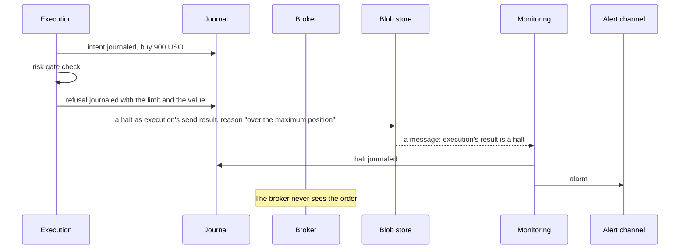

A refusal is final, and execution halts rather than sending the rest of its
orders, because portfolio construction sized the rest assuming this one would
go through. Nothing resizes the order to fit either, since an order cut down
to pass the risk gate is a trade nobody chose. Clearing the halt sends nothing more for that decision. If the refused order is a pair's second leg and the first is already accepted, execution cancels the accepted leg before the cancel cutoff, as for any pair left with one leg. The next decision plans again from the book. Holding
the account after a refusal until a person clears it waits for a strategy
that decides minutes apart, as design.md's
`### Strategies, schedules and decisions` says.

The daily loss stop works through the same gate. Once the day's loss passes the
stop, the risk gate refuses every new order. [#7](https://github.com/l3a0/ithildin-runtime/issues/7)
lists the limit as "an automatic unwind and stop", and an unwind is itself a
trade. Slice 1 stops only, as question 8 settles.

### The book and the broker disagree

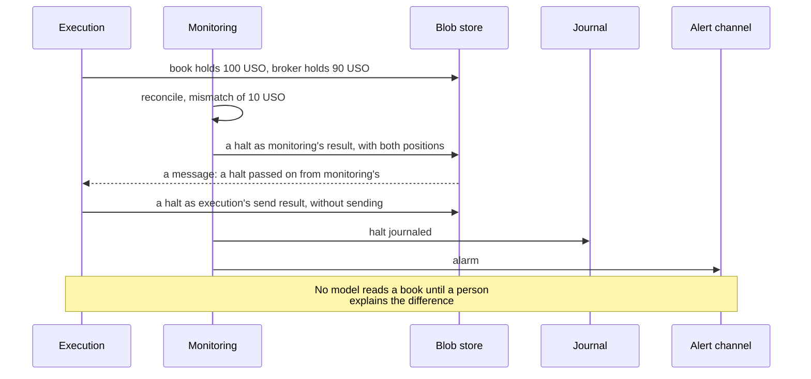

A mismatch means either a fill the platform never journaled or a position the
broker changed on its own, and both need a person. Monitoring compares open
orders as well as positions, so an order the broker holds and the journal
marks lost or abandoned halts the day it appears, not the day it fills. Reconciliation lives on
[#11](https://github.com/l3a0/ithildin-runtime/issues/11). The charter has the
trading systems engineer write it, so that role reviews it there.

### The kill switch and the dead-man check

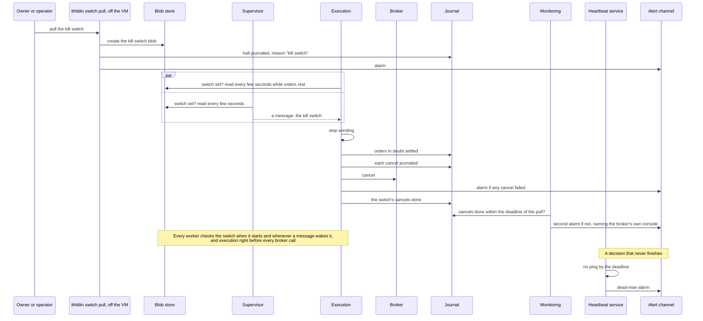

The two cover different failures.

1. **The kill switch** is for a run that is alive and doing something nobody
   wants.
2. **The dead-man check** is for a run that is not alive at all, including a
   supervisor that died, since monitoring pings only as each decision's last
   step. The check runs on the deployment's schedule, and its grace period has
   to exceed the longest chain of worker deadlines plus the report, or a slow,
   healthy decision alarms.

The kill switch is a command, not a running process. It creates a blob at one
key per broker account, which every worker reads, and the execution worker
that already holds the account's lease cancels resting orders through the
order path, so each cancel is journaled like any other step. A starting execution takes the account's lease and, finding the switch set, cancels before anything else, so a
switch pulled while execution is down still cancels once the host restarts
it. Monitoring's report says the switch is set. A switch that cannot be read halts with the reason "kill switch unreadable" and the error,
so the journal never mistakes a permission problem for a deliberate pull. The split of the kill switch work is on
[#11](https://github.com/l3a0/ithildin-runtime/issues/11). Market-on-close orders rest at the broker from when they are sent, between 15:40 and 15:48, until the close, so a switch
pulled in that window stops nothing already sent unless it also cancels
them, which is why it does, as question 7 settles. The exchange stops taking
cancels of closing-auction orders some minutes before the close, so a switch
pulled after that cannot stop the fill, and execution's report of its
cancels says so. The cancel cutoff is the earlier of Alpaca's and the exchange's.
NYSE Arca, where GLD and USO list, refuses cancels of closing-auction
orders from 15:59, as a
[Lightspeed guide](https://lightspeed.com/support/lightspeed-trader-on-close-and-on-open-guide)
and an [SEC filing](https://www.sec.gov/files/rules/sro/nyse/2018/34-84804.pdf)
on its closing freeze describe. Alpaca's
[order page](https://docs.alpaca.markets/docs/orders-at-alpaca) names no
separate cancel cutoff, so this doc takes 15:50, Alpaca's entry cutoff, as
the cancel cutoff until Alpaca says otherwise.

### Every alarm and its drill

The charter's paper gate asks for every alarm to fire in a drill first. An
alarm reads zero while it is healthy, so only a drill shows it works. This
shape adds alarms that one process would not need, and each one gets a row
here, with the issue that builds its drill.

| Alarm | Reason it writes | Drill | Built on |
| --- | --- | --- | --- |
| Missing or stale bar | The instrument and its state | A replay with a bar removed or aged, test 2 | [#5](https://github.com/l3a0/ithildin-runtime/issues/5), [#11](https://github.com/l3a0/ithildin-runtime/issues/11) |
| Data not ready | "data not ready" | A run whose segments up to the decision time are missing, test 2 | [#11](https://github.com/l3a0/ithildin-runtime/issues/11) |
| Risk gate refusal | The limit and the value | One order over each limit, test 3 | [#7](https://github.com/l3a0/ithildin-runtime/issues/7) |
| Book and broker disagree | Both positions, or both sets of open orders | A simulated broker account edited by hand | [#11](https://github.com/l3a0/ithildin-runtime/issues/11) |
| The broker moved between execution's recover and send stages in a way the platform did not ask for | Both positions, or both sets of open orders, at the send stage | A simulated broker account edited by hand between the stages | [#10](https://github.com/l3a0/ithildin-runtime/issues/10) |
| A fill with no `sending` entry, or past its order's quantity | The client order id | A simulated broker that reports an unknown fill | [#10](https://github.com/l3a0/ithildin-runtime/issues/10) |
| A target portfolio that leaves out an instrument the book holds | The instrument | A target portfolio file written without one leg | [#9](https://github.com/l3a0/ithildin-runtime/issues/9) |
| A bad constraints file or hard cap | The field and its value | A file with a missing field, a NaN and a wrong sign | [#7](https://github.com/l3a0/ithildin-runtime/issues/7) |
| A send that would start after the market-on-close cutoff | The decision time, the cutoff and the clock's time | A test clock set past the cutoff before the order loop, and one that crosses it after the first leg's ack | [#10](https://github.com/l3a0/ithildin-runtime/issues/10) |
| The VM's clock differs from the broker's by more than the tolerance | Both times | A test clock skewed by three minutes | [#10](https://github.com/l3a0/ithildin-runtime/issues/10) |
| A pair with one leg accepted and another rejected or unsent | Each leg's client order id and state | A broker double that rejects the second leg on the submit, and one that rejects it after acknowledging it | [#10](https://github.com/l3a0/ithildin-runtime/issues/10) |
| Execution restarted between a pair's legs | The decision and each leg's state | Kill execution after the first leg's ack, and again after it restarts, and expect leg 2 never sent and leg 1 cancelled before the cancel cutoff | [#11](https://github.com/l3a0/ithildin-runtime/issues/11) |
| After the close, a pair whose filled legs differ from the planned hedge | Each leg's fill | A broker double that fills one leg in part | [#11](https://github.com/l3a0/ithildin-runtime/issues/11) |
| A traded or held instrument whose price carries a spike flag | The instrument and both prices | A provisional segment with one spiked quote | [#5](https://github.com/l3a0/ithildin-runtime/issues/5), [#7](https://github.com/l3a0/ithildin-runtime/issues/7) |
| Kill switch pulled | "kill switch" | Pull it before a run, test 4 | [#11](https://github.com/l3a0/ithildin-runtime/issues/11) |
| Kill switch unreadable | "kill switch unreadable" and the error | Deny the runtime's credential read access to the switch blob | [#11](https://github.com/l3a0/ithildin-runtime/issues/11) |
| A write S3 refuses for a reason other than an existing key, or does not answer by the deadline | The key and S3's answer | Point a run at a bucket the credential cannot write, and block the S3 endpoint mid-run | [#22](https://github.com/l3a0/ithildin-runtime/issues/22) |
| A lease another VM holds, the deployment's or the account's | The holder's VM, boot, container and run | Start a second VM while the first runs | [#11](https://github.com/l3a0/ithildin-runtime/issues/11) |
| Execution cannot take the account's lease by its deadline | The lease's holder and whether the host shows its container gone | Start execution while the earlier container holding the lease is frozen and not removed | [#10](https://github.com/l3a0/ithildin-runtime/issues/10), [#11](https://github.com/l3a0/ithildin-runtime/issues/11) |
| A journal entry that changes the book lies past the send stage's sync, or an override whose blob is missing, whose hash differs or whose book has moved | The entry, the sync entry and the override's key | Write an override between the sync and the first send, and one naming stale book values | [#10](https://github.com/l3a0/ithildin-runtime/issues/10) |
| The broker key cannot be read | The secret store's answer | Deny the execution user's read of the secret | [#10](https://github.com/l3a0/ithildin-runtime/issues/10) |
| A cancel failed or timed out | How many orders were cancelled and which failed | A broker double that refuses a cancel | [#11](https://github.com/l3a0/ithildin-runtime/issues/11) |
| A worker restarted | Its exit status or signal and the end of its error output, from its restart record | Kill a worker mid-decision, and expect it back within seconds and the decision finished | [#11](https://github.com/l3a0/ithildin-runtime/issues/11) |
| A worker missed its deadline | The worker and the deadline | A worker that sleeps past it | [#11](https://github.com/l3a0/ithildin-runtime/issues/11) |
| A second execution worker, or a second supervisor on one VM | The lease that was held | Start two | [#10](https://github.com/l3a0/ithildin-runtime/issues/10), [#11](https://github.com/l3a0/ithildin-runtime/issues/11) |
| A worker or the supervisor on a different release | Both releases | Restart one worker mid-run under another digest | [#11](https://github.com/l3a0/ithildin-runtime/issues/11) |
| A worker's heartbeat stopped, or its restart limit reached | The worker, its last heartbeat and its restart records | Freeze a worker with the host watchdog stopped, and expect the alarm after a minute; freeze one with the watchdog running, and expect a restart within thirty seconds; make one crash on start until its restart limit | [#11](https://github.com/l3a0/ithildin-runtime/issues/11) |
| A journal entry whose `prev_hash` does not match the SHA-256 of the entry before it, whose bytes are not canonical, whose format is unknown, or a gap in its numbers | The account and the sequence number | Alter an entry in a copy of the journal | [#10](https://github.com/l3a0/ithildin-runtime/issues/10) |
| An output file that is missing, or whose SHA-256 does not match the decision result listing it | The file and the result | Change a byte in a copy of an output file | [#22](https://github.com/l3a0/ithildin-runtime/issues/22) |
| A deterministic step that writes different bytes for the same inputs, or any create-only write S3 refuses whose stored SHA-256 differs | The key and both SHA-256s | Run a step that puts the clock time in its output | [#22](https://github.com/l3a0/ithildin-runtime/issues/22) |
| A worker exits cleanly before it has a result for every decision in the plan, so its unit does not restart it | The worker and its last heartbeat | A worker that exits after its first decision, expecting the supervisor's heartbeat check to fail the run | [#11](https://github.com/l3a0/ithildin-runtime/issues/11) |
| A blob for the wrong decision, or an output file with no entries and no "trade nothing" mark | The key and the decision | Write one by hand | [#22](https://github.com/l3a0/ithildin-runtime/issues/22) |
| The sealed day differs from what a provisional read saw | The segment's key and both SHA-256s | Change a sealed partition after a run read its segments | [#11](https://github.com/l3a0/ithildin-runtime/issues/11) |
| A supervisor restarted mid-run | The plan it found and each worker's last heartbeat | Kill the supervisor between two decisions | [#11](https://github.com/l3a0/ithildin-runtime/issues/11) |
| An order the journal holds open that the broker no longer lists, in a state its time in force does not explain | The client order id and the broker's answer | A simulated broker that drops a good-till-cancelled order | [#10](https://github.com/l3a0/ithildin-runtime/issues/10) |
| The Docker daemon stopped or restarted mid-run | The daemon's state and the run's last decision | Restart the daemon during a decision, in each of shadow, paper and live | [#11](https://github.com/l3a0/ithildin-runtime/issues/11) |
| The supervisor's heartbeat stopped, or a unit or the Docker daemon reached its limit | The unit and its last exit, from the host's handler | Freeze the supervisor, and make it crash on start after the plan exists, in each of shadow, paper and live | [#11](https://github.com/l3a0/ithildin-runtime/issues/11) |
| The kill switch was pulled and execution has not journaled its cancels done within the deadline | The account and the orders still resting | Pull the switch with execution crash-looping on start | [#11](https://github.com/l3a0/ithildin-runtime/issues/11) |
| A person's journal entry names an identity that differs from the one AWS recorded for its write | The entry and both identities | Write an entry with a forged name | [#11](https://github.com/l3a0/ithildin-runtime/issues/11) |
| A VM's release pin is missing or unreadable | "release pin missing or unreadable", from the host's handler | Boot a VM whose pin is deleted, and one whose role cannot read it, in each of shadow, paper and live | [#11](https://github.com/l3a0/ithildin-runtime/issues/11) |
| The promotion job stopped running | None. Its own heartbeat check raises it | Disable the promotion schedule for a day | [#11](https://github.com/l3a0/ithildin-runtime/issues/11) |
| A promotion refused because a block record could not be read | The bucket and S3's answer | Deny the promotion role's read of one bucket's block records | [#11](https://github.com/l3a0/ithildin-runtime/issues/11) |
| A promotion refused because paper is not clear | The open halt, set switch, pending override or held lease | Run a promotion with paper's switch set | [#11](https://github.com/l3a0/ithildin-runtime/issues/11) |
| Dead-man | None. The heartbeat service raises it | A day of two decisions whose second ping is skipped, test 4, run against each of shadow's, paper's and live's checks | [#11](https://github.com/l3a0/ithildin-runtime/issues/11) |

Each deadline that the supervisor enforces is set on
[#11](https://github.com/l3a0/ithildin-runtime/issues/11), beside the
heartbeat's grace period, which has to exceed them.

## What a person runs

The platform halts rather than guess, so every halt that needs judgement
waits for a person, and the person's actions are as much a part of the
record as the platform's. The owner ruled on 2026-10-29 that the owner or
the operator clears a halt, and that only the owner clears a live account's
kill switch. Until now the docs said only that each is "a command". This
section is this doc's proposal for what those commands are and how an alarm
leads to one, for [#11](https://github.com/l3a0/ithildin-runtime/issues/11).

### One command line tool, run off the VM

A person acts through one command line tool, `ithildin`, run from the
owner's or the operator's own machine with their own AWS credential, never
on the runtime's VM. Its writes go through the same journal and storage
contract in `core` that the workers use, so a person's entry is checked,
chained and refused on a stale number exactly as a worker's is, and the
tool fetches the journal's end before it writes, as design.md's ruling 6, fetch and sync before changing state, asks. It reads
and writes S3 only, so it needs nothing from the VM and works while the VM
is down.

The tool writes the identity AWS reports for the caller into each entry,
but S3 does not stop a caller writing any name it likes. So CloudTrail
records every write to the journal, the switch, the leases and the
overrides, in a bucket only the owner can change, and monitoring alarms when
an entry's named identity differs from the one CloudTrail recorded.

Two credentials hold what the VM's credential deliberately cannot.

1. **The owner's**, which may do everything below on any account.
2. **The operator's**, which acts on paper and shadow accounts only, plus
   pulling a live account's switch, since a pull can only stop trading. It
   cannot clear a live account's halt, switch or lease, or write a live
   account's override. The owner ruled on 2026-10-30 that only the owner
   resumes live trading. The charter makes the operator an agent role, and
   hard limit 1 keeps agents to simulated and paper brokers.

Each credential is a role reached through IAM Identity Center or an MFA
sign-in, with a hardware key, sessions of an hour at most, and no
long-lived access key. Each environment's bucket policy names each role. The live bucket's policy enforces the owner's split, and inside every bucket overrides sit under a prefix of their own per account,
apart from the journal, which only the owner's role may write on a live
account and no runtime role may write at all. On the live bucket, the switch, lease and override keys refuse every principal but the owner's, the pull aside.

### The commands

Reading commands change nothing. A halt's id is the key of the result that holds it, `<deployment>/<run>/<decision>/<stage>`, so the tool finds the environment it lives in.

1. **`ithildin status`** shows, for every account, grouped by environment: whether the kill switch
   is set, who holds each lease, every open halt with its reason and age,
   the latest decision's result for each stage, each worker's and the
   supervisor's last heartbeat and restart count, any pair leg left open
   since the last close, and when the heartbeat service last heard a ping. It also shows each environment's pin and the digest each recent run used.
2. **`ithildin explain <halt>`** shows one halt: its reason, the halt it
   passed on, the blobs it was made from, and for a restart, the exit
   status and the end of the error output.

Writing commands take more friction the more they can resume trading.

1. **`ithildin switch pull --account <a>`** is one command with a default
   reason, because stopping should never be slow. It creates the kill
   switch blob, journals the pull and raises the alarm. Execution reads the
   switch itself and cancels every resting order, as rule 10 of `design.md`'s
   ten rules says. The tool then waits for execution's entry saying the
   cancels are done, and if it does not appear within a deadline, tells the
   person to cancel at the broker's own console.
2. **`ithildin clear <halt>`** records that a person has looked at a halt
   and why it may be left behind. It never reruns the halted decision, and
   the next decision runs as usual.
3. **`ithildin override --account <a>`** records a correction the book
   cannot work out alone, such as a fill the broker shows and the journal
   lacks after an outage. It names each position or open order it changes,
   with the broker's evidence and, for a fill, the broker's fill id, and the
   book values it was built against. It writes the override's body under
   the overrides prefix and a journal entry naming that blob by its SHA-256.
   Execution's next sync applies it only when the blob exists there and its
   hash matches, and refuses it if the replayed book has moved from the
   values it names. It never sends an order.
4. **`ithildin switch clear --account <a>`** deletes the switch and journals
   the clear.
5. **`ithildin lease clear --account <a>`** deletes a lease another VM holds
   and journals it. It first asks EC2 whether the holder's instance is
   stopped or gone, and refuses while it still runs. Only when EC2 cannot answer may the person say with `--holder-gone` that they have confirmed it another way.
6. **`ithildin pin set --environment <e> --digest <d>`** rolls an environment back. It refuses a digest that environment has not run, or whose attestation `gh attestation verify` rejects, and makes the person type the environment's name. It writes the pin and a block record for the digest it replaced, beside a record of who changed it and why. Only the owner runs it until the owner rules otherwise.

The last five each take a required `--reason`, print what they will do and
to which account, show a live account's name in capitals, and for a live
account make the person type the account's name to confirm. When there is
nothing to do, a command says what it found and who acted on it, rather
than quietly succeeding, so a mistyped id is visible.

### From an alarm to a command

Every alarm names the environment, the account, the decision and the reason in its first line, so a push on a phone says what happened without opening
anything. Its second line is the command to run first, almost always `ithildin explain` on the halt, or `ithildin status` for an alarm with no halt, such as one the heartbeat service raises, whose check's description carries that line, and its third names the alarm's row in
`### Every alarm and its drill`, where the runbook on
[#11](https://github.com/l3a0/ithildin-runtime/issues/11) says, row by row,
what to check and which writing command, if any, follows. Monitoring's
report after each decision ends with the same summary `ithildin status`
prints.

Most alarms need no writing command at all. A missing bar, a gate refusal
or a pair leg left open clears itself at the next decision, which plans
again from the book, and the person's job is to read the reason and decide
whether something larger is wrong. The writing commands are for the cases
the platform cannot resolve alone: a book that disagrees with the broker, a
kill switch, a lease left by a lost VM.

Away from a computer, the fallback is the runbook's: cancel at the broker's
own app, and journal it with `ithildin override` once back. A page or a
phone app that runs these commands waits for evidence that the command line
is not enough.

The price is a tool to build and test, a drill for each writing command on
a paper account before the paper gate, which the runbook on
[#11](https://github.com/l3a0/ithildin-runtime/issues/11) adds to
`### Every alarm and its drill`, CloudTrail's data events on four prefixes,
and two credentials outside the VM, each guarded by a hardware key.

## Types and interfaces

A class diagram shows the types the workers pass to each other, each written
as an output file that a decision result lists, and the interfaces each module implements. Two diagrams follow, one
for the data the workers pass and one for the interfaces.

Three kinds of arrow appear.

1. A plain arrow means one type refers to the other.
2. A hollow diamond means the type holds one it was given.
3. A dotted arrow means the type returns or uses the other.

### The data the workers pass

```mermaid
classDiagram
    direction LR

    class Instrument {
        +InstrumentId id
        +str symbol
    }
    class Bar {
        +InstrumentId instrument
        +date session
        +Decimal open
        +Decimal high
        +Decimal low
        +Decimal close
        +int volume
        +str basis
        +str origin
        +str vintage_id
        +datetime end
        +str interval
        +datetime first_seen
    }
    class Snapshot {
        +datetime decision_at
        +dict bars
        +dict quotes
        +dict status
        +bool provisional
        +list segments
        +require_fresh()
    }
    class Quote {
        +InstrumentId instrument
        +datetime at
        +Decimal bid
        +Decimal ask
        +Decimal last
    }
    class Basket {
        +dict legs
    }
    class Forecast {
        +str strategy
        +Basket basket
        +int direction
        +int horizon_sessions
        +Decimal confidence
    }
    class Constraints {
        +Decimal max_order_qty
        +Decimal max_position
        +Decimal max_gross
        +int max_open_orders
        +Decimal max_net
        +Decimal loss_stop
        +time moc_cutoff
    }
    class TargetPortfolio {
        +datetime decision_at
        +dict shares
    }
    class Book {
        +dict positions
        +list open_orders
        +Decimal realised_pnl
        +int replayed_through
    }
    class OrderIntent {
        +str client_order_id
        +InstrumentId instrument
        +Decimal qty
        +str type
        +str time_in_force
    }
    class Fill {
        +str fill_id
        +str client_order_id
        +Decimal qty
        +Decimal price
        +datetime at
    }
    class Ack {
        +str client_order_id
        +str broker_order_id
        +str state
    }
    class Verdict {
        +bool approved
        +str limit
        +Decimal value
    }
    class CostSchedule {
        +dict per_share
        +dict fixed
        +estimate(instrument, qty) Decimal
    }
    class BrokerAccount {
        +dict positions
        +list open_orders
    }
    class SendOutcome {
        +datetime decision_at
        +str target_hash
        +list orders
    }
    class BlobRef {
        +str key
        +str sha256
    }
    class StoredBlob {
        +BlobRef ref
        +str etag
        +datetime stored_at
    }
    class BlobHeader {
        +int format
        +str deployment
        +str run
        +str stage
        +str kind
        +datetime decision_at
        +dict inputs
        +str release
        +str config_hash
    }
    class DecisionResult {
        +BlobHeader header
        +list outputs
        +HaltRecord halt
    }
    class HaltRecord {
        +str reason
        +BlobRef cause
        +list restart_records
        +list found_outputs
    }
    class RestartRecord {
        +str worker
        +int restart_count
        +int exit_status
        +str signal
        +str error_tail
    }
    class Heartbeat {
        +str writer
        +datetime at
    }
    class Lease {
        +str vm
        +str boot
        +str container
        +int restart_count
        +str release
        +str run
        +datetime created
    }
    class Plan {
        +str deployment
        +str run
        +str mode
        +str release
        +list decisions
    }
    class JournalEntry {
                +int seq
        +int format
        +datetime built_at
        +dict body
        +str prev_hash
        +hash() str
    }
    class Halt {
        +str reason
    }

    Snapshot o-- Bar
    Snapshot o-- Quote
    Bar --> Instrument
    Forecast --> Basket
    TargetPortfolio --> Instrument
```

### The interfaces

The interfaces are Python `Protocol` classes. A `Protocol` names the methods a
type must have, and any class with those methods satisfies it without
inheriting from it. That is what lets a run swap the simulated broker for the
paper one without either knowing about the other.

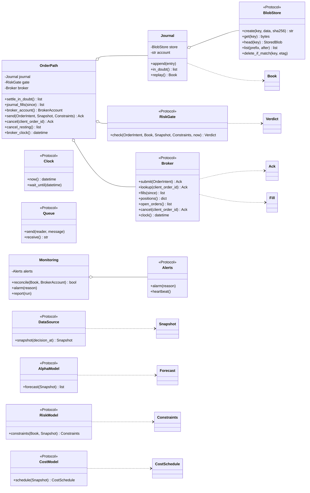

Eight choices in the two diagrams for a reviewer to check.

1. **A forecast is about a basket, not an instrument.** The Bollinger strategy
   forecasts a spread, which is two legs in a fixed ratio for the day. A
   `Basket` holds `{USO: 1, GLD: −h}`, so one forecast carries the whole
   position and portfolio construction never has to know it is a pair. The
   charter and [#6](https://github.com/l3a0/ithildin-runtime/issues/6) say a
   forecast is per instrument, so this is a proposal for
   [#6](https://github.com/l3a0/ithildin-runtime/issues/6) rather than a
   decision here.
2. **A bar carries where it came from.** `origin` says whether marketlake
   captured it or imported it, `vintage_id` names the vintage it was read
   from, and `first_seen` is when the platform first held it. `basis` says
   which price the series carries, such as `raw` for as traded or
   `adjusted` for split and dividend adjusted, as quantitative-trading's
   vintage records do. `vintage_id` and `first_seen` come from the data
   engineer's duty, in the charter, to store when each value became available
   (L3884). `end` and `interval` say when the bar closed and how long it is,
   so one daily bar and minute bars of the same instrument can sit side by
   side, keyed in a snapshot by instrument and interval. Every `DataSource`
   adapter applies one rule: `snapshot(decision_at)` returns only bars whose
   `end` is at or before the decision time.
3. **`Snapshot.require_fresh()` is how a module refuses a gap.** A snapshot is
   the set of bars one decision read, each pointing at the partition that holds
   it. A
   module calls `require_fresh()` before reading, and it raises `Halt` when any
   bar it needs is missing or stale. So the default when something is absent
   is to stop.
4. **Only `OrderPath` holds a `Broker`.** Every call to the broker goes through
   it, one method per kind of call: settling orders in doubt, journaling fills,
   reading positions and open orders, sending and cancelling. Nothing else in
   the package is given a broker, and only the execution worker's entry point
   builds one, which the import rule enforces. Test 3's fake broker checks the
   send path itself, as the section on the import rule says.
5. **The risk gate holds no state of its own.** `check` takes the order, the
   book, the snapshot and the run's `Constraints`. `send` replays the book from
   the journal just before each check, so the gate counts every order already
   approved or sending, including those of an earlier attempt, each at its
   worst case for each limit. Three of the seven limits need the snapshot's
   prices to value the book.
   1. Maximum portfolio size, the `max_gross` field.
   2. Net exposure.
   3. The loss stop.
   The `Constraints` come from the risk model's constraints file, so the order
   path first checks that every field of that file and every hard cap in the
   hard caps blob only the owner can write is present, finite and of the sign the field expects, and
   halts otherwise. `moc_cutoff` is a time on the exchange's clock, which the calendar function in `core` turns into a UTC instant on the decision's own session date, and the gate compares only that instant. Then it takes the tighter of
   each pair: the smaller maximum, the smaller loss for the loss stop, and
   the earlier cutoff. The gate also refuses a market-on-close order past the cutoff, at the time execution hands it. That is a backstop to execution's own clock checks, which journal an order past the cutoff `Abandoned`, as design.md's `### Strategies, schedules and decisions` rule 5 says. A constraints file can
   tighten a limit and never loosen it. This is a proposal for
   [#7](https://github.com/l3a0/ithildin-runtime/issues/7).
6. **The book comes from the journal.** `Journal.replay()` applies every entry
   in order to build a `Book`. The broker's positions and open orders are read
   only to reconcile. `Journal` itself lives in `core`, because execution, monitoring, the supervisor and the `ithildin` tool all append to it.
7. **The cost model writes a schedule rather than answering calls.**
   Portfolio construction priced each candidate trade by calling the cost
   model. With each module in its own process, the cost model instead writes a
   `CostSchedule` per decision, a fixed and a per-share cost for each
   instrument, and portfolio construction evaluates it. Slice 1's flat or
   linear model fits that shape. This is a proposal for
   [#8](https://github.com/l3a0/ithildin-runtime/issues/8).
8. **Every type that crosses between workers has a file form.** That
   includes `BrokerAccount` and `SendOutcome`. Each travels as an output file
   that begins with a `BlobHeader`, naming its inputs by key and SHA-256, and
   that its component's `DecisionResult` lists. A test writes each one and reads
   it back unchanged, and a deterministic component's format is canonical, so the same inputs give the same bytes, as `### File formats and keys` defines. Prices and quantities cross between workers as decimals, never floats, for the same reason. `Halt` stays an exception inside a
   worker, and at the worker's edge it becomes a `DecisionResult` that holds a
   `HaltRecord`, whose `cause` names the halt it met when it is passing one on,
   and is empty when the worker found the problem itself. The supervisor
   writes the same record for a worker that failed, naming its restart
   records, which the host's stop handler and the restarted worker write as
   design.md's rule 5 says. `Plan` holds the run's decisions, each with its time and the strategies
   deciding at it, built by one function in `core` from the schedules and the
   trading calendar, and
   `JournalEntry` is the one numbered record, chained to the entry before it.
   `BlobStore` is the storage port, S3 in shadow, paper and live and a
   memory-backed folder in a backtest, and one contract test suite runs
   against both. `create` returns the stored blob's tag and `head` its stored
   time, so a lease can be deleted only by the tag its creator got. `Journal`
   writes through `BlobStore` too, for the account the broker adapter names,
   so the journal has no storage port of its own.

## The life of an order

A state diagram shows the states one thing can be in and what moves it between
them. Each transition is a journal entry written before the next step. A restarted execution writes two of them after the fact, when it finds the gap, as design.md's rule 9 says: `Abandoned` for an order a crash left without a `sending` entry, and the crash half of `InDoubt`.

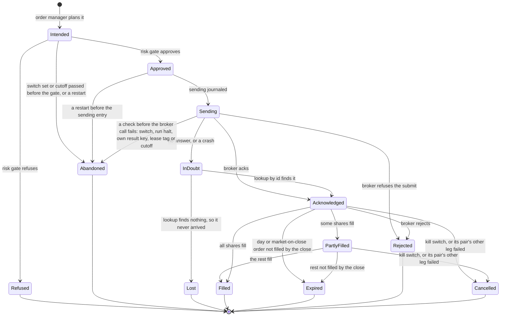

`Refused` is the platform's own risk gate saying no. `Rejected` is the broker
saying no.

`InDoubt` is the state a crash between sending and the ack lands in. It lets
the journal say "the platform does not know whether the broker has this order",
rather than leaving the next decision to guess. The only way out is to ask the
broker by client order id. Sending the order again is never a way out. An order
that ends `Abandoned` or `Lost` never reached the broker, so the next decision's
order manager plans from the book as if it had never existed.

`Cancelled` is reached two ways: through the kill switch, as question 7
settles, and when one leg of a pair is accepted and the other fails, as
design.md's `### Strategies, schedules and decisions` says. Either way the
cancel is journaled first, and the sync then counts it as the platform's own.

## The life of a run

One decision's chain moves through these states. In shadow, paper and live a
run is one trading day's decisions. In a backtest it is every decision of the
span. A halt ends only its own decision's chain.

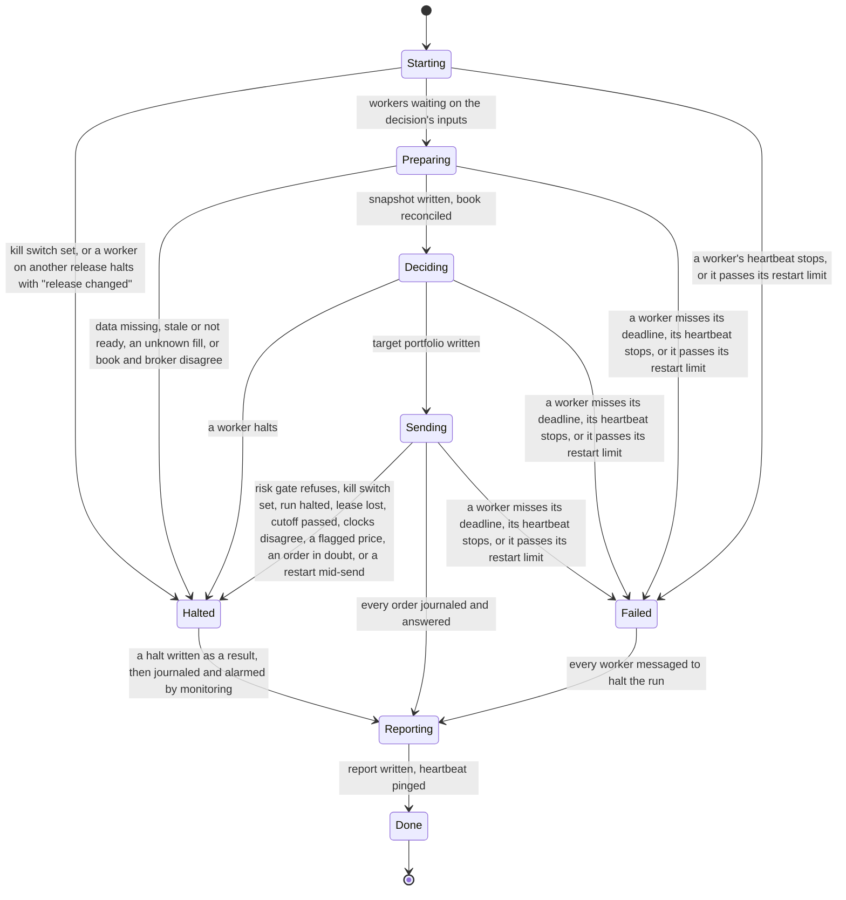

`Preparing` is the first phase of a decision: data reads the snapshot, then execution, once that snapshot and its own send result for the decision before exist, settles orders in doubt, journals fills and writes the book, and monitoring reconciles. The supervisor holds none of these states in
memory. It reads them from storage: which components have a decision result,
and whether a result is a halt. A restarted supervisor finds the state the
same way, while the workers keep running. A worker the host restarts checks its
own result key for each decision, reads the blobs that exist, and writes the
ones that are missing.

A halt and a failure differ in what they stop. A halt stops one decision, and in every mode the span goes on to the next. A failure stops the whole run. Both pass through `Reporting`, so a halted or failed decision still writes its report and its journal entry, and monitoring pings the heartbeat service's
failure address so the owner hears even if the alarm from the machine is lost.
If monitoring itself is what failed, no ping arrives, and the dead-man check
raises the alarm. A halt is final for its decision, which is this doc's choice.
The owner ruled on 2026-10-29 that the owner or the operator clears it, and
narrowed it on 2026-10-30 so that only the owner clears a live account's
halt. Clearing never reruns the decision. The next decision starts fresh, and it
halts again while the kill switch is set or the cause is still there.

## What is stored

An entity-relationship diagram shows what is kept and how the records point at
each other. A pair of bars at a line's end means exactly one, and a circle with a
crow's foot means zero or more.

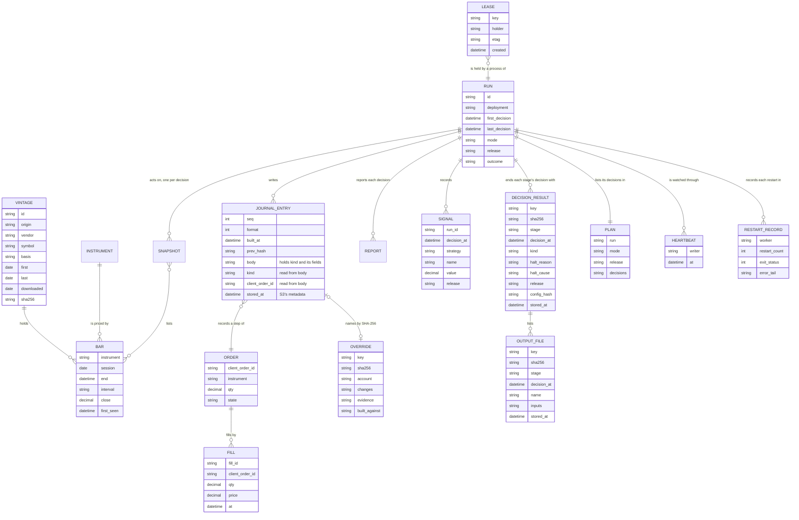

The entities live in seven stores, one of them kept by marketlake, and
each keeps its own rule.

1. **marketlake holds `VINTAGE` and `BAR`.** Every bar, captured or imported,
   lives there, written once and never changed, with its source and checksum
   in marketlake's manifest. Each marketlake partition is one vintage here, and
   a bar's `vintage_id` is its partition's path. marketlake's lake is private
   and backed up off the machine, which is what question 4 and the premise ask
   of captured bars. The checksums
   question 4 asks to commit are the partition checksums a snapshot records,
   for any run a test or a report pins. Imported history
   from quantitative-trading arrives with that repository's own checksums,
   from its `data/vintages.jsonl`, so the import can prove it read the
   recorded bytes. [l3a0/marketlake#938](https://github.com/l3a0/marketlake/issues/938) builds the import.
2. **The run, D1, holds `SNAPSHOT`, `SIGNAL`, `DECISION_RESULT` and
   `OUTPUT_FILE`,** as blobs in S3 under the run's prefix, each written once at
   a key fixed by the run, the stage, the decision and, for an output file, its name. A snapshot lists the marketlake bars one decision read, by partition, or by segment for a read before sealing, each with its checksum, and marks a read before sealing provisional. A signal record holds a value the run computed,
   such as the hedge ratio, the z-score or the forecast, keyed by run,
   component, decision and name. Each blob's header names the blobs it came from, and a halt says
   why a decision stopped. A deterministic component's blobs are regenerable
   from marketlake, the journal and the code, but data's snapshots and
   execution's account files capture what was true at the moment, and the restart records the host's stop handler writes record exits, which the supervisor's halts name, so none of them can be. A
   backtest's blobs sit in a memory-backed folder and vanish when it ends,
   because a backtest can be regenerated. The blobs also make a question such
   as "how did the backtest's z-score on a decision differ from the shadow
   run's" a lookup rather than a recomputation.
3. **The security master, D2, holds `INSTRUMENT`.** It is a small committed file
   that changes only through a pull request.
4. **The journal, D3, holds `JOURNAL_ENTRY`.** It is the one numbered log:
   one per broker account, outside every run, because the book is replayed
   from it across runs. Each entry is a blob at a key fixed by the account and its sequence number, holding its number, the time it was built, to the microsecond, its body and the hash of the entry before it, so the entry itself is the record. Its own hash is the SHA-256 of those bytes, as `### File formats and keys` says. The owner's ruling that the journal is the only
   numbered log, when SQLite was dropped, replaced the earlier ruling on
   [#10](https://github.com/l3a0/ithildin-runtime/issues/10) that kept entries
   in SQLite rows. `Journal` writes through `BlobStore` for the account the
   broker adapter names.
   `ORDER` and `FILL` are read from journal entries rather than kept as
   records of their own. Each entry is stored before the step it records
   happens. The `ithildin` tool, the supervisor when it clears a lease, monitoring and execution can all write,
   and S3's refusal of an existing key is what keeps two of them from taking
   one number: the writer that is refused reads the new entries, decides its
   step again, and takes the next number. Changing an entry would break the
   link from the entry after it, and the bucket refuses any replacement or
   delete and keeps every version, so an edit cannot hide.
5. **Run reports, D4, hold `RUN` and `REPORT`.** A report is computed from the
   journal and the snapshot, so losing one costs nothing. The run writes it to S3 for the
   owner to read, not as a record.
6. **The simulated broker's account, one blob per simulated account per call, written before the call returns, outside every run,** holds the resting orders and positions the
   simulator keeps. The simulated broker's adapter reads and writes it
   through a `BlobStore` the entry point hands it, so execution's own outputs
   are the same whichever broker it holds. Backtest and shadow use the same
   form, so an order still resting when a shadow run ends is there in the
   next run, or on a new VM. Each simulated account has its
   own lease and kill switch, so a backtest never shares the paper account's.
   This is a proposal for [#10](https://github.com/l3a0/ithildin-runtime/issues/10).
7. **The account's own blobs, outside every run,** hold `LEASE`, `OVERRIDE`,
   the kill switch and the hard caps blob, at keys fixed by the account or the deployment under prefixes of their own, with the rules `## Where it runs` rules 4 and 5
   give. `PLAN` sits under the run's prefix. `HEARTBEAT` and `RESTART_RECORD`
   sit under prefixes of their own, keyed by writer and time and by worker
   and restart count, and heartbeats are the one prefix the bucket's
   lifecycle expires.

### File formats and keys

Two rules lean on exact bytes. A deterministic stage that is run again must
write the same bytes, because S3 refuses the second write and the worker
then compares SHA-256s, alarming on a difference. And the journal chains each
entry to the hash of the one before it. Both fail if the same values can be
written two ways, such as a different key order, a float printed with one
more digit, or a time in another zone. This subsection is this doc's
proposal for [#22](https://github.com/l3a0/ithildin-runtime/issues/22), where `core` defines the file form of every type.

**One codec in `core` writes and reads every blob.** `core.encode` turns an
object into bytes and `core.decode` turns bytes of a named kind back into an
object. No worker, tool or test calls a JSON library itself. Two workers
that each followed the standard library would differ: Python's `json`
sorts keys by code point where RFC 8785 sorts by UTF-16 units, and
`Decimal(0.1)` carries fifty-five digits of the float behind it. Each field's
type in `core` declares how the codec writes it, and `core`'s storage
contract holds one key builder for each row of the key table below, so no
module puts a key together from strings.

**Every blob is canonical JSON.** The encoding follows RFC 8785, the JSON
Canonicalization Scheme, for encoding, whitespace and key order, and adds
rules of its own for numbers, times and empty fields.

1. UTF-8, with no whitespace outside strings, as RFC 8785 requires.
2. Object keys sorted by their UTF-16 code units, as RFC 8785 sorts them.
3. No JSON floats. RFC 8785 prints a number in its shortest double form,
   which cannot hold most decimal prices exactly, and it recommends a
   string for a number that needs more precision than a double holds. So
   every decimal quantity, such as a price, a share count, a dollar amount,
   a hedge ratio or a z-score, is a JSON string in plain decimal notation,
   such as `"123.4500"`. Integers below 2⁵³, such as a sequence number or a
   bar's volume, are JSON integers. Share counts are decimals, because the
   GLD leg is fractional.
4. Every time is UTC, as the owner ruled on 2026-10-30, written in RFC 3339 with a `Z` and six fractional digits, truncated, such as `"2026-11-02T20:40:01.123456Z"`. A decision's time is UTC too, such as the 15:40 decision on 2026-11-02 at `"2026-11-02T20:40:00.000000Z"`. A session date is the exchange's trading date, such as `"2026-11-02"`, because it names a session rather than an instant.
5. A field with no value is `null`, never left out, so a reader can tell an
   empty field from a format that lacks it. A list keeps its order when the
   order means something, such as a plan's decisions, and is sorted by its
   key when it does not, such as a header's inputs, which is this doc's
   rule rather than RFC 8785's.

**A value received from outside is kept exactly as it arrived.** A fill's
quantity and price, a position, an open order's quantity, and marketlake's
bar and quote values are stored as the decimal string the broker or
marketlake sent, never passed through a float and never rounded, and so is a
time received from outside. The journal and the snapshot are the only
records of what the broker and the market said, so a rounded copy would
lose a value that cannot be recaptured: at four places, a leftover
position of `0.00004` would record as zero, and the book replayed from
rounded fills would drift from the broker's. A received value with more places than its field declares is flagged in the record, never rounded.

**Three rules are stated on the exchange's clock, and resolved to UTC once.**
A strategy's schedule, such as the 15:40 decision, Alpaca's market-on-close
cutoff, which Alpaca states as 15:50 Eastern, and the heartbeat check's cron
expression all follow New York's clock, because the market does. A rule
written in UTC would move by an hour against the close each time the clocks
change. So each is written as the exchange's local time, and one calendar
function in `core` turns it into a UTC instant for each session. The plan,
every key, every stored time and every check hold only that instant.

**A value the platform computes is rounded once, in one place.** The types
in `core` hold `Decimal`. A statistic, such as the alpha model's hedge
ratio and z-score or the cost model's estimate, may be computed in floats
and converted at the stage's output by `core.to_decimal`, which takes the
float's shortest form and rounds it half to even to the field's declared
places. The risk gate, the order manager, `Journal.replay` and
reconciliation compute in `Decimal` throughout, and the quantity journaled
for an order is the exact string the broker adapter sends and the gate
checks. A `dict` field's values take the declared places of their value
type, such as a share count in `TargetPortfolio.shares`. A field's declared
places never shrink in a later release.

The price is that a value computed in floats that falls exactly on a
rounding boundary can round differently under another release's numeric
library. A run never mixes releases, because a worker on another release
halts with "release changed", so the difference can appear only between
runs, where the header's `release` explains it.

**Every output file has a header and a body.** Each output file is one
object with two members, `header`, the `BlobHeader`, and `body`. The
header's `format` is a number per kind, raised when that kind's fields
change, under `## Where it runs` rule 6's rule that each release writes
only formats the release before it can read. Each hash is lowercase hex
SHA-256, and each writer sends it as the upload's SHA-256 checksum, so S3
checks it before it stores the blob.

**A journal entry hashes its whole blob.** Each entry is one blob holding
`seq`, `format`, `built_at`, `prev_hash` and `body`. Its hash is the SHA-256
of those bytes exactly as stored, which the next entry carries as its
`prev_hash`, and the first entry of an account carries sixty-four zeros. A
hash of the body alone would leave an entry's number and its link outside
what the next entry vouches for. A blob cannot hold its own hash, so
`JournalEntry.hash()` computes it from the bytes S3 returns, never from a
re-encoding of the parsed fields. A reader also checks that those bytes are
the canonical encoding of what it parsed, that each key's number equals the
`seq` inside it, and that it knows the entry's `format`, and halts
otherwise. Every journal format ever written stays readable by every later
release, because the book is replayed from the first entry, and each
format has a committed fixture entry and a test that replays it.

The `body` holds a `kind`, such as `intent`, `sending`, `fill`, `cancel`,
`override`, `clear` or `switch_pull`, and that kind's fields. A writer builds
an entry once and resends the same bytes on a retry, so a live process
recognises its own earlier attempt by hash. A process that restarted builds
new bytes, so before it appends it checks the field that names the step
against the journal instead: the client order id for `intent`, `sending` and
`cancel`, the broker's fill id for `fill`, the override blob's SHA-256 for
`override`, and the halt's id for `clear`. A switch already pulled makes
`switch_pull` say so rather than journal it twice.

**Keys.** Every key below sits in its environment's bucket, as
`### Four environments` says. Deployments and accounts appear by the alias
the release's table gives them, never by a broker's account number. A
create-only write that S3 refuses, whose stored SHA-256 differs from the
writer's, alarms, as `### Every alarm and its drill` lists.

| Store | Key |
| --- | --- |
| A run's plan | `runs/<deployment>/<run>/plan.json` |
| A halt of the run, and the run's stop | `runs/<deployment>/<run>/halt.json`, `runs/<deployment>/<run>/stop.json` |
| A stage's decision result, which holds its halt when it has one | `runs/<deployment>/<run>/<decision>/<stage>/result.json` |
| A stage's output file, including data's snapshot, alpha's signal records and monitoring's report | `runs/<deployment>/<run>/<decision>/<stage>/<name>.json` |
| A journal entry | `journal/<account>/<seq>.json`, with `seq` padded to twelve digits |
| The simulated account, written before each call returns | `sim/<account>/<decision>/<call>.json`, with the call padded to four digits |
| The deployment's lease | `leases/deployments/<deployment>.json` |
| The account's lease | `leases/accounts/<account>.json` |
| The kill switch | `accounts/<account>/switch.json` |
| The hard caps | `accounts/<account>/caps.json` |
| An override | `accounts/<account>/overrides/<sha256>.json` |
| A heartbeat | `heartbeats/<deployment>/<writer>/<UTC time>.json` |
| A restart record | `restarts/<deployment>/<run>/<worker>/<boot>/<count>.json`, with the count padded to six digits |
| The release pin, block records, promotion records and pin changes | `release/pin.json`, `release/blocked/<digest>.json`, `release/promotions/<digest>.json`, `release/changes/<UTC time>.json` |

`<run>` is the session date in shadow, paper and live, and the span's first
and last session dates, as `2006-04-26_2012-04-09`, in a backtest, built by
one function in `core`. `<decision>` is the decision's UTC time in the compact form `20261102T204000Z`, and `<UTC time>` is `20261102T204001.123456Z`, so each sorts in order. `<boot>` is the boot id
of the VM that wrote the record, so a replacement VM whose restart count
starts again never meets an earlier record's key. A halt's id is the key of
the result that holds it, `<deployment>/<run>/<decision>/<stage>`. Twelve
digits of sequence number cover a million million entries, which at thirty
entries a minute around the clock last tens of thousands of years. The
prefixes are the ones `## Where it runs` rule 5's grants and the bucket's
lifecycle name, with `release/` read by each VM's role for its own pin, as
`### Four environments` rule 4 says.

## Where it runs

A deployment diagram shows which machine each piece runs on and what crosses the machine's edge. It draws one environment, shadow, paper or live, each of which has a VM, a bucket and roles of its own, as `### Four environments` says. The owner ruled on 2026-10-29 that the VM keeps no state
that matters, and that the storage is S3, so everything the platform must
keep sits in the runtime's bucket, and the VM can be replaced by starting a
new one from the pinned release.

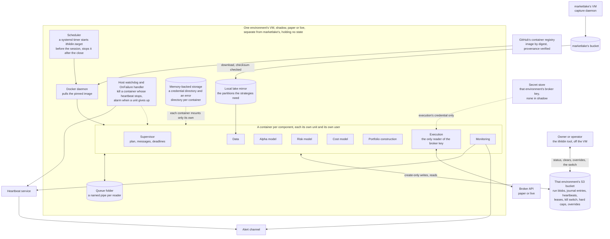

Ten rules hold the deployment to the premise and the hard limits.

1. **The pin names the release.** Each environment's VM runs the release its pin names. The owner's merge to `main` moves shadow's pin, a healthy shadow moves paper's, and only the owner moves live's, as `### Four environments` says, so the code that traded is always known. The release also pins boto3, from a version
   whose botocore, 1.35.67 or later, sends both S3's refuse-if-it-exists
   condition and its conditional delete.
2. **Nothing the platform must keep lives only on the VM.** Every blob a run
   writes and every journal entry is created in the runtime's bucket before
   anything relies on it. The VM's working directory holds only queues,
   error output and the files the host's stop handler writes, and none of it
   is kept. The journal is one of the
   three things the premise says cannot be recovered, so losing the VM must
   not take it. Captured bars, another of the three, live in marketlake,
   which backs up its own lake.
3. **The broker key lives in a secret store, and only execution can read it.**
   The execution worker runs as a Unix user of its own, started by a systemd
   unit with that user, never by a process that keeps root. Only root and one
   provisioning user can reach the VM's instance metadata service, which a
   firewall rule matched on the process's owner enforces across reboots,
   because any process that can reach that service can fetch the VM's
   credentials. At boot the provisioning step writes each worker user a
   credential file only that user can read, never carried in the VM's start-up
   data. Only the execution user's credential can read the secret store.
   Execution reads the key from the store into its own memory, never into its
   environment, which other processes and child processes can see, and never
   into a file. It is a broker key with no withdrawal or transfer permission,
   which is hard limit 5. A drill on [#11](https://github.com/l3a0/ithildin-runtime/issues/11) has a worker other than execution
   try each route to the key, the metadata service, the start-up data, another
   process's environment and the unit's settings, and expects every one to
   fail. The owner ruled on 2026-10-29 that the store is the one marketlake
   uses, AWS Systems Manager Parameter Store, holding the key as a
   `SecureString` parameter encrypted under KMS, and that the runtime's
   parameter, bucket and VM all live in marketlake's AWS account, the second
   choice of question 11. That account is shared with a public repository's
   CI, so the ruling puts the data behind a list of who may reach it, the
   bucket policy in rule 5, and narrows the one role that runs on public
   pull requests.
   1. **AWS's managed `aws/ssm` key encrypts the parameter.** The owner ruled
      on 2026-10-29 that AWS's key is fine, rather than a KMS key of the
      runtime's own. Every principal in the account may decrypt through SSM
      under that key, so who can read the parameter is decided by IAM alone:
      a grant of `ssm:GetParameter` on that parameter, given only to the
      execution user's credential, and the refusals in item 3 for every role
      that holds a broader read. The price is that a role added later with a
      broad parameter read can read the key until someone refuses it, which
      the drill in item 6 catches only when it runs.
   2. **marketlake's plan role reads only what `tofu plan` needs.** Its
      `ReadOnlyAccess`, which reads every bucket and parameter and runs on
      any pull request of a public repository, gives way to a policy that
      lists the reads, with no parameter read of any kind and object reads on
      marketlake's state bucket alone. The owner chose this fix at the cause
      on 2026-10-29, because a missing grant stops the next plan in plain
      sight, while a missing refusal exposes data silently.
   3. **The roles that keep a broad read refuse the key's path as a
      backstop.** marketlake's VM role, its apply role, which runs only after
      the owner's approval, the operator's role, and every runtime role but each execution role on its own key each refuse `ssm:GetParameter`, `ssm:GetParameters` and `ssm:GetParameterHistory` on every broker key path, `/ithildin/<environment>/broker/`, and `ssm:GetParametersByPath` on every path,
      because a recursive read of a parent path returns every parameter below
      it. Each environment's VM and worker roles refuse the same on `/marketlake/config` and
      everything below it, which holds marketlake's market data credentials
      and alert keys.
   4. **marketlake's apply and deploy roles cannot touch the runtime's VM.**
      The VM and its volume carry a tag of the runtime's own, and both roles
      refuse every EC2 action on resources with that tag, and any change to
      that tag or to marketlake's capture-host tag on them, so neither can
      rewrite the VM, copy its disk or point marketlake's deploy document at
      it. This one is a list of refusals, so a check in marketlake's CI fails
      any role that lacks it. The worker credential files also live in
      memory-backed storage, which a copy of the disk would not hold, and the
      runtime uses no Run Command in that account, because marketlake's deploy role can read every command's output there. Those roles and the operator's also refuse `ssm:SendCommand` and `ssm:StartSession` on any instance carrying the runtime's tag, and no runtime VM role holds an SSM managed-instance policy.
   5. **The parameter lives in us-east-1**, the region marketlake's refusals
      name, and the owner writes its value by hand through standard input,
      as marketlake writes its own. No OpenTofu configuration, state or
      variable ever holds it.
   6. **A drill** reads the key with the plan, apply and VM roles'
      credentials and the runtime's VM role's, directly, by a recursive read
      from `/` and through its history, reads marketlake's path with the
      runtime's VM role, and tries an EC2 action on the runtime's VM with the
      apply and deploy roles, and expects "access denied" every time.

   [l3a0/marketlake#944](https://github.com/l3a0/marketlake/issues/944)
   builds marketlake's side. What remains needs the owner's approval or the
   owner's own credential. An approved apply can edit a role's refusal,
   which its policy diff shows. The owner's administrator session, and the
   account's root user, can edit any of these policies, and only a service
   control policy in an AWS organization binds a root user, which this
   account does not use.
4. **The kill switch and the hard caps are blobs.** The runtime's credential
   can create the switch, which pulls it, and can never delete it. The owner
   ruled on 2026-10-29 that only the owner's credential clears a live
   account's switch, and that the operator's may also clear a paper or shadow
   account's. Neither credential sits on the VM, and each environment's bucket policy exempts only those principals its own rule allows from its refusal of deletes on the switch's key, which on the live bucket is the owner alone. The hard caps blob can be written or deleted only by the
   owner's credential, which an explicit refusal in the bucket's policy for
   every other principal enforces, because raising a cap raises a capital
   limit, which hard limit 1 keeps for the owner. Copying an older version
   back counts as a write, so the same refusal covers it. Pulling the switch
   needs no deploy.
5. **The runtime's credential does only what the rules need.** It can create
   and read blobs under the runs', the journal's and the simulated accounts'
   prefixes, create and read the leases, create and read but not delete the switch, read the hard caps and the overrides, and list each of those prefixes, without which S3
   answers a missing key with "access denied" rather than "no such blob". A
   drill reads an absent switch with that list right and expects "no such
   blob". It can also create heartbeats and restart records under their own
   prefixes, the heartbeats being the one prefix the bucket's lifecycle
   expires. Only the supervisor's and execution's credentials may delete a
   lease, and only with the tag the creator got, which leaves a delete marker
   so the lease's history survives, besides the owner's and the operator's
   off the VM, as `## What a person runs` says. No credential the runtime
   holds can delete a version, or change the bucket's policy, versioning or
   lifecycle, and no credential but the owner's can change those three. The
   bucket's policy, whose refusals name the runtime's principals, refuses any
   write on those prefixes that lacks the refuse-if-it-exists condition, any
   delete outside the leases, and any lease delete without the tag condition.
   It also refuses every S3 action on the bucket to any principal that is not
   one of that environment's own runtime, deploy or promotion roles, the owner's or the operator's, matched on
   `aws:PrincipalArn`, refuses the operator any version delete, and refuses
   changes to the policy itself to all but the owner. An explicit
   refusal in a bucket policy overrides any role's own grant, so a role
   marketlake adds later is refused without anyone remembering it, which
   matters because the bucket lives in marketlake's account. The release
   writes every blob with one single-part upload, never a
   multipart one, which S3 cannot make conditional, and the policy marks a
   multipart start so a stray one fails when it completes rather than
   halfway.
6. **A rollback is a pin to an earlier digest.** Every blob carries a format version, and each release writes only formats the release before it can read, so the old release reads what the new one left. Mid-session, the owner first pulls the kill switch or waits past the cancel cutoff, so nothing is left half sent. Then `ithildin pin set` writes the earlier digest, as `### Four environments` says. The VM keeps the session's digest until the session ends, so nobody needs to reach the VM, and the earlier release takes the next session.
7. **systemd keeps every process running, up to a limit.** The supervisor
   and each worker have a unit of their own, all part of one
   `ithildin.target`, with systemd's `Restart=on-failure`, a
   `StartLimitBurst`, and a `StartLimitIntervalSec` of a whole trading day,
   since systemd's default of ten seconds would never reach the limit for a
   process that crashes once a minute. `RestartSec` is long enough to ride
   out a short restart of the Docker daemon, rather than spending the whole
   burst in a second. Each unit's stop handler, `ExecStopPost`, runs on the
   host and records why the container stopped, for the restart record
   design.md's rule 5 describes. A watchdog on the host reads the heartbeats
   and kills a worker's container whose heartbeat is thirty seconds old,
   because systemd's own watchdog cannot see a process inside a container.
   An `OnFailure` handler on the host pings the heartbeat service's failure
   address when any unit, or the Docker daemon itself, reaches its limit or
   fails, so a failure no container can see still reaches the owner. A timer
   stops `ithildin.target` after the close, behind the supervisor's own stop,
   and a unit stopped that way stays down until the next day's timer starts
   the target. A restarted supervisor alarms that it restarted, and the
   dead-man check covers systemd stopping too.
8. **The runtime has a VM of its own, apart from marketlake's.** The owner
   ruled on 2026-10-29 that the runtime runs on a VM separate from the one
   marketlake's capture daemon runs on, and downloads the parts of the lake its
   strategies need. So a run on the runtime cannot starve capture, and a
   failure on one VM leaves the other running. The data worker downloads each
   partition a decision's lookback names from marketlake's bucket into a local
   mirror, checks it against the checksum in marketlake's manifest, and reads
   it through the same bar query. A partition not yet in the bucket is "data
   not ready", which halts. A capture segment read before sealing is checked
   the same way, against its own manifest entry, and the read credential
   covers the segments' prefix too. The mirror is a copy, so losing it costs only a
   download. Each environment's credential for marketlake's bucket reads and never writes, and each gets a row in design.md's `## Configuration` when
   [#5](https://github.com/l3a0/ithildin-runtime/issues/5) first reads it.
9. **A replacement VM's supervisor takes the lease, then runs.** The
   supervisor takes the deployment's lease before it writes the plan, the
   same in every mode. If another VM holds it, the supervisor halts and
   alarms and writes no plan, and the replacement's workers, finding no plan
   under a lease of theirs, wait. Once it holds
   the lease, there is nothing to restore, because every worker finds its
   place by checking its own keys in S3. Who starts a replacement VM, from
   which VM image, and how a person confirms the old VM is gone before clearing
   its lease, is a runbook on [#11](https://github.com/l3a0/ithildin-runtime/issues/11).
10. **The release is one container image, and each component runs in a
    container of its own.** This is this doc's proposal, raised by the owner
    on 2026-10-30. One Docker image holds the whole runtime: one Python
    version, every dependency installed from `uv.lock` with its hashes
    enforced, and an entry point per worker. Each component runs as its own
    container from that image, and the supervisor as one more, so a
    backtest, CI and the VM run the same bytes.

    The supervisor only sends messages, as design.md's rule 7 says, so it
    needs no power over containers. A systemd unit per container, under
    rule 7, starts each one before the session, restarts it when it exits or
    its heartbeat stops, and stops it after the close. No container holds the
    Docker socket or the system D-Bus, because either one is root on the
    host. The owner said on 2026-10-30 that eventually each component could
    run on a machine of its own, or serverless. Messages, results and
    heartbeats all pass through the queues and S3, so moving a component
    changes only where its container runs and the queue adapter it uses.
    The queue is the one seam built for that, a port in `core` with a
    named pipe as its adapter today and a contract test suite that a later
    adapter, such as SQS, has to pass.

    If adopted, rule 10 changes these:
    1. **The pin is an image digest.** Rule 1's tagged commit becomes the
       digest of the image built from it. The plan records the digest, and
       each worker halts with "release changed" if its own differs. A rollback, rule 6, moves the pin to an earlier digest, which takes the next session and which the
       VM keeps pulled.
    2. **Each container is fenced off by itself.** Each runs as its own
       non-root user, given by its unit, with every capability dropped, a
       read-only root file system and no way to gain privileges, and none
       runs privileged or shares the host's network, process ids or IPC.
       Each mounts only its own worker's credential directory, read-only
       from memory-backed storage, which the host's provisioning step
       refreshes inside that directory before the credentials expire, so a
       mounted directory sees each new file. Only execution's credential
       reads the broker key, which is fetched into memory and never mounted.
       Each worker's error output goes to a directory of its own, readable by
       its own user alone. Each queue's pipe is owned by its reader and
       writable by a group holding only the writers its input table lists
       and the supervisor, and a worker acts on a message only after reading
       the blob it names, as design.md's rule 3 says.
    3. **The instance's credentials never reach a container.** The instance
       is launched with IMDSv2 required and a token hop limit of 1, set
       explicitly, because AWS's own
       [defaults](https://docs.aws.amazon.com/AWSEC2/latest/UserGuide/configuring-IMDS-new-instances.html)
       give 2 for an AMI that requires IMDSv2, and 2 lets a container
       through. A `DOCKER-USER` firewall rule also drops traffic from
       Docker's bridges to the metadata service's addresses. Rule 3's drill
       adds, from inside each container, a token request and a tokenless
       request to the metadata service, each expected to fail, and a read of
       another container's mounts.
    4. **A restart writes its own record.** Each unit's stop handler on the
       host records why the container stopped, its count of restarts and
       the end of its error output, and the restarted worker, or monitoring
       if the worker does not come back, uploads that as its restart record.
       Stopping the Docker daemon stops every container, so a daemon restart
       is a failure of the run, which the host's `OnFailure` handler alarms
       on, and the daemon is never upgraded during a session.
    5. **CI runs the same containers under their real unit files.** CI's second required check starts each worker's container and the supervisor's from its systemd unit, under the runner's own systemd and with the host's watchdog. So the restart path runs in what is tested, and the drills that crash, freeze or restart a worker run there as well as on the VM. A small test host in the harness stands in for systemd only in a local backtest, as `### How CI runs them` says.

    CI builds the image on every pull request and runs the tests inside it,
    in the two required checks `### How CI runs them` describes. A branch of
    this repository
    can change a workflow, so no control on a pull request can promise that
    it never publishes. The control is provenance. One job, run only on a
    push to `main` and never on `pull_request_target`, `workflow_run` or a
    manual dispatch, rebuilds the image, runs the tests on it, publishes it
    to GitHub's container registry tagged with its commit, and attests its
    build provenance. That job alone holds `packages: write` and `attestations: write`. It and each deploy and promotion job hold `id-token: write`, each of those in its own GitHub environment with no `packages: write`, and every other job reads only. Before a digest becomes a pin, the deploy job, and the owner for live, runs `gh attestation verify` on it, requiring the publish workflow on
    `refs/heads/main`, and the deploy runbook on
    [#11](https://github.com/l3a0/ithildin-runtime/issues/11) refuses a
    digest that fails. Every action is pinned to a full commit hash. The
    base image is pinned by digest, a bot proposes its updates, and a
    scheduled job rescans the digest the owner pinned. A `.dockerignore`
    keeps `.git`, `.venv`, `.env*` and `.claude/` out, and no secret enters
    the build through an argument or an environment variable. The owner
    makes the package public once after its first publish, so the VM pulls
    by digest with no GitHub credential. The owner's merge deploys to shadow, a healthy shadow promotes to paper, and deploying to live stays the owner's by hand, as `### Four environments` says.

    The price is a Docker daemon on the VM, running as root, to patch outside
    sessions, a unit per container to keep in step, an image build on every
    pull request, and a verification step before each deploy. On Fargate the
    same containers become tasks, each with its own role, and only the queue
    adapter changes, as question 12 says.

### Four environments

The owner ruled on 2026-10-30 that test, shadow, paper and live run in
separate environments. The same day the owner ruled that GitHub's CI is the
test environment, that a merge to `main` deploys to shadow, and that a
healthy shadow then deploys to paper. The owner's words ended "and then
live". This doc reads that last step as the owner's own, by hand, which hard
limit 1 requires, and asks the owner to confirm the reading on [#11](https://github.com/l3a0/ithildin-runtime/issues/11).

Before those rulings, this doc kept the modes apart inside one VM and one
bucket, by key prefix and by the account a lease names. So one wrong role or
one wrong prefix could reach every mode: a drill could pull the live switch,
or a shadow run could read a broker key. With an environment each, no
runtime role of one environment can reach another environment's resources.
The owner's and the operator's credentials still span environments by
design, one read-only grant lets the promotion job judge shadow, and rule 11
names what the shared AWS account still allows. The rest of this subsection
is this doc's proposal for [#11](https://github.com/l3a0/ithildin-runtime/issues/11).

Hard limit 6, in CLAUDE.md and in the charter, still says deploying is the
owner's. The automatic deploys to shadow and paper wait on the owner
rewording it, because this doc cannot change either file.

An environment is a set of resources: a machine, a bucket, roles, a broker
credential, a heartbeat check and a release pin. Shadow, paper and live each
run exactly one mode, the one with the same name. Test is GitHub's CI, which
runs backtest mode among its checks, and backtest mode also runs on a
developer's machine, outside every environment. Where the rest of this doc
says the runtime's VM or the runtime's bucket, it means the one in the
environment at hand.

| Environment | Runs | Machine | Bucket | Broker credential | Release pin |
| --- | --- | --- | --- | --- | --- |
| Test | CI's checks on every pull request and every push to `main`, as `### How CI runs them` says | A GitHub runner, gone after each run | The test bucket, which only the store suite's S3 run on `main` touches. Backtests keep the memory-backed folder | None | None. CI tests the commit it builds |
| Shadow | Shadow mode on live data | The shadow VM | The shadow bucket, with the shadow journal | None. Shadow fills in the simulator | Moved by the deploy job once the owner merges to `main` |
| Paper | Paper mode | The paper VM | The paper bucket, with the paper journal | Alpaca's paper key | Moved by the promotion job once shadow is healthy on the same digest |
| Live | Live mode, once the owner switches | The live VM | The live bucket, with the live journal | A live key, which the live broker, not yet chosen, must issue with no withdrawal or transfer permission | Moved only by the owner, by hand |

Eleven rules keep the environments apart.

1. **A merge deploys to shadow, and a healthy shadow promotes to paper.** CI
   runs the tests on every pull request, with no AWS credential. When the
   owner merges a pull request to `main`, rule 10's publishing job rebuilds
   the image, runs the tests again with the store suite's run against the
   test bucket, publishes the image and attests its provenance. A deploy
   job then confirms through GitHub's API that its commit belongs to a
   merged pull request, verifies the attestation, and writes the digest as
   shadow's pin. A promotion job runs on a schedule after each session,
   with no manual trigger and no input naming a digest. It reads shadow's
   records, and writes the digest as paper's pin once shadow is healthy on
   it and paper is clear. Live's pin moves only by the owner's hand, which
   is hard limit 1, and the board sits before the first switch to live. The
   owner pins live only a digest that has run on paper.
2. **Healthy is counted, never read from silence.** Shadow is healthy on a
   digest when, on that digest, at least N sessions ran, at least M
   decisions wrote a result that lists outputs rather than a halt,
   healthchecks.io's API shows every expected ping received, and every one
   of those decisions' orders matched what a replay of the same day emits.
   The owner sets N and M on [#11](https://github.com/l3a0/ithildin-runtime/issues/11) as counts. The promotion fires once per
   digest, and writes a promotion record holding the counts beside paper's
   pin. It refuses while paper has an open halt, a set switch, an override
   not yet applied, or a lease held by a lost VM, and alarms with that
   reason.
3. **A digest has run in an environment** when a run there recorded it in
   its plan, and that run's decisions finished without a "release changed"
   or restart-limit halt.
4. **A pin is a bare digest, read once a session, and a rollback holds.**
   Each pin is a blob in its own environment's bucket holding only a `sha256:` digest in its `digest` field, and the VM builds `ghcr.io/l3a0/ithildin-runtime@`
   and the digest itself, refusing anything else. When the timer starts a
   session, it resolves the pin once into a session file in memory-backed
   storage, and every unit start and restart that session uses it. A
   replacement VM that reads a newer pin mid-session halts with "release
   changed", which is intended. A VM that finds its pin missing or
   unreadable fails its unit with "release pin missing or unreadable",
   which the host's `OnFailure` handler sends. A rollback is
   `ithildin pin set`, which writes an earlier digest the environment has
   run, and a block record for the digest it replaced, both in the bucket of the environment it rolls back. The promotion job reads the block records in shadow's bucket and in paper's, and refuses a digest blocked in either. A block read that fails refuses the promotion and alarms, rather than reading as no block. So the next promotion cannot undo a rollback of either environment.
   Only the owner runs `ithildin pin set` until the owner rules who else
   may, under hard limit 6.
5. **Each role reaches only its own environment's resources, by ARN and
   path, never by tag.** Each bucket's policy refuses every principal but
   that environment's own runtime, deploy and promotion roles, the owner's
   and the operator's, matched on `aws:PrincipalArn`, as rule 5 says. A
   deploy role may only put its own environment's pin. The promotion role
   may only put paper's pin and promotion record, read paper's switch, overrides, leases, results and block records, and read shadow's plans, results, halts, heartbeats and block records, which shadow's policy names as its one grant across environments. On the live bucket
   the operator may pull the switch, as the owner ruled, and read, which is
   this doc's proposal. Each broker key sits under its environment's
   `/ithildin/<environment>/broker/`, granted to that environment's
   execution role by the parameter's full ARN, and rule 3's refusals cover
   every broker path. Ping addresses sit apart, under
   `/ithildin/<environment>/heartbeat/`. Each environment's worker roles
   trust only that environment's VM role, by its exact ARN. Every role but
   the owner's refuses `iam:PassRole` on every runtime role, and
   `sts:AssumeRole` on another environment's roles. Every VM and volume
   carries rule 3's runtime tag and a tag naming its environment, and every
   principal but the owner's refuses to add, change or remove the
   environment tag. The test role acts on the test bucket alone, with no
   SSM, EC2 or IAM action, and carries rule 3's refusals. The tags and paths
   are this doc's proposal, and
   [l3a0/marketlake#944](https://github.com/l3a0/marketlake/issues/944)'s
   refusals have to cover every environment's tag and path.
6. **GitHub's tokens reach a role only from one workflow file on `main`.**
   The repository's OIDC subject includes the calling workflow's
   `job_workflow_ref`, and each role's trust matches it exactly, pinned to
   its one workflow file on `refs/heads/main`. The deploy and promotion
   workflows have no `pull_request_target`, `workflow_run`, `issues` or
   `issue_comment` trigger, check out only the commit that started them,
   and read no event payload. Each GitHub environment's branch rule names
   `main` alone, with no tag rule. So a workflow added later on `main`,
   such as the board's, cannot reach these roles.
7. **The environment is read once, at the edge.** The release carries one
   table naming each environment's bucket, key paths, deployments and account aliases,
   with each alias in exactly one environment. The mapping from an alias to
   a broker account stays under the environment's parameter path, because
   the image and the repository are public. The provisioning step that
   rule 3 runs at boot writes the environment's name, its credentials and
   its ping addresses to the VM's memory-backed storage, so the `OnFailure`
   handler needs no SSM call while the host fails, and none of them goes
   into a unit's settings, which `systemctl show` lets any user read. Only
   `runtime`'s entry points read them, and turn them into adapter
   arguments, so a module gets a `BlobStore`, a broker and an alert adapter
   and never the environment's name. The mode follows from the environment,
   and the supervisor halts on a plan whose mode differs from its
   environment's. Each environment downloads into its own mirror with its
   own read-only credential for marketlake's bucket.
8. **The `ithildin` tool finds the environment from the account.** It looks
   the account up in the same table, and a halt's id carries its deployment,
   so a command reaches the bucket that account lives in. It refuses an
   account the table does not name. So a switch pull for a live account
   cannot land in the paper bucket, and the pull stays one command.
9. **Every running environment has its own heartbeat check, and so does
   the pipeline.** Shadow, paper and live each get a check on healthchecks.io
   named after the environment, whose description carries the first command
   to run and its runbook row, so the push on a phone says what to do. The
   promotion job pings a check of its own after each run, so a dropped
   schedule alarms. Test needs no check, because a failed CI run is its
   alarm. The owner placed the checks in marketlake's healthchecks.io
   project, so the runbook on [#11](https://github.com/l3a0/ithildin-runtime/issues/11) confirms that marketlake holds only ping
   addresses there, and no API key that could pause a check.
10. **Every drill that depends on an environment's own resources runs in
    each environment that has them.** These are the dead-man check, the
    host's `OnFailure` handler, the Docker daemon, the pin, the bucket
    policy, the key paths, the metadata fence, CloudTrail and the operator's
    grants. Shadow's and paper's drills run before paper's gate. Live's run
    before the owner switches, in a live session started with the kill
    switch already set, and after the switch only while no live session is
    open, until the owner rules otherwise. Drills that depend only on code
    run once, in test. Rule 3's drill grows to try each environment's roles
    against every other environment's bucket, key and VM, by each route rule
    3's item 6 lists and by assuming or passing another environment's role,
    and expects "access denied" every time. It also checks five more things.
    1. Each environment's monitoring role and VM role read their own ping
      addresses, and every other role is refused.
    2. The operator's credential is refused every broker key, every live
      write it is not granted, and `ssm:SendCommand` on every runtime VM.
    3. A deploy role is refused every key but its pin.
    4. A promotion is refused while paper's switch is set, and a rollback holds against the next promotion, drilled once rolling paper back and once rolling shadow back after its digest met the healthy counts.
    5. A pin moved mid-session leaves a restarted worker on the session's
      digest.

    Each environment's infrastructure is applied by a plan of its own, a bad
    apply rolls back by applying the previous configuration, and that
    environment's drills run again after every apply.
11. **The environments share marketlake's AWS account.** The owner ruled on
    question 11 that the runtime's resources live there, so the environments
    are separated by ARN, path and policy rather than by AWS account. The
    price is that one IAM mistake can still cross environments, which an
    account per environment would rule out, and rule 10's drill is what
    catches one.

The price is a VM per running environment, two for slice 1 and three once
live exists, as question 12 now says. Each environment also needs its own
bucket, roles, heartbeat check and pin. The deploy and promotion jobs hold
AWS roles in a public repository's workflows, guarded by the trust rules of
rule 6. And the drills run once per environment and grow with each pair.

## Package layout and the import rule

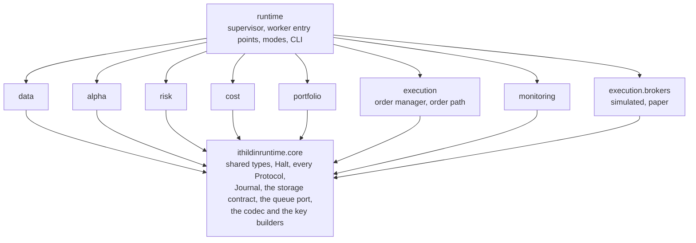

An arrow means "may import". The diagram draws three rules.

1. Every module imports `core` and none of its siblings. The types that cross
   modules, such as `Forecast`, `Constraints` and `TargetPortfolio`, and every
   `Protocol`, including `RiskGate`, live in `core` for that reason. So do
   `Journal`, which execution, monitoring, the supervisor and the `ithildin` tool append to, and the storage contract every
   worker uses: the `BlobStore` port, writing a blob S3 refuses to replace,
   the blob header, the decision result and its halt, the plan, the message to each reader's queue, and the one codec and key builders that `### File formats and keys` describes.
2. Only `runtime` imports the modules together. Each worker's entry point
   lives there. It picks the adapters for the mode it is given, and the
   execution worker's entry point hands the risk module's `RiskGate` to the
   order path. The supervisor lives there too, and imports only `core`. It
   starts no worker. It writes nothing but the plan, the deployment's lease and its delete at the end of the run, its heartbeat, its messages, the halts of workers that failed, a halt of the run with a halt for every decision left in the plan, the run's stop, and the journal entry for a lease it clears, which `core`'s storage contract, queue and `Journal` cover. Only the entry points read the plan's mode, and a module is handed
   only the decisions.
3. Only `runtime` imports `execution.brokers`, and only the execution worker's
   entry point builds a broker, which it hands to `OrderPath` alone.

A test reads every module's imports with Python's `ast` module and fails on an
arrow the diagram does not draw. A second test runs a day under the supervisor
against a fake broker that fails on three things.

1. An order whose client order id has no approval in the journal.
2. An order whose `sending` entry is not yet stored in the journal.
3. A client order id it has already received. Together they turn
test 3's "no order reaches the broker adapter without passing the gate" into
something executed rather than reviewed. The price is two more tests to keep
in step with the diagram, and a module that needs a sibling has to argue for a
new arrow.

## How the four acceptance tests exercise it

| Test, from [#4](https://github.com/l3a0/ithildin-runtime/issues/4) | Mode | What it runs | What it pins |
| --- | --- | --- | --- |
| 1. The backtest reproduces a replicated strategy | Backtest | marketlake reader over the imported vintages, history clock, simulated broker filling market-on-close orders at the close, zero cost | APR 0.17824928 and Sharpe 0.96467289 to 5e-9, the 162 changes of unit, and the unit on each of the 1,480 days as `chan.bollinger` computes it at `19aadbeb` |
| 2. A replay emits pinned orders, through a missing feed, a stale price and a restart in the wrong order | Backtest | A recorded stretch of sessions with three faults injected. The restart kills a worker mid-run, and the host brings execution up before data | The orders on each day, and a halt with no orders on each faulted day |
| 3. The risk gate refuses an order over each limit, and nothing bypasses it | Unit and import | `RiskGate` against one order over each of the seven limits, including a market-on-close order past the cutoff, and a pair whose second leg alone breaks `max_net`, the import rule test, and the fake broker | Seven refusals and the pair's, no import of `execution.brokers` outside `runtime`, and no order reaching the fake broker without a journaled approval and `sending` entry, or twice |
| 4. The kill switch and the dead-man check fire in a drill | Paper, drill | Set the switch before a run, and skip the second ping of a day of two decisions | A halt journaled with reason "kill switch", and a dead-man alarm delivered |

Test 1 fills at the close of the day the signal used, because that is what
Chan's script assumes. The owner ruled on question 10 that the paper run
trades that close too, with market-on-close orders, so both fill at the same
price. The two still decide at different times. Test 1's deployment decides
at the close, on the imported daily bars, through a simulated account whose
cutoff is the close, because a 15:40 decision there would see only the day
before's close and shift every signal a session. The paper deployment
decides at 15:40, because no live decision can read a close that has not
happened. Test 1 checks the engine against Chan's timing. A backtest of the
deployed 15:40 schedule needs minute history at 15:40 that the imported
vintages lack, so it waits for marketlake's captured minutes to cover a long
enough span, and shadow running measures the gap until then. A paper order also needs whole shares, or a fractional order the
broker accepts, while the backtest holds fractional dollar positions. So the
two runs differ in two ways.

1. **Timing of the signal.** The paper decision computes its signal on the
   price at 15:40, twenty minutes before the close the backtest's signal
   uses, and a price that moves in those minutes can flip the unit.
2. **Rounding.** Rounding each leg to whole shares moves it by at most half a
   share. Whether portfolio construction or the order manager rounds, and
   whether the broker allows a fractional short sale for the GLD leg, is open
   on [#9](https://github.com/l3a0/ithildin-runtime/issues/9).

Shadow running measures both gaps rather than leaving them to argument.

The charter's paper gate also asks for every alarm to fire in a drill, which
covers more than test 4 names. The reconciliation mismatch above is one such
alarm, and its drill belongs on
[#11](https://github.com/l3a0/ithildin-runtime/issues/11).

Which issue writes each piece. Where a piece is a shared type, it lives in
`core` whichever issue writes it.

| Piece | Written on |
| --- | --- |
| Importing every source into marketlake, provenance on each bar, the one bar query | [l3a0/marketlake#938](https://github.com/l3a0/marketlake/issues/938) |
| `core`'s shared types and every `Protocol`, the file form of each type, `Journal`, the storage contract of `BlobStore`, create-only writes, the blob header, the decision result, the plan, the queue port with its named-pipe adapter and its contract suite, the S3 and memory-backed folder adapters with one contract test suite, the import rule test, as question 9 settles | [#22](https://github.com/l3a0/ithildin-runtime/issues/22) |
| `Bar`, `Snapshot`, the marketlake reader, the snapshot and signal records, security master | [#5](https://github.com/l3a0/ithildin-runtime/issues/5) |
| Bollinger band alpha model, `Basket`, `Forecast` | [#6](https://github.com/l3a0/ithildin-runtime/issues/6) |
| `Constraints`, `RiskGate`, the daily loss stop, the stale-data rule | [#7](https://github.com/l3a0/ithildin-runtime/issues/7) |
| Flat and linear cost models, `CostSchedule` | [#8](https://github.com/l3a0/ithildin-runtime/issues/8) |
| Equal-risk-weight portfolio construction, `TargetPortfolio` naming every instrument | [#9](https://github.com/l3a0/ithildin-runtime/issues/9) |
| Order manager, `OrderPath`, the journal written through `BlobStore`, each entry stored before its step, fills keyed by the broker's fill id, simulated and paper brokers, the simulated account's blob, the account's lease | [#10](https://github.com/l3a0/ithildin-runtime/issues/10) |
| `Monitoring`, reconciliation, reports, alert channel adapter, dead-man check, kill switch, startup order, the alarms and their drills, each worker's deadline, and the supervisor and the fake-broker test as proposed below | [#11](https://github.com/l3a0/ithildin-runtime/issues/11) |

Each module issue also writes its own worker's entry point under `runtime`,
the code that picks that worker's adapters for a mode.

Equal risk weight sizes each forecast's basket so they all carry the same
risk. With one basket in slice 1, it reduces to sizing that basket, which
question 3 settles.

Two pieces belong to no single module.

1. `core`, with the shared types, every `Protocol`, and the storage contract
   every worker uses: the create-only write, the blob header, the decision
   result and its halt, the plan and the queue message.
2. The import rule test, which reads every module's imports.

Both are written on [#22](https://github.com/l3a0/ithildin-runtime/issues/22), which every module issue waits on, as question 9
settles.

The supervisor imports no module, but it cannot run a day until every worker
exists, so it is built last. This doc proposes building it on
[#11](https://github.com/l3a0/ithildin-runtime/issues/11), which owns the startup order and waits on every
other module. The fake-broker test goes there too, since it runs a whole day
under the supervisor. [#11](https://github.com/l3a0/ithildin-runtime/issues/11) names neither today, and its acceptance
covers tests 2 and 4 but not test 3, so the Decisions table lists both as a
proposal.

### How CI runs them

CI has to test the components as they run on the VM: separate containers
passing one-line messages through named pipes and reading their inputs from
a store that refuses an existing key. Testing the modules in one process
would not exercise the messages, the restarts or the store's rules, which is
where the failures this doc's reviews found have lived. GitHub's hosted
runners are Linux VMs with Docker, so CI runs the real image. This is this
doc's proposal for the CI that [#22](https://github.com/l3a0/ithildin-runtime/issues/22)
and [#11](https://github.com/l3a0/ithildin-runtime/issues/11) build, in
three levels, from fast to slow.

1. **Module tests, in one process.** Each module's logic, the risk gate's
   seven refusals, the import rule and the journal's replay run as ordinary
   tests, as the existing suite does today.
2. **Contract tests for the two swappable pieces.** Each runs every adapter
   against the same rules.
   - **The store suite** holds the list design.md's
     `### A worker works through a span of decisions` gives, which stays the
     one statement of it, including two processes racing one create, a read
     during a write and a writer killed partway through. A store that checks
     for a key and then writes passes a test of one refused write and fails a
     racing create, and one that creates the key and then writes into it
     shows a reader half a blob, as a review's experiments showed. The suite
     runs against the memory-backed folder and against the S3 adapter, the
     second through a local S3 emulator that honours the refuse-if-it-exists
     condition, which the first build confirms, and against the test environment's bucket on each push to `main`.
   - **The queue suite** checks that one send is one write of at most 511
     bytes with its newline, and that 512 is refused. It runs two writers of
     at least a thousand messages each and finds no line mixed. A send with
     no reader and a send to a full pipe are each skipped within a second,
     and a send to a pipe being read arrives. A worker that starts late finds
     what it missed, including a result written between its opening its
     pipe and checking its keys, which is the order design.md's rule 4 sets.
     A later SQS adapter joins this suite against a local SQS emulator or a
     real test queue.
3. **The runtime in containers.** CI builds the image once, and the runner's own systemd starts every component's container and the supervisor's from their unit files, with the host's watchdog, as the second required check below says. Each starts with the user, flags and pipe ownership its unit gives it, and a test pins the restart policy in the unit files. Every container mounts the pipe folder and one
   memory-backed folder created on the runner standing in for S3, so a blob
   written before every container stops is still there after. Tests 1 and 2
   and test 3's fake-broker run go through this level, with the simulated
   broker and the history clock, and so do the drills that crash, freeze or
   restart a worker, among them the crash between a pair's legs. Tests show
   that a message sent from one container arrives in another, and that a
   container the input table does not list as a writer cannot open another
   worker's pipe.

The required `test` check runs the first two levels. A second required check, which `.github/rulesets/default.json` gains when [#22](https://github.com/l3a0/ithildin-runtime/issues/22) builds it, runs the third on the same
image, test 2 and the restart drills included, because the restart path is
what this design rests on. That check also runs the real unit files and the
host's watchdog under the runner's own systemd, which hosted runners appear
to allow with `sudo`, as the first build confirms, so the test host stands in
for systemd only in a local backtest.

What CI cannot cover runs in each environment that has the resource, as `### Four environments` rule 10 says, as drills on
[#11](https://github.com/l3a0/ithildin-runtime/issues/11): the instance
metadata fence against AWS's own service, S3's bucket policy and CloudTrail,
and the account's real roles. The memory-backed folder and the emulator only
imitate S3's rules, which the real test bucket checks.

The price is a CI run that builds an image and starts several containers on
every pull request, a second required check, an S3 emulator and a test
bucket to keep, and drills that only the VM can run.

## Decisions

Each row is a choice this doc makes, what it turned down, the price, and where
the choice is settled. A row settled here is a shape every module shares. A row
marked with an issue is a proposal: once the owner accepts it, it goes on that
issue, which then decides. Either way, each turned-down alternative gets a row
in [design.md](design.md#considered-and-rejected)'s register when the row is
accepted.

| Decision | Turned down | Price | Settled on |
| --- | --- | --- | --- |
| Each component runs as its own process, in parallel, passing files | One process calling every module in memory, or a process per action | A file format and a round-trip test for every type that crosses between modules | Ruled by the owner on 2026-10-29, with the rules in [design.md](design.md#processes-and-files) |
| The platform is an event pipeline: each component runs its processing loop when there is something new for it, and its outputs trigger those downstream | A controller that calls each component in a fixed order | A worker waits for a message on its queue instead of being called | Ruled by the owner on 2026-10-29 |
| Pure steps write create-only blobs at decision keys, data's first write wins, a halt is a blob at the same kind of key, and the journal is the only numbered log | An event log per component, as a SQLite file or as numbered blobs, with or without Litestream | A deterministic step's format must be canonical, and the journal alone keeps sequence numbers | Ruled by the owner on 2026-10-29, after the SQLite and numbered-blob designs before it |
| A decision result per stage, listing its outputs or holding a halt, with execution and monitoring each split into two stages, and each stage's kind declared in the `runtime` table that the storage contract alone acts on | One result per component per decision, which put execution's account file behind its own send | Two more result keys a decision, and a canonical format for every deterministic stage | [#22](https://github.com/l3a0/ithildin-runtime/issues/22), as [design.md](design.md#processes-and-files) proposes |
| A backtest uses an in-memory store through the same port, which this doc takes as a memory-backed folder every worker process can reach | S3 for backtests, which would cost minutes of round trips | A second adapter, held to S3's rules by one contract test suite | Ruled by the owner on 2026-10-29, the folder this doc's reading of it |
| Each component keeps a queue, listens for events on it, and reads its inputs from files and writes its outputs to files. A message is sent to a component's queue whenever there is something new for it | File notifications through `watchdog`, or polling | A message has to reach every component with something new | Ruled by the owner on 2026-10-29 |
| Each queue is a named pipe in the VM's working directory, written without waiting. The storage contract sends each message after a decision result is written, to the readers one table in `runtime` declares, and again for the newest result when a worker starts, and a starting worker opens its pipe before it catches up | A socket, a queue server, or every write messaging every queue | A message is skipped when its reader is down or its pipe is full, so a starting worker catches up by checking its keys | [#22](https://github.com/l3a0/ithildin-runtime/issues/22), as [design.md](design.md#processes-and-files) proposes |
| Every write is created once with S3's refuse-if-it-exists condition and its SHA-256. A deterministic component treats a refused write with the same hash as done and a different hash as a bug that halts, and a capturing one, data or execution, treats the stored blob as the one that counts | Blobs that may be replaced, or one rule for both kinds of component | Each component has to know its kind, and the bucket's policy has to refuse writes without the condition | [#22](https://github.com/l3a0/ithildin-runtime/issues/22), as [design.md](design.md#processes-and-files) proposes |
| The VM keeps no state that matters, and every file is a blob in S3 | Durable state on the VM's disk | A round trip to S3 per blob | Ruled by the owner on 2026-10-29 |
| The journal is numbered blobs per account, each entry the body of its own blob, stored before the step it records, with S3's refusal of an existing number keeping two writers apart | A journal in SQLite on the VM | One S3 round trip before each order step | The entry as its own record ruled by the owner on 2026-10-29, the rest proposed for [#10](https://github.com/l3a0/ithildin-runtime/issues/10) |
| A deployment's lease and an account's lease, as blobs in S3 that record their holder and are deleted only with a condition naming the tag S3 returned when each was created. The kill switch and the hard caps are blobs beside them | A lock file, a switch file and a config file on the VM | A lease another VM left behind needs a person to clear it | [#11](https://github.com/l3a0/ithildin-runtime/issues/11) for the deployment's lease and the switch, [#10](https://github.com/l3a0/ithildin-runtime/issues/10) for the account's lease |
| Test, shadow, paper and live each run in an environment of their own. CI is test, the owner's merge to `main` deploys to shadow, a healthy shadow deploys to paper, and only the owner moves live's pin | Keeping the modes apart inside one VM and one bucket by key prefix, or deploying by hand to every environment | A VM per running environment, a bucket, roles and a pin per environment, AWS roles held by workflows on a public repository, and drills that run per environment | Ruled by the owner on 2026-10-30. The layout is proposed for [#11](https://github.com/l3a0/ithildin-runtime/issues/11) |
| The runtime runs on a VM of its own and downloads the partitions its strategies need into a local mirror | Running on marketlake's VM beside the capture daemon, or a long-running ECS Fargate service for slice 1 | A second VM, and a read-only credential for marketlake's bucket | Ruled by the owner on 2026-10-29, and on 2026-10-30 that a VM rather than a Fargate service hosts slice 1, question 12 |
| The skeleton's strategy decides at 15:40 on marketlake's segments read before sealing and sends market-on-close orders by 15:48, a cutoff for market-on-close orders in the paper account's hard caps that execution checks before every send and again before each broker call. A pair left with one leg accepted is cancelled, and each leg must fit `max_net` alone. One simulator fills by order type in backtest and shadow, a market order at the decision quote as [#16](https://github.com/l3a0/ithildin-runtime/issues/16) rules | Deciding in the evening and trading the next open, on the official daily bar or on marketlake's captured close | A signal twenty minutes before the close it trades, execution reads the clock for the cutoff, and a kill switch cannot stop a closing-auction fill after the exchange's cancel cutoff | Trading the close ruled by the owner on 2026-10-29, question 10. The times are proposed for [#10](https://github.com/l3a0/ithildin-runtime/issues/10) and [#7](https://github.com/l3a0/ithildin-runtime/issues/7) |
| `max_net` is set from the venture's loss limit: one leg's stress move, from a recorded vintage over at least a weekend, sized to a share of the loss limit the owner sets, stored with its input's hash. Monitoring tallies stranded legs after each close, and the simulator strands legs on a seeded fault | A cap equal to the larger leg, which never refuses anything, or closing a stranded leg at the next open, after the overnight gap has landed | A smaller pair at live size, and a stress move to derive and pin | Ruled by the owner on 2026-10-29, on a board sitting's recommendation. [#7](https://github.com/l3a0/ithildin-runtime/issues/7) for the cap, [#11](https://github.com/l3a0/ithildin-runtime/issues/11) for the tally, [#10](https://github.com/l3a0/ithildin-runtime/issues/10) for the simulator |
| The release is one container image, pinned by digest, each component a container of its own kept running by systemd, and CI testing the image on every pull request while one job on `main` publishes it with a provenance attestation the owner verifies before pinning | A Python environment installed on the VM, or containers started by the supervisor through the Docker socket | A Docker daemon to maintain and patch outside sessions, a unit per container, an image build per pull request, and a verification step before each deploy | Raised by the owner on 2026-10-30. This doc's proposal for [#11](https://github.com/l3a0/ithildin-runtime/issues/11) |
| A person acts through one command line tool, `ithildin`, run off the VM with their own credential, whose reading commands show status and liveness and explain a halt, and whose writing commands pull or clear the switch, clear a halt, record an override under its own prefix, and clear a lease, each journaled through `core` and checked against CloudTrail. The operator's credential acts on paper and shadow accounts only, plus a live pull, as the owner ruled on 2026-10-30 | Commands on the VM, a web page, editing blobs by hand, or overrides inside the journal where a key-based policy cannot fence them | A tool to build and drill, CloudTrail data events, and two credentials off the VM, each behind a hardware key | This doc's proposal for [#11](https://github.com/l3a0/ithildin-runtime/issues/11), after the owner asked on 2026-10-30 what a person runs. Only the owner resumes live trading, ruled by the owner on 2026-10-30 |
| A component learns of a new blob from a message its writer sends, a timed check of the next key, and, once a writer or a component sits off the VM, S3's notifications to a queue, fanned out through SNS or EventBridge. Each is a hint, and anything that touches money re-reads the blob right before it acts | Watching S3 directly, which S3 does not offer, or trusting a notice as the change itself | A small read every few seconds for each reader that checks on a timer, which is execution, the supervisor and monitoring, and up to that interval's delay for a change nobody messaged | This doc's proposal for [#22](https://github.com/l3a0/ithildin-runtime/issues/22) and [#11](https://github.com/l3a0/ithildin-runtime/issues/11), after the owner asked on 2026-10-30 how a component listens for changes |
| CI tests in three levels: modules in one process, a contract suite per storage and queue adapter, the S3 adapter's through an emulator and a real test bucket, and the runtime's containers on the runner with the units' own users and flags, sharing a pipe folder and a memory-backed store, with test 2 and the restart drills in a second required check that runs the real unit files under the runner's systemd. What only AWS can show runs as paper drills | Testing the modules in one process only, a test host that reimplements systemd, or leaving the restart path out of the required checks | An image build and several containers per pull request, a second required check, an S3 emulator and a test bucket, and VM-only drills | This doc's proposal for [#22](https://github.com/l3a0/ithildin-runtime/issues/22) and [#11](https://github.com/l3a0/ithildin-runtime/issues/11), after the owner asked on 2026-10-30 how CI works for containers that pass messages |
| The runtime's bucket, VM and broker key live in marketlake's AWS account. The bucket policy names who may reach the data, the broker key stays under AWS's managed `aws/ssm` key behind a grant to the execution user and refusals for broad readers, marketlake's plan role reads only what `tofu plan` needs, and marketlake's apply and deploy roles refuse the runtime's VM | A separate AWS account, which a board sitting recommended | The VM is guarded by refusals a CI check has to keep complete, and the account's root user can edit every policy | Ruled by the owner on 2026-10-29, question 11, with AWS's managed key ruled fine. The key's path, the grant to the execution user and the refusals for broad readers are this doc's proposal for [#10](https://github.com/l3a0/ithildin-runtime/issues/10). marketlake's side is [l3a0/marketlake#944](https://github.com/l3a0/marketlake/issues/944) |
| The runtime reads marketlake's capture segments before the day is sealed, as a provisional read, with its own minimum checks and a comparison with the sealed day afterwards | Waiting for marketlake's upload at the close plus fifteen minutes, or sealing continuously in marketlake | Data at decision time has not passed marketlake's validation battery, and a difference after sealing has to be journaled and explained | Ruled by the owner on 2026-10-29, and on 2026-10-30 that the runtime turns the segments into quote rows itself with marketlake's package. The read is proposed for [#5](https://github.com/l3a0/ithildin-runtime/issues/5) and [#16](https://github.com/l3a0/ithildin-runtime/issues/16), and the uploader on [l3a0/marketlake#943](https://github.com/l3a0/marketlake/issues/943) |
| A supervisor that writes the plan, messages every worker and keeps no state, while the host keeps every worker running and restarts one that crashes, with a halt that flows down the pipeline and is final for its decision | A supervisor that starts and watches its workers as their parent, which in a container per component needs a grant that is root on the host, or one that holds the run's state in memory | Heartbeats from every worker, a host watchdog for a hung one, and execution cancelling a stranded leg itself on restart. The owner ruled on 2026-10-29 that the owner or the operator clears a halt, and on 2026-10-30 that only the owner clears a live account's | [#11](https://github.com/l3a0/ithildin-runtime/issues/11), as [design.md](design.md#processes-and-files) proposes, after the owner asked on 2026-10-30 for a supervisor that sends messages |
| Every blob is canonical JSON after RFC 8785, written and read by one codec in `core`, with computed decimals as strings at places `core` declares, received values kept exactly as sent, times in UTC, and a journal entry's hash taken over its whole stored blob | Parquet, whose writer records its own version in each file so the same values change bytes across releases, JSON floats, and a hash of the entry's body alone | A worker rounds a computed value at its edge, so a value on a rounding boundary can differ between releases, and every blob is larger than a binary form would be | [#22](https://github.com/l3a0/ithildin-runtime/issues/22) |
| `Journal` and the storage contract live in `core` | The journal writer in `execution`, which the supervisor and monitoring could not import | `core` holds behaviour beyond what its types need | [#22](https://github.com/l3a0/ithildin-runtime/issues/22) |
| Only the order path talks to the broker, for sends, lookups, fills, positions and cancels, inside one execution worker per broker account | Letting the supervisor or monitoring call the broker | One more method on `OrderPath` per kind of broker call | This doc |
| Monitoring reconciles positions and open orders between execution's recovery and the models, and journals and alarms every halt | Reconciling inside execution, or the supervisor raising alarms | One more output file, the broker's account, which also makes the reconciliation readable afterwards | [#11](https://github.com/l3a0/ithildin-runtime/issues/11) |
| Execution journals a fill only when its client order id has a `sending` entry and the fill stays within that order's quantity, and halts otherwise | Journaling every fill the broker reports | A fill from an order placed by hand at the broker halts the platform | [#10](https://github.com/l3a0/ithildin-runtime/issues/10) |
| Fetch and sync before any step that changes state, and resolve conflicts before modifying. A state that moved on in a way the step can work from brings it up to date, and a conflict between two versions of the truth halts for a person | Acting on state fetched earlier, or resolving a conflict automatically | A round trip before each change, and a halt wherever the broker moved unasked | Fetching, syncing and resolving first ruled by the owner on 2026-10-29. Up to date against a halt for a person is this doc's application, in [design.md](design.md#processes-and-files) |
| Execution's send stage fetches the broker afresh, settles orders in doubt, journals new fills, and halts before planning on any difference that is not its own open order or fill. It then journals the whole target portfolio and its planned orders, each with its client order id, with the journal entry it synced through and a hash of the broker state, in one entry before its first send, reuses that list on a rerun in the same decision, journals each fill under the broker's fill id, and halts before planning if an entry that changes the book, and that neither its sync nor its order loop wrote, lies past the entry its sync names | Planning again on a rerun, ids from the order's place in a fresh plan, fills matched by order and quantity alone, or planning on the recover stage's read | A rerun cannot catch up on a changed target within a decision, and a broker change during the order loop waits for the next recover | [#10](https://github.com/l3a0/ithildin-runtime/issues/10) |
| A target portfolio names every instrument the book holds, with a flat leg as an explicit zero | Reading a missing instrument as zero | One more check, and a halt on a leg left out | [#9](https://github.com/l3a0/ithildin-runtime/issues/9) |
| The gate's hard caps come from a blob only the owner's credential can write, every field of both sources is checked before use, and the tighter of each pair applies | Trusting the risk model's constraints file alone | Two places to set a limit. The owner ruled on 2026-10-29 that only the owner changes the caps, by hand | [#7](https://github.com/l3a0/ithildin-runtime/issues/7) |
| The cost model writes a cost schedule that portfolio construction reads | Portfolio construction calling the cost model for each candidate trade, which would cross a process boundary per trade | One more type in `core`, and a change to the charter's module table | [#8](https://github.com/l3a0/ithildin-runtime/issues/8) |
| The current book comes from the journal, and the broker is only reconciled against | Reading positions from the broker each run | A journal bug halts trading instead of being silently patched over by the broker's numbers | This doc |
| The blob store, which holds the journal, and the alert channel are adapters chosen per mode | Writing records and alarms the same way in every mode | Two more ports in `core`, and a change to design.md's `## One runtime` | This doc |
| A missing, stale or empty input raises `Halt` | Defaulting a gap to the last value or to zero | A day with a data hiccup is a day with no trading | This doc, with the staleness rule on [#7](https://github.com/l3a0/ithildin-runtime/issues/7) |
| A forecast names a basket | A forecast per instrument, with the pair logic in portfolio construction | One more type in `core`, and a change to the charter's module table | [#6](https://github.com/l3a0/ithildin-runtime/issues/6) |
| The supervisor and the fake-broker test are built last, on [#11](https://github.com/l3a0/ithildin-runtime/issues/11) | Building the supervisor with `core`, which cannot run a day before every worker exists, or a separate issue. Writing the fake-broker test with the import rule test in `core`'s sub-issue, which cannot run before the supervisor exists | No end-to-end run happens until [#11](https://github.com/l3a0/ithildin-runtime/issues/11) lands, and [#11](https://github.com/l3a0/ithildin-runtime/issues/11) grows past its Monitoring row and takes on part of test 3 | [#11](https://github.com/l3a0/ithildin-runtime/issues/11) |
| Run the Bollinger band on GLD and USO for test 1 | Entry 21's linear rule on the same data, which is always in the market with continuous units, or the Kalman-filter hedge on EWA and EWC, which adds a model to verify first | The engine carries the strategy's quirks, such as no capital account and a daily resize of one leg | [#6](https://github.com/l3a0/ithildin-runtime/issues/6), which also sets [#5](https://github.com/l3a0/ithildin-runtime/issues/5)'s ETFs |
| The platform trades at any time of day and as often as a strategy needs. A decision is keyed by its time, a run in shadow, paper and live is one trading day of one deployment, and its plan lists the day's decisions, built by one function in `core` from the schedules and the trading calendar | One run per trading session after marketlake's evening sweep, filling at the next open | The workers run all trading day, every key carries a decision time, recover waits for data at every decision, and the fastest useful decision is about one a minute, marketlake's capture rate | Ruled by the owner on 2026-10-29, and on 2026-10-30 that the architecture runs through every session and trades continuously, at decisions as often as once a minute, with S3 holding everything. The shape is proposed for [#11](https://github.com/l3a0/ithildin-runtime/issues/11), and question 10 sets the skeleton's strategy at 15:40 |
| A strategy is a set of rows in the one table in `runtime`: its instruments, schedule, data needs, alpha model as a stage of its own, and configuration. An account belongs to one environment and carries one deployment there, and strategies on one account share it and meet in portfolio construction | A runtime per strategy, or the strategy's logic spread through the shared modules | Every key carries the deployment and every forecast its strategy. How strategies combine and a halt that holds the account wait for the first strategy that needs them, written on [#11](https://github.com/l3a0/ithildin-runtime/issues/11) | Open to other strategies ruled by the owner on 2026-10-29. The shape is this doc's proposal for [#22](https://github.com/l3a0/ithildin-runtime/issues/22) |
| The risk gate counts every open order at its worst case, as filled on the side that grows exposure and unfilled on the other, until the broker confirms it | Counting open orders at their net | An order left resting can block a trade that would have fitted | [#7](https://github.com/l3a0/ithildin-runtime/issues/7), as [design.md](design.md#processes-and-files) proposes |
| marketlake is the one bar provider: every source is imported into it, and every mode reads one query | A bar store in this repository, or a reader per source | It reverses marketlake's rule that it holds no history from before capture, so every bar carries whether it was captured or imported. This repository also depends on marketlake's package at a pinned commit | [l3a0/marketlake#938](https://github.com/l3a0/marketlake/issues/938) and [#5](https://github.com/l3a0/ithildin-runtime/issues/5), ruled by the owner on 2026-10-29 |
| Each run records the signals it computed | Recomputing them whenever two runs are compared | One more output file per decision, which holds nothing that cannot be regenerated | [#5](https://github.com/l3a0/ithildin-runtime/issues/5) |
| Alpaca's paper account is the paper broker | Schwab, which is not known to offer an API paper account, or Interactive Brokers, which needs a gateway process beside the platform | The adapter is written to one broker's API, and whether Alpaca refuses a second order with the same client order id still needs confirming on the paper account | Ruled by the owner on 2026-10-30, question 1. Built on [#10](https://github.com/l3a0/ithildin-runtime/issues/10) |
| Talk to the paper broker over its REST API, with the HTTP client passed in as an argument | The broker's own SDK | A few more lines per call. In return tests replace the client with a fake that returns scripted answers, as quantitative-trading's Alpha Vantage fetcher does, and no SDK enters the dependency list | [#10](https://github.com/l3a0/ithildin-runtime/issues/10) |

## Questions for the owner

Each question says what was recommended and how the owner ruled.

1. **Which paper broker?** The recommendation is Alpaca's paper account. It is
   free, it has a REST API, and a paper key cannot move money. Schwab, which
   marketlake already reads, is not known to offer an API paper account, so
   confirm that before choosing it. Interactive Brokers has one, but it needs a
   gateway process running beside the platform. The owner ruled for Alpaca's
   paper account on 2026-10-30, and the ruling is on
   [#10](https://github.com/l3a0/ithildin-runtime/issues/10).
2. **Where do live GLD and USO bars come from?** The recommendation was to add
   both to marketlake's `config/tickers.yaml`, and [l3a0/marketlake PR #928](https://github.com/l3a0/marketlake/pull/928) did on
   2026-10-29. The owner onboarded both on marketlake's VM on 2026-10-30, so
   capture starts with Monday 2026-11-02's session, which
   [l3a0/marketlake#961](https://github.com/l3a0/marketlake/issues/961) tracks.
   marketlake captures forward from that day and keeps no history from before
   it. So the first z-score's 40 or so sessions come from a vintage recorded
   once from a vendor download, or the paper run waits that long before its
   first trade. The owner ruled on 2026-10-29 that every
   source goes through marketlake, so that download is imported there too, and
   [l3a0/marketlake#938](https://github.com/l3a0/marketlake/issues/938) builds the import.
3. **How large is one unit on paper?** The replication has no capital account.
   The recommendation is to size one unit so the gross position is a fixed
   dollar amount the owner sets, recorded in the run's configuration. The owner
   accepted it on 2026-10-29, and the ruling is on
   [#9](https://github.com/l3a0/ithildin-runtime/issues/9).
4. **May captured bars be committed to this public repository?** Vendor terms
   can forbid redistributing data. The recommendation follows
   quantitative-trading's archive pattern: keep the files in a private store,
   and commit only their checksums, so a reader can still check that a run's
   inputs are the ones recorded. The owner accepted it on 2026-10-29, and the
   ruling is on [#5](https://github.com/l3a0/ithildin-runtime/issues/5). The
   owner's later ruling the same day made marketlake's private lake that
   store.
5. **Where does the platform run?** The recommendation is one machine the owner
   controls with a daily scheduler, either the owner's own machine or the VM
   marketlake runs on. The VM keeps the run beside the lake it reads, but it
   can power itself off each day, so the run's time has to fit inside its
   window. The owner's machine needs no new host. The owner accepted one owner
   controlled machine with a daily scheduler on 2026-10-29, and the ruling is
   on [#11](https://github.com/l3a0/ithildin-runtime/issues/11). Later the same
   day the owner ruled that the runtime runs on a VM of its own, separate from
   marketlake's, and downloads the parts of the lake it needs, as
   `## Where it runs` says.
6. **Which heartbeat service?** The recommendation is a hosted check that
   alarms when a ping is late, outside every machine the platform uses. A
   GitHub Actions schedule is not one, because quantitative-trading measured
   only about 11% of its scheduled board runs firing over 185 hours. The owner
   chose healthchecks.io on 2026-10-29, in the project marketlake already runs,
   with its ntfy push and email integrations as the alert channel. The ruling
   is on [#11](https://github.com/l3a0/ithildin-runtime/issues/11).
7. **Does pulling the kill switch cancel orders resting at the broker?** The
   recommendation is yes: execution, on seeing the switch, cancels each
   resting order through the order path and journals it. Cancelling an order
   that has not filled sells nothing, so it is still a stop and not a flatten,
   and without it a switch pulled between 15:48 and the exchange's cancel
   cutoff stops nothing already sent.
   The owner accepted it on 2026-10-29, and the ruling is on
   [#11](https://github.com/l3a0/ithildin-runtime/issues/11).
8. **Does the daily loss stop also unwind positions?** The recommendation is
   no for slice 1. Crossing the stop makes the risk gate refuse every new
   order. An unwind is a trade of its own, so it would need its own path
   through the gate and its own tests, and
   [#7](https://github.com/l3a0/ithildin-runtime/issues/7) can add it later.
   The owner accepted it on 2026-10-29, and the ruling is on [#7](https://github.com/l3a0/ithildin-runtime/issues/7).
   A later ruling the same day, for a pair leg left filled alone at the close,
   kept the unwind out too, and set `max_net` from the venture's loss limit
   instead, as design.md's `### Strategies, schedules and decisions` rule 5
   says.
9. **Where are `core` and the import rule test written?** The
   recommendation is a new sub-issue of
   [#4](https://github.com/l3a0/ithildin-runtime/issues/4), built first, which
   every module issue waits on through a "blocked by" link. Every module
   imports `core`, so the dependency is real. The price is one step before any
   module starts. In return the shared shapes land once, reviewed on their own,
   rather than inside whichever module happens to go first. The owner accepted
   it on 2026-10-29, and the work is [#22](https://github.com/l3a0/ithildin-runtime/issues/22).
10. **When does the skeleton's strategy decide, and which close does it
    read?** The owner ruled on 2026-10-29 that it trades the close: it decides
    before the close on marketlake's segments read before sealing, and sends
    market-on-close orders, so the fill lands on the close the backtest fills
    at. Two evening choices were turned down. When the owner ruled, the
    official daily bar arrived a session later, so deciding on it filled two
    nights after the signal. Deciding on marketlake's captured 16:15 close
    fills at the next open, one night after the signal. Once
    [l3a0/marketlake#962](https://github.com/l3a0/marketlake/issues/962)
    ships, the official bar arrives at the 18:30 sweep the same evening, so
    deciding on it would also fill at the next open, one night after the
    signal. Either evening choice fills at an open rather than at the close
    the backtest fills at, which is the reason the ruling rests on, as the
    owner asked this doc to record on 2026-10-30.

    This doc proposes the times. Alpaca's order documentation says
    market-on-close orders "submitted after 3:50pm but before 7:00pm ET will
    be rejected", so the decision runs at 15:40 and every market-on-close
    order goes out by 15:48, a cutoff the paper account's hard caps hold.
    Execution checks it before every send and again just before each broker
    call. Alpaca's order page does not state a cutoff for an early-close
    day, so on those days the plan drops the 15:40 decision, which falls
    after the 13:00 close, and the strategy does not trade. Alpaca's paper
    account accepts market-on-close orders, but its
    [paper trading page](https://docs.alpaca.markets/docs/paper-trading)
    says it fills "based on the real-time quotes" and gives "partial fills for
    a random size 10% of the time", and Alpaca staff on its forum say paper
    does not tell a market-on-close order from a market order. So paper fills
    measure the quote near the close rather than the closing auction's
    price, and the random partial fills exercise the path that keeps a pair
    whole. The price
    is a signal computed twenty minutes before the close it trades, a pair
    whose second leg can be rejected after the first is accepted, which
    execution then cancels while the exchange still takes cancels, and a kill
    switch that cannot stop a closing-auction fill after the exchange's
    cancel cutoff. A missing input on a day halts that decision rather than
    switching to another time.
11. **Which AWS account holds the runtime's bucket and VM?** The owner ruled
    on 2026-10-29 for the second choice, marketlake's account with the four
    controls, against the board's recommendation of the first. Rule 3 and
    rule 5 now carry it. Rule 3 had assumed marketlake's account, where the
    owner ruled earlier that day that the broker key lives. Three facts about that account matter. marketlake's plan role
    holds AWS's `ReadOnlyAccess`, which reads every bucket and every parameter
    in the account, and runs on pull requests of a public repository, which
    [l3a0/marketlake#944](https://github.com/l3a0/marketlake/issues/944)
    narrows to what `tofu plan` reads whichever choice the owner makes. Its
    apply role holds `ec2:*`, so an approved apply can reach any VM in the
    account as root. And a refusal added to one role protects nothing from a
    role added later. Two choices follow.
    1. **A separate AWS account for the bucket, the VM and the broker key.**
       It refuses every marketlake role by default, the VM included, and
       reads the lake through one read-only grant on marketlake's bucket. A
       member account in AWS Organizations costs nothing, as the
       [Organizations pricing page](https://docs.aws.amazon.com/organizations/latest/userguide/pricing.html)
       says. The price is a second root login and recovery email to guard,
       the setup hours, and moving the key out of marketlake's account, which
       reverses part of the owner's ruling. The key cannot stay in
       marketlake's account while the runtime runs elsewhere, because a
       parameter encrypted under AWS's managed key cannot be shared across
       accounts, as AWS's
       [shared parameters page](https://docs.aws.amazon.com/systems-manager/latest/userguide/parameter-store-shared-parameters.html)
       says.
    2. **marketlake's account, with the data behind lists of who may reach
       it.** Four controls do the work.
       1. The narrowed plan role reads no parameter and no object outside
          marketlake's state bucket, so a pull request cannot print the
          runtime's data, and a grant added by mistake later still meets
          the next two controls.
       2. The runtime's bucket policy refuses every S3 action to any principal that is not one of that environment's own runtime, deploy or promotion roles, the owner's or the operator's, matched on `aws:PrincipalArn`, and refuses changes to the policy itself to all but the owner. An explicit refusal in a bucket policy overrides any role's own grant, as AWS's
          [policy evaluation logic](https://docs.aws.amazon.com/IAM/latest/UserGuide/reference_policies_evaluation-logic.html)
          says, so a role marketlake adds later is refused without anyone
          remembering it.
       3. The broker key's parameter is encrypted under a KMS key of the
          runtime's own, whose policy names only the execution user's
          principal and the owner's, and leaves out the statement that lets
          IAM policies grant access. Without that statement, "IAM policies
          that allow access to the key are ineffective", as AWS's
          [default key policy page](https://docs.aws.amazon.com/kms/latest/developerguide/key-policy-default.html)
          says. The key costs $1 a month. The owner later ruled AWS's
          managed key fine instead, so the parameter rests on IAM grants and
          refusals, as rule 3 says.
       4. The VM cannot be listed that way, so marketlake's apply and deploy
          roles carry explicit refusals of EC2 actions on instances tagged as
          the runtime's, and of any change to that tag. That part is still a
          list of refusals, and a check in marketlake's CI fails any role
          that lacks it.

       The price is that the VM stays behind a list someone has to keep
       right, and that the account's root user can still edit every one of
       these policies. Only a service control policy binds a root user, and
       it does so only in a member account of an organization, as the
       [service control policies page](https://docs.aws.amazon.com/organizations/latest/userguide/orgs_manage_policies_scps.html)
       says.

    A board sitting on 2026-10-29 recommended the first, with one condition:
    no role in the runtime's account can be assumed from a pull request on
    either public repository, since ithildin-runtime is public too. It
    weighed the separate account's setup hours against the second choice's
    list of refusals that has to be kept right as marketlake grows, and
    judged the journal, which cannot be recovered, worth the hours. The owner ruled for the second choice the same day, so no separate account is set up.
12. **What hosts the runtime: a VM, or a long-running Fargate service?** The
    owner ruled on 2026-10-30 that the platform runs through every session
    and trades continuously, at decisions as often as once a minute, so the
    host keeps the supervisor and the workers running from before the open
    until after the close. Lambda per component is turned down for now.
    Lambda's
    [15-minute limit](https://docs.aws.amazon.com/lambda/latest/dg/configuration-timeout.html)
    rules out a worker that lasts the session, and execution's watch over a
    pair's legs and over the kill switch while orders rest needs one. A
    message-driven supervisor would let the other components run as
    functions triggered by their queues later, which rule 10 keeps open. Two choices were weighed.
    1. **The VM, as `## Where it runs` draws it.** The workers run as Unix
       users of their own, the queues are named pipes, and only the
       execution user's credential reads the broker key. The price is a
       machine to patch and restart, the firewall rule that keeps worker
       users off the instance metadata service, and the refusals that keep
       marketlake's apply and deploy roles off the VM, as rule 3 says.
    2. **A long-running ECS Fargate service**, started before the open and
       stopped after the close, with the same containers, each a task. There is no machine to patch, and marketlake's EC2
       permissions have no VM to reach. But ECS hands a task's IAM role to
       every container in the task, and its
       [task role page](https://docs.aws.amazon.com/AmazonECS/latest/developerguide/task-iam-roles.html)
       says "containers are not a security boundary", while each Fargate
       task has its own. With a container per component, as rule 10
       proposes, each becomes a task with its own role, so only execution's
       reads the broker key. The supervisor already only sends messages and
       the kill switch is a blob read from anywhere, so the one change is the
       queue: tasks do not share a folder, so the queue adapter becomes a
       queue service such as SQS.

    The recommendation is the VM for slice 1. Its design is complete and has
    been reviewed, and the refusals that guard it are already ruled. Moving
    to Fargate changes the queue adapter, which needs its own contract tests
    and drills, on a path that has run zero times. The case for Fargate is
    real, no machine and no reach from marketlake's EC2 roles, and the
    evidence that would settle it is what running the VM costs: hours spent
    patching and restarting it, and any marketlake apply that touches it.
    The owner ruled for the VM for slice 1 on 2026-10-30, and the ruling is
    on [#11](https://github.com/l3a0/ithildin-runtime/issues/11). That evidence is what would reopen the question. This doc's proposal for the owner's ruling of the same day on separate environments gives shadow and paper a VM each in slice 1, and one more for live, as `### Four environments` says, which doubles the patching the VM recommendation weighed for slice 1.
