# Architecture — ithildin-runtime slice 1

Seven module issues are about to be built by seven separate sessions, and the
pieces they share are the expensive thing to change later. A bar type, an
order type and the one path an order takes to the broker are read by every
module. Getting one wrong after four modules use it means four rewrites. This
doc draws those shared pieces now, while disagreeing with them costs an edit.

Slice 1 is the walking skeleton on
[#4](https://github.com/l3a0/ithildin-runtime/issues/4): the first version of
the platform in which every module exists in its simplest form and one
strategy runs end to end, every trading day, in shadow mode and on Alpaca's
paper account. Shadow decides on live data and fills every order in the
platform's own simulated broker. Paper, a practice account at a broker that
trades with no real money, sends the same decisions to Alpaca. Each
module issue, [#5](https://github.com/l3a0/ithildin-runtime/issues/5) to
[#11](https://github.com/l3a0/ithildin-runtime/issues/11), still decides what
its module must do. Where this doc and an issue disagree, the issue wins.

Each component runs as its own process and
passes everything to the others through files, so a failure stays inside one
process and every input and output can be read afterwards. So the diagrams draw one worker per module, each a process the host keeps running and the supervisor only messages, rather than one program calling each module in turn. The platform
is an event pipeline with a queue per component: each component listens for events on its queue, and an event reaches a component's queue whenever there is something new for it. The event is S3's own notification of the write, with no polling of storage, apart from one narrow read of monitoring's that catches a lost switch-off. S3 hands that notification to EventBridge, AWS's event router, which copies it to SQS, AWS's queue service, where the worker waits for it. Every file is a blob in S3, written once at a key
fixed by the run, the stage and the decision, and the VM keeps no state.
The journal is the one numbered log.
[design.md](design.md#processes-and-files)'s `## Processes and files` carries
the rules the workers follow.

The owner's part in reviewing this doc is one section at the end, [Proposals awaiting a ruling](#proposals-awaiting-a-ruling), a table where each row says what this doc proposes, what it
turned down, the price and the issue it goes on. Object to a row there. Settled choices sit in [design.md](design.md)'s `## Decisions`, ordered by when they were decided.

The diagrams are Mermaid, which GitHub draws in place. Each one is followed by
what it shows and what to look for. Nothing here is built yet.

One decision, end to end, is the picture to hold before the detail:

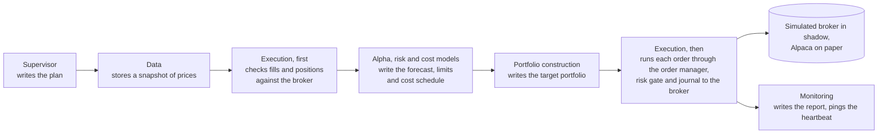

It shows the order of the work, condensed from the diagram in
[The loop and its adapters](#the-loop-and-its-adapters). Look for execution
appearing twice: once to learn what is true at the broker, and once, at the
end, to send orders. Every arrow between workers is really a file written to S3 with an event
telling the next worker it exists. Monitoring also compares the book with the
broker on its own, off the path that sends orders.

## Contents

- [The strategy the skeleton runs](#the-strategy-the-skeleton-runs)
- [Context: what the platform talks to](#context-what-the-platform-talks-to)
- [The loop and its adapters](#the-loop-and-its-adapters)
- [Data flow](#data-flow)
- [One trading day](#one-trading-day)
  - [The day at a glance](#the-day-at-a-glance)
  - [The whole decision in order](#the-whole-decision-in-order)
  - [Before the first decision](#before-the-first-decision)
  - [Phase 1: read the data and recover](#phase-1-read-the-data-and-recover)
  - [Phase 2: decide](#phase-2-decide)
  - [Phase 3: send](#phase-3-send)
  - [After the close](#after-the-close)
  - [If an instance dies in the middle of a send](#if-an-instance-dies-in-the-middle-of-a-send)
- [When something is wrong](#when-something-is-wrong)
- [What a person runs](#what-a-person-runs)
- [Types and interfaces](#types-and-interfaces)
- [The life of an order](#the-life-of-an-order)
- [The life of a run](#the-life-of-a-run)
- [What is stored](#what-is-stored), with [File formats and keys](#file-formats-and-keys)
- [Where it runs](#where-it-runs), with [Four environments](#four-environments)
  - [Rule 1: the pin names the release](#rule-1-the-pin-names-the-release)
  - [Rule 2: nothing the platform must keep lives only on the VM](#rule-2-nothing-the-platform-must-keep-lives-only-on-the-vm)
  - [Rule 3: the broker key lives in a secret store](#rule-3-the-broker-key-lives-in-a-secret-store)
  - [Rule 4: the kill switch and the hard caps are blobs](#rule-4-the-kill-switch-and-the-hard-caps-are-blobs)
  - [Rule 5: the runtime's credential does only what the rules need](#rule-5-the-runtimes-credential-does-only-what-the-rules-need)
  - [Rule 6: a rollback is a pin to an earlier digest](#rule-6-a-rollback-is-a-pin-to-an-earlier-digest)
  - [Rule 7: systemd keeps every process running, up to a limit](#rule-7-systemd-keeps-every-process-running-up-to-a-limit)
  - [Rule 8: the runtime has a VM of its own](#rule-8-the-runtime-has-a-vm-of-its-own)
  - [Rule 9: a replacement VM's supervisor reads the run's plan](#rule-9-a-replacement-vms-supervisor-reads-the-runs-plan)
  - [Rule 10: the release is one container image](#rule-10-the-release-is-one-container-image)
  - [Rule 11: an environment scales out to a cluster of three VMs](#rule-11-an-environment-scales-out-to-a-cluster-of-three-vms)
- [Package layout and the import rule](#package-layout-and-the-import-rule)
- [How the four acceptance tests exercise it](#how-the-four-acceptance-tests-exercise-it)
- [Proposals awaiting a ruling](#proposals-awaiting-a-ruling)

## The strategy the skeleton runs

Acceptance test 1 asks the backtest to reproduce a strategy that
[quantitative-trading](https://github.com/l3a0/quantitative-trading) has
already replicated. A mismatch then points at the platform rather than the
idea, because the strategy's numbers are already pinned there.

The proposal is Chan's Bollinger band on the price spread between GLD, a gold
ETF, and USO, an oil ETF. It is Example 3.2 of *Algorithmic Trading* and
[Entry 26](https://github.com/l3a0/quantitative-trading/blob/19aadbeb9730bf34f724af5688669b6bc208d136/docs/replication-log.md#entry-26-bollinger-bands-on-gld-and-uso-chans-algorithmic-trading) of that repository's replication log, and
[a post in its blog](https://github.com/l3a0/quantitative-trading/blob/main/blog/bollinger-band-lessons.md)
walks through it. A Bollinger band is a moving
average with a band of one standard deviation on each side, and this strategy
trades when the spread leaves its band. Read at quantitative-trading's commit
`19aadbeb`, the rule is four steps.

1. Each day, fit the hedge ratio `h`, the number of GLD shares that offset one
   USO share. It is the slope of a regression of USO's close on GLD's close
   and a constant, over the last 20 closes.
2. Form the spread `USO − h·GLD`.
3. Measure how many standard deviations the spread sits from its own 20-day
   mean. That count is the spread's z-score.
4. Go long one unit of the spread when the z-score falls below −1, and exit
   when it rises above 0. Go short one unit above +1, and exit below 0.
   Otherwise hold. One unit is `+1` share of USO and `−h` shares of GLD.

The position is only ever one of three states, and the z-score decides each
move at the close:

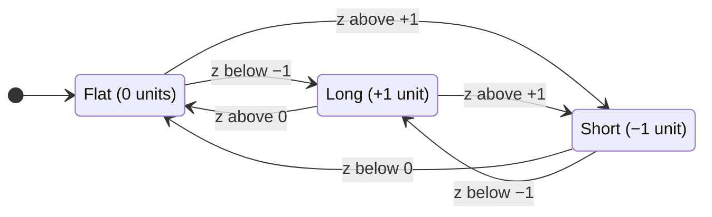

The diagram shows step 4. Look for the last two arrows, the reversals: a jump
past 0 and through the far band on one close exits one side and enters the
other. Two figures from the blog post show the same moves on the run itself.


The sketch shows sixteen days up close. Look for each entry beyond a band and
each exit at 0.


The chart shows the whole run. Look at the middle panel, which holds the three
states of the diagram above.

Steps 1 to 3 run every day whatever the state, which is why a held position
trades on days the units do not change:

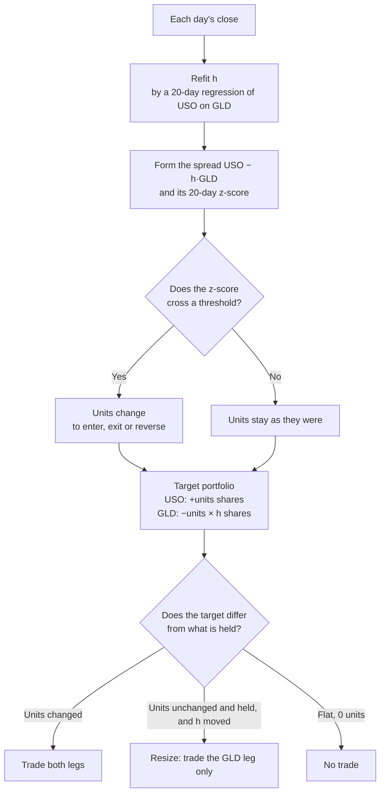

The diagram shows one close, from the refit to what trades. Look for the two
paths that keep the same units. A refit moves `h` even when the position holds
still, so the target moves too, and the engine trades the difference as it
would for any strategy. The USO leg stays at one share per unit, so only GLD
resizes.

These numbers are made up to show the mechanics, and share counts are per unit
of the spread:

**Table:** How the position and its legs resize, day by day, with made-up numbers

| Day | z-score | Units | `h` | Target USO | Target GLD | What trades |
| --- | --- | --- | --- | --- | --- | --- |
| Monday | −1.2 | +1 | 0.50 | +1 | −0.50 | Enter: buy 1 USO, short 0.50 GLD |
| Tuesday | −0.4 | +1 | 0.53 | +1 | −0.53 | Resize: short 0.03 more GLD |
| Wednesday | −0.2 | +1 | 0.51 | +1 | −0.51 | Resize: buy back 0.02 GLD |
| Thursday | +0.1 | 0 | 0.52 | 0 | 0 | Exit: sell 1 USO, buy back 0.51 GLD |
| Friday | +0.4 | 0 | 0.50 | 0 | 0 | Nothing: flat, so `h` has no effect |

Four facts make it the simplest candidate there.

1. **Two liquid ETFs, daily closes.** The backtest reads daily closes only,
   with no futures rolls and no stock panel. The live decision also reads one
   quote per ETF at close−20, 15:40 on a full day, from marketlake's segments.
2. **One committed source.** [`data/inputdata_etf/gld.csv`](https://github.com/l3a0/quantitative-trading/blob/19aadbeb9730bf34f724af5688669b6bc208d136/data/inputdata_etf/gld.csv) and
   [`data/inputdata_etf/uso.csv`](https://github.com/l3a0/quantitative-trading/blob/19aadbeb9730bf34f724af5688669b6bc208d136/data/inputdata_etf/uso.csv) were lifted from Chan's `inputData_ETF.mat`, cover
   2006-04-26 to 2012-04-09, and each has a recorded SHA-256 checksum. Each
   file is a vintage, meaning one source's copy of a series stored once and
   never changed, as [design.md](design.md#vocabulary) defines it.
3. **A discrete unit.** The number of spread units held is only ever −1, 0 or
   +1, so a test can check it on each day, not only a summary ratio. The share
   counts are not discrete. One unit holds `−h` shares of GLD, and `h` is a
   regression slope refitted daily, so the GLD leg is fractional on every day
   the strategy holds a position. The replication never deals in shares. It
   turns units, the hedge ratio and prices into a dollar position per leg, so
   test 1 checks the unit and the dollars, never a share count.
4. **Tight pins.** [`tests/test_bollinger.py`](https://github.com/l3a0/quantitative-trading/blob/19aadbeb9730bf34f724af5688669b6bc208d136/tests/test_bollinger.py) pins the APR at 0.17824928 and the
   Sharpe ratio at 0.96467289, both to 5e-9, over 1,480 rows. It also pins 162
   changes of unit, made of 77 entries, 76 exits and 9 reversals.

The replication has four quirks. The
engine carries none of them: it runs any strategy, and it keeps a capital
account. So each quirk lives in the strategy's own pieces or in test 1's
comparison, never in a shared module, and a second strategy changes none of
them.

1. The strategy refits the hedge ratio every day, so its target resizes the
   GLD leg even on days the unit does not change. That is the alpha model's
   forecast changing, and the engine trades the difference like any other.
2. The replication's return is profit over the gross dollars held, with no
   capital account. The engine keeps a capital account, so test 1's
   comparison recomputes Chan's return from the positions and prices the run
   recorded, rather than reading the engine's own return.
3. The moving standard deviation divides by `n − 1`, as MATLAB does, which
   lives in the alpha model. Dividing by `n` moves the APR to 0.183306.

   

   The sketch, also from the blog post, shows why the divisor matters. Look
   for the days one divisor's dot crosses +1 and the other's does not.
4. The replication charges no transaction cost, so the cost model in
   [#8](https://github.com/l3a0/ithildin-runtime/issues/8) runs at zero in this strategy's configuration for test 1.
   Paper trading then charges a flat or linear cost.

Every quantitative-trading result is exploratory, meaning found by looking at
the data, and this one is too. Test 1 uses it as a known answer for checking
the engine. Running it on paper promotes the platform's version, not the
strategy, because a strategy is promoted only by its registered test,
which runs on paper with its hypothesis committed before its sample opens. Registered means
the hypothesis was committed in writing before the number was seen.

## Context: what the platform talks to

A context diagram shows the platform as one box and everything outside it that
it talks to.

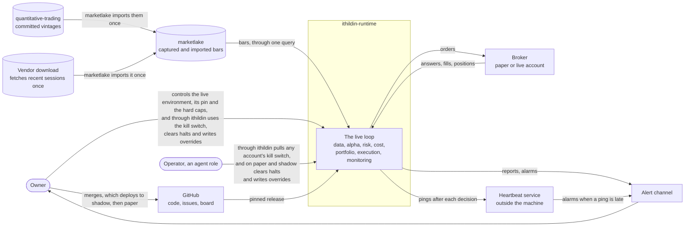

### Where bars come from

The platform reads every bar from one place, marketlake, the sibling repository
that captures market data before anything computes on it. Each source is
transformed into marketlake once, stored durably there, and read by every mode
through one query, so a backtest and a live run never read bars by different
paths. The runtime runs on a VM of its own and reads a local mirror of the
partitions it downloads from marketlake's bucket, as `## Where it runs` says.
marketlake holds three kinds of bar.

**Table:** The three kinds of bar marketlake holds

| Kind of bar | Comes from | Read by |
| --- | --- | --- |
| Captured | marketlake's capture, which has held GLD and USO since Monday 2026-11-02's session | Shadow, paper and live trading |
| Committed vintages | quantitative-trading, imported once | The backtest |
| Recent vendor download | One download of the latest sessions, imported once | The strategy's first decisions, until capture covers them |

The vendor download exists because the strategy's first z-score needs about 40
sessions of closes: 20 to fit the first hedge ratio, and 20 more spreads to fill
the z-score's 20-day window.

Every bar says whether it was captured or imported, in `origin`, and where an
imported one came from, in `vintage_id`, so a consumer can refuse imported
history where only captured data will do. Imported history never overwrites a
captured partition.

### How long data is kept

No session ages out for the runtime, and only a day's capture segments go, as
[Reading the day before it is sealed](#reading-the-day-before-it-is-sealed)
says. marketlake's VM can delete older partitions
from its own disk once its backup bucket holds them, but the runtime reads a
mirror of that bucket, which keeps every session, and never the VM's disk. So
the 2006 to 2012 history and a lookback of any length stay readable.

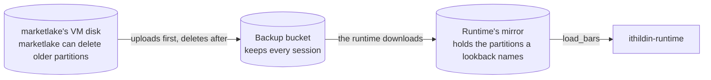

The diagram shows the path a bar takes to the runtime. Look for the missing
arrow: nothing connects the VM's disk to the runtime, so a deletion there cannot
reach a lookback.

### Reading the day before it is sealed

A decision at close−20, 15:40 on a full day, needs today's quotes, but
marketlake runs its validation battery only when it seals a day, at the close
plus fifteen minutes. So the runtime may read the day's data before marketlake
seals it, as a provisional read, and it checks that data twice: its own minimum
checks before anything decides, and a comparison with the sealed day afterwards.
The skeleton decides this way because it trades the close, so its fill lands on
the close the backtest fills at.

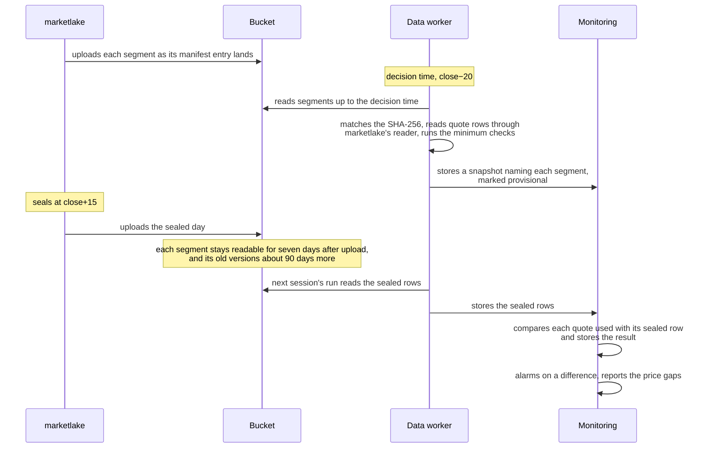

The diagram shows one day's read before sealing. Look for the two checks either
side of the seal, and for monitoring's comparison, which runs after the decision
has already acted. The read has five parts.

1. **What is read.** marketlake's capture daemon writes a segment each cycle and
   never rewrites it once its manifest entry lands, which makes an early read
   safe. marketlake uploads each segment to its bucket as soon as that entry
   lands, refusing to replace an existing key. Any decision time inside
   marketlake's capture hours reads those segments, up to the decision time. The
   skeleton's close−20 is one such time, and the shadow run on SPY and QQQ that
   [#16](https://github.com/l3a0/ithildin-runtime/issues/16) sets decides at the same minute. The
   data worker reads an unsealed day through the one reader marketlake publishes, [l3a0/marketlake#1004](https://github.com/l3a0/marketlake/issues/1004), which [#5](https://github.com/l3a0/ithildin-runtime/issues/5) waits on. Given a ticker, a day and a time, the reader returns the quote rows captured so far, the same rows the seal would produce for those minutes, so joining a ticker-day's segments has one implementation. marketlake's publication lag, from a cycle's capture to its segment in the bucket, is a published input. A decision whose newest cycle has not landed by the decision time treats that quote as missing or stale under the rule [#7](https://github.com/l3a0/ithildin-runtime/issues/7) sets, [#5](https://github.com/l3a0/ithildin-runtime/issues/5) holds how, and shadow measures the lag.

   ```mermaid
   flowchart LR
       seg["Segment in the bucket"] --> sha["Match its SHA-256 against the object's<br/>stored SHA-256 and metadata"]
       sha -- "Mismatch" --> halt["Halt the decision"]
       sha -- "Match" --> read["marketlake's reader<br/>joins a ticker-day's segments"]
       read --> rows["Quote rows"]
   ```

   The diagram shows one segment becoming quote rows. Look for which steps are
   the runtime's. The SHA-256 match is the check [The runtime has a VM of its own](#rule-8-the-runtime-has-a-vm-of-its-own)
   requires, which reads the stored SHA-256 and metadata that carry the segment's manifest entry under `lake-live/`. The reader comes from marketlake's package, a
   dependency at a pinned commit, and [l3a0/marketlake#1004](https://github.com/l3a0/marketlake/issues/1004) states what it does when a segment is absent or fails its SHA-256, so the data worker can halt on it. The reader reads only the root the data worker checked, and the snapshot's list comes from the worker's own download.
2. **What is checked before deciding.** The data worker runs its own minimum
   checks before anything decides. A missing or stale quote at the decision time
   halts the decision, a segment whose SHA-256 does not match its manifest entry halts it too, and a price spike is flagged in the snapshot, and the send stage's flag test halts the decision when the instrument is traded or held. This doc proposes, for [#7](https://github.com/l3a0/ithildin-runtime/issues/7), that the test runs with no order needed.
3. **Which read a decision uses.** Whether the day is sealed when the read
   happens picks the read. A live decision before the seal reads segments,
   because no partition exists yet. A replay reads the sealed partitions, up to
   the decision's time, because the partition is what stays.

   ```mermaid
   flowchart TD
       t{"Is the day sealed<br/>when the read happens?"}
       t -- "No" --> seg["Read segments, marked provisional"]
       t -- "Yes" --> part["Read sealed partitions<br/>up to the decision time"]
       part --> same["A replay of a decision<br/>read before sealing lands here"]
   ```

   The diagram shows the choice. Look for the replay: a backtest that replays a
   close−20 decision reads the sealed rows up to that decision's time. Those are
   the rows the live decision read, unless a row's segment landed after the decision, or part 4's comparison found a
   difference. On such a day a replay shows the sealed rows rather than what the
   decision read, and the journal holds the difference. Test 2 covers both reads, with a sealed stretch for the replay and
   a fixture day left unsealed for the read of segments. A decision after the
   seal needs none of this.
4. **What is compared after the seal.** The snapshot names each segment it read
   by key, S3 version and SHA-256, and marks the read provisional. Once marketlake
   seals the day, monitoring compares each quote the snapshot used with the sealed
   row of the same ticker and minute, by bid, ask and last as received, because a
   segment and the partition built from it never share bytes. The stored snapshot
   holds every `Quote` field and each bar's `vintage_id`, as `Snapshot` does in memory, so
   monitoring reads the used quote from the snapshot. A segment that is gone
   changes nothing, and the comparison holds for as long as the snapshot does.
   The data worker's role, in the next session's run, reads the sealed row and stores it, so data stays the one reader of marketlake, and monitoring's role compares, as [#5](https://github.com/l3a0/ithildin-runtime/issues/5) and [#11](https://github.com/l3a0/ithildin-runtime/issues/11) hold. Each provisional snapshot gets a stored comparison result within a written bound after the close. A missing result, or a sealed day that never arrives, pages and stops no decision. This doc proposes, for [#5](https://github.com/l3a0/ithildin-runtime/issues/5), that the comparison also takes the newest sealed row at or before the decision time, so a row whose segment landed after the decision shows as a difference.

   **Table:** What monitoring does with each thing it finds after the seal

   | Monitoring finds | It does |
   | --- | --- |
   | A value that differs from the sealed row | Journals and alarms |
   | A row the sealed day quarantined or lacks | Journals and alarms |
   | A gap between the price the decision used and the official close | A report line, since the two differ by design |
   | A gap between a market-on-close fill and that close | A report line, since the two differ by design |

5. **What this rests on.** marketlake publishes a window: each segment stays
   readable for seven days after upload, with old versions kept about 90 days
   more, as [l3a0/marketlake#995](https://github.com/l3a0/marketlake/issues/995) records, and nothing in the runtime knows when one goes. A read before sealing is the
   only read that needs a segment, because a replay reads partitions and the
   comparison reads the snapshot. Only the uploader refuses an overwrite so far, and
   [l3a0/marketlake#985](https://github.com/l3a0/marketlake/issues/985) holds making S3 itself refuse one. A snapshot
   keeps naming each segment it read, as the record of what the decision read,
   though after the window those names point at nothing. The window reads age alone, so a day whose sealed partition never reached the bucket ends with marketlake's VM volume as its only copy, and [l3a0/marketlake#996](https://github.com/l3a0/marketlake/issues/996) is the page that rests on. The provisional read
   is proposed for [#5](https://github.com/l3a0/ithildin-runtime/issues/5) and [#16](https://github.com/l3a0/ithildin-runtime/issues/16).

### The previous session's daily bar

The close−20 decision on a session needs the previous session's official daily
bar for its lookback, so marketlake fetches each bar at its own session's 18:30
sweep, still checked against that session's 16:15 quote, rather than serve a
provisional bar. So the close−20 decision reads the previous session's official bar
through `load_bars`, and [#16](https://github.com/l3a0/ithildin-runtime/issues/16)'s shadow run reads the previous session's
official close the same way. That bar
is Schwab's daily candle as fetched at the session's own 18:30 sweep. A
correction Schwab publishes later is not picked up, and nothing measured has
shown one, which [l3a0/marketlake#962](https://github.com/l3a0/marketlake/issues/962) records as its price. The lookback stays on daily
closes, and the close−20 quote stands where the backtest uses the session's
close. That is the timing gap [How the four acceptance
tests exercise it](#how-the-four-acceptance-tests-exercise-it) names, which shadow running
measures.

### Orders and the two outside switches

The platform sends orders to one place, Alpaca's paper account. Shadow fills its own orders in the simulator, so they reach no broker.

Two switches come from outside the loop.

1. **The live switch** is the live environment, which only the owner builds, gives the live key and pins a release in, which is hard limit 1 in [CLAUDE.md](../CLAUDE.md). Paper and live never share a VM, a bucket or a key, as `### Four environments` says.
2. **The kill switch** halts trading. The
   risk engineer builds it and writes when to pull it, and the operator pulls
   it by that guidance. The owner can pull it too.

### The heartbeat

A dead-man check raises an alarm when a ping it expects fails to arrive. Here
monitoring pings a heartbeat service as each decision's last step, and the
service alarms when a ping is late against the deployment's schedule. The service sits outside the machine because a
check on the same machine dies with it, and a machine where nothing runs is
the failure the check exists for. The heartbeat service is healthchecks.io, in the
project marketlake already runs.

The alert channel is how an alarm reaches the owner, and it has three routes.

1. **healthchecks.io's ntfy push and email integrations** carry the dead-man checks' alarms. No runtime VM holds an address for them.
2. **The push topic** is an ntfy topic of an environment's own. Shadow, paper and live each hold one, separate from marketlake's and from each other's, on the same phone. Every push an environment's VM or AWS account sends straight to ntfy goes to that environment's topic. An environment's VM, parameters and EventBridge route hold only that environment's address, and no runtime VM, parameter or EventBridge route holds marketlake's topic address. [An ntfy topic's name is its only password](https://docs.ntfy.sh/publish/), so that separation holds only while no address can be guessed or derived from another environment's. This doc proposes, for [#11](https://github.com/l3a0/ithildin-runtime/issues/11), that each topic's name is a long random value.
3. **Email through an SNS topic** goes with two alarms, the promotion check and the live drill check, which say that a scheduled job stopped running. [Email on two checks](#rule-9-email-on-two-checks) says how.

A ping says only that a decision finished. The jobs [Faults are expected](design.md#faults-are-expected-and-the-platform-checks-itself-while-it-runs) lists, such as the daily report, run apart from a decision and get no check of their own. Monitoring reads each job's age and pages through the alert channel, as that section says.

## The loop and its adapters

[design.md](design.md#one-runtime)'s `## One runtime` says backtest, paper and
live run the same modules and differ only in adapters at the edges. The usual
name for that shape is ports and adapters. A port is an interface the modules
define, and an adapter is one implementation of it that talks to the outside
world. No module imports an adapter.

Each component runs as its own process,
processes pass everything through files, and the platform is an
event pipeline. [design.md](design.md#processes-and-files)'s
`## Processes and files` gives the reasoning and the rules. So each module
here runs as one worker, a process of its own that the host keeps running.
The supervisor writes the run's plan, whose event reaches every worker, and each one listens on its own queue. An event there wakes the worker for a blob it reads, such as an input's decision result, the plan, the run's halt or stop, or the kill switch, and the worker then checks the keys it builds from the plan, reads the output files that result lists, writes its own output files, and
writes its own decision result last. A worker's entry point builds the
adapters for the mode it is given and hands them to the module, so the module
never learns which mode it is in.

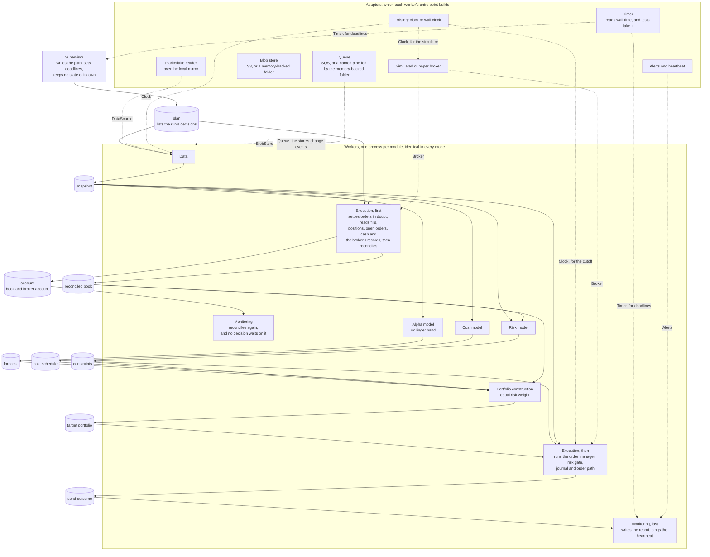

Each cylinder is one component's output files for a decision, and the decision
result that lists them, each a blob written once at a key fixed by the run,
the stage and the decision. A solid arrow into a worker is an output it
reads. When a worker writes its decision result, S3's event for it reaches the queue of each worker that reads it, which wakes that worker's receive loop, and the loop hands the work to a free handler in the worker's pool. Every
worker reads the plan, which the diagram draws only into the two that start
the day, and monitoring reads every component's results, which the diagram
leaves out to stay legible. Each dotted arrow from an adapter is a port,
labelled with its name, and each mode is one choice of adapter for each port.
Execution and monitoring each appear twice because each has two stages in one
process, and each stage writes its own decision result. Execution recovers first and then, once the target portfolio
exists, sends. Execution's recover stage reconciles the book with the broker, and monitoring reconciles again with nothing waiting on it and reports last.

Two groups of workers run at the same time.

1. Execution's recovery for a decision waits for data's snapshot and for its
   own send result for the decision before, so it reads the broker at the
   decision's own time, and reconciles the book with the broker itself, halting on a difference. Monitoring's reconcile repeats the check for its report and alarm, and no decision waits on it.
2. Alpha and cost need only the snapshot, and risk also needs the reconciled
   book, so the three models overlap.

Execution sends only what the target portfolio asks for, so nothing it sends
can come from a snapshot or a book that is not stored yet. When it sends, it
checks each order against the book it replays from the journal at that
moment, not against a blob.

**Table:** What each mode plugs in at each edge

| Mode | Data source | Clock | Broker, and when it fills | Blob store and journal | Alerts and heartbeat |
| --- | --- | --- | --- | --- | --- |
| Backtest | marketlake reader, the bars a test names | History clock | Simulated, by order type: a market order at the decision quote, a buy at the ask and a sell at the bid, and a market-on-close order at the official close | A memory-backed folder, holding the backtest's own journal, gone when it ends, in the test environment or on a developer's machine | Recorded, not sent |
| Shadow | marketlake reader, captured bars, plus the imported download until capture covers the lookback | Wall clock | Simulated, by order type, the same rule as the backtest. A market-on-close order stays open until the data source holds the official close at the 18:30 sweep, so the run's read of the day's fills finds it open, which counts as read, and the fill lands at the next recover stage. A close missing at the next recover stage halts under hard limit 3, that missing input means stop, not flatten | The shadow environment's bucket, with the shadow journal | Sent |
| Paper | marketlake reader, captured bars, plus the imported download until capture covers the lookback | Wall clock | Paper broker, at its own simulated fill, which for a market-on-close order is the quote near the close rather than the auction price | The paper environment's bucket, with the paper journal | Sent |
| Live | marketlake reader, captured bars, plus the imported download until capture covers the lookback | Wall clock | Live broker, at its own fill | The live environment's bucket, with the live journal | Sent |

Every mode reads bars through the same marketlake reader. The modes differ in
which bars they read and which clock drives them, not in how they read. Shadow
reads live bars and decides real orders, but fills them in the simulated
broker, so no order reaches any broker. The diagram leaves out the
live broker, because only the owner switches to it.

### Six things differ by mode

Modes differ in six things, and they fall into two groups.

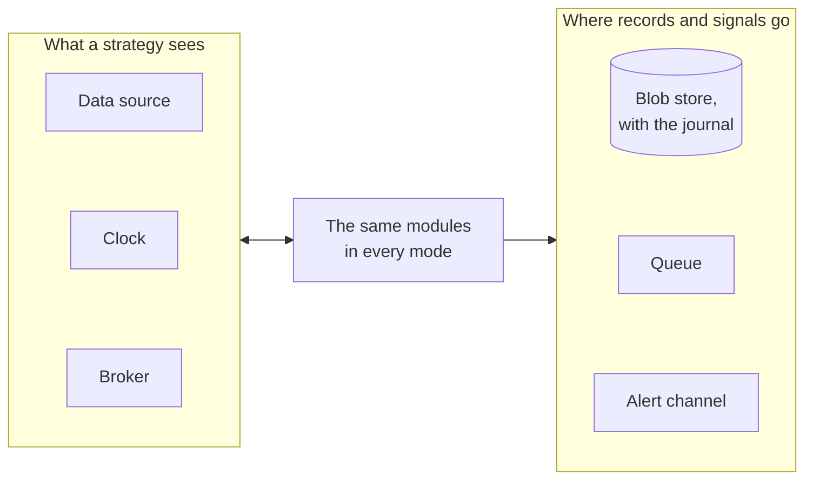

[design.md](design.md#one-runtime) names the three adapters that change what a
strategy sees:

1. The data source.
2. The clock.
3. The broker.

It lists three more beside them, which change only where records and signals go:

1. The blob store, which holds the journal too.
2. The queue.
3. The alert channel.

Those three differ because a backtest of 1,480 decisions must not append to the
paper journal or page the owner.

### No module asks which mode it is in

A module that asks has broken the shape, because its backtest would then test a
branch the paper run never takes.

The broker adapter also decides which account a worker acts for. A worker's
lease, a blob that names the one instance allowed to change that account while it holds the lease, and
its kill switch both belong to that account. So a backtest's simulated account
never shares the paper account's lease.

### One simulator serves backtest and shadow

1. **It fills by the order, not by the mode.** The order's type and time in
   force decide the fill.
2. **Its state outlives a run.** It keeps orders and positions as one
   blob per account per call, written before the call returns, outside any
   run's prefix.
3. **It can fail on purpose.** A seeded fault fills one leg of a pair in part,
   or not at all, so a replay runs the stranded-leg path paper trading will.

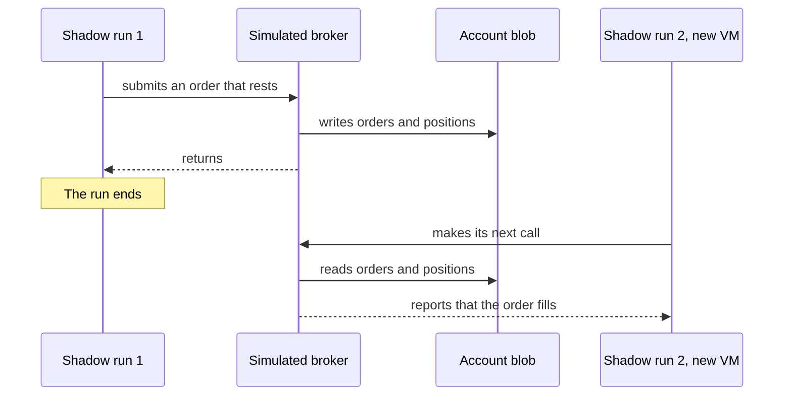

### What a worker works through

The event that design.md says modules are written against is one decision
result. In a backtest each worker works through every decision of the span in
turn. In the other modes it works through one trading day's decisions, as
design.md's `### A worker works through a span of decisions` says.

## Data flow

A data flow diagram shows the components, the order they talk in, and each point where a call crosses a trust boundary. A trust boundary is a line where what a caller may do changes, such as the edge of execution, the only component that holds the broker key. Threat modeling starts from these crossings, because that is where data can be read, changed or forged, so each one needs a stated protection.

The dashed boxes are trust boundaries, the cylinders are stores, and the rounded boxes are things outside the platform. The numbers give the order of one decision on paper, and a sub-number, such as 9.2, names one arrow of a step that has several. Flow 0 happens before the session, and flow 15 whenever a person acts. In shadow, flows 6, 10 and 11 go to the simulated broker and cross nothing, and no broker key exists.

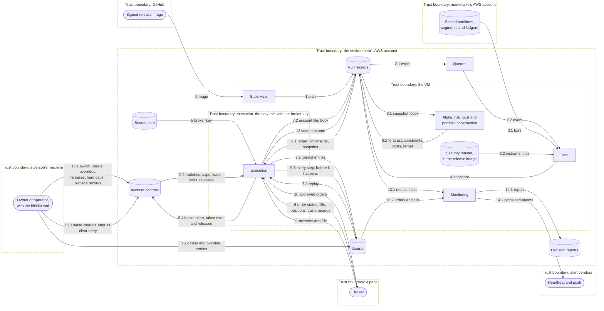

Flows outside one decision, such as pin writes and a failure's direct alarm route, are drawn in [Where it runs](#where-it-runs).

**Table:** Each flow that crosses a trust boundary

| Flow | Crosses | What could go wrong | What protects it |
| --- | --- | --- | --- |
| 0 image | GitHub into the VM | A forged or altered release runs | The VM checks the pinned digest and its attestation, and refuses otherwise |
| 1, 4, 7.1, 7.2, 8.2, 9.3, 12, 14.1 writes | The VM into storage | A component overwrites or forges a record | Each component has its own role, every write is create-only with its SHA-256, and the journal chains by hash |
| 9.4 lease | The VM into storage | A holder that lost the lease rewrites it | Among the runtime's roles, only execution's rewrites an account's lease, a take on the tag it read and a renewal or a release on the tag its own last write returned, so a stale holder's write is refused. Execution creates one only where an absent lease allows it, and the bucket refuses every delete there |
| 7.3, 8.1, 9.1, 13.1, 13.2 reads | Storage into the VM | A component acts on a changed blob | Each read checks the SHA-256 its result or header lists, the journal also chains by hash, and a mismatch halts |
| 2.1, 2.2 event | Storage to a component's queue | A forged or lost event starts or starves a step | An event only wakes a component, which reads the stored blob itself, and a missing result alarms past its bound |
| 3.1 bars | marketlake's account into the VM | Bars are changed, withheld or stale | Only the data worker's role reads them, read only, each object's SHA-256 is checked, and a missing, stale or quarantined input halts |
| 5 broker key | Storage into execution | The key leaks to another process | Only execution's role reads it, it stays in memory and is never mounted, and a key has no withdrawal route |
| 6, 11 broker answers | Alpaca into execution | An answer is lost, or shows an order the platform did not send | A lookup settles doubt, reconciliation compares the journal with the broker, and an unmatched order or fill halts |
| 9.2 controls | Storage into execution | A switch or a halt is missed | Execution reads them right before each broker call, and an unreadable control halts |
| 10 orders | Execution to Alpaca | An order is sent twice, or around the gate | One order path through the gate, each step journaled before the send, and a client order id on every order |
| 14.2 pings and alarms | Monitoring to vendors | An alarm is lost or forged | Each environment holds only its own checks' addresses and its own push topic's address, and the dead-man check pages when pings stop. On paper and live the SNS subscription also holds the owner's email address, written by hand. No runtime VM, parameter or EventBridge route holds marketlake's topic address, no tracked file holds a push topic's, and [#11](https://github.com/l3a0/ithildin-runtime/issues/11) holds how an EventBridge target and the tool reach it, and whether OpenTofu state may hold that address |
| 15.1, 15.2, 15.3 person's writes | A person's machine into storage | Someone else acts as the owner | Each person has their own credential, on live only the owner's role writes the release, override and hard caps keys or clears a lease, on every account only the owner's role writes an owner's record, and CloudTrail records each write and delete |

The security master is the table that maps each ticker to the platform's own instrument id, so a vendor's renamed ticker does not become a new instrument. Every run record is kept after the run, and its header names the blobs it came from. That is what makes each decision readable afterwards.

### What the data flow guarantees

**Table:** The three rules at a glance

| Rule | What it prevents | Flows |
| --- | --- | --- |
| Only execution talks to the broker | An order sent around the gate, or a fill nobody journaled entering the book | 6, 10, 11 |
| The current book comes from the journal | The broker's view quietly replacing the platform's record | 6, 7.1, 7.3, 9.3 |
| Bars reach the models only after they are recorded | A model acting on a number nobody can read back | 3.1, 4, 8.1 |

#### Only execution talks to the broker

An order sent from anywhere else would escape the gate. So only execution talks to the broker. Several execution instances run, and any of them may send, but only while it holds the account's lease, so one sends at a time. The broker's acks, fills, positions, open orders and cash come back the same way. Monitoring reconciles against the account file execution wrote rather than asking the broker itself.

Every order carries the platform's stamp, a client order id naming its strategy and decision, or for a close its close entry. The journal maps the broker's order id to it on each ack, as design.md's `### Orders the platform did not send` says.

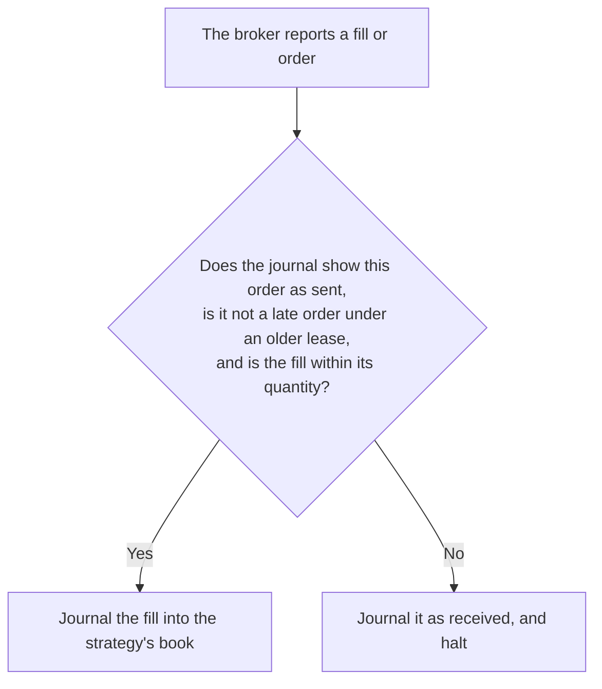

A broker's liquidation and a late order under an older lease take the "No" path too. Without the halt, a fill nobody journaled would enter the book and agree with the broker.

#### The current book comes from the journal

The book is the platform's own record of what it holds and what orders are open, so a broker's answer never replaces it quietly. Execution's recover stage replays it from the journal.

The broker's positions, open orders and cash are used in these places only:

1. The recover stage's reconcile.
2. Monitoring's second check.
3. The sync that opens the send stage.
4. A takeover's read of the broker's order list, which it stores.
5. The kill switch's read of open orders.
6. A sort's read of open orders.
7. The reconcile after the close. This doc proposes, for [#10](https://github.com/l3a0/ithildin-runtime/issues/10) and [#11](https://github.com/l3a0/ithildin-runtime/issues/11), that it compares positions, open orders and cash, and those issues hold the read.
8. A read of the broker's order list that gives an order in doubt its broker id. It supplies an id, checks each row against the order's `sending` entry, and never replaces the book.
9. The read of a leg's position and open orders just before each send of a close after a broker's trade, under [A fill is measured from the decision](design.md#a-fill-is-measured-from-the-decision-and-a-position-depends-on-a-market-it-does-not-control).

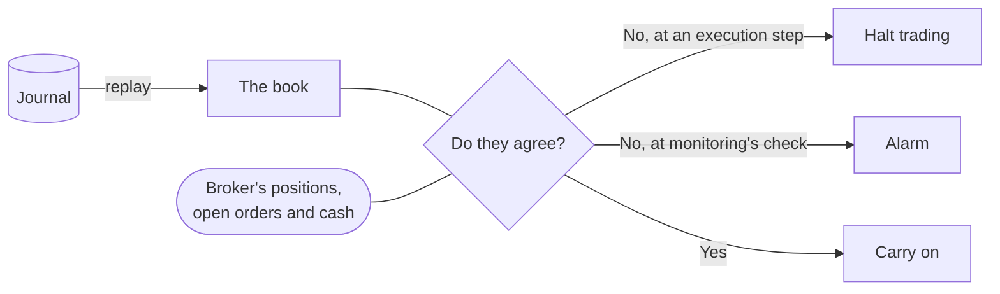

A disagreement at an execution step halts trading rather than quietly replacing the platform's record, and one at monitoring's check alarms.

#### Bars reach the models only after they are recorded

A number nobody can read back cannot be checked later. So a model never reads a feed directly, and the data worker records which bars it read first. Every number a model acted on can then be read back, from the snapshot for what the decision read, and from marketlake for the bars. Captured market data is the first of the three things [design.md](design.md#premise) says cannot be recovered, and marketlake is where it is kept.

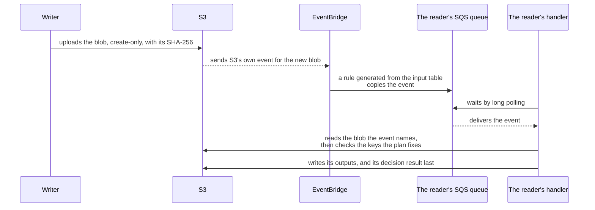

The diagram shows one write reaching one reader, so look for the event carrying only a hint and the handler reading the blob itself before it acts.

## One trading day

### The day at a glance

Every decision runs the same three phases, and one stage after the close ends the day. Phase 1 learns what is true at the broker, phase 2 decides what should be true, and phase 3 closes the gap.

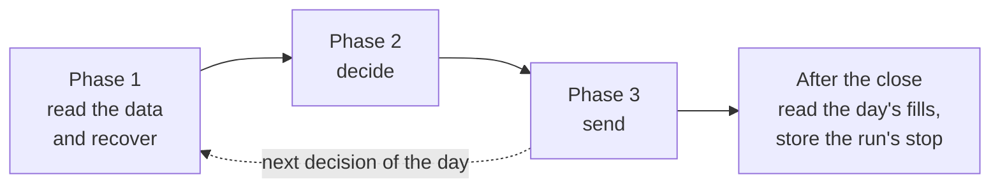

**Table:** Who acts in each phase, what it produces and what stops it

| Phase | Who acts | What it produces | What stops it |
| --- | --- | --- | --- |
| 1. Read the data and recover | Data and execution, with monitoring checking beside them | A snapshot of the bars read, and a book that agrees with the broker | Missing or stale data, or a book the broker disagrees with |
| 2. Decide | The alpha, risk and cost models, then portfolio construction | The target portfolio, within this decision's limits | A halt in any input, which each worker passes on |
| 3. Send | Execution, then monitoring | Orders at the broker, the decision's report and the heartbeat's ping | A failed check, a refused order or an order in doubt |
| After the close | Execution, then the supervisor | A result on each open order, then the run's stop | A read that fails or runs late, which pages the owner, or a difference, which halts and pages |

### The whole decision in order

A sequence diagram shows the same pieces in time order. This is one paper
decision with nothing wrong, for the skeleton's daily strategy. The
platform trades at any time of day and as often
as a strategy needs, so the time comes from the strategy's schedule, as
design.md's `### Strategies, schedules and decisions` says. The
skeleton trades the close, so the diagram draws its
decision at close−20, 15:40 on a full day, on marketlake's segments read before sealing, with
market-on-close orders that fill at the close. A strategy that decides
several times a day runs the same three phases once per decision, with the
workers left running between. The notes split it into three phases and a stage after the close. The host
keeps every worker running, the supervisor's plan starts the decision, and a
`par` block marks workers working at the same time. Each dashed arrow from
the blob store to a worker is S3's event for a blob, arriving on that worker's queue.

Alpaca rejects a market-on-close order "submitted after 3:50pm but before
7:00pm ET", so every order goes out by close−12, 15:48 on a full day, a
cutoff the owner's hard caps hold, as design.md's `### Strategies, schedules and decisions` says. That rule
also checks the cutoff again just before each broker call, and keeps a pair
whole by cancelling an accepted leg whose partner fails. The session's official daily bar arrives at marketlake's 18:30 sweep that evening. Monitoring then reports how far the decision's price and the fills sat from it.

```mermaid
sequenceDiagram
    autonumber
    participant S as Host, a systemd timer
    participant V as Supervisor
    participant F as Blob store
    participant D as Data
    participant X as Execution
    participant B as Broker
    participant J as Journal
    participant M as Monitoring
    participant A as Alpha model
    participant K as Risk model
    participant C as Cost model
    participant P as Portfolio construction

        S->>S: starts the supervisor instances' units
    V->>V: is the kill switch blob absent?
    V->>F: writes the run's plan once under the plan's lease,<br/>naming its release
    V->>S: writes the local release file,<br/>so its path unit starts each worker's unit
    F-->>D: sends an event for the plan
    F-->>X: sends an event for the plan
    F-->>M: sends an event for the plan
    F-->>A: sends an event for the plan
    F-->>K: sends an event for the plan
    F-->>C: sends an event for the plan
    F-->>P: sends an event for the plan
    X->>F: each instance runs its Startup checks, read only,<br/>before it plans or sends
    Note over V,M: Phase 1, read the data, then recover
    D->>F: stores the snapshot, naming each bar read,<br/>and data's decision result
    F-->>X: sends an event for data's result
    X->>B: asks about orders in doubt,<br/>reads fills since the last decision
    B-->>X: returns fills since the last decision
    X->>J: journals each fill
    X->>B: reads positions, open orders, cash<br/>and the broker's records
    B-->>X: returns positions, open orders, cash<br/>and the broker's records
    X->>J: journals each record as an outside entry
    X->>F: stores the account file, naming<br/>the journal entry it replayed through
    X->>X: does the book from the journal<br/>agree with the broker?
    X->>F: stores the reconciled book<br/>and execution's recover result
    F-->>M: sends an event for execution's recover result
    M->>F: stores monitoring's reconcile result,<br/>which no decision waits on
    Note over V,P: Phase 2, decide
    par
        F-->>A: sends an event for data's result
        A->>F: stores the forecast, hedge ratio, z-score<br/>and alpha's result
    and
        F-->>C: sends an event for data's result
        C->>F: stores the cost schedule and cost's result
    and
        F-->>K: sends events for data's and<br/>execution's recover results
        K->>F: stores the constraints and risk's result
    end
    F-->>P: sends events for alpha's, risk's, cost's<br/>and execution's recover results
    P->>F: stores the target portfolio and<br/>portfolio construction's result
    Note over X,J: Phase 3, send, in whichever execution instance<br/>receives the event
    F-->>X: sends an event for portfolio construction's result
    X->>F: writes a create-only claim on the send stage,<br/>naming its handler
    X->>B: reads positions, open orders, cash,<br/>the broker's records and fills since recover
    B-->>X: returns its state now
    X->>F: stores that read of the broker
    X->>J: journals its hash
    X->>J: journals any new fill under its fill id,<br/>and each new record as an outside entry
    X->>X: does the book from the journal<br/>agree with the broker?
    X->>X: runs the daily loss stop's test and the price spike<br/>flag's test, with no order needed,<br/>and creates stop.json from the result
    X->>X: the order manager plans the orders
    X->>J: journals the whole target portfolio and its<br/>planned orders, cancels and replacements
    X->>X: does the clock agree with the broker's,<br/>and is it before the cutoff?
    opt a resting order the plan cancels or replaces
        X->>F: takes the account's lease
        X->>J: journals the cancel
        X->>F: is no run or account halt stored or on the plan's lease,<br/>is its own send result empty, is the lease tag unchanged,<br/>and is it before the cancel cutoff?
        X->>B: cancels by the broker's order id<br/>that the journaled answer holds
        B-->>X: answers cancelled, filled first or accepted,<br/>or gives no answer
        opt accepted, or no answer
            X->>B: looks up once by the broker's order id
        end
        X->>J: journals the old order's outcome or its doubt,<br/>any fill included
        X->>F: releases the account's lease
    end
    loop each order the order manager plans,<br/>a replacement only if its old order settled
        X->>F: takes the account's lease
        X->>X: is the kill switch blob absent,<br/>and is it before the cutoff?
        X->>J: journals the intent
        X->>J: replays the book
        X->>X: runs the risk gate check
        X->>J: journals the approval
        X->>J: journals the sending entry
        X->>F: is the switch absent, the strategy not off,<br/>no run or account halt stored or on the plan's lease,<br/>its own send result empty, the lease tag unchanged,<br/>and is it before the cutoff?
        X->>B: sends the order, with its client order id
        B-->>X: answers
        X->>J: journals the broker's answer
        X->>F: releases the account's lease
    end
    X->>B: is every leg accepted?
    alt a leg rejected or unsent while another is accepted,<br/>or a leg's plan cancel stopped<br/>after its partner's was confirmed
        X->>F: takes the account's lease
        X->>J: journals each cancel
        X->>F: is the lease tag unchanged?
        X->>B: cancels the accepted legs
        X->>F: releases the account's lease
        loop a cancel's answer lost, inside the send stage's<br/>deadline, under design.md's rule<br/>for a cancel whose answer is lost
            X->>F: takes the account's lease
            X->>B: looks up by the broker's order id
            X->>J: journals the answer, and a new cancel<br/>when the rule for a cancel<br/>whose answer is lost allows one
            X->>F: is the lease tag unchanged?
            X->>B: sends the new cancel
            X->>J: journals its answer or its doubt
            X->>F: releases the account's lease
        end
    end
    X->>F: stores the send outcome<br/>and execution's send result
    F-->>M: sends an event for execution's result
    M->>F: stores the decision's report<br/>and monitoring's report result
    M->>M: reads the age of the jobs that run apart from a decision,<br/>and pages on one past its bound
    M->>M: pings the heartbeat service
    Note over V,J: After the close, once every decision has a result
    X->>B: reads the day's fills, positions, open orders,<br/>cash and the broker's records
    B-->>X: returns the day's fills, positions, open orders,<br/>cash and the broker's records
    X->>X: sorts what it read
    X->>J: journals each fill,<br/>and each record as an outside entry
    X->>X: reconciles the book
    X->>F: stores a result saying, for each order the journal<br/>holds as open, whether it is settled or still open
    V->>F: reads that result, and only then stores the run's stop
    Note over V,J: A read that fails or misses a written time<br/>pages the owner, and the supervisor stores no stop.<br/>A difference halts and pages whether or not<br/>the result and the stop follow
```

### Before the first decision

1. Each execution instance runs the charter's Startup step, the read-only checks listed there, in that order, as this doc proposes for [#11](https://github.com/l3a0/ithildin-runtime/issues/11).
2. It plans and sends nothing until they pass.
3. A halted instance whose digest and journal checks passed still takes a dead runner's send stage over, cancels a stranded leg and serves the kill switch, and [Every change can be undone or switched off](design.md#every-change-can-be-undone-or-switched-off) says what else a failed check still serves.

### Phase 1: read the data and recover

A run that starts on a book the broker disagrees with would trade the wrong difference. So this phase ends in a comparison, and a difference halts.

1. **Data reads the bars.** It reads what the decision's lookback needs from marketlake, about 40 sessions of each ETF, and records which ones it read before any model sees them.
2. **Execution waits for that snapshot,** so it reads the broker at the decision's own time.
3. **Execution catches up.** It settles any order a crash left in doubt, and journals the fills that arrived since the last decision. This doc proposes, for [#10](https://github.com/l3a0/ithildin-runtime/issues/10), that it also reads the broker's records, such as fees and dividends, and journals each as an outside entry, ahead of the comparison.
4. **Execution lays out both sides.** It writes the strategies' books, replayed from the journal, beside the broker's positions, open orders and cash.
5. **Execution compares them,** position by position, order by order and cash against cash, and each stamped order's filled quantity against the journal's. A cash difference a listed record explains in full passes, and any other difference halts.
6. **Monitoring repeats the same check** for its report, and nothing waits on it.

### Phase 2: decide

The alpha, risk and cost models run at once, each on the blobs it needs. The risk model sets the constraints, meaning the limits for this decision. Portfolio construction builds the target portfolio within them.

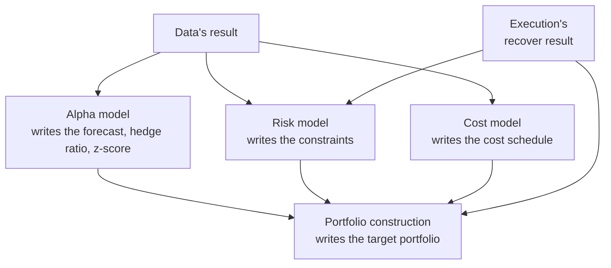

### Phase 3: send

This phase is the only one that touches the broker with an order, so it has the most checks. It has three parts: prepare once, send each order, and finish once.

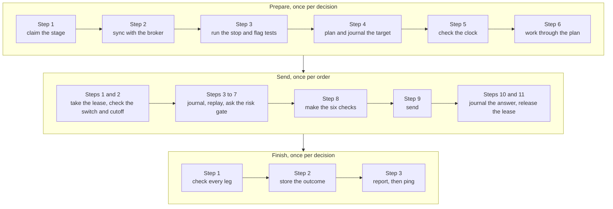

#### Prepare, once per decision

Three more checks sit inside these steps, as [How a rerun never doubles anything](design.md#rule-9-how-a-rerun-never-doubles-anything) and [Who takes over a dead send stage](design.md#rule-9-fifth-item-who-takes-over-a-dead-send-stage) say.

1. An instance checks the kill switch when it receives the event.
2. The sync settles each order in doubt.
3. Execution halts before it plans if an entry that changes the book, and that neither its sync nor its own order loop wrote, lies past the entry its sync names.

The steps run in this order.

1. **Claim the stage.** Whichever execution instance receives portfolio construction's result reads the target portfolio it lists, and writes a create-only claim on the send stage naming its handler. An instance that finds a claim it did not write never plans for that decision.
2. **Sync with the broker.** Every step fetches and syncs before changing state. So it fetches the broker's positions, open orders, cash and fills again. It stores that read and journals its hash before the comparison, as the sentence on every `Broker` read in [The interfaces](#the-interfaces) says. It journals any fill that arrived since phase 1. This doc proposes, for [#10](https://github.com/l3a0/ithildin-runtime/issues/10), that it also reads the broker's records and journals each as an outside entry, ahead of the comparison. It then checks the journal's book against the broker. A fill of its own order brings the book up to date. Any order or fill the journal did not send is journaled as received and halts for a person.
3. **Run the daily loss stop's test and the price spike flag's test.** This doc proposes, for [#7](https://github.com/l3a0/ithildin-runtime/issues/7), that both run with no order needed, so a decision that plans no order still runs them, and that the stop's test creates `stop.json` from its result, as [The risk gate refuses an order](#the-risk-gate-refuses-an-order) says.
4. **Plan the orders and journal the target whole.** Each strategy's order manager turns the target minus that strategy's own positions and open orders into planned orders, cancels and replacements. One stored entry holds the target, the planned orders, cancels and replacements, each with its client order id, the journal entry it synced through, a hash of the broker state it fetched, and the instance running the send stage. A target portfolio names every instrument the book holds or the forecast names, with a flat leg as an explicit zero, and execution halts on one that leaves an instrument out. A strategy that is off when this step reads it gets no planned orders, cancels or replacements, so its resting orders are left to the sort, and the entry names it as off. A strategy is off when its off switch is set or, by this doc's proposal in [How a sort runs](halts-and-drills.md#how-a-sort-runs), a strategy halt of its is unreleased, the same two things the check before each send reads. That never reads as a target of zero, so nothing it holds is sold, and the close after a broker's trade still goes out. An off switch or a strategy halt this step cannot read halts the decision. A switch set after this step is caught by the check before each send, as [What is checked right before a broker call](design.md#rule-9-fourth-item-what-is-checked-right-before-a-broker-call) says.
5. **Check the clock.** Execution confirms its clock agrees with the broker's and that the market-on-close cutoff has not passed.
6. **Work through the plan.** The order manager carries out what step 4 journaled. It cancels a resting order of the strategy's that the target no longer wants, and replaces one that should change, sending the replacement only once the old order's cancel is settled.

#### Send, once per order

Each order goes through the order path alone, and the journal gains a line before the broker hears anything.

1. Take the account's lease.
2. Check the kill switch and the cutoff again.
3. Journal the intent.
4. Replay the book from the journal, so the risk gate sees every order already approved.
5. Ask the risk gate.
6. Journal the approval.
7. Journal that it is sending.
8. Make the six checks in the table below.
9. Send, with the order's client order id.
10. Journal the broker's answer: the ack, the rejection, or the order's doubt.
11. Release the lease by a conditional rewrite that clears its holder, so another instance's cancels wait for at most one order.

**Table:** The six checks made right before the broker call

| Check | What it reads | Passes when |
| --- | --- | --- |
| 1 | The kill switch | It is absent |
| 2 | The order's strategy | It is not switched off |
| 3 | The run's and the account's halts, and the plan's lease | No halt is stored, and the lease says the run is running |
| 4 | This instance's own send result | It is still empty |
| 5 | The account's lease | It still carries this instance's tag |
| 6 | The market-on-close cutoff | It has not passed |

Any check that fails journals the order `Abandoned` and halts the decision. One exception is a switched-off strategy, whose orders are abandoned while the account's other strategies keep sending. An order under a valid close entry reads these checks as [What is checked right before a broker call](design.md#rule-9-fourth-item-what-is-checked-right-before-a-broker-call) says.

A cancel the plan asks for takes the same shape, as the sequence diagram above shows: take the lease, journal the cancel, check, call the broker, journal the outcome and release the lease.

#### Finish, once per decision

1. **Check every leg.** After the loop execution looks up each leg. It cancels any accepted leg whose partner was rejected or never sent, and any leg whose plan cancel was stopped after its partner's was confirmed.
2. **Store the send's outcome** and execution's send result.
3. **Report, then ping.** Monitoring writes the decision's report. It reads the age of the jobs that run apart from a decision, and pages on one past its bound, as [Faults are expected](design.md#faults-are-expected-and-the-platform-checks-itself-while-it-runs) says. It pings the heartbeat service last, so a decision that dies or hangs never pings.

### After the close

Once every decision has a result, the day ends in three steps, which this doc proposes for [#10](https://github.com/l3a0/ithildin-runtime/issues/10) and [#11](https://github.com/l3a0/ithildin-runtime/issues/11).

1. Execution reads the day's fills and the broker's positions, open orders, cash and records, sorts what it finds as design.md's `Sorting what the broker reports` says, journals the fills and each record as an outside entry, and reconciles. A difference halts and pages with its reason. Execution journals the open halt the holding-halt check reads, and neither that write nor the page waits on the result or the stop. [#10](https://github.com/l3a0/ithildin-runtime/issues/10) and [#11](https://github.com/l3a0/ithildin-runtime/issues/11) hold whether those are still stored after it.
2. Execution stores a result naming each order the journal holds as open as settled or still open.
3. The supervisor reads that result, and only then stores the run's stop.

A read that fails or misses a written time pages the owner, and no stop is stored, as [The life of a run](#the-life-of-a-run) says.

### If an instance dies in the middle of a send

The journal entries carry the weight of hard limit 4, which says every order is journaled before it is sent. An order's `sending` entry is what makes a crash safe, because it tells the next instance that an order may have left.

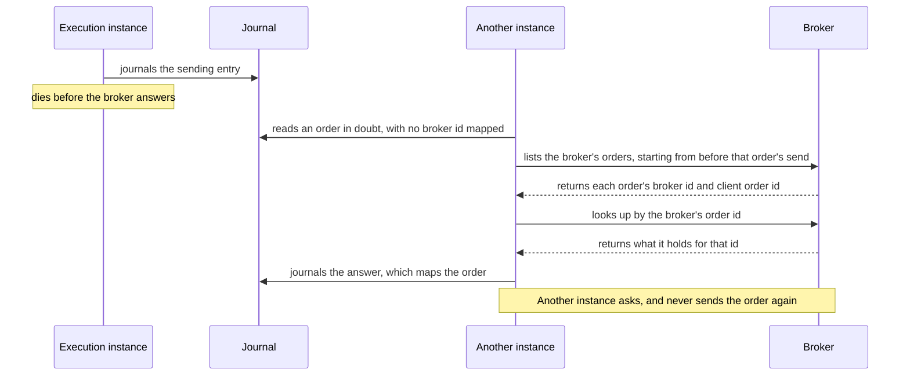

A client order id is an id the platform chooses and sends with the order. The broker gives the order an id of its own, and the journal maps one to the other on each ack. Every lookup goes by the broker's order id, because not every broker can find an order by a client order id.

An order in doubt has no ack, so the journal holds no broker id for it. `OrderPath` hands the adapter the order's intent through `find_order`, and the adapter answers with the broker's id, not found, or more than one. It also says whether its list was whole and gives each paired row it read, converted at the adapter to the platform's `BrokerOrder`, so `OrderPath` runs the match and the halts in one place. How it finds the order is the adapter's own, so a new broker changes no line of `OrderPath`. Three steps make Alpaca's lookup go by the broker's id too, and [#10](https://github.com/l3a0/ithildin-runtime/issues/10) builds them.

1. The adapter reads the broker's order list, open and closed orders alike, from the earliest `sending` entry in doubt, less a written overlap larger than the clock's bound, which [#10](https://github.com/l3a0/ithildin-runtime/issues/10) sets.
2. It returns the broker's order id from the row that carries the order's client order id.
3. `OrderPath` looks the order up by that id and journals the answer. Its ack maps the order like any other, apart from a late order under an older lease or an answer that disagrees with the `sending` entry, which halts first.

An order absent from a whole list stays `InDoubt`, because a request sent just before a crash can still arrive. A list that fails or stops early settles no order's state and halts new orders, a row already read still serves every cancel but a plan's own, and a row or an answer that disagrees with the `sending` entry halts, as design.md's `### Orders the platform did not send` says. Alpaca, the broker for paper and for live, names both ids in its [list of orders](https://docs.alpaca.markets/reference/getallorders-1), which returns at most 500 orders a call, and [#10](https://github.com/l3a0/ithildin-runtime/issues/10) confirms how the adapter pages through it.

A broker that takes no client order id gets an adapter that pairs on the order's details instead. It takes a row the journal has not mapped, matching the order's instrument, side, quantity and type inside the same window. That match is close to unique, because an account holds one portfolio, one holder of the lease sends, and the gate refuses a second order beside one in doubt. The journal's mapping stands in for the stamp there, and more than one match halts. This adapter is designed and not built, and it passes the broker suite before any such broker is used, on the terms design.md's `### Orders the platform did not send` gives.

Alpaca's [order reference](https://docs.alpaca.markets/reference/postorder) does not say whether it refuses a second order with the same client order id, so nothing here relies on that, and [#10](https://github.com/l3a0/ithildin-runtime/issues/10) tests it on the paper account as a second line of defence.

## When something is wrong

Hard limit 3 says missing input means stop, not flatten. One firm's execution
server rebooted before its alpha server, read "no signals" as "hold nothing",
and sold most of its book. The [charter](team-charter.md) cites it at L4690, a
Kindle location in the owner's highlights of Narang's *Inside the Black Box*.
Each diagram below is one way a day goes wrong, and each ends with no new orders and the positions left as they were, apart from a broker's own trade, where the close after a broker's trade under [A fill is measured from the decision](design.md#a-fill-is-measured-from-the-decision-and-a-position-depends-on-a-market-it-does-not-control) can close the whole position.

Every halt takes the same route.

1. The worker that finds the problem writes a halt as its decision result,
   with the reason, in place of its outputs. A capturing stage stores what it
   read first, and its halt names that file.
2. Every worker downstream finds that halt as its input's result, writes its
   own halt naming it, skips the decision and goes on to its next one.
3. Monitoring, which reads every component's results, journals every halt,
   raises an alarm on the halt that names no earlier one, once per reason in
   a run until a decision succeeds, writes the decision's report and pings the
   heartbeat service.

The same route runs in every mode, and the run goes on to its next decision,
which halts again if the cause is still there. A single crash is not a
failure: the host restarts the worker, which resumes from storage. A
failure is a missed deadline, a heartbeat stopped for longer than the limit set on [#11](https://github.com/l3a0/ithildin-runtime/issues/11), or
none of a component's instances healthy, and it takes the same route. The supervisor
writes the halt as the failed worker's result, stores a halt of the whole run, whose event reaches every worker, writes a halt for every decision left in the plan, and monitoring reports.

### A missing or stale bar

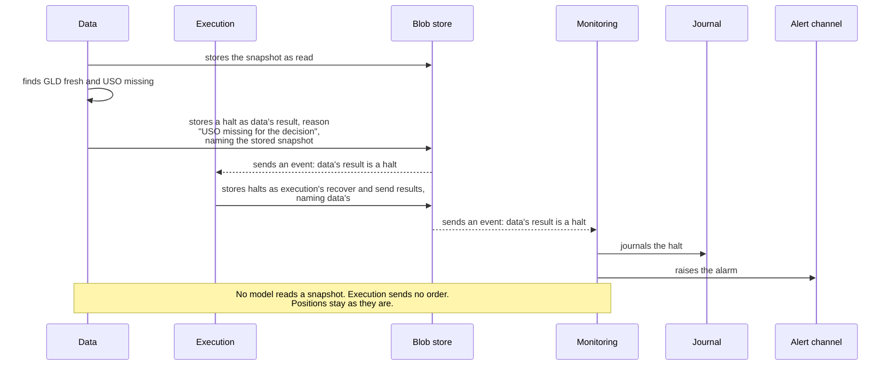

A stale bar takes the same path. Stale means the newest bar is older than the
decision time allows, which is how a feed that stopped looks when it keeps
answering. Data reports the gap and never fills it with the last close.
The charter gives the risk engineer the halt on stale data, so
[#7](https://github.com/l3a0/ithildin-runtime/issues/7) decides how old is too
old. Data applies that rule.

An empty answer halts the same way. If the alpha model writes a forecast file
with no entries and no "trade nothing" mark, portfolio construction halts rather
than reading the silence as a target of zero. A flat position is a forecast
with direction 0, never a missing forecast. The one exception is a forecast late at portfolio construction's deadline, under hard limit 3's written age, which the owner sets, which starts at 0 and which [a decision of 2026-11-06](design.md#2026-11-06) sets out.

### A restart before the data is ready

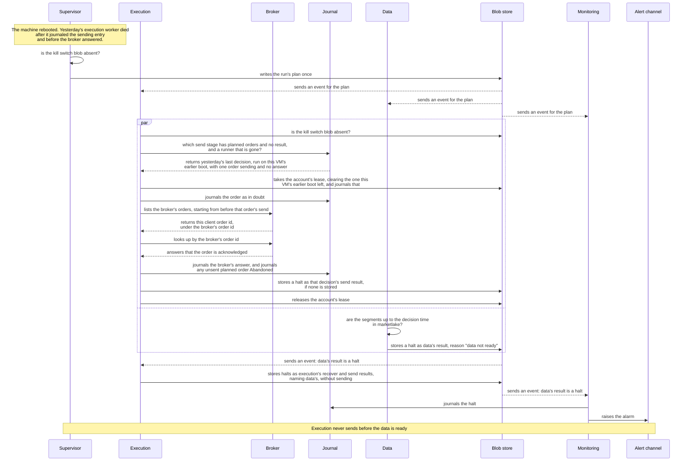

The restart runs the same first phase as any trading day.

1. On starting, execution settles the order the dead worker left half-sent, by
   asking the broker about it rather than sending it again, and halts that old
   decision, as [Who takes over a dead send stage](design.md#rule-9-fifth-item-who-takes-over-a-dead-send-stage) says.
2. Data finds the segments up to the decision time not yet in marketlake and
   halts, so execution's recover stage, which waits for data's result, halts
   too.

The order in which the processes come up no longer matters. Execution may
start before data, as it does here, but it sends only what a target
portfolio asks for, and that cannot exist until a snapshot does. The charter
gives the operator the startup order: execution may send an order only once
every upstream worker has written a decision result that lists outputs, not a
halt, for the decision. Above a written age of 0, hard limit 3's exception covers a strategy's late forecast.
The pipeline makes that order something the platform cannot get wrong. "Not ready" is a halt, never an empty forecast.

### The risk gate refuses an order

```mermaid
sequenceDiagram
    participant X as Execution
    participant J as Journal
    participant B as Broker
    participant F as Blob store
    participant M as Monitoring
    participant L as Alert channel

    X->>J: journals the intent, buy 900 USO
    X->>X: runs the risk gate check
    X->>J: journals the refusal with the limit and the value
    X->>F: stores a halt as execution's send result,<br/>reason "over the maximum position"
    F-->>M: sends an event: execution's result is a halt
    M->>J: journals the halt
    M->>L: raises the alarm
    Note over B: The broker never sees the order
```

A refusal is final, and execution halts rather than sending the rest of its
orders, because portfolio construction sized the rest assuming this one would
go through. Nothing resizes the order to fit either, since an order cut down
to pass the risk gate is a trade nobody chose. Clearing the halt sends nothing more for that decision. If the refused order is a pair's second leg and the first is already accepted, execution cancels the accepted leg, as for any pair left with one leg. The cancel aims to land before the cancel cutoff, and one that goes late is still sent and its refusal journaled. The next decision plans again from the book. On a shadow or paper account, holding
the account after a refusal until a person clears it waits for a strategy
that decides minutes apart, as design.md's
`### Strategies, schedules and decisions` says. A refusal on live holds until the owner clears it.

#### The daily loss stop

A day's loss past a set limit has to end new trading for the account, and a price that recovers must not start it again. So the stop works through the same risk gate, and once it fires it holds until a person clears it.

#### How the day's loss is measured

The day's loss is the fall in the account's value at current prices, measured from its valuation at the prior session's official closes. The day's first decision stores that valuation.

Two gaps in that measure halt rather than read as no loss.

1. A decision halts when the valuation is missing, which this doc proposes for [#7](https://github.com/l3a0/ithildin-runtime/issues/7).
2. An uncomputable loss with positions held halts, and [#7](https://github.com/l3a0/ithildin-runtime/issues/7) holds how.

#### When the stop is tested

This doc proposes, for [#7](https://github.com/l3a0/ithildin-runtime/issues/7), that the send stage runs the stop's test and the price spike flag's test on every decision that reaches it, before any order is planned and with no order needed. So a decision that plans no order still tests the stop.

The stop has a stated limit: no decision tests the price move from close−20 to the close.

#### What happens when the stop fires

A fired stop latches, which means it stays fired whatever the price does next. This doc also proposes that for [#7](https://github.com/l3a0/ithildin-runtime/issues/7), in four steps.

1. The first time the send stage's test finds the day's loss past the stop, execution creates a blob at `accounts/<account>/stop.json` with a create-only write, as the kill switch is created, and journals it.
2. `OrderPath` reads that blob before every new order, as it reads the switch, and hands its state to the gate.
3. The gate refuses every new order while the blob exists, across sessions, so a price that recovers never resumes trading on its own.
4. `ithildin stop clear --account <a>` deletes the blob and journals the clear. On a live account only the owner may, and on shadow and paper the operator may too, as the charter's owner and risk engineer sections say.

```mermaid
flowchart TD
    fire["Step 1: execution finds the day's loss past the stop,<br/>creates stop.json and journals it"]
    read["Step 2: OrderPath reads stop.json before every new order<br/>and hands its state to the gate"]
    refuse["Step 3: the gate refuses every new order"]
    clear["Step 4: a person runs ithildin stop clear,<br/>which deletes stop.json and journals the clear"]
    fire --> read
    read --> refuse
    refuse -->|"the price recovers, or a new session opens:<br/>the blob stays, so the gate keeps refusing"| read
    refuse -->|"only a person ends it"| clear
```

#### Which orders a stop refuses

A fired stop has one exception. The close after a broker's trade closes a whole position once the broker has made a trade of its own, under [A fill is measured from the decision](design.md#a-fill-is-measured-from-the-decision-and-a-position-depends-on-a-market-it-does-not-control). That order passes a fired stop only under a valid close entry.

A failed read must not open that exception, so an unreadable stop holds the close too. Any answer other than "no such blob" reads as fired for a decision's order, and the state `OrderPath` hands the gate keeps fired and unreadable apart. [#7](https://github.com/l3a0/ithildin-runtime/issues/7) holds how.

**Table:** What the gate does with each answer from reading `stop.json`

| Answer from the read | The stop's state | A decision's new order | An order under a valid close entry |
| --- | --- | --- | --- |
| "No such blob" | Not fired | Passes this check | Passes this check |
| The blob | Fired | Refused | Passes this check |
| Any other answer | Unreadable | Refused | Not sent |

#### Why slice 1 only stops

[#7](https://github.com/l3a0/ithildin-runtime/issues/7) lists the limit as "an automatic unwind and stop". An unwind is itself a trade, so slice 1 stops only.

### The book and the broker disagree

```mermaid
sequenceDiagram
    participant X as Execution
    participant M as Monitoring
    participant F as Blob store
    participant J as Journal
    participant L as Alert channel

    X->>F: stores the account file as read
    X->>X: reconciles: the book holds 100 USO,<br/>the broker holds 90 USO
    X->>F: stores a halt as execution's recover result, with both<br/>positions, naming the stored account file
    F-->>M: sends an event: execution's halt
    M->>J: journals the halt
    M->>L: raises the alarm
    Note over X,L: No model reads a book until a person<br/>explains the difference
    Note over X,L: A broker's own trade can close the whole<br/>position while this halt stands
```

Execution trades the difference between a target and the book, so a book the broker disagrees with sends the wrong order. So the platform compares the two, and a difference it cannot explain halts trading until a person has.

#### Who compares the book with the broker

Two workers compare the broker with the sum of the strategies' books.

1. Execution's recover stage compares them before a decision trades.
2. Monitoring compares them again for its report.

Both compare positions, open orders and cash. So an order the broker holds and the journal marks lost or abandoned halts the day it appears, not the day it fills.

#### What each difference leads to

A mismatch in a position means one of two things: a fill the platform never journaled, or a position the broker changed on its own. Both need a person. The table below lists each case and what it needs.

**Table:** What the platform does with each thing the comparison finds

| What the comparison finds | What the platform does | What a person does |
| --- | --- | --- |
| A fill the platform never journaled | Halts | Explains the difference |
| A position the broker changed on its own | Halts | Explains the difference |
| A split or an assignment, in shadow or on paper | Halts. An outside entry from the broker's own record releases the halt once it explains the whole difference and any close has ended, under the rule that any difference from the broker halts trading ([Faults are expected](design.md#faults-are-expected-and-the-platform-checks-itself-while-it-runs)) | Nothing for a split. An assignment leaves its strategy off until a person switches it back on |
| A broker's own trade, such as a forced close or a buy-in | Halts. The order that closes the rest of the position can go out before a person acts, under the close after a broker's trade ([A fill is measured from the decision](design.md#a-fill-is-measured-from-the-decision-and-a-position-depends-on-a-market-it-does-not-control)) | On a live account, clears the halt once every leg has ended. In shadow and on paper the outside entry releases it then |
| An order the broker holds and the journal marks lost or abandoned | Halts the day it appears | Explains the difference |
| A broker record of a type on the closed list, with its amount in range | Journals it with no halt | Nothing |
| A broker record that leaves a difference unexplained | Halts | Explains the difference |
| By this doc's proposal for [#10](https://github.com/l3a0/ithildin-runtime/issues/10), a record that repeats a record id with different content | Halts | Explains the difference |

The closed list of record types, and the four cases that halt, are in [Strategies, schedules and decisions](design.md#strategies-schedules-and-decisions).

#### Who owns reconciliation

Reconciliation lives on [#11](https://github.com/l3a0/ithildin-runtime/issues/11). The charter has the trading systems engineer write it, so that role reviews it there.

### The kill switch and the dead-man check

```mermaid
sequenceDiagram
    participant P as Owner or operator
    participant K as ithildin switch pull, off the VM
    participant F as Blob store
    participant V as Supervisor
    participant X as Execution
    participant B as Broker
    participant J as Journal
    participant M as Monitoring
    participant H as Heartbeat service
    participant A as Alert channel

    P->>K: pulls the kill switch
    K->>F: creates the kill switch blob
    K->>J: journals the halt, reason "kill switch"
    K->>A: raises the alarm
    par
        F-->>X: sends the blob's event
    and
        F-->>V: sends the blob's event
    and
        F-->>M: sends the blob's event
    end
    X->>X: stops sending
    X->>F: takes the account's lease
    X->>J: settles orders in doubt
    X->>J: journals each cancel
    X->>B: cancels
    X->>J: journals any failed cancel
    X->>J: journals that the switch's cancels are done
    X->>F: releases the account's lease
    M->>A: raises the alarm if any cancel failed
    M->>J: are the cancels done within the deadline of the pull?
    M->>A: raises a second alarm if not,<br/>naming the broker's own console
    Note over F,X: Every worker checks the switch when it starts and whenever an event wakes it,<br/>and execution right before every broker call

    Note over H,A: A decision that never finishes
    H->>H: gets no ping by the deadline
    H->>A: raises the dead-man alarm
```

The two cover different failures.

1. **The kill switch** is for a run that is alive and doing something nobody
   wants.
2. **The dead-man check** is for a run that is not alive at all, including a
   supervisor that died, since monitoring pings only as each decision's last
   step. The check runs on the deployment's schedule, and its grace period has
   to exceed the longest chain of worker deadlines plus the report, or a slow,
   healthy decision alarms.

#### How a pull cancels

Pulling the kill switch cancels every resting order in the account, stamped or not.

##### What the kill switch is

The kill switch is a command, not a running process. It creates a blob at one key per broker account, and every worker reads that blob. The split of the kill switch work is on [#11](https://github.com/l3a0/ithildin-runtime/issues/11).

##### What happens after a pull

1. The blob's S3 event reaches the queues of execution, the supervisor and monitoring.
2. Whichever execution instance receives that event takes the account's lease. The lease is free after at most one order in flight, or on the lease's release.
3. That instance cancels every resting order in the account through the order path, stamped or not, so each cancel is journaled like any other step.

Monitoring's report says the switch is set.

##### What happens when execution is down at the pull

A starting execution instance checks the switch as soon as its digest and journal checks pass. If it finds the switch set, it takes the account's lease and cancels every resting order. So a switch pulled while execution is down still cancels once the host restarts it.

##### What happens when the switch cannot be read

A switch that cannot be read halts with the reason "kill switch unreadable" and the error, so the journal never mistakes a permission problem for a deliberate pull.

##### Why a pull also cancels market-on-close orders

Market-on-close orders rest at the broker from when they are sent, between close−20 and close−12, until the close. So a switch pulled in that window stops nothing already sent unless it also cancels them, which is why it does.

Cancelling an unfilled order sells nothing, so the pull is still a stop and not a flatten.

#### The cancel cutoff

The exchange stops taking cancels of closing-auction orders some minutes before the close, so a switch pulled after that cannot stop the fill, and execution's report of its cancels says so. The cancel cutoff is the earlier of Alpaca's and the exchange's. NYSE Arca, where GLD and USO list, refuses cancels of closing-auction orders from 15:59, as a [Lightspeed guide](https://lightspeed.com/support/lightspeed-trader-on-close-and-on-open-guide) and an [SEC filing](https://www.sec.gov/files/rules/sro/nyse/2018/34-84804.pdf) on its closing freeze describe. Alpaca's [order page](https://docs.alpaca.markets/docs/orders-at-alpaca) names no separate cancel cutoff, so this doc takes close−10, Alpaca's entry cutoff and 15:50 on a full day, as the cancel cutoff until Alpaca says otherwise. That is an assumption that errs early, and [#10](https://github.com/l3a0/ithildin-runtime/issues/10) confirms Alpaca's real one.

### Every alarm and its drill

Every alarm has one row, with the reason it writes and the drill that fires it, in [Halts and drills](halts-and-drills.md#every-alarm-and-its-drill). The paper gate reads that list.

## What a person runs

The platform halts rather than guess, so every halt that needs judgement
waits for a person, and the person's actions are as much a part of the
record as the platform's. The owner or
the operator clears a halt, and only the owner clears a live account's
kill switch. This
section is this doc's proposal for what those commands are and how an alarm
leads to one, for [#11](https://github.com/l3a0/ithildin-runtime/issues/11).

### One command line tool, run off the VM

#### Where the tool runs

A person acts through one command line tool, `ithildin`. It runs from the owner's or the operator's own machine with their own AWS credential, never on the runtime's VM. It reads and writes S3 only, so it needs nothing from the VM and works while the VM is down.

#### How a person's write is checked

Its writes go through the same journal and storage contract in `core` that the workers use. So a person's entry is checked, chained and refused on a stale number exactly as a worker's is. The tool fetches the journal's end before it writes, since every step fetches and syncs before changing state, as design.md's `## Processes and files` says.

#### How a false name in an entry is caught

The tool writes the identity AWS reports for the caller into each entry, but S3 does not stop a caller writing any name it likes. Two things cover that.

1. CloudTrail records every write to these places, in a bucket only the owner can change:

   - the journal
   - the switch
   - `stop.json`
   - each strategy's `off.json`
   - the leases
   - the overrides
   - `accounts/<account>/releases/`
   - the halt folders
   - the hard caps
   - the owner's records
   - `release/`

2. Monitoring alarms when an entry's named identity differs from the one CloudTrail recorded.

Every principal but the owner refuses `cloudtrail:StopLogging`, `DeleteTrail`, `UpdateTrail` and `PutEventSelectors`, and [the drill on CloudTrail](halts-and-drills.md#drills-with-no-alarm) tries each.

#### Which credentials the tool uses

Two credentials hold what the VM's credential deliberately cannot.

1. **The owner's**, which may do everything below on any account.
2. **The operator's**, which acts on paper and shadow accounts only, plus pulling a live account's switch and switching a live strategy off, since each can only stop trading. It cannot clear a live account's halt, switch or lease, or write a live account's override.

Only the owner resumes live trading. The charter makes the operator an agent role, and hard limit 1 keeps agents to simulated and paper brokers.

#### The owner's credential

The owner's credential is a role reached through IAM Identity Center or an MFA sign-in behind a hardware key, with sessions of an hour at most.

A hardware key guards the sign-in, not what the sign-in leaves behind. Three facts about an IAM Identity Center session show what it leaves.

1. It [lasts eight hours by default](https://docs.aws.amazon.com/singlesignon/latest/userguide/user-interactive-sessions.html).
2. Its token sits in `~/.aws/sso/cache`, where any process of that user can read it.
3. While it lasts, it mints credentials for every permission set the user holds.

Agent sessions run as the owner's user on the owner's machine, so the owner's live-writing permission set is never signed in where agents run. It lives under a separate OS user or device, with a session short enough to need a fresh key touch, and a [drill](halts-and-drills.md#drills-with-no-alarm) proves an agent session cannot use it.

#### The operator's credential

The operator's is a short-lived principal of its own. The operator is an agent role, so its credential cannot rest on a hardware key. It has no owner permission set, sessions of an hour or less and no path to the owner's cache. How an agent session receives it is a runbook item on [#11](https://github.com/l3a0/ithildin-runtime/issues/11).

#### Both credentials and each bucket's policy

Neither holds a long-lived secret in a file. Each environment's bucket policy names each role, and these rules hold.

- The live bucket's policy enforces the owner's split.
- Inside every bucket, overrides sit under a prefix of their own per account, apart from the journal.
- Only the owner's role may write a live account's overrides, and no runtime role may write any override.
- Journal entries are created, never replaced, by execution, monitoring and the supervisor, and by the `ithildin` tool for the person running it.
- On the live bucket, the switch, lease, override and release keys refuse every person's principal but the owner's, the operator's pull and strategy off switch aside.
- The runtime's own roles keep the grants [The runtime's credential does only what the rules need](#rule-5-the-runtimes-credential-does-only-what-the-rules-need) gives them there.

#### Which duty each credential holds

A larger team would split these duties among several people. Here one person and one agent hold them, so every duty sits with the owner's credential, the operator's, or either one. A cell that names both means either may act alone.

Two credentials keep duties apart only if a different principal holds each. So a duty gets a credential of its own when a different principal takes it on, such as a second person on call or a read-only auditor.

[The commands](#the-commands) says what each clear, override and pin command does. The hard caps are the risk gate's fixed limits.

**Table:** Which credential holds each duty on each kind of account

| Duty | Shadow and paper | Live |
| --- | --- | --- |
| Release a build | The owner's merge deploys it | The owner, by hand |
| Change the infrastructure | Follows the owner's merge. A change to the paper VM's image, startup script or role waits for the owner's approval | The owner, behind live's reviewer |
| Roll back by the release's pin | The owner or the operator | The owner |
| Remove a block record with `ithildin pin unblock` | The owner | The owner |
| Pull the kill switch | The owner or the operator | The owner or the operator |
| Switch a strategy off | Any person's credential | Any person's credential |
| Switch a strategy back on | The owner, and whether the operator may too is undecided | The owner |
| Clear a halt, a fired loss stop or the kill switch | The owner or the operator | The owner |
| Clear an account's lease | The owner or the operator | The owner |
| Write an override | The owner or the operator | The owner |
| Change the hard caps | The owner | The owner |
| Return a tightened limit to its value at the sample's opening | Not decided | The owner |
| Use the switch that stops restarts and scaling | The operator | The owner |
| Confirm a trade as the broker's own | The owner | The owner |
| Read the log and state stores | The owner or the operator | The owner or the operator |

The operator approves no apply to any environment.

### The commands

#### The commands that read

Reading commands change nothing.

A halt's id takes one of two forms, because there are two kinds of halt and each id is where its halt is stored. So the tool goes straight to a halt without searching for it.

1. A halt in a result belongs to one decision, as a stage's result saying why that decision cannot go on. Its id is the key of that result, `<deployment>/<run>/<decision>/<stage>`.
2. A halt held in a folder is a blob of its own for the account or one strategy, which outlives a decision and lasts until a journaled release names it. Its id is the halt's name, `<component>-<cause>-<timestamp>-<count>`, one name for each firing. It belongs to no single decision, so it has no result key to use.

`ithildin halt clear` reduces a person's input to that id before it journals, so the tool finds the environment it lives in.

1. **`ithildin status`** shows, for every account, grouped by environment:

   - whether the kill switch is set
   - which strategies are switched off
   - whether a loss stop has fired
   - the last sort's outcome for each strategy switched off
   - who holds each lease
   - every open halt with its reason and age
   - the latest decision's result for each stage
   - each worker's and the supervisor's last heartbeat and restart count
   - any pair leg left open since the last close
   - when the heartbeat service last heard a ping

   It also shows:

   - each environment's pin
   - the digest each recent run used
   - each level of load reached, with its date and the issue filed for it, or "no issue filed"
   - the next gate's rows with no passing record

2. **`ithildin halt explain <haltid>`** shows one halt: its reason, the halt it passed on, the blobs it was made from, and for a restart, the exit status and the end of the error output.

#### The commands that write

Writing commands take more friction the more they can resume trading, so they are grouped by what they do to trading.

**Table:** The ten writing commands, grouped by what they do to trading

| # | Group | Command | What it does |
| --- | --- | --- | --- |
| 1 | Stop trading | `ithildin switch pull` | Creates the kill switch blob |
| 2 | Stop trading | `ithildin strategy off` | Creates a strategy's off switch |
| 3 | Correct the record | `ithildin override` | Records a correction the book cannot work out alone |
| 4 | Resume trading | `ithildin halt clear` | Records that a person has looked at a halt |
| 5 | Resume trading | `ithildin strategy on` | Deletes a strategy's off switch |
| 6 | Resume trading | `ithildin stop clear` | Deletes a fired loss stop's blob |
| 7 | Resume trading | `ithildin switch clear` | Deletes the switch |
| 8 | Recover from a dead host | `ithildin lease clear` | Rewrites a lease another VM holds to clear its holder |
| 9 | Change the release | `ithildin pin set` | Rolls an environment back |
| 10 | Change the release | `ithildin pin unblock` | Removes a block record |

##### Stop trading

These two take a default reason and ask for no confirmation, because stopping should never be slow.

###### `ithildin switch pull --account <a>`

This is one command with a default reason, because stopping should never be slow.

1. The tool creates the kill switch blob, journals the pull and raises the alarm.
2. The blob's own event wakes execution.
3. Execution reads the switch itself and cancels every resting order in the account, stamped or not, as [The kill switch is a blob](design.md#rule-10-the-kill-switch-is-a-blob) says.
4. The tool reads the journal once, at a deadline set before the [cancel cutoff](#the-cancel-cutoff), for execution's entry saying the cancels are done.
5. If that entry is not there, the tool tells the person to cancel at the broker's own console.

A pull past that deadline names the console at once.

###### `ithildin strategy off --account <a> --strategy <s>`

This creates the strategy's off switch with a default reason and journals it, because stopping should never be slow.

A decision that finds the off switch already set plans no orders for the strategy, as [Prepare, once per decision](#prepare-once-per-decision) says. For a switch set later, execution reads the off switch right before each of that strategy's orders, abandons them, and keeps sending the account's other strategies' orders. It never reads as a target of zero, so nothing is flattened. The strategy's cancels still go out.

As with the kill switch, this doc proposes that the blob's event wakes execution, which takes the account's lease and makes a pass called the sort. [How a sort runs](halts-and-drills.md#how-a-sort-runs) proposes the steps of this pass.

**Table:** What the sort does to the strategy's working and in-doubt orders, as this doc proposes

| The order | What execution does |
| --- | --- |
| It adds to a position | Cancels it, journaled first |
| It reduces a position | Keeps it |
| It belongs to a pair with one leg of each kind | The pair stays whole. Execution cancels the adding leg first, and the reducing leg only once that cancel is confirmed with nothing filled |

The command then reports in three steps.

1. It prints the orders resting and says execution's journaled sort decides which stay.
2. It reads the journal once, at a deadline set before the cancel cutoff, for the `sort_done` entry.
3. If the entry is there, it prints which orders went, which stayed and which were lost with a partner. If not, it tells the person to cancel at the broker's own console.

A kept order still fills unless the kill switch, which cancels every order in the account, or the broker's console cancels it before the cancel cutoff. A cancel at the console traces to nothing, so it halts all trading until the owner confirms it.

Past the cutoff, the command says no order can be stopped and lists the adding orders that will still fill.

##### Correct the record

This changes the book and never sends an order.

###### `ithildin override --account <a>`

This records a correction the book cannot work out alone, such as a fill the broker shows and the journal lacks after an outage, or an order the platform did not send. It never sends an order.

An override names these things:

- the strategy's book it changes, or the unmatched entry it brings in
- each position or open order it changes, with the broker's evidence and, for a fill, the broker's fill id
- the book values it was built against

The command writes the override's body under the overrides prefix and a journal entry naming that blob by its SHA-256.

**Table:** What execution's next sync does with an override

| What the sync finds | What it does |
| --- | --- |
| The blob exists under the overrides prefix, its hash matches and the replayed book has not moved from the values it names | Applies it |
| The blob is not under the overrides prefix, or its hash does not match | Does not apply it |
| The replayed book has moved from the values it names | Refuses it |

A change to a strategy's position leaves that strategy off and sorted, as [A strategy is judged over a sample](design.md#a-strategy-is-judged-over-a-sample-and-runs-unchanged-through-it) says, and the command prints so.

This doc proposes, for [#10](https://github.com/l3a0/ithildin-runtime/issues/10), that an override brings a held cash record into the book, as the case list in design.md's `### Strategies, schedules and decisions` says.

##### Resume trading

These run from the narrowest reach to the widest in the usual case: one halt, one strategy, the fired loss stop on the account's gate, then the kill switch on the whole account. A halt of all trading is account-wide, so clearing that one reaches as far as the last two.

###### `ithildin halt clear <haltid>`

This records that a person has looked at a halt and why it may be left behind. It never reruns the halted decision, and the next decision runs as usual.

On an account that sets `release_needs_blob`, it first writes the release blob, whose body names the halt's id, which only the owner's role can do, and the journal entry names its hash.

This doc proposes it as the confirmation after a stop that [A strategy is judged over a sample](design.md#a-strategy-is-judged-over-a-sample-and-runs-unchanged-through-it) asks for, and as the release of a mismatched request's halt, for [#33](https://github.com/l3a0/ithildin-runtime/issues/33).

This doc also proposes, for [#10](https://github.com/l3a0/ithildin-runtime/issues/10), that a clear brings a held cash record into the book, as the case list in design.md's `### Strategies, schedules and decisions` says.

###### `ithildin strategy on --account <a> --strategy <s>`

This deletes the strategy's off switch and journals it. It refuses two kinds of strategy.

1. A strategy with an unreleased firing of a strategy halt, naming each id. `ithildin halt clear <haltid>` releases each firing, which ends its sort.
2. A strategy retired under design.md's sample rules that has no new registration.

On a live account only the owner may. On shadow and paper the operator may too, which is this doc's reading of the rule for a fired loss stop and the kill switch rather than a rule of its own.

###### `ithildin stop clear --account <a>`

This deletes a fired loss stop's blob and journals the clear, so the gate takes new orders again. On a live account only the owner may, and on shadow and paper the operator may too.

###### `ithildin switch clear --account <a>`

This deletes the switch and journals the clear.

##### Recover from a dead host

This clears the holder of a lease whose host is gone, so another instance can take the account over.

###### `ithildin lease clear --account <a>`

This rewrites a lease another VM holds to clear its holder, with `If-Match` on the tag it read, before it expires, for when a person knows the holder is gone sooner than the expiry would show. It asks EC2 whether the holder's instance is stopped or gone.

**Table:** What `ithildin lease clear` does on each answer from EC2

| EC2's answer | What the command does |
| --- | --- |
| The holder's instance is stopped or gone | Clears the lease |
| The holder's instance still runs | Refuses |
| EC2 cannot answer | Clears the lease only if the person says with `--holder-gone` that they have confirmed it another way, which the command allows only on this answer |

This doc proposes, for [#10](https://github.com/l3a0/ithildin-runtime/issues/10), that the clear's journal entry is durable before the rewrite, so a write with no acknowledgement leaves the lease untouched, and that a lease changed since that entry stays and the command reports it. [#10](https://github.com/l3a0/ithildin-runtime/issues/10) holds how, including what a rerun checks.

##### Change the release

These roll an environment back and free a blocked build.

###### `ithildin pin set --environment <e> --digest <d>`

This rolls an environment back.

- It refuses a digest that environment has not run, or whose attestation `gh attestation verify` rejects.
- It makes the person type the environment's name.
- It writes the pin and a block record for the digest it replaced, beside a record of who changed it and why.

The owner or the operator runs it on shadow and paper, and only the owner on live.

###### `ithildin pin unblock --environment <e> --digest <d>`

This removes a block record, so a digest blocked by mistake can be promoted again. Only the owner runs it. Until then a stray block holds paper on its current digest, which keeps trading, and stalls promotion.

#### What a command outside the stop group asks of a person

Every writing command outside the stop group does these things.

- They take a required `--reason`.
- They print what they will do and to which account.
- They show a live account's name in capitals.
- For a live account, they make the person type the account's name to confirm.

When there is nothing to do, a command says what it found and who acted on it, rather than quietly succeeding, so a mistyped id is visible.

### From an alarm to a command

#### What an alarm says

Each line of an alarm has one job.

1. Its first line names the environment, the account, the decision and the reason, so a push on a phone says what happened without opening anything.
2. Its second line is the command to run first, almost always `ithildin halt explain` on the halt, or `ithildin status` for an alarm with no halt, such as one the heartbeat service raises, whose check's description carries that line.
3. Its third line names the alarm's row in [Every alarm and its drill](halts-and-drills.md#every-alarm-and-its-drill), where the runbook on [#11](https://github.com/l3a0/ithildin-runtime/issues/11) says, row by row, what to check and which writing command, if any, follows.

Monitoring's report after each decision ends with the same summary `ithildin status` prints.

#### When a writing command is needed

Most alarms on shadow and paper need no writing command at all. A missing bar, a gate refusal or a pair leg left open clears itself at the next decision, which plans again from the book, and the person's job is to read the reason and decide whether something larger is wrong. On live, every halt holds the account until the owner clears it.

The writing commands are for the cases the platform cannot resolve alone:

- a book that disagrees with the broker
- an order the platform did not send
- a kill switch
- any halt on live

#### What to do away from a computer

Away from a computer, the fallback is the runbook's: cancel at the broker's own app, and journal it with `ithildin override` once back. A page or a phone app that runs these commands waits for evidence that the command line is not enough.

#### What all of this costs

The price has four parts.

1. A tool to build and test.
2. A drill for each writing command on a paper account before the paper gate, which the runbook on [#11](https://github.com/l3a0/ithildin-runtime/issues/11) adds to [Every alarm and its drill](halts-and-drills.md#every-alarm-and-its-drill).
3. CloudTrail's data events on eleven prefixes.
4. Two credentials outside the VM, the owner's behind a hardware key and the operator's a short-lived principal of its own, neither with a long-lived secret in a file.

## Types and interfaces

A class diagram shows the types the workers pass to each other, each written
as an output file that a decision result lists, and the interfaces each module implements. Two diagrams follow, one
for the data the workers pass and one for the interfaces.

Three kinds of arrow appear.

1. A plain arrow means one type refers to the other.
2. A hollow diamond means the type holds one it was given.
3. A dotted arrow means the type returns or uses the other.

### The data the workers pass

```mermaid
classDiagram
    direction LR

    class Instrument {
        +InstrumentId id
        +str symbol
    }
    class Bar {
        +InstrumentId instrument
        +date session
        +Decimal open
        +Decimal high
        +Decimal low
        +Decimal close
        +int volume
        +str basis
        +str origin
        +str vintage_id
        +datetime end
        +str interval
        +datetime first_seen
    }
    class Snapshot {
        +datetime decision_at
        +dict bars
        +dict quotes
        +dict status
        +bool provisional
        +dict flags
        +list segments
        +dict ledgers
        +require_fresh()
    }
    class Quote {
        +InstrumentId instrument
        +datetime at
        +Decimal bid
        +Decimal ask
        +Decimal last
        +str vendor_stamp
        +datetime fetched_at
        +bool realtime
        +int volume
    }
    class Basket {
        +dict legs
    }
    class Forecast {
        +str strategy
        +Basket basket
        +int direction
        +int horizon_sessions
        +Decimal confidence
    }
    class Constraints {
        +Decimal max_order_qty
        +Decimal max_position
        +Decimal max_gross
        +int max_open_orders
        +Decimal max_net
        +Decimal loss_stop
        +int moc_cutoff
    }
    class TargetPortfolio {
        +datetime decision_at
        +str strategy
        +dict shares
    }
    class Book {
        +dict positions_by_strategy
        +dict open_orders_by_strategy
        +Decimal cash
        +Decimal platform_realised_pnl
        +int replayed_through
    }
    class OrderIntent {
        +str client_order_id
        +str strategy
        +InstrumentId instrument
        +Decimal qty
        +str type
        +str time_in_force
    }
    class Fill {
        +str fill_id
        +str correction_id
        +str broker_order_id
        +str client_order_id
        +Decimal qty
        +Decimal price
        +datetime at
        +datetime received_at
    }
    class Ack {
        +str client_order_id
        +str broker_order_id
        +BrokerOrder order
        +str state
        +str outcome
        +bytes raw
    }
    class BrokerOrder {
        +str broker_order_id
        +str client_order_id
        +InstrumentId instrument
        +str side
        +Decimal qty
        +str type
    }
    class FoundOrder {
        +str answer
        +list rows
        +bool whole_list
        +bytes raw
    }
    class BrokerRead {
        +bytes raw
        +object value
    }
    class JournalAck {
        +int seq
        +str entry_hash
    }
    class Verdict {
        +bool approved
        +str limit
        +Decimal value
        +str missing_term
    }
    class CostSchedule {
        +dict per_share
        +dict fixed
        +estimate(instrument, qty) Decimal
    }
    class BrokerAccount {
        +dict positions
        +list open_orders
        +Decimal cash
        +datetime read_at
    }
    class Valuation {
        +date session
        +Decimal value
        +Decimal cash
        +dict marks
        +int replayed_through
    }
    class GateInputs {
        +Decimal share
        +Decimal stress_move
        +str vintage_hash
        +Decimal value
        +str stop_state
        +object close_entry
    }
    class SendOutcome {
        +datetime decision_at
        +str target_hash
        +list orders
    }
    class BlobRef {
        +str key
        +str sha256
    }
    class StoredBlob {
        +BlobRef ref
        +str etag
        +datetime stored_at
    }
    class BlobHeader {
        +int format
        +str deployment
        +str run
        +str stage
        +str kind
        +datetime decision_at
        +dict inputs
        +str release
        +str config_hash
    }
    class DecisionResult {
        +BlobHeader header
        +list outputs
        +HaltRecord halt
    }
    class HaltRecord {
        +str reason
        +BlobRef cause
        +list restart_records
        +list found_outputs
    }
    class RestartRecord {
        +str worker
        +int restart_count
        +int exit_status
        +str signal
        +str error_tail
    }
    class Heartbeat {
        +str writer
        +datetime at
    }
    class Lease {
        +str vm
        +str boot
        +str container
        +int restart_count
        +str handler
        +str release
        +str run
        +datetime taken
        +datetime expires
        +str status
    }
    class Plan {
        +str deployment
        +str run
        +str mode
        +str release
        +list decisions
    }
    class JournalEntry {
        +int seq
        +int format
        +datetime built_at
        +dict body
        +str prev_hash
        +hash() str
    }
    class Halt {
        +str reason
    }

    Snapshot o-- Bar
    Snapshot o-- Quote
    Bar --> Instrument
    Forecast --> Basket
    TargetPortfolio --> Instrument
```

### The interfaces

The interfaces are Python `Protocol` classes. A `Protocol` names the methods a
type must have, and any class with those methods satisfies it without
inheriting from it. That is what lets a run swap the simulated broker for the
paper one without either knowing about the other.

```mermaid
classDiagram
    direction LR

    class DataSource {
        <<Protocol>>
        +snapshot(decision_at) Snapshot
    }
    class Clock {
        <<Protocol>>
        +now() datetime
        +monotonic() float
        +offset() timedelta
        +sync_age() timedelta
        +wait_until(datetime)
    }
    class Timer {
        <<Protocol>>
        +now() datetime
        +after(seconds) Event
    }
    class Queue {
        <<Protocol>>
        +receive() Event
        +done(Event)
        +extend(Event)
        +release(Event)
    }
    class Broker {
        <<Protocol>>
        +submit(OrderIntent) Ack
        +find_order(OrderIntent, since, mapped) FoundOrder
        +orders(since) BrokerRead
        +lookup(broker_order_id) Ack
        +fills(since) BrokerRead
        +positions() BrokerRead
        +open_orders() BrokerRead
        +activities(since) BrokerRead
        +cancel(broker_order_id) Ack
        +clock() datetime
    }
    class AlphaModel {
        <<Protocol>>
        +forecast(Snapshot) list
    }
    class RiskModel {
        <<Protocol>>
        +constraints(Book, Snapshot) Constraints
    }
    class CostModel {
        <<Protocol>>
        +schedule(Snapshot) CostSchedule
    }
    class RiskGate {
        <<Protocol>>
        +check(OrderIntent, Book, Snapshot, Constraints, GateInputs, now) Verdict
    }
    class BlobStore {
        <<Protocol>>
        +create(key, data, sha256) str
        +get(key) bytes
        +head(key) StoredBlob
        +list(prefix, after) list
        +replace_if_match(key, data, sha256, etag) str
    }
    class Alerts {
        <<Protocol>>
        +alarm(reason)
        +heartbeat()
    }
    class Journal {
        -BlobStore store
        -str account
        +append(entry) JournalAck
        +in_doubt() list
        +replay() Book
    }
    class OrderPath {
        -Journal journal
        -RiskGate gate
        -Broker broker
        +settle_in_doubt() list
        +journal_fills(since) list
        +broker_account() BrokerAccount
        +send(OrderIntent, Snapshot, Constraints) Ack
        +cancel(broker_order_id) Ack
        +cancel_resting() list
        +broker_clock() datetime
        -submit(JournalAck) Ack
        -send_cancel(JournalAck) Ack
    }
    class Monitoring {
        -Alerts alerts
        +alarm(reason)
        +report(run)
    }
    class core {
        <<module>>
        +reconcile(Book, BrokerAccount) list
    }

    Journal o-- BlobStore
    Monitoring o-- Alerts
    OrderPath o-- Journal
    OrderPath o-- RiskGate
    OrderPath o-- Broker
    DataSource ..> Snapshot
    AlphaModel ..> Forecast
    RiskModel ..> Constraints
    CostModel ..> CostSchedule
    RiskGate ..> Verdict
    Broker ..> Ack
    Broker ..> Fill
    Journal ..> Book
    Journal ..> JournalAck
    OrderPath ..> core
    Monitoring ..> core
```

### Eight choices for a reviewer to check

The two diagrams above make eight choices for a reviewer to check. Several are proposals for the issue that owns the piece, and each says so where it is one.

1. [A forecast is about a basket, not an instrument](#a-forecast-is-about-a-basket-not-an-instrument).
2. [A bar carries where it came from](#a-bar-carries-where-it-came-from).
3. [`Snapshot.require_fresh()` is how a module refuses a gap](#snapshotrequire_fresh-is-how-a-module-refuses-a-gap).
4. [Only `OrderPath` holds a `Broker`](#only-orderpath-holds-a-broker).
5. [The risk gate holds no state of its own](#the-risk-gate-holds-no-state-of-its-own).
6. [The book comes from the journal](#the-book-comes-from-the-journal).
7. [The cost model writes a schedule rather than answering calls](#the-cost-model-writes-a-schedule-rather-than-answering-calls).
8. [Every type that crosses between workers has a file form](#every-type-that-crosses-between-workers-has-a-file-form).

#### A forecast is about a basket, not an instrument

The Bollinger strategy forecasts a spread, which is two legs in a fixed ratio for the day. A `Basket` holds `{USO: 1, GLD: −h}`, so one forecast carries the whole position and portfolio construction never has to know it is a pair. The charter and [#6](https://github.com/l3a0/ithildin-runtime/issues/6) say a forecast is per instrument, so this is a proposal for [#6](https://github.com/l3a0/ithildin-runtime/issues/6) rather than a decision here.

#### A bar carries where it came from

##### What each field of a bar says

**Table:** The fields that say where a bar came from and when it closed

| Field | What it says |
| --- | --- |
| `origin` | Whether marketlake captured the bar or imported it |
| `vintage_id` | The vintage the bar was read from |
| `first_seen` | When the platform first held the bar |
| `basis` | Which price the series carries, such as `raw` for as traded or `adjusted` for split and dividend adjusted, as quantitative-trading's vintage records do |
| `end` | When the bar closed |
| `interval` | How long the bar is |

`vintage_id` and `first_seen` come from the data engineer's duty, in [the charter](team-charter.md), to store when each value became available (L3884). `end` and `interval` let one daily bar and minute bars of the same instrument sit side by side, keyed in a snapshot by instrument and interval.

##### Which bars a snapshot returns

Every `DataSource` adapter applies one rule: `snapshot(decision_at)` returns only bars whose `end` and knowable time are both at or before the decision time. Three rules set those times.

1. A minute bar's `end` is marketlake's `bar_ts` plus its interval.
2. A daily bar's `end` is its session's close from the calendar.
3. An imported vintage has no receive time, so its knowable time is the vendor's publication date where the vintage records one, and otherwise the bar's `end`, which a backtest states as an assumption of its result.

[#5](https://github.com/l3a0/ithildin-runtime/issues/5) holds how.

##### What a quote and a snapshot's flags carry

A `Quote` keeps the vendor's stamp as received, the capture time, whether the quote was real time, and its volume, which [#16](https://github.com/l3a0/ithildin-runtime/issues/16) asks for.

A snapshot's `flags` hold a spike flag with both prices per instrument, so the send stage's flag test has a field to read.

#### `Snapshot.require_fresh()` is how a module refuses a gap

A snapshot is the set of bars one decision read, each pointing at the partition that holds it. A module calls `require_fresh()` before reading, and it raises `Halt` when any bar it needs is missing or stale. So the default when something is absent is to stop.

#### Only `OrderPath` holds a `Broker`

Every call to the broker goes through `OrderPath`.

##### Which calls reach the broker

`OrderPath` has one method per kind of call.

- Settling orders in doubt.
- Journaling fills.
- Reading positions and open orders.
- Sending and cancelling.

[#10](https://github.com/l3a0/ithildin-runtime/issues/10) states which read supplies cash. Nothing else in the package is given a broker, and only the execution worker's entry point builds one, which the import rule enforces. The fake broker in test 3, the test that the risk gate refuses an order over each limit and that nothing bypasses it, checks the send path itself, as [Package layout and the import rule](#package-layout-and-the-import-rule) says. The adapter wraps Alpaca's SDK, alpaca-py, so a test hands `OrderPath` a fake and no module sees the SDK's types.

##### How a call names an order

Every lookup and every cancel uses the broker's order id the journal mapped from the ack. An order in doubt has no ack, so `find_order` supplies its broker id first, by the adapter's own means, as design.md's [Orders the platform did not send](design.md#orders-the-platform-did-not-send) says.

##### How a late fill is still fetched

`fills(since)` takes the last decision's time less a stated overlap. The journal compares each fill with any it holds under that id and correction identifier.

- It skips only an identical repeat.
- It journals a differing one and halts.

So a fill the broker posts late is still fetched.

##### What each call returns, and what is journaled first

`Journal.append` returns a `JournalAck` naming the entry's number and hash. The private calls that submit an order or send a cancel take that acknowledgement alone, as [The code holds its own rules](design.md#the-code-holds-its-own-rules-and-every-check-runs-in-production) says.

Every `Broker` read and write returns its received bytes apart from the converted value, including on a failed conversion. `OrderPath` journals those bytes before it uses the value. For a send-stage read it journals the hash of the output file that holds them instead, also before it uses the value.

Each call ends in one of these outcomes.

1. Accepted.
2. Rejected.
3. Provably not sent.
4. Unknown.
5. Not found.
6. More than one, an outcome only a `find_order` can reach.

`orders(since)` reads a takeover's whole list, open and closed orders across every page. [#10](https://github.com/l3a0/ithildin-runtime/issues/10) owns the form of these outcomes and of that list.

##### One function lists the differences from the broker

One reconciliation function in `core`, `core.reconcile(book, broker_account)`, lists the differences. Four stages call it.

1. Execution's recover stage.
2. Execution's send-stage sync.
3. Execution's reconcile after the close.
4. Monitoring's reconcile stage.

Each decides only what to do with the differences. Execution journals its own outcomes and halts on the rest, and monitoring alarms. [#10](https://github.com/l3a0/ithildin-runtime/issues/10) holds how `core.reconcile` receives a takeover's stored order list, so it can flag a late order.

##### How the broker's rate limit is shared

Alpaca's trading API [allows 200 requests a minute](https://alpaca.markets/support/usage-limit-api-calls) for each account, a figure [#10](https://github.com/l3a0/ithildin-runtime/issues/10) confirms on the paper account before anything relies on it. The budget that follows is this doc's proposal for [#10](https://github.com/l3a0/ithildin-runtime/issues/10).

**Table:** How execution splits the account's 200 requests a minute

| Share | Of the account's limit | Each instance's share, for three instances | What draws on it |
| --- | --- | --- | --- |
| The reserve | A quarter, 50 a minute | 16 a minute, rounded down | Cancels, and every read and lookup a cancel, a sort or a pair-keeping cancel needs, the kill switch's included |
| Orders and lookups | The rest | 50 a minute | New orders and other lookups, which never draw on the reserve |

The first sketch draws that table to scale, for three instances.

![Animated sketch titled “How the account's 200 a minute are shared”, drawn to scale. A berry box “reserve: 50” takes the first quarter of a bar, and a black box “orders and lookups: the rest” takes the remainder. Three rows follow, one per instance, each a berry box “16” under the reserve and a black box “instance 1: 50”, “instance 2: 50” or “instance 3: 50” under the rest, set side by side so they tile the bar. The third reserve box stops just short of the reserve's edge. Two notes close it: “Each instance takes 16 of the reserve, rounded down, and 50 of the rest.” and “Together the shares stay under the limit, so no counter is shared.” The finished drawing holds for 12 seconds.](figures/rate-limit-shares.gif)

Both shares are split evenly across the deployment's execution instances. Each instance holds two token buckets, one for its share of orders and lookups and one for its share of the reserve. Each bucket refills continuously and holds at most 10 tokens, so a burst cannot spend a minute's share in a second, and the sum stays under the limit with no shared counter. A request takes a token or waits the time the bucket names.

The second sketch follows a request through its instance's two buckets.

![Animated sketch titled “One instance, two token buckets”. A bucket with berry tokens is drawn and named “the reserve”, with a grey arrow into it labelled “refills all the time” and a dashed line labelled “holds at most 10 tokens”. An arrow brings “cancels, and the reads and lookups a cancel or a sort needs” into it, and an arrow out, labelled “takes a token”, leads to “goes to the broker”. A second bucket, “orders and lookups”, with the same refill and dashed line, takes “new orders and other lookups” and leads to “an order takes the account's lease only now, then the broker”. Last, a vermilion empty bucket with a cross is labelled “empty: the request waits the time the bucket names”. The finished drawing holds for 12 seconds.](figures/rate-limit-buckets.gif)

An instance's share sets two thresholds.

1. An instance alarms when its requests pass 75% of its share.
2. An order that would pass its instance's share waits for the budget before the order path takes the account's lease, so a wait never holds the lease.

The third sketch draws both on one instance's share.

![Animated sketch titled “When an instance alarms, and when it waits”. A line runs from a tick labelled “none” to a heavier tick labelled “its share”. A thick berry bar labelled “its requests in a minute” fills most of it. A vermilion dashed line three quarters of the way along is labelled “75% of its share: the instance alarms”. Last, a note under the share's tick reads “an order that would pass its share waits for the budget, before the order path takes the account's lease”. How far the bar fills is illustrative. The finished drawing holds for 12 seconds.](figures/rate-limit-alarm.gif)

**Table:** What a broker 429, its answer for too many requests, does on a submit and on a cancel

| The call | What the 429 means | What follows |
| --- | --- | --- |
| A submit | The order is left in doubt | A lookup settles it like any other order in doubt |
| A cancel | A definite answer, which the contract suite proves | Because the answer is definite, an alarm, and execution retries the cancel inside the reserve |

#### The risk gate holds no state of its own

The gate keeps nothing from one check to the next. Every check is handed what it weighs, and the diagram shows where its inputs come from, as the parts below describe. The diagram draws only the sources this section names, so four of the values in `GateInputs` have no arrow.

```mermaid
flowchart LR
    order["The order"]
    journal["The journal"]
    book["The book"]
    snapshot["The snapshot"]
    file["The risk model's constraints file"]
    caps["The hard caps blob,<br/>which only the owner can write"]
    checked["OrderPath checks every field and halts<br/>if one is missing, not finite or of the wrong sign"]
    constraints["The run's Constraints"]
    stop["The stop blob"]
    owner["The owner's record"]
    inputs["GateInputs: the share, the stress move, the vintage hash,<br/>the portfolio value, the stop blob's state, and a close's entry"]
    gate["The risk gate's check"]
    verdict["The Verdict, which names<br/>any term the gate could not compute"]
    journal -->|"send replays it just before each check"| book
    file --> checked
    caps --> checked
    checked -->|"the tighter of each field and its hard cap<br/>applies, a proposal for issue 7"| constraints
    stop -->|"OrderPath reads its state"| inputs
    journal -->|"for a close, OrderPath reads its entry,<br/>never from the order or a caller"| inputs
    owner -->|"for a close, OrderPath reads any confirmation,<br/>never from the order or a caller"| gate
    order --> gate
    book --> gate
    snapshot --> gate
    constraints --> gate
    inputs --> gate
    gate --> verdict
```

##### What the gate is handed

`check` takes five things.

1. The order.
2. The book.
3. The snapshot.
4. The run's `Constraints`.
5. A `GateInputs`, which holds the share, the stress move, the vintage hash, the portfolio value, the stop blob's state and, for a close, its close entry.

`OrderPath` reads the stop blob and hands that state to the gate. For a close it reads the entry from the journal, and any confirmation from the owner's record, never from the order or a caller, under the rule that a broker's own trade closes the whole position ([A fill is measured from the decision](design.md#a-fill-is-measured-from-the-decision-and-a-position-depends-on-a-market-it-does-not-control)). [#7](https://github.com/l3a0/ithildin-runtime/issues/7) holds the shape.

##### How the gate values the book

The gate computes each position's worst loss from the replayed `Book`, the order and `stress_move`, and `Verdict` names any term it could not compute. `send` replays the book from the journal just before each check. So the gate counts every order already approved or sending, including those of an earlier attempt, each at its worst case for each limit.

The gate checks seven limits, one for each field of `Constraints` in the data diagram above, as [#7](https://github.com/l3a0/ithildin-runtime/issues/7) counts them. Three of the seven limits need the snapshot's prices to value the book.

**Table:** The seven limits, and which need the snapshot's prices

| Field of `Constraints` | Needs the snapshot's prices to value the book |
| --- | --- |
| `max_order_qty`, the maximum order size | No |
| `max_position`, the maximum position per instrument | No |
| `max_gross`, the maximum portfolio size | Yes |
| `max_open_orders`, the maximum open orders | No |
| `max_net`, the net exposure | Yes |
| `loss_stop`, the loss stop | Yes |
| `moc_cutoff`, the market-on-close cutoff | No |

##### How the gate reads the cutoff

`moc_cutoff` is minutes before the close. The one calendar function in `core` turns it into a UTC instant from the decision's own session's close, and the gate compares only that instant. The gate also refuses a market-on-close order past the cutoff, at the time execution hands it. That is a backstop to execution's own clock checks, which journal an order past the cutoff `Abandoned`, as [Strategies, schedules and decisions](design.md#strategies-schedules-and-decisions) says.

##### Where the limits come from

The `Constraints` come from the risk model's constraints file, so the order path first checks every field of that file, and every hard cap in the hard caps blob only the owner can write. Each must be present, finite and of the sign the field expects, and the order path halts otherwise. Then it takes the tighter of each pair, a field of the constraints file and its hard cap.

**Table:** Which value of each pair applies

| The pair | The one that applies |
| --- | --- |
| A maximum | The smaller maximum |
| The loss stop | The smaller loss |
| The cutoff | The earlier cutoff |

A constraints file can tighten a limit and never loosen it. This is a proposal for [#7](https://github.com/l3a0/ithildin-runtime/issues/7).

#### The book comes from the journal

`Journal.replay()` applies every entry in order to build a `Book`. The broker's positions, open orders and cash are read only in the places [The current book comes from the journal](#the-current-book-comes-from-the-journal) lists. `Journal` itself lives in `core`, because execution, monitoring, the supervisor and the `ithildin` tool all append to it.

#### The cost model writes a schedule rather than answering calls

Portfolio construction priced each candidate trade by calling the cost model. With each module in its own process, the cost model instead writes a `CostSchedule` per decision, a fixed and a per-share cost for each instrument, and portfolio construction evaluates it. Slice 1's flat or linear model fits that shape. This is a proposal for [#8](https://github.com/l3a0/ithildin-runtime/issues/8).

#### Every type that crosses between workers has a file form

##### How a type travels

Every type that crosses between workers has a file form, `BrokerAccount` and `SendOutcome` included. Each travels as an output file that begins with a `BlobHeader`, naming its inputs by key and SHA-256, and that its component's `DecisionResult` lists. A test writes each one and reads it back unchanged. A deterministic component's format is canonical, so the same inputs give the same bytes, as [File formats and keys](#file-formats-and-keys) defines. Prices and quantities cross between workers as decimals, never floats, for the same reason.

##### How a halt crosses a worker's edge

`Halt` stays an exception inside a worker. At the worker's edge it becomes a `DecisionResult` that holds a `HaltRecord`.

**Table:** What a `HaltRecord` holds about where the halt came from

| Field | What it holds |
| --- | --- |
| `cause` | The halt the worker met, when it is passing one on. Empty when the worker found the problem itself |
| `found_outputs` | Each output file stored under the decision's prefix when the halt was written, a capturing stage's stored capture included |

The supervisor writes the same record for a worker that failed, naming its restart records. The host's stop handler and the restarted worker write those records, as [Each blob names what made it](design.md#rule-5-each-blob-names-what-made-it) says.

##### What a plan, a journal entry and a lease hold

- `Plan` holds the run's decisions, each with its time and the strategies deciding at it. One function in `core` builds it from the schedules and the trading calendar.
- `JournalEntry` is the one numbered record, chained to the entry before it.
- `Lease` names its holder down to the handler, and when it expires, and leaves those `null` while the lease is free. It carries `status` only on a plan's lease, where it holds the run's status, so an account's lease leaves it `null`.

##### How the storage port rewrites a blob

`BlobStore` is the storage port, S3 in shadow, paper and live and a memory-backed folder in a backtest, and one contract test suite runs against both. `create` returns the stored blob's tag and `head` its stored time. `replace_if_match` rewrites a blob only while it still carries the tag it names, and returns the new tag. That is how a lease is taken, renewed, released and taken over, and it is the one rewrite the port allows. So a lease can be rewritten only on a tag.

**Table:** Which tag each rewrite of a lease names

| The rewrite | The tag it names |
| --- | --- |
| A take | The one it read |
| A clear | The one it read |
| A renewal | The one its holder's own last write returned |
| A release | The one its holder's own last write returned |

No worker deletes through the port. [#11](https://github.com/l3a0/ithildin-runtime/issues/11) names how `ithildin`'s deletes of a switch, a loss stop or an off switch reach S3. `Journal` writes through `BlobStore` too, for the account the broker adapter names, so the journal has no storage port of its own.

## The life of an order

A state diagram shows the states one thing can be in and what moves it between
them. Each transition is a journal entry written before the next step. An execution instance taking over a send stage whose runner died writes two of them after the fact, when it finds the gap, as [Who takes over a dead send stage](design.md#rule-9-fifth-item-who-takes-over-a-dead-send-stage) says: `Abandoned` for an order a crash left without a `sending` entry, and the crash half of `InDoubt`.

```mermaid
stateDiagram-v2
    [*] --> Intended: order manager plans it
    Intended --> Refused: risk gate refuses
    Intended --> Approved: risk gate approves
    Intended --> Abandoned: the switch is set or the cutoff passes before the gate,<br/>or a restart
    Approved --> Abandoned: a restart before the sending entry
    Approved --> Sending: execution journals the sending entry
    Sending --> Acknowledged: the broker acknowledges it, unless it is<br/>a late order, which halts
    Sending --> InDoubt: no answer, a crash, or a refusal saying<br/>the broker already holds the id
    InDoubt --> Acknowledged: a lookup by the broker's id finds it, unless it is<br/>a late order under an older lease or disagrees<br/>with its sending entry, which halts first
    InDoubt --> Lost: still not found once its time in force has run out
    Acknowledged --> PartlyFilled: some shares fill
    PartlyFilled --> Filled: the rest fill
    Acknowledged --> Filled: all shares fill
    Sending --> Abandoned: a check before the broker call fails. A failed check on<br/>the switch, a run or account halt, its own result key,<br/>the lease tag or the cutoff also halts. A switched-off strategy<br/>abandons without halting. A close reads them<br/>as design.md's checks before a broker call say
    Acknowledged --> Expired: a day or market-on-close order<br/>stays unfilled at the close
    PartlyFilled --> Expired: the rest stay unfilled at the close
    Sending --> Rejected: the broker refuses the submit, other than<br/>a refusal saying it already holds the id
    Acknowledged --> Rejected: broker rejects
                Acknowledged --> CancelSent: execution journals the cancel, for the kill switch,<br/>a failed pair leg, a later plan or a sort
    PartlyFilled --> CancelSent: execution journals a cancel of the rest,<br/>for the same reasons
    InDoubt --> InDoubt: execution journals a cancel on a row a list returned,<br/>and the order stays blocked and counted<br/>until a lookup settles it
    CancelSent --> CancelSent: execution journals a new cancel, under the rule<br/>for a cancel whose answer is lost
    CancelSent --> Cancelled: the broker confirms, or a lookup finds it cancelled
    CancelSent --> Filled: it filled before the cancel landed
    CancelSent --> Expired: it stays unfilled at the close, because the exchange<br/>had stopped taking cancels
    CancelSent --> Acknowledged: execution journals that the broker refused the cancel,<br/>or that a check before the broker call stopped it
    CancelSent --> PartlyFilled: the same, for an order already part filled
    Refused --> [*]
    Abandoned --> [*]
    Lost --> Lost: execution journals an open order or fill on its id<br/>as unmatched, which halts
    Lost --> [*]
    Filled --> [*]
    Expired --> [*]
    Rejected --> [*]
    Cancelled --> [*]
```

`Refused` is the platform's own risk gate saying no. `Rejected` is the broker
saying no.

### How an order leaves `InDoubt`

`InDoubt` is the state a crash between sending and the ack lands in. It lets the journal say "the platform does not know whether the broker has this order", rather than leaving the next decision to guess.

The only way out is to ask the broker, by the broker's order id, which the broker's order list supplies for an order with no ack. Sending the order again is never a way out.

A lookup that finds nothing, or a whole order list that does not show the order, keeps it `InDoubt`, counted at its worst case, until its time in force has run out, when it becomes `Lost`. It stays because a request sent just before a crash can still arrive after that read.

### What the next decision does with `Abandoned` and `Lost`

**Table:** The two end states the order manager plans around

| State | What it means | What the next decision's order manager does |
| --- | --- | --- |
| `Abandoned` | The order never reached the broker | Plans from the book as if the order had never existed |
| `Lost` | The platform stopped waiting, and sending is unproved | Plans from the book the same way |

### What halts as unmatched

An open order or a fill on an order the journal holds as `Lost` or `Abandoned` is journaled as received as unmatched and halts. So is a late order under an older lease.

### What becomes of an order after its cancel

**Table:** What happens to an order after each way its cancel can end

| How the cancel ends | What happens to the order |
| --- | --- |
| The broker reports it as pending | It stays `CancelSent`, still counted at its worst case |
| The broker refuses it | It returns to the state it was in, still counted, with the alarm for a cancel that failed |
| The answer is lost | It stays `CancelSent` |
| A check stops the cancel before the broker call | Execution journals that, and the order returns to the state it was in, still counted |

For a cancel whose answer is lost, [Faults are expected](design.md#faults-are-expected-and-the-platform-checks-itself-while-it-runs) says when it is sent again and when it halts new orders. For a plan's cancel no stage resends yet, and the next recover stage settles what it can by lookup.

### How an order reaches `Cancelled`

`Cancelled` is reached four ways.

1. Through the kill switch.
2. When one leg of a pair is accepted and the other fails.
3. When a later decision's plan no longer wants an unfilled order or replaces it, as design.md's `### Strategies, schedules and decisions` says.
4. Through a sort, under a strategy's off switch or a halt that cancels this way, as [How a sort runs](halts-and-drills.md#how-a-sort-runs) says.

A replacement is a new order with a stamp of its own, sent only once the old order's cancel is confirmed. Each way the cancel is journaled first, and the sync then counts it as the platform's own.

## The life of a run

One decision's chain moves through these states. In shadow, paper and live a
run is one trading day's decisions. In a backtest it is every decision of the
span. A halt ends only its own decision's chain.

```mermaid
stateDiagram-v2
    [*] --> Starting
    Starting --> Halted: the kill switch is set, or a worker on another release<br/>halts with "release changed"
    Starting --> Preparing: workers wait on the decision's inputs
    Preparing --> Halted: data missing, stale or not ready, an unknown stamped fill,<br/>an unstamped order, a fill with no stamp, an order<br/>the broker placed itself, or book and broker disagree
    Preparing --> Deciding: data writes the snapshot, execution reconciles the book
    Deciding --> Halted: a worker halts
    Deciding --> Sending: portfolio construction writes the target portfolio
    Sending --> Halted: the risk gate refuses, the kill switch is set,<br/>the run or account halts, the lease is lost,<br/>the cutoff passes, clocks disagree, a price is flagged,<br/>a loss cannot be computed with positions held,<br/>an order is in doubt, or a restart comes mid-send
    Sending --> Reporting: the journal holds every order and its answer
    Halted --> Reporting: a halt lands as a result, then monitoring<br/>journals it and raises the alarm
    Reporting --> Done: monitoring writes the report and pings the heartbeat
    Done --> [*]
    Starting --> Failed: a worker's heartbeat stops,<br/>or none of its instances is healthy
    Preparing --> Failed: a worker misses its deadline, its heartbeat stops,<br/>or none of its instances is healthy
    Deciding --> Failed: a worker misses its deadline, its heartbeat stops,<br/>or none of its instances is healthy
    Sending --> Failed: a worker misses its deadline, its heartbeat stops,<br/>or none of its instances is healthy
    Failed --> Reporting: the run's halt reaches every worker as an event
```

### What `Preparing` does

`Preparing` is the first phase of a decision, in two steps.

1. Data reads the snapshot.
2. Once that snapshot and its own send result for the decision before exist, execution settles orders in doubt, journals fills, writes the book and reconciles it with the broker.

Monitoring reconciles again, and no decision waits on it.

### Where the run's state is kept

The supervisor holds none of these states in memory. It reads them from storage: which components have a decision result, and whether a result is a halt.

- A restarted supervisor finds the state the same way, while the workers keep running.
- A worker the host restarts checks its own result key for each decision, reads the blobs that exist, and writes the ones that are missing.

### How a halt differs from a failure

A halt and a failure differ in what they stop.

- A halt stops one decision, and in every mode the run goes on to the next decision.
- A failure stops the whole run.

Both pass through `Reporting`, so a halted or failed decision still writes its report and its journal entry, and monitoring sends the alarm with its reason to the environment's push topic, which delivers each one. If monitoring itself is what failed, no ping arrives, and the dead-man check raises the alarm.

### Who clears a halt

A halt is final for its decision, which is this doc's choice. The owner or the operator clears it, and only the owner clears a live account's halt. Clearing never reruns the decision. The next decision starts fresh, and it halts again while the kill switch is set or the cause is still there.

### When the run stops

The run's stop waits for two things.

1. The market's close.
2. The run's read of the day's fills.

So execution serves a pull of the kill switch until the last moment a cancel could land, and the closing auction's fills are reconciled the same evening.

This doc proposes, for [#10](https://github.com/l3a0/ithildin-runtime/issues/10) and [#11](https://github.com/l3a0/ithildin-runtime/issues/11), that the read after the close runs in five steps. The same steps appear, grouped as three, under [After the close](#after-the-close).

1. Execution reads the day's fills and the broker's positions, open orders, cash and records.
2. It sorts what it finds as design.md's `Sorting what the broker reports` says.
3. It journals the fills and each record as an outside entry.
4. It reconciles, and stores a result naming each order the journal holds as open as settled or still open.
5. The supervisor reads that result before it stores the stop.

In shadow the read finds the market-on-close order open, which counts as read. [#10](https://github.com/l3a0/ithildin-runtime/issues/10) and [#11](https://github.com/l3a0/ithildin-runtime/issues/11) hold how.

The host's timer stops every unit after that stop.

### When the read after the close goes wrong

This doc also proposes, for [#10](https://github.com/l3a0/ithildin-runtime/issues/10) and [#11](https://github.com/l3a0/ithildin-runtime/issues/11), what happens in two cases. One of them journals a halt for the holding-halt check, which halts each later decision while the journal holds an unreleased halt whose cause holds the account, as [A halt is final for its decision](design.md#rule-7-a-halt-is-final-for-its-decision) says.

**Table:** What happens when the read after the close goes wrong

| What goes wrong | What happens |
| --- | --- |
| The read fails or misses a written time | It pages the owner, the next recover stage, where execution settles orders and journals fills before a decision, reads the fills, and the host's timer ends the run, which [How a run stops](design.md#rule-7-how-a-run-stops) proposes not to count as a clean shutdown |
| The read finds a difference | The difference halts and pages with its reason. Execution journals the open halt the holding-halt check reads, and neither that write nor the page waits on the result or the stop |

## What is stored

An entity-relationship diagram shows what is kept and how the records point at
each other. A pair of bars at a line's end means exactly one, and a circle with a
crow's foot means zero or more.

```mermaid
erDiagram
    VINTAGE ||--o{ BAR : "holds"
    INSTRUMENT ||--o{ BAR : "is priced by"
    RUN ||--o{ SNAPSHOT : "acts on, one per decision"
    RUN ||--o{ ACCOUNT_FILE : "captures, one per decision"
    SNAPSHOT }o--o{ BAR : "lists"
    RUN ||--o{ JOURNAL_ENTRY : "writes"
    JOURNAL_ENTRY }o--o| ORDER : "records a step of"
    ORDER ||--o{ FILL : "fills by"
    RUN ||--o{ REPORT : "reports each decision"
    RUN ||--o{ SIGNAL : "records"
    RUN ||--o{ DECISION_RESULT : "ends each stage's decision with"
    DECISION_RESULT ||--o{ OUTPUT_FILE : "lists"
    RUN ||--|| PLAN : "lists its decisions in"
    RUN ||--o{ HEARTBEAT : "is watched through"
    RUN ||--o{ RESTART_RECORD : "records each restart in"
    JOURNAL_ENTRY |o--o| OVERRIDE : "names by SHA-256"
    JOURNAL_ENTRY |o--o| RELEASE_BLOB : "names by SHA-256"
    JOURNAL_ENTRY }o--o| HALT_FILE : "names by its id"
    LEASE }o--|| RUN : "is held by a process of"

    SNAPSHOT {
        string key
        string sha256
        datetime decision_at
        bool provisional
        string segments "key, S3 version and SHA-256 of each"
        string bars "each with its vintage_id"
        string quotes "every Quote field"
        string ledgers "each ledger's SHA-256"
    }
    ACCOUNT_FILE {
        string key
        string sha256
        datetime read_at
        string positions
        string open_orders
        decimal cash
        int replayed_through
    }
    VINTAGE {
        string id
        string origin
        string vendor
        string symbol
        string basis
        date first
        date last
        date downloaded
        string sha256
    }
    BAR {
        string instrument
        date session
        datetime end
        string interval
        decimal close
        datetime first_seen
    }
    RUN {
        string id
        string deployment
        datetime first_decision
        datetime last_decision
        string mode
        string release
        string outcome
    }
    SIGNAL {
        string run_id
        datetime decision_at
        string strategy
        string name
        decimal value
        string release
    }
    DECISION_RESULT {
        string key
        string sha256
        string stage
        datetime decision_at
        string kind
        string halt_reason
        string halt_cause
        string release
        string config_hash
        datetime stored_at
    }
    OUTPUT_FILE {
        string key
        string sha256
        string stage
        datetime decision_at
        string name
        string inputs
        datetime stored_at
    }
    JOURNAL_ENTRY {
        int seq
        int format
        datetime built_at
        string prev_hash
        string body "holds kind and its fields"
        string kind "read from body"
        string client_order_id "read from body"
        datetime stored_at "S3's metadata"
    }
    ORDER {
        string client_order_id
        string strategy
        string instrument
        decimal qty
        string state
    }
    FILL {
        string fill_id
        string correction_id
        string broker_order_id
        string client_order_id
        decimal qty
        decimal price
        datetime at
        datetime received_at
    }
    PLAN {
        string run
        string mode
        string release
        string decisions
    }
    HEARTBEAT {
        string writer
        datetime at
    }
    RESTART_RECORD {
        string worker
        int restart_count
        int exit_status
        string error_tail
    }
    LEASE {
        string key
        string holder
        string etag
        datetime taken
    }
    OVERRIDE {
        string key
        string sha256
        string account
        string changes
        string evidence
        string built_against
    }
    RELEASE_BLOB {
        string key
        string sha256
        string account
        string halt_id
    }
    HALT_FILE {
        string key
        string account
        string component
        string cause
        string reason
    }
```

### Where each entity is kept

The entities live in eight stores, one of them kept by marketlake, and each keeps its own rule. Five of them are the cylinders in the diagram under [Data flow](#data-flow), by the same names.

1. [marketlake](#marketlake-holds-vintage-and-bar) holds `VINTAGE` and `BAR`.
2. [Run records](#run-records) hold `SNAPSHOT`, `ACCOUNT_FILE`, `SIGNAL`, `DECISION_RESULT` and `OUTPUT_FILE`.
3. [The security master](#the-security-master) holds `INSTRUMENT`.
4. [The journal](#the-journal) holds `JOURNAL_ENTRY`.
5. [Decision reports](#decision-reports) hold `RUN` and `REPORT`.
6. [The simulated broker's account](#the-simulated-brokers-account) holds the simulator's orders and positions, as proposed for [#10](https://github.com/l3a0/ithildin-runtime/issues/10).
7. [Account controls](#account-controls), the account's own blobs, hold `LEASE`, `OVERRIDE`, `RELEASE_BLOB`, `HALT_FILE`, the kill switch, the strategies' off switches, a fired loss stop and the hard caps.
8. [Split records and saved broker statements](#split-records-and-saved-broker-statements) are recorded facts, whose place [#5](https://github.com/l3a0/ithildin-runtime/issues/5) holds.

#### marketlake holds `VINTAGE` and `BAR`

Every bar, captured or imported, lives there, with its source and checksum in marketlake's manifest.

A repair can overwrite a partition, whose old copy marketlake's bucket versioning keeps, so [#16](https://github.com/l3a0/ithildin-runtime/issues/16) says lake partitions are not vintages. A bar's `vintage_id` is therefore its partition's path and S3 version id, which together name one copy, and a re-read fetches by that version.

marketlake's lake is private and backed up off the machine, which is what the premise asks of captured bars, and it keeps them out of this public repository. The checksums this repository commits are the partition checksums a snapshot records, for any run a test or a report pins.

Imported history from quantitative-trading arrives with that repository's own checksums, from its [`data/vintages.jsonl`](https://github.com/l3a0/quantitative-trading/blob/19aadbeb9730bf34f724af5688669b6bc208d136/data/vintages.jsonl), so the import can prove it read the recorded bytes. [l3a0/marketlake#938](https://github.com/l3a0/marketlake/issues/938) built the import.

#### Run records

Run records serve two purposes. They are how the workers pass work to each other, since each stage's output is the next stage's input, and they are the record of what each decision saw and did.

Run records hold `SNAPSHOT`, `ACCOUNT_FILE`, `SIGNAL`, `DECISION_RESULT` and `OUTPUT_FILE`, as blobs in S3 under the run's prefix, each written once at a key fixed by the run, the stage, the decision and, for an output file, its name.

- A snapshot lists the marketlake bars one decision read, by partition, or by segment for a read before sealing, each with its checksum, holds every `Quote` field and each bar's `vintage_id`, and marks a read before sealing provisional.
- A signal record holds a value the run computed, such as the hedge ratio, the z-score or the forecast, keyed by run, component, decision and name.
- Each blob's header names the blobs it came from, and a halt says why a decision stopped.

**Table:** Which blobs can be regenerated

| Blobs | Can they be regenerated? |
| --- | --- |
| A deterministic component's blobs | Yes, from marketlake, the journal and the code |
| Data's snapshots, execution's account files, the send stage's broker reads, a takeover's broker order list and the order list that maps an order in doubt | No. They capture what was true at the moment, so all are recorded data |
| The restart records the host's stop handler writes | No, but they are diagnostics rather than recorded data. They are kept as long as the operator sets, as design.md's `### Data has a cost, except the data that cannot be recaptured` says. The price is that a record not yet uploaded when its VM is lost is lost with it |
| A backtest's blobs | Yes. They sit in a memory-backed folder and vanish when it ends, because a backtest can be regenerated |

The blobs also make a question such as "how did the backtest's z-score on a decision differ from the shadow run's" a lookup rather than a recomputation.

#### The security master

The security master holds `INSTRUMENT`. It is a small committed file that changes only through a pull request. The file ships in the release image, so the digest records the mapping. This doc proposes, for [#5](https://github.com/l3a0/ithildin-runtime/issues/5), that rows only add, an id is never reused or removed, and a rename is a dated row, and [#5](https://github.com/l3a0/ithildin-runtime/issues/5) holds how. The price is that a renamed ticker needs a release.

#### The journal

The journal holds `JOURNAL_ENTRY`. It is the one numbered log: one per broker account, outside every run, because the book is replayed from it across runs.

Each entry is a blob at a key fixed by the account and its sequence number. It holds these, so the entry itself is the record.

- Its number.
- The time it was built, to the microsecond.
- Its body.
- The hash of the entry before it.

Its own hash is the SHA-256 of those bytes, as [File formats and keys](#file-formats-and-keys) says. `Journal` writes through `BlobStore` for the account the broker adapter names. `ORDER` and `FILL` are read from journal entries rather than kept as records of their own. Each entry is stored before the step it records happens.

Four writers can append.

1. The `ithildin` tool.
2. The supervisor, when it clears a lease.
3. Monitoring.
4. Execution.

S3's refusal of an existing key is what keeps two of them from taking one number: the writer that is refused reads the new entries, decides its step again, and takes the next number.

Changing an entry would break the link from the entry after it. Beside that link, the bucket does four things, so an edit cannot hide.

1. It refuses any replacement or delete by every principal, the owner's included.
2. It keeps every version.
3. It locks each entry with S3 Object Lock.
4. It alarms on a delete event.

Before live, the live journal, every override, every release, every halt and every recorded capture are replicated to a bucket in a second AWS account, as [The replica before live](design.md#rule-1-the-replica-before-live) says.

#### Decision reports

Decision reports hold `RUN` and `REPORT`. A `REPORT` is the report monitoring writes for each decision. A report is computed from the journal and the snapshot, so losing one costs nothing. The run writes it to S3 for the owner to read, not as a record.

#### The simulated broker's account

One blob per simulated account per call, written before the call returns, outside every run, holds the orders, open and closed, with both ids and each submission time, and the positions the simulator keeps.

The simulated broker's adapter reads and writes it through a `BlobStore` the entry point hands it, so execution's own outputs are the same whichever broker it holds. Backtest and shadow use the same form, so an order still resting when a shadow run ends is there in the next run, or on a new VM. Each simulated account has its own lease and kill switch, so a backtest never shares the paper account's.

This is a proposal for [#10](https://github.com/l3a0/ithildin-runtime/issues/10).

#### Account controls

Outside every run, account controls, the account's own blobs, hold `LEASE`, `OVERRIDE`, `RELEASE_BLOB`, `HALT_FILE`, the kill switch, each strategy's off switch, a fired loss stop and the hard caps blob. They sit at keys fixed by the account or the deployment under prefixes of their own, with the rules [The kill switch and the hard caps are blobs](#rule-4-the-kill-switch-and-the-hard-caps-are-blobs) and [The runtime's credential does only what the rules need](#rule-5-the-runtimes-credential-does-only-what-the-rules-need) give.

#### Where the plan, heartbeats and restart records sit, and what the lifecycle expires

`PLAN` sits under the run's prefix. `HEARTBEAT` and `RESTART_RECORD` sit under prefixes of their own, keyed by writer and time and by worker and restart count.

The bucket's lifecycle expires heartbeats and the noncurrent versions a lease's rewrites leave under `leases/`, and nothing else. A snapshot a decision read sits under its run's prefix with data's other outputs and is recorded data, so no lifecycle rule may match it, as design.md's `### Data has a cost, except the data that cannot be recaptured` says.

#### Split records and saved broker statements

Split records and saved broker statements are recorded facts, so nothing overwrites or silently drops one, every read verifies its checksum, and a copy leaves the machine from the first session. [#5](https://github.com/l3a0/ithildin-runtime/issues/5) holds where they sit.

### How recorded blobs are checked

One scheduled job reads every recorded blob back on a rolling cycle, verifying each checksum and comparing its copies, and a restore drill restores to a scratch place and checks counts and checksums, as [Faults are expected](design.md#faults-are-expected-and-the-platform-checks-itself-while-it-runs) and [#11](https://github.com/l3a0/ithildin-runtime/issues/11) hold.

### File formats and keys

Two rules lean on exact bytes. A deterministic stage that is run again must
write the same bytes, because S3 refuses the second write and the worker
then compares SHA-256s, alarming on a difference. And the journal chains each
entry to the hash of the one before it. Both fail if the same values can be
written two ways, such as a different key order, a float printed with one
more digit, or a time in another zone. This subsection is this doc's
proposal for [#22](https://github.com/l3a0/ithildin-runtime/issues/22), where `core` defines the file form of every type.

**One codec in `core` writes and reads every blob.** `core.encode` turns an
object into bytes and `core.decode` turns bytes of a named kind back into an
object. No worker, tool or test calls a JSON library itself. Two workers
that each followed the standard library would differ: Python's `json`
sorts keys by code point where RFC 8785 sorts by UTF-16 units, and
`Decimal(0.1)` carries fifty-five digits of the float behind it. Each field's
type in `core` declares how the codec writes it, and `core`'s storage
contract holds one key builder for each row of the key table below, so no
module puts a key together from strings.

**Every blob is canonical JSON.** The encoding follows RFC 8785, the JSON
Canonicalization Scheme, for encoding, whitespace and key order, and adds
rules of its own for numbers, times and empty fields.

1. UTF-8, with no whitespace outside strings, as RFC 8785 requires.
2. Object keys sorted by their UTF-16 code units, as RFC 8785 sorts them.
3. No JSON floats. RFC 8785 prints a number in its shortest double form,
   which cannot hold most decimal prices exactly, and it recommends a
   string for a number that needs more precision than a double holds. So
   every decimal quantity, such as a price, a share count, a dollar amount,
   a hedge ratio or a z-score, is a JSON string in plain decimal notation,
   such as `"123.4500"`. Integers below 2⁵³, such as a sequence number or a
   bar's volume, are JSON integers. Share counts are decimals, because the
   GLD leg is fractional.
4. Every time the platform writes is UTC, in RFC 3339 with a `Z` and six fractional digits, truncated, such as `"2026-11-02T20:40:01.123456Z"`. A decision's time is UTC too, such as the 15:40 decision on 2026-11-02 at `"2026-11-02T20:40:00.000000Z"`. A session date is the exchange's trading date, such as `"2026-11-02"`, because it names a session rather than an instant.
5. A field with no value is `null`, never left out, so a reader can tell an
   empty field from a format that lacks it. A list keeps its order when the
   order means something, such as a plan's decisions, and is sorted by its
   key when it does not, such as a header's inputs, which is this doc's
   rule rather than RFC 8785's.

**A value received from outside is kept exactly as it arrived.** A fill's
quantity and price, a position, an open order's quantity, and marketlake's
bar and quote values are stored as the decimal string the broker or
marketlake sent, never passed through a float and never rounded, and so is a time received from outside, with its UTC instant written beside it. The journal and the snapshot are the only
records of what the broker and the market said, so a rounded copy would
lose a value that cannot be recaptured: at four places, a leftover
position of `0.00004` would record as zero, and the book replayed from
rounded fills would drift from the broker's. A received value with more places than its field declares is flagged in the record, never rounded. marketlake stores prices as 64-bit floats, so for its values "as sent" means the float's shortest round-trip text, `Decimal(repr(x))`, through one converter in `core` that never rounds. `core.to_decimal` below is for computed values only, and a test pins that a five-place price and `0.00004` survive the round trip.

This doc proposes, for [#22](https://github.com/l3a0/ithildin-runtime/issues/22), that a received body is stored whole and unchanged, in a form canonical JSON can hold, a body that is not valid UTF-8 included. [#22](https://github.com/l3a0/ithildin-runtime/issues/22) holds that form, and a body that cannot be stored halts.

**Two rules are stated on the exchange's clock, and resolved to UTC once.**
They follow New York's clock because the market does.

1. The host's timer, which starts the run before the session and stops it
   after the close.
2. The heartbeat check's cron expression.

A rule written in UTC would move by an hour against the close each time the
clocks change. So each is written as the exchange's local time, and one
calendar function in `core` turns it into a UTC instant for each session.
A time stated as minutes before the close, such as a strategy's close−20
decision or the market-on-close cutoff, close−12 in the hard caps this doc
recommends, under Alpaca's close−10, resolves through the same function from
that session's close.
The plan, every key, every timestamp the platform writes and every
comparison hold only that instant. The promotion job's schedule is a GitHub
Actions cron, which runs in UTC, so it runs at 22:00 UTC, after the close in
both summer and winter.

**A value the platform computes is rounded once, in one place.** The types
in `core` hold `Decimal`. A statistic, such as the alpha model's hedge
ratio and z-score or the cost model's estimate, may be computed in floats
and converted at the stage's output by `core.to_decimal`, which takes the
float's shortest form and rounds it half to even to the field's declared
places. The risk gate, the order manager, `Journal.replay` and
reconciliation compute in `Decimal` throughout, and the quantity journaled
for an order is the exact string the broker adapter sends and the gate
checks. A `dict` field's values take the declared places of their value
type, such as a share count in `TargetPortfolio.shares`. A field's declared
places never shrink in a later release.

The price is that a value computed in floats that falls exactly on a
rounding boundary can round differently under another release's numeric
library. A run never mixes releases, because a worker on another release
halts with "release changed", so the difference can appear only between
runs, where the header's `release` explains it.

**Every output file has a header and a body.** Each output file is one
object with two members, `header`, the `BlobHeader`, and `body`. The
header's `format` is a number per kind, raised when that kind's fields
change, under the rule of [A rollback is a pin to an earlier digest](#rule-6-a-rollback-is-a-pin-to-an-earlier-digest) that each
release writes only formats the release before it can read. Each hash is lowercase hex
SHA-256, and each writer sends it as the upload's SHA-256 checksum, so S3
checks it before it stores the blob.

**A journal entry hashes its whole blob.** Each entry is one blob holding
`seq`, `format`, `built_at`, `prev_hash` and `body`. Its hash is the SHA-256
of those bytes exactly as stored, which the next entry carries as its
`prev_hash`, and the first entry of an account carries sixty-four zeros. A
hash of the body alone would leave an entry's number and its link outside
what the next entry vouches for. A blob cannot hold its own hash, so
`JournalEntry.hash()` computes it from the bytes S3 returns, never from a
re-encoding of the parsed fields. A reader also checks that those bytes are
the canonical encoding of what it parsed, that each key's number equals the
`seq` inside it, and that it knows the entry's `format`, and halts
otherwise. Every journal format ever written stays readable by every later
release, because the book can be replayed from the first entry, whatever book snapshot a rebuild starts from, and each
format has a committed fixture entry and a test that replays it.

The `body` holds a `kind`, such as `intent`, `sending`, `fill`, `outside_order`, `outside_fill`, `unmatched_order`, `unmatched_fill`, `cancel`, `sort`, `sort_done`,
`override`, `clear` or `switch_pull`, and that kind's fields. A writer builds
an entry once and resends the same bytes on a retry, so a live process
recognises its own earlier attempt by hash. A process that restarted builds new bytes, so before it appends it checks the field that names the step against the journal instead.

**Table:** The field a restarted writer checks against the journal before it appends, by kind of entry

| Kind of entry | The field it checks |
| --- | --- |
| `intent`, `sending` and `cancel` | The client order id |
| `fill` and `outside_fill` | The broker's fill id and correction identifier together, with an identical repeat skipped and a differing one journaled, which halts |
| `outside_order` | The broker's order id |
| `unmatched_fill` and `unmatched_order` | The broker's fill or order id |
| An outside entry with no order or fill | The broker's own record id |
| `sort` and `sort_done` | The off switch's or halt's id |
| `override` | The override blob's SHA-256 |
| `clear` | The halt's id with the release hash, counting only a valid release as already done |
| A halt's own entry | The firing's id |

A switch already pulled makes `switch_pull` say so rather than journal it twice.

**Keys.** Every key below sits in its environment's bucket, as
`### Four environments` says. Deployments and accounts appear by the alias
the release's table gives them, never by a broker's account number. A
create-only write that S3 refuses, whose stored SHA-256 differs from the
writer's, alarms, as [Every alarm and its drill](halts-and-drills.md#every-alarm-and-its-drill) lists. For a capturing
stage, data's snapshot and execution's recover stage, the differing capture
is also stored at the next attempt number, by `core`'s key builder for that
row, and named in the decision result, so a second read of a source that may
not come again is kept rather than discarded.

**Table:** The key each store writes under

| Store | Key |
| --- | --- |
| A run's plan, which only the supervisor's role may create | `runs/<deployment>/<run>/plan.json` |
| The session-start comparison's result, holding the sequence number and hash it compared | `runs/<deployment>/<run>/comparison.json` |
| A halt of the run, and the run's stop | `runs/<deployment>/<run>/halt.json`, `runs/<deployment>/<run>/stop.json` |
| A stage's decision result, which holds its halt when it has one | `runs/<deployment>/<run>/<decision>/<stage>/result.json` |
| A stage's output file, including data's snapshot, alpha's signal records and monitoring's report | `runs/<deployment>/<run>/<decision>/<stage>/<name>.json` |
| The account's `Valuation`, an output of the day's first recover stage, by this doc's proposal for [#7](https://github.com/l3a0/ithildin-runtime/issues/7) and [#10](https://github.com/l3a0/ithildin-runtime/issues/10) | `runs/<deployment>/<run>/<decision>/execution/recover/valuation.json` |
| A send stage's broker read, one for each attempt | `runs/<deployment>/<run>/<decision>/execution/send/broker-read-<n>.json` |
| A capturing stage's later capture that differs from its first | `runs/<deployment>/<run>/<decision>/<stage>/<name>.attempt-<n>.json`, with `n` counting from 2 |
| A takeover's broker order list, a capture named by the journaled takeover entry, whose form [#10](https://github.com/l3a0/ithildin-runtime/issues/10) holds | `runs/<deployment>/<run>/execution/takeovers/<UTC time>.json` |
| The order list that maps an order in doubt | [#10](https://github.com/l3a0/ithildin-runtime/issues/10) holds the key |
| A send stage's claim, naming the handler running it | `runs/<deployment>/<run>/<decision>/execution/send/claim.json` |
| A journal entry | `journal/<account>/<seq>.json`, with `seq` padded to twelve digits |
| A journal checkpoint | `journal/<account>/checkpoints/<seq>.json` |
| A book snapshot, derived | `accounts/<account>/books/<seq>.json` |
| The simulated account, written before each call returns | `sim/<account>/<decision>/<call>.json`, with the call padded to four digits |
| The plan's lease, holding the run's status | `leases/plans/<deployment>/<run>.json` |
| The account's lease | `leases/accounts/<account>.json` |
| The kill switch | `accounts/<account>/switch.json` |
| A fired loss stop, which holds until a person clears it | `accounts/<account>/stop.json` |
| A halt that names the account and outlives a session, such as the one [Faults are expected](design.md#faults-are-expected-and-the-platform-checks-itself-while-it-runs) holds on an unsettled cancel | `accounts/<account>/halts/<component>-<cause>-<timestamp>-<count>.json` |
| A strategy's off switch | `accounts/<account>/strategies/<strategy>/off.json` |
| A strategy halt the platform raises, by this doc's proposal for [#33](https://github.com/l3a0/ithildin-runtime/issues/33) | `accounts/<account>/strategies/<strategy>/halts/<component>-<cause>-<timestamp>-<count>.json` |
| The hard caps | `accounts/<account>/caps.json` |
| An override | `accounts/<account>/overrides/<sha256>.json` |
| A live release | `accounts/<account>/releases/<sha256>.json` |
| An owner's record confirming a broker's trade, under a prefix [#11](https://github.com/l3a0/ithildin-runtime/issues/11) names | [#11](https://github.com/l3a0/ithildin-runtime/issues/11) holds the key |
| A rewrite-planning page's claim and its sent record, one for each load parameter and level in the environment | `load/<parameter>-<level>/claim.json`, `load/<parameter>-<level>/sent.json` |
| A heartbeat | `heartbeats/<deployment>/<writer>/<UTC time>.json` |
| A restart record | `restarts/<deployment>/<run>/<worker>/<boot>/<count>.json`, with the count padded to six digits |
| The release pin, deploy records, block records, promotion records and pin changes | `release/pin.json`, `release/deploys/<digest>.json`, `release/blocked/<digest>.json`, `release/promotions/<digest>.json`, `release/changes/<UTC time>.json` |

**Table:** What each part of a key stands for

| Part | What it stands for |
| --- | --- |
| `<run>` | The session date in shadow, paper and live, and the span's first and last session dates, as `2006-04-26_2012-04-09`, in a backtest, built by one function in `core` |
| `<decision>` | The decision's UTC time in the compact form `20261102T204000Z`, so it sorts in order |
| `<UTC time>` | A UTC time to the microsecond, in the compact form `20261102T204001.123456Z`, so it sorts in order |
| `<boot>` | The boot id of the VM that wrote the record, so a replacement VM whose restart count starts again never meets an earlier record's key |
| `<seq>` | The journal entry's sequence number. A journal entry's own key pads it to twelve digits. Twelve digits of sequence number cover a million million entries, which at thirty entries a minute around the clock last tens of thousands of years |

A halt's id is the key of the result that holds it, `<deployment>/<run>/<decision>/<stage>`, or for a halt held in a folder its name. The prefixes are the ones the grants of [The runtime's credential does only what the rules need](#rule-5-the-runtimes-credential-does-only-what-the-rules-need) and the bucket's lifecycle name, with `release/` read by each VM's role for its own pin, as [Four environments](#four-environments) says.

## Where it runs

A deployment diagram shows which machine each piece runs on and what crosses the machine's edge. It draws one environment, shadow, paper or live, each of which has one VM in slice 1, scaling out to a cluster of three, and a bucket and roles of its own, as `### Four environments` says. The VM keeps no state
that matters, and the storage is S3, so everything the platform must
keep sits in the runtime's bucket, and an Auto Scaling group replaces a lost
VM by starting a new one on the release the run uses, as [An environment scales out to a cluster of three VMs](#rule-11-an-environment-scales-out-to-a-cluster-of-three-vms) says.

```mermaid
flowchart TB
    subgraph host["One environment's VM in slice 1, or each of three across availability zones once it scales out,<br/>separate from marketlake's, holding no state,<br/>an Auto Scaling group replaces it when lost"]
        timer["Scheduler<br/>a systemd timer starts the supervisor before the session,<br/>a path unit starts the workers once it has read the run's plan,<br/>the timer stops all after the close"]
        docker["Docker daemon<br/>pulls the pinned image"]
        guard["Host watchdog and OnFailure handler<br/>kill a container whose heartbeat stops,<br/>alarm when a unit gives up"]
        subgraph ctrs["Three containers per component and three supervisors per deployment, on the one VM or spread across three,<br/>each its own unit and its own user"]
            sup["Supervisor<br/>writes the plan, sets deadlines"]
            data["Data"]
            alpha["Alpha model"]
            risk["Risk model"]
            cost["Cost model"]
            pc["Portfolio construction"]
            execw["Execution<br/>the only reader of the broker key"]
            mon["Monitoring"]
        end
        
        creds[("Memory-backed storage<br/>a credential, an error and a heartbeat<br/>directory per container, and the release file")]
        mirror[("Local lake mirror<br/>the partitions the strategies need")]
        timer --> docker --> ctrs
        guard -.-> ctrs
        guard -. "kernel file change events" .-> creds

        
        creds -. "each container mounts only its own" .-> ctrs
        mirror --> data
    end
    registry["GitHub's container registry<br/>holds the image by digest,<br/>and the VM verifies its provenance"]
    mlvm["marketlake's VM<br/>capture daemon"]
    lake[("marketlake's bucket")]
        events["EventBridge<br/>a rule per reader and prefix,<br/>generated from the input table"]
    queues[("SQS<br/>a queue per component")]
    bucket[("That environment's S3 bucket<br/>run blobs, journal entries, heartbeats,<br/>leases, kill switch, hard caps, overrides, releases, halts")]
    secrets["Secret store<br/>that environment's broker key,<br/>none in shadow"]
    broker["Broker API<br/>paper or live"]
    beat["Heartbeat service"]
    alerts["Alert channel"]
    cw["CloudWatch alarms<br/>session-ready, promotion and live drill checks"]
    sns["SNS topic, one per account,<br/>with an email subscription"]
    person["Owner or operator<br/>the ithildin tool, off the VM"]

    registry --> docker
    mlvm --> lake
    lake -->|"the data worker downloads, then checks the checksum"| mirror
        ctrs <-->|"create-only writes, reads"| bucket
    bucket -->|"an event per write"| events
    events --> queues
    queues -->|"long polling"| ctrs
    secrets -. "execution's credential only" .-> execw
    execw <--> broker
    mon --> beat
    mon --> alerts
    guard --> alerts
    beat --> alerts
    cw -->|"EventBridge route"| alerts
    cw -->|"promotion and live drill checks only"| sns
    sns -->|"email"| alerts
        person <-->|"reads status, clears halts, writes overrides,<br/>uses the kill switch"| bucket
```

Eleven rules hold the deployment to the premise and the hard limits.

### Rule 1: the pin names the release

**The pin names the release.** Each environment's VM runs the release its pin names. The owner's merge to `main` moves shadow's pin, a healthy shadow moves paper's, and only the owner moves live's, as `### Four environments` says, so the code that traded is always known. The release also pins boto3, from a version
whose botocore, [1.35.69](https://raw.githubusercontent.com/boto/botocore/1.35.69/CHANGELOG.rst) or later, sends both S3's refuse-if-it-exists
condition and `If-Match` on a write.

### Rule 2: nothing the platform must keep lives only on the VM

**Nothing the platform must keep lives only on the VM.** Every blob a run
writes and every journal entry is created in the runtime's bucket before
anything relies on it. The VM's working directory holds only error output, heartbeat files, the local release file and the files the host's stop handler writes, and none of it
is kept. The journal is one of the
three things the premise says cannot be recovered, so losing the VM must
not take it. Captured bars, another of the three, live in marketlake,
which backs up its own lake.

### Rule 3: the broker key lives in a secret store

**The broker key lives in a secret store, and only execution can read it.**
The execution worker runs as a Unix user of its own, started by a systemd
unit with that user, never by a process that keeps root. Only root and one
provisioning user can reach the VM's instance metadata service, which a
firewall rule matched on the process's owner enforces across reboots,
because any process that can reach that service can fetch the VM's
credentials. Each VM has no inbound port, Docker listens on its Unix socket alone, and every role is refused remote commands and remote sessions. At boot the provisioning step writes each worker user a
credential file only that user can read, never carried in the VM's start-up
data. Only the execution user's credential can read the secret store's broker path.
Execution reads the key from the store into its own memory, never into its
environment, which other processes and child processes can see, and never
into a file. It is a broker key with no withdrawal or transfer permission,
which is hard limit 5. [The drill on the broker key](halts-and-drills.md#drills-with-no-alarm) on [#11](https://github.com/l3a0/ithildin-runtime/issues/11) tries each route to the key. The store is the one marketlake
uses, AWS Systems Manager Parameter Store, holding the key as a
`SecureString` parameter encrypted under KMS, and the
runtime sits outside marketlake's AWS account, in an account per
environment. So each environment's
broker key sits in that environment's own account, under the account's
AWS managed `aws/ssm` key. No
marketlake role can reach it, because a role acts in another account only
where that account grants it, and no runtime account grants one. Inside
each environment's account four controls hold.

1. **Only the execution user reads the key.** A grant of
   `ssm:GetParameter` on the key's parameter goes to the execution user's
   credential alone. Every other role in the account, the other workers',
   the operator's and the deploy roles, refuses `ssm:GetParameter`,
   `ssm:GetParameters` and `ssm:GetParameterHistory` on the broker path,
   `/ithildin/<environment>/broker/`, and `ssm:GetParametersByPath` on
   every path, because a recursive read of a parent path returns every
   parameter below it. On every path under `/ithildin/`, every principal
   but the owner refuses `ssm:PutParameter`, `ssm:DeleteParameter`,
   `ssm:DeleteParameters`, `ssm:LabelParameterVersion`,
   `ssm:UnlabelParameterVersion`, `ssm:AddTagsToResource` and
   `ssm:RemoveTagsFromResource`, because a rewritten ping address silences
   a dead-man check and a rewritten alias points execution at another
   broker account.
2. **Service control policies bind each runtime account.** The accounts
   are members of one AWS organization, under a management account that
   holds nothing else, so a service control policy binds every principal
   in a runtime account, its root user included, as AWS's
   [service control policies page](https://docs.aws.amazon.com/organizations/latest/userguide/orgs_manage_policies_scps.html)
   says. It refuses, to all but the owner's role, deleting a journal or
   run version and changing a runtime bucket's policy, versioning, Object
   Lock or notifications. It refuses reading the broker path to all but
   the owner's role and that environment's execution role, each named by
   its full ARN, path included, because execution has to read its own
   key. It refuses every IAM write on every role with a path to the broker key
   or to deploying or applying, and on the GitHub OIDC provider, to every principal but the
   owner's role, because rewriting a role's trust or policy would hand
   its reach to someone else, as [#32](https://github.com/l3a0/ithildin-runtime/issues/32) holds. It refuses leaving the organization. The
   organization's centralized root access removes each member account's
   root password, so the management account is the one left to guard,
   and every principal in it is in scope, not only its root user. This
   doc proposes for
   [#11](https://github.com/l3a0/ithildin-runtime/issues/11) that
   `sts:AssumeRoot` and IAM Identity Center administration there are
   limited to the owner's identity, behind a hardware key, and that an
   alarm reads the organization trail for a service control policy
   detached or edited, a root password created and a permission set
   assigned.
3. **The parameter lives in us-east-1**, and the owner writes its value by
   hand through standard input, as marketlake writes its own. No OpenTofu
   configuration, state or variable ever holds it.
4. **A [drill](halts-and-drills.md#drills-with-no-alarm)** tries to read the key with every role but execution's.

The price is four runtime accounts, test, shadow, paper and live, the
organization's management account, and a log-archive account for the
organization trail, which no existing account can hold, as [Each environment has an AWS account of its own](#rule-11-each-environment-has-an-aws-account-of-its-own) says, each set up once, with GitHub's
deploy roles recreated in each and a read grant from marketlake's account
for each environment's data role, as [The runtime has a VM of its own](#rule-8-the-runtime-has-a-vm-of-its-own) says. The broker key moves
out of marketlake's account. marketlake's refusals for the runtime's VM, key and queues,
which [l3a0/marketlake#944](https://github.com/l3a0/marketlake/issues/944)
held, are no longer on the runtime's path.

### Rule 4: the kill switch and the hard caps are blobs

**The kill switch and the hard caps are blobs.** The runtime's credential
can create the switch, which pulls it, and can never delete it. Only the
owner's credential clears a live
account's switch, and the operator's may also clear a paper or shadow
account's. Neither credential sits on the VM, and each environment's bucket policy exempts only those principals its own rule allows from its refusal of deletes on the switch's key, which on the live bucket is the owner alone. A fired loss stop's blob takes the same grants as the switch: execution's role may create it and never delete it, and the same principals may delete it, the owner alone on live and the operator too on shadow and paper. A strategy's off switch sits beside it: any person's credential may create it, and the same principals may delete it, the owner alone on live and the operator too on shadow and paper, the last being this doc's reading of the rule for the kill switch and a fired loss stop. The hard caps blob can be written or deleted only by the
owner's credential, which an explicit refusal in the bucket's policy for
every other principal enforces, because raising a cap raises a capital
limit, which hard limit 1 keeps for the owner. Copying an older version
back counts as a write, so the same refusal covers it. Only the owner's credential may write `accounts/<account>/releases/`, under the same refusal. Pulling the switch
needs no deploy.

### Rule 5: the runtime's credential does only what the rules need

**The runtime's credential does only what the rules need.**

**Table:** What each role may do under each prefix of the runtime's bucket

| Role | Prefix | Allowed action |
| --- | --- | --- |
| The runtime's credential | `runs/`, `journal/` and `sim/` | Create and read |
| The runtime's credential | `leases/` | Read |
| The runtime's credential | The switch and a fired loss stop, `accounts/<account>/switch.json` and `accounts/<account>/stop.json` | Create and read, never delete |
| The runtime's credential | The hard caps, the overrides and `accounts/<account>/releases/` | Read. No runtime role writes `accounts/<account>/releases/` |
| Execution's and monitoring's roles | `accounts/<account>/strategies/` and `accounts/<account>/halts/` | Read and list |
| The role that raises a halt | `accounts/<account>/strategies/<strategy>/halts/` and `accounts/<account>/halts/` | Create, never delete |
| The runtime's credential | `heartbeats/` and `restarts/` | Create |
| Monitoring's role alone | `load/`, a rewrite-planning page's records, which outlive every run and release | Create and read |
| Execution's role alone among the runtime's roles | `leases/accounts/` | Rewrite, only with `If-Match`, a take on the tag it read and a renewal or a release on the tag its own last write returned. Create with `If-None-Match`, only where an absent lease allows it, as this doc proposes for [#10](https://github.com/l3a0/ithildin-runtime/issues/10). No principal deletes a lease |
| The owner's role alone, on every account | The owner's records, under a prefix [#11](https://github.com/l3a0/ithildin-runtime/issues/11) names | Create. No role deletes one |
| Execution's and monitoring's roles | The owner's records | Read |
| The owner's and the operator's credentials | `leases/accounts/` | Clear an account's lease off the VM, a rewrite with `If-Match` on the tag it read, as `## What a person runs` says |
| The supervisor's role alone | `leases/plans/` | Create a plan's lease with `If-None-Match` and rewrite it with `If-Match` on its tag. No role deletes it |
| Every other role | `leases/` | Read at most |
| The runtime's credential | Each of those prefixes | List, without which S3 answers a missing key with "access denied" rather than "no such blob" |

A [drill](halts-and-drills.md#drills-with-no-alarm) checks that. The bucket's lifecycle expires heartbeats and the noncurrent versions of leases, and nothing else. Log lines go to a log store outside this bucket, which [#32](https://github.com/l3a0/ithildin-runtime/issues/32) holds. The lease grants are narrower than the rest, as this doc proposes for [#11](https://github.com/l3a0/ithildin-runtime/issues/11). No credential the runtime
holds can delete a version, or change the bucket's policy, versioning or
lifecycle, or its notification configuration, and no credential but the owner's can change those four. The
bucket's policy, whose refusals name the runtime's principals, refuses any
write on those prefixes that lacks the refuse-if-it-exists condition and any
delete,
while a lease may be rewritten with `If-Match` on its current tag, which
takes, renews or releases it, or takes it over once expired. It refuses every principal any delete under `leases/`, and it refuses the owner's and the operator's principals any write under `leases/accounts/` that lacks `If-Match`.
It also refuses every S3 action on the bucket to any principal that is not
one of that environment's own runtime, deploy, promotion, plan, apply or VM change roles, the owner's or the operator's, matched on
`aws:PrincipalArn`, refuses the operator any version delete, and refuses
changes to the policy itself to all but the owner. An explicit
refusal in a bucket policy overrides any role's own grant, so a role
added later is refused without anyone remembering it. The release
writes every blob with one single-part upload, never a
multipart one, so each blob is one request checked against one SHA-256,
and the policy marks a
multipart start so a stray one fails when it completes rather than
halfway.

### Rule 6: a rollback is a pin to an earlier digest

**A rollback is a pin to an earlier digest.** Every blob carries a format version, and each release writes only formats the release before it can read, so the old release reads what the new one left. Mid-session, the person rolling back, the owner or on shadow and paper the operator, first pulls the kill switch or waits past the cancel cutoff, so nothing is left half sent. Then `ithildin pin set` writes the earlier digest, as `### Four environments` says. The VM keeps the session's digest until the session ends, so nobody needs to reach the VM, and the earlier release takes the next session.

### Rule 7: systemd keeps every process running, up to a limit

**systemd keeps every process running, up to a limit.** Each
supervisor instance and each worker instance, three of each per
deployment, has a unit of its own, the
instances of each from one template unit, all part of one
`ithildin.target`, with systemd's `Restart=on-failure`, a
`StartLimitBurst`, and a `StartLimitIntervalSec` of a whole trading day,
since systemd's default of ten seconds would never reach the limit for a
process that crashes once a minute. Execution's units, and capture's once
this platform runs it, are the exception under [A release is checked where
it
runs](design.md#a-release-is-checked-where-it-runs-and-nothing-heals-by-hiding-a-fault): they have no start limit and use a growing delay. Execution's
also come up halted past the count and restart on any exit while a
session is open, a clean one included, so something always serves a
cancel. Capture never halts. `RestartSec` is long enough to ride
out a short restart of the Docker daemon, rather than spending the whole
burst in a second. Each unit's stop handler, `ExecStopPost`, runs on the
host and records why the container stopped, for the restart record [Each
blob names what made it](design.md#rule-5-each-blob-names-what-made-it) describes. A watchdog on the host watches each worker's local heartbeat file with the kernel's file change events and kills a worker's container whose file is thirty seconds stale,
and the worker's receive loop touches that file only while every busy handler is making progress,
because systemd's own watchdog cannot see a process inside a container.
An `OnFailure` handler on the host sends its alarm, with the reason, to the environment's push topic when any unit, or the Docker daemon itself, reaches its limit or
fails, so a failure no container can see still reaches the owner, and each one arrives. A timer
stops `ithildin.target` after the close, behind the supervisor's own stop,
and a unit stopped that way stays down until the next day's timer starts
the target. A restarted supervisor alarms that it restarted, and the
dead-man check covers systemd stopping too.

### Rule 8: the runtime has a VM of its own

**The runtime has a VM of its own, apart from marketlake's.** The
runtime runs on a VM separate from the one
marketlake's capture daemon runs on, and downloads the parts of the lake its
strategies need. So a run on the runtime cannot starve capture, and a
failure on one VM leaves the other running. At each decision the data
worker downloads what that decision's lookback names and the mirror lacks.
For the skeleton's one daily decision that is once a day at close−20: the
previous session's sealed partition and the day's segments up to the
decision time. A strategy deciding once a minute fetches each new segment
as its decision comes. The data worker downloads each
partition a decision's lookback names from marketlake's bucket into a local
mirror, checks it against the checksum in marketlake's manifest, and reads
it through the same bar query. A partition not yet in the bucket is "data not ready", which halts, and one that fails the check halts the decision. Each decision compares a mirrored partition with its published checksum and treats a difference as absent. A capture segment read before sealing is checked against its manifest entry as the object carries it, the stored SHA-256 and metadata under `lake-live/`, not the bucket's `manifest.jsonl`, which only the nightly upload writes. A mismatch halts the decision, and the read credential
covers the segments' prefix too. The grant and the mirror cover every file marketlake's `is_reader_file` names, including `quarantine.jsonl`, `actions/corporate_actions.jsonl` and `reference/`, refreshed for each decision. An absent or unreadable one stops the decision, the snapshot records each ledger's SHA-256, and a test expects a quarantined lookback partition to halt. The mirror is a copy, so losing it costs only a
download. Each environment's credential for marketlake's bucket reads and never writes, and each gets a row in design.md's `## Configuration` when
[#5](https://github.com/l3a0/ithildin-runtime/issues/5) first reads it. Each
environment has an AWS account of its own, so that credential is the
data worker's role in its environment's account, allowed by its own IAM
policy and by one read-only statement in marketlake's bucket policy that
names it, limited to the partitions, the segments, the manifest and the files `is_reader_file` names. The
statement grants `s3:GetObject` and `s3:GetObjectVersion`, since the
snapshot names each segment by its S3 version, and `s3:ListBucket`
limited by prefix to those keys, without which S3 answers a missing
partition with "access denied" rather than "no such blob". A [drill](halts-and-drills.md#drills-with-no-alarm) checks
that, and the data worker reads "no such blob" as "data not ready".
marketlake's bucket is encrypted with SSE-S3, so no KMS key is shared.

### Rule 9: a replacement VM's supervisor reads the run's plan

**A replacement VM's supervisor reads the run's plan, then runs.**
The supervisor instance holding the plan's lease writes the plan, the
same in every mode, and a VM that starts later reads it and runs the release it
names, as [An environment scales out to a cluster of three VMs](#rule-11-an-environment-scales-out-to-a-cluster-of-three-vms) says. Once a VM has read the plan, there is nothing to
restore, because every worker finds
its place by checking its own keys in S3. When a person clears an
account's lease early with `ithildin lease clear` is a runbook on [#11](https://github.com/l3a0/ithildin-runtime/issues/11).

### Rule 10: the release is one container image

**The release is one container image, and each component runs in a
container of its own.** This is this doc's proposal. One Docker image holds the whole runtime: one Python
version, every dependency installed from `uv.lock` with its hashes
enforced, and an entry point per worker. Each component runs as its own
container from that image, and the supervisor as one more, so a
backtest, CI and the VM run the same bytes.

The supervisor only sends messages, as [How a run starts](design.md#rule-7-how-a-run-starts) says, so it
needs no power over containers. A systemd unit per container, under [Systemd
keeps every process running, up to a limit](#rule-7-systemd-keeps-every-process-running-up-to-a-limit), starts the supervisor before the session and each worker once the supervisor has read the run's plan, restarts it when it exits or
its heartbeat stops, and stops it after the close. No container holds the
Docker socket or the system D-Bus, because either one is root on the
host. Eventually each component could
run on a machine of its own, or serverless. Results, heartbeats and the events that announce them all pass through S3, EventBridge and SQS, so moving a component changes only where its container runs. The queue is a port in `core`, with SQS as its adapter in shadow, paper and live and a named pipe fed by the memory-backed folder in a backtest and in CI, both held to one contract test suite.

Five things follow.

1. **The pin is an image digest.** It names the
   digest of the image built from a commit. The plan records the digest, and
   each worker halts with "release changed" if its own differs. A [rollback](#rule-6-a-rollback-is-a-pin-to-an-earlier-digest) moves the pin to an earlier digest, which takes the next session and which the
   VM keeps pulled.
2. **Each container is fenced off by itself.** Each runs as its own
   non-root user, given by its unit, with every capability dropped, a
   read-only root file system and no way to gain privileges, and none
   runs privileged or shares the host's network, process ids or IPC.
   Each mounts only its own worker's credential directory, read-only
   from memory-backed storage, which the host's provisioning step
   refreshes inside that directory before the credentials expire, so a
   mounted directory sees each new file. Only execution's credential
   reads the broker key, which is fetched into memory and never mounted.
   Each worker's error output goes to a directory of its own, readable by
   its own user alone. Each component's SQS queue refuses every send unless `aws:SourceArn` is one of that environment's own rule ARNs, so no person's role sends to any queue. A refusal written on `aws:PrincipalArn` instead would also refuse EventBridge, which delivers as a service. Each queue also refuses every receive, delete or visibility change but by that component's own role, and every purge, attribute change, delete or permission change but by the owner. An allow-list alone would not do, because inside one account a role's own grant is enough. An event only wakes a worker to check the keys it builds from the plan, as [A worker resumes by reading what exists](design.md#rule-3-a-worker-resumes-by-reading-what-exists) says.
3. **The instance's credentials never reach a container.** The instance
   is launched with IMDSv2 required and a token hop limit of 1, set
   explicitly, because AWS's own
   [defaults](https://docs.aws.amazon.com/AWSEC2/latest/UserGuide/configuring-IMDS-new-instances.html)
   give 2 for an AMI that requires IMDSv2, and 2 lets a container
   through. A `DOCKER-USER` firewall rule also drops traffic from
   Docker's bridges to the metadata service's addresses. [The drill on the metadata fence](halts-and-drills.md#drills-with-no-alarm)
   tests this from inside each container.
4. **A restart writes its own record.** Each unit's stop handler on the
   host records why the container stopped, its count of restarts and
   the end of its error output, and the restarted worker, or monitoring
   if the worker does not come back, uploads that as its restart record.
   Stopping the Docker daemon stops every container, so a daemon restart
   is a failure of the run, which the host's `OnFailure` handler alarms
   on, and the daemon is never upgraded during a session.
5. **CI runs the same containers under their real unit files.** CI's second required check starts each worker's container and the supervisor's from its systemd unit, under the runner's own systemd and with the host's watchdog. So the restart path runs in what is tested, and the drills that crash, freeze or restart a worker run there as well as on the VM. A local backtest has no restart behaviour at all, so a crash fails it, and no second host that reimplements systemd gets written.

CI builds the image on every pull request and runs the tests inside it,
in the two required checks `### How CI runs them` describes. A branch of
this repository
can change a workflow, so no control on a pull request can promise that
it never publishes. The control is provenance. Two jobs run only on a
push to `main`, never on `pull_request_target`, `workflow_run` or a
manual dispatch. A test job rebuilds the image and runs the tests on it,
holding `id-token: write` for the test role alone, and neither
`packages: write` nor `attestations: write`. A publish job, which needs
the test job, rebuilds the image, publishes it to GitHub's container
registry tagged with its commit and attests its build provenance. It
runs no project code beyond the image build. Signing runs where no test code can reach the token, and the VM and the deploy job require that signer. Its image build installs every dependency from
wheels only, with `uv`'s `--no-build`, so the job that signs runs no
dependency's build code either. That job alone holds `packages: write` and `attestations: write`. It and each deploy, promotion, plan, apply and VM change job hold `id-token: write`, each of those in its own GitHub environment with no `packages: write`, and every other job reads only. Before a digest becomes a pin, the deploy job, and the owner for live, runs `gh attestation verify` on it, requiring the publish workflow on
`refs/heads/main`, and the deploy runbook on
[#11](https://github.com/l3a0/ithildin-runtime/issues/11) refuses a
digest that fails. Every action is pinned to a full commit hash. The
base image is pinned by digest, a bot proposes its updates, and a
scheduled job rescans the digest the owner pinned. A `.dockerignore`
keeps `.git`, `.venv`, `.env*` and `.claude/` out, and no secret enters
the build through an argument or an environment variable. The owner
makes the package public once after its first publish, so the VM pulls
by digest with no GitHub credential. The owner's merge deploys to shadow, a healthy shadow promotes to paper, and deploying to live stays the owner's by hand, as `### Four environments` says.

The price is a Docker daemon on the VM, running as root, to patch outside
sessions, a unit per container to keep in step, an image build on every
pull request, and a verification step before each deploy. On Fargate the
same containers become tasks, each with its own role, and the queue
adapter stays SQS, as it already is on the VM.

### Rule 11: an environment scales out to a cluster of three VMs

**An environment scales out to a cluster of three VMs, and slice 1 runs
one.** The containers spread across a
cluster of three identical VMs in an
EC2 Auto Scaling group, one in each of three availability zones. The cluster
is the scale-out path, for a design load of 10 times slice 1's, while the MVP starts
on a single VM, as design.md's
`## Design for 10x, plan the rewrite before 100x, build at 1x` says. So slice 1 runs each
environment's one VM in an Auto Scaling group of one, which replaces a
lost VM without a person, and that VM runs every instance of its
deployment, under the units of [Systemd keeps every process running, up to a limit](#rule-7-systemd-keeps-every-process-running-up-to-a-limit). Scaling out raises the group to three,
one VM a zone, each running one supervisor instance and one instance of
each component. The items below describe the cluster. The first, second,
fourth, sixth and seventh hold for the group of one as well, and so does the third's test of whether a runner's VM has gone, and so does
the third's self-fence, a VM stopping its own units when its supervisor
instances find their own last heartbeat past the limit.

1. **The group replaces a lost VM.** A VM that fails EC2's status checks
   or stops is terminated and replaced from the group's launch template,
   which holds the VM image and the provisioning step of [The broker key lives in a secret store](#rule-3-the-broker-key-lives-in-a-secret-store), in the same
   zone while it is up and in another when it is not. So a replacement
   needs no person to start, though mid-session its execution comes up
   halted and the session waits for the owner, as [A release is checked
   where it runs](design.md#a-release-is-checked-where-it-runs-and-nothing-heals-by-hiding-a-fault)
   says.
2. **A VM joins the run its plan names.** A VM that starts mid-session
   runs the release the run's plan names, its supervisor reads the plan as [Who
   changes a run](design.md#rule-9-who-changes-a-run-the-plans-lease) says, and its path unit then starts
   its workers, which find their place by checking their keys in S3. A
   VM that started on another release stops its units and starts them
   again on the plan's, and writes the reason "release differs from
   plan" to the restart record and to the host's direct alarm route.
3. **A VM counts as gone when its supervisors go quiet.** Each supervisor
   instance's heartbeat blob names its VM. Another VM counts a VM as gone
   once no supervisor instance on it has written a heartbeat within a
   limit longer than a supervisor's restart, or once the group reports it
   terminated. Only then does an instance take over a send stage that
   VM's handler was running. A VM whose supervisor instances find their
   own last heartbeat older than that limit, as after a freeze, stops its
   units, which start again as a fresh member, so a woken VM never
   carries on work another VM took over. This self-fence writes the
   reason "own heartbeat stale past limit" to the restart record and to
   the host's direct alarm route. Execution's check of the
   account's lease tag before every broker call stops its send even if
   it tried.
4. **The VMs share no disk.** Each keeps its own watchdog, heartbeat
   files, local release file and lake mirror, so losing one costs its
   mirror's download and nothing else.
5. **A zone's outage takes only its own VM.** Each VM sits in a subnet of
   its own zone, and nothing a VM needs to reach S3, SQS or the secret
   store lives in only one zone.
6. **A new VM image rolls out by instance refresh, outside sessions.**
   A change to the VM itself, such as
   an OS patch, a Docker upgrade or a new machine image in the launch
   template, rolls out through the group's instance refresh. The apply
   that changes the launch template starts it, and on paper and live that
   apply waits for the owner. The rest of this item is this doc's proposal for
   [#11](https://github.com/l3a0/ithildin-runtime/issues/11). The
   refresh keeps at least 66 percent of the group healthy, so it
   replaces one of the three VMs at a time and two stay up throughout.
   In slice 1's group of one the refresh sets a maximum healthy
   percentage of 200, so the group starts the new VM beside the old one
   and terminates the old one only once the new one completes its hook.
   It still runs only outside sessions. A launch lifecycle hook holds each new VM out of
   service until its provisioning step has verified the pin's provenance
   and pulled the image, and the read-only drill checks pass, and only
   then does the VM complete the hook. The VM's role may complete the
   hook on its own group and nothing else in Auto Scaling. A VM whose
   checks fail never completes it, the hook's timeout abandons the VM,
   the refresh fails, and the refresh's automatic rollback restores the
   earlier launch template. A refresh first creates a marker with a
   create-only write and refuses to go on while a session is open, meaning a run whose plan exists, whose stop does not and whose close has not passed by design.md's margin, by the
   same two-sided check that keeps a drill and a session apart, so a
   session never starts on a group with two VM images in it. A session
   that finds the marker refuses to start, with the reason "session
   refused: instance refresh open". The job that started the
   refresh waits for the refresh's end event and then deletes the
   marker. `ithildin` gets no command for it, so the next merge's apply
   job clears a stale marker on shadow and paper, and on live a run
   behind live's reviewer does, whose run records who started it. A VM image that passes its refresh and fails later rolls back by
   a revert commit on `main`, approved like any VM change, which applies the previous launch template version, which starts a
   refresh outside sessions under the same session check. An app
   release never rolls out this way, because two releases in one run
   write different bytes to one key, which the create-only rule turns
   into a halt. A release changes only at a session's start, through the
   pin and the promotion from shadow to paper to live.
7. **Auto Scaling's own events reach the alert channel.** An
   EventBridge rule in each environment's account matches Auto
   Scaling's instance refresh failed, instance refresh rollback and
   instance launch events, and sends each to the environment's push
   topic, as this doc proposes for
   [#11](https://github.com/l3a0/ithildin-runtime/issues/11). These
   alarms start in AWS rather than on a VM, so they reach the owner
   while no VM is up.

Slice 1's one VM runs 24 containers, about 2.4 GB at an estimated
100 MB each. [#11](https://github.com/l3a0/ithildin-runtime/issues/11) measures that and sizes
the machine so measured use stays at or under half its memory, as [Design
ahead](design.md#design-ahead-and-write-down-where-the-build-stops)
asks, which at the estimate means an 8 GB machine such as `t4g.large`,
at roughly 7 cents an hour on demand, a figure to confirm against AWS's
price list on [#11](https://github.com/l3a0/ithildin-runtime/issues/11). Both machines this paragraph names are burstable: each earns CPU credits and spends them to run above a baseline, which [AWS's baseline table](https://docs.aws.amazon.com/AWSEC2/latest/UserGuide/burstable-credits-baseline-concepts.html) puts at 30% of each vCPU for `t4g.large` and 20% for `t4g.small`. So the measure of load counts CPU beside memory, shadow shows whether the named machine holds, and the machine stays as named. Until load
calls for the cluster, losing the VM or its zone stops the environment
until the group starts a replacement, and mid-session until the owner
releases execution's halt. Scaling out costs three VMs per
environment, each running 8 containers on a 2 GB machine such as
`t4g.small`, at roughly 2 cents an hour, and subnets in three zones, and
it brings [five drills](halts-and-drills.md#drills-with-no-alarm), which run before anything relies on the
cluster. Each VM group has a written limit of deployments, and the next
split past it is an account-to-group mapping in configuration, as
design.md's `## Design for 10x, plan the rewrite before 100x, build at 1x` says.

### Four environments

What this section says an agent cannot reach, it says of the design. Until agents move off the owner's admin login, a move deferred on [#32](https://github.com/l3a0/ithildin-runtime/issues/32), those statements are rules agents follow, as [A release is checked where it runs](design.md#a-release-is-checked-where-it-runs-and-nothing-heals-by-hiding-a-fault) says.

Test, shadow, paper and live run in
separate environments. GitHub's CI is the
test environment, a merge to `main` deploys to shadow, and a
healthy shadow then deploys to paper. The last step, to live, is the owner's own, by hand, which hard limit 1 requires.

Modes kept apart inside one VM and one
bucket, by key prefix and by the account a lease names, would let one wrong role or
one wrong prefix reach every mode: a drill could pull the live switch,
or a shadow run could read a broker key. With an environment each, no
runtime role of one environment can reach another environment's resources.
The owner's and the operator's credentials still span environments by
design, one read-only grant lets the promotion job judge shadow, and [Each environment has an AWS account of its own](#rule-11-each-environment-has-an-aws-account-of-its-own)
says which AWS account each environment lives in. What this subsection
adds to the environments, accounts and pipeline that design.md's `## Decisions` settles is this doc's proposal for [#11](https://github.com/l3a0/ithildin-runtime/issues/11): the records a promotion reads, a pin's form and checks, each role's reach, the trust rules and the drills.

Hard limit 6, in CLAUDE.md and in the charter, matches: merging to `main` is the owner's, a merge deploys to shadow and, once shadow is healthy, to paper, and deploying to live is the owner's, by hand.

An environment is a set of resources: a machine, a bucket, roles, a broker credential, a heartbeat check, a release pin, and the EventBridge rules, SQS queues and dead-letter queues that carry its events. Shadow, paper and live each
run exactly one mode, the one with the same name. Test is GitHub's CI, which
runs backtest mode among its checks, and backtest mode also runs on a
developer's machine, outside every environment. Where the rest of this doc
says the runtime's VM or the runtime's bucket, it means the one in the
environment at hand. The VM means that environment's one VM in slice 1, or
each of its three VMs once it scales out to the cluster in [An environment scales out to a cluster of three
VMs](#rule-11-an-environment-scales-out-to-a-cluster-of-three-vms).

**Table:** What each of the four environments runs on

| Environment | Runs | Machine | Bucket | Broker credential | Release pin |
| --- | --- | --- | --- | --- | --- |
| Test | CI's checks on every pull request and every push to `main`, as `### How CI runs them` says | A GitHub runner, gone after each run | The test bucket and test queues, which only the store and queue suites' runs on `main` touch. Backtests keep the memory-backed folder | None | None. CI tests the commit it builds |
| Shadow | Shadow mode on live data | The shadow VM, scaling out to a cluster | The shadow bucket, with the shadow journal | None. Shadow fills in the simulator | Moved by the deploy job once the owner merges to `main` |
| Paper | Paper mode | The paper VM, scaling out to a cluster | The paper bucket, with the paper journal | Alpaca's paper key, readable by paper's execution user alone | Moved by the promotion job once shadow is healthy on the same digest |
| Live | Live mode, once the owner switches | The live VM, scaling out to a cluster | The live bucket, with the live journal | A live key at Alpaca, for the platform's own account, which nobody trades by hand. Alpaca's trading API offers whitelist endpoints and no published withdrawal route, so crypto is never enabled on the platform's account and no withdrawal address is whitelisted, proven by a read-only check of `GET /v2/account` and `GET /v2/wallets/whitelists` before the live gate and at each session's start and end after. A whitelist entry the key adds between sessions turns approved on its own after 24 hours, so Alpaca's email to the owner warns of it and withdrawing needs the owner's web login, since [Alpaca removed the API route](https://docs.alpaca.markets/us/changelog/2026-07-10-crypto-withdrawal-fe07e7d). That, with the rule that moving money out requires a human's sign-off, is how hard limit 5 holds, as [#10](https://github.com/l3a0/ithildin-runtime/issues/10) records | Moved only by the owner, by hand |

Shadow, paper and live each have their own VM, bucket and roles,
and shadow's simulated account never shares a machine with paper's broker
key. The drills that try one environment's roles against another's run
between every pair.

```mermaid
flowchart TB
    merge["The owner's merge to main"] --> publish["Publishing job<br/>rebuilds, tests, publishes and attests the image"]
    publish --> deploy["Deploy job<br/>writes the deploy record and shadow's pin"]
    deploy --> shadow["Shadow runs the digest"]
    shadow --> promote{"Promotion job after each session<br/>is shadow healthy, paper clear,<br/>and the digest blocked in neither bucket?"}
    promote -- "Yes" --> paper["Write paper's pin and promotion record"]
    promote -- "No" --> refuse["No promotion"]
    paper --> live["Only the owner moves live's pin, by hand"]
    rollback["ithildin pin set<br/>writes an earlier digest, and a block record<br/>for the digest it replaced"] -. "the block record it reads" .-> promote
```

The diagram shows a digest's path from a merge to paper, so look for the rollback's block record, which is why the next promotion cannot undo a rollback.

Eleven rules keep the environments apart.

1. **A merge deploys to shadow, and a healthy shadow promotes to paper.** CI
   runs the tests on every pull request, with no AWS credential. When the
   owner merges a pull request to `main`, the publishing job of [The release is one container image](#rule-10-the-release-is-one-container-image) rebuilds
   the image, runs the tests again with the store and queue suites' runs against the test bucket and queues, publishes the image and attests its provenance. A deploy
   job then confirms through GitHub's API that its commit belongs to a
   merged pull request, compares its commit with `main`'s head at run time and refuses otherwise, refuses a blocked digest, verifies the attestation, writes a deploy record for the digest, which only the deploy role can write, and writes the digest as shadow's pin. A promotion job runs on a schedule after each session,
   with no manual trigger and no input naming a digest. It reads shadow's
   records, verifies the digest's attestation, requires shadow's deploy record for it, and writes the digest as paper's pin once shadow is healthy on it and paper is clear. So a digest reaches paper only through an owner's merge. Live's pin moves only by the owner's hand, which
   is hard limit 1, and the board sits before the first switch to live. The
   owner pins live only a digest that has run on paper.
2. **Healthy is counted, never read from silence.** Shadow is healthy on a
   digest when, on that digest, at least N sessions ran, at least M
   decisions wrote a result that lists outputs rather than a halt,
   healthchecks.io's read-only API shows every expected ping received, meaning the check's `n_pings` rose by the plan's expected pings over those sessions and its status changes show no `down`, and every one
   of those decisions' orders matched what a replay of the same day emits. A marked decision never counts toward M.
   For slice 1, N is one session and M is one decision. Health is counted per digest, so a larger N would stall paper while merges come faster than every N sessions, and a bad promotion costs a halted paper session and no money. N rises once merges come less often than weekly, or the first time a defect gets past shadow. The promotion fires once per
   digest, and writes a promotion record holding the counts beside paper's
   pin. It refuses while paper has an open halt, a set switch, an override
   not yet applied, or an account's lease held by a lost VM, and alarms with that
   reason. A read that fails refuses too. A strategy's off switch on paper does not block it, because
   switching one strategy off says nothing against the digest.
3. **A digest has run in an environment** when a run there recorded it in
   its plan, and that run's decisions finished without a "release changed"
   or restart-limit halt.
4. **A pin is a bare digest, read once a session, and a rollback holds.**
   Each pin is a blob in its own environment's bucket holding only a `sha256:` digest in its `digest` field, and the VM builds `ghcr.io/l3a0/ithildin-runtime@`
      and the digest itself, refusing anything else. Before every container start, whatever named the digest, a pin, a run's plan or a restart, the VM checks it: its attestation
   names the publishing workflow on `refs/heads/main`, verified from the
   bundle stored beside the image so the VM needs no GitHub credential,
   against a trusted root, an expected signer and a pinned verifier that ship
   in the VM's image rather than in the registry the image came from, and
   the environment holds a deploy record, a promotion record or an earlier
   run for it. A digest that fails either check halts the session with
   "release pin not trusted" and alarms. The checks run here because a pin
   is a plain S3 write, so a check inside a tool can be skipped by writing
   the pin directly. It then resolves the pin once into a release file in memory-backed
   storage, beside the bundle it verified, and every unit start and restart that session uses them, so a restart on the same VM reaches no outside service. A
   replacement VM that starts mid-session runs the release the run's
   plan names, so a pin moved since the session started waits for the next
   session, as [An environment scales out to a cluster of three VMs](#rule-11-an-environment-scales-out-to-a-cluster-of-three-vms) says. A VM that finds its pin missing or
   unreadable fails its unit with "release pin missing or unreadable",
   which the host's `OnFailure` handler sends. A rollback is
   `ithildin pin set`, which writes an earlier digest the environment has
   run, and a block record for the digest it replaced, both in the bucket of the environment it rolls back. The promotion job reads the block records in shadow's bucket and in paper's, and refuses a digest blocked in either. A block read that fails refuses the promotion and alarms, rather than reading as no block. So the next promotion cannot undo a rollback of either environment.
   The owner or the operator runs `ithildin pin set` on shadow and paper, and only the owner on live.
5. **Each role reaches only its own environment's resources, by ARN and
   path, never by tag.** Each bucket's policy refuses every principal but
   that environment's own runtime, deploy, promotion, plan, apply and VM change roles, the owner's
   and the operator's, matched on `aws:PrincipalArn`, as [The runtime's credential does only what the rules need](#rule-5-the-runtimes-credential-does-only-what-the-rules-need) says. A
   deploy role may only put its own environment's pin, create its deploy record under `release/deploys/` and read `release/blocked/`. The operator may put shadow's and paper's pin, and create-only block records and pin changes, and none of live's. Those are plain S3 writes, so the operator could write a pin without `ithildin pin set`, which is why the VM and the promotion job check every pin themselves. The promotion role
   may only put paper's pin and promotion record, read paper's switch, hard caps, overrides, leases, results, halts, strategy halts, journal, releases and block records, and read shadow's plans, results, halts, heartbeats, block records and deploy records, which shadow's policy names as its one grant across environments. On the live bucket
   the operator may pull the switch. It may also create a strategy's off switch and read, which is this doc's proposal, since both only stop trading. Each broker key sits under its environment's
   `/ithildin/<environment>/broker/`, granted to that environment's
   execution role by the parameter's full ARN, and the refusals of [The broker key lives in a secret store](#rule-3-the-broker-key-lives-in-a-secret-store) cover
   every broker path. Ping addresses and the address of the environment's own push topic sit apart, under
   `/ithildin/<environment>/heartbeat/`, and each environment holds only its checks' own UUID addresses, never the project's ping key, another environment's topic address or marketlake's. Each environment's worker roles
   trust only that environment's VM role, by its exact ARN. Every role but
   the owner's refuses `iam:PassRole` on every runtime role, apart from the
   VM change credential, and on shadow the apply credential, on the VM's role alone, for EC2, and
   `sts:AssumeRole` on another environment's roles. Every VM and volume
   carries a tag naming its environment, and every
   principal but the owner's refuses to add, change or remove it. The test role acts on the test bucket and test queues alone, with no SSM, EC2, IAM or EventBridge action, and carries the refusals of [The broker key lives in a secret store](#rule-3-the-broker-key-lives-in-a-secret-store). The tags and paths
   are this doc's proposal.
6. **GitHub's tokens reach a role only from one workflow file on `main`.**
   The repository's OIDC subject template includes `context`, which
   carries `environment:<name>` for a job that runs in a GitHub
   environment, and the calling workflow's `job_workflow_ref`. Each deploy,
   promotion, publish, plan, apply and VM change role's trust matches both exactly: its own GitHub
   environment, and its one workflow file on `refs/heads/main`. The test
   job runs in no deploy environment, so its token matches none of those
   roles. The deploy, promotion and infrastructure
   workflows have no `pull_request_target`, `workflow_run`, `issues` or
   `issue_comment` trigger, check out only the commit that started them,
   and read no event payload. Each GitHub environment's branch rule names
   `main` alone, with no tag rule. The test role trusts one workflow on `refs/heads/main`, each scheduled read-only role trusts one workflow and one event on `main`, and such a job never runs on `pull_request_target` or `workflow_run`. So a workflow added later on `main`,
   such as the board's, cannot reach these roles.
7. **The environment is read once, at the edge.** The release carries one
   table naming each environment's bucket, key paths, deployments, account aliases and each account's VM group,
   with each alias in exactly one environment. The mapping from an alias to
   a broker account stays under the environment's parameter path, because
   the image and the repository are public. The provisioning step that [The broker key lives
   in a secret store](#rule-3-the-broker-key-lives-in-a-secret-store) runs at boot writes the environment's name, its credentials and
   its ping addresses and its own push topic's address to the VM's memory-backed storage, so the `OnFailure`
   handler needs no SSM call while the host fails, and none of them goes
   into a unit's settings, which `systemctl show` lets any user read. Only
   `runtime`'s entry points read them, and turn them into adapter
   arguments, so a module gets a `BlobStore`, a broker and an alert adapter
   and never the environment's name. The mode follows from the environment,
   and the supervisor halts on a plan whose mode differs from its
   environment's. Each environment downloads into its own mirror with its own read-only credential for marketlake's bucket. Each environment's EventBridge rules match only its own bucket's events, and each queue's policy admits only those rules, so no event crosses environments.
8. **The `ithildin` tool finds the environment from the account.** It looks
   the account up in the same table, and a halt's id carries its deployment,
   so a command reaches the bucket that account lives in. It refuses an
   account the table does not name. So a switch pull for a live account
   cannot land in the paper bucket, and the pull stays one command.

#### Rule 9: every running environment has its own heartbeat check

**Every running environment has its own heartbeat check, and the pipeline has a CloudWatch alarm.** Each deployment gets a check on healthchecks.io named after its environment and deployment, whose description carries the first command to run, its runbook row and the broker's console, so the push on a phone says what to do. The promotion job reports each run to a CloudWatch alarm of its own, so a dropped schedule alarms.

Test needs no check, because a failed CI run is its alarm. Slice 1 runs one deployment in each of shadow, paper and live, so that is one check each, and each portfolio added on the way to 10x adds a check, a change of configuration.

The checks sit in marketlake's healthchecks.io project, so the runbook on [#11](https://github.com/l3a0/ithildin-runtime/issues/11) confirms that marketlake holds only ping addresses there, and no API key that could pause a check. The promotion job reads the project with a read-only API key, which cannot pause or delete a check, stored only in the promotion job's GitHub environment and named in design.md's `## Configuration` when the job is built. A [drill](halts-and-drills.md#drills-with-no-alarm) confirms that.

This doc proposes, for [#11](https://github.com/l3a0/ithildin-runtime/issues/11), that the promotion job reads the check count, and that a count it cannot read pages rather than reads as zero, and [#11](https://github.com/l3a0/ithildin-runtime/issues/11) holds how.

Each environment also gets a session-ready check in CloudWatch, due at the session timer plus a margin, which the supervisor reports to once it has written or read the plan and has heard the plan's own event. So a VM that never booted, or an event path dead since the open, alarms in the morning rather than after the cutoff.

#### Rule 9: how each check reaches the owner

The deployment checks stay on healthchecks.io, outside AWS, because they must still page during an AWS outage. The session-ready checks, the promotion check and the live drill check are [CloudWatch alarms](https://docs.aws.amazon.com/AmazonCloudWatch/latest/monitoring/AlarmThatSendsEmail.html) that treat missing data as a failure and reach their environment's push topic by the EventBridge route. That keeps marketlake's shared healthchecks.io project at 12 checks, marketlake's nine and the three deployment checks, of the free plan's 20, under the 75% limit of 15. The count is the shared project's, so a check either repository adds moves it.

**Table:** How each check reaches the owner

| Check | Push | Email |
| --- | --- | --- |
| A deployment's dead-man check | healthchecks.io's ntfy integration | healthchecks.io's email integration |
| A session-ready check | Its environment's push topic, by the EventBridge route | None |
| The promotion check | Its environment's push topic, by the EventBridge route | An SNS topic, on every firing |
| The live drill check | Its environment's push topic, by the EventBridge route | An SNS topic, on every firing |

```mermaid
flowchart LR
    deadman["A deployment's dead-man check"]
    ready["A session-ready check"]
    promo["The promotion check"]
    drill["The live drill check"]
    hc["healthchecks.io's integrations"]
    rule["EventBridge rule"]
    sns["SNS topic"]
    push["That environment's push topic, on ntfy"]
    dlq[("Dead-letter queue")]
    owner(["The owner's phone and inbox"])

    deadman --> hc
    ready --> rule
    promo --> rule
    drill --> rule
    promo --> sns
    drill --> sns
    hc --> owner
    rule --> push
    rule -.->|"a refused push"| dlq
    push --> owner
    sns -->|"email"| owner
```

A [drill](halts-and-drills.md#drills-with-no-alarm) confirms that a push arrives on each environment's push topic, because the phone subscribes to each of the three by hand and a dead subscription looks like silence.

#### Rule 9: email on two checks

The promotion check and the live drill check each have a second alarm action, an email through an SNS topic. As this doc proposes for [#11](https://github.com/l3a0/ithildin-runtime/issues/11), paper's account holds the promotion check and live's holds the live drill check, so test and shadow hold neither alarm and need no topic. Four things hold for the email.

1. There is one SNS topic per AWS account, and it needs no new credential.
2. The email goes out on every firing, not only when a push fails, so it also covers a fault on the route to ntfy.
3. The owner writes each email subscription by hand, so the address enters no tracked file and no OpenTofu state.
4. A subscription [sends nothing until it is confirmed](https://docs.aws.amazon.com/sns/latest/dg/sns-email-notifications.html). The owner confirms it with `aws sns confirm-subscription --authenticate-on-unsubscribe true`, once per account, in place of the emailed link's click, so [cancelling it needs an AWS sign-in](https://docs.aws.amazon.com/sns/latest/api/API_ConfirmSubscription.html) and a stray click or a mail scanner cannot end the route through the link in an alert. The command takes the token from the emailed link without opening it, and a subscription confirmed by the link is removed and subscribed again. A [drill](halts-and-drills.md#drills-with-no-alarm) confirms that it was confirmed that way and that an email arrives.

Keeping checks on two services and adding email by hand has five prices.

1. Alerts are set up in two places.
2. The CloudWatch alarms go quiet with AWS, and so does their email.
3. The session-ready pages have no email path.
4. The phone's three subscriptions and each email subscription's confirmation are hand steps that a drill has to watch. The email itself costs nothing at this volume, since [SNS's FAQ](https://aws.amazon.com/sns/faqs/) states no charge for the first 1,000 email notifications each month.
5. A subscription lost after a drill, to a signed removal, a replaced topic or a change on the phone, sends nothing until that drill's next run finds it, and [#11](https://github.com/l3a0/ithildin-runtime/issues/11) holds that drill's turn on shadow and paper.

#### Rule 9: what each CloudWatch check guarantees

This doc proposes, for [#11](https://github.com/l3a0/ithildin-runtime/issues/11), what each CloudWatch check guarantees, and [#11](https://github.com/l3a0/ithildin-runtime/issues/11) holds how.

1. It pages for a report due and missed, stays quiet on a day none is due, and pages again on the next due day it misses. A due time moves with an early close where the report's own time does, and [#11](https://github.com/l3a0/ithildin-runtime/issues/11) says which. A schedule it cannot read, or one that is empty or has run out, pages. On the promotion check and the live drill check, each of those pages also sends the email. CloudWatch [runs an alarm's actions](https://docs.aws.amazon.com/AmazonCloudWatch/latest/monitoring/AlarmThatSendsEmail.html) and [sends its state-change event](https://docs.aws.amazon.com/AmazonCloudWatch/latest/monitoring/cloudwatch-and-eventbridge.html) only when the alarm changes state, so an alarm still in alarm on a second missed day sends neither, and [#11](https://github.com/l3a0/ithildin-runtime/issues/11) holds how a repeat reaches both routes.
2. Its reporter holds only the grant for its own metric.
3. An EventBridge rule carries the alarm's change to that environment's push topic, and the page carries the three lines `### From an alarm to a command` requires. The email carries the same three lines.
4. A push the topic refuses stays on the rule's dead-letter queue. On the promotion check and the live drill check the email still reaches the owner, while the subscription lives. For every other page on the push route, [#11](https://github.com/l3a0/ithildin-runtime/issues/11) holds how the owner learns of it, including when monitoring is down or the topic refuses monitoring's own push.
5. Each SNS topic's policy admits only its own account's alarm of the two.

#### Rule 10: what the drills check

**Every drill that depends on an environment's own resources runs in each environment that has them.** These are the dead-man check, the session-ready check, the host's `OnFailure` handler, the Docker daemon, the pin, the bucket policy, the key paths, the metadata fence, CloudTrail, the operator's grants, the event rules, queues and their policies, the CloudWatch route to the push topic, the SNS route to email where an environment has one, and the route that carries Auto Scaling's refresh and launch events to the alert channel ([An environment scales out to a cluster of three VMs](#rule-11-an-environment-scales-out-to-a-cluster-of-three-vms)). [Drills with no alarm](halts-and-drills.md#drills-with-no-alarm) lists the drill that grows with each environment.

#### Rule 10: when drills run

Shadow's and paper's drills run before paper's gate. Live's run before the owner switches, in a live session started with the kill switch already set, and after the switch only while no live session is open: on a fixed schedule, and after any apply in the environment's account or any host patch. Drills that end in a clear only the owner can make run once a month, and the rest run more often. A drill first creates a marker with a create-only write, then refuses to go on while live has a session open, meaning a run whose plan exists, whose stop does not and whose close has not passed by design.md's margin, or its account lease is held, and a session's supervisor first writes the plan, then halts the run while a drill's marker exists or until whatever the last drill left behind checks clean, so a drill and a session that start together never both pass. Each drill records when it last ran, and the job raises one overdue through the live drill check, where [#11](https://github.com/l3a0/ithildin-runtime/issues/11) holds how the drill's name reaches the page. After an apply the read-only checks run at once, and the owner-cleared drills keep their monthly turn, with the time one takes recorded on paper. Drills that depend only on code run once, in test.

#### Rule 10: who runs them

A live drill's job runs unattended only the read-only checks, which change nothing, under a role that can assume no other, and reminds the owner when a drill that changes live's state is due, which the owner runs by hand. Live's drills are paper's drill code, chosen by the environment table, and their scheduled job reports to a CloudWatch alarm of its own. The owner runs every live drill, and alone pulls and clears the live switch in one. No agent runs a drill on live.

#### Rule 10: how an environment's infrastructure is applied

Each environment's infrastructure is applied by a plan of its own, a bad
apply rolls back by a revert commit that applies the previous configuration, which never removes an event rule, and that environment's read-only checks run again after every apply, while live's owner-cleared drills keep their monthly turn.

Nothing deploys yet. When it does, the host's Unix users, unit files,
firewall rules and memory-backed directories come from the environment's
infrastructure plan, through the instance's launch configuration, and so
do its SQS queues and its EventBridge rules, generated from the routes. A
change to any of them is an apply, followed by that environment's
read-only checks. A release whose routes need a new rule waits for that
apply, because the session-start check refuses it. With detail this doc proposes
for [#11](https://github.com/l3a0/ithildin-runtime/issues/11), each runtime account
holds three credentials.

1. **The plan credential** is assumed only by the infrastructure
   workflow's plan job on `main`, through the OIDC trust of [Four environments](#four-environments), which lets GitHub's tokens reach a role only from one workflow file on `main`, and reads
   what a plan compares. It holds neither `ReadOnlyAccess` nor any
   `ssm:Get*`, because merged code runs in that job, and either grant
   would let it read the environment's secrets. A pull request's run
   holds no AWS credential.
2. **The apply credential** is assumed only by the apply job on `main`,
   in that environment's GitHub environment, once the owner's merge
   reaches `main`, and on live once the owner approves. On paper and live
   it holds no write on the launch template or the VM's role.
3. **The VM change credential**, on paper and live, is assumed only by a
   job in the `paper-vm` or `live-vm` GitHub environment, behind the
   owner's approval, and can change the launch template and pass the
   VM's role. Reach to the VM counts as reach to that
   environment's broker key, which is why it stays behind that approval
   and why it is the one exception to the refusals that bind every principal ([A release is checked where it runs](design.md#a-release-is-checked-where-it-runs-and-nothing-heals-by-hiding-a-fault)). On
   shadow, which holds no broker key, the apply credential does this.

Shadow's and paper's applies follow the owner's merge with no second
approval, a paper VM change apart, and live's is approved by the owner
alone.

#### Rule 11: each environment has an AWS account of its own

**Each environment has an AWS account of its own.** Test, shadow, paper and live each run in an AWS account of
their own, members of one organization, so an IAM mistake in one
environment's account cannot reach another's, and the drill in [What the drills check](#rule-10-what-the-drills-check) checks
that every such try fails at the account's edge. The owner and the
operator reach each account through a role of their own in it. The
promotion job's one read of shadow's bucket crosses from paper's account
through a statement in shadow's bucket policy naming the promotion role,
limited to the records it judges. An organization trail records every
account's API calls in one place, for the drills that read CloudTrail,
and writes them to a bucket in a log-archive account of its own, so no
principal of a runtime account can change the record of its own
calls. Three kinds of existing account fail as the home of that bucket.

1. **A runtime account** fails because its own principals could change a record kept there.
2. **The management account** fails because it holds no workload, as [The broker key lives in a secret store](#rule-3-the-broker-key-lives-in-a-secret-store) says of an account that holds nothing else.
3. **The journal replica's account** fails because it holds a different kind of data, the records a replay of the book needs.

#### The price of four environments

The price is one VM per running environment in slice 1, one for shadow
and one for paper, each running three instances of each component and of
the supervisor, a third once live exists, and three VMs per environment
once load calls for the cluster of [An environment scales out to a cluster of three VMs](#rule-11-an-environment-scales-out-to-a-cluster-of-three-vms). Live's rules and drills here are designed now and
built at the live gate, which slice 1 does not reach, and that deferral is
written on [#11](https://github.com/l3a0/ithildin-runtime/issues/11). Each environment also needs its own bucket, roles, heartbeat check, pin, rules and queues. The deploy, promotion, plan, apply and VM change jobs hold
AWS roles in a public repository's workflows, guarded by the trust rules of
[Four environments](#four-environments). And the drills run once per environment and grow with each pair.

## Package layout and the import rule

```mermaid
flowchart TB
    core["ithildinruntime.core<br/>shared types, Halt, every Protocol,<br/>Journal, the storage contract, the queue port,<br/>the codec, the key builders, reconcile"]
    adapters["adapters<br/>S3, memory-backed folder, SQS, named pipe"]
    data["data"]
    alpha["alpha"]
    risk["risk"]
    cost["cost"]
    portfolio["portfolio"]
    execution["execution<br/>order manager, order path"]
    brokers["execution.brokers<br/>simulated, Alpaca through its SDK"]
    monitoring["monitoring"]
    runtime["runtime<br/>worker entry points, modes, CLI"]
    loop["runtime.loop<br/>the receive loop"]
    supervisor["runtime.supervisor<br/>the supervisor"]

    data --> core
    alpha --> core
    risk --> core
    cost --> core
    portfolio --> core
    execution --> core
    monitoring --> core
    brokers --> core
    adapters --> core
    runtime --> adapters
    runtime --> data
    runtime --> alpha
    runtime --> risk
    runtime --> cost
    runtime --> portfolio
    runtime --> execution
    runtime --> brokers
    runtime --> monitoring
    runtime --> loop
    runtime --> supervisor
    loop --> core
    supervisor --> core
    supervisor --> adapters
    supervisor --> loop
```

An arrow means "may import". The diagram draws four rules.

1. Every module imports `core` and none of its siblings. The types that cross
   modules, such as `Forecast`, `Constraints` and `TargetPortfolio`, and every
   `Protocol`, including `RiskGate`, live in `core` for that reason. So do
   `Journal`, which execution, monitoring, the supervisor and the `ithildin` tool append to, and the storage contract every
   worker uses: the `BlobStore` port, writing a blob S3 refuses to replace,
   the blob header, the decision result and its halt, the plan, the queue port, the one codec and key builders that `### File formats and keys` describes, and `reconcile`, the one comparison of a book with the broker's account. `core` holds ports and no adapter, so no module can build an S3 store or an SQS queue and choose its own mode.
2. Only `runtime` imports the modules together. Each worker's entry point
   lives there, and so does the one receive loop every worker and the
   supervisor run. It picks the adapters for the mode it is given, and the
   execution worker's entry point hands the risk module's `RiskGate` to the
   order path. The supervisor lives there too, in `runtime.supervisor`, and
   imports `core`, `adapters` and the receive loop's module, `runtime.loop`,
   and nothing else. `runtime.loop` itself imports only `core`, so the
   supervisor reaches no worker module through it. It starts no worker. It writes nothing but the plan's lease, whose conditional writes carry the run's status, the plan, its heartbeat, the halts of workers that failed, a halt of the run with a halt for every decision left in the plan, the run's stop, which `core`'s storage contract, queue and `Journal` cover. The one exception is its report to the session-ready check in CloudWatch, which goes through `adapters`. Only the entry points read the plan's mode, and a module is handed
   only the decisions.
3. Only `runtime` imports `execution.brokers`, and only the execution worker's
   entry point builds a broker, which it hands to `OrderPath` alone.
4. Only `runtime` imports `adapters`, which holds the S3, memory-backed
   folder, SQS and named-pipe adapters, so boto3 is imported there alone,
   marketlake's package only in `data`, and Alpaca's SDK only in
   `execution.brokers`. The `ithildin` tool, which lives in `runtime`,
   imports only `core` and `adapters`. The supervisor imports those two and
   `runtime.loop`, as rule 2 says. The import test gives each of them that
   narrower arrow of its own and allows nothing more.

A test reads every module's imports with Python's `ast` module and fails on an
arrow the diagram does not draw. A second test runs a day under the supervisor
against a fake broker that fails on three things.

1. An order whose client order id has no approval in the journal.
2. An order whose `sending` entry is not yet stored in the journal.
3. A client order id it has already received.

Together they turn
test 3's "no order reaches the broker adapter without passing the gate" into
something executed rather than reviewed. The price is two more tests to keep
in step with the diagram, and a module that needs a sibling has to argue for a
new arrow.

## How the four acceptance tests exercise it

**Table:** What each acceptance test runs

| Test, from [#4](https://github.com/l3a0/ithildin-runtime/issues/4) | Mode | What it runs | What it pins |
| --- | --- | --- | --- |
| 1. The backtest reproduces a replicated strategy | Backtest | marketlake reader over the imported vintages, history clock, simulated broker filling market-on-close orders at the close, zero cost | APR 0.17824928 and Sharpe 0.96467289 to 5e-9, the 162 changes of unit, and the unit on each of the 1,480 days as [`chan.bollinger`](https://github.com/l3a0/quantitative-trading/blob/19aadbeb9730bf34f724af5688669b6bc208d136/src/chan/bollinger.py) computes it at `19aadbeb` |
| 2. A replay emits pinned orders, through a missing feed, a stale price, a restart in the wrong order and an ack withheld across two decisions | Backtest | A recorded stretch of sessions with four faults injected. The restart kills a worker mid-run, and the host brings execution up before data. The simulated broker withholds one order's ack across two decisions. A second run sets every cause to hold in the hard caps blob, as live sets it, and adds a halt of a cause the set does not name, once with `release_needs_blob` set and once absent | The orders on each day, the expected orders and halts for each fault, a halt with no orders on each faulted day, and the second decision's order on the withheld order's instrument refused. In the second run, every decision after the first halt halts until it is released, by the release test in [Halts and drills](halts-and-drills.md#how-a-sort-runs), and the unnamed cause holds in both cases |
| 3. The risk gate refuses an order over each limit, and nothing bypasses it | Unit and import | `RiskGate` against an order one step below, at and above each of the seven limits, including a market-on-close order past the cutoff, and a pair whose second leg alone breaks `max_net`, an order on an instrument with an order in doubt, an order that adds to a position whose worst loss cannot be computed, a replacement whose old order fills during its cancel, the import rule test, and the fake broker | Seven refusals, each naming its limit, with [#7](https://github.com/l3a0/ithildin-runtime/issues/7) stating whether the limit itself is allowed, the pair's, the refusal beside an order in doubt, the refusal when a worst loss cannot be computed, a replacement cut by a fill that raced its cancel, no import of `execution.brokers` outside `runtime`, and no order reaching the fake broker without a journaled approval and `sending` entry, or twice |
| 4. The kill switch and the dead-man check fire in a drill | Paper, drill | Set the switch before a run, pull it five minutes after a decision with a platform order and an order the platform did not send both resting, and skip the second ping of a day of two decisions | A broker read just before the pull that lists at least one stamped and one unstamped order, or the test fails, a halt journaled with reason "kill switch", a journaled cancel for each resting order and a "cancels done" entry, and a dead-man alarm delivered. [#11](https://github.com/l3a0/ithildin-runtime/issues/11) holds how an order is kept resting |

Every test that asserts no order left pairs with an identical run that sends one, and asserts which check stopped it.

Test 1 fills at the close of the day the signal used, because that is what
Chan's script assumes. The paper run
trades that close too, with market-on-close orders, so both fill at the same
price. The two still decide at different times. Test 1's deployment decides
at the close, on the imported daily bars, through a simulated account whose
cutoff is the close, because a close−20 decision there would see only the day
before's close and shift every signal a session. The paper deployment
decides at close−20, because no live decision can read a close that has not
happened. Test 1 checks the engine against Chan's timing. A backtest of the
deployed close−20 schedule needs minute history at that minute that the imported
vintages lack, so it waits for marketlake's captured minutes to cover a long
enough span, and shadow running measures the gap until then. A paper order also needs whole shares, or a fractional order the
broker accepts, while the backtest holds fractional dollar positions. So the
two runs differ in two ways.

1. **Timing of the signal.** The paper decision computes its signal on the
   price at close−20, twenty minutes before the close the backtest's signal
   uses, and a price that moves in those minutes can flip the unit.
2. **Rounding.** Rounding each leg to whole shares moves it by at most half a
   share. Whether portfolio construction or the order manager rounds, and
   whether the broker allows a fractional short sale for the GLD leg, is open
   on [#9](https://github.com/l3a0/ithildin-runtime/issues/9).

Shadow running measures both gaps rather than leaving them to argument.

The charter's paper gate also asks for every alarm to fire in a drill, which
covers more than test 4 names. The reconciliation mismatch above is one such
alarm, and its drill belongs on
[#11](https://github.com/l3a0/ithildin-runtime/issues/11).

Which issue writes each piece. Where a piece is a shared type, it lives in
`core` whichever issue writes it.

**Table:** Which issue writes each piece

| Piece | Written on |
| --- | --- |
| Importing every source into marketlake, provenance on each bar, the one bar query | [l3a0/marketlake#938](https://github.com/l3a0/marketlake/issues/938), closed 2026-11-04 |
| `core`'s shared types and every `Protocol`, the file form of each type, `Journal`, the storage contract of `BlobStore`, create-only writes, the blob header, the decision result, the plan, the queue port with its SQS and named-pipe adapters and their contract suite, the S3 and memory-backed folder adapters with one contract test suite, the import rule test | [#22](https://github.com/l3a0/ithildin-runtime/issues/22) |
| `Bar`, `Snapshot`, the marketlake reader, the snapshot and signal records, security master | [#5](https://github.com/l3a0/ithildin-runtime/issues/5) |
| Bollinger band alpha model, `Basket`, `Forecast` | [#6](https://github.com/l3a0/ithildin-runtime/issues/6) |
| `Constraints`, `RiskGate`, the daily loss stop, the stale-data rule | [#7](https://github.com/l3a0/ithildin-runtime/issues/7) |
| Flat and linear cost models, `CostSchedule` | [#8](https://github.com/l3a0/ithildin-runtime/issues/8) |
| Equal-risk-weight portfolio construction, `TargetPortfolio` naming every instrument | [#9](https://github.com/l3a0/ithildin-runtime/issues/9) |
| Order manager, `OrderPath`, a plan's cancels and replacements, the journal's entries for orders and fills, fills keyed by the broker's fill id, the broker id mapped on each ack, the simulator and the Alpaca adapter around its SDK, the simulated account's blob, the account's lease | [#10](https://github.com/l3a0/ithildin-runtime/issues/10) |
| `Monitoring`, reconciliation, reports, alert channel adapter, dead-man check, kill switch, startup order, the alarms and their drills, each worker's deadline, and the supervisor and the fake-broker test as proposed below | [#11](https://github.com/l3a0/ithildin-runtime/issues/11) |

Each module issue also writes its own worker's entry point under `runtime`,
the code that picks that worker's adapters for a mode.

Equal risk weight sizes each forecast's basket so they all carry the same
risk. With one basket in slice 1, it reduces to sizing that basket, so the
gross position is a fixed dollar amount the owner sets, recorded in the run's configuration.

Two pieces belong to no single module.

1. `core`, with the shared types, every `Protocol`, and the storage contract
   every worker uses: the create-only write, the blob header, the decision
   result and its halt, the plan and the queue message.
2. The import rule test, which reads every module's imports.

Both are written on [#22](https://github.com/l3a0/ithildin-runtime/issues/22), which every module issue waits on.

The supervisor imports no module, but it cannot run a day until every worker
exists, so it is built last. This doc proposes building it on
[#11](https://github.com/l3a0/ithildin-runtime/issues/11), which owns the startup order and waits on every
other module. The fake-broker test goes there too, since it runs a whole day
under the supervisor. [#11](https://github.com/l3a0/ithildin-runtime/issues/11)'s body names neither today, and its acceptance
covers tests 2 and 4 but not test 3, so `## Proposals awaiting a ruling` lists both as a
proposal.

### How CI runs them

CI has to test the components as they run on the VM: separate containers
learning of each other's writes from the store's events and reading their inputs from
a store that refuses an existing key. Testing the modules in one process
would not exercise the messages, the restarts or the store's rules. GitHub's hosted
runners are Linux VMs with Docker, so CI runs the real image. This is this
doc's proposal for the CI that [#22](https://github.com/l3a0/ithildin-runtime/issues/22)
and [#11](https://github.com/l3a0/ithildin-runtime/issues/11) build, in
three levels, from fast to slow.

1. **Module tests, in one process.** Each module's logic, the risk gate's
   seven refusals, its refusal beside an order in doubt and its refusal when a worst loss cannot be computed, the import rule and the journal's replay run as ordinary
   tests, as the existing suite does today.
2. **Contract tests for the three swappable pieces.** Each runs every adapter
   against the same rules.
   - **The store suite** holds the list design.md's
     `### A worker works through a span of decisions` gives, which stays the
     one statement of it, including two processes racing one create, a read
     during a write and a writer killed partway through. A store that checks
     for a key and then writes passes a test of one refused write and fails a
     racing create, and one that creates the key and then writes into it
     shows a reader half a blob. The suite
     runs against the memory-backed folder and against the S3 adapter, the
     second through a local S3 emulator that honours the refuse-if-it-exists
     condition, which the first build confirms, and against the test environment's bucket on each push to `main`.
   - **The queue suite** holds the SQS adapter and the named-pipe adapter
     to what both guarantee. A write reaches the queue of every reader its
     routes name and no other, and the suite loads the generated rules into
     the emulator rather than routing by hand. An event can arrive twice,
     late, out of order or not at all, and a reader still handles each
     decision once, in the plan's order, by checking its keys when it wakes
     and when it starts. Dropping events while a reader is down, by purging
     its queue in the emulator and by the folder adapter's seeded fault,
     shows the recovery CI runs is the one live runs. A writer killed between
     its write and the folder adapter's delivery announces again when it
     restarts. The SQS adapter runs through a local emulator that sends S3's
     events to EventBridge and SQS, named and pinned by digest when
     [#22](https://github.com/l3a0/ithildin-runtime/issues/22) picks it, and
     against the test environment's bucket and queues on each push to
     `main`. The queue port's `done` deletes a message, `extend` lengthens
     its visibility timeout, and `release` returns it at once with
     visibility 0. The named-pipe adapter implements `extend` and `release`
     as no-ops, because a pipe hands each message to one reader once and
     keeps nothing to hide or return. So the suite runs the receive loop
     over both adapters only for what the pipe guarantees: a message whose
     item is already in a handler is not run twice, the loop never holds
     more messages than it has free handlers, and a hung handler stops the
     heartbeat. The loop's extend, delete and return path, a message whose
     handler is killed returning to the queue included, runs against the
     SQS emulator.
   - **The broker suite** holds every `Broker` adapter to the methods
     `OrderPath` calls: a submit with a client order id where the broker keeps one, a find of an order from its intent that answers the broker's id, not found or more than one, whether its list was whole and each paired row as a `BrokerOrder`, a list of every order since a time across all its pages, a lookup by the broker's order id that returns a `BrokerOrder`, with the client order id where the broker keeps one, a cancel by the broker's order id, fills
     with their own ids, positions, open orders, the read [#10](https://github.com/l3a0/ithildin-runtime/issues/10) names for cash, the broker's records through `activities`, the clock and a
     market-on-close order refused past the cutoff. It runs as [The code
     holds its own rules](design.md#the-code-holds-its-own-rules-and-every-check-runs-in-production) says: against the
     simulator and recorded responses in CI on every pull request, and against Alpaca's paper account on a
     schedule. No case calls the broker outside `OrderPath`. An adapter that cannot honour a method fails the suite, and the
     gap is closed inside that adapter, never by a broker's branch in
     `OrderPath`.
3. **The runtime in containers.** CI builds the image once, and the runner's own systemd starts every component's container and the supervisor's from their unit files, with the host's watchdog, as the second required check below says. Each starts with the user and flags its unit gives it, and a test pins the restart policy in the unit files. Every container mounts the queue folder and one memory-backed folder created on the runner standing in for S3, so a blob
   written before every container stops is still there after. Tests 1 and 2
   and test 3's fake-broker run go through this level, with the simulated
   broker and the history clock, and so do the drills that crash, freeze or
   restart a worker, among them the crash between a pair's legs. Tests show that a write in one container reaches the queue of every container the table lists as its reader, and no other's. This level runs three instances of each component and of the supervisor, as a deployment does, and runs test 2's replay without its kill, once as a deployment does and once with one instance of each, expecting the same journal and the same blobs byte for byte, apart from what design.md's `### How a component learns of a change` leaves out.

On a run with no credential, tests 1 and 2 read [the vintages](https://github.com/l3a0/quantitative-trading/blob/19aadbeb9730bf34f724af5688669b6bc208d136/data/vintages.jsonl) quantitative-trading commits, at a pinned commit and against their committed checksums, as [#5](https://github.com/l3a0/ithildin-runtime/issues/5) holds. An absent input fails the check.

The required `test` check runs the first two levels. A second required check, which `.github/rulesets/default.json` gains when [#22](https://github.com/l3a0/ithildin-runtime/issues/22) builds it, runs the third on the same
image, test 2 and the restart drills included, because the restart path is
what this design rests on. That check also runs the real unit files and the
host's watchdog under the runner's own systemd, which hosted runners appear
to allow with `sudo`, as the first build confirms. A local backtest has no
restart behaviour, so no test host that reimplements systemd exists.

What CI cannot cover runs in each environment that has the resource, as [When drills run](#rule-10-when-drills-run) says, as drills on
[#11](https://github.com/l3a0/ithildin-runtime/issues/11): the instance
metadata fence against AWS's own service, S3's bucket policy and CloudTrail,
and the account's real roles. The memory-backed folder and the emulator only
imitate S3's rules, which the real test bucket checks.

The price is a CI run that builds an image and starts several containers on
every pull request, a second required check, an S3 emulator and a test
bucket to keep, and drills that only the VM can run.

## Proposals awaiting a ruling

Each row is a proposal this doc makes for an issue, what it turned down, the
price and the issue it goes on. Nothing in this table is decided. Once the
owner accepts a row, it goes on that issue, which then decides, and each
turned-down alternative gets a row in
[design.md](design.md#considered-and-rejected)'s register. Settled choices sit
in [design.md](design.md)'s `## Decisions`.

**Table:** Proposals awaiting a ruling, with their price and their issue

| Proposal | Turned down | Price | Goes on |
| --- | --- | --- | --- |
| A decision result per stage, listing its outputs or holding a halt, with execution and monitoring each split into two stages, and each stage's kind declared in the `runtime` table that the storage contract alone acts on | One result per component per decision, which put execution's account file behind its own send | Two more result keys a decision, and a canonical format for every deterministic stage | [#22](https://github.com/l3a0/ithildin-runtime/issues/22), as [design.md](design.md#processes-and-files) proposes |
| Each queue is SQS in shadow, paper and live, fed by EventBridge rules generated from the table in `runtime`, and a named pipe fed by the memory-backed folder in a backtest and in CI, with one contract suite for both | A named pipe on the VM fed by writers' messages, a socket, a queue server of the runtime's own, or a queue that pushes, such as SNS to an HTTPS endpoint, Amazon MQ or Kinesis enhanced fan-out | A rule and a queue per reader in each environment, and long polling's requests, about 1.2 million a month for shadow and paper and about 1.9 million once live runs, a little past SQS's free million | [#22](https://github.com/l3a0/ithildin-runtime/issues/22), as [design.md](design.md#processes-and-files) proposes |
| Every write is created once with S3's refuse-if-it-exists condition and its SHA-256. A deterministic component treats a refused write with the same hash as done and a different hash as a bug that halts, and a capturing one, data or execution, treats the stored blob as the one that counts | Blobs that may be replaced, or one rule for both kinds of component | Each component has to know its kind, and the bucket's policy has to refuse writes without the condition | [#22](https://github.com/l3a0/ithildin-runtime/issues/22), as [design.md](design.md#processes-and-files) proposes |
| The journal is numbered blobs per account, stored before the step it records, with S3's refusal of an existing number keeping two writers apart | A journal in SQLite on the VM | One S3 round trip before each order step | [#10](https://github.com/l3a0/ithildin-runtime/issues/10) |
| Leases, as blobs in S3 that record their holder and stay between holders, each rewritten only with a condition naming a tag, the one a take read or the one a holder's own last write returned, and never deleted. The run's plan, written once, names the run and its release. The kill switch and the hard caps are blobs beside them | A lock file, a switch file and a config file on the VM, a deployment's lease renewed for the whole session, or a session record | A renewal every ten seconds, a takeover only once a lease has expired unrenewed, the one request a frozen holder may already have on its way, an S3 round trip to take and release the account's lease for each order and the plan's lease for each change to the run, a read of the lease for each event an instance receives from it, and no expiry to say every supervisor has gone quiet | [#11](https://github.com/l3a0/ithildin-runtime/issues/11) for the switch and the plan's lease, and [#10](https://github.com/l3a0/ithildin-runtime/issues/10) for the account's lease |
| Inside each environment, what `### Four environments` adds: the records a promotion reads, a pin's form and checks, each role's reach by ARN and path, the trust rules and the drills. [The 2026-10-30 entries](design.md#2026-10-30) and [the 2026-11-02 entries](design.md#2026-11-02) settled the environments and their machines | None named | AWS roles held by workflows on a public repository, and drills that run per environment | [#11](https://github.com/l3a0/ithildin-runtime/issues/11) |
| What [An environment scales out to a cluster of three VMs](#rule-11-an-environment-scales-out-to-a-cluster-of-three-vms) adds to each environment's EC2 Auto Scaling group: the test across VMs of whether a runner is gone, a VM's stop of its own units, the subnets and the route for the group's events. [The 2026-11-01 entries](design.md#2026-11-01) and [the 2026-11-02 entries](design.md#2026-11-02) settled the group and its one VM | None named | Subnets in three zones, a test across VMs of whether a runner is gone, and drills that terminate a VM and take a zone down | [#11](https://github.com/l3a0/ithildin-runtime/issues/11) |
| How a VM image's instance refresh runs: one VM at a time behind a lifecycle hook that runs the VM's own checks, with automatic rollback | AWS CodeDeploy | A refresh marker, a hook the VM's role may complete, an alarm on a failed refresh, and a drill | [#11](https://github.com/l3a0/ithildin-runtime/issues/11) |
| The delay on work put back on the queue while an account's lease is held, and the limit on how many times it goes back | None named | An SQS redelivery as the fallback for a lost event | [#10](https://github.com/l3a0/ithildin-runtime/issues/10) |
| A cutoff of close−12 for market-on-close orders in the paper account's hard caps, which execution checks before every send and again before each broker call. [The 2026-10-29 entries](design.md#2026-10-29), [the 2026-11-01 entries](design.md#2026-11-01) and [the 2026-11-04 entries](design.md#2026-11-04) settled trading the close, the close−20 decision and the early close. Alpaca's order documentation says market-on-close orders "submitted after 3:50pm but before 7:00pm ET will be rejected". Alpaca's order page does not state a cutoff for an early-close day, so close−12 on such a day stays unconfirmed until the broker contract suite or Alpaca confirms it. A missing input on a day halts that decision rather than switching to another time. A pair left with one leg accepted is cancelled, and each leg must fit `max_net` alone. One simulator fills by order type in backtest and shadow, a market order at the decision quote as [#16](https://github.com/l3a0/ithildin-runtime/issues/16) says. Alpaca's paper account accepts market-on-close orders, but its [paper trading page](https://docs.alpaca.markets/docs/paper-trading) says it fills "based on the real-time quotes" and gives "partial fills for a random size 10% of the time", and [Alpaca staff on its forum](https://forum.alpaca.markets/t/opening-and-closing-market-prices-in-paper-trading/11664) say paper does not tell a market-on-close order from a market order. So paper fills measure the quote near the close rather than the closing auction's price, and the random partial fills exercise the path that keeps a pair whole | None named | Execution reads the clock for the cutoff, a pair whose second leg can be rejected after the first is accepted, which execution then cancels while the exchange still takes cancels, and a kill switch that cannot stop a closing-auction fill after the exchange's cancel cutoff | [#10](https://github.com/l3a0/ithildin-runtime/issues/10) and [#7](https://github.com/l3a0/ithildin-runtime/issues/7) |
| The release is one container image, pinned by digest, each component a container of its own kept running by systemd, and CI testing the image on every pull request while one job on `main` publishes it with a provenance attestation the owner verifies before pinning | A Python environment installed on the VM, or containers started by the supervisor through the Docker socket | A Docker daemon to maintain and patch outside sessions, a unit per container, an image build per pull request, and a verification step before each deploy | This doc's proposal for [#11](https://github.com/l3a0/ithildin-runtime/issues/11) |
| A person acts through one command line tool, `ithildin`, run off the VM with their own credential, including `pin set` and `pin unblock` for rollbacks, whose reading commands show status and liveness and explain a halt, and whose writing commands pull or clear the switch, clear a halt, record an override under its own prefix, and clear a lease, each journaled through `core` and checked against CloudTrail | Commands on the VM, a web page, editing blobs by hand, or overrides inside the journal where a key-based policy cannot fence them | A tool to build and drill, CloudTrail data events, and two credentials off the VM, the owner's behind a hardware key and the operator's a short-lived principal of its own, neither with a long-lived secret in a file | This doc's proposal for [#11](https://github.com/l3a0/ithildin-runtime/issues/11) |
| The receive loop's design: an `asyncio` event loop in `runtime` with a pool of handler threads, in which stages that read the journal keep the plan's order | One message at a time per worker, or a loop of each component's own | A thread pool in every worker, a progress report at every step, an order rule for the stages that read the journal, and a backtest run at two pool sizes in CI | [#22](https://github.com/l3a0/ithildin-runtime/issues/22) |
| S3's event reaches a component through EventBridge and its SQS queue, and the component waits by long polling the queue. An absence is caught by a deadline an earlier event set, held in the setter's memory, and the host's watchdog watches local heartbeat files. Each event is a hint, the keys come from the plan, and anything that touches money re-reads the blob right before it acts | A writer messaging its readers, timed checks of the next key, or trusting an event as the change itself | S3's delivery delay on each step of a decision and on a pull, a rule and a queue per reader, dead-letter queues, refusals that keep other roles off them, and deadlines long enough for delivery's slow tail | [#22](https://github.com/l3a0/ithildin-runtime/issues/22) and [#11](https://github.com/l3a0/ithildin-runtime/issues/11) |
| CI tests in three levels: modules in one process, a contract suite per storage and queue adapter, the S3 adapter's through an emulator and a real test bucket, and the runtime's containers on the runner with the units' own users and flags, sharing a pipe folder and a memory-backed store, with test 2 and the restart drills in a second required check that runs the real unit files under the runner's systemd. What only AWS can show runs as paper drills | Testing the modules in one process only, a test host that reimplements systemd, or leaving the restart path out of the required checks | An image build and several containers per pull request, a second required check, an S3 emulator and a test bucket, and VM-only drills | This doc's proposal for [#22](https://github.com/l3a0/ithildin-runtime/issues/22) and [#11](https://github.com/l3a0/ithildin-runtime/issues/11) |
| What [The broker key lives in a secret store](#rule-3-the-broker-key-lives-in-a-secret-store) and [Each environment has an AWS account of its own](#rule-11-each-environment-has-an-aws-account-of-its-own) add to the accounts: the service control policies binding each account's root user, and the one read-only statement in marketlake's bucket policy. [The 2026-11-02 entries](design.md#2026-11-02) settled an account per environment and the broker key's place | None named | A read grant from marketlake for each environment | [#10](https://github.com/l3a0/ithildin-runtime/issues/10) and [#11](https://github.com/l3a0/ithildin-runtime/issues/11) |
| The provisional read of marketlake's capture segments before the day is sealed, with the runtime's own minimum checks and a comparison with the sealed day afterwards | None named | Data at decision time has not passed marketlake's validation battery, and a difference after sealing has to be journaled and explained | [#5](https://github.com/l3a0/ithildin-runtime/issues/5) and [#16](https://github.com/l3a0/ithildin-runtime/issues/16) |
| A supervisor that writes the plan, whose event reaches every worker, and keeps no state, while the host keeps every worker running and restarts one that crashes, with a halt that flows down the pipeline and is final for its decision | A supervisor that starts and watches its workers as their parent, which in a container per component needs a grant that is root on the host, or one that holds the run's state in memory | Heartbeats from every worker, a host watchdog for a hung one, and execution cancelling a stranded leg itself on restart | [#11](https://github.com/l3a0/ithildin-runtime/issues/11), as [design.md](design.md#processes-and-files) proposes |
| Every blob is canonical JSON after RFC 8785, written and read by one codec in `core`, with computed decimals as strings at places `core` declares, received values kept exactly as sent, times in UTC, and a journal entry's hash taken over its whole stored blob | Parquet, whose writer records its own version in each file so the same values change bytes across releases, JSON floats, and a hash of the entry's body alone | A worker rounds a computed value at its edge, so a value on a rounding boundary can differ between releases, and every blob is larger than a binary form would be | [#22](https://github.com/l3a0/ithildin-runtime/issues/22) |
| `Journal` and the storage contract live in `core` | The journal writer in `execution`, which the supervisor and monitoring could not import | `core` holds behaviour beyond what its types need | [#22](https://github.com/l3a0/ithildin-runtime/issues/22) |
| Execution's recover stage reconciles positions, open orders and cash before the models read the book, and monitoring reconciles again off the order path and journals and alarms every halt | Monitoring's reconcile as a stage every decision waits on, a second comparison rather than the one `core.reconcile` every caller shares, or the supervisor raising alarms | One more output file, the broker's account, which also makes the reconciliation readable afterwards, a larger recover result, and a second check that comes after the gate rather than before it | [#11](https://github.com/l3a0/ithildin-runtime/issues/11) |
| Any order or fill the journal did not send is journaled as received, halts, and holds the account until a person clears it, apart from the split or assignment that [Faults are expected](design.md#faults-are-expected-and-the-platform-checks-itself-while-it-runs) lets an outside entry explain in shadow or on paper | Ignoring unstamped orders, or an outside book for hand trades | A halt on a broker's liquidation even when it is harmless | [#10](https://github.com/l3a0/ithildin-runtime/issues/10) |
| Execution's send stage fetches the broker afresh, settles orders in doubt, journals new fills, and halts before planning on any difference that is not its own open order or fill. It then journals the whole target portfolio and its planned orders, cancels and replacements, each with its client order id, with the journal entry it synced through and a hash of the broker state, in one entry before its first send, reuses that list on a rerun in the same decision, journals each fill under the broker's fill id, and halts before planning if an entry that changes the book, and that neither its sync nor its order loop wrote, lies past the entry its sync names | Planning again on a rerun, ids from the order's place in a fresh plan, fills matched by order and quantity alone, or planning on the recover stage's read | A rerun cannot catch up on a changed target within a decision, and a broker change during the order loop waits for the next recover. The next decision's plan changes or cancels an unfilled order this one left resting | [#10](https://github.com/l3a0/ithildin-runtime/issues/10) |
| A plan's method for changing a resting stamped order: a cancel and then a new order sent only once the cancel is settled, sized less any fill that raced it | Netting resting orders alone, the broker's own replace call, or sending the replacement before the cancel is settled | A gap between the old and the new order, and a replacement that misses the send cutoff is abandoned | [#10](https://github.com/l3a0/ithildin-runtime/issues/10) |
| A target portfolio names every instrument its strategy's book holds, with a flat leg as an explicit zero | Reading a missing instrument as zero | One more check, and a halt on a leg left out | [#9](https://github.com/l3a0/ithildin-runtime/issues/9) |
| The gate's hard caps come from a blob only the owner's credential can write, every field of both sources is checked before use, and the tighter of each pair applies | Trusting the risk model's constraints file alone | Two places to set a limit | [#7](https://github.com/l3a0/ithildin-runtime/issues/7) |
| The cost model writes a cost schedule that portfolio construction reads | Portfolio construction calling the cost model for each candidate trade, which would cross a process boundary per trade | One more type in `core`, and a change to the charter's module table | [#8](https://github.com/l3a0/ithildin-runtime/issues/8) |
| A forecast names a basket | A forecast per instrument, with the pair logic in portfolio construction | One more type in `core`, and a change to the charter's module table | [#6](https://github.com/l3a0/ithildin-runtime/issues/6) |
| The supervisor and the fake-broker test are built last, on [#11](https://github.com/l3a0/ithildin-runtime/issues/11) | Building the supervisor with `core`, which cannot run a day before every worker exists, or a separate issue. Writing the fake-broker test with the import rule test in `core`'s sub-issue, which cannot run before the supervisor exists | No end-to-end run happens until [#11](https://github.com/l3a0/ithildin-runtime/issues/11) lands, and [#11](https://github.com/l3a0/ithildin-runtime/issues/11) grows past its Monitoring row and takes on part of test 3 | [#11](https://github.com/l3a0/ithildin-runtime/issues/11) |
| Run the Bollinger band on GLD and USO for test 1 | [Entry 21](https://github.com/l3a0/quantitative-trading/blob/19aadbeb9730bf34f724af5688669b6bc208d136/docs/replication-log.md#entry-21-price-spread-log-price-spread-and-ratio-chans-algorithmic-trading)'s linear rule on the same data, which is always in the market with continuous units, or the Kalman-filter hedge on EWA and EWC, which adds a model to verify first | The engine carries none of the strategy's quirks and keeps a capital account, so test 1's comparison recomputes Chan's return over gross dollars from the recorded positions and prices | [#6](https://github.com/l3a0/ithildin-runtime/issues/6), which also sets [#5](https://github.com/l3a0/ithildin-runtime/issues/5)'s ETFs |
| A decision is keyed by its time, a run in shadow, paper and live is one trading day of one deployment, and its plan lists the day's decisions, built by one function in `core` from the schedules and the trading calendar | None named | The workers run all trading day, every key carries a decision time, recover waits for data at every decision, and the fastest useful decision is about one a minute, marketlake's capture rate | [#11](https://github.com/l3a0/ithildin-runtime/issues/11) |
| A strategy is a set of rows in the one table in `runtime`: its instruments, schedule, data needs, alpha model as a stage of its own, and configuration. An account belongs to one environment and carries one deployment there, and strategies on one account share it and meet in portfolio construction, one target per strategy until combining is settled | A runtime per strategy, or the strategy's logic spread through the shared modules | Every key carries the deployment and every forecast its strategy. How strategies combine and a halt that holds the account wait for the first strategy that needs them, written on [#11](https://github.com/l3a0/ithildin-runtime/issues/11) | [#22](https://github.com/l3a0/ithildin-runtime/issues/22) |
| The risk gate counts every open order at its worst case, as filled on the side that grows exposure and unfilled on the other, until the broker confirms it | Counting open orders at their net | An order left resting can block a trade that would have fitted | [#7](https://github.com/l3a0/ithildin-runtime/issues/7), as [design.md](design.md#processes-and-files) proposes |
| Each run records the signals it computed | Recomputing them whenever two runs are compared | One more output file per decision, which holds nothing that cannot be regenerated | [#5](https://github.com/l3a0/ithildin-runtime/issues/5) |
| Execution reserves a quarter of the broker's rate limit, 50 of [Alpaca's 200 requests a minute](https://alpaca.markets/support/usage-limit-api-calls), for cancels and every read and lookup a cancel, a sort or a pair-keeping cancel needs, the kill switch's included, which new orders and other lookups never draw on, and splits both the reserve and the rest evenly across its instances, each counting against a fixed share | A counter shared across instances, or no reserve | An instance cannot borrow another's idle share, and an order waits at its instance's share | [#10](https://github.com/l3a0/ithildin-runtime/issues/10) |
| An order in doubt alarms when it is first journaled `InDoubt`, and halts the run once it stays unsettled past the smaller of 30 minutes and the time left before the cancel cutoff | Waiting out the order's time in force | A halt when a slow broker answers a lookup late | [#10](https://github.com/l3a0/ithildin-runtime/issues/10) |
| A strategy's off switch is a blob any person may create, which execution reads before each of that strategy's submits, abandoning only its orders while its cancels still go out, and which sorts its orders, cancelling those that add to a position and keeping a pair whole | A deploy to switch a strategy off, or a halt of the whole account | One more control blob, check, command and drill, and a pending adding order lost when a switch-off was a mistake | [#11](https://github.com/l3a0/ithildin-runtime/issues/11) |
| A fired loss stop creates a create-only blob that holds the account until `ithildin stop clear` | A stop that lifts once the day's loss recovers or a new session starts | A person's clear before trading resumes after any fired stop | [#7](https://github.com/l3a0/ithildin-runtime/issues/7), which owns the loss stop |
| Slice 1's one VM is sized so measured memory use stays at or under half its memory, an 8 GB machine at the estimate, and a VM group's written limit of deployments comes from 75% of its memory | Sizing the machine to the estimate alone | About 7 cents an hour for each environment, a figure to confirm, and a second VM group once the limit is reached | [#11](https://github.com/l3a0/ithildin-runtime/issues/11) |
| The rewrite's planning starts at 8 portfolios in an environment, the owner holds at ten until the rewrite lands, decisions a day carry no level, and the expected rewrite shares the workers that hold no account | A level on decisions, which would page while each deployment sits far below its ceiling, or no level until load is measured | An alarm and a key of their own, and a rewrite named before any load shows it is the right one | [#11](https://github.com/l3a0/ithildin-runtime/issues/11) |
| After the close, execution reads the day's fills and the broker's positions, open orders, cash and records, sorts what it finds, journals the fills and each record as an outside entry, reconciles and stores a result naming each open order as settled or still open, which the supervisor reads before it stores the run's stop. A read that fails or misses a written time pages the owner, the next recover stage reads the fills, and the host's timer ends the run. A difference the read finds halts and pages with its reason, execution journals the open halt the holding-halt check reads, and neither that write nor the page waits on the result or the stop. [#10](https://github.com/l3a0/ithildin-runtime/issues/10) and [#11](https://github.com/l3a0/ithildin-runtime/issues/11) say whether those are still stored after it. [A decision of 2026-11-05](design.md#2026-11-05) settled that the stop waits for the close and that read | None named | One more result file a day, a written time to keep, a page on a slow read, and a page at night on a difference | [#10](https://github.com/l3a0/ithildin-runtime/issues/10) and [#11](https://github.com/l3a0/ithildin-runtime/issues/11) |
| An uncomputable loss with positions held halts the decision, and the stop's test and the flag test run at the send stage with no order needed | Running both tests only when an order is planned, which would miss a day with no order | A decision that plans no order still halts | [#7](https://github.com/l3a0/ithildin-runtime/issues/7) |
| A run the host's timer ended counts as no clean shutdown, because it stored no stop | Counting a timer's stop as clean | A person's confirmation before the next session trades | [#33](https://github.com/l3a0/ithildin-runtime/issues/33) |
| Where V's parts live: the book's cash comes from the journal, and the broker's account activities read supplies each fee, dividend and deposit record, journaled under the broker's own record id | The broker's equity figure, which would let a reporting error raise the cap | One more broker read, and a list of record types and their ranges to keep current | [#7](https://github.com/l3a0/ithildin-runtime/issues/7) and [#10](https://github.com/l3a0/ithildin-runtime/issues/10) |
| The account's `Valuation` is an output file of the day's first recover stage, at a key of its own | None named | One more output file a day | [#7](https://github.com/l3a0/ithildin-runtime/issues/7) and [#10](https://github.com/l3a0/ithildin-runtime/issues/10) |
| A repeated broker record id with different content is journaled beside the first and halts, and an outside entry's record id carries the guarantee a fill's execution id carries | Skipping a repeat by its id alone | One more check on each outside entry, and a halt on a broker that rewrites a record | [#10](https://github.com/l3a0/ithildin-runtime/issues/10) |
| A cash record that halts as a type off the list, an amount outside its range or a repeated id with different content enters no book's cash until a person's clear or `ithildin override` brings it in | Letting the record reach the book while the halt waits | The book's cash trails the broker's until a person acts | [#10](https://github.com/l3a0/ithildin-runtime/issues/10) |
| The daily report names each entry the closed list explains | None named | One more section in the report | [#11](https://github.com/l3a0/ithildin-runtime/issues/11) |
| Each job monitoring reads the age of pages once per cause at a written interval | A page at every decision, which a strategy that decides often would repeat all day | A job that stays down pages again only at the interval | [#11](https://github.com/l3a0/ithildin-runtime/issues/11) |
| What each CloudWatch check guarantees: a page for a report due and missed, quiet on a day none is due, a page again on the next due day it misses, a due time that moves with an early close where the report's own time does, a page on a schedule it cannot read or one empty or run out, a grant per reporter, the EventBridge rule and the page's three lines, and a refused push kept on the rule's dead-letter queue. [A decision of 2026-11-05](design.md#2026-11-05) settled which checks move to CloudWatch | None named | A schedule of due days to keep for each check | [#11](https://github.com/l3a0/ithildin-runtime/issues/11) |
| The email on the promotion and live drill checks repeats with each page and carries the page's three lines, paper's account holds the promotion check and live's the live drill check, each SNS topic's policy admits only its own account's alarm, the drill fires with the route to the push topic broken and tries a refused publish, a live session holds while a drill leaves that route broken, the owner confirms each arrival and how a subscription was confirmed, that confirmation holds for 31 days, counted to the gate's read or the sample's opening, on digests whose send it did not watch, this reads the ruling as one topic in each account that holds one of the two alarms, and each push topic's name is a long random value. [The 2026-11-06 entries of the decisions](design.md#2026-11-06) settled the route | None named | A subscription lost after a drill goes unseen until that drill's next run, up to 31 days later, session-ready pages stay with no email path, and the owner checks a phone and an inbox each month | [#11](https://github.com/l3a0/ithildin-runtime/issues/11) |
| The security master's rows only add, an id is never reused or removed, and a rename is a dated row | Editing a row in place | A renamed ticker needs a release | [#5](https://github.com/l3a0/ithildin-runtime/issues/5) |
| The comparison after the seal also takes the newest sealed row at or before the decision time | Comparing only the row of the same minute, which misses a row whose segment landed after the decision | A second row to read for each quote used | [#5](https://github.com/l3a0/ithildin-runtime/issues/5) |
| Whatever ends the halt on a failed takeover, no new order goes out until a list is stored and a takeover entry journaled, and [#10](https://github.com/l3a0/ithildin-runtime/issues/10) holds how the next instance finds that takeover still owed | None named | A halt a person clears can leave new orders refused until an instance finishes the takeover | [#10](https://github.com/l3a0/ithildin-runtime/issues/10) |
| A person's clear of the account's lease counts as a takeover for the guard on a late order. The clear's journal entry is durable before the rewrite, a lease changed since that entry stays and the command reports it, and the next holder reads the entry and stores the broker's order list before it acts | None named | One more broker read and capture after a clear, and a clear that stops when the lease moved under it | [#10](https://github.com/l3a0/ithildin-runtime/issues/10) |
| An account's lease found absent never reads as free. It halts new orders and pages the owner, whoever finds it, a cancel included, unless the account's journal holds no `sending` or cancel entry, which is a first use whose first take creates it with a create-only write. A cancel a halt does not stop still goes out and creates the lease as a takeover | Reading an absent lease as free, which lets a lost lease pass for one nobody holds, and creating each account's lease ahead of its first use, which adds a provisioning step and still needs this rule for a lost store | A read of the journal on the path that finds no lease | [#10](https://github.com/l3a0/ithildin-runtime/issues/10) |
| A comparison of cash follows a read of the broker's records, each journaled as an outside entry ahead of the comparison | None named | One more broker read at each comparison | [#10](https://github.com/l3a0/ithildin-runtime/issues/10) |
| A record the broker posts late is still fetched | None named | Records already journaled are read again | [#10](https://github.com/l3a0/ithildin-runtime/issues/10) |
| A last-run record that is absent, unreadable or past its read's timeout counts as past its bound | None named | A page when only the read failed | [#11](https://github.com/l3a0/ithildin-runtime/issues/11) |
| A received body is stored whole and unchanged, in a form canonical JSON can hold, and a body that cannot be stored halts | None named | A body stored beside its parsed values, and a halt on one that cannot be stored | [#22](https://github.com/l3a0/ithildin-runtime/issues/22) |
| The promotion job reads the shared project's check count, and a count it cannot read pages rather than reads as zero | None named | A page when only the count's read failed | [#11](https://github.com/l3a0/ithildin-runtime/issues/11) |
