# Architecture — ithildin-runtime slice 1

This doc proposes how the walking skeleton in
[#4](https://github.com/l3a0/ithildin-runtime/issues/4) fits together: which
pieces exist, what passes between them, what happens on one trading day, and
what happens when something goes wrong. Nothing here is built yet. Each module
issue, [#5](https://github.com/l3a0/ithildin-runtime/issues/5) to
[#11](https://github.com/l3a0/ithildin-runtime/issues/11), still decides what
its module must do. This doc decides only the shapes they share, so seven
builders working from seven issues produce parts that fit.

It matters now, before the first build, because the shared shapes are the
expensive thing to change later. A bar type, an order type and the one order
path are read by every module. Getting one wrong after four modules use it
means four rewrites.

The diagrams are Mermaid, which GitHub draws in place. Each one is followed by
what it shows and what it rules out. The doc ends with the decisions it makes,
the alternatives each one turned down, and the questions it leaves for the
owner.

## Contents

- [The strategy the skeleton runs](#the-strategy-the-skeleton-runs)
- [Context: what the platform talks to](#context-what-the-platform-talks-to)
- [The loop and its three adapters](#the-loop-and-its-three-adapters)
- [Data flow](#data-flow)
- [One trading day](#one-trading-day)
- [When something is wrong](#when-something-is-wrong)
- [Types and interfaces](#types-and-interfaces)
- [The life of an order](#the-life-of-an-order)
- [The life of a run](#the-life-of-a-run)
- [What is stored](#what-is-stored)
- [Where it runs](#where-it-runs)
- [Package layout and the import rule](#package-layout-and-the-import-rule)
- [How the four acceptance tests exercise it](#how-the-four-acceptance-tests-exercise-it)
- [Decisions](#decisions)
- [Questions for the owner](#questions-for-the-owner)

## The strategy the skeleton runs

Acceptance test 1 asks the backtest to reproduce a strategy that
[quantitative-trading](https://github.com/l3a0/quantitative-trading) has
already replicated. A mismatch then points at the platform rather than the
idea, because the strategy's numbers are already pinned there.

The proposed strategy is Chan's Bollinger band on the GLD and USO price spread,
Example 3.2 of *Algorithmic Trading*, which is Entry 26 of that repository's
replication log. Read at its commit `19aadbeb`, its rule is five steps.

1. Each day, fit a hedge ratio `h` as the slope of a regression of USO on GLD
   and a constant, over the last 20 closes.
2. Form the spread `USO − h·GLD`.
3. Take the spread's z-score against its own 20-day mean and standard
   deviation.
4. Go long one unit of the spread below −1 and exit above 0. Go short one unit
   above +1 and exit below 0. Otherwise hold.
5. One unit of the spread means `+1` share of USO and `−h` shares of GLD.

Four facts make it the simplest candidate there.

1. **Two liquid ETFs, daily closes only.** No minute data, no futures rolls, no
   stock panel.
2. **One committed vintage.** `gld.csv` and `uso.csv`, 2006 to 2012, each with
   a recorded SHA-256 checksum.
3. **Discrete positions.** The unit is only ever −1, 0 or +1, so the engine's
   positions can be checked day by day, not only through a summary ratio.
4. **Tight pins.** `tests/test_bollinger.py` pins the APR at 0.17824928 and the
   Sharpe ratio at 0.96467289, both to 5e-9, over 1,480 rows. It also pins 162
   changes of position, made of 77 entries, 76 exits and 9 reversals.

Its price is four quirks the engine has to carry rather than tidy away.

1. The hedge ratio is refitted every day, so the GLD leg is resized even on
   days the unit does not change.
2. The return is profit over the gross dollars held, with no capital account.
3. The moving standard deviation divides by `n − 1`, as MATLAB does. Dividing
   by `n` moves the APR to 0.183306.
4. No transaction cost is charged, so the cost model in
   [#8](https://github.com/l3a0/ithildin-runtime/issues/8) must be set to zero
   for test 1. A flat or linear cost then applies on paper.

Every quantitative-trading result is exploratory, and this one is too. Test 1
uses it as a known answer for checking the engine, never as evidence the
strategy earns money.

## Context: what the platform talks to

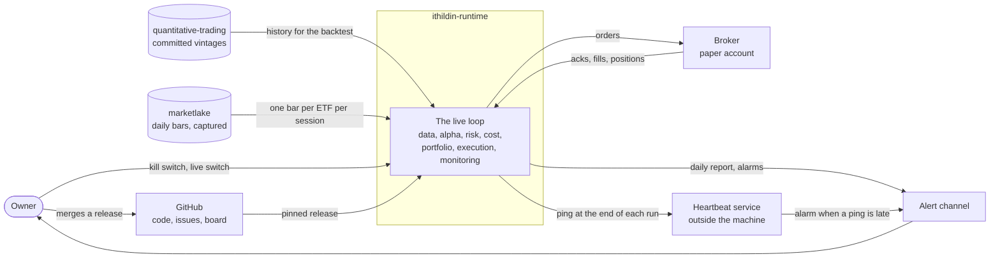

The platform reads history from two places and writes orders to one. The
backtest replays the committed GLD and USO vintages from quantitative-trading.
Paper trading reads one new bar per ETF each session from marketlake, the
sibling repository that captures market data before anything computes on it.

Two arrows run only from the owner. The kill switch halts trading, and the live
switch moves the broker from the paper account to a real one. No agent holds
either, which is hard limit 1 in [CLAUDE.md](../CLAUDE.md).

The heartbeat service sits outside the machine on purpose. A check that runs on
the same machine dies with it, and the failure a dead-man check exists for is
exactly the one where nothing on that machine runs.

## The loop and its three adapters

The design doc's `## One runtime` says backtest, paper and live run the same
modules and differ only in three adapters at the edges. The usual name for that
shape is ports and adapters. A port is an interface the core defines, and an
adapter is one implementation of it that talks to the outside world. The core
never imports an adapter. It is handed one when a run starts.

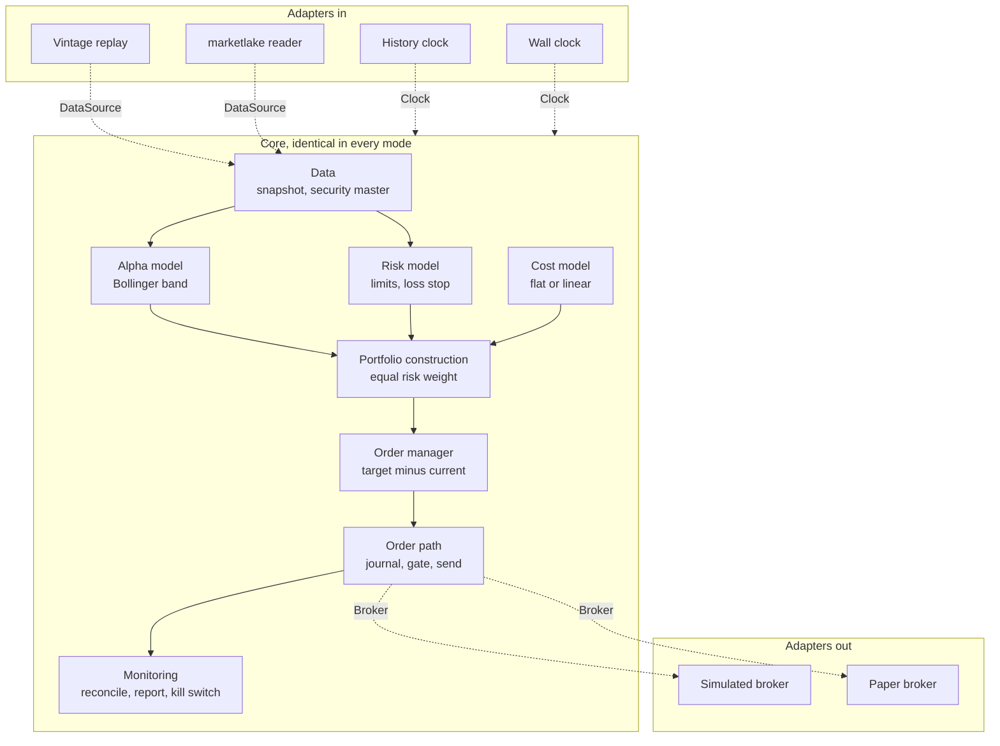

Each mode is one choice of three adapters.

| Mode | Data source | Clock | Broker |
| --- | --- | --- | --- |
| Backtest | Vintage replay | History clock | Simulated broker |
| Shadow | marketlake reader | Wall clock | Simulated broker |
| Paper | marketlake reader | Wall clock | Paper broker |
| Live | marketlake reader | Wall clock | Live broker, which only the owner switches on |

The dotted arrows are the only places a mode shows through. A module that asks
which mode it is in has broken the shape, because its backtest would then test
a branch the paper run never takes.

## Data flow

A data flow diagram shows where data comes from, which process changes it, and
where it is kept, with no sense of time. The cylinders are stores, the boxes are
processes, and the rounded boxes are things outside the platform.

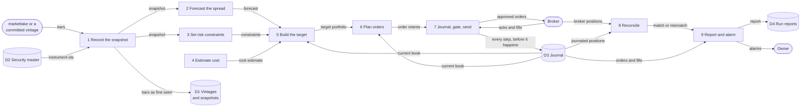

Three things the diagram rules out.

1. **No process reads the broker's positions to decide a trade.** The current
   book comes from the journal. The broker's view arrives only at process 8,
   where a disagreement halts trading rather than quietly replacing the
   platform's own record.
2. **No order reaches the broker except through process 7.** That is hard
   limits 2 and 4, which say every order passes the risk gate and is journaled
   first.
3. **Bars reach the models only after process 1 has stored them.** A model
   never reads a feed directly, so every number it acted on can be read back
   later. That is the first item of the premise.

## One trading day

A sequence diagram shows the same pieces in time order. This is one paper
session with nothing wrong. The run starts after marketlake's evening sweep has
captured the day's bars, and the orders it sends fill at the next open.

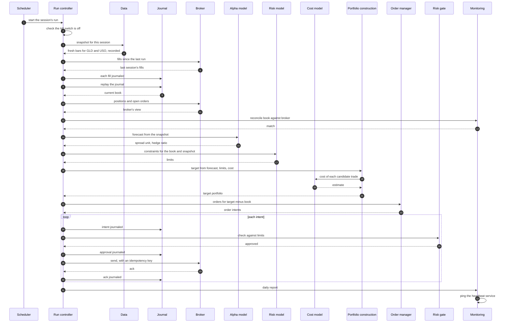

Two orderings carry the weight of the hard limits.

1. **Reconciliation comes before any model runs** (steps 10 to 13). A run that
   starts on a book that disagrees with the broker would trade the wrong
   difference.
2. **The journal entry comes before each send** (steps 27 and 28). If the
   process dies between the two, the journal holds an intent and an approval
   with no ack. The next run sees that gap and asks the broker whether the
   order exists, using its idempotency key, rather than sending it again. An
   idempotency key is a client-chosen order id the broker refuses to accept
   twice, so a resend after a crash cannot double the position.

Fills arrive the next morning. That is why the run opens by reading the last
session's fills from the broker and journaling each one (steps 5 to 7), and
only then replays the book.

## When something is wrong

Hard limit 3 says missing input means stop, not flatten. One firm's execution
server rebooted before its alpha server, read "no signals" as "hold nothing",
and sold most of its book (L4690 in the highlights the charter cites). Each
diagram below is one way a day goes wrong, and each ends with no new orders and
the positions left as they were.

### A missing or stale bar

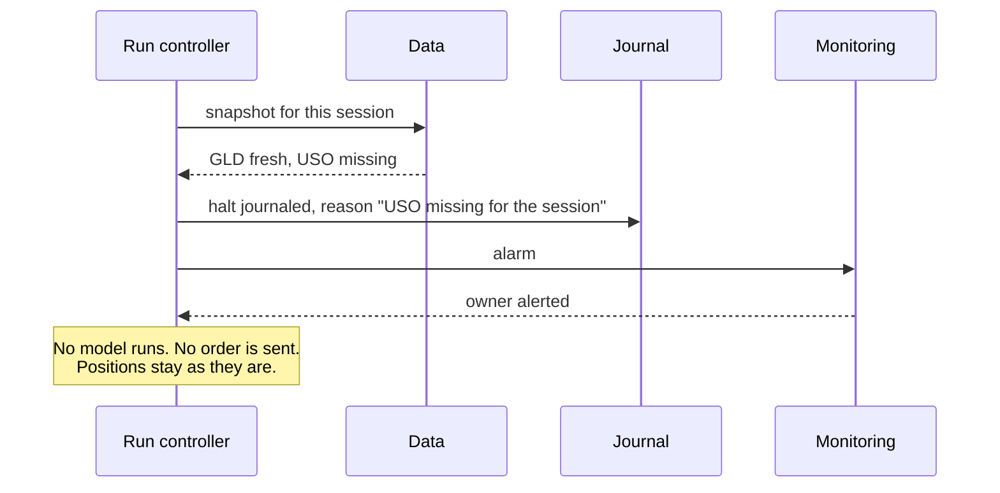

A stale bar takes the same path. Stale means the newest bar is older than the
session the clock says it is, which is how a feed that stopped looks when it
keeps answering. Data reports the gap. It never fills it with the last close,
and portfolio construction never reads an absent forecast as a target of zero.

### A restart in the wrong order

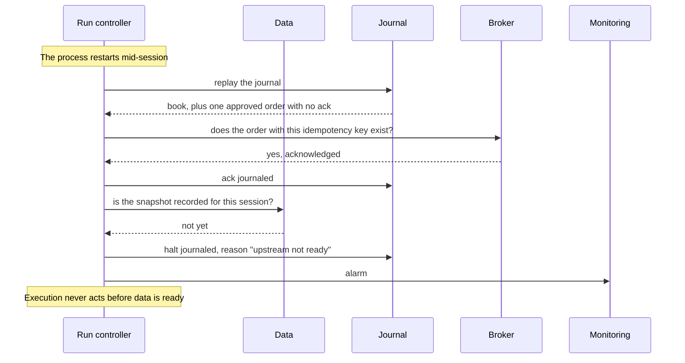

The startup check is the operator's, as the charter's roles say. Execution may
act only once every upstream module reports itself current for the session.
"Not ready" is a halt, never an empty forecast.

### The risk gate refuses an order

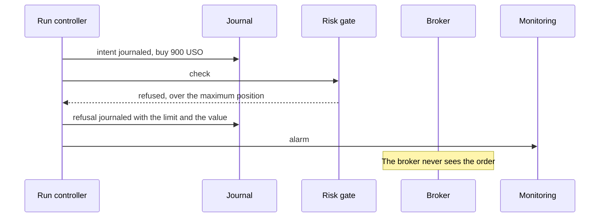

A refusal is final, and the run halts rather than sending the rest of its
orders, because the rest were sized on the assumption that this one would go
through. Nothing resizes the order to fit either, since an order cut down to
pass the gate is a trade nobody chose.

### The kill switch and the dead-man check

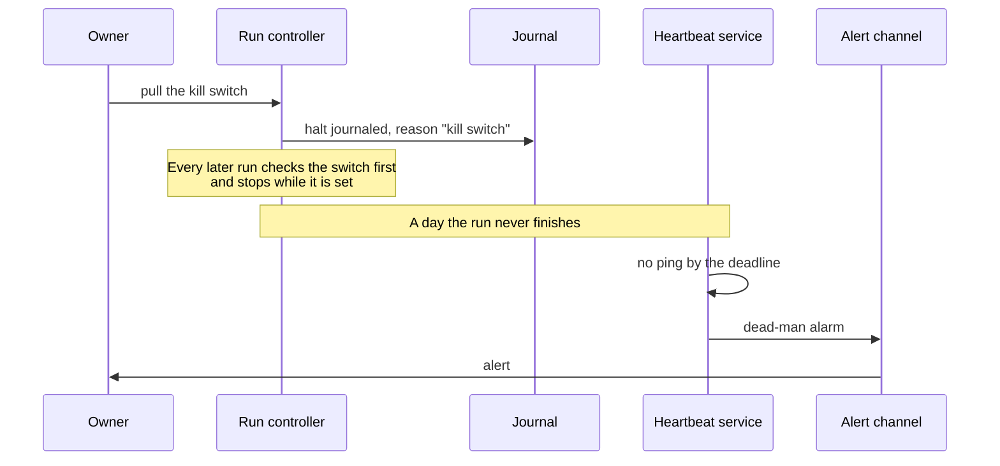

The two cover different failures. The kill switch is for a run that is alive
and doing something nobody wants. The dead-man check is for a run that is not
alive at all. The owner ruled on 2026-10-28 that the risk engineer builds the
kill switch and writes when to pull it, and the operator pulls it by that
guidance. That split is on [#11](https://github.com/l3a0/ithildin-runtime/issues/11).

## Types and interfaces

A class diagram shows the types the modules pass to each other and the
interfaces each one implements. The interfaces are Python `Protocol` classes.
A `Protocol` names the methods a type must have, and any class with those
methods satisfies it without inheriting from it. That is what lets the
simulated and paper brokers be swapped without either knowing about the other.

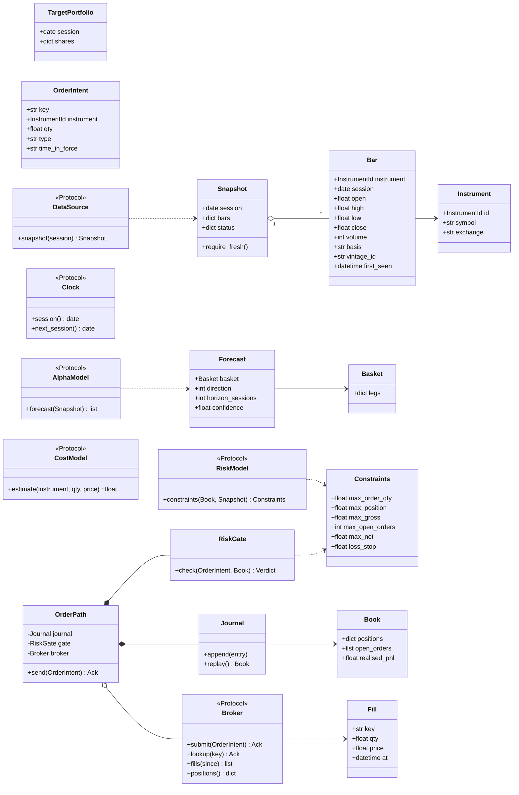

Five choices in the diagram are worth a reviewer's attention.

1. **A forecast is about a basket, not an instrument.** The Bollinger strategy
   forecasts a spread, which is two legs in a fixed ratio for the day. A
   `Basket` holds `{USO: 1, GLD: −h}`, so one forecast carries the whole
   position and portfolio construction never has to know it is a pair.
2. **A bar carries where it came from.** `vintage_id` names the stored file it
   was read from, and `first_seen` is when the platform first held it. Both
   come from the data engineer's duty to store when each value became
   available (L3884).
3. **`Snapshot.require_fresh()` is how a module refuses a gap.** It raises a
   `Halt` when any bar it needs is missing or stale. A module calls it before
   reading, so the default when something is absent is to stop.
4. **Only `OrderPath` holds a `Broker`.** Its constructor takes the journal,
   the gate and the broker together, and nothing else in the package is given
   a broker. Test 3 checks that by reading the imports, as the section on the
   import rule below says.
5. **The book comes from the journal.** `Journal.replay()` folds every entry
   into a `Book`. The broker's `positions()` is read only to reconcile, never
   to decide what to trade.

## The life of an order

A state diagram shows the states one thing can be in and what moves it between
them. Every transition here is a journal entry written before the next step.

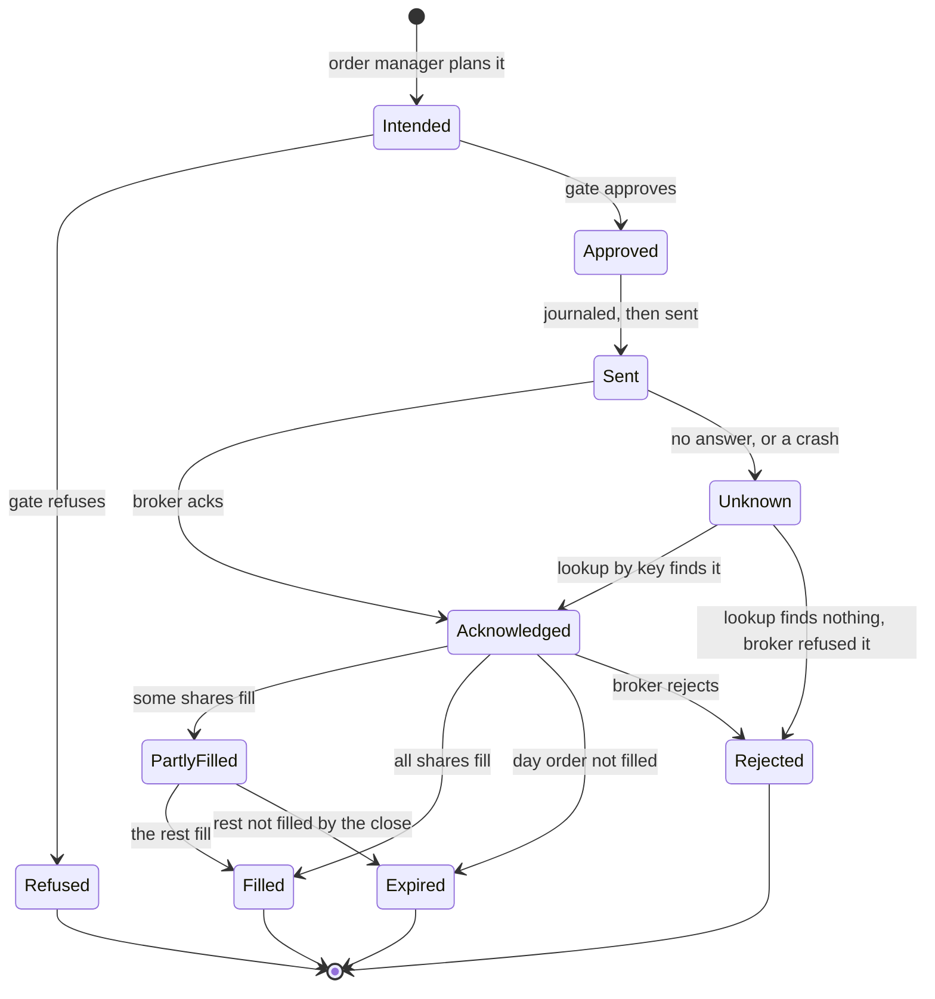

`Unknown` is the state the crash case lands in. It exists so that "the
platform does not know whether the broker has the order" is something the
journal can say, rather than a guess the next run makes. The only way out of
it is to ask the broker by idempotency key. Sending the order again is never a
way out.

## The life of a run

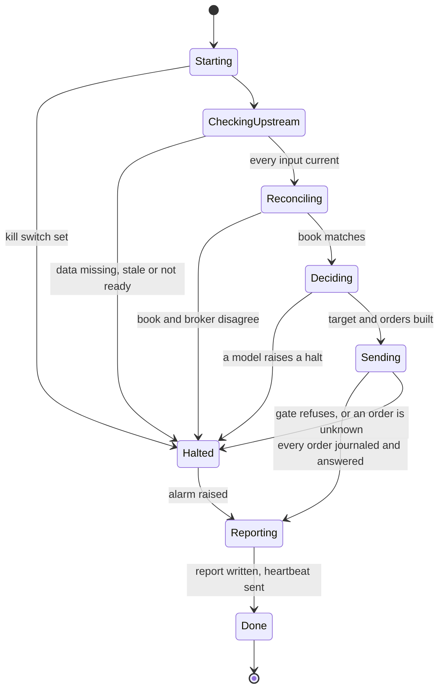

`Halted` always passes through `Reporting`, so a halted day still writes its
report and its journal entry, and the owner hears why. A halted run never moves
itself back to `Starting`. The next session's run starts fresh, and it halts
again while the kill switch is set or the cause is still there.

## What is stored

An entity-relationship diagram shows what is kept and how the records point at
each other.

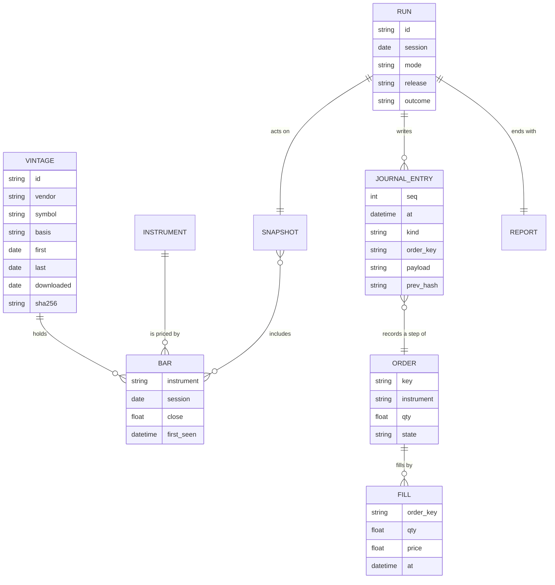

Three stores, three rules.

1. **Vintages are written once and never changed.** The format, the file names,
   the manifest and the refusal to overwrite are quantitative-trading's, from
   `src/chan/vintage.py` there. That module opens a new file with `open(path,
   "xb")`, which fails if the file exists, so an overwrite raises
   `VintageRefused` instead of happening. A paper run records the bars it acted
   on the same way, as a snapshot that points at its bars.
2. **The journal only grows.** Each entry carries the hash of the one before
   it, which makes the file a hash chain: changing or deleting any old entry
   breaks every hash after it, so an edit is detectable. It is one JSON object
   per line, flushed to disk before the step it records happens.
3. **Reports are regenerable.** A report is computed from the journal and the
   snapshot, so losing one costs nothing. It is stored for the owner to read,
   not as a record.

## Where it runs

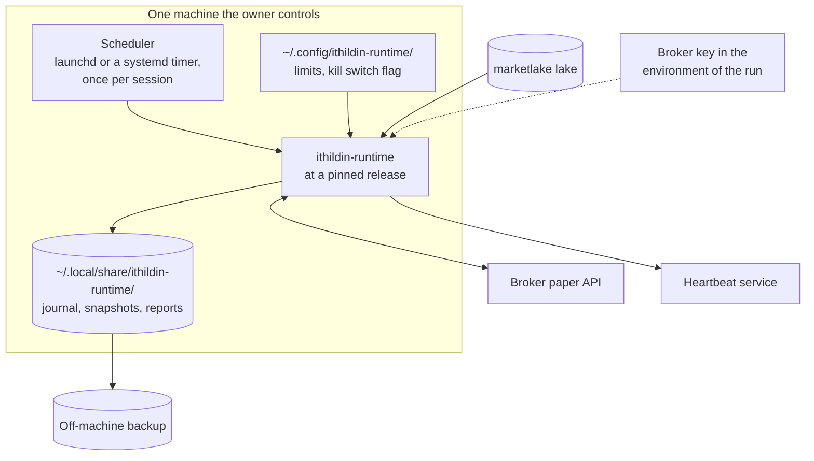

Four rules hold the deployment to the premise and the hard limits.

1. **The release is pinned.** The scheduler runs a tagged commit the owner
   merged, so the code that traded is always known.
2. **The journal and snapshots leave the machine every day.** They are two of
   the three things the premise says cannot be recovered, so a disk failure
   must not take them.
3. **The broker key lives in the environment of the run.** It never enters a
   file in the repository, and it is a paper key with no withdrawal or transfer
   permission, which is hard limit 5.
4. **The kill switch is a file the owner controls.** The run checks it before
   anything else and before every send. Setting it needs no deploy and no
   agent.

## Package layout and the import rule

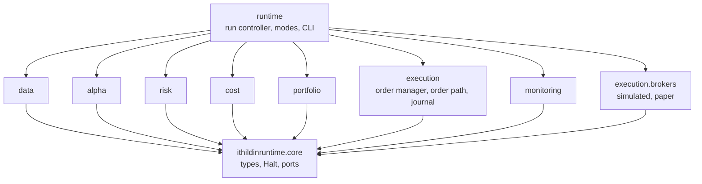

An arrow means "may import". The rule the diagram draws is short.

1. Every module imports `core` and nothing else among its siblings.
2. Only `runtime` imports the modules together, and it is the only place that
   picks an adapter for a mode.
3. Only `runtime` imports `execution.brokers`, and it hands the chosen broker
   to `OrderPath` alone.

A test reads every module's imports with Python's `ast` module and fails on an
arrow the diagram does not draw. That turns test 3's "no order reaches the
broker adapter without passing the gate" into something executed rather than
reviewed. The price is one more test to keep in step with the diagram, and a
module that genuinely needs a sibling has to argue for a new arrow.

## How the four acceptance tests exercise it

| Test, from [#4](https://github.com/l3a0/ithildin-runtime/issues/4) | Mode | What it runs | What it pins |
| --- | --- | --- | --- |
| 1. The backtest reproduces a replicated strategy | Backtest | Vintage replay, history clock, simulated broker filling at the signal's close, zero cost | APR 0.17824928 and Sharpe 0.96467289 to 5e-9, the unit on each of the 1,480 days, and the 162 changes |
| 2. A replay emits pinned orders, through a missing feed, a stale price and a wrong-order restart | Backtest | A recorded stretch of sessions with three faults injected | The orders on each day, and a halt with no orders on each faulted day |
| 3. The risk gate refuses an order over each limit, and nothing bypasses it | Unit and import | `RiskGate` against one order over each of the six limits, and the import rule test | Six refusals, and no import of `execution.brokers` outside `runtime` |
| 4. The kill switch and the dead-man check fire in a drill | Paper, drill | Set the switch before a run, and skip a run's ping | A halt journaled with reason "kill switch", and a dead-man alarm delivered |

Test 1 fills at the close of the day the signal used, because that is what
Chan's script assumes. A paper run cannot trade at a close it has already seen,
so it fills at the next open. The two runs therefore differ by one night of
price movement, and shadow running is where that gap gets measured rather than
argued about.

Which module each piece belongs to:

| Piece | Issue |
| --- | --- |
| `Bar`, `Snapshot`, vintage replay, marketlake reader, security master | [#5](https://github.com/l3a0/ithildin-runtime/issues/5) |
| Bollinger band alpha model, `Basket`, `Forecast` | [#6](https://github.com/l3a0/ithildin-runtime/issues/6) |
| `Constraints`, `RiskGate`, the daily loss stop, the kill switch | [#7](https://github.com/l3a0/ithildin-runtime/issues/7) |
| Flat and linear cost models | [#8](https://github.com/l3a0/ithildin-runtime/issues/8) |
| Equal-risk-weight portfolio construction, `TargetPortfolio` | [#9](https://github.com/l3a0/ithildin-runtime/issues/9) |
| Order manager, `OrderPath`, `Journal`, simulated and paper brokers | [#10](https://github.com/l3a0/ithildin-runtime/issues/10) |
| Reconciliation, daily report, dead-man check, run controller's startup order | [#11](https://github.com/l3a0/ithildin-runtime/issues/11) |

`core`, the import rule and the run controller belong to no single module. The
first builder to need them writes them, which by the "blocked by" links is
[#5](https://github.com/l3a0/ithildin-runtime/issues/5).

## Decisions

Each row is a choice this design makes, what it turned down, and the price of
the choice. A reviewer who disagrees with a row changes the design, not the
code, so this is the cheapest place to disagree.

| Decision | Turned down | Price |
| --- | --- | --- |
| Run the Bollinger band on GLD and USO for test 1 | Entry 21's linear rule on the same data, which is always in the market with continuous units. The Kalman hedge on EWA and EWC, which adds a filter to check before the engine | The engine carries the strategy's quirks, such as no capital account and a daily resize of one leg |
| A forecast names a basket | A forecast per instrument, with the pair logic in portfolio construction | One more type in `core`. In return portfolio construction stays general, and a later strategy on one instrument is a basket of one leg |
| One run per session, after marketlake's evening sweep, filling at the next open | Running just before the close and sending market-on-close orders | The paper fills differ from the backtest's by one night. In return the run never acts on a bar still forming |
| The current book comes from the journal, and the broker is only reconciled against | Reading positions from the broker each run | A journal bug shows up as a halt rather than as silently correct trading. That is the intent, because a fill the platform never recorded is the record the premise says cannot be rebuilt |
| The journal is JSON Lines with a hash chain, flushed per entry | SQLite | No queries without loading the file, which slice 1 does not need. In return the file is append-only by construction, readable in a terminal, and simple to back up |
| Share quantitative-trading's vintage code through `ithildincore` | A second copy here | A release of `ithildincore` before [#5](https://github.com/l3a0/ithildin-runtime/issues/5) can use it. `CLAUDE.md` puts code both repositories use there, because two copies drift without either looking wrong |
| Talk to the paper broker over its REST API with an injected transport | The broker's own SDK | A few more lines per call. In return tests replace the transport with a recording, as quantitative-trading's fetchers do, and no SDK enters the dependency list |

## Questions for the owner

Each question has a recommendation, so a review can answer it with a yes.

1. **Which paper broker?** The recommendation is Alpaca's paper account. It is
   free, it has a REST API, and a paper key cannot move money. Schwab, which
   marketlake already reads, is not known to offer an API paper account, and
   that is worth confirming before choosing. Interactive Brokers has one, but
   it needs a gateway process running beside the platform.
2. **Where do live GLD and USO bars come from?** The recommendation is to add
   both to marketlake's `config/tickers.yaml`, which lists only SPY and QQQ
   today. marketlake captures forward from the day a symbol is added and keeps
   no history from before it. So the first 20 sessions, which the hedge ratio
   and z-score need, come from a vintage recorded once from a vendor download,
   or the paper run waits 20 sessions before its first trade.
3. **How large is one unit on paper?** The replication has no capital account.
   The recommendation is to size one unit so the gross position is a fixed
   dollar amount the owner sets, recorded in the run's configuration.
4. **May captured bars be committed to this public repository?** Vendor terms
   can forbid redistributing data. The recommendation follows
   quantitative-trading's archive pattern: keep the files in a private store,
   and commit only their checksums, so a reader can still check that a run's
   inputs are the ones recorded.
5. **Where does the platform run?** The recommendation is one machine the owner
   controls with a daily scheduler, such as the owner's own machine or the VM
   marketlake runs on. The VM keeps the run beside the lake it reads, while the
   owner's machine needs no new host.
6. **Which heartbeat service?** The recommendation is a hosted check that
   alarms when a ping is late, outside every machine the platform uses. A
   GitHub Actions schedule is not one, because quantitative-trading measured
   only about 11% of its scheduled board runs firing over 185 hours.
