# Architecture — ithildin-runtime slice 1

Seven module issues are about to be built by seven separate sessions, and the
pieces they share are the expensive thing to change later. A bar type, an
order type and the one path an order takes to the broker are read by every
module. Getting one wrong after four modules use it means four rewrites. This
doc draws those shared pieces now, while disagreeing with them costs an edit.

Slice 1 is the walking skeleton on
[#4](https://github.com/l3a0/ithildin-runtime/issues/4): the first version of
the platform in which every module exists in its simplest form and one
strategy runs end to end, every trading day, on a broker's paper account, a
practice account that trades with no real money. Each
module issue, [#5](https://github.com/l3a0/ithildin-runtime/issues/5) to
[#11](https://github.com/l3a0/ithildin-runtime/issues/11), still decides what
its module must do. Where this doc and an issue disagree, the issue wins.

The owner's part in reviewing this doc is two sections at the end.

1. [Decisions](#decisions), a table where each row says what this doc chose, what it
   turned down and where the choice gets settled. Object to a row there.
2. [Questions for the owner](#questions-for-the-owner), nine questions that
   need an answer before the build starts. Each carries a recommendation, so a
   yes is enough.

The diagrams are Mermaid, which GitHub draws in place. Each one is followed by
what it shows and what to look for. Nothing here is built yet.

## Contents

- [The strategy the skeleton runs](#the-strategy-the-skeleton-runs)
- [Context: what the platform talks to](#context-what-the-platform-talks-to)
- [The loop and its adapters](#the-loop-and-its-adapters)
- [Data flow](#data-flow)
- [One trading day](#one-trading-day)
- [When something is wrong](#when-something-is-wrong)
- [Types and interfaces](#types-and-interfaces)
- [The life of an order](#the-life-of-an-order)
- [The life of a run](#the-life-of-a-run)
- [What is stored](#what-is-stored)
- [Where it runs](#where-it-runs)
- [Package layout and the import rule](#package-layout-and-the-import-rule)
- [How the four acceptance tests exercise it](#how-the-four-acceptance-tests-exercise-it)
- [Decisions](#decisions)
- [Questions for the owner](#questions-for-the-owner)

## The strategy the skeleton runs

Acceptance test 1 asks the backtest to reproduce a strategy that
[quantitative-trading](https://github.com/l3a0/quantitative-trading) has
already replicated. A mismatch then points at the platform rather than the
idea, because the strategy's numbers are already pinned there.

The proposal is Chan's Bollinger band on the price spread between GLD, a gold
ETF, and USO, an oil ETF. It is Example 3.2 of *Algorithmic Trading* and
Entry 26 of that repository's replication log. A Bollinger band is a moving
average with a band of one standard deviation on each side, and this strategy
trades when the spread leaves its band. Read at quantitative-trading's commit
`19aadbeb`, the rule is four steps.

1. Each day, fit the hedge ratio `h`, the number of GLD shares that offset one
   USO share. It is the slope of a regression of USO's close on GLD's close
   and a constant, over the last 20 closes.
2. Form the spread `USO − h·GLD`.
3. Measure how many standard deviations the spread sits from its own 20-day
   mean. That count is the spread's z-score.
4. Go long one unit of the spread when the z-score falls below −1, and exit
   when it rises above 0. Go short one unit above +1, and exit below 0.
   Otherwise hold. One unit is `+1` share of USO and `−h` shares of GLD.

Four facts make it the simplest candidate there.

1. **Two liquid ETFs, daily closes only.** No minute data, no futures rolls, no
   stock panel.
2. **One committed source.** `data/inputdata_etf/gld.csv` and
   `data/inputdata_etf/uso.csv` were lifted from Chan's `inputData_ETF.mat`, cover
   2006-04-26 to 2012-04-09, and each has a recorded SHA-256 checksum. Each
   file is a vintage, meaning one source's copy of a series stored once and
   never changed, as [design.md](design.md#vocabulary) defines it.
3. **Discrete positions.** The unit is only ever −1, 0 or +1, so a test can
   check the engine's position on each day, not only a summary ratio.
4. **Tight pins.** `tests/test_bollinger.py` pins the APR at 0.17824928 and the
   Sharpe ratio at 0.96467289, both to 5e-9, over 1,480 rows. It also pins 162
   changes of position, made of 77 entries, 76 exits and 9 reversals.

The engine has to carry four quirks of the replication rather than tidy them
away.

1. The strategy refits the hedge ratio every day, so it resizes the GLD leg
   even on days the unit does not change.
2. The return is profit over the gross dollars held, with no capital account.
3. The moving standard deviation divides by `n − 1`, as MATLAB does. Dividing
   by `n` moves the APR to 0.183306.
4. The replication charges no transaction cost, so the cost model in
   [#8](https://github.com/l3a0/ithildin-runtime/issues/8) runs at zero for
   test 1. Paper trading then charges a flat or linear cost.

Every quantitative-trading result is exploratory, meaning found by looking at
the data, and this one is too. Test 1 uses it as a known answer for checking
the engine. Running it on paper promotes the platform's version, not the
strategy, because the charter's backtest gate for a strategy also needs a
registered out-of-sample test, which this one has not passed. Registered means
the hypothesis was committed in writing before the number was seen.

## Context: what the platform talks to

A context diagram shows the platform as one box and everything outside it that
it talks to.

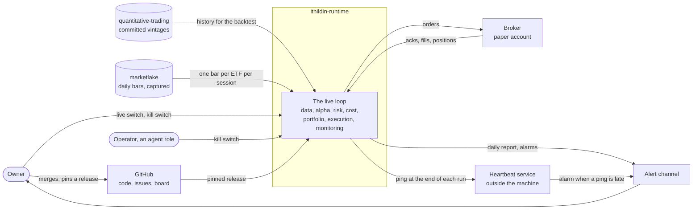

The platform reads history from two places.

1. **Committed vintages from quantitative-trading,** which the backtest
   replays.
2. **marketlake,** the sibling repository that captures market data before
   anything computes on it. Paper trading reads one new bar per ETF from it
   each session.

It sends orders to one place, the broker's paper account.

Two switches come from outside the loop.

1. **The live switch** moves the broker from the paper account to a real one.
   Only the owner holds it, which is hard limit 1 in
   [CLAUDE.md](../CLAUDE.md).
2. **The kill switch** halts trading. The owner ruled on 2026-10-28 that the
   risk engineer builds it and writes when to pull it, and the operator pulls
   it by that guidance. The owner can pull it too.

A dead-man check raises an alarm when a ping it expects fails to arrive. Here
the run pings a heartbeat service at the end of each run, and the service
alarms when a ping is late. The service sits outside the machine because a
check on the same machine dies with it, and a machine where nothing runs is
the failure the check exists for.

## The loop and its adapters

[design.md](design.md#one-runtime)'s `## One runtime` says backtest, paper and
live run the same modules and differ only in adapters at the edges. The usual
name for that shape is ports and adapters. A port is an interface the modules
define, and an adapter is one implementation of it that talks to the outside
world. No module imports an adapter. The run controller hands each module the
adapters for its mode when a run starts.

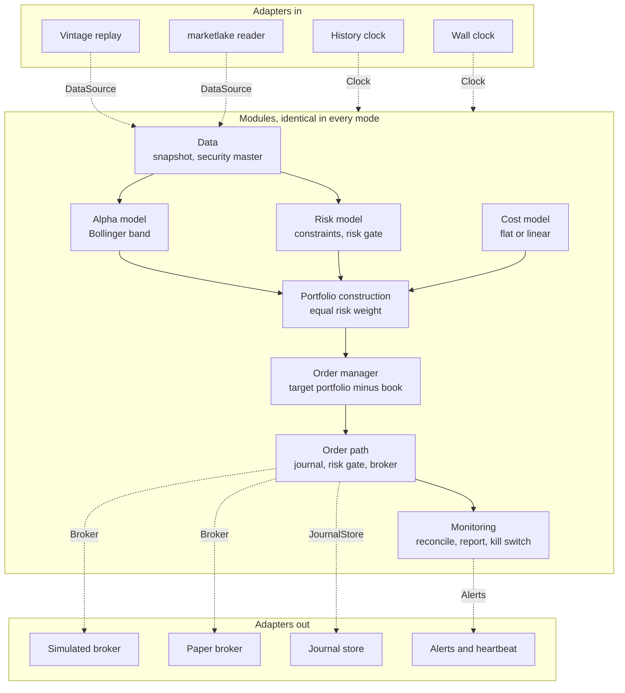

Each dotted arrow is a port, labelled with its name. Each mode is one choice of
adapter for each port.

| Mode | Data source | Clock | Broker, and when it fills | Journal | Alerts and heartbeat |
| --- | --- | --- | --- | --- | --- |
| Backtest | Vintage replay | History clock | Simulated, at the signal's close | A temporary file, deleted when the backtest ends | Recorded, not sent |
| Shadow | marketlake reader | Wall clock | Simulated, at the next open | Shadow journal | Sent |
| Paper | marketlake reader | Wall clock | Paper broker, at the next open | Paper journal | Sent |
| Live | marketlake reader | Wall clock | Live broker, at the next open | Live journal | Sent |

Shadow reads live bars and decides real orders, but fills them in the
simulated broker, so no order reaches any broker. The diagram leaves out the
live broker, because only the owner switches to it.

[design.md](design.md#one-runtime) names three adapters, the ones that change
what a strategy sees.

1. The data source.
2. The clock.
3. The broker.

The journal store and the alert channel also differ by mode, but they change
only where records go. A backtest of 1,480 sessions must not append to the
paper journal or page the owner. The Decisions table proposes adding those two
to design.md's `## One runtime`.

A module that asks which mode it is in has broken the shape, because its
backtest would then test a branch the paper run never takes. In slice 1 the
event that design.md says modules are written against is one session's run.

## Data flow

A data flow diagram shows where data comes from, which process changes it, and
where it is kept, with no sense of time. The cylinders are stores, the boxes
are processes, and the rounded boxes are things outside the platform. The
numbers name the processes, not their order. The next section gives the order.

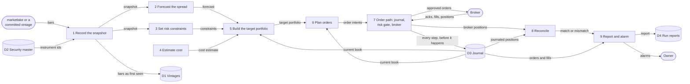

This repeats the loop from the section above, with the stores and the broker
added, to show where each piece reads and writes. The security master is the
table that maps each ticker to the platform's own instrument id, so a vendor's
renamed ticker does not become a new instrument.

Three things the diagram rules out.

1. **Only the order path talks to the broker.** Orders go out through
   process 7, and the broker's acks, fills and positions come back through it.
   Reconciliation receives the broker's positions from process 7 rather than
   asking the broker itself.
2. **The current book comes from the journal.** The book is the platform's own
   record of what it holds and what orders are open. The broker's positions are
   used only at process 8, where a disagreement halts trading rather than
   quietly replacing the platform's record.
3. **Bars reach the models only after process 1 has stored them.** A model
   never reads a feed directly, so every number it acted on can be read back
   later. Captured market data is the first of the three things
   [design.md](design.md#premise) says cannot be recovered.

## One trading day

A sequence diagram shows the same pieces in time order. This is one paper
session with nothing wrong. The run starts after marketlake has captured the
day's closing bars each evening, and the orders it sends fill at the next
open. The notes split it into four phases.

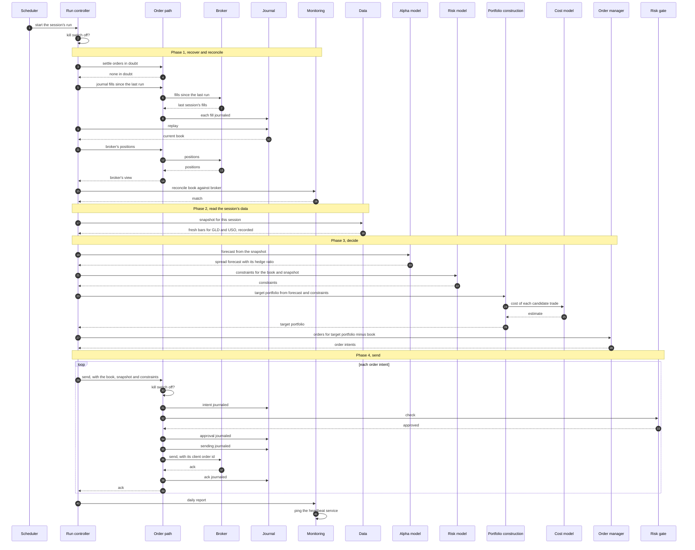

The phases in order.

1. **Recover and reconcile.** The run first settles any order a crash left in
   doubt. Fills arrive the morning after a run, so it then journals them,
   replays the journal into the current book, and checks the book against the
   broker's positions. A run that starts on a book
   the broker disagrees with would trade the wrong difference.
2. **Read the session's data.** Data records the bars before any model sees
   them.
3. **Decide.** The risk model sets the constraints, meaning the limits for this
   run. Portfolio construction builds the target portfolio within them, and the
   order manager turns the difference from the book into order intents.
4. **Send.** Each intent goes through the order path alone. The order path
   checks the kill switch again, journals the intent, asks the risk gate,
   journals the approval, journals that it is sending, and only then sends. The
   risk gate checks each order against the constraints the risk model set.

The journal entries carry the weight of hard limit 4, which says every order is
journaled before it is sent. If the process dies after "sending journaled" and
before the ack, the journal holds an order in doubt. The next run asks the
broker for it by its client order id, an id the platform chooses and sends with
the order, rather than sending it again. Alpaca, the recommended paper broker,
accepts a client order id and can look an order up by it. Whether it refuses a
second order with the same id needs confirming on the paper account before
[#10](https://github.com/l3a0/ithildin-runtime/issues/10) relies on it.

## When something is wrong

Hard limit 3 says missing input means stop, not flatten. One firm's execution
server rebooted before its alpha server, read "no signals" as "hold nothing",
and sold most of its book. The [charter](team-charter.md) cites it at L4690, a
Kindle location in the owner's highlights of Narang's *Inside the Black Box*.
Each diagram below is one way a day goes wrong, and each ends with no new
orders and the positions left as they were.

### A missing or stale bar

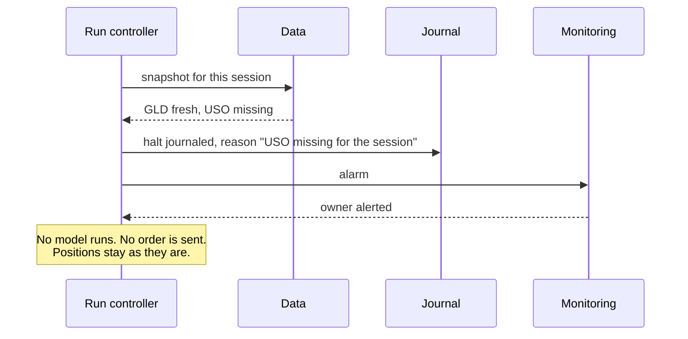

A stale bar takes the same path. Stale means the newest bar is older than the
session the clock says it is, which is how a feed that stopped looks when it
keeps answering. Data reports the gap and never fills it with the last close.
The charter gives the risk engineer the halt on stale data, so
[#7](https://github.com/l3a0/ithildin-runtime/issues/7) decides how old is too
old. Data applies that rule.

An empty answer halts the same way. If the alpha model returns no forecast,
portfolio construction raises a halt rather than reading the silence as a
target of zero. A flat position is a forecast with direction 0, never a missing
forecast.

### A restart before the data is ready

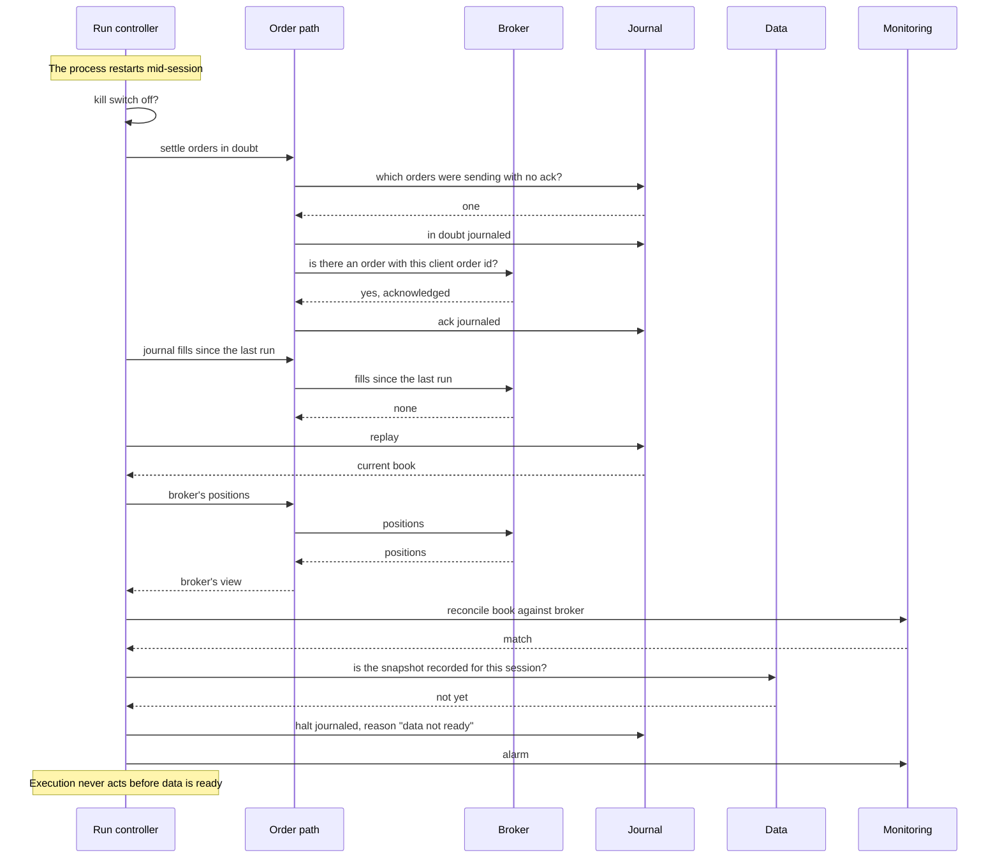

The restart runs the same phase 1 as any trading day, and then halts at
phase 2.

1. It settles the order it left half-sent, by asking the broker about it
   rather than sending it again.
2. It journals any fills, replays the journal and reconciles.
3. It finds the session's data not yet recorded and halts. The charter gives the operator the
startup order: execution may act only once every upstream module reports
itself current for the session. "Not ready" is a halt, never an empty forecast.

### The risk gate refuses an order

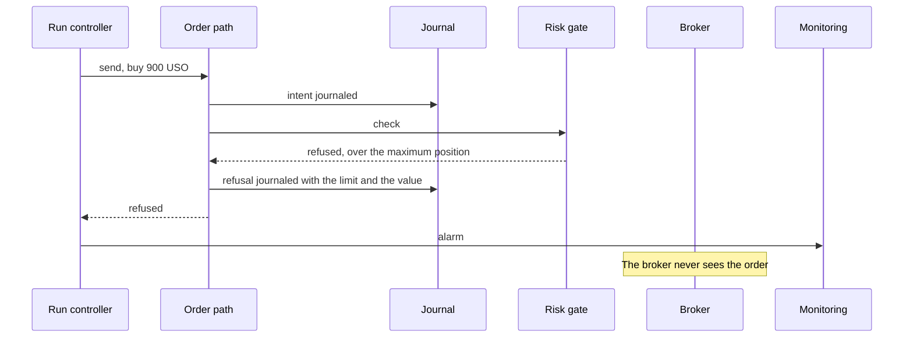

A refusal is final, and the run halts rather than sending the rest of its
orders, because portfolio construction sized the rest assuming this one would
go through. Nothing resizes the order to fit either, since an order cut down
to pass the risk gate is a trade nobody chose.

The daily loss stop works through the same gate. Once the day's loss passes the
stop, the risk gate refuses every new order. [#7](https://github.com/l3a0/ithildin-runtime/issues/7)
lists the limit as "an automatic unwind and stop", and an unwind is itself a
trade. Question 8 asks whether slice 1 stops only.

### The book and the broker disagree

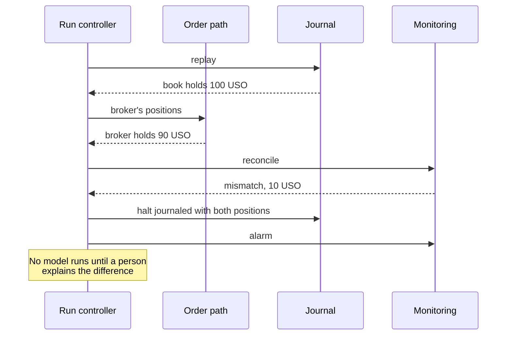

A mismatch means either a fill the platform never journaled or a position the
broker changed on its own, and both need a person. Reconciliation lives on
[#11](https://github.com/l3a0/ithildin-runtime/issues/11). The charter has the
trading systems engineer write it, so that role reviews it there.

### The kill switch and the dead-man check

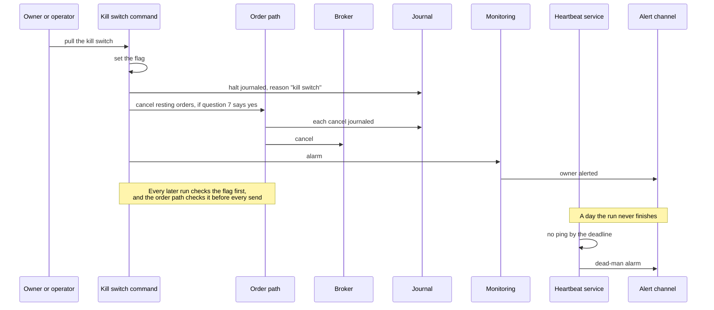

The two cover different failures.

1. **The kill switch** is for a run that is alive and doing something nobody
   wants.
2. **The dead-man check** is for a run that is not alive at all.

The kill switch is a command, not a running process. It sets a flag that
every run reads, and it can cancel resting orders through the order path, so
the cancel is journaled like any other step. The split of the kill switch work
is on [#11](https://github.com/l3a0/ithildin-runtime/issues/11). Orders sent in
the evening rest at the broker overnight, so a switch pulled before the open
stops nothing already sent unless it also cancels them. Question 7 asks whether
it does.

## Types and interfaces

A class diagram shows the types the modules pass to each other and the
interfaces each one implements. Two diagrams follow, one for the data the
modules pass and one for the interfaces.

Three kinds of arrow appear.

1. A plain arrow means one type refers to the other.
2. A hollow diamond means the type holds one it was given.
3. A dotted arrow means the type returns or uses the other.

### The data the modules pass

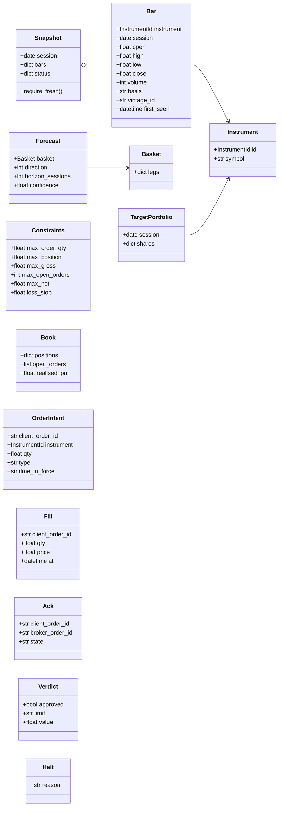

### The interfaces

The interfaces are Python `Protocol` classes. A `Protocol` names the methods a
type must have, and any class with those methods satisfies it without
inheriting from it. That is what lets a run swap the simulated broker for the
paper one without either knowing about the other.

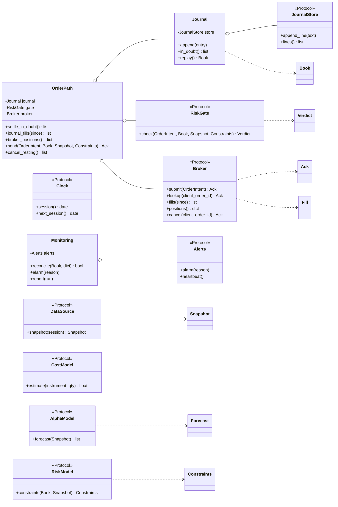

Six choices in the two diagrams for a reviewer to check.

1. **A forecast is about a basket, not an instrument.** The Bollinger strategy
   forecasts a spread, which is two legs in a fixed ratio for the day. A
   `Basket` holds `{USO: 1, GLD: −h}`, so one forecast carries the whole
   position and portfolio construction never has to know it is a pair. The
   charter and [#6](https://github.com/l3a0/ithildin-runtime/issues/6) say a
   forecast is per instrument, so this is a proposal for
   [#6](https://github.com/l3a0/ithildin-runtime/issues/6) rather than a
   decision here.
2. **A bar carries where it came from.** `vintage_id` names the vintage it was
   read from, and `first_seen` is when the platform first held it. `basis`
   says which price the series carries, such as `raw` for as traded or
   `adjusted` for split and dividend adjusted, as quantitative-trading's
   vintage records do. `vintage_id` and `first_seen` come from the data
   engineer's duty, in the charter, to store when each value became available
   (L3884).
3. **`Snapshot.require_fresh()` is how a module refuses a gap.** A snapshot is
   the set of bars one run read, each pointing at the vintage that holds it. A
   module calls `require_fresh()` before reading, and it raises `Halt` when any
   bar it needs is missing or stale. So the default when something is absent
   is to stop.
4. **Only `OrderPath` holds a `Broker`.** Every call to the broker goes through
   it, one method per kind of call: settling orders in doubt, journaling fills,
   reading positions, sending and cancelling.
   Nothing else in the package is given a broker. Test 3 checks that, as the
   section on the import rule says.
5. **The risk gate holds no state of its own.** `check` takes the order, the
   book, the snapshot and the run's `Constraints`, so `send` passes all four
   through. Three of the six limits need the snapshot's prices to value the
   book.
   1. Maximum portfolio size, the `max_gross` field.
   2. Net exposure.
   3. The loss stop.
6. **The book comes from the journal.** `Journal.replay()` applies every entry
   in order to build a `Book`. The broker's positions are read only to
   reconcile.

## The life of an order

A state diagram shows the states one thing can be in and what moves it between
them. Each transition is a journal entry written before the next step, except
the two a crash causes, `Abandoned` and the crash half of `InDoubt`. The next
run writes those when it finds the gap.

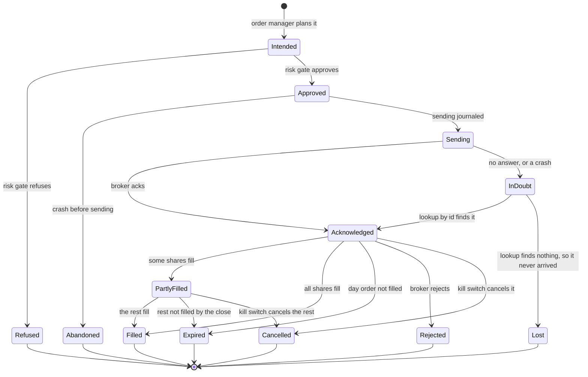

`Refused` is the platform's own risk gate saying no. `Rejected` is the broker
saying no.

`InDoubt` is the state a crash between sending and the ack lands in. It lets
the journal say "the platform does not know whether the broker has this order",
rather than leaving the next run to guess. The only way out is to ask the
broker by client order id. Sending the order again is never a way out. An order
that ends `Abandoned` or `Lost` never reached the broker, so the next run's
order manager plans from the book as if it had never existed.

`Cancelled` exists only if the owner answers yes to question 7.

## The life of a run

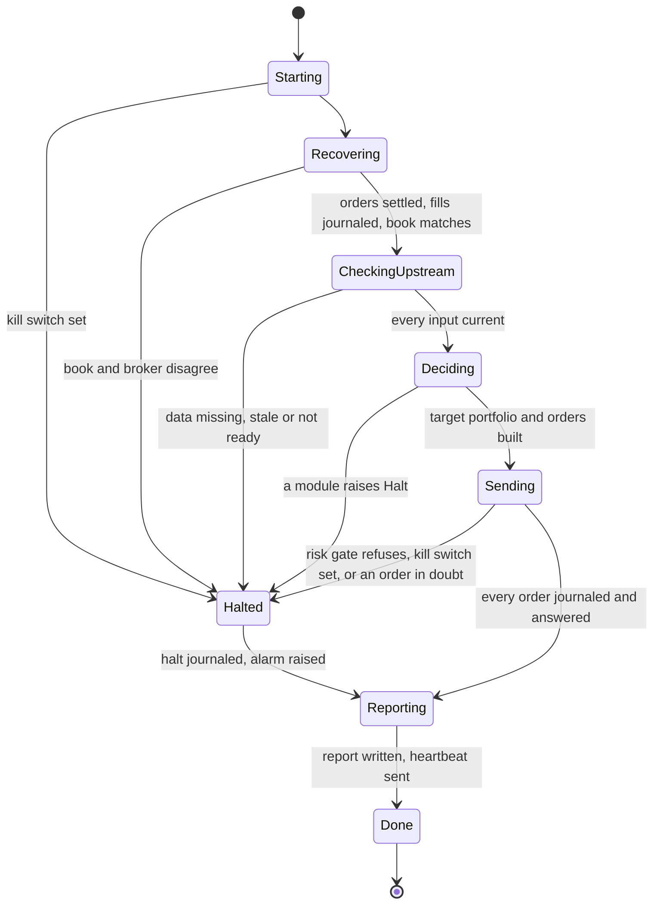

`Recovering` is phase 1 of the trading day: settle any order in doubt, journal
the fills, replay the journal and reconcile. Every halt passes through
`Reporting`, so a halted day still writes its report and its journal entry, and
the owner hears why. A halted run never moves itself back to `Starting`. The
next session's run starts fresh, and it halts again while the kill switch is
set or the cause is still there.

## What is stored

An entity-relationship diagram shows what is kept and how the records point at
each other. A pair of bars at a line's end means exactly one, and a circle with a
crow's foot means zero or more.

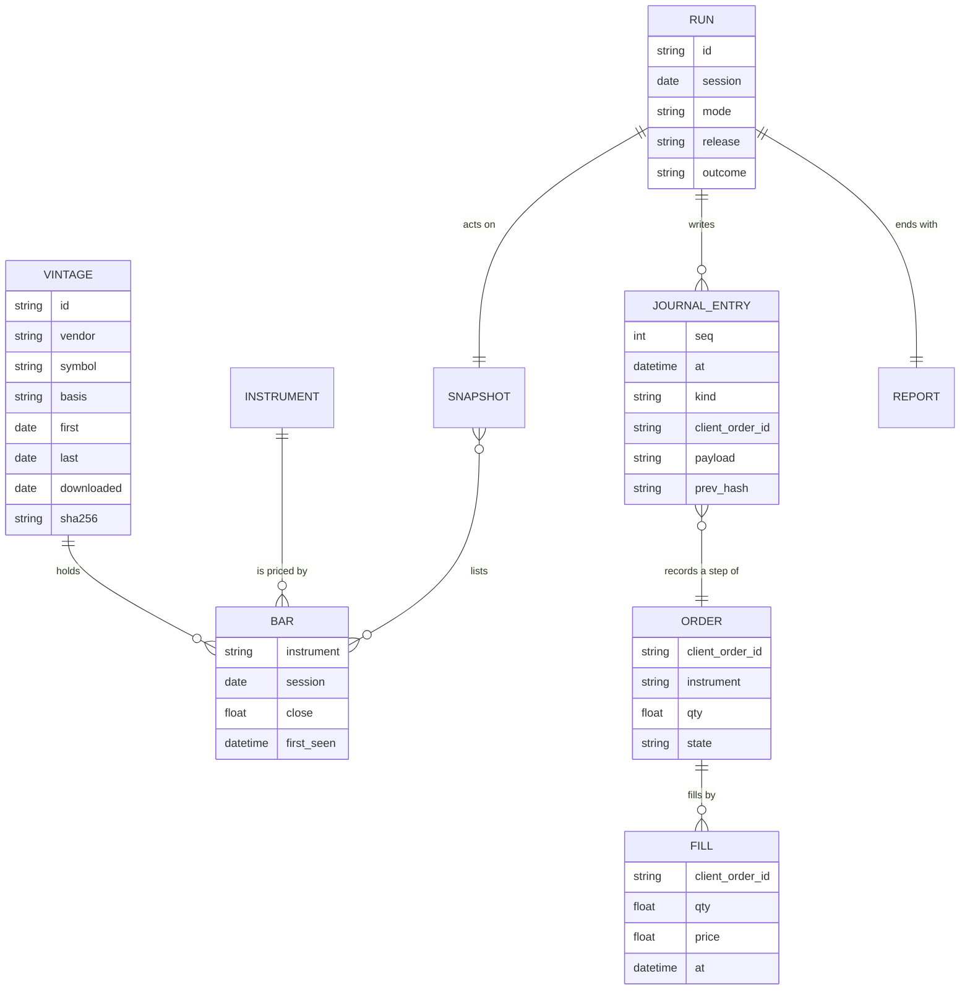

The entities live in four stores, and each store keeps its own rule.

1. **Vintages, D1, hold `VINTAGE`, `BAR` and `SNAPSHOT`.** They are written once
   and never changed. The format, the file names, the manifest and the refusal
   to overwrite are quantitative-trading's, from `src/chan/vintage.py` there.
   That module opens a new file with `open(path, "xb")`, which fails if the
   file exists, so an overwrite raises `VintageRefused` instead of happening. A
   paper run's captured bars are vintages too, and the snapshot is the list of
   bars the run read. Their files live in a private store and only their
   checksums are committed, as question 4 settles, the way
   quantitative-trading's `src/chan/archive.py` keeps vendor bars it may not
   publish.
2. **The security master, D2, holds `INSTRUMENT`.** It is a small committed file
   that changes only through a pull request.
3. **The journal, D3, holds `JOURNAL_ENTRY`.** `ORDER` and `FILL` are read from
   journal entries rather than kept as files of their own. The writer only ever
   appends, one JSON object per line, and flushes each entry to disk with
   `fsync` before the step it records happens. Each entry carries the hash of
   the one before it, which makes the file a hash chain. Changing or deleting
   an entry breaks the link from the entry after it. That catches an edit
   unless someone recomputes every later hash. Recording the latest hash off
   the machine each day, in the backup or the report, catches that case and a
   cut-off tail. The kill switch command and a run can both write at once, so
   the writer takes an exclusive file lock for each append and, while holding
   it, reads the last entry's sequence number and hash before writing the new
   entry. Without that, two writers could both chain from the same last entry,
   giving two entries one sequence number and splitting the chain.
4. **Run reports, D4, hold `RUN` and `REPORT`.** A report is computed from the
   journal and the snapshot, so losing one costs nothing. The run keeps it for
   the owner to read, not as a record.

## Where it runs

A deployment diagram shows which machine each piece runs on and what crosses
the machine's edge.

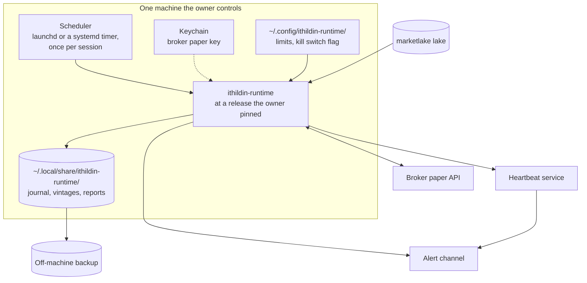

Four rules hold the deployment to the premise and the hard limits.

1. **The owner pins the release.** The scheduler runs a tagged commit the owner
   merged and chose, so the code that traded is always known. Deploying is the
   owner's under hard limit 6.
2. **The journal and vintages leave the machine every day.** They are two of
   the three things the premise says cannot be recovered, so a disk failure
   must not take them.
3. **The broker key lives in the keychain.** The run reads it into its own
   environment and never into a file, tracked or not. It is a paper key with
   no withdrawal or transfer permission, which is hard limit 5.
4. **The kill switch is a flag the owner and the operator can set.** The run
   checks it before anything else, and the order path checks it before every
   send. Setting it needs no deploy.

`~/.local/share/ithildin-runtime/` is a new machine path. design.md's
`## Configuration` names only `~/.config/ithildin-runtime/`, so the first
module to write there adds its row.

## Package layout and the import rule

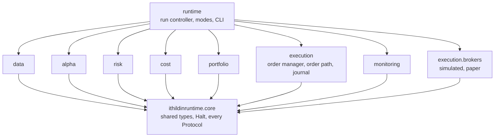

An arrow means "may import". The diagram draws three rules.

1. Every module imports `core` and none of its siblings. The types that cross
   modules, such as `Forecast`, `Constraints` and `TargetPortfolio`, and every
   `Protocol`, including `RiskGate`, live in `core` for that reason.
2. Only `runtime` imports the modules together. It is the one place that picks
   an adapter for a mode, and it hands the risk module's `RiskGate` to the
   order path.
3. Only `runtime` imports `execution.brokers`, and it hands the chosen broker to
   `OrderPath` alone.

A test reads every module's imports with Python's `ast` module and fails on an
arrow the diagram does not draw. A second test runs a day against a fake broker
that fails if anything but `OrderPath` calls it. Together they turn
test 3's "no order reaches the broker adapter without passing the gate" into
something executed rather than reviewed. The price is two more tests to keep
in step with the diagram, and a module that needs a sibling has to argue for a
new arrow.

## How the four acceptance tests exercise it

| Test, from [#4](https://github.com/l3a0/ithildin-runtime/issues/4) | Mode | What it runs | What it pins |
| --- | --- | --- | --- |
| 1. The backtest reproduces a replicated strategy | Backtest | Vintage replay, history clock, simulated broker filling at the signal's close, zero cost | APR 0.17824928 and Sharpe 0.96467289 to 5e-9, the 162 changes of position, and the unit on each of the 1,480 days as `chan.bollinger` computes it at `19aadbeb` |
| 2. A replay emits pinned orders, through a missing feed, a stale price and a restart in the wrong order | Backtest | A recorded stretch of sessions with three faults injected | The orders on each day, and a halt with no orders on each faulted day |
| 3. The risk gate refuses an order over each limit, and nothing bypasses it | Unit and import | `RiskGate` against one order over each of the six limits, the import rule test, and the fake broker | Six refusals, no import of `execution.brokers` outside `runtime`, and no broker call from outside `OrderPath` |
| 4. The kill switch and the dead-man check fire in a drill | Paper, drill | Set the switch before a run, and skip a run's ping | A halt journaled with reason "kill switch", and a dead-man alarm delivered |

Test 1 fills at the close of the day the signal used, because that is what
Chan's script assumes. A paper run cannot trade at a close it has already seen,
so it fills at the next open. The two runs therefore differ by one night of
price movement, and shadow running measures that gap.

The charter's paper gate also asks for every alarm to fire in a drill, which
covers more than test 4 names. The reconciliation mismatch above is one such
alarm, and its drill belongs on
[#11](https://github.com/l3a0/ithildin-runtime/issues/11).

Which issue writes each piece. Where a piece is a shared type, it lives in
`core` whichever issue writes it.

| Piece | Written on |
| --- | --- |
| `Bar`, `Snapshot`, vintage replay, marketlake reader, security master | [#5](https://github.com/l3a0/ithildin-runtime/issues/5) |
| Bollinger band alpha model, `Basket`, `Forecast` | [#6](https://github.com/l3a0/ithildin-runtime/issues/6) |
| `Constraints`, `RiskGate`, the daily loss stop, the stale-data rule | [#7](https://github.com/l3a0/ithildin-runtime/issues/7) |
| Flat and linear cost models | [#8](https://github.com/l3a0/ithildin-runtime/issues/8) |
| Equal-risk-weight portfolio construction, `TargetPortfolio` | [#9](https://github.com/l3a0/ithildin-runtime/issues/9) |
| Order manager, `OrderPath`, `Journal`, journal store adapters, simulated and paper brokers | [#10](https://github.com/l3a0/ithildin-runtime/issues/10) |
| `Monitoring`, reconciliation, daily report, alert channel adapter, dead-man check, kill switch, startup order, and the run controller and the fake-broker test as proposed below | [#11](https://github.com/l3a0/ithildin-runtime/issues/11) |

Equal risk weight sizes each forecast's basket so they all carry the same
risk. With one basket in slice 1, it reduces to sizing that basket, which
question 3 settles.

Two pieces belong to no single module.

1. `core`, with the shared types and every `Protocol`.
2. The import rule test, which reads every module's imports.

Question 9 asks where they are written, since
[#5](https://github.com/l3a0/ithildin-runtime/issues/5) and
[#8](https://github.com/l3a0/ithildin-runtime/issues/8) are both free to start
first and both would need `core`.

The run controller imports every module, so it is built last. This doc
proposes building it on [#11](https://github.com/l3a0/ithildin-runtime/issues/11), which owns the startup order and waits on every
other module. The fake-broker test goes there too, since it runs a whole day
through the run controller. [#11](https://github.com/l3a0/ithildin-runtime/issues/11) names neither today, and its acceptance
covers tests 2 and 4 but not test 3, so the Decisions table lists both as a
proposal.

## Decisions

Each row is a choice this doc makes, what it turned down, the price, and where
the choice is settled. A row settled here is a shape every module shares. A row
marked with an issue is a proposal: once the owner accepts it, it goes on that
issue, which then decides. Either way, each turned-down alternative gets a row
in [design.md](design.md#considered-and-rejected)'s register when the row is
accepted.

| Decision | Turned down | Price | Settled on |
| --- | --- | --- | --- |
| Only the order path talks to the broker, for sends, lookups, fills, positions and cancels | Letting the run controller or reconciliation call the broker | One more method on `OrderPath` per kind of broker call | This doc |
| The current book comes from the journal, and the broker is only reconciled against | Reading positions from the broker each run | A journal bug halts trading instead of being silently patched over by the broker's numbers | This doc |
| The journal store and the alert channel are adapters chosen per mode | Writing records and alarms the same way in every mode | Two more ports in `core`, and a change to design.md's `## One runtime` | This doc |
| A missing, stale or empty input raises `Halt` | Defaulting a gap to the last value or to zero | A day with a data hiccup is a day with no trading | This doc, with the staleness rule on [#7](https://github.com/l3a0/ithildin-runtime/issues/7) |
| A forecast names a basket | A forecast per instrument, with the pair logic in portfolio construction | One more type in `core`, and a change to the charter's module table | [#6](https://github.com/l3a0/ithildin-runtime/issues/6) |
| The run controller and the fake-broker test are built last, on [#11](https://github.com/l3a0/ithildin-runtime/issues/11) | Building the run controller with `core`, which cannot work because it imports every module, or a separate issue. Writing the fake-broker test with the import rule test in `core`'s sub-issue, which cannot run before the run controller exists | No end-to-end run happens until [#11](https://github.com/l3a0/ithildin-runtime/issues/11) lands, and [#11](https://github.com/l3a0/ithildin-runtime/issues/11) grows past its Monitoring row and takes on part of test 3 | [#11](https://github.com/l3a0/ithildin-runtime/issues/11) |
| Run the Bollinger band on GLD and USO for test 1 | Entry 21's linear rule on the same data, which is always in the market with continuous units, or the Kalman-filter hedge on EWA and EWC, which adds a model to verify first | The engine carries the strategy's quirks, such as no capital account and a daily resize of one leg | [#6](https://github.com/l3a0/ithildin-runtime/issues/6), which also sets [#5](https://github.com/l3a0/ithildin-runtime/issues/5)'s ETFs |
| One run per session after marketlake's evening capture, filling at the next open | Running just before the close and sending market-on-close orders | The paper fills differ from the backtest's by one night. In return the run never acts on a bar still forming | [#10](https://github.com/l3a0/ithildin-runtime/issues/10) and [#11](https://github.com/l3a0/ithildin-runtime/issues/11) |
| The journal is JSON Lines with a hash chain, fsynced per entry | SQLite | No queries without loading the file, which slice 1 does not need. In return the file is readable in a terminal and simple to back up | [#10](https://github.com/l3a0/ithildin-runtime/issues/10) |
| Share quantitative-trading's vintage code through the shared `ithildin-core` repository | A second copy here | A release of `ithildincore`, that repository's package, before [#5](https://github.com/l3a0/ithildin-runtime/issues/5) can use it | [#5](https://github.com/l3a0/ithildin-runtime/issues/5) |
| Talk to the paper broker over its REST API, with the HTTP client passed in as an argument | The broker's own SDK | A few more lines per call. In return tests replace the client with a fake that returns scripted answers, as quantitative-trading's Alpha Vantage fetcher does, and no SDK enters the dependency list | [#10](https://github.com/l3a0/ithildin-runtime/issues/10) |

The vintage row rests on quantitative-trading's `CLAUDE.md`, which sends code
both repositories use to `ithildin-core`, because two copies drift without
either looking wrong. This repository's README plans to share code with its
siblings the same way.

## Questions for the owner

Each question has a recommendation, so a review can answer it with a yes.

1. **Which paper broker?** The recommendation is Alpaca's paper account. It is
   free, it has a REST API, and a paper key cannot move money. Schwab, which
   marketlake already reads, is not known to offer an API paper account, so
   confirm that before choosing it. Interactive Brokers has one, but it needs a
   gateway process running beside the platform.
2. **Where do live GLD and USO bars come from?** The recommendation is to add
   both to marketlake's `config/tickers.yaml`, which lists only SPY and QQQ
   today. marketlake captures forward from the day a symbol is added and keeps
   no history from before it. So the first 20 sessions, which the hedge ratio
   and z-score need, come from a vintage recorded once from a vendor download,
   or the paper run waits 20 sessions before its first trade.
3. **How large is one unit on paper?** The replication has no capital account.
   The recommendation is to size one unit so the gross position is a fixed
   dollar amount the owner sets, recorded in the run's configuration. The owner
   accepted it on 2026-10-29, and the ruling is on
   [#9](https://github.com/l3a0/ithildin-runtime/issues/9).
4. **May captured bars be committed to this public repository?** Vendor terms
   can forbid redistributing data. The recommendation follows
   quantitative-trading's archive pattern: keep the files in a private store,
   and commit only their checksums, so a reader can still check that a run's
   inputs are the ones recorded. The owner accepted it on 2026-10-29, and the
   ruling is on [#5](https://github.com/l3a0/ithildin-runtime/issues/5).
5. **Where does the platform run?** The recommendation is one machine the owner
   controls with a daily scheduler, either the owner's own machine or the VM
   marketlake runs on. The VM keeps the run beside the lake it reads, but it
   can power itself off each day, so the run's time has to fit inside its
   window. The owner's machine needs no new host. The owner accepted one owner
   controlled machine with a daily scheduler on 2026-10-29, and the ruling is
   on [#11](https://github.com/l3a0/ithildin-runtime/issues/11). Which of the
   two machines is still the owner's pick.
6. **Which heartbeat service?** The recommendation is a hosted check that
   alarms when a ping is late, outside every machine the platform uses. A
   GitHub Actions schedule is not one, because quantitative-trading measured
   only about 11% of its scheduled board runs firing over 185 hours. The owner
   chose healthchecks.io on 2026-10-29, in the project marketlake already runs,
   with its ntfy push and email integrations as the alert channel. The ruling
   is on [#11](https://github.com/l3a0/ithildin-runtime/issues/11).
7. **Does pulling the kill switch cancel orders resting at the broker?** The
   recommendation is yes, through the kill switch command, which cancels each
   resting order through the order path and journals it. Cancelling an order
   that has not filled sells nothing, so it is still a stop and not a flatten,
   and without it a switch pulled overnight stops nothing until after the open.
8. **Does the daily loss stop also unwind positions?** The recommendation is
   no for slice 1. Crossing the stop makes the risk gate refuse every new
   order. An unwind is a trade of its own, so it would need its own path
   through the gate and its own tests, and
   [#7](https://github.com/l3a0/ithildin-runtime/issues/7) can add it later.
9. **Where are `core` and the import rule test written?** The
   recommendation is a new sub-issue of
   [#4](https://github.com/l3a0/ithildin-runtime/issues/4), built first, which
   every module issue waits on through a "blocked by" link. Every module
   imports `core`, so the dependency is real. The price is one step before any
   module starts. In return the shared shapes land once, reviewed on their own,
   rather than inside whichever module happens to go first.
