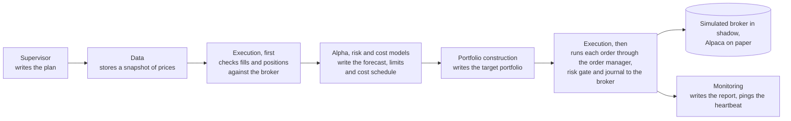

# Architecture — ithildin-runtime slice 1

Seven module issues are about to be built by seven separate sessions, and the
pieces they share are the expensive thing to change later. A bar type, an
order type and the one path an order takes to the broker are read by every
module. Getting one wrong after four modules use it means four rewrites. This
doc draws those shared pieces now, while disagreeing with them costs an edit.

Slice 1 is the walking skeleton on
[#4](https://github.com/l3a0/ithildin-runtime/issues/4): the first version of
the platform in which every module exists in its simplest form and one
strategy runs end to end, every trading day, in shadow mode and on Alpaca's
paper account. Shadow decides on live data and fills every order in the
platform's own simulated broker. Paper, a practice account at a broker that
trades with no real money, sends the same decisions to Alpaca. Each
module issue, [#5](https://github.com/l3a0/ithildin-runtime/issues/5) to
[#11](https://github.com/l3a0/ithildin-runtime/issues/11), still decides what
its module must do. Where this doc and an issue disagree, the issue wins.

Each component runs as its own process and
passes everything to the others through files, so a failure stays inside one
process and every input and output can be read afterwards. So the diagrams draw one worker per module, each a process the host keeps running and the supervisor only messages, rather than one program calling each module in turn. The platform
is an event pipeline with a queue per component: each component listens for events on its queue, and an event reaches a component's queue whenever there is something new for it. The event is S3's own notification of the write, with no polling of storage, apart from one narrow read of monitoring's that catches a lost event for a switch-off or a halt. S3 hands that notification to EventBridge, AWS's event router, which copies it to SQS, AWS's queue service, where the worker waits for it. Every file is a blob in S3, written once at a key
fixed by the run, the stage and the decision, and the VM keeps no state.
The journal is the one numbered log.
[design.md](../design.md#processes-and-files)'s `## Processes and files` carries
the rules the workers follow.

The owner's part in reviewing this doc is one page, [Proposals awaiting a ruling](09-decisions.md#proposals-awaiting-a-ruling), a table where each row says what this doc proposes, what it
turned down, the price and the issue it goes on. Object to a row there. Settled choices sit in [design.md](../design.md)'s `## Decisions`, ordered by when they were decided.

The diagrams are Mermaid, which GitHub draws in place. Each one is followed by
what it shows and what to look for. Nothing here is built yet. A clock time written with no zone, such as 15:40, is New York time, the exchange's own, and the platform writes each one as its UTC instant.

One decision, end to end, is the picture to hold before the detail:

The figure below is a C4 dynamic diagram.

It shows the order of the work, condensed from the diagram in
[The loop and its adapters](05-building-blocks.md#the-loop-and-its-adapters). Look for execution
appearing twice: once to learn what is true at the broker, and once, at the
end, to send orders. Every arrow between workers is really a file written to S3 with an event
telling the next worker it exists. Monitoring also compares the book with the
broker on its own, off the path that sends orders.

## Pages

The pages follow the twelve sections of the [arc42 template](https://arc42.org/overview), so each kind of question has one page. Sections 2, 4 and 12 already live in [design.md](../design.md), with the hard limits of section 2 in [the charter](../team-charter.md#hard-limits), which carries the reasoning, and section 11 lists the prices the design accepts. The operator's pages are reference and how-to rather than architecture, so they sit beside the drills, in the [Diátaxis](https://diataxis.fr/) split between explaining and doing.

Each diagram names its level in the [C4 model](https://c4model.com/) in the sentence before it: system context, container, component or code for structure, and dynamic or deployment for the views that show behaviour over time or the machines a piece runs on.

**Table:** Where each arc42 section lives

| arc42 section | Page | What it answers |
| --- | --- | --- |
| 1. Introduction and goals | [01-introduction-and-goals.md](01-introduction-and-goals.md) | What the platform's first slice must do, and the strategy it runs to prove it |
| 2. Constraints | [design.md's Design for 10x](../design.md#design-for-10x-plan-the-rewrite-before-100x-build-at-1x) and [the charter's hard limits](../team-charter.md#hard-limits) | What the design may not do, and the load it is built for |
| 3. Context and scope | [03-context-and-scope.md](03-context-and-scope.md) | What the platform talks to outside itself, and what crosses each edge |
| 4. Solution strategy | [design.md's One runtime](../design.md#one-runtime) and [Processes and files](../design.md#processes-and-files) | The few choices everything else follows from |
| 5. Building blocks | [05-building-blocks.md](05-building-blocks.md) | Which modules and workers make up the platform, the types they pass, and which may import which |
| 6. Runtime | [06-runtime.md](06-runtime.md) | What happens while the platform runs: a decision's data flow, a trading day, faults, and the life of an order and of a run |
| 7. Deployment | [07-deployment.md](07-deployment.md) | Which machine each piece runs on, what crosses each machine's edge, and how the four environments are kept apart |
| 8. Crosscutting concepts | [08-crosscutting-concepts.md](08-crosscutting-concepts.md) | What is stored, where, and in which format, for every component |
| 9. Architecture decisions | [09-decisions.md](09-decisions.md) | What this design proposes and is waiting on a ruling for |
| 10. Quality requirements | [10-quality.md](10-quality.md) | How the four acceptance tests exercise the design |
| 11. Risks and technical debt | [11-risks.md](11-risks.md) | Every price the design accepts, in one list |
| 12. Glossary | [design.md's Vocabulary](../design.md#vocabulary) | What each term this design uses means |

**Table:** Where the operator's pages live

| Page | What it holds |
| --- | --- |
| [what-a-person-runs.md](../what-a-person-runs.md) | The command line tool, its commands, and how a person goes from an alarm to a command |
| [halts-and-drills.md](../halts-and-drills.md) | The steps of a sort, every alarm and its drill, and the drills with no alarm |
