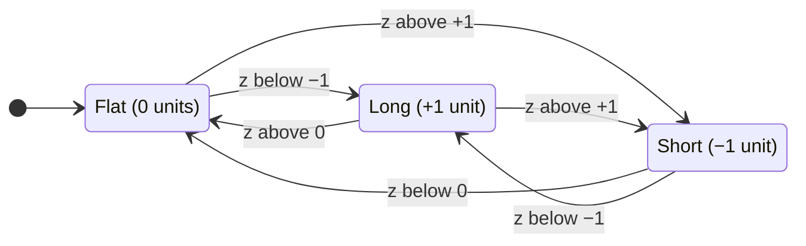
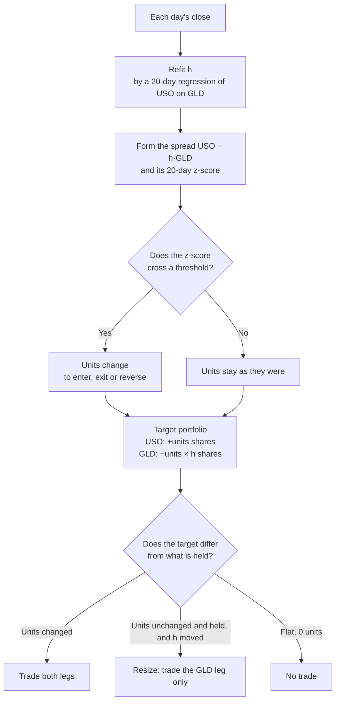

# Architecture, section 1: Introduction and goals

This page is section 1 of [the architecture](00-README.md), in the order of the arc42 template. It answers what the platform's first slice must do, and the strategy it runs to prove it.

## Contents

- [The strategy the skeleton runs](#the-strategy-the-skeleton-runs)
  - [How the model knows which unit it holds](#how-the-model-knows-which-unit-it-holds)
  - [What ends a position](#what-ends-a-position)
  - [What forces the spread back](#what-forces-the-spread-back)
  - [What a pin on this data cannot show](#what-a-pin-on-this-data-cannot-show)

## The strategy the skeleton runs

Acceptance test 1 asks the backtest to reproduce a strategy that
[quantitative-trading](https://github.com/l3a0/quantitative-trading) has
already replicated. A mismatch then points at the platform rather than the
idea, because the strategy's numbers are already pinned there.

The proposal is Chan's Bollinger band on the price spread between GLD, a gold
ETF, and USO, an oil ETF. It is Example 3.2 of *Algorithmic Trading* and
[Entry 26](https://github.com/l3a0/quantitative-trading/blob/19aadbeb9730bf34f724af5688669b6bc208d136/docs/replication-log.md#entry-26-bollinger-bands-on-gld-and-uso-chans-algorithmic-trading) of that repository's replication log, and
[a post in its blog](https://github.com/l3a0/quantitative-trading/blob/main/blog/bollinger-band-lessons.md)
walks through it. A Bollinger band is a moving
average with a band of one standard deviation on each side, and this strategy
trades when the spread leaves its band. Read at quantitative-trading's commit
`19aadbeb`, the rule is four steps.

1. Each day, fit the hedge ratio `h`, the number of GLD shares that offset one
   USO share. It is the slope of a regression of USO's close on GLD's close
   and a constant, over the last 20 closes.
2. Form the spread `USO − h·GLD`.
3. Measure how many standard deviations the spread sits from its own 20-day
   mean. That count is the spread's z-score.
4. Go long one unit of the spread when the z-score falls below −1, and exit
   when it rises above 0. Go short one unit above +1, and exit below 0.
   Otherwise hold. One unit is `+1` share of USO and `−h` shares of GLD.

The position is only ever one of three states, and the z-score decides each
move at the close:

The figure below is a C4 code diagram.

The diagram shows step 4. Look for the last two arrows, the reversals: a jump
past 0 and through the far band on one close exits one side and enters the
other. Two figures from the blog post show the same moves on the run itself.

The sketch shows sixteen days up close. Look for each entry beyond a band and
each exit at 0.

The chart shows the whole run. Look at the middle panel, which holds the three
states of the diagram above.

Steps 1 to 3 run every day whatever the state, which is why a held position
trades on days the units do not change:

The figure below is a code-level flowchart of the strategy's rule for one close, from the refit to what trades.

The diagram shows one close, from the refit to what trades. Look for the two
paths that keep the same units. A refit moves `h` even when the position holds
still, so the target moves too, and the engine trades the difference as it
would for any strategy. The USO leg stays at one share per unit, so only GLD
resizes.

These numbers are made up to show the mechanics, and share counts are per unit
of the spread:

**Table:** How the position and its legs resize, day by day, with made-up numbers

| Day | z-score | Units | `h` | Target USO | Target GLD | What trades |
| --- | --- | --- | --- | --- | --- | --- |
| Monday | −1.2 | +1 | 0.50 | +1 | −0.50 | Enter: buy 1 USO, short 0.50 GLD |
| Tuesday | −0.4 | +1 | 0.53 | +1 | −0.53 | Resize: short 0.03 more GLD |
| Wednesday | −0.2 | +1 | 0.51 | +1 | −0.51 | Resize: buy back 0.02 GLD |
| Thursday | +0.1 | 0 | 0.52 | 0 | 0 | Exit: sell 1 USO, buy back 0.51 GLD |
| Friday | +0.4 | 0 | 0.50 | 0 | 0 | Nothing: flat, so `h` has no effect |

Four facts make it the simplest candidate there.

1. **Two liquid ETFs, daily closes.** The backtest reads daily closes only,
   with no futures rolls and no stock panel. The live decision also reads one
   quote per ETF at close−20, 15:40 on a full day, from marketlake's segments.
2. **One committed source.** [`data/inputdata_etf/gld.csv`](https://github.com/l3a0/quantitative-trading/blob/19aadbeb9730bf34f724af5688669b6bc208d136/data/inputdata_etf/gld.csv) and
   [`data/inputdata_etf/uso.csv`](https://github.com/l3a0/quantitative-trading/blob/19aadbeb9730bf34f724af5688669b6bc208d136/data/inputdata_etf/uso.csv) were lifted from Chan's `inputData_ETF.mat`, cover
   2006-04-26 to 2012-04-09, and each has a recorded SHA-256 checksum. Each
   file is a vintage, meaning one source's copy of a series stored once and
   never changed, as [design.md](../design.md#vocabulary) defines it.
3. **A discrete unit.** The number of spread units held is only ever −1, 0 or
   +1, so a test can check it on each day, not only a summary ratio. The share
   counts are not discrete. One unit holds `−h` shares of GLD, and `h` is a
   regression slope refitted daily, so the GLD leg is fractional on every day
   the strategy holds a position. The replication never deals in shares. It
   turns units, the hedge ratio and prices into a dollar position per leg, so
   test 1 checks the unit and the dollars, never a share count.
4. **Tight pins.** [`tests/test_bollinger.py`](https://github.com/l3a0/quantitative-trading/blob/19aadbeb9730bf34f724af5688669b6bc208d136/tests/test_bollinger.py) pins the APR at 0.17824928 and the
   Sharpe ratio at 0.96467289, both to 5e-9, over 1,480 rows. It also pins 162
   changes of unit, made of 77 entries, 76 exits and 9 reversals.

The replication has six quirks. The
engine carries none of them: it runs any strategy, and it keeps a capital
account. So each quirk lives in the strategy's own pieces or in how test 1 is
set up and compared, never in a shared module's code, and a second strategy
changes none of them.

1. The strategy refits the hedge ratio every day, so its target resizes the
   GLD leg even on days the unit does not change. That is the alpha model's
   forecast changing, and the engine trades the difference like any other.
2. The replication's return is profit over the gross dollars held, with no
   capital account. The engine keeps a capital account, so test 1's
   comparison recomputes Chan's return from the positions and prices the run
   recorded, rather than reading the engine's own return.
3. The moving standard deviation divides by `n − 1`, as MATLAB does, which
   lives in the alpha model. Dividing by `n` moves the APR to 0.183306.

   

   The sketch, also from the blog post, shows why the divisor matters. Look
   for the days one divisor's dot crosses +1 and the other's does not.
4. The replication charges no transaction cost, so this strategy's
   configuration, `chan_bollinger.toml`, writes every cost term as zero, and
   test 1 runs the cost model on that file. A strategy's file is the same in
   every environment, so paper estimates a cost of zero too until the strategy
   it runs has terms above zero. Terms above zero are written before any
   strategy weighs a cost against what a trade would earn, and before live.
   Where they go is not settled, because test 1 pins this file at zero.
5. The replication drops its first 20 rows, although the regression can be
   fitted on the 20th, 2006-05-23. Without that row's spread, 2006-06-20, the
   19th row it keeps, has no z-score there. A decision on that session would
   read a z-score of −1.075 and enter a day early, the one day the two differ.
   So test 1's plan starts on 2006-06-21, and the model carries no rule for it.
6. The replication fills at the close whose price its signal read, which no
   live order can do. Test 1 fills there too, because its deployment decides at
   the close through a simulated account whose cutoff is the close, as
   [How the four acceptance tests exercise it](10-quality.md#how-the-four-acceptance-tests-exercise-it)
   says.

Every quantitative-trading result is exploratory, meaning found by looking at
the data, and this one is too. Test 1 uses it as a known answer for checking
the engine. Running it on paper promotes the platform's version, not the
strategy, because a strategy is promoted only by its registered test,
which runs on paper with its hypothesis committed before its sample opens. Registered means
the hypothesis was committed in writing before the number was seen.

### How the model knows which unit it holds

The rule holds a unit from its entry to its exit, so today's unit depends on
days gone by. A live run is one trading day, and a worker carries nothing from
one decision to the next except blobs. So the alpha model remembers no unit.
It works the unit out again at every decision, from the closes in that
decision's snapshot, in four steps.

1. Start at the decision's own session and walk back, working out each
   session's z-score only when the walk reaches it.
2. Settle the long side at the newest z-score that enters it, below −1, or ends
   it, above 0. Settle the short side at the newest one that enters it, above
   +1, or ends it, below 0.
3. Stop once both sides are settled. The unit is +1 if the long is held, −1 if
   the short is, and 0 if neither is.
4. Halt if the window of bars ends before both sides settle. Positions stay as
   they are.

A z-score exactly on a threshold settles nothing, because the rule's
comparisons are strict.

**Table:** How far back each walk reads, with made-up z-scores

| z-scores, newest first | The long side | The short side | The unit |
| --- | --- | --- | --- |
| −0.4, then −1.2 | Held, by −1.2 | Not held, by −0.4 | +1, after two z-scores |
| +0.3, then −0.4 | Not held, by +0.3 | Not held, by −0.4 | 0, after two z-scores |
| +1.3 | Not held, by +1.3 | Held, by +1.3 | −1, after one z-score |
| −0.4, then −0.9 | Not settled | Not held, by −0.4 | Unknown, so the walk goes on, and halts if the window ends |

A settled unit equals the rule run forward over every close today's snapshot
knows, whatever the window's length, and a day that halted leaves no gap in
it. `tests/test_alpha_replication.py` holds it to the replication's unit on
each of test 1's 1,461 decisions. The longest walk among them reads 55
sessions. At a lookback of 60 sessions none of them halts, and at 40 sessions
513 halt and none is wrong. The lookback was chosen after the z-scores of
2006 to 2012 and of 2012 to 2026 were both read, so "none halts" is exploratory,
and a longer walk is rare rather than impossible. A settled unit does not
depend on the lookback. The strategy's lookback is 60 sessions, which
[#110](https://github.com/l3a0/ithildin-runtime/issues/110) writes in place of the 40 that data's settings state today.

The price has three parts.

1. A live decision reads a price before the close, so the unit worked out from
   closes the next day can differ from the one traded. An entry or an exit that
   the close does not confirm is undone then, at the cost of one round trip, and
   one the earlier price missed is taken a session late.
2. A bar corrected inside the window can change today's unit with no move of
   the market.
3. A bar whose prices contradict each other halts every decision whose lookback
   reads it, which is up to 60 sessions.

### What ends a position

A long ends when the z-score rises above 0 and a short when it falls below 0,
or either ends when a reversal enters the other side. A reversal ends one side
and starts the other inside one position. Nothing bounds how long a position is
held, because a time limit would change the decisions test 1 pins. The
replication's 77 positions, counted from flat to flat, lasted a median of 14
sessions and at most 40, with one open at the end.

Where the spread does not return, the daily refit of `h` moves the spread's
mean under it, and the caps and the daily loss stop are the only bound. A halt
holds an open position as it is, because nothing in slice 1 unwinds one.

The exit is a function of its own in `alpha`. So a backtest quoted as evidence
for the entry can set it beside random entries under the same exit, as
[A result is measured against the risk it took](../design.md#a-result-is-measured-against-the-risk-it-took-and-size-answers-to-what-the-owner-can-bear)
asks.

### What forces the spread back

Nothing forces it back. Two prices are cointegrated when some fixed combination
of them keeps returning to one level, and Chan states that GLD and USO are not.
quantitative-trading has run one test of it on these prices, an Engle-Granger
test at one lag over all 1,500 sessions, which gives −1.5150 against a bar of
−3.04 at 10 percent
([Entry 21](https://github.com/l3a0/quantitative-trading/blob/19aadbeb9730bf34f724af5688669b6bc208d136/docs/replication-log.md#entry-21-price-spread-log-price-spread-and-ratio-chans-algorithmic-trading)). So
it does not find that they are, which is exploratory and no proof that they are
not. This repository has run no test of its own. USO holds oil futures, so its price also carries
the roll return, which is what a fund gains or loses as it replaces an expiring
contract with the next one. Who the strategy trades against, and what kind each
price is, go on its registration, [#41](https://github.com/l3a0/ithildin-runtime/issues/41).

### What a pin on this data cannot show

Both vintages were saved on 2012-04-10, so a result quoted from them can carry
corrections made up to that day. Chan calls the 20-session windows near-optimal
with the benefit of hindsight
([Entry 26](https://github.com/l3a0/quantitative-trading/blob/19aadbeb9730bf34f724af5688669b6bc208d136/docs/replication-log.md#entry-26-bollinger-bands-on-gld-and-uso-chans-algorithmic-trading)),
and states the thresholds, 1 and 0, without saying how they were chosen
([the post](https://github.com/l3a0/quantitative-trading/blob/main/blog/bollinger-band-lessons.md)).
So no test can show that any of the four settings was knowable before test 1's
decisions.

A backtest quoted as evidence names the corrections its vintage can carry, and
tests that each value it was given was knowable before its first decision, as
[A backtest uses nothing it could not have known](../design.md#a-backtest-uses-nothing-it-could-not-have-known-and-each-figure-it-quotes-has-one-definition)
requires. A replication pin owes neither, because it checks the engine.
