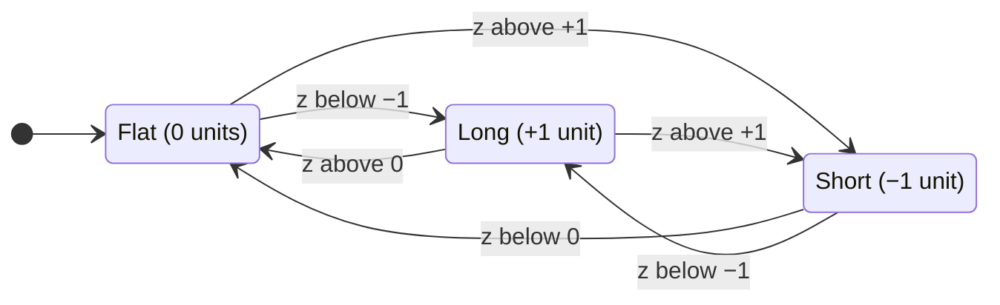
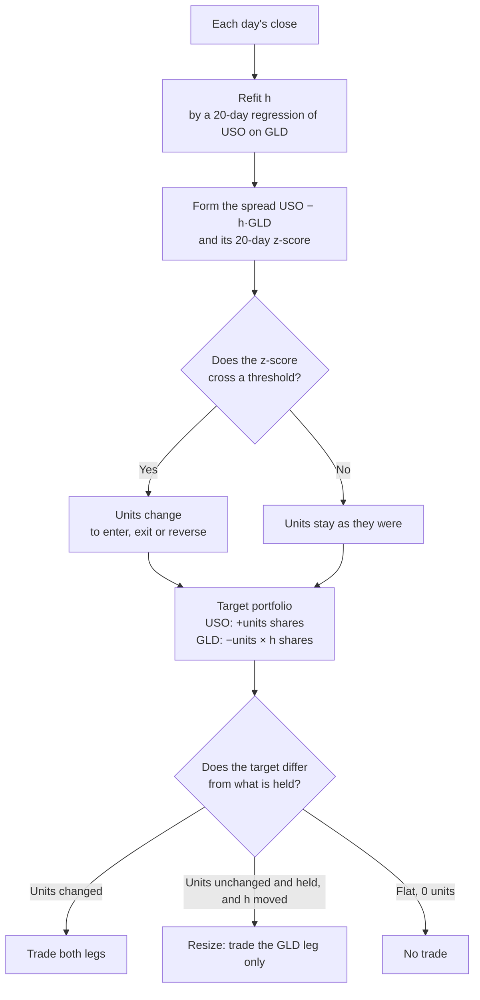

# Architecture, section 1: Introduction and goals

This page is section 1 of [the architecture](00-README.md), in the order of the arc42 template. It answers what the platform's first slice must do, and the strategy it runs to prove it.

## Contents

- [The strategy the skeleton runs](#the-strategy-the-skeleton-runs)

## The strategy the skeleton runs

Acceptance test 1 asks the backtest to reproduce a strategy that
[quantitative-trading](https://github.com/l3a0/quantitative-trading) has
already replicated. A mismatch then points at the platform rather than the
idea, because the strategy's numbers are already pinned there.

The proposal is Chan's Bollinger band on the price spread between GLD, a gold
ETF, and USO, an oil ETF. It is Example 3.2 of *Algorithmic Trading* and
[Entry 26](https://github.com/l3a0/quantitative-trading/blob/19aadbeb9730bf34f724af5688669b6bc208d136/docs/replication-log.md#entry-26-bollinger-bands-on-gld-and-uso-chans-algorithmic-trading) of that repository's replication log, and
[a post in its blog](https://github.com/l3a0/quantitative-trading/blob/main/blog/bollinger-band-lessons.md)
walks through it. A Bollinger band is a moving
average with a band of one standard deviation on each side, and this strategy
trades when the spread leaves its band. Read at quantitative-trading's commit
`19aadbeb`, the rule is four steps.

1. Each day, fit the hedge ratio `h`, the number of GLD shares that offset one
   USO share. It is the slope of a regression of USO's close on GLD's close
   and a constant, over the last 20 closes.
2. Form the spread `USO − h·GLD`.
3. Measure how many standard deviations the spread sits from its own 20-day
   mean. That count is the spread's z-score.
4. Go long one unit of the spread when the z-score falls below −1, and exit
   when it rises above 0. Go short one unit above +1, and exit below 0.
   Otherwise hold. One unit is `+1` share of USO and `−h` shares of GLD.

The position is only ever one of three states, and the z-score decides each
move at the close:

The figure below is a C4 code diagram.

The diagram shows step 4. Look for the last two arrows, the reversals: a jump
past 0 and through the far band on one close exits one side and enters the
other. Two figures from the blog post show the same moves on the run itself.

The sketch shows sixteen days up close. Look for each entry beyond a band and
each exit at 0.

The chart shows the whole run. Look at the middle panel, which holds the three
states of the diagram above.

Steps 1 to 3 run every day whatever the state, which is why a held position
trades on days the units do not change:

The figure below is a C4 dynamic diagram.

The diagram shows one close, from the refit to what trades. Look for the two
paths that keep the same units. A refit moves `h` even when the position holds
still, so the target moves too, and the engine trades the difference as it
would for any strategy. The USO leg stays at one share per unit, so only GLD
resizes.

These numbers are made up to show the mechanics, and share counts are per unit
of the spread:

**Table:** How the position and its legs resize, day by day, with made-up numbers

| Day | z-score | Units | `h` | Target USO | Target GLD | What trades |
| --- | --- | --- | --- | --- | --- | --- |
| Monday | −1.2 | +1 | 0.50 | +1 | −0.50 | Enter: buy 1 USO, short 0.50 GLD |
| Tuesday | −0.4 | +1 | 0.53 | +1 | −0.53 | Resize: short 0.03 more GLD |
| Wednesday | −0.2 | +1 | 0.51 | +1 | −0.51 | Resize: buy back 0.02 GLD |
| Thursday | +0.1 | 0 | 0.52 | 0 | 0 | Exit: sell 1 USO, buy back 0.51 GLD |
| Friday | +0.4 | 0 | 0.50 | 0 | 0 | Nothing: flat, so `h` has no effect |

Four facts make it the simplest candidate there.

1. **Two liquid ETFs, daily closes.** The backtest reads daily closes only,
   with no futures rolls and no stock panel. The live decision also reads one
   quote per ETF at close−20, 15:40 on a full day, from marketlake's segments.
2. **One committed source.** [`data/inputdata_etf/gld.csv`](https://github.com/l3a0/quantitative-trading/blob/19aadbeb9730bf34f724af5688669b6bc208d136/data/inputdata_etf/gld.csv) and
   [`data/inputdata_etf/uso.csv`](https://github.com/l3a0/quantitative-trading/blob/19aadbeb9730bf34f724af5688669b6bc208d136/data/inputdata_etf/uso.csv) were lifted from Chan's `inputData_ETF.mat`, cover
   2006-04-26 to 2012-04-09, and each has a recorded SHA-256 checksum. Each
   file is a vintage, meaning one source's copy of a series stored once and
   never changed, as [design.md](../design.md#vocabulary) defines it.
3. **A discrete unit.** The number of spread units held is only ever −1, 0 or
   +1, so a test can check it on each day, not only a summary ratio. The share
   counts are not discrete. One unit holds `−h` shares of GLD, and `h` is a
   regression slope refitted daily, so the GLD leg is fractional on every day
   the strategy holds a position. The replication never deals in shares. It
   turns units, the hedge ratio and prices into a dollar position per leg, so
   test 1 checks the unit and the dollars, never a share count.
4. **Tight pins.** [`tests/test_bollinger.py`](https://github.com/l3a0/quantitative-trading/blob/19aadbeb9730bf34f724af5688669b6bc208d136/tests/test_bollinger.py) pins the APR at 0.17824928 and the
   Sharpe ratio at 0.96467289, both to 5e-9, over 1,480 rows. It also pins 162
   changes of unit, made of 77 entries, 76 exits and 9 reversals.

The replication has four quirks. The
engine carries none of them: it runs any strategy, and it keeps a capital
account. So each quirk lives in the strategy's own pieces or in test 1's
comparison, never in a shared module, and a second strategy changes none of
them.

1. The strategy refits the hedge ratio every day, so its target resizes the
   GLD leg even on days the unit does not change. That is the alpha model's
   forecast changing, and the engine trades the difference like any other.
2. The replication's return is profit over the gross dollars held, with no
   capital account. The engine keeps a capital account, so test 1's
   comparison recomputes Chan's return from the positions and prices the run
   recorded, rather than reading the engine's own return.
3. The moving standard deviation divides by `n − 1`, as MATLAB does, which
   lives in the alpha model. Dividing by `n` moves the APR to 0.183306.

   

   The sketch, also from the blog post, shows why the divisor matters. Look
   for the days one divisor's dot crosses +1 and the other's does not.
4. The replication charges no transaction cost, so the cost model in
   [#8](https://github.com/l3a0/ithildin-runtime/issues/8) runs at zero in this strategy's configuration for test 1.
   Paper trading then charges a flat or linear cost.

Every quantitative-trading result is exploratory, meaning found by looking at
the data, and this one is too. Test 1 uses it as a known answer for checking
the engine. Running it on paper promotes the platform's version, not the
strategy, because a strategy is promoted only by its registered test,
which runs on paper with its hypothesis committed before its sample opens. Registered means
the hypothesis was committed in writing before the number was seen.
