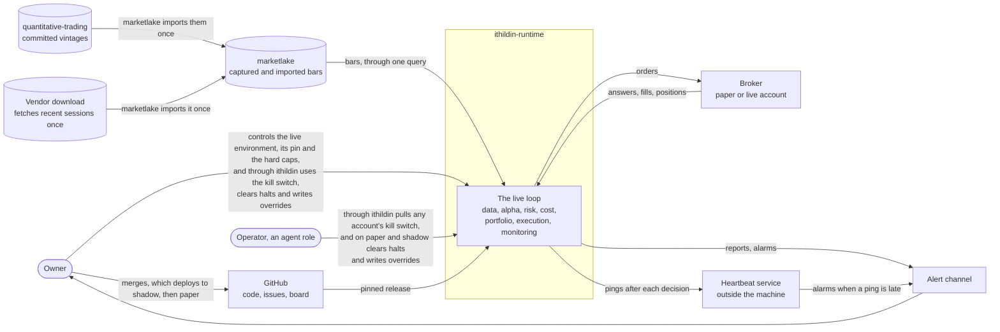
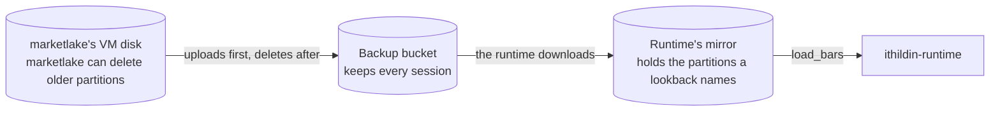
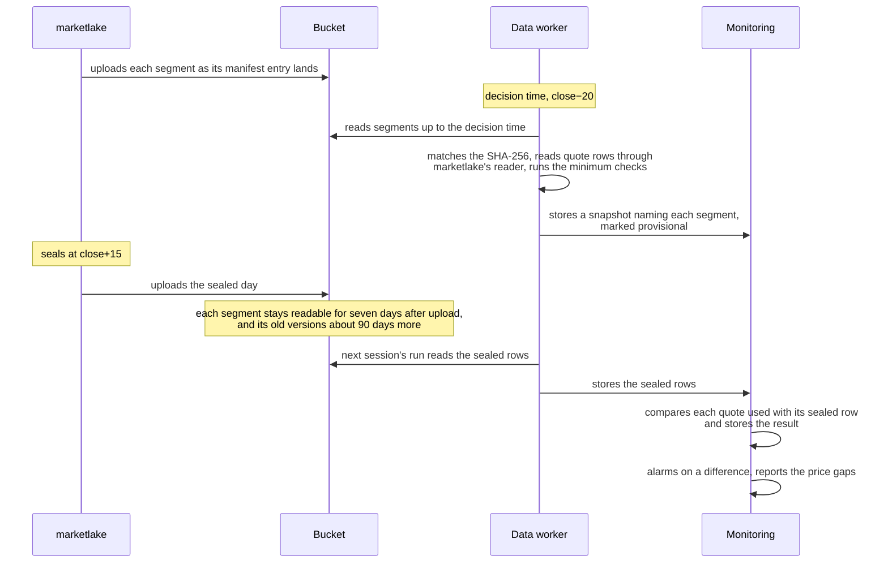

# Architecture, section 3: Context and scope

This page is section 3 of [the architecture](00-README.md), in the order of the arc42 template. It answers what the platform talks to outside itself, and what crosses each edge.

## Contents

- [Context: what the platform talks to](#context-what-the-platform-talks-to)
  - [Where bars come from](#where-bars-come-from)
  - [How long data is kept](#how-long-data-is-kept)
  - [Reading the day before it is sealed](#reading-the-day-before-it-is-sealed)
  - [The previous session's daily bar](#the-previous-sessions-daily-bar)
  - [Orders and the two outside switches](#orders-and-the-two-outside-switches)
  - [The heartbeat](#the-heartbeat)

## Context: what the platform talks to

A context diagram shows the platform as one box and everything outside it that
it talks to.

The figure below is a C4 system context diagram.



### Where bars come from

The platform reads every bar from one place, marketlake, the sibling repository
that captures market data before anything computes on it. Each source is
transformed into marketlake once, stored durably there, and read by every mode
through one query, so a backtest and a live run never read bars by different
paths. The runtime runs on a VM of its own and reads a local mirror of the
partitions it downloads from marketlake's bucket, as [Where it runs](07-deployment.md#where-it-runs) says.
marketlake holds three kinds of bar.

**Table:** The three kinds of bar marketlake holds

| Kind of bar | Comes from | Read by |
| --- | --- | --- |
| Captured | marketlake's capture, which has held GLD and USO since Monday 2026-11-02's session | Shadow, paper and live trading |
| Committed vintages | quantitative-trading, imported once | The backtest |
| Recent vendor download | One download of the latest sessions, imported once | The strategy's first decisions, until capture covers them |

The vendor download exists because the strategy's first z-score needs about 40
sessions of closes: 20 to fit the first hedge ratio, and 20 more spreads to fill
the z-score's 20-day window.

Every bar says whether it was captured or imported, in `origin`, and where an
imported one came from, in `vintage_id`, so a consumer can refuse imported
history where only captured data will do. Imported history never overwrites a
captured partition.

### How long data is kept

No session ages out for the runtime, and only a day's capture segments go, as
[Reading the day before it is sealed](#reading-the-day-before-it-is-sealed)
says. marketlake's VM can delete older partitions
from its own disk once its backup bucket holds them, but the runtime reads a
mirror of that bucket, which keeps every session, and never the VM's disk. So
the 2006 to 2012 history and a lookback of any length stay readable.

The figure below is a C4 container diagram.



The diagram shows the path a bar takes to the runtime. Look for the missing
arrow: nothing connects the VM's disk to the runtime, so a deletion there cannot
reach a lookback.

### Reading the day before it is sealed

A decision at close−20, 15:40 on a full day, needs today's quotes, but
marketlake runs its validation battery only when it seals a day, at the close
plus fifteen minutes. So the runtime may read the day's data before marketlake
seals it, as a provisional read, and it checks that data twice: its own minimum
checks before anything decides, and a comparison with the sealed day afterwards.
The skeleton decides this way because it trades the close, so its fill lands on
the close the backtest fills at.

The figure below is a C4 dynamic diagram.



The diagram shows one day's read before sealing. Look for the two checks either
side of the seal, and for monitoring's comparison, which runs after the decision
has already acted. The read has five parts.

1. **What is read.** marketlake's capture daemon writes a segment each cycle and
   never rewrites it once its manifest entry lands, which makes an early read
   safe. marketlake uploads each segment to its bucket as soon as that entry
   lands, refusing to replace an existing key. Any decision time inside
   marketlake's capture hours reads those segments, up to the decision time. The
   skeleton's close−20 is one such time, and the shadow run on SPY and QQQ that
   [#16](https://github.com/l3a0/ithildin-runtime/issues/16) sets decides at the same minute. The
   data worker reads an unsealed day through the one reader marketlake publishes, [l3a0/marketlake#1004](https://github.com/l3a0/marketlake/issues/1004), which [#5](https://github.com/l3a0/ithildin-runtime/issues/5) waits on. Given a ticker, a day and a time, the reader returns the quote rows captured so far, the same rows the seal would produce for those minutes, so joining a ticker-day's segments has one implementation. marketlake's publication lag, from a cycle's capture to its segment in the bucket, is a published input. A decision whose newest cycle has not landed by the decision time treats that quote as missing or stale under the rule [#7](https://github.com/l3a0/ithildin-runtime/issues/7) sets, [#5](https://github.com/l3a0/ithildin-runtime/issues/5) holds how, and shadow measures the lag.

   The figure below is a C4 dynamic diagram.

   ```mermaid
   flowchart LR
       seg["Segment in the bucket"] --> sha["Match its SHA-256 against the object's<br/>stored SHA-256 and metadata"]
       sha -- "Mismatch" --> halt["Halt the decision"]
       sha -- "Match" --> read["marketlake's reader<br/>joins a ticker-day's segments"]
       read --> rows["Quote rows"]
   ```

   The diagram shows one segment becoming quote rows. Look for which steps are
   the runtime's. The SHA-256 match is the check [The runtime has a VM of its own](07-deployment.md#rule-8-the-runtime-has-a-vm-of-its-own)
   requires, which reads the stored SHA-256 and metadata that carry the segment's manifest entry under `lake-live/`. The reader comes from marketlake's package, a
   dependency at a pinned commit, and [l3a0/marketlake#1004](https://github.com/l3a0/marketlake/issues/1004) states what it does when a segment is absent or fails its SHA-256, so the data worker can halt on it. The reader reads only the root the data worker checked, and the snapshot's list comes from the worker's own download.
2. **What is checked before deciding.** The data worker runs its own minimum
   checks before anything decides. A missing or stale quote at the decision time
   halts the decision, a segment whose SHA-256 does not match its manifest entry halts it too, and a price spike is flagged in the snapshot, and the send stage's flag test halts the decision when the instrument is traded or held. This doc proposes, for [#7](https://github.com/l3a0/ithildin-runtime/issues/7), that the test runs with no order needed.
3. **Which read a decision uses.** Whether the day is sealed when the read
   happens picks the read. A live decision before the seal reads segments,
   because no partition exists yet. A replay reads the sealed partitions, up to
   the decision's time, because the partition is what stays.

   The figure below is a C4 dynamic diagram.

   ```mermaid
   flowchart TD
       t{"Is the day sealed<br/>when the read happens?"}
       t -- "No" --> seg["Read segments, marked provisional"]
       t -- "Yes" --> part["Read sealed partitions<br/>up to the decision time"]
       part --> same["A replay of a decision<br/>read before sealing lands here"]
   ```

   The diagram shows the choice. Look for the replay: a backtest that replays a
   close−20 decision reads the sealed rows up to that decision's time. Those are
   the rows the live decision read, unless a row's segment landed after the decision, or part 4's comparison found a
   difference. On such a day a replay shows the sealed rows rather than what the
   decision read, and the journal holds the difference. Test 2 covers both reads, with a sealed stretch for the replay and
   a fixture day left unsealed for the read of segments. A decision after the
   seal needs none of this.
4. **What is compared after the seal.** The snapshot names each segment it read
   by key, S3 version and SHA-256, and marks the read provisional. Once marketlake
   seals the day, monitoring compares each quote the snapshot used with the sealed
   row of the same ticker and minute, by bid, ask and last as received, because a
   segment and the partition built from it never share bytes. The stored snapshot
   holds every `Quote` field and each bar's `vintage_id`, as `Snapshot` does in memory, so
   monitoring reads the used quote from the snapshot. A segment that is gone
   changes nothing, and the comparison holds for as long as the snapshot does.
   The data worker's role, in the next session's run, reads the sealed row and stores it, so data stays the one reader of marketlake, and monitoring's role compares, as [#5](https://github.com/l3a0/ithildin-runtime/issues/5) and [#11](https://github.com/l3a0/ithildin-runtime/issues/11) hold. Each provisional snapshot gets a stored comparison result within a written bound after the close. A missing result, or a sealed day that never arrives, pages and stops no decision. This doc proposes, for [#5](https://github.com/l3a0/ithildin-runtime/issues/5), that the comparison also takes the newest sealed row at or before the decision time, so a row whose segment landed after the decision shows as a difference.

   **Table:** What monitoring does with each thing it finds after the seal

   | Monitoring finds | It does |
   | --- | --- |
   | A value that differs from the sealed row | Journals and alarms |
   | A row the sealed day quarantined or lacks | Journals and alarms |
   | A gap between the price the decision used and the official close | A report line, since the two differ by design |
   | A gap between a market-on-close fill and that close | A report line, since the two differ by design |

5. **What this rests on.** marketlake publishes a window: each segment stays
   readable for seven days after upload, with old versions kept about 90 days
   more, as [l3a0/marketlake#995](https://github.com/l3a0/marketlake/issues/995) records, and nothing in the runtime knows when one goes. A read before sealing is the
   only read that needs a segment, because a replay reads partitions and the
   comparison reads the snapshot. Only the uploader refuses an overwrite so far, and
   [l3a0/marketlake#985](https://github.com/l3a0/marketlake/issues/985) holds making S3 itself refuse one. A snapshot
   keeps naming each segment it read, as the record of what the decision read,
   though after the window those names point at nothing. The window reads age alone, so a day whose sealed partition never reached the bucket ends with marketlake's VM volume as its only copy, and [l3a0/marketlake#996](https://github.com/l3a0/marketlake/issues/996) is the page that rests on. The provisional read
   is proposed for [#5](https://github.com/l3a0/ithildin-runtime/issues/5) and [#16](https://github.com/l3a0/ithildin-runtime/issues/16).

### The previous session's daily bar

The close−20 decision on a session needs the previous session's official daily
bar for its lookback, so marketlake fetches each bar at its own session's 18:30
sweep, still checked against that session's 16:15 quote, rather than serve a
provisional bar. So the close−20 decision reads the previous session's official bar
through `load_bars`, and [#16](https://github.com/l3a0/ithildin-runtime/issues/16)'s shadow run reads the previous session's
official close the same way. That bar
is Schwab's daily candle as fetched at the session's own 18:30 sweep. A
correction Schwab publishes later is not picked up, and nothing measured has
shown one, which [l3a0/marketlake#962](https://github.com/l3a0/marketlake/issues/962) records as its price. The lookback stays on daily
closes, and the close−20 quote stands where the backtest uses the session's
close. That is the timing gap [How the four acceptance
tests exercise it](10-quality.md#how-the-four-acceptance-tests-exercise-it) names, which shadow running
measures.

### Orders and the two outside switches

The platform sends orders to one place, Alpaca's paper account. Shadow fills its own orders in the simulator, so they reach no broker.

Two switches come from outside the loop.

1. **The live switch** is the live environment, which only the owner builds, gives the live key and pins a release in, which is hard limit 1 in [CLAUDE.md](../../CLAUDE.md). Paper and live never share a VM, a bucket or a key, as [Four environments](07-deployment.md#four-environments) says.
2. **The kill switch** halts trading. The
   risk engineer builds it and writes when to pull it, and the operator pulls
   it by that guidance. The owner can pull it too.

### The heartbeat

A dead-man check raises an alarm when a ping it expects fails to arrive. Here
monitoring pings a heartbeat service as each decision's last step, and the
service alarms when a ping is late against the deployment's schedule. The service sits outside the machine because a
check on the same machine dies with it, and a machine where nothing runs is
the failure the check exists for. The heartbeat service is healthchecks.io, in the
project marketlake already runs.

The alert channel is how an alarm reaches the owner, and it has three routes.

1. **healthchecks.io's ntfy push and email integrations** carry the dead-man checks' alarms. No runtime VM holds an address for them.
2. **The push topic** is an ntfy topic of an environment's own. Shadow, paper and live each hold one, separate from marketlake's and from each other's, on the same phone. Every push an environment's VM or AWS account sends straight to ntfy goes to that environment's topic. An environment's VM, parameters and EventBridge route hold only that environment's address, and no runtime VM, parameter or EventBridge route holds marketlake's topic address. [An ntfy topic's name is its only password](https://docs.ntfy.sh/publish/), so that separation holds only while no address can be guessed or derived from another environment's. This doc proposes, for [#11](https://github.com/l3a0/ithildin-runtime/issues/11), that each topic's name is a long random value.
3. **Email through an SNS topic** goes with two alarms, the promotion check and the live drill check, which say that a scheduled job stopped running. [Email on two checks](07-deployment.md#rule-9-email-on-two-checks) says how.

A ping says only that a decision finished. The jobs [Faults are expected](../design.md#faults-are-expected-and-the-platform-checks-itself-while-it-runs) lists, such as the daily report, run apart from a decision and get no check of their own. Monitoring reads each job's age and pages through the alert channel, as that section says.
