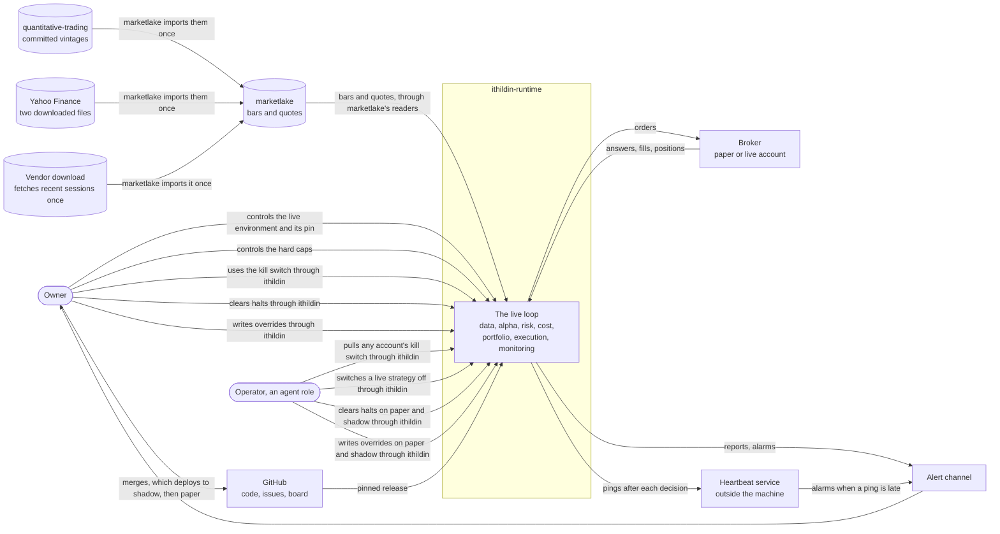
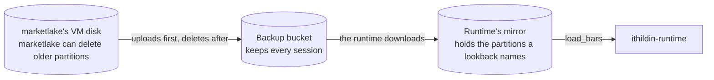
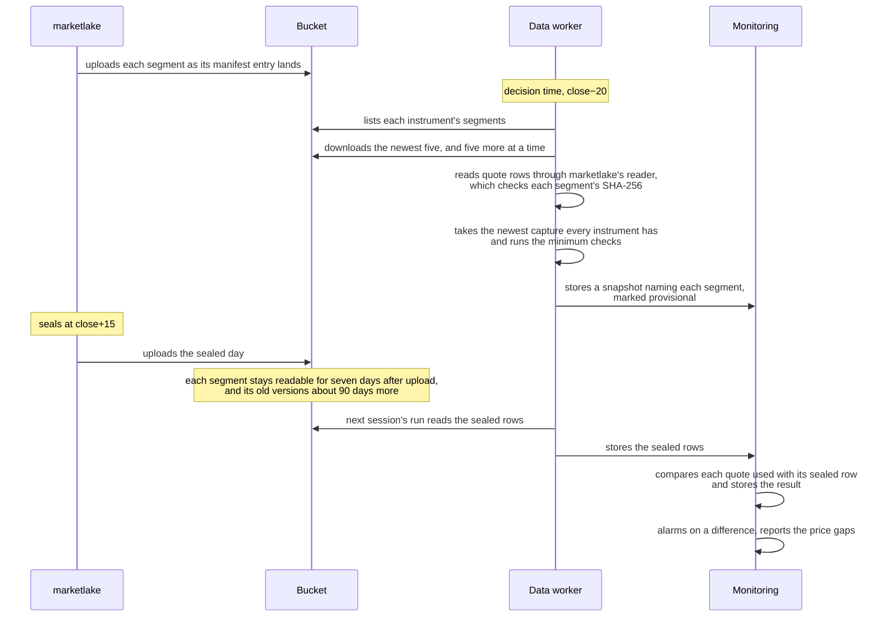
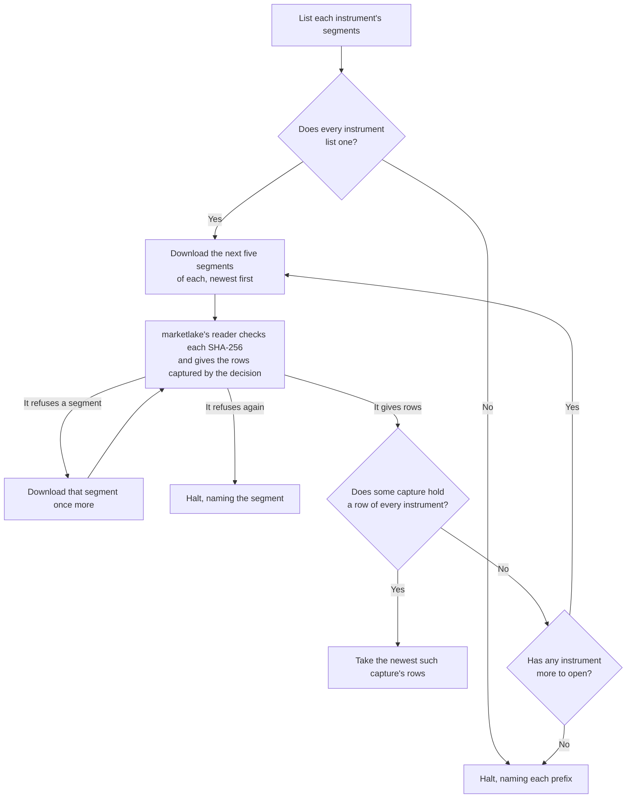
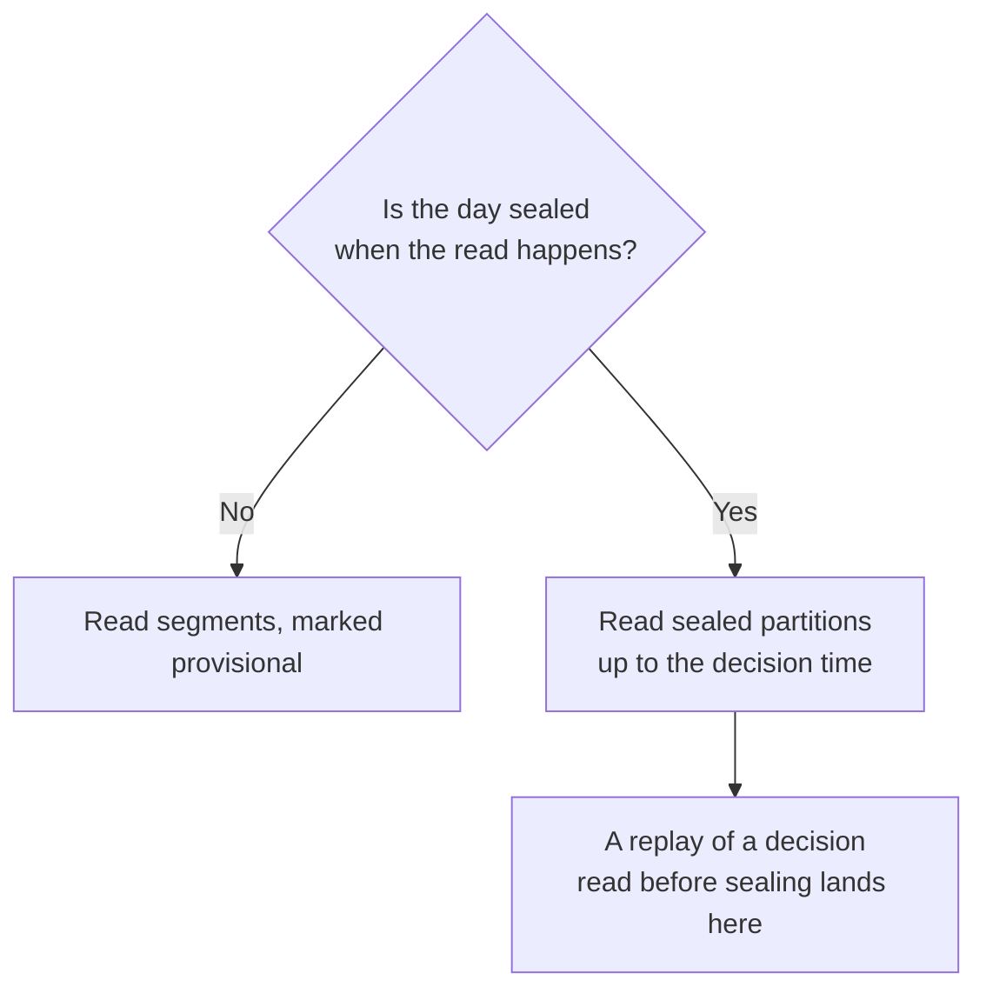

# Architecture, section 3: Context and scope

This page is section 3 of [the architecture](00-README.md), in the order of the arc42 template. It answers what the platform talks to outside itself, and what crosses each edge.

## Contents

- [Context: what the platform talks to](#context-what-the-platform-talks-to)
  - [Where bars come from](#where-bars-come-from)
  - [How long data is kept](#how-long-data-is-kept)
  - [Reading the day before it is sealed](#reading-the-day-before-it-is-sealed)
  - [The previous session's daily bar](#the-previous-sessions-daily-bar)
  - [Orders and the two outside switches](#orders-and-the-two-outside-switches)
  - [The heartbeat](#the-heartbeat)

## Context: what the platform talks to

A context diagram shows the platform as one box and everything outside it that
it talks to.

The figure below is a C4 system context diagram.

`ithildin` is the one command line tool a person acts through, as [Where the tool runs](../what-a-person-runs.md#where-the-tool-runs) says.

### Where bars come from

The platform reads every bar from one place, marketlake, the sibling repository
that captures market data before anything computes on it. Each source is
transformed into marketlake once, stored durably there, and read by every mode
through one query, so a backtest and a live run never read bars by different
paths. The runtime runs on a VM of its own and reads a local mirror of the
partitions it downloads from marketlake's bucket, as [Where it runs](07-deployment.md#where-it-runs) says.
marketlake holds four kinds of bar.

**Table:** The four kinds of bar marketlake holds

| Kind of bar | Comes from | Read by |
| --- | --- | --- |
| Captured | marketlake's capture, which has held GLD and USO since Monday 2026-11-02's session | Shadow, paper and live trading |
| Committed vintages | quantitative-trading, imported once | The backtest, and the stress move's measurement |
| Yahoo's GLD and USO | Yahoo's two downloaded files, 2012-04-10 to 2026-09-03, imported once | The stress move's measurement |
| Recent vendor download | One download of the latest sessions, imported once | The strategy's first decisions, until capture covers them |

The vendor download exists because each decision reads 60 sessions of closes.
The newest z-score needs 39 prices: 20 to fit the hedge ratio of the oldest
spread in its 20-day window, and one more for each of the 19 spreads after that.
At the close they are 39 bars, and before it 38 bars and [the decision
price](01-introduction-and-goals.md#which-price-a-decision-reads). The other 21
bars at the close, and 22 before it, reach the earlier sessions whose z-scores settle
[which unit is held](01-introduction-and-goals.md#how-the-model-knows-which-unit-it-holds).
So the download and capture together have to hold 60 sessions. A lookback that
holds both [crosses a change of
series](../design.md#a-lookback-that-crosses-a-change-of-series) and halts, unless
[#175](https://github.com/l3a0/ithildin-runtime/issues/175) lifts that halt.

Every bar says whether it was captured or imported, in `origin`, and where an
imported one came from, in `vintage_id`, so a consumer can refuse imported
history where only captured data will do. Imported history never overwrites a
captured partition.

### How long data is kept

No session ages out for the runtime, and only a day's capture segments go, as
[Reading the day before it is sealed](#reading-the-day-before-it-is-sealed)
says. marketlake's VM can delete older partitions
from its own disk once its backup bucket holds them, but the runtime reads a
mirror of that bucket, which keeps every session, and never the VM's disk. So
the 2006 to 2026 history and a lookback of any length stay readable.

The figure below is a C4 container diagram.

The diagram shows the path a bar takes to the runtime. Look for the missing
arrow: nothing connects the VM's disk to the runtime, so a deletion there cannot
reach a lookback.

### Reading the day before it is sealed

A decision at close−20, 15:40 on a full day, needs today's quotes, but
marketlake runs its validation battery only when it seals a day, at the close
plus fifteen minutes. So the runtime may read the day's data before marketlake
seals it, as a provisional read, and it checks that data twice: its own minimum
checks before anything decides, and a comparison with the sealed day afterwards.
The skeleton decides this way because it trades the close, so its fill lands on
the close the backtest fills at.

The figure below is a C4 dynamic diagram.

The diagram shows one day's read before sealing. Look for the two checks either
side of the seal, and for monitoring's comparison, which runs after the decision
has already acted. The read has six parts, and each has a heading below.

1. [What is read](#what-is-read).
2. [What is checked before deciding](#what-is-checked-before-deciding).
3. [How a quote is judged](#how-a-quote-is-judged).
4. [Which read a decision uses](#which-read-a-decision-uses).
5. [What is compared after the seal](#what-is-compared-after-the-seal).
6. [What this rests on](#what-this-rests-on).

#### What is read

The data worker lists the segments marketlake has uploaded so far, opens the
newest, turns them into quote rows through marketlake's own reader, and takes
one capture's row for each instrument.

##### Why an early read is safe

marketlake's capture daemon writes a segment each cycle and never rewrites it
once its manifest entry lands, which makes an early read safe. marketlake
uploads each segment to its bucket as soon as that entry lands, refusing to
replace an existing key.

##### Which decisions read this way

A decision inside its session reads a quote of every instrument: one at or after
the session's open and before its close, by `core.sessions`. The skeleton's
close−20 is one such time, and the shadow run on SPY and QQQ that
[#16](https://github.com/l3a0/ithildin-runtime/issues/16) sets decides at the
same minute. A decision at or after the close reads none. A decision at the open
itself always halts, because nothing is captured by then.

Until [#132](https://github.com/l3a0/ithildin-runtime/issues/132) builds the read
of a quote from a sealed day, a decision inside its session reads segments
whenever it runs, so a backtest of one reads them from a folder too. The cut is
each row's own landing time, so such a backtest can read a capture that reached
the bucket after its decision time, and [#132](https://github.com/l3a0/ithildin-runtime/issues/132) holds the lag it should allow. A snapshot's
`provisional` is true exactly when its decision read segments, an empty listing
included.

An instrument with no written maximum age or spread halts such a decision before
either bucket is called, because a quote read under no maximum is stale.

##### How segments become one quote of each instrument

The data worker reads an unsealed day through the one reader marketlake
publishes, in [Read an unsealed day](https://github.com/l3a0/marketlake/blob/2d41793ab92028cf3b746a681394bb3df6db4ee0/README.md#read-an-unsealed-day).
The reader comes from marketlake's package, a dependency at a pinned commit. The
read takes five steps. `data/source.py` holds the first and `data/segments.py` the rest.

1. **The bars are read first**, and a halt in that read ends the decision before
   any quote is read.
2. **Each instrument's segments are listed once**, under the prefix marketlake's
   reader gives for its ticker on the session's day. Where an instrument lists
   nothing, nothing is opened.
3. **The newest five segments of each are downloaded, and five more at a time**,
   until some capture is found that holds a row of every instrument. The bucket's
   version and stored SHA-256 of each are kept.
4. **marketlake's reader is called once for each instrument and five segments.**
   It is handed the SHA-256 the bucket stored with each segment, and its verdict
   is the check [The runtime has a VM of its own](07-deployment.md#rule-8-the-runtime-has-a-vm-of-its-own)
   requires. The object's user metadata is read nowhere, because marketlake
   publishes nothing about it. The reader returns the rows captured by the
   decision time, the same rows the seal would produce for those minutes, so
   joining a ticker-day's segments has one implementation.
5. **The quotes are the newest capture every instrument has.** The rows of one
   capture share one `fetch_end_ts`, the instant the response landed. An older
   capture they all have is taken over a newer one only some have, because a
   spread priced across two captures is a price nobody saw.

The figure below is a component-level flowchart of steps 2 to 5, inside the data worker.

The diagram shows one decision's read. Look for the loop: a newest capture that
one instrument lacks sends the read five segments further back.

##### Why the read opens five segments at a time

The whole day at 15:40 is 370 segments an instrument. Paths under one prefix sort
by the start of their capture, and marketlake's contract lets a caller name any
subset, so five downloads an instrument serve the usual decision, and a fault in
the morning's segments cannot halt it.

An instrument has none left to open in two cases.

1. Its listing ends.
2. Five segments of its own returned at least one row, and every one was captured
   before the decision by more than its maximum age. The check of a quote refuses
   such a row, and any older one.

Each instrument stops alone, because a rule that stopped them all at the first one
can lose a capture they share. How far the read goes back grows with the maximum
age. At a made-up maximum of 90 seconds, a day with no common capture opens 20
segments for two instruments whose capture is live. An instrument whose capture
wrote only gap markers is opened to its listing's end, which is 370 segments at
15:40, and nothing here bounds the time that takes.
[#11](https://github.com/l3a0/ithildin-runtime/issues/11)'s deadline on the stage
does.

##### Why no decision waits for a listing to fill

marketlake's bound from a capture's start to its segment in the bucket is 90
seconds. Nothing enforces it, and the largest of 1,624 segments measured 10.7
seconds. The newest capture at 15:40:00 is 15:39's, under a minute old. Waiting
for 15:40's would cost every decision about a minute and a half before the
market-on-close cutoff, and would have it decide on data from after its own time.
So the read takes the newest capture by the decision time, whenever the listing
is made. The price is a quote up to a minute old at the decision. A row that lands
later is for [the comparison after the seal](#what-is-compared-after-the-seal) to
find.

A capture run by hand and late can land after a newer one started, and outside
the segments opened it is not seen.

##### What the read does with each answer

A fault in the read of the quotes never takes the snapshot's place, and nothing
in that read raises for what a call to the bucket meets, or marketlake's reader or a row holds. Each fault becomes a reason in the snapshot's `faults`, and
the snapshot is stored before the halt with the bars, each segment opened and
every row marketlake's reader returned. A fault ends the read once every
instrument's turn in that round of five is done, so one instrument's refusal
loses none of another's rows.

**Table:** What the read does with each answer, and what ends the halt

| Answer | What happens | Ended by |
| --- | --- | --- |
| A segment's bytes differ from the SHA-256 the bucket stored, a segment is not under the lake root, a download fails its checksum, or a download has no answer or is refused | That segment is downloaded once more, at the same version where the first answer named one, and the reader is asked again. A second fault of one segment halts naming it and what each try met, with both hashes where there are two. The first try's reason is logged whichever way the second goes | The next decision, or the grant |
| A listed key the bucket does not hold, or one no bucket call takes | A halt naming the key, and the answer or the error's type | The next decision, or marketlake, whose prefix it is |
| Any other error of a listing or a download, such as refreshed credentials that are still expired | A halt naming the prefix or the segment, and the error's type. The log holds its words | The next decision, the machine's operator, or a release where the error is a mistake in the code |
| A segment with no version or no stored SHA-256 | A halt naming it | The next decision, or marketlake's upload |
| A listing with no answer or refused, twice | A halt naming the prefix and the answer | The next decision, or the grant |
| A row of a schema version the pinned marketlake does not read | A halt naming the segment, the versions, and that the marketlake pin is raised | A release |
| Any other refusal by marketlake's reader, or an error opening a segment | A halt naming the segment, or the ticker and day | The next decision, or marketlake's release of a day it withholds |
| A row whose `fetch_end_ts` is past any date | A halt naming the ticker, the day and the stamp | The next decision |
| A segment that cannot be written into the decision's lake root, such as on a full disk | A halt naming the segment | The machine's operator |
| A published column of another type than marketlake publishes. One that is absent reads as null | A halt naming it | A release |
| No security master row for the day, or two rows of `data/quote_kinds.csv` for it | A halt naming the instrument or the source | A release |
| No segment listed, no row by the decision, or no capture every instrument has | A halt naming each prefix, the segments listed and opened, and each instrument's newest capture | The next decision |
| Two rows of one instrument at the capture taken | A halt naming the instrument | The next decision |

Data's stage ends its own decision on each of these. [A fill is measured from the
decision](../design.md#a-fill-is-measured-from-the-decision-and-a-position-depends-on-a-market-it-does-not-control)
says which halts hold an account until a person clears them, and
[#155](https://github.com/l3a0/ithildin-runtime/issues/155) is asked to build
that hold.

A reason says what the bucket held, and not why it held no more. marketlake's own
capture host says why.

#### What is checked before deciding

The data worker runs its own minimum checks before anything decides. Nine checks halt or flag a decision.

1. A quote that is absent, or that [the judge of a quote](#how-a-quote-is-judged) gives any reason against, halts the decision.
2. A segment whose bytes do not hash to the SHA-256 the bucket stored with it, on a second download too, halts it.
3. A bar whose prices contradict each other, such as a price at or below zero or a high below the close, is flagged in the snapshot beside the price and halts the decision.
4. A close past the written multiple of the lookback's standard deviation is flagged beside the price. The owner is alerted, and the decision trades on the price as it arrived.
5. A close below its bar's low is flagged beside the price, however little it moved. The owner is alerted, and the decision trades on the price as it arrived.
6. Two consecutive bars of one instrument that are of two series, meaning two recordings by different sources, as of different dates, or one of the price as traded and one adjusted, halt the decision, as [A lookback that crosses a change of series](../design.md#a-lookback-that-crosses-a-change-of-series) says.
7. A bar whose kind `data/price_kinds.csv` leaves unstated in any of its four fields halts the decision.
8. A quote with a bid or an ask at or below zero, or an ask below its bid, is flagged beside the price, and the judge halts on it.
9. A midpoint whose return on the newest bar's close is past the written multiple of the standard deviation of the lookback's returns is flagged beside that close. The owner is alerted, and the decision trades on the quote as it arrived. Fewer than two returns judge none, and where every return is the same any other move is flagged.

#### How a quote is judged

`core.quote_faults` is the one judge of a quote. Data and `core.mark` call it
through `core.require_quote`. `core.mark` gives the price the alpha model's signal
reads, and the one a position is sized and valued at. The judge gives every reason
at once, and a quote is read only where it gives none.

**Table:** What makes a quote unreadable

| Fault | What its reason names |
| --- | --- |
| The maximum age its strategies write is not a whole number of seconds from ten times the clock bound up, or the maximum spread is not a decimal above 0 and below 1 | The instrument and the value |
| The time it is read at is not UTC, or is before the decision | Both times |
| The bid or the ask is absent, or not above zero | The side, and what was received |
| The ask is below the bid | Both |
| The ask less the bid is past the written share of the midpoint | Both, and the share |
| The vendor's realtime flag is not true. False says delayed, and an absent flag leaves the delay unstated | What was received |
| The security status is absent, the normal one is unstated, or the two differ | Both |
| The kind of the bid and the ask is unstated | The instrument |
| The bid's or the ask's stamp is absent, or later than the capture by more than the clock bound | The stamp as received |
| The capture is before the session's open, or after the decision | Each time |
| The older of the two stamps is older than the written maximum age, with the clock bound added | The stamp, the age, the bound, the maximum and the capture time |

##### Which stamp dates a quote

What is read is the midpoint, so it is as old as the older of the bid's stamp
and the ask's. One stamp for both sides, such as Schwab's `quoteTime`, would let
one side that froze pass under the other's. `last` has a stamp of its own and
nothing here reads it. The price is a refusal when one side of a liquid fund
stands still for longer than the maximum, which
[#133](https://github.com/l3a0/ithildin-runtime/issues/133) counts before the
owner writes the value.

##### What the clock bound covers

`core.CLOCK_BOUND` is one second, and it is added to every age, because the
machine's clock can be off by that much. A written maximum under ten of them is
refused, so the bound is never more than a tenth of the age it guards. Until
[#134](https://github.com/l3a0/ithildin-runtime/issues/134) measures the machine's
offset, a machine whose clock runs further behind than the bound reads an old
quote as fresh. Schwab's clock and the capture host's have no published bound.

##### When the age is measured

The age is measured at each read. Data, the alpha model, risk and portfolio
construction read no clock and pass the decision time, so they answer alike in a
backtest and live. The risk gate passes its own `now`, so a quote that was good at
the decision and has aged past its maximum when its order is checked halts that
order. The gate's answer
comes before two journal entries and the checks right before the broker call, so the
order path also ends an order's last moment where a quote the gate marked reaches its
maximum.

An order has the maximum less the quote's age at the decision and less the clock
bound. At a made-up maximum of 90 seconds, a quote 59 seconds old at the decision
halts any order that reads it more than 30 seconds after the decision, so a written
maximum has to hold the order path's seconds too.
[What a quote that fails its check stops](../halts-and-drills.md#what-a-quote-that-fails-its-check-stops)
says what a person can do then.

A plan's orders are checked one at a time, so one leg can pass while its partner, a
second later, halts on its age. So where the snapshot holds a quote of an instrument
the plan orders, every such quote passes `core.require_quote`, with a written margin
past the send stage's `now`, before the plan's first order goes out.
[#155](https://github.com/l3a0/ithildin-runtime/issues/155) holds how.

##### Why a wide quote is a fault

A midpoint has no other bound. With a loss stop of 100 and made-up figures, a held
leg quoted at 60 by 140 in place of 60 by 60.1 hid a loss of 199.75 from the stop,
and an order that added was approved. A market that wide has no price a midpoint
can stand for, so it halts, and the halt holds the account until a person clears
it. A quote whose ask is below its bid, or with a side that is missing or at or below
zero, holds it too.

##### What is recorded and not judged

Venue coverage, volume counting, each side's size, the last sale, its kind and its
stamp, and the time the request went out are recorded and halt nothing, because
nothing reads them to decide. A side with no size therefore passes where its price,
stamp and status do, and [#133](https://github.com/l3a0/ithildin-runtime/issues/133)'s
measurement can count how often that happens. Unstated coverage is shown on the report.

#### Which read a decision uses

Whether the day is sealed when the read
happens picks the read. A live decision before the seal reads segments,
because no partition exists yet. A replay reads the sealed partitions, up to
the decision's time, because the partition is what stays.

The figure below is a component-level flowchart of the choice between the two reads.

The diagram shows the choice once [#132](https://github.com/l3a0/ithildin-runtime/issues/132)
builds the read of sealed quotes. Look for the replay: a backtest that replays a
close−20 decision reads the sealed rows up to that decision's time. Those are
the rows the live decision read, unless a row's segment landed after the decision, or [the comparison after the seal](#what-is-compared-after-the-seal) found a
difference. On such a day a replay shows the sealed rows rather than what the
decision read, and the journal holds the difference. Test 2 covers both reads, with a sealed stretch for the replay and
a fixture day left unsealed for the read of segments. A decision after the
seal needs none of this.

#### What is compared after the seal

Once marketlake seals the day, monitoring checks each quote the decision used
against the sealed day, after the decision has already acted.

##### Who reads and who compares after the seal

Two roles share the work, so data stays the one reader of marketlake, as
[#11](https://github.com/l3a0/ithildin-runtime/issues/11) and [#132](https://github.com/l3a0/ithildin-runtime/issues/132) hold. Three steps
follow the seal.

1. The data worker's role, in the next session's run, reads the sealed row and
   stores it.
2. Monitoring's role compares each quote the snapshot used with the sealed row
   of the same ticker and minute, by bid, ask and last as received.
3. Monitoring stores the result. Each provisional snapshot gets a stored
   comparison result within a written bound after the close.

A missing result, or a sealed day that never arrives, pages and stops no
decision.

This doc proposes, for [#11](https://github.com/l3a0/ithildin-runtime/issues/11),
that the comparison also takes the newest sealed row at or before the decision
time, so a row whose segment landed after the decision shows as a difference.

##### What the comparison reads

The snapshot names each segment it opened by key, S3 version and SHA-256, and
marks the read provisional. The stored snapshot holds every `Quote` field, every
other row marketlake's reader returned and each bar's `vintage_id`, as `Snapshot`
does in memory, so monitoring reads the used quote from the snapshot. The comparison goes by bid, ask and last because
a segment and the partition built from it never share bytes. A segment that is
gone changes nothing, and the comparison holds for as long as the snapshot
does.

##### What monitoring does with each finding

**Table:** What monitoring does with each thing it finds after the seal

| Monitoring finds | It does |
| --- | --- |
| A value that differs from the sealed row | Journals and alarms |
| A row the sealed day quarantined or lacks | Journals and alarms |
| A gap between the price the decision used and the official close | A report line, since the two differ by design |
| A gap between a market-on-close fill and that close | A report line, since the two differ by design |

#### What this rests on

The provisional read rests on five things about marketlake's segments.

1. **marketlake publishes a window.** Each segment stays readable for seven days
   after upload, with old versions kept about 90 days more, as
   [l3a0/marketlake#995](https://github.com/l3a0/marketlake/issues/995) records.
   Nothing in the runtime knows when one goes.
2. **A read before sealing is the only read that needs a segment,** because a
   replay reads partitions and the comparison reads the snapshot.
3. **Only the uploader refuses an overwrite so far.**
   [l3a0/marketlake#985](https://github.com/l3a0/marketlake/issues/985) holds
   making S3 itself refuse one, and marketlake's reader cannot see one. So that
   issue closed is a condition of the [Live step](../team-charter.md#5-release).
4. **A snapshot keeps naming each segment it read,** as the record of what the
   decision read. After the window those names point at nothing.
5. **The window reads age alone.** So a day whose sealed partition never reached
   the bucket ends with marketlake's VM volume as its only copy, and
   [l3a0/marketlake#996](https://github.com/l3a0/marketlake/issues/996) is the
   page that rests on.

### The previous session's daily bar

The close−20 decision on a session needs the previous session's official daily
bar for its lookback, so marketlake fetches each bar at its own session's 18:30
sweep, still checked against that session's 16:15 quote, rather than serve a
provisional bar. So the close−20 decision reads the previous session's official bar
through `load_bars`, and [#16](https://github.com/l3a0/ithildin-runtime/issues/16)'s shadow run reads the previous session's
official close the same way. That bar
is Schwab's daily candle as fetched at the session's own 18:30 sweep. A
correction Schwab publishes later is not picked up, and nothing measured has
shown one, which [l3a0/marketlake#962](https://github.com/l3a0/marketlake/issues/962) records as its price. The lookback stays on daily
closes, and the close−20 quote's midpoint stands where the backtest uses the session's
close. That is the gap [How the four acceptance tests exercise
it](10-quality.md#how-the-four-acceptance-tests-exercise-it) names first, which shadow running
measures.

### Orders and the two outside switches

The platform sends orders to one place, Alpaca's paper account. Shadow fills its own orders in the simulator, so they reach no broker.

Two switches come from outside the loop.

1. **The live switch** is the live environment, which only the owner builds, gives the live key and pins a release in, which is hard limit 1 in [CLAUDE.md](../../CLAUDE.md). Paper and live never share a VM, a bucket or a key, as [Four environments](07-deployment.md#four-environments) says.
2. **The kill switch** halts trading. The
   risk engineer builds it and writes when to pull it, and the operator pulls
   it by that guidance. The owner can pull it too.

### The heartbeat

A dead-man check raises an alarm when a ping it expects fails to arrive. Here
monitoring pings a heartbeat service as each decision's last step, and the
service alarms when a ping is late against the deployment's schedule. The service sits outside the machine because a
check on the same machine dies with it, and a machine where nothing runs is
the failure the check exists for. The heartbeat service is healthchecks.io, in the
project marketlake already runs.

The alert channel is how an alarm reaches the owner, and it has three routes.

1. **healthchecks.io's ntfy push and email integrations** carry the dead-man checks' alarms. No runtime VM holds an address for them.
2. **The push topic** is an ntfy topic of an environment's own. Shadow, paper and live each hold one, separate from marketlake's and from each other's, on the same phone. Every push an environment's VM or AWS account sends straight to ntfy goes to that environment's topic. An environment's VM, parameters and EventBridge route hold only that environment's address, and no runtime VM, parameter or EventBridge route holds marketlake's topic address. [An ntfy topic's name is its only password](https://docs.ntfy.sh/publish/), so that separation holds only while no address can be guessed or derived from another environment's. This doc proposes, for [#11](https://github.com/l3a0/ithildin-runtime/issues/11), that each topic's name is a long random value.
3. **Email through an SNS topic** goes with two alarms, the promotion check and the live drill check, which say that a scheduled job stopped running, and with the test account's budget alarm. [Email on two checks](07-deployment.md#environment-rule-9-email-on-two-checks) says how.

A ping says only that a decision finished. The jobs [Faults are expected](../design.md#faults-are-expected-and-the-platform-checks-itself-while-it-runs) lists, such as the daily report, run apart from a decision and get no check of their own. Monitoring reads each job's age and pages through the alert channel, as that section says.
