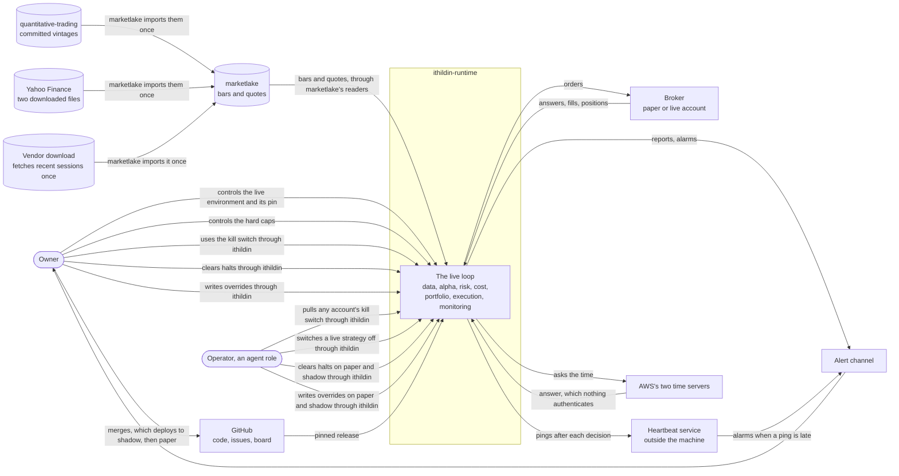
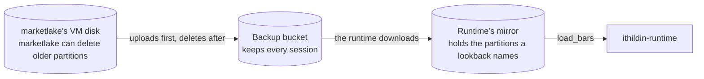
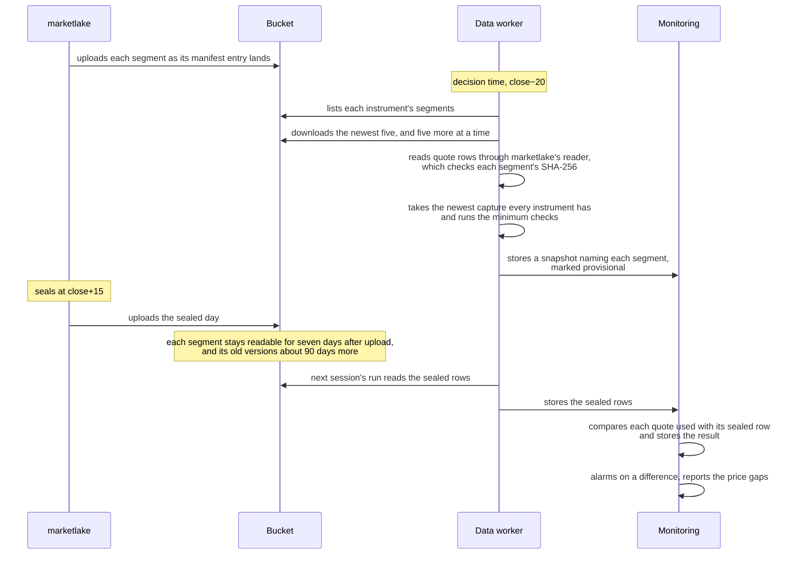
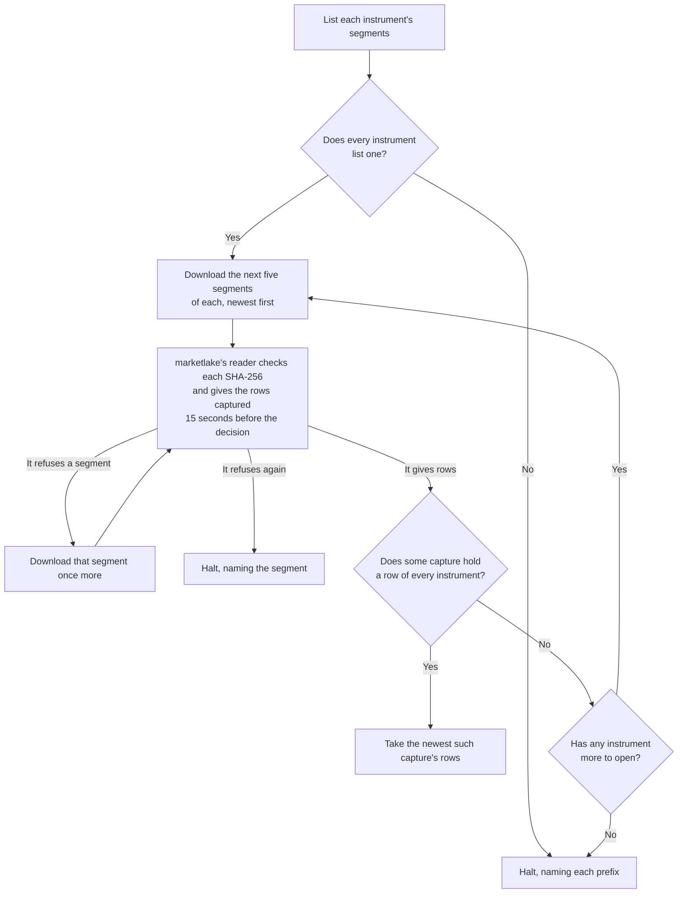
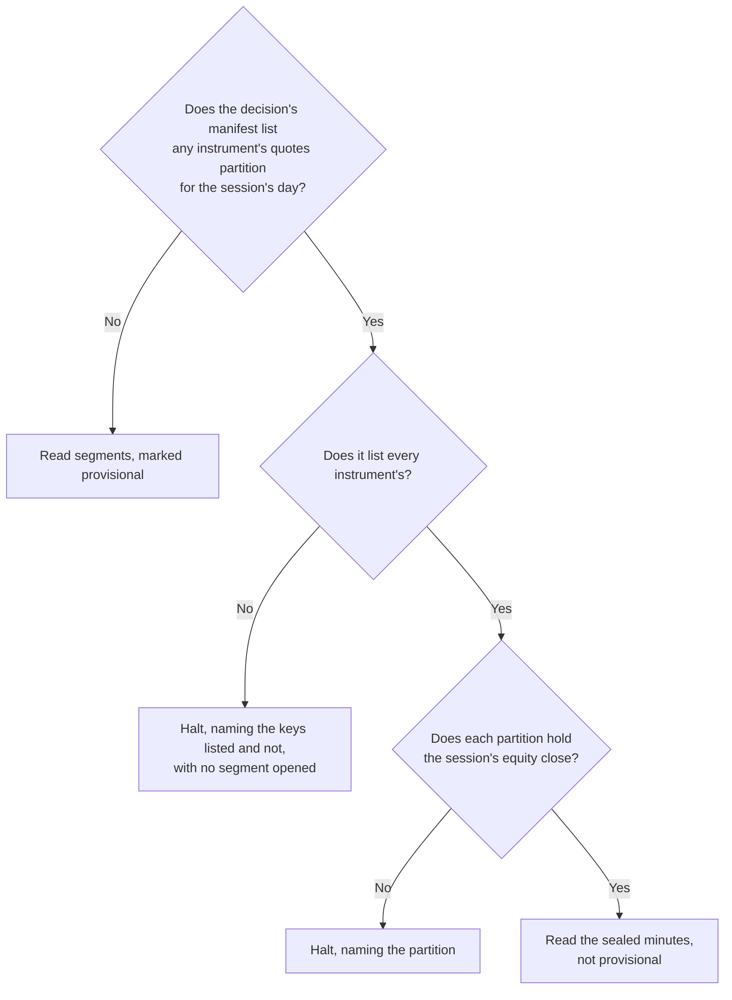
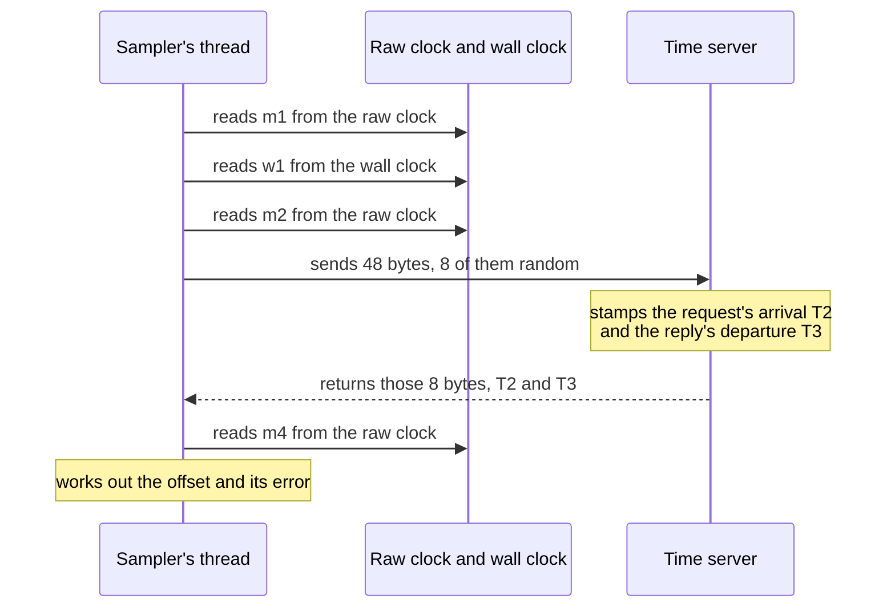

# Architecture, section 3: Context and scope

This page is section 3 of [the architecture](00-README.md), in the order of the arc42 template. It answers what the platform talks to outside itself, and what crosses each edge.

## Contents

- [Context: what the platform talks to](#context-what-the-platform-talks-to)
  - [Where bars come from](#where-bars-come-from)
  - [How long data is kept](#how-long-data-is-kept)
  - [Reading the day before it is sealed](#reading-the-day-before-it-is-sealed)
  - [The previous session's daily bar](#the-previous-sessions-daily-bar)
  - [Orders and the two outside switches](#orders-and-the-two-outside-switches)
  - [The heartbeat](#the-heartbeat)
  - [The time servers](#the-time-servers)

## Context: what the platform talks to

A context diagram shows the platform as one box and everything outside it that
it talks to.

The figure below is a C4 system context diagram.



`ithildin` is the one command line tool a person acts through, as [Where the tool runs](../what-a-person-runs.md#where-the-tool-runs) says.

### Where bars come from

The platform reads every bar from one place, marketlake, the sibling repository
that captures market data before anything computes on it. Each source is
transformed into marketlake once, stored durably there, and read by every mode
through one query, so a backtest and a live run never read bars by different
paths. The runtime runs on a VM of its own and reads a local mirror of the
partitions it downloads from marketlake's bucket, as [Where it runs](07-deployment.md#where-it-runs) says.
marketlake holds four kinds of bar.

**Table:** The four kinds of bar marketlake holds

| Kind of bar | Comes from | Read by |
| --- | --- | --- |
| Captured | marketlake's capture, which has held GLD and USO since Monday 2026-11-02's session | Shadow and paper trading, and live trading once [a split record covers them](../team-charter.md#5-release) |
| Committed vintages | quantitative-trading, imported once | The backtest, and the stress move's measurement |
| Yahoo's GLD and USO | Yahoo's two downloaded files, 2012-04-10 to 2026-09-03, imported once | The stress move's measurement |
| Recent vendor download | One download of the latest sessions, imported once | The strategy's first decisions, until capture covers them |

The vendor download exists because each decision reads 60 sessions of closes.
The newest z-score needs 39 prices: 20 to fit the hedge ratio of the oldest
spread in its 20-day window, and one more for each of the 19 spreads after that.
At the close they are 39 bars, and before it 38 bars and [the decision
price](01-introduction-and-goals.md#which-price-a-decision-reads). The other 21
bars at the close, and 22 before it, reach the earlier sessions whose z-scores settle
[which unit is held](01-introduction-and-goals.md#how-the-model-knows-which-unit-it-holds).
So the download and capture together have to hold 60 sessions. A lookback that
holds both [crosses a change of
series](../design.md#a-lookback-that-crosses-a-change-of-series). It reads where
the download is Schwab's, adjusted to the session capture began on, and it halts
otherwise. For GLD and USO an exploratory comparison with a second vendor shows
the two on one scale there, and nothing measures it for another instrument.

Every bar says whether it was captured or imported, in `origin`, and where an
imported one came from, in `vintage_id`, so a consumer can refuse imported
history where only captured data will do. Imported history never overwrites a
captured partition.

### How long data is kept

No session ages out for the runtime, and only a day's capture segments go, as
[Reading the day before it is sealed](#reading-the-day-before-it-is-sealed)
says. marketlake's VM can delete older partitions
from its own disk once its backup bucket holds them, but the runtime reads a
mirror of that bucket, which keeps every session, and never the VM's disk. So
the 2006 to 2026 history and a lookback of any length stay readable.

The figure below is a C4 container diagram.



The diagram shows the path a bar takes to the runtime. Look for the missing
arrow: nothing connects the VM's disk to the runtime, so a deletion there cannot
reach a lookback.

### Reading the day before it is sealed

A decision at close−20, 15:40 on a full day, needs today's quotes, but
marketlake seals a day at the close plus fifteen minutes, and runs its validation
battery after that. So the runtime may read the day's data before marketlake
seals it, as a provisional read, and it checks that data twice: its own minimum
checks before anything decides, and a comparison with the sealed day afterwards.
The skeleton decides this way because it trades the close, so its fill lands on
the close the backtest fills at.

The figure below is a C4 dynamic diagram.



The diagram shows one day's read before sealing. Look for the two checks either
side of the seal, and for monitoring's comparison, which runs after the decision
has already acted. The read has six parts, and each has a heading below.

1. [What is read](#what-is-read).
2. [What is checked before deciding](#what-is-checked-before-deciding).
3. [How a quote is judged](#how-a-quote-is-judged).
4. [Which read a decision uses](#which-read-a-decision-uses).
5. [What is compared after the seal](#what-is-compared-after-the-seal).
6. [What this rests on](#what-this-rests-on).

#### What is read

The data worker lists the segments marketlake has uploaded so far, opens the
newest, turns them into quote rows through marketlake's own reader, and takes
one capture's row for each instrument.

##### Why an early read is safe

marketlake's capture daemon writes a segment each cycle and never rewrites it
once its manifest entry lands, which makes an early read safe. marketlake
uploads each segment to its bucket as soon as that entry lands, refusing to
replace an existing key.

##### Which decisions read this way

A decision inside its session reads a quote of every instrument: one at or after
the session's open and before its close, by `core.sessions`. The skeleton's
close−20 is one such time, and the shadow run on SPY and QQQ that
[#16](https://github.com/l3a0/ithildin-runtime/issues/16) sets decides at the
same minute. A decision at or after the close reads none. A decision at the open
itself always halts, because nothing is captured by then.

Such a decision reads segments where its day is not sealed, and the sealed day
where it is, as [Which read a decision uses](#which-read-a-decision-uses) says.
Either read keeps only rows whose capture landed at least 15 seconds before the
decision, as [Why every read cuts 15 seconds before its decision](#why-every-read-cuts-15-seconds-before-its-decision)
says. A snapshot's `provisional` is true exactly when its decision read
segments, an empty listing included.

An instrument with no written maximum age or spread halts such a decision before
either bucket is called, because a quote read under no maximum is stale.

##### How segments become one quote of each instrument

The data worker reads an unsealed day through the one reader marketlake
publishes, in [Read an unsealed day](https://github.com/l3a0/marketlake/blob/2d41793ab92028cf3b746a681394bb3df6db4ee0/README.md#read-an-unsealed-day).
The reader comes from marketlake's package, a dependency at a pinned commit. The
read takes five steps. `data/source.py` holds the first, `data/segments.py` the
second to the fourth, and `data/cycles.py` the walk and the last, which the read
of a sealed day shares.

1. **The bars are read first**, and a halt in that read ends the decision before
   any quote is read.
2. **Each instrument's segments are listed once**, under the prefix marketlake's
   reader gives for its ticker on the session's day. Where an instrument lists
   nothing, nothing is opened.
3. **The newest five segments of each are downloaded, and five more at a time**,
   until some capture is found that holds a row of every instrument. The bucket's
   version and stored SHA-256 of each are kept.
4. **marketlake's reader is called once for each instrument and five segments.**
   It is handed the SHA-256 the bucket stored with each segment, and its verdict
   is the check [The runtime has a VM of its own](07-deployment.md#rule-8-the-runtime-has-a-vm-of-its-own)
   requires. The object's user metadata is read nowhere, because marketlake
   publishes nothing about it. The reader returns the rows captured by the cut,
   15 seconds before the decision, the same rows the seal would produce for those
   minutes, so joining a ticker-day's segments has one implementation.
5. **The quotes are the newest capture every instrument has.** The rows of one
   capture share one `fetch_end_ts`, the instant the response landed. An older
   capture they all have is taken over a newer one only some have, because a
   spread priced across two captures is a price nobody saw.

The figure below is a component-level flowchart of steps 2 to 5, inside the data worker.



The diagram shows one decision's read. Look for the loop: a newest capture that
one instrument lacks sends the read five segments further back.

##### Why the read opens five segments at a time

The whole day at 15:40 is 370 segments an instrument. Paths under one prefix sort
by the start of their capture, and marketlake's contract lets a caller name any
subset, so five downloads an instrument serve the usual decision, and a fault in
the morning's segments cannot halt it.

An instrument has none left to open in two cases.

1. Its listing ends.
2. Five segments of its own returned at least one row, and every one was captured
   before the decision by more than its maximum age. The check of a quote refuses
   such a row, and any older one.

Each instrument stops alone, because a rule that stopped them all at the first one
can lose a capture they share. How far the read goes back grows with the maximum
age. At a made-up maximum of 90 seconds, a day with no common capture opens 20
segments for two instruments whose capture is live. An instrument whose capture
wrote only gap markers is opened to its listing's end, which is 370 segments at
15:40, and nothing here bounds the time that takes.
[#11](https://github.com/l3a0/ithildin-runtime/issues/11)'s deadline on the stage
does.

##### Why no decision waits for a listing to fill

marketlake's bound from a capture's start to its segment in the bucket is 90
seconds. Nothing enforces it, and the largest of 1,624 segments measured 10.7
seconds. The newest capture at 15:40:00 is 15:39's, under a minute old. Waiting
for 15:40's would cost every decision about a minute and a half before the
market-on-close cutoff, and would have it decide on data from after its own time.
So the read takes the newest capture by the cut, 15 seconds before the decision,
whenever the listing is made. The price is a quote up to a minute old at
close−20, and up to about 75 seconds old for a decision off the minute. A row
that lands later is for [the comparison after the seal](#what-is-compared-after-the-seal)
to find.

A capture run by hand and late can land after a newer one started, and outside
the segments opened it is not seen.

##### Why every read cuts 15 seconds before its decision

A capture takes seconds to reach the bucket. A live read lists only what has
landed by its decision, while a replay over the sealed day holds every row. With
no cut, a replay could take a capture that a live decision at the same time
could not have listed, and a backtest would trade on a quote live never saw. So
every read of quotes, sealed or of segments, in every mode, keeps only rows whose
`fetch_end_ts` is at or before the decision less `CAPTURE_LAG`, which is 15
seconds and lives in `data/cycles.py`. The judge, the walk's stop and every age
still read the decision time. A row after the cut is in no snapshot, by either
read, since a snapshot holds no value its decision could not know, and
marketlake's partition keeps it.

The cut on both reads is what keeps a slow upload from making a backtest read
what live could not, apart from the shapes [What a replay cannot show](#what-a-replay-cannot-show)
and [How a sealed day becomes one quote of each instrument](#how-a-sealed-day-becomes-one-quote-of-each-instrument)
name. With uploads of 1 to 14 seconds planted on 3,696 decisions over 22
recorded sessions, the two picks differed on 0 with the cut on both, and on 190
with it on the backtest alone. That 0 checks the cut's logic, since the cut
rules out a difference from an upload under 15 seconds, and it is no
measurement of live. An upload past 15 seconds is a capture the sealed day holds
and live did not, and with uploads of up to 20 seconds the two differed on 140.
All three counts are exploratory.

Every count in this section was made in [#132's plan](https://github.com/l3a0/ithildin-runtime/issues/132#issuecomment-7170961785), whose comment holds
the script, over capture stamps alone, on a copy of the lake whose manifest's
SHA-256 is `96c023035150117b44f74a7bef67e2789ba89457ddec10ca1ded9830fe8312dd`.
No code in this repository reproduces them.

Two measures bound the lag.

1. **From below,** the largest time from a cycle's start to its segment in the
   bucket was 10.7 seconds, of 1,624 on 2026-11-03
   ([l3a0/marketlake#984](https://github.com/l3a0/marketlake/issues/984)), and up
   to a second more where S3 states the time in whole seconds. A cut under 12
   seconds can read a row no live listing held.
2. **From above,** 15:39's capture is 20.5 seconds old at the youngest at
   15:40:00, and a decision at close−20 reads 15:39's. marketlake's bound of 90
   seconds, which nothing enforces, would read 15:38's or older on every session.

**Table:** What bounds the lag, from the capture stamps of 22 sessions, exploratory

| Lag, in seconds | Decisions of 8,580 on whole minutes whose capture differs from no lag | Sessions of the twenty from 2026-09-15 to 2026-10-12 that read 15:39's quote at 15:40 |
| --- | --- | --- |
| 0 | 0 | 20 |
| 11 | 16 | 20 |
| 15 | 25 | 20 |
| 20 | 34 | 20 |
| 30 | 76 | 18 |
| 60 | 8,538 | 0 |
| 90 | 8,551 | 0 |

The 25 sit in four sessions, 15 of them on 2026-10-05, so 8,580 is no count of
independent decisions. The sessions are 2026-09-14 to 2026-10-13, captured by
the laptop before the live upload existed, so one host's lower bound meets
another's upper bound.

The price is one whole capture on every decision with a capture in those 15
seconds, because it reads the capture before. That quote is about 60 seconds
older: at a median of 60.0 seconds and at most 737 where minutes were missing, on
25,482 of 102,432 decisions every 5 seconds and 25 of the 8,580 on whole minutes,
counted where both instruments hold a capture with no lag, and 0 of 22 at
close−20, all exploratory. So the greatest usual age is 75 seconds and
not 60, an order has that much less of its maximum left, and sizing, the caps and
the loss stop read the older mark. A capture in those seconds that shows a
halted, crossed or wide quote halts nothing and holds no account.
[#11](https://github.com/l3a0/ithildin-runtime/issues/11) is asked to report one,
and [#173](https://github.com/l3a0/ithildin-runtime/issues/173) stores the sealed
rows it needs.

`python -m lake.live_upload lag --date D` measures any of the last seven days, as
[What a person runs](../what-a-person-runs.md#measure-the-capture-lag) says. A
largest above 13 seconds moves the constant, in a pull request of its own,
reviewed as a raised maximum age is. A value that stops a close−20 decision
reading 15:39's quote is the owner's.

##### What the read does with each answer

A fault in the read of the quotes never takes the snapshot's place, and nothing
in that read raises for what a call to the bucket meets, or marketlake's reader or a row holds. Each fault becomes a reason in the snapshot's `faults`, and
the snapshot is stored before the halt with the bars, each segment opened and
every row marketlake's reader returned. A fault ends the read once every
instrument's turn in that round of five is done, so one instrument's refusal
loses none of another's rows.

**Table:** What the read does with each answer, and what ends the halt

| Answer | What happens | Ended by |
| --- | --- | --- |
| A segment's bytes differ from the SHA-256 the bucket stored, a segment is not under the lake root, a download fails its checksum, or a download has no answer or is refused | That segment is downloaded once more, at the same version where the first answer named one, and the reader is asked again. A second fault of one segment halts naming it and what each try met, with both hashes where there are two. The first try's reason is logged whichever way the second goes | The next decision, or the grant |
| A listed key the bucket does not hold, or one no bucket call takes | A halt naming the key, and the answer or the error's type | The next decision, or marketlake, whose prefix it is |
| Any other error of a listing or a download, such as refreshed credentials that are still expired | A halt naming the prefix or the segment, and the error's type. The log holds its words | The next decision, the machine's operator, or a release where the error is a mistake in the code |
| A segment with no version or no stored SHA-256 | A halt naming it | The next decision, or marketlake's upload |
| A listing with no answer or refused, twice | A halt naming the prefix and the answer | The next decision, or the grant |
| A row of a schema version the pinned marketlake does not read | A halt naming the segment, the versions, and that the marketlake pin is raised | A release |
| Any other refusal by marketlake's reader, or an error opening a segment | A halt naming the segment, or the ticker and day | The next decision, or marketlake's release of a day it withholds |
| A row whose `fetch_end_ts` is past any date | A halt naming the ticker, the day and the stamp | The next decision |
| A segment that cannot be written into the decision's lake root, such as on a full disk | A halt naming the segment | The machine's operator |
| A published column of another type than marketlake publishes. One that is absent reads as null | A halt naming it | A release |
| No security master row for the day, or two rows of `data/quote_kinds.csv` for it | A halt naming the instrument or the source | A release |
| No segment listed, no row by the cut, or no capture every instrument has | A halt naming each prefix, the segments listed and opened, each instrument's newest capture and the cut | The next decision |
| Two rows of one instrument at the capture taken | A halt naming the instrument | The next decision |

Data's stage ends its own decision on each of these. [A fill is measured from the
decision](../design.md#a-fill-is-measured-from-the-decision-and-a-position-depends-on-a-market-it-does-not-control)
says which halts hold an account until a person clears them, and
[#150](https://github.com/l3a0/ithildin-runtime/issues/150) is asked to build
that hold.

A reason says what the bucket held, and not why it held no more. marketlake's own
capture host says why.

#### What is checked before deciding

The data worker runs its own minimum checks before anything decides. Beside the check on its clock, which [The time servers](#the-time-servers) describes, nine checks halt or flag a decision.

1. A quote that is absent, or that [the judge of a quote](#how-a-quote-is-judged) gives any reason against, halts the decision.
2. A segment whose bytes do not hash to the SHA-256 the bucket stored with it, on a second download too, halts it, and so does a sealed quotes partition whose bytes differ from the manifest or that holds no row of the session's equity close.
3. A bar whose prices contradict each other, such as a price at or below zero or a high below the close, is flagged in the snapshot beside the price and halts the decision.
4. A close past the written multiple of the lookback's standard deviation is flagged beside the price. The owner is alerted, and the decision trades on the price as it arrived.
5. A close below its bar's low is flagged beside the price, however little it moved. The owner is alerted, and the decision trades on the price as it arrived.
6. Two consecutive bars of one instrument that are of two series, meaning two recordings by different sources, as of different dates, or one of the price as traded and one adjusted, halt the decision, as [A lookback that crosses a change of series](../design.md#a-lookback-that-crosses-a-change-of-series) says. The one change that passes is from Schwab's import to captured bars on the session the import is adjusted to. An exploratory comparison shows that change on one scale for GLD and USO alone.
7. A bar whose kind `data/price_kinds.csv` leaves unstated in any of its four fields halts the decision.
8. A quote with a bid or an ask at or below zero, or an ask below its bid, is flagged beside the price, and the judge halts on it.
9. A midpoint whose return on the newest bar's close is past the written multiple of the standard deviation of the lookback's returns is flagged beside that close. The owner is alerted, and the decision trades on the quote as it arrived. Fewer than two returns judge none, and where every return is the same any other move is flagged.

#### How a quote is judged

`core.quote_faults` is the one judge of a quote. Data and `core.mark` call it
through `core.require_quote`. `core.mark` gives the price the alpha model's signal
reads, and the one a position is sized and valued at. The judge gives every reason
at once, and a quote is read only where it gives none.

**Table:** What makes a quote unreadable

| Fault | What its reason names |
| --- | --- |
| The maximum age its strategies write is not a whole number of seconds from ten times the clock bound up, or the maximum spread is not a decimal above 0 and below 1 | The instrument and the value |
| The time it is read at is not UTC, or is before the decision | Both times |
| The bid or the ask is absent, or not above zero | The side, and what was received |
| The ask is below the bid | Both |
| The ask less the bid is past the written share of the midpoint | Both, and the share |
| The vendor's realtime flag is not true. False says delayed, and an absent flag leaves the delay unstated | What was received |
| The security status is absent, the normal one is unstated, or the two differ | Both |
| The kind of the bid and the ask is unstated | The instrument |
| The bid's or the ask's stamp is absent, or later than the capture by more than the clock bound | The stamp as received |
| The capture is before the session's open, or after the decision | Each time |
| The older of the two stamps is older than the written maximum age, with the clock bound added | The stamp, the age, the bound, the maximum and the capture time |

##### Which stamp dates a quote

What is read is the midpoint, so it is as old as the older of the bid's stamp
and the ask's. One stamp for both sides, such as Schwab's `quoteTime`, would let
one side that froze pass under the other's. `last` has a stamp of its own and
nothing here reads it. The price is a refusal when one side of a liquid fund
stands still for longer than the maximum. In
[#133's exploratory count](https://github.com/l3a0/ithildin-runtime/issues/133#issuecomment-7193657427) at close−20,
a maximum of 180 seconds refused none of the 12 sessions of GLD and USO it could
read from 2026-11-02 to 2026-11-25, and none of 34 of SPY and QQQ from
2026-09-15 to 2026-10-30, for age.

##### What the clock bound covers

`core.CLOCK_BOUND` is one second, and it is added to every age, because the
machine's clock can be off by that much. A written maximum under ten of them is
refused, so the bound is never more than a tenth of the age it guards. Data's stage
halts a decision whose clock is past the bound, as [The time
servers](#the-time-servers) says. Until [#165](https://github.com/l3a0/ithildin-runtime/issues/165)
checks the clock before each submit, one that goes wrong after that read makes an
old quote read as fresh at the gate. Schwab's clock and the capture host's have no
published bound.

##### When the age is measured

The age is measured at each read. Data, the alpha model, risk and portfolio
construction read no clock and pass the decision time, so they answer alike in a
backtest and live. The risk gate passes its own `now`, so a quote that was good at
the decision and has aged past its maximum when its order is checked halts that
order. The gate's answer
comes before two journal entries and the checks right before the broker call, so the
order path also ends an order's last moment where a quote the gate marked reaches its
maximum.

An order has the maximum less the quote's age at the decision and less the clock
bound. At a made-up maximum of 90 seconds, a quote 59 seconds old at the decision
halts any order that reads it more than 30 seconds after the decision, so a written
maximum has to hold the order path's seconds too.
[What a quote that fails its check stops](../halts-and-drills.md#what-a-quote-that-fails-its-check-stops)
says what a person can do then.

A plan's orders are checked one at a time, so one leg can pass while its partner, a
second later, halts on its age. So before the plan is asked about or sent, the send
stage judges every quote the plan's gate checks will mark with `core.require_quote`,
at a margin past its clock's `now`. Those are the snapshot's quotes of each
instrument the account holds or has a working order in, and of each the plan
orders, because an order approved before counts as working for the next. The margin
is `execution.send.MARGIN`, 5 seconds, for each order of the plan, the order path's
own bound on one pass of a submit's checks. Where any of those quotes already fails
at `now`, the whole plan is left to the gate, whose halt on it is the quote's own
fault, so no such fault hides behind another quote's margin. Where every one passes
at `now` and one would not last the margin, the decision halts, nothing is asked or sent, and
every order of the plan is journaled `Abandoned` where the journal takes each entry.
An `abandoned` the store refuses is named in the halt, which then says nothing of the
next decision. The next recover reads what the journal holds, and halts where the plan
is unfinished, as [What a plan a crash left unfinished is](06-runtime.md#what-a-plan-a-crash-left-unfinished-is)
says.

On shadow and paper that halt holds no account, and neither does a quote that reaches
its maximum after the gate and before the broker call, because each quote was a price
when the gate judged it. Unless recover finds the plan unfinished, the next decision
trades on its own quotes. On live, as with
every cause, the account is held until the owner clears it.

The check narrows the case of one leg sent without its partner, and does not close
it. A send slower than the margin still meets its partner's quote past its maximum at
the partner's own gate check, with the first leg at the broker, and that halt alarms
with each leg's state. [#133](https://github.com/l3a0/ithildin-runtime/issues/133)'s ruling leaves a quote at close−20 about 107 seconds,
or about 47 after one missed capture. So a plan of more than about nine orders halts
this way whenever a capture was missed, and one of more than about twenty every time.
Nothing has measured a send yet, so the margin is revisited once one is.

##### Why a wide quote is a fault

A midpoint has no other bound. With a loss stop of 100 and made-up figures, a held
leg quoted at 60 by 140 in place of 60 by 60.1 hid a loss of 199.75 from the stop,
and an order that added was approved. A market that wide has no price a midpoint
can stand for, so it halts, and the halt holds the account until a person clears
it. A quote whose ask is below its bid, or with a side that is missing or at or below
zero, holds it too.

##### What is recorded and not judged

Venue coverage, volume counting, each side's size, the last sale, its kind and its
stamp, and the time the request went out are recorded and halt nothing, because
nothing reads them to decide. A side with no size therefore passes where its price,
stamp and status do. [#133's exploratory count](https://github.com/l3a0/ithildin-runtime/issues/133#issuecomment-7193657427)
found no side with a size of zero or none among the 92 quotes it read. Unstated coverage is shown on the report.
The quote's type is neither recorded nor judged.
[Schwab's Market Data specification](https://developer.schwab.com/products/trader-api--individual/details/specifications/Market%20Data%20Production) gives the type in its `quoteType` field as NBBO, the national best bid and offer across every US exchange, or NFL, which it calls a non-fee-liable quote.
On shadow and paper the bid and ask still read as the best bid and ask. On live,
neither a decision nor the gate may read them unless a row of `data/quote_kinds.csv` states the quote's type from a field marketlake publishes and the owner's ruling allows that type, as the conditions on [the Live step](../team-charter.md#5-release) say
and [#224](https://github.com/l3a0/ithildin-runtime/issues/224) tracks.

#### Which read a decision uses

The manifest the decision downloaded picks the read, so the choice and the check
of the bytes read one file. Where it lists the quotes partition of any
instrument the settings read, for the session's day, the read is of the sealed
day. Where it lists none, the read is of segments. A partition's key is
`LakePaths.quotes_partition_path` of the ticker the security master gives for
that day. Nothing branches on the mode, so a backtest, shadow, paper and live
choose alike.

The figure below is a component-level flowchart of the choice between the two reads.



The diagram shows the choice. Look for the two halts on the sealed side: a mix
of the two reads would price one leg from a sealed day and the other from one
that is not, and a week later would find no segment.

##### Which decisions read the sealed day

A live decision before the seal finds no partition listed, and reads segments.
One that runs after the day's upload reads the sealed day under the same cut.
Data does not stop it, because the judge measures the age at the decision. What
refuses its orders is the gate's window, which halts on a `now` past the
session's close, and the day is uploaded only after it. A backtest over a past
session reads the sealed day wherever the manifest lists it, and segments
otherwise.

A listed partition has to hold the session's equity close. marketlake seals at
close+15, and its repair by hand can seal a day still open, which the gate would
trade on as healthy with no comparison owed. The check refused none of the 22
recorded sessions of SPY or QQQ that hold a row. The price is a replay that
refuses a day whose close cycle was lost, where live may have traded.

A sealed read is not provisional, so [#11](https://github.com/l3a0/ithildin-runtime/issues/11)
owes it no comparison. Sealed does not mean judged: marketlake's battery writes
its verdict after the seal, and no verdict reads as a pass.

##### How a sealed day becomes one quote of each instrument

`data/sealed.py` reads it, in four steps.

1. **Each listed partition is linked into the decision's lake root**, one
   `Mirror.partitions` call a key, after the bars are read and their ledgers
   recorded, so a partition enters neither the snapshot's `ledgers` nor the
   bars' cache key. Every listed key is linked whatever faults before it.
2. **Each partition has to answer `load_quotes` with no minute**, which is its
   equity close. No minute is read where a link or this check faults.
3. **The walk `data/cycles.py` holds reads five minutes of each leg at a time**,
   from the cut's own minute back to the minute the session opens, counted in
   New York time from the session's own offset. Each minute is read by
   `load_quotes(T, D, "HH:MM")`, then `captured_by` at the cut. It is the walk
   the read of segments takes, with a minute in place of a segment.
4. **Each row the cut kept has to carry the instrument's ticker.** `load_quotes`
   checks neither the published types nor whose rows a partition holds, so the
   shared check of types stands and the sealed read checks the ticker.

Reading five minutes at a time, and not one, is what makes the two reads agree.
On 2,684 decisions over 22 recorded sessions and 18,960 seeded ones, on and off
the minute, the sealed walk gave the capture the walk of segments gives, every
time, and the brute force's wherever that was inside every maximum. Two shapes
differ, and neither is fixed.

1. Where a capture landed after a later minute's, a fifth style of seeded day
   missed the newest usable capture on 250 of 4,740.
2. Where minutes are missing beside such a capture, the newest five segments
   reach past the newest five minutes.

All these counts are exploratory. A quote of a sealed row equals the segment's
in every field, `received` included on each column both hold, so the judge reads
either with no branch. A sealed partition can hold a column a later segment
added, which is null in an earlier row's `received`.

##### What a replay cannot show

The decision's own snapshot is the only record of what it read. The price of
reading the sealed day through `load_quotes`, which answers a minute by its
`snap_ts`, is three things a replay of it cannot show.

1. **It can take a newer row than the decision could see, or an older one**,
   with no refusal. A row whose `snap_ts` is 30 seconds past its minute came back
   from marketlake's reader of segments, and `load_quotes` at that minute
   answered no row, so a replay takes an older row. A row of another day the
   reader of segments refuses, and the sealed read does not find.
2. **It and live refuse different sessions.** A verdict written after the
   decision refuses the replay, a listing or a digest refuses live, and a row
   after the decision whose stamp or kind cannot be read can refuse the replay,
   because `load_quotes` reads the whole partition for both. [#16](https://github.com/l3a0/ithildin-runtime/issues/16)'s report keeps
   each refused session with its reason and a count.
3. **An upload past 15 seconds is read by a replay and was not by live**, so
   the measure in [Why every read cuts 15 seconds before its decision](#why-every-read-cuts-15-seconds-before-its-decision)
   is what keeps the two reads one.

The log line of a sealed read ends "A decision before the seal may have read
another row". [What the sealed read does with each answer](../halts-and-drills.md#what-the-sealed-read-does-with-each-answer)
lists every fault and what ends the halt it causes. Test 2 covers both reads,
with a sealed stretch for the replay and a fixture day left unsealed for the read
of segments.

#### What is compared after the seal

Once marketlake seals the day, monitoring checks each quote the decision used
against the sealed day, after the decision has already acted.

##### Who reads and who compares after the seal

Two roles share the work, so data stays the one reader of marketlake, as
[#11](https://github.com/l3a0/ithildin-runtime/issues/11) and [#173](https://github.com/l3a0/ithildin-runtime/issues/173) hold. Three steps
follow the seal.

1. The data worker's role, in the next session's run, reads the sealed row and
   stores it.
2. Monitoring's role compares each quote the snapshot used with the sealed row
   of the same ticker and minute, by bid, ask and last as received.
3. Monitoring stores the result. Each provisional snapshot gets a stored
   comparison result within a written bound after the close.

A missing result, or a sealed day that never arrives, pages and stops no
decision.

This doc proposes, for [#11](https://github.com/l3a0/ithildin-runtime/issues/11),
that the comparison also takes the newest sealed row at or before the cut, 15
seconds before the decision, so a row whose segment landed after the cut shows
as a difference.

##### What the comparison reads

The snapshot names each segment it opened by key, S3 version and SHA-256, and
marks the read provisional. The stored snapshot holds every `Quote` field, every
other row marketlake's reader returned and each bar's `vintage_id`, as `Snapshot`
does in memory, so monitoring reads the used quote from the snapshot. The comparison goes by bid, ask and last because
a segment and the partition built from it never share bytes. A segment that is
gone changes nothing, and the comparison holds for as long as the snapshot
does.

##### What monitoring does with each finding

**Table:** What monitoring does with each thing it finds after the seal

| Monitoring finds | It does |
| --- | --- |
| A value that differs from the sealed row | Journals and alarms |
| A row the sealed day quarantined or lacks | Journals and alarms |
| A gap between the price the decision used and the official close | A report line, since the two differ by design |
| A gap between a market-on-close fill and that close | A report line, since the two differ by design |

#### What this rests on

The provisional read rests on five things about marketlake's segments.

1. **marketlake publishes a window.** Each segment stays readable for seven days
   after upload, with old versions kept about 90 days more, as
   [l3a0/marketlake#995](https://github.com/l3a0/marketlake/issues/995) records.
   Nothing in the runtime knows when one goes.
2. **A read before sealing is the only read that needs a segment,** because a
   replay reads partitions and the comparison reads the snapshot.
3. **Only the uploader refuses an overwrite so far.**
   [l3a0/marketlake#985](https://github.com/l3a0/marketlake/issues/985) holds
   making S3 itself refuse one, and marketlake's reader cannot see one. So that
   issue closed is a condition of the [Live step](../team-charter.md#5-release).
4. **A snapshot keeps naming each segment it read,** as the record of what the
   decision read. After the window those names point at nothing.
5. **The window reads age alone.** So a day whose sealed partition never reached
   the bucket ends with marketlake's VM volume as its only copy, and
   [l3a0/marketlake#996](https://github.com/l3a0/marketlake/issues/996) is the
   page that rests on.

### The previous session's daily bar

The close−20 decision on a session needs the previous session's official daily
bar for its lookback, so marketlake fetches each bar at its own session's 18:30
sweep, still checked against that session's 16:15 quote, rather than serve a
provisional bar. So the close−20 decision reads the previous session's official bar
through `load_bars`, and [#16](https://github.com/l3a0/ithildin-runtime/issues/16)'s shadow run reads the previous session's
official close the same way. That bar
is Schwab's daily candle, fetched at the session's own 18:30 sweep or later. A bar that has not
landed by the next close−20 decision halts it as stale. A
correction Schwab publishes later is not picked up, and nothing measured has
shown one, which [l3a0/marketlake#962](https://github.com/l3a0/marketlake/issues/962) records as its price. The lookback stays on daily
closes, and the close−20 quote's midpoint stands where the backtest uses the session's
close. That is the gap [How the four acceptance tests exercise
it](10-quality.md#how-the-four-acceptance-tests-exercise-it) names first, which shadow running
measures.

### Orders and the two outside switches

The platform sends orders to one place, Alpaca's paper account. Shadow fills its own orders in the simulator, so they reach no broker.

Two switches come from outside the loop.

1. **The live switch** is the live environment, which only the owner builds, gives the live key and pins a release in, which is hard limit 1 in [CLAUDE.md](../../CLAUDE.md). Paper and live never share a VM, a bucket or a key, as [Four environments](07-deployment.md#four-environments) says.
2. **The kill switch** halts trading. The
   risk engineer builds it and writes when to pull it, and the operator pulls
   it by that guidance. The owner can pull it too.

### The heartbeat

A dead-man check raises an alarm when a ping it expects fails to arrive. Here
monitoring pings a heartbeat service as each decision's last step, and the
service alarms when a ping is late against the deployment's schedule. The service sits outside the machine because a
check on the same machine dies with it, and a machine where nothing runs is
the failure the check exists for. The heartbeat service is healthchecks.io, in the
project marketlake already runs.

The alert channel is how an alarm reaches the owner, and it has three routes.

1. **healthchecks.io's ntfy push and email integrations** carry the dead-man checks' alarms. No runtime VM holds an address for them.
2. **The push topic** is an ntfy topic of an environment's own. Shadow, paper and live each hold one, separate from marketlake's and from each other's, on the same phone. Every push an environment's VM or AWS account sends straight to ntfy goes to that environment's topic. An environment's VM, parameters and EventBridge route hold only that environment's address, and no runtime VM, parameter or EventBridge route holds marketlake's topic address. [An ntfy topic's name is its only password](https://docs.ntfy.sh/publish/), so that separation holds only while no address can be guessed or derived from another environment's. This doc proposes, for [#11](https://github.com/l3a0/ithildin-runtime/issues/11), that each topic's name is a long random value.
3. **Email through an SNS topic** goes with two alarms, the promotion check and the live drill check, which say that a scheduled job stopped running, and with the test account's budget alarm. [Email on two checks](07-deployment.md#environment-rule-9-email-on-two-checks) says how.

A ping says only that a decision finished. The jobs [Faults are expected](../design.md#faults-are-expected-and-the-platform-checks-itself-while-it-runs) lists, such as the daily report, run apart from a decision and get no check of their own. Monitoring reads each job's age and pages through the alert channel, as that section says.

### The time servers

A machine's clock drifts, and nothing on the machine can see it. The clock dates every quote and every order, so a clock 317 seconds slow reads a quote 380 seconds old as fresh. So the platform asks two outside servers the time, over NTP, the Network Time Protocol, and halts where it cannot show that its clock is right. chrony, the program AWS's Linux images already run, sets the clock. The platform only measures it, and asks chrony nothing.

#### Which servers are asked, and what is read from them

**Table:** The two time servers

| Server | Whose | Asked every |
| --- | --- | --- |
| `169.254.169.123` | AWS's, at a [link-local address](https://docs.aws.amazon.com/AWSEC2/latest/UserGuide/configure-ec2-ntp.html), so the traffic stays inside the environment's own network | 16 seconds |
| `time.aws.com.` | AWS's, on the public internet. Its trailing dot keeps a resolver from adding a search domain | 64 seconds |

[Both smear a leap second](https://docs.aws.amazon.com/AWSEC2/latest/UserGuide/set-time.html), meaning each spreads it out rather than jumping, so they agree through one. An ask that fails is asked again after 2 seconds, then 4, doubling up to the server's own interval.

Each process that judges the clock asks for itself, on one thread per server, and keeps each server's last answer in memory. The code that does this is the sampler, `TimeServers` in `adapters/time_servers.py`. So no handler waits on the network, and a name lookup that hangs holds up neither the other server nor the order path. No cancel waits on a first answer. [#11](https://github.com/l3a0/ithildin-runtime/issues/11) and [#165](https://github.com/l3a0/ithildin-runtime/issues/165) hold when each process starts its threads, waits for a first answer and stops them. [Who judges the clock](#who-judges-the-clock-and-who-records-it) names the processes.

#### How one answer is read

The figure below is a C4 dynamic diagram of one ask.



The raw clock, `CLOCK_MONOTONIC_RAW`, is the one clock on a Linux machine that no time service adjusts. chrony corrects the wall clock by running it faster or slower, and Linux's ordinary monotonic clock with it, so elapsed time measured on that one would hide the correction.

1. **The address.** An address written out is asked as it is. A name is looked up before any stamp is taken, and its first address has to be a global one, so a poisoned or misconfigured answer cannot point the ask inside the network.
2. **The packet.** It carries nothing of the machine. Its 8 random bytes come back in the reply, so a reply sent before the ask, or to another one, is refused.
3. **The socket.** It is connected to the one address, so the system drops a reply from any other. It waits at most one second.
4. **The offset.** It is the machine's clock less the server's, so a slow clock reads negative. `t4` is `w1` plus the raw time the exchange took, so a step of the wall clock during the exchange cannot enter it.

   ```text
   delay  = (m4 - m1) - (T3 - T2)
   offset = ((w1 - T2) + (t4 - T3)) // 2
   error  = ceil(delay / 2) + ceil(root_delay / 2) + root_dispersion + (m2 - m1) + 2
   ```

5. **The error.** It is how far off the offset can be: half the time on the network, what the server says of its own error, the gap around the wall clock's stamp, and 2 microseconds of rounding.

Everything is whole microseconds. A reply is refused, and the last answer kept, where it is not 48 bytes, is not a server's reply in version 3 or 4, says its server is unsynchronised, gives a stratum of 0 or above 15, does not return the random bytes, holds a time of zero, or could not have been sent when it says. An answer whose error is past a quarter of a second is refused too, unless it proves the clock wrong all the same.

#### How a reading is made from the last answers

A reading reads the raw clock, the wall clock and the raw clock again, and moves each kept answer forward to now. The offset gains how far the wall clock moved against the raw one since the answer, so a step or a correction shows at the next reading, whoever made it. The error gains the gap between the two raw stamps and what a clock may drift since the answer, at the 500 parts per million Linux allows, which is at most 0.15 seconds over 300. The age is the raw time since the ask began. `ClockReading` holds one `TimeAnswer` per server, with the reply's bytes as they arrived.

#### What halts on a reading

`core.clock_faults` is the one rule, and gives each server's first fault in this order.

**Table:** What faults a server's answer

| Fault | What the reason names |
| --- | --- |
| The server has given no answer | The server, and why the newest ask to end failed, or that none has ended |
| The answer is older than `SYNC_BOUND`, 300 seconds | The server, the age, the bound, and why the newest ask to end failed, or that none has ended since |
| The offset, taken as positive, plus its error is past `CLOCK_BOUND`, one second | The server, the offset, whether the clock is slow or fast, the error and the bound |

At a bound is no fault. An ask that hangs or a thread that dies after a failed ask still shows that failure, so a reason cannot tell a stuck thread from a server that stays out. A reading with no answers at all, which a history clock gives, is none only where the run was told it does not measure its clock, as [Who judges the clock](#who-judges-the-clock-and-who-records-it) says.

The bound on an answer's age, 300 seconds, is about four asks of the slower server. Both servers have to be fresh and within the bound, so there is no vote to win. A forged or broken answer from one can only halt, apart from hiding what neither of the machine's clocks shows, such as a pause of the virtual machine, until the other server's next answer, or for 300 seconds without one. Both forged hide any fault.

#### Who judges the clock, and who records it

**Table:** Each reader of the clock's reading

| Reader | When | Where the reading is recorded | Built on |
| --- | --- | --- | --- |
| Data's stage | Once a decision, after the last answer its read waits on | `Snapshot.clock`, stored before the halt | [#134](https://github.com/l3a0/ithildin-runtime/issues/134) |
| Execution | At both reads of each submit's controls | As [#165](https://github.com/l3a0/ithildin-runtime/issues/165) proposes | [#165](https://github.com/l3a0/ithildin-runtime/issues/165) |
| Monitoring | From Startup through the session | As [#11](https://github.com/l3a0/ithildin-runtime/issues/11) proposes | [#11](https://github.com/l3a0/ithildin-runtime/issues/11) |

Until [#165](https://github.com/l3a0/ithildin-runtime/issues/165) is built, nothing judges the clock against a time server between data's read and a submit. A later capture whose own clock is past a bound halts nothing in data, because the first capture counts. It raises the alarm that names the difference, and the check [#165](https://github.com/l3a0/ithildin-runtime/issues/165) holds is what stops an order then. The receive loop judges no clock, because it serves cancels and the stages that read no clock, and a halt there would stop both.

Whether a run measures its clock is `measured`, which data's handler takes with no default. Shadow, paper and live hand it true, so a history clock wired into a trading run halts. A backtest, the first run over past sessions and the command that measures a stress move hand it false. A replay of a recorded session hands `HistoryClock` the readings that session recorded, passes the `measured` that session passed, and the one rule judges them as it did then. Those readings are data's, each from the capture that counts for its decision.

#### What nothing here can see

1. A pause of the virtual machine that stops both of its clocks, until the next answer. That is about 17 seconds with both servers answering, about 65 with the public one alone, and up to the 300 seconds of `SYNC_BOUND` with neither.
2. An error common to both of Amazon's servers. The comparison with the broker's clock, which [#153](https://github.com/l3a0/ithildin-runtime/issues/153) holds, is the check that is not Amazon's, and shadow has no broker.
3. A pause of a little over a second where the paths to both servers are slow. The simulation on [#134](https://github.com/l3a0/ithildin-runtime/issues/134)'s plan, which no test holds, left one unfaulted for most of `SYNC_BOUND`, with the true error under 2 seconds.
4. A step of the clock inside data's read that leaves it right by the end. The reading judges the clock as the read ended, and a stamp the read took before the step is wrong.

#### What measuring the clock costs

The price is seven things.

1. Two threads in each instance of three components, six processes on slice 1's one machine and nine across a cluster. At nine processes an environment sends at most 33.8 asks a minute to the link-local server and 8.4 to the public one while every ask is answered, and more while they fail. AWS allows [1,024 packets a second](https://docs.aws.amazon.com/AWSEC2/latest/UserGuide/configure-ec2-ntp.html) to its link-local services together, and no page of its read here states a limit for the public one.
2. A reply of 48 bytes that nothing authenticates, parsed in the process that holds the broker key.
3. Outbound UDP 123 and DNS, for the public server. Its address comes from a lookup nothing authenticates, so the rule that lets it out reaches any address unless [#32](https://github.com/l3a0/ithildin-runtime/issues/32) can pin the server's.
4. A 300-second outage of either server, or of DNS for the public one, halts. Each halt is final for its decision, its exits included. Nobody has measured how often that happens, so shadow reports it first, on [#166](https://github.com/l3a0/ithildin-runtime/issues/166).
5. At scale-out the first capture of a decision wins, so one VM's bad clock halts that decision for the deployment.
6. A worker started just before a decision, with no answer by then, halts it for good.
7. Nobody has yet asked `169.254.169.123` from inside a container, which [#166](https://github.com/l3a0/ithildin-runtime/issues/166) does first.
