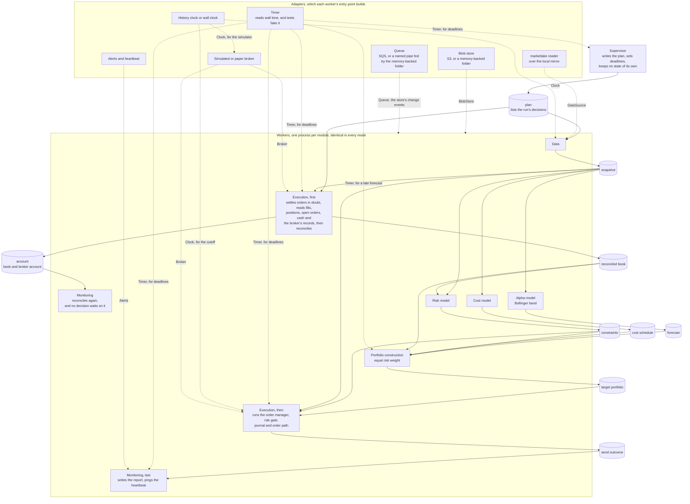
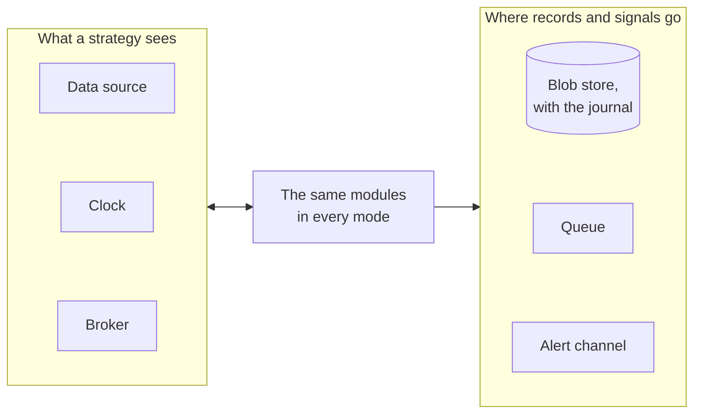
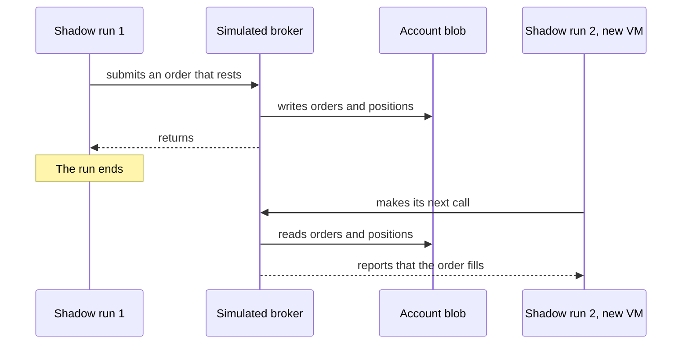
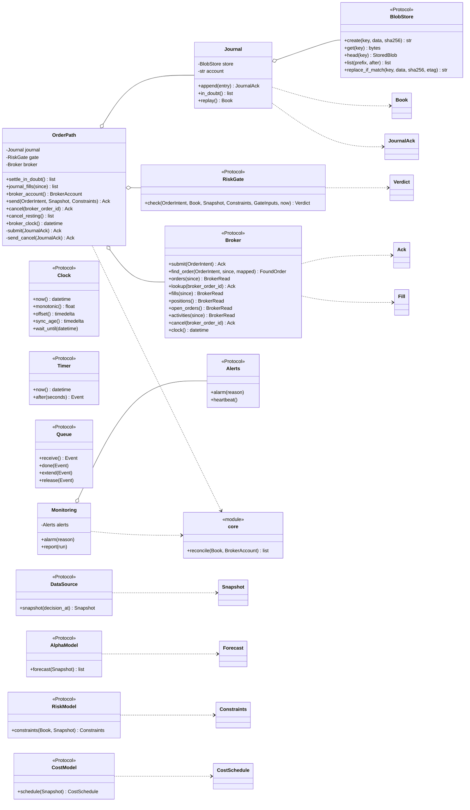
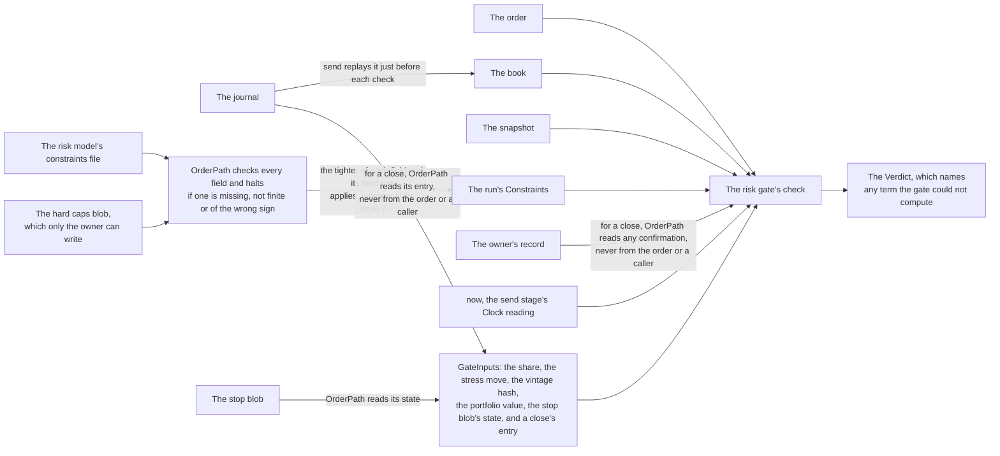
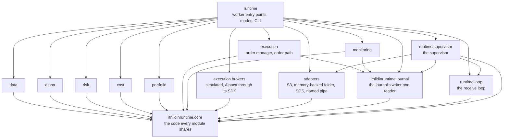

# Architecture, section 5: Building blocks

This page is section 5 of [the architecture](00-README.md), in the order of the arc42 template. It answers which modules and workers make up the platform, the types they pass, and which may import which.

## Contents

- [The loop and its adapters](#the-loop-and-its-adapters)
  - [Six things differ by mode](#six-things-differ-by-mode)
  - [No module asks which mode it is in](#no-module-asks-which-mode-it-is-in)
  - [One simulator serves backtest and shadow](#one-simulator-serves-backtest-and-shadow)
  - [What a worker works through](#what-a-worker-works-through)
- [Types and interfaces](#types-and-interfaces)
  - [The data the workers pass](#the-data-the-workers-pass)
  - [The interfaces](#the-interfaces)
  - [Eight choices for a reviewer to check](#eight-choices-for-a-reviewer-to-check)
- [Package layout and the import rule](#package-layout-and-the-import-rule)
  - [Which module may import which](#which-module-may-import-which)
  - [How tests hold the rule](#how-tests-hold-the-rule)
  - [What the rule costs](#what-the-rule-costs)

## The loop and its adapters

[design.md](../design.md#one-runtime)'s `## One runtime` says backtest, paper and
live run the same modules and differ only in adapters at the edges. The usual
name for that shape is ports and adapters. A port is an interface the modules
define, and an adapter is one implementation of it that talks to the outside
world. No module imports an adapter.

Each component runs as its own process,
processes pass everything through files, and the platform is an
event pipeline. [design.md](../design.md#processes-and-files)'s
`## Processes and files` gives the reasoning and the rules. So each module
here runs as one worker, a process of its own that the host keeps running.

The supervisor writes the run's plan, whose event reaches every worker, and
each one listens on its own queue. An event there wakes the worker for a blob
it reads, such as one of these.

- An input's decision result.
- The plan.
- The run's halt or stop.
- The kill switch.

Once woken, the worker takes four steps in order.

1. It checks the keys it builds from the plan.
2. It reads the output files that the input's decision result lists.
3. It writes its own output files.
4. It writes its own decision result last.

A worker's entry point builds the
adapters for the mode it is given and hands them to the module, so the module
never learns which mode it is in.

The figure below is a C4 container diagram.

Each cylinder is one component's output files for a decision, and the decision
result that lists them, each a blob written once at a key fixed by the run,
the stage and the decision. A solid arrow into a worker is an output it
reads.

A decision result reaches the workers that read it in three steps.

1. A worker writes its decision result.
2. S3's event for that result reaches the queue of each worker that reads it.
3. The event wakes that worker's receive loop, and the loop hands the work to a free handler in the worker's pool.

Every
worker reads the plan, which the diagram draws only into the two that start
the day, and monitoring reads every component's results, which the diagram
leaves out to stay legible. Each dotted arrow from an adapter is a port,
labelled with its name, and each mode is one choice of adapter for each port. The diagram leaves out two kinds of port read to stay legible: each worker's heartbeat, and the `Clock` read that stamps a record's own time, such as a journal entry's `built_at`, which every writer makes.
Execution and monitoring each appear twice because each has two stages in one
process, and each stage writes its own decision result. Execution recovers first and then, once the target portfolio
exists, sends. Execution's recover stage reconciles the book with the broker, and monitoring reconciles again with nothing waiting on it and reports last.

Two groups of workers run at the same time.

1. Execution's recovery for a decision waits for data's snapshot and for its
   own send result for the decision before, so it reads the broker at the
   decision's own time, and reconciles the book with the broker itself, halting on a difference. Monitoring's reconcile repeats the check for its report and alarm, and no decision waits on it.
2. Alpha and cost need only the snapshot, and risk also needs the reconciled
   book, so the three models overlap.

Execution sends only what the target portfolio asks for, so nothing it sends
can come from a snapshot or a book that is not stored yet. When it sends, it
checks each order against the book it replays from the journal at that
moment, not against a blob.

**Table:** What each mode plugs in at each edge

| Mode | Data source | Clock | Broker, and when it fills | Blob store and journal | Alerts and heartbeat |
| --- | --- | --- | --- | --- | --- |
| Backtest | marketlake reader, the bars a test names | History clock | Simulated, by order type: a market order at the decision quote, a buy at the ask and a sell at the bid, and a market-on-close order at the official close | A memory-backed folder, holding the backtest's own journal, gone when it ends, in the test environment or on a developer's machine | Recorded, not sent |
| Shadow | marketlake reader, captured bars, plus the imported download until capture covers the lookback | Wall clock | Simulated, by order type, the same rule as the backtest. A market-on-close order stays open until the data source holds the official close at the 18:30 sweep, so the run's read of the day's fills finds it open, which counts as read, and the fill lands at the next recover stage. A close missing at the next recover stage halts under hard limit 3, that missing input means stop, not flatten | The shadow environment's bucket, with the shadow journal | Sent |
| Paper | marketlake reader, captured bars, plus the imported download until capture covers the lookback | Wall clock | Paper broker, at its own simulated fill, which for a market-on-close order is the quote near the close rather than the auction price | The paper environment's bucket, with the paper journal | Sent |
| Live | marketlake reader, captured bars, plus the imported download until capture covers the lookback | Wall clock | Live broker, at its own fill | The live environment's bucket, with the live journal | Sent |

Every mode reads bars through the same marketlake reader. The modes differ in
which bars they read and which clock drives them, not in how they read. Shadow
reads live bars and decides real orders, but fills them in the simulated
broker, so no order reaches any broker. The diagram leaves out the
live broker, because only the owner switches to it.

### Six things differ by mode

Modes differ in six things, and they fall into two groups.

The figure below is a C4 component diagram.

[design.md](../design.md#one-runtime) names the three adapters that change what a
strategy sees:

1. The data source.
2. The clock.
3. The broker.

It lists three more beside them, which change only where records and signals go:

1. The blob store, which holds the journal too.
2. The queue.
3. The alert channel.

Those three differ because a backtest of 1,480 decisions must not append to the
paper journal or page the owner.

### No module asks which mode it is in

A module that asks has broken the shape, because its backtest would then test a
branch the paper run never takes.

The broker adapter also decides which account a worker acts for. A worker's
lease, a blob that names the one instance allowed to change that account while it holds the lease, and
its kill switch both belong to that account. So a backtest's simulated account
never shares the paper account's lease.

### One simulator serves backtest and shadow

1. **It fills by the order, not by the mode.** The order's type and time in
   force decide the fill.
2. **Its state outlives a run.** It keeps orders and positions as one
   blob per account per call, written before the call returns, outside any
   run's prefix.
3. **It can fail on purpose.** A seeded fault fills one leg of a pair in part,
   or not at all, so a replay runs the stranded-leg path paper trading will.

The figure below is a C4 dynamic diagram.

### What a worker works through

The event that design.md says modules are written against is one decision
result. In a backtest each worker works through every decision of the span in
turn. In the other modes it works through one trading day's decisions, as
design.md's `### A worker works through a span of decisions` says.

## Types and interfaces

A class diagram shows the types the workers pass to each other, each written
as an output file that a decision result lists, and the interfaces each module implements. Two diagrams follow, one
for the data the workers pass and one for the interfaces.

Three kinds of arrow appear.

1. A plain arrow means one type refers to the other.
2. A hollow diamond means the type holds one it was given.
3. A dotted arrow means the type returns or uses the other.

### The data the workers pass

The figure below is a C4 code diagram.

```mermaid
classDiagram
    direction LR

    class Instrument {
        +InstrumentId id
        +str symbol
    }
    class Bar {
        +InstrumentId instrument
        +date session
        +Decimal open
        +Decimal high
        +Decimal low
        +Decimal close
        +int volume
        +str basis
        +str origin
        +str vintage_id
        +datetime end
        +str interval
        +datetime first_seen
    }
    class Snapshot {
        +datetime decision_at
        +dict bars
        +dict quotes
        +dict status
        +bool provisional
        +dict flags
        +list segments
        +dict ledgers
        +require_fresh()
    }
    class Quote {
        +InstrumentId instrument
        +datetime at
        +Decimal bid
        +Decimal ask
        +Decimal last
        +str vendor_stamp
        +datetime fetched_at
        +bool realtime
        +int volume
    }
    class Basket {
        +dict legs
    }
    class Forecast {
        +str strategy
        +Basket basket
        +int direction
        +int horizon_sessions
        +Decimal confidence
    }
    class Constraints {
        +Decimal max_order_qty
        +Decimal max_position
        +Decimal max_gross
        +int max_open_orders
        +Decimal max_net
        +Decimal loss_stop
        +int moc_cutoff
    }
    class TargetPortfolio {
        +datetime decision_at
        +str strategy
        +dict shares
    }
    class Book {
        +dict positions_by_strategy
        +dict open_orders_by_strategy
        +Decimal cash
        +Decimal platform_realised_pnl
        +int replayed_through
    }
    class OrderIntent {
        +str client_order_id
        +str strategy
        +InstrumentId instrument
        +Decimal qty
        +str type
        +str time_in_force
    }
    class Fill {
        +str fill_id
        +str correction_id
        +str broker_order_id
        +str client_order_id
        +Decimal qty
        +Decimal price
        +datetime at
        +datetime received_at
    }
    class Ack {
        +str client_order_id
        +str broker_order_id
        +BrokerOrder order
        +str state
        +str outcome
        +bytes raw
    }
    class BrokerOrder {
        +str broker_order_id
        +str client_order_id
        +InstrumentId instrument
        +str side
        +Decimal qty
        +str type
    }
    class FoundOrder {
        +str answer
        +list rows
        +bool whole_list
        +bytes raw
    }
    class BrokerRead {
        +bytes raw
        +object value
    }
    class JournalAck {
        +int seq
        +str entry_hash
    }
    class Verdict {
        +bool approved
        +str limit
        +Decimal value
        +str missing_term
    }
    class CostSchedule {
        +dict per_share
        +dict fixed
        +estimate(instrument, qty) Decimal
    }
    class BrokerAccount {
        +dict positions
        +list open_orders
        +Decimal cash
        +datetime read_at
    }
    class Valuation {
        +date session
        +Decimal value
        +Decimal cash
        +dict marks
        +int replayed_through
    }
    class GateInputs {
        +Decimal share
        +Decimal stress_move
        +str vintage_hash
        +Decimal value
        +str stop_state
        +object close_entry
    }
    class SendOutcome {
        +datetime decision_at
        +str target_hash
        +list orders
    }
    class BlobRef {
        +str key
        +str sha256
    }
    class StoredBlob {
        +BlobRef ref
        +str etag
        +datetime stored_at
    }
    class BlobHeader {
        +int format
        +str deployment
        +str run
        +str stage
        +str kind
        +datetime decision_at
        +dict inputs
        +str release
        +str config_hash
    }
    class DecisionResult {
        +BlobHeader header
        +list outputs
        +HaltRecord halt
    }
    class HaltRecord {
        +str reason
        +BlobRef cause
        +list restart_records
        +list found_outputs
    }
    class RestartRecord {
        +str worker
        +int restart_count
        +int exit_status
        +str signal
        +str error_tail
    }
    class Heartbeat {
        +str writer
        +datetime at
    }
    class Lease {
        +str vm
        +str boot
        +str container
        +int restart_count
        +str handler
        +str release
        +str run
        +datetime taken
        +datetime expires
        +str status
    }
    class Plan {
        +str deployment
        +str run
        +str mode
        +str release
        +list decisions
    }
    class JournalEntry {
        +int seq
        +int format
        +datetime built_at
        +dict body
        +str prev_hash
        +hash() str
    }
    class Halt {
        +str reason
    }

    Snapshot o-- Bar
    Snapshot o-- Quote
    Bar --> Instrument
    Quote --> Instrument
    Forecast --> Basket
    TargetPortfolio --> Instrument
    OrderIntent --> Instrument
    BrokerOrder --> Instrument
    Ack o-- BrokerOrder
    StoredBlob o-- BlobRef
    DecisionResult o-- BlobHeader
    DecisionResult o-- HaltRecord
    HaltRecord o-- BlobRef
    HaltRecord o-- RestartRecord
    FoundOrder o-- BrokerOrder
```

### The interfaces

The interfaces are Python `Protocol` classes. A `Protocol` names the methods a
type must have, and any class with those methods satisfies it without
inheriting from it. That is what lets a run swap the simulated broker for the
paper one without either knowing about the other.

The figure below is a C4 code diagram.

### Eight choices for a reviewer to check

The two diagrams above make eight choices for a reviewer to check. Several are proposals for the issue that owns the piece, and each says so where it is one.

1. [A forecast is about a basket, not an instrument](#a-forecast-is-about-a-basket-not-an-instrument).
2. [A bar carries where it came from](#a-bar-carries-where-it-came-from).
3. [`Snapshot.require_fresh()` is how a module refuses a gap](#snapshotrequire_fresh-is-how-a-module-refuses-a-gap).
4. [Only `OrderPath` holds a `Broker`](#only-orderpath-holds-a-broker).
5. [The risk gate holds no state of its own](#the-risk-gate-holds-no-state-of-its-own).
6. [The book comes from the journal](#the-book-comes-from-the-journal).
7. [The cost model writes a schedule rather than answering calls](#the-cost-model-writes-a-schedule-rather-than-answering-calls).
8. [Every type that crosses between workers has a file form](#every-type-that-crosses-between-workers-has-a-file-form).

#### A forecast is about a basket, not an instrument

The Bollinger strategy forecasts a spread, which is two legs in a fixed ratio for the day. A `Basket` holds `{USO: 1, GLD: −h}`, so one forecast carries the whole position and portfolio construction never has to know it is a pair. The charter and [#6](https://github.com/l3a0/ithildin-runtime/issues/6) say a forecast is per instrument, so this is a proposal for [#6](https://github.com/l3a0/ithildin-runtime/issues/6) rather than a decision here.

#### A bar carries where it came from

##### What each field of a bar says

**Table:** The fields that say where a bar came from and when it closed

| Field | What it says |
| --- | --- |
| `origin` | Whether marketlake captured the bar or imported it |
| `vintage_id` | The vintage the bar was read from |
| `first_seen` | When the platform first held the bar |
| `basis` | Which price the series carries, such as `raw` for as traded or `adjusted` for split and dividend adjusted, as quantitative-trading's vintage records do |
| `end` | When the bar closed |
| `interval` | How long the bar is |

A bar and a quote also name each price's kind, the venues it covers and any delay from its source, and each volume how it was counted, with a field no source states recorded as unstated, as the rule that [a recorded price states what kind of price it is](../design.md#a-fill-is-measured-from-the-decision-and-a-position-depends-on-a-market-it-does-not-control) requires. The class diagram above leaves those fields out until [#50](https://github.com/l3a0/ithildin-runtime/issues/50) names them with [#5](https://github.com/l3a0/ithildin-runtime/issues/5). [#22](https://github.com/l3a0/ithildin-runtime/issues/22) builds `Bar` and `Quote` with the fields the diagram names, and [#50](https://github.com/l3a0/ithildin-runtime/issues/50) and [#5](https://github.com/l3a0/ithildin-runtime/issues/5) add the rest, since a module issue may change its own module's type.

`vintage_id` and `first_seen` come from the data engineer's duty, in [the charter](../team-charter.md), to store when each value became available (*Inside the Black Box*, Kindle location L3884). `end` and `interval` let one daily bar and minute bars of the same instrument sit side by side, keyed in a snapshot by instrument and interval.

##### Which bars a snapshot returns

Every `DataSource` adapter applies one rule: `snapshot(decision_at)` returns only bars whose `end` and knowable time are both at or before the decision time. Three rules set those times.

1. A minute bar's `end` is marketlake's `bar_ts` plus its interval.
2. A daily bar's `end` is its session's close from the calendar.
3. An imported vintage has no receive time, so its knowable time is the vendor's publication date where the vintage records one, and otherwise the bar's `end`, which a backtest states as an assumption of its result.

[#5](https://github.com/l3a0/ithildin-runtime/issues/5) holds how.

##### What a quote and a snapshot's flags carry

A `Quote` keeps the vendor's stamp as received, the capture time, whether the quote was real time, and its volume, which [#16](https://github.com/l3a0/ithildin-runtime/issues/16) asks for.

A snapshot's `flags` hold a spike flag with both prices per instrument, so the send stage's flag test has a field to read.

#### `Snapshot.require_fresh()` is how a module refuses a gap

A snapshot is the set of bars one decision read, each pointing at the partition that holds it. A module calls `require_fresh()` before reading, and it raises `Halt` when any bar it needs is missing or stale. So the default when something is absent is to stop.

#### Only `OrderPath` holds a `Broker`

Every call to the broker goes through `OrderPath`.

##### Which calls reach the broker

`OrderPath` has one method per kind of call.

- Settling orders in doubt.
- Journaling fills.
- Reading positions and open orders.
- Sending and cancelling.

[#10](https://github.com/l3a0/ithildin-runtime/issues/10) states which read supplies cash. Nothing else in the package is given a broker, and only the execution worker's entry point builds one, which the import rule enforces. The fake broker in test 3, the test that the risk gate refuses an order over each limit and that nothing bypasses it, checks the send path itself, as [Package layout and the import rule](#package-layout-and-the-import-rule) says. The adapter wraps Alpaca's SDK, alpaca-py, so a test hands `OrderPath` a fake and no module sees the SDK's types.

##### How a call names an order

Every lookup and every cancel uses the broker's order id the journal mapped from the ack. An order in doubt has no ack, so `find_order` supplies its broker id first, by the adapter's own means, as design.md's [Orders the platform did not send](../design.md#orders-the-platform-did-not-send) says.

##### How a late fill is still fetched

`fills(since)` takes the last decision's time less a stated overlap. The journal compares each fill with any it holds under that id and correction identifier.

- It skips only an identical repeat.
- It journals a differing one and halts.

So a fill the broker posts late is still fetched.

##### What each call returns, and what is journaled first

`Journal.append` returns a `JournalAck` naming the entry's number and hash. The private calls that submit an order or send a cancel take that acknowledgement alone, as [The code holds its own rules](../design.md#the-code-holds-its-own-rules-and-every-check-runs-in-production) says.

Every `Broker` read and write returns its received bytes apart from the converted value, including on a failed conversion. `OrderPath` journals those bytes before it uses the value. For a send-stage read it journals the hash of the output file that holds them instead, also before it uses the value.

Each call ends in one of these outcomes.

1. Accepted.
2. Rejected.
3. Provably not sent.
4. Unknown.
5. Not found.
6. More than one, an outcome only a `find_order` can reach.

`orders(since)` reads a takeover's whole list, open and closed orders across every page. [#10](https://github.com/l3a0/ithildin-runtime/issues/10) owns the form of these outcomes and of that list.

##### One function lists the differences from the broker

One reconciliation function in `core`, `core.reconcile(book, broker_account)`, lists the differences. Four stages call it.

1. Execution's recover stage.
2. Execution's send-stage sync.
3. Execution's reconcile after the close.
4. Monitoring's reconcile stage.

Each decides only what to do with the differences. Execution journals its own outcomes and halts on the rest, and monitoring alarms. [#10](https://github.com/l3a0/ithildin-runtime/issues/10) holds how `core.reconcile` receives a takeover's stored order list, so it can flag a late order.

##### How the broker's rate limit is shared

Alpaca's trading API [allows 200 requests a minute](https://alpaca.markets/support/usage-limit-api-calls) for each account, a figure [#10](https://github.com/l3a0/ithildin-runtime/issues/10) confirms on the paper account before anything relies on it. The budget that follows is this doc's proposal for [#10](https://github.com/l3a0/ithildin-runtime/issues/10).

**Table:** How execution splits the account's 200 requests a minute

| Share | Of the account's limit | Each instance's share, for three instances | What draws on it |
| --- | --- | --- | --- |
| The reserve | A quarter, 50 a minute | 16 a minute, rounded down | Cancels, and every read and lookup a cancel, a sort or a pair-keeping cancel needs, the kill switch's included |
| Orders and lookups | The rest | 50 a minute | New orders and other lookups, which never draw on the reserve |

Slice 1's one VM runs two execution instances, so each takes half of each share, 25 a minute of the reserve and 75 of the rest, and their shares together reach the limit. The table and the first sketch count the cluster's three. Each instance takes the count of execution instances from the release's table for its environment.

The first sketch draws that table to scale, for three instances.

![Animated sketch titled “How the account's 200 a minute are shared”, drawn to scale. A berry box “reserve: 50” takes the first quarter of a bar, and a black box “orders and lookups: the rest” takes the remainder. Three rows follow, one per instance, each a berry box “16” under the reserve and a black box “instance 1: 50”, “instance 2: 50” or “instance 3: 50” under the rest, set side by side so they tile the bar. The third reserve box stops just short of the reserve's edge. Two notes close it: “Each instance takes 16 of the reserve, rounded down, and 50 of the rest.” and “Together the shares stay under the limit, so no counter is shared.” The finished drawing holds for 12 seconds.](../figures/rate-limit-shares.gif)

Both shares are split evenly across the deployment's execution instances. Each instance holds two token buckets, one for its share of orders and lookups and one for its share of the reserve. Each bucket refills continuously and holds at most 10 tokens, so a burst cannot spend a minute's share in a second, and no counter is shared. The steady shares add up to at most the limit, but each bucket's 10 tokens come on top of its share, so the busiest minute can pass the limit by up to 10 requests for each bucket, 40 with two instances and 60 with three. [#10](https://github.com/l3a0/ithildin-runtime/issues/10) sizes the shares so that every bucket's tokens plus every share a minute stay under the account's limit. A request takes a token or waits the time the bucket names.

The second sketch follows a request through its instance's two buckets.

![Animated sketch titled “One instance, two token buckets”. A bucket with berry tokens is drawn and named “the reserve”, with a grey arrow into it labelled “refills all the time” and a dashed line labelled “holds at most 10 tokens”. An arrow brings “cancels, and the reads and lookups a cancel or a sort needs” into it, and an arrow out, labelled “takes a token”, leads to “goes to the broker”. A second bucket, “orders and lookups”, with the same refill and dashed line, takes “new orders and other lookups” and leads to “an order takes the account's lease only now, then the broker”. Last, a vermilion empty bucket with a cross is labelled “empty: the request waits the time the bucket names”. The finished drawing holds for 12 seconds.](../figures/rate-limit-buckets.gif)

An instance's share sets two thresholds.

1. An instance alarms when its requests pass 75% of its share.
2. An order that would pass its instance's share waits for the budget before the order path takes the account's lease, so a wait never holds the lease.

The third sketch draws both on one instance's share.

![Animated sketch titled “When an instance alarms, and when it waits”. A line runs from a tick labelled “none” to a heavier tick labelled “its share”. A thick berry bar labelled “its requests in a minute” fills most of it. A vermilion dashed line three quarters of the way along is labelled “75% of its share: the instance alarms”. Last, a note under the share's tick reads “an order that would pass its share waits for the budget, before the order path takes the account's lease”. How far the bar fills is illustrative. The finished drawing holds for 12 seconds.](../figures/rate-limit-alarm.gif)

**Table:** What a broker 429, its answer for too many requests, does on a submit and on a cancel

| The call | What the 429 means | What follows |
| --- | --- | --- |
| A submit | The order is left in doubt | A lookup settles it like any other order in doubt |
| A cancel | A refused cancel, where that account's latest scheduled contract-suite run shows a 429 on a cancel is definite. Otherwise the answer counts as lost | An alarm. Where the 429 is definite, execution journals a new cancel first and sends it under the lease, inside the reserve, and each such cancel counts toward rule 6's written number and its clock, which runs from the first cancel's entry. Where it counts as lost, the rule for a cancel whose answer is lost applies. In either case no stage resends a plan's own cancel, as rule 6 of [Faults are expected](../design.md#faults-are-expected-and-the-platform-checks-itself-while-it-runs) says |

#### The risk gate holds no state of its own

The gate keeps nothing from one check to the next. Every check is handed what it weighs, and the diagram shows where its inputs come from, as the parts below describe. The diagram draws only the sources this section names, so four of the values in `GateInputs` have no arrow.

The figure below is a C4 component diagram.

##### What the gate is handed

`check` takes six things.

1. The order.
2. The book.
3. The snapshot.
4. The run's `Constraints`.
5. A `GateInputs`, which holds the share, the stress move, the vintage hash, the portfolio value, the stop blob's state and, for a close, its close entry.
6. `now`, the send stage's reading of the `Clock` port when it hands the order over, the history clock in a backtest, which the gate compares with the cutoff.

`OrderPath` reads the stop blob and hands that state to the gate. For a close it reads the entry from the journal, and any confirmation from the owner's record, never from the order or a caller, under the rule that a broker's own trade closes the whole position ([A fill is measured from the decision](../design.md#a-fill-is-measured-from-the-decision-and-a-position-depends-on-a-market-it-does-not-control)). [#7](https://github.com/l3a0/ithildin-runtime/issues/7) holds the shape. The figure draws the owner's confirmation straight into the gate because no field of `GateInputs` holds it yet, and [#7](https://github.com/l3a0/ithildin-runtime/issues/7) places that field.

##### How the gate values the book

The gate computes each position's worst loss from the replayed `Book`, the order and `stress_move`, and `Verdict` names any term it could not compute. `send` replays the book from the journal just before each check. So the gate counts every order already approved or sending, including those of an earlier attempt, each at its worst case for each limit.

The gate checks seven limits, one for each field of `Constraints` in the data diagram above, as [#7](https://github.com/l3a0/ithildin-runtime/issues/7) counts them. Three of the seven limits need the snapshot's prices to value the book.

**Table:** The seven limits, and which need the snapshot's prices

| Field of `Constraints` | Needs the snapshot's prices to value the book |
| --- | --- |
| `max_order_qty`, the maximum order size | No |
| `max_position`, the maximum position per instrument | No |
| `max_gross`, the maximum portfolio size | Yes |
| `max_open_orders`, the maximum open orders | No |
| `max_net`, the net exposure | Yes |
| `loss_stop`, the loss stop | Yes |
| `moc_cutoff`, the market-on-close cutoff | No |

##### How the gate reads the cutoff

`moc_cutoff` is minutes before the close. The one calendar function in `core` turns it into a UTC instant from the decision's own session's close, and the gate compares only that instant. The gate also refuses a market-on-close order past the cutoff, at the time execution hands it. That is a backstop to execution's own clock checks, which journal an order past the cutoff `Abandoned`, as [Strategies, schedules and decisions](../design.md#strategies-schedules-and-decisions) says.

##### Where the limits come from

The `Constraints` come from the risk model's constraints file, so the order path first checks every field of that file, and every hard cap in the hard caps blob only the owner can write. Each must be present, finite and of the sign the field expects, and the order path halts otherwise. Then it takes the tighter of each pair, a field of the constraints file and its hard cap.

**Table:** Which value of each pair applies

| The pair | The one that applies |
| --- | --- |
| A maximum | The smaller maximum |
| The loss stop | The smaller loss |
| The cutoff | The earlier cutoff |

A constraints file can tighten a limit and never loosen it. This is a proposal for [#7](https://github.com/l3a0/ithildin-runtime/issues/7).

#### The book comes from the journal

`Journal.replay()` applies every entry in order to build a `Book`. The broker's positions, open orders and cash are read only in the places [The current book comes from the journal](06-runtime.md#the-current-book-comes-from-the-journal) lists. `Journal` lives in a package of its own, `ithildinruntime.journal`, which imports only `core`. Execution, monitoring, the supervisor and the `ithildin` tool all append to it, and they are the only code that may import it, so no other module holds a writer of the journal.

#### The cost model writes a schedule rather than answering calls

Portfolio construction priced each candidate trade by calling the cost model. With each module in its own process, the cost model instead writes a `CostSchedule` per decision, a fixed and a per-share cost for each instrument, and portfolio construction evaluates it. Slice 1's flat or linear model fits that shape. This is a proposal for [#8](https://github.com/l3a0/ithildin-runtime/issues/8).

#### Every type that crosses between workers has a file form

##### How a type travels

Every type that crosses between workers has a file form, `BrokerAccount` and `SendOutcome` included. Each travels as an output file that begins with a `BlobHeader`, naming its inputs by key and SHA-256, and that its component's `DecisionResult` lists. A test writes each one and reads it back unchanged. A deterministic component's format is canonical, so the same inputs give the same bytes, as [File formats and keys](08-crosscutting-concepts.md#file-formats-and-keys) defines. Prices and quantities cross between workers as decimals, never floats, for the same reason.

##### How a halt crosses a worker's edge

`Halt` stays an exception inside a worker. At the worker's edge it becomes a `DecisionResult` that holds a `HaltRecord`.

**Table:** What a `HaltRecord` holds about where the halt came from

| Field | What it holds |
| --- | --- |
| `cause` | The halt the worker met, when it is passing one on. Empty when the worker found the problem itself |
| `found_outputs` | Each output file stored under the decision's prefix when the halt was written, a capturing stage's stored capture included |

The supervisor writes the same record for a worker that failed, naming its restart records. The host's stop handler and the restarted worker write those records, as [Each blob names what made it](../design.md#rule-5-each-blob-names-what-made-it) says.

##### What a plan, a journal entry and a lease hold

- `Plan` holds the run's decisions, each with its time and the strategies deciding at it. One function in `core` builds it from the schedules and the trading calendar.
- `JournalEntry` is the one numbered record, chained to the entry before it.
- `Lease` names its holder down to the handler, and when it expires, and leaves those `null` while the lease is free. It carries `status` only on a plan's lease, where it holds the run's status, so an account's lease leaves it `null`.

##### How the storage port rewrites a blob

`BlobStore` is the storage port, S3 in shadow, paper and live and a memory-backed folder in a backtest, and one contract test suite runs against both. A case in it writes, through `create` and through `replace_if_match`, bytes whose SHA-256 differs from the one sent, and both adapters refuse it. `create` returns the stored blob's tag and `head` its stored time. `replace_if_match` rewrites a blob only while it still carries the tag it names, and returns the new tag. That is how a lease is taken, renewed, released and taken over, and it is the one rewrite the port allows. So a lease can be rewritten only on a tag.

**Table:** Which tag each rewrite of a lease names

| The rewrite | The tag it names |
| --- | --- |
| A take | The one it read |
| A clear | The one it read |
| A renewal | The one its holder's own last write returned |
| A release | The one its holder's own last write returned |

No worker deletes through the port. [#11](https://github.com/l3a0/ithildin-runtime/issues/11) names how `ithildin`'s deletes of a switch, a loss stop or an off switch reach S3. `Journal` writes through `BlobStore` too, for the account the broker adapter names, so the `journal` package has no storage port of its own.

## Package layout and the import rule

No worker module imports another worker module. Each imports only the shared code below it, `core` and, for the modules that write the journal, `journal`, and only `runtime` puts the modules together, so no module can reach a sibling's code or choose its own mode.

### Which module may import which

The figure below is a C4 component diagram.

An arrow means "may import". The arrow from `runtime` to `journal` is the `ithildin` tool's. The diagram draws four rules.

1. **No worker module imports another worker module.** The workers are data, alpha, risk, cost, portfolio, execution and monitoring. The code they share sits below them, in two packages, so no worker needs a sibling's code.
   1. `core`, which every module may import.
   2. `journal`, which holds `Journal` and imports only `core`. Only execution, monitoring, the supervisor and the `ithildin` tool may import it, because they are the four that append to the journal, so no other module holds a writer of it.

   These live in `core`:

   - the types that cross modules, such as `Forecast`, `Constraints` and `TargetPortfolio`;
   - the `Halt` exception;
   - every `Protocol`, including `RiskGate`;
   - the storage contract every worker uses:
     - the `BlobStore` port, writing a blob S3 refuses to replace;
     - the blob header;
     - the decision result and its halt;
     - the plan;
     - the queue port;
     - the one codec and key builders that [File formats and keys](08-crosscutting-concepts.md#file-formats-and-keys) describes;
   - the calendar function and the plan builder, which read the trading sessions from a committed data file rather than a calendar library, as [Which clock a schedule follows](08-crosscutting-concepts.md#which-clock-a-schedule-follows-and-how-it-becomes-utc) says;
   - `reconcile`, the one comparison of a book with the broker's account.

   `core` holds ports and no adapter, so no module can build an S3 store or an SQS queue and choose its own mode.
2. **Only `runtime` imports the modules together.**
   - Each worker's entry point lives there, and so does the one receive loop every worker and the supervisor run. It picks the adapters for the mode it is given, and the execution worker's entry point hands the risk module's `RiskGate` to the order path.
   - The supervisor lives there too, in `runtime.supervisor`, and imports `core`, `journal`, `adapters` and the receive loop's module, `runtime.loop`, and nothing else. `runtime.loop` itself imports only `core`, so the supervisor reaches no worker module through it.
   - The supervisor starts no worker itself. The host's path unit starts each worker's unit once the supervisor writes the local release file. It writes nothing but these, which `core`'s storage contract and queue and the `journal` package cover, apart from that file:
     - the local release file, in memory-backed storage on its VM;
     - the plan's lease, whose conditional writes carry the run's status;
     - the plan;
     - the journal entry for each lease it clears or takes over;
     - the journal entry for each capture lost when a worker's process died holding it, which names each capture the failed stage owed for that decision and that is absent at its key, read from the stage's declared outputs rather than from the halt's blob, because a process that died while S3 was down may never have stored that blob;
     - its heartbeat;
     - the halts of workers that failed;
     - a halt of the run, with a halt for every decision left in the plan;
     - the run's stop.

     The one exception is its report to the session-ready check in CloudWatch, which goes through `adapters`.
   - Only the entry points read the plan's mode, and a module is handed only the decisions.
3. **Only `runtime` imports `execution.brokers`**, and only the execution worker's entry point builds a broker, which it hands to `OrderPath` alone.
4. **Only `runtime` imports `adapters`**, which holds the S3, memory-backed folder, SQS and named-pipe adapters. So each of these three outside libraries is imported in one module.

   **Table:** The one module that imports each of three outside libraries

   | Library | The only module that imports it |
   | --- | --- |
   | boto3 | `adapters` |
   | marketlake's package | `data` |
   | Alpaca's SDK | `execution.brokers` |

   The `ithildin` tool, which lives in `runtime`, imports only `core`, `adapters` and `journal`. The supervisor imports those three and `runtime.loop`, as rule 2 says. The import test gives each of them that narrower arrow of its own and allows nothing more.

### How tests hold the rule

A test reads every module's imports with Python's `ast` module and fails on an arrow the diagram does not draw, an import of `journal` from a module other than its four importers included. A second test runs a day under the supervisor against a fake broker that fails on four things.

1. An order whose client order id has no approval in the journal.
2. An order whose `sending` entry is not yet stored in the journal.
3. A client order id it has already received.
4. A cancel whose `cancel` entry is not yet stored in the journal, since a cancel is journaled before it is sent, the kill switch's included.

The day pulls the kill switch, rejects one leg of a pair and answers one cancel with a 429, so the kill switch's cancels, a pair-keeping cancel and a cancel retried after a 429 meet the fourth check. The fake broker applies the fourth check in every test that runs against it, so each other path that sends a cancel meets the check in the test that drives that path.

Together they turn acceptance test 3's claim that no order reaches the broker adapter without passing the gate into something executed rather than reviewed. That test, in [How the four acceptance tests exercise it](10-quality.md#how-the-four-acceptance-tests-exercise-it), checks that the risk gate refuses an order over each limit and that nothing bypasses it.

### What the rule costs

The price is two more tests to keep in step with the diagram, and a module that needs a sibling has to argue for a new arrow.
