# Architecture, section 5: Building blocks

This page is section 5 of [the architecture](00-README.md), in the order of the arc42 template. It answers which modules and workers make up the platform, the types they pass, and which may import which.

## Contents

- [The loop and its adapters](#the-loop-and-its-adapters)
  - [Six things differ by mode](#six-things-differ-by-mode)
  - [No module asks which mode it is in](#no-module-asks-which-mode-it-is-in)
  - [One simulator serves backtest and shadow](#one-simulator-serves-backtest-and-shadow)
  - [What a worker works through](#what-a-worker-works-through)
- [Types and interfaces](#types-and-interfaces)
  - [The data the workers pass](#the-data-the-workers-pass)
  - [The interfaces](#the-interfaces)
  - [Ten choices for a reviewer to check](#ten-choices-for-a-reviewer-to-check)
- [Package layout and the import rule](#package-layout-and-the-import-rule)
  - [Which module may import which](#which-module-may-import-which)
  - [How tests hold the rule](#how-tests-hold-the-rule)
  - [What the rule costs](#what-the-rule-costs)

## The loop and its adapters

[design.md](../design.md#one-runtime)'s `## One runtime` says backtest, paper and
live run the same modules and differ only in adapters at the edges. The usual
name for that shape is ports and adapters. A port is an interface the modules
define, and an adapter is one implementation of it that talks to the outside
world. No module imports an adapter.

Each component runs as its own process,
processes pass everything through files, and the platform is an
event pipeline. [design.md](../design.md#processes-and-files)'s
`## Processes and files` gives the reasoning and the rules. So each module
here runs as one worker, a process of its own that the host keeps running.

The supervisor writes the run's plan, whose event reaches every worker, and
each one listens on its own queue. An event there wakes the worker for a blob
it reads, such as one of these.

- An input's decision result.
- The plan.
- The run's halt or stop.
- The kill switch.

Once woken, the worker takes four steps in order.

1. It checks the keys it builds from the plan.
2. It reads the output files that the input's decision result lists.
3. It writes its own output files.
4. It writes its own decision result last.

A worker's entry point builds the
adapters for the mode it is given and hands them to the module, so the module
never learns which mode it is in.

The figure below is a C4 container diagram.

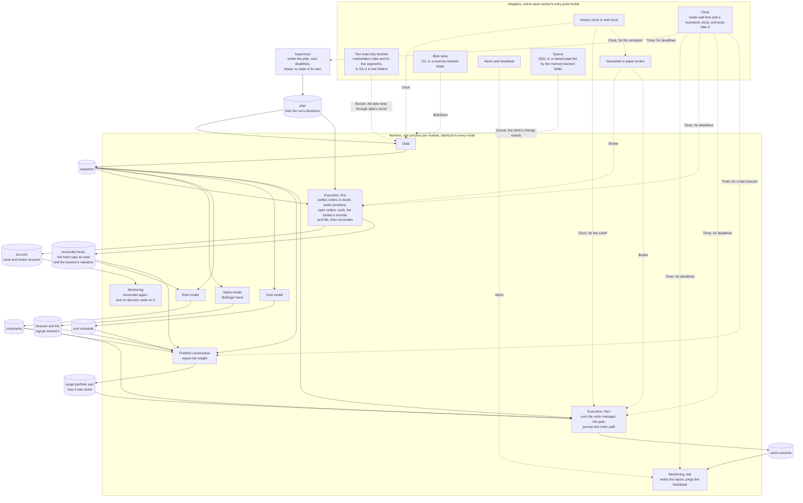

Each cylinder is one component's output files for a decision, and the decision
result that lists them, each a blob written once at a key fixed by the run,
the stage and the decision. A solid arrow into a worker is an output it
reads.

A decision result reaches the workers that read it in three steps.

1. A worker writes its decision result.
2. S3's event for that result reaches the queue of each worker that reads it.
3. The event wakes that worker's receive loop, and the loop hands the work to a free handler in the worker's pool.

Every
worker reads the plan, which the diagram draws only into the two that start
the day, and monitoring reads every component's results, which the diagram
leaves out to stay legible. Each dotted arrow from an adapter is a port,
labelled with its name, and each mode is one choice of adapter for each port. The diagram leaves out two kinds of port read to stay legible: each worker's heartbeat, and the `Clock` read that stamps a record's own time, such as a journal entry's `built_at`, which every writer makes.
Execution and monitoring each appear twice because each has two stages in one
process, and each stage writes its own decision result. Execution recovers first and then, once the target portfolio
exists, sends. Execution's recover stage reconciles the book with the broker, and monitoring reconciles again with nothing waiting on it and reports last.

Two groups of workers run at the same time.

1. Execution's recovery for a decision waits for data's snapshot and for its
   own send result for the decision before, so it reads the broker at the
   decision's own time, and reconciles the book with the broker itself, halting on a difference. Monitoring's reconcile repeats the check for its report and alarm, and no decision waits on it.
2. Alpha and cost need only the snapshot, and risk also needs the reconciled
   book, the hard caps as recover read them and the session's valuation, so the
   three models overlap. Portfolio construction reads those three files and the
   snapshot too.

Execution sends only what the target portfolio asks for, so nothing it sends
can come from a snapshot or a book that is not stored yet. When it sends, it
checks each order against the book it replays from the journal at that
moment, not against a blob.

**Table:** What each mode plugs in at each edge

| Mode | Data source | Clock | Broker, and when it fills | Blob store and journal | Alerts and heartbeat |
| --- | --- | --- | --- | --- | --- |
| Backtest | A folder holding marketlake's lake and the folder of segments beside it, the bars and quotes a test names | History clock | Simulated, by order type: a market-on-close order at its session's official close, and the day's market order at once, a buy at the decision's ask and a sale at its bid | A memory-backed folder, holding the backtest's own journal, gone when it ends, in the test environment or on a developer's machine | Recorded, not sent |
| Shadow | marketlake's S3 bucket, captured bars and the day's quotes, plus the imported download until capture covers the lookback | Wall clock | Simulated, by order type, the same rule as the backtest. A market-on-close order stays open until a decision's stored snapshot holds the official close, which the data source holds from the 18:30 sweep, so the run's read of the day's fills finds it open, which counts as read, and the fill lands at the next recover stage. A close missing at the next recover stage halts under hard limit 3, that missing input means stop, not flatten: at the stale lag of 0 a strategy's file writes, data reads the instrument as stale and its result holds the halt. The order keeps working | The shadow environment's bucket, with the shadow journal | Sent |
| Paper | marketlake's S3 bucket, captured bars and the day's quotes, plus the imported download until capture covers the lookback | Wall clock | Paper broker, at its own simulated fill, which for a market-on-close order is the quote near the close rather than the auction price | The paper environment's bucket, with the paper journal | Sent |
| Live | marketlake's S3 bucket, captured bars, once [a split record covers them](../team-charter.md#5-release), and the day's quotes, plus the imported download until capture covers the lookback | Wall clock | Live broker, at its own fill | The live environment's bucket, with the live journal | Sent |

Every mode reads bars through one `DataSource`, which sits inside `data` and calls the same marketlake reader over the same mirror. The modes differ in
which bucket the mirror reads, which bars that bucket holds and which clock drives them, not in how they read. A lookback that holds the imported download beside captured bars [halts](../design.md#a-lookback-that-crosses-a-change-of-series), unless the download is Schwab's, adjusted to the session capture began on. For GLD and USO an exploratory comparison with a second vendor shows the two on one scale there, and nothing measures it for another instrument. Shadow
reads live bars and decides real orders, but fills them in the simulated
broker, so no order reaches any broker. The diagram leaves out the
live broker, because only the owner switches to it.

### Six things differ by mode

Modes differ in six things, and they fall into two groups.

The figure below is a C4 component diagram.

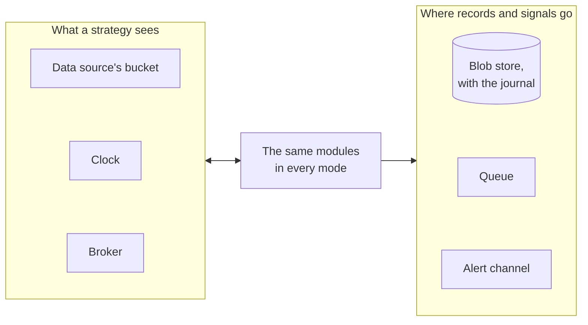

[design.md](../design.md#one-runtime) names the three adapters that change what a
strategy sees:

1. The data source's two buckets, folders in a backtest and two prefixes of marketlake's S3 bucket otherwise.
2. The clock. Whether a run measures it, as [The time servers](03-context-and-scope.md#the-time-servers) says, goes with it.
3. The broker.

It lists three more beside them, which change only where records and signals go:

1. The blob store, which holds the journal too.
2. The queue.
3. The alert channel.

Those three differ because a backtest of 1,461 decisions must not append to the
paper journal or page the owner.

### No module asks which mode it is in

A module that asks has broken the shape, because its backtest would then test a
branch the paper run never takes.

The broker adapter also decides which account a worker acts for. A worker's
lease, a blob that names the one instance allowed to change that account while it holds the lease, and
its kill switch both belong to that account. So a backtest's simulated account
never shares the paper account's lease.

### One simulator serves backtest and shadow

1. **It fills by the order, not by the mode.** The order's type and time in
   force decide the fill, and [What fills, and when](#what-fills-and-when) gives
   the rule.
2. **Its state outlives a run.** It keeps the account as a log, one blob for each
   call that changed it, written before the call returns, outside any run's
   prefix, as [The simulated broker's account](08-crosscutting-concepts.md#the-simulated-brokers-account) says.
3. **Its prices are what data stored.** `StoredPrices` reads one decision's
   result and snapshot through `core.Storage`, with the checks every stage
   makes of them, and `execution.brokers` imports `core` alone, so marketlake's
   reader never loads there.
4. **It can fail on purpose.** A test hands it `Faults`, a value that names what
   happens to an order, a read or the account. One fills one leg of a pair in
   part, or not at all, so a replay runs the stranded-leg path paper trading
   will. A fault changes an order as it enters, or what the account does, and
   none holds randomness. The account's own checks answer a repeated id, a wrong
   type and zero shares, and `reject` gives a fixed rejection.
5. **It is reached as any broker is.** `OrderPath` alone submits to it, in `src/`
   and in the tests, through a relay where a test needs the clock to move first,
   as [a sweep of the source](#which-calls-reach-the-broker) holds. So each order
   meets the gate and the journal first.

#### What fills, and when

1. **A market-on-close order at `cls`** rests when it comes at or before its
   session's close by the clock, and is rejected after it. Its session is the one
   of the decision that sent it.
2. **It fills whole at that session's official close**, at the first call after
   the close by the clock that reads a price and whose decision's snapshot holds
   that session's bar.
   Until then it is working, and it can be cancelled while the clock reads no
   later than the close, as item 9 says. Nothing here ends an order whose bar never comes, and
   data halts only while that session is in the lookback.
3. **The fill says what price it was given.** Its `at` is the session's close, its
   `received_at` is the clock's, and the log names the stored snapshot that
   gave the price. Its `basis` is `signal_close` where the decision that sent it
   had read a close of that session, and `official_close` otherwise. So a result
   that fills at a close its signal read is told by its own fills. The price
   itself is the settling snapshot's, which a revision can have moved. A market
   order's fill, under item 5, has the `basis` `quote`.
4. **Cash and shares move exactly**, as the journal's book moves them, with no
   rounding. A sale can open a short.
5. **A market order for the day fills whole at once**, in the call that takes
   it, a buy at the ask and a sale at the bid of the quote in the snapshot of
   the decision that sent it. `core.quote_faults` judges that quote at the
   decision's time, so a backtest's fills do not move with its clock. Before the
   close the gate has already judged it at its own time. At the close itself a
   decision reads no quote and the gate marks at the day's bar, so the broker's
   rejection is what stops the order. Its `at` and `received_at` are the
   clock's, its `basis` is `quote`, and the log names the decision's stored
   snapshot, which holds the quote's stamps and the row as received. A snapshot
   with no quote of the instrument, and a quote with a fault, are each a
   rejection that names why, cut short where it would be long, so the answer
   stays inside the journal's raw limit. Under the faults `reject_later` and `fill_none` it
   rests instead, and one still working at its close expires unfilled. One on
   its way is judged as it arrives. It is not taken when it arrives past its
   close, under another decision's prices, or with a quote that is missing or
   has a fault, and otherwise it fills. A read of the orders reads no price, so
   it leaves one of its own decision that arrives before its close on its way,
   as item 9 says. Any other order is rejected.
6. **A client order id of an order it took, or has or had on its way, is refused** with
   an answer that says so, which the order path reads as in doubt.
7. **It moves only forward.** A call whose clock reads before the log's newest
   call, or before the decision its prices are of, halts, apart from those of
   item 9.
8. **A price it needs and cannot read halts the call**, apart from those of item
   9. An order past its close needs one, and so does an order it takes. A result
   or a snapshot that is missing, stale or of another decision gives none.
9. **No clock and no price stops a cancel, or a read of the orders.** Neither reads
   a price, and both leave a close that needs one, and a market order on its way
   that needs its quote, to the next call that reads one.
   A cancel is judged by the clock it reads, or by the log's newest call where the
   clock gives no UTC time. `open_orders`, `orders`, `lookup` and `find_order`,
   which say what there is to cancel, give the log as it stands where the clock
   would halt them, dated by the later of the clock and the log's newest call. The price is that a clock that
   went back can cancel an order whose close had passed and was not yet settled.
   What stops these calls is the log: one that cannot be read or written, a number
   lost 101 times, and a clock that gives no UTC time on an account that holds no
   call but its opening. A test's fault can stop a read of the orders, and stops no
   cancel.

#### What a simulated fill leaves out

A result that quotes one of these fills as evidence names what it leaves out, as
[A backtest names what it could not have traded](../design.md#a-backtest-names-what-it-could-not-have-traded-and-each-model-states-how-it-fails)
asks.

1. **The scale.** A fill at a close is at the bar's close on the bar's own scale, which
   `basis` does not state. The USO prices imported from Yahoo, 2012-04-10 to
   2020-04-28, are eight times those that traded
   ([A lookback that crosses a change of series](../design.md#a-lookback-that-crosses-a-change-of-series)).
2. **The auction.** `official_close` never means the closing auction's print. The
   bar the fill was priced from states its `venues`, and a consolidated close is
   the last trade on any of them.
3. **The cutoffs.** A live order or cancel past the broker's or the exchange's
   cutoff is refused, and this account takes both up to the close. `basis` says
   nothing of that. The order's `submitted_at` does.
4. **Size.** A fill is whole whatever its size, and moves no price.
5. **Terms it does not book.** Commission, borrow, interest, distributions, credit
   on a short's proceeds and buying power read as unknown, never as zero. A split
   is [#191](https://github.com/l3a0/ithildin-runtime/issues/191)'s, and a forced close or a buy-in [#152](https://github.com/l3a0/ithildin-runtime/issues/152)'s.
6. **The time a market order lands.** A market order fills at the decision's
   quote whatever the time of the call, so its cost from the decision's midpoint
   is half the spread by construction and never shows the market moving in
   between. `OrderPath` abandons a send past the moment its quote stops being
   readable, which bounds how late a fill can come, apart from an order a test's
   `Late` fault holds on its way.
7. **An order on its way across decisions.** A market order on its way that
   arrives under another decision's prices is not taken, where a real broker
   fills an order whenever it lands. So a test of an order in doubt on this
   simulator never meets one that fills in a later decision after a lookup found
   nothing, which is the case where sending it again would double it. Within one
   decision a read of the orders can find nothing while a market order waits on
   its way, and the next call that reads a price takes it or misses it, as item 5
   of `#### What fills, and when` says.
8. **The quote's kind.** The bid and the ask are what the quote-kind contract in
   `data/quote_kinds.csv` says of them. On shadow and paper they read as the best
   bid and ask, though the source types each answer as NBBO, the national best bid
   and offer across every US exchange, or NFL, which it calls a non-fee-liable
   quote, and marketlake's columns do not say which, as `## Decisions` of
   [2026-11-26](../design.md#2026-11-26) records.

The figure below is a C4 dynamic diagram.

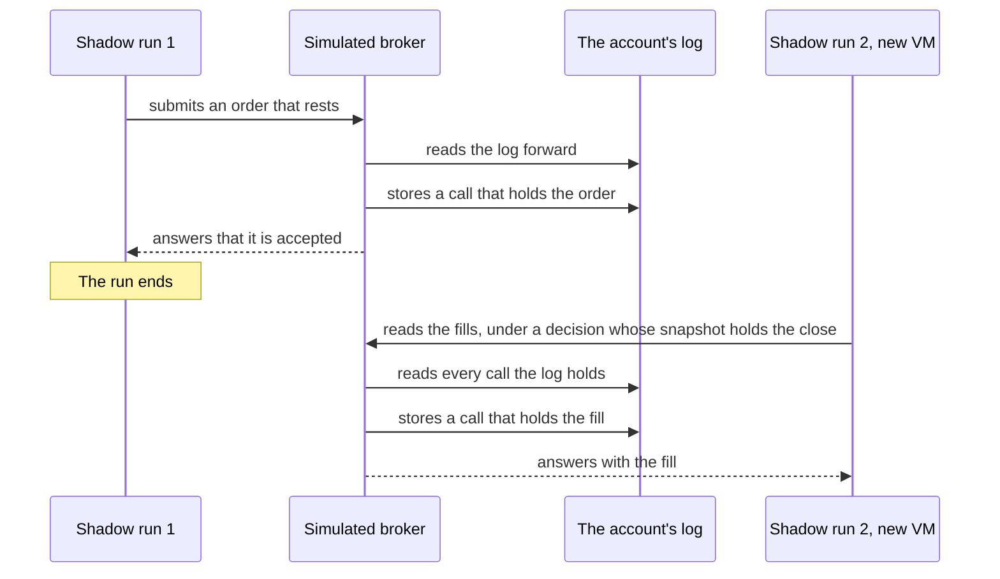

### What a worker works through

The event that design.md says modules are written against is one decision
result. In a backtest each worker works through every decision of the span in
turn. In the other modes it works through one trading day's decisions, as
design.md's `### A worker works through a span of decisions` says.

## Types and interfaces

A class diagram shows the types the workers pass to each other, each written
as an output file that a decision result lists, and the interfaces each module implements. Two diagrams follow, one
for the data the workers pass and one for the interfaces.

Three kinds of arrow appear.

1. A plain arrow means one type refers to the other.
2. A hollow diamond means the type holds one it was given.
3. A dotted arrow means the type returns or uses the other.

### The data the workers pass

The figure below is a C4 code diagram.

```mermaid
classDiagram
    direction LR

    class Instrument {
        +InstrumentId id
        +str symbol
    }
    class Bar {
        +InstrumentId instrument
        +date session
        +Decimal open
        +Decimal high
        +Decimal low
        +Decimal close
        +int or None volume
        +str basis
        +str origin
        +str vintage_id
        +datetime end
        +str interval
        +datetime first_seen
        +str or None fetched
        +datetime or None fetched_at
        +str or None fetched_end
        +datetime or None fetched_end_at
        +datetime knowable_at
        +str or None source
        +date or None source_as_of
        +str price_kind
        +str venues
        +str delay
        +str volume_counted
        +list excess_places
    }
    class Snapshot {
        +datetime decision_at
        +dict bars
        +dict quotes
        +dict status
        +bool provisional
        +dict flags
        +list segments
        +list partitions
        +dict ledgers
        +dict rows
        +list faults
        +datetime or None quotes_read_at
        +ClockReading clock
        +require_fresh(needed)
    }
    class ClockReading {
        +datetime read_at
        +list or None answers
    }
    class TimeAnswer {
        +str server
        +int or None offset_us
        +int or None error_us
        +int or None age_us
        +str or None received
        +str or None failed
    }
    class Segment {
        +str key
        +str version
        +str sha256
    }
    class SpikeFlag {
        +date session
        +str field
        +Decimal price
        +Decimal against
        +str rule
        +str note
    }
    class Quote {
        +InstrumentId instrument
        +Decimal or None bid
        +Decimal or None ask
        +Decimal or None last
        +int or None volume
        +datetime or None bid_at
        +datetime or None ask_at
        +datetime or None last_at
        +datetime or None fetched_at
        +datetime captured_at
        +bool or None realtime
        +str or None status
        +str price_kind
        +str last_kind
        +str venues
        +str volume_counted
        +str normal_status
        +int or None max_age
        +Decimal or None max_spread_share
        +dict received
        +list excess_places
    }
    class Basket {
        +dict legs
    }
    class Forecast {
        +str strategy
        +Basket basket
        +int direction
        +int horizon_sessions
        +Decimal confidence
    }
    class Signal {
        +str name
        +Decimal value
        +date first_session
        +date last_session
    }
    class ForecastSet {
        +list forecasts
        +list signals
    }
    class Constraints {
        +str strategy
        +dict max_order_qty
        +dict max_position
        +Decimal max_gross
        +int max_open_orders
        +Decimal max_net
        +Decimal loss_stop
        +int moc_cutoff
    }
    class HardCaps {
        +dict max_order_qty
        +dict max_position
        +Decimal max_gross
        +int max_open_orders
        +Decimal loss_stop
        +int moc_cutoff
        +Decimal share
        +Decimal stress_move
        +Decimal stress_low
        +Decimal stress_high
        +str stress_vintage
        +date stress_through
        +int stress_max_age_days
        +Decimal share_step
    }
    class TargetPortfolio {
        +datetime decision_at
        +str strategy
        +dict shares
    }
    class Sizing {
        +str strategy
        +dict wanted
        +list cut
    }
    class Book {
        +dict positions_by_strategy
        +dict open_orders_by_strategy
        +Decimal cash
        +int replayed_through
        +list in_doubt
        +list corrections
    }
    class Correction {
        +int seq
        +datetime at
        +bool repositions
    }
    class OrderIntent {
        +str client_order_id
        +str strategy
        +InstrumentId instrument
        +Decimal qty
        +OrderType type
        +TimeInForce time_in_force
    }
    class OrderType {
        <<enumeration>>
        MARKET
        MARKET_ON_CLOSE
    }
    class TimeInForce {
        <<enumeration>>
        DAY
        CLS
    }
    class OrderState {
        <<enumeration>>
        INTENDED
        APPROVED
        REFUSED
        ABANDONED
        SENDING
        IN_DOUBT
        ACKNOWLEDGED
        PARTLY_FILLED
        FILLED
        REJECTED
        EXPIRED
        LOST
    }
    class OrderRecord {
        +OrderIntent intent
        +int decision
        +OrderState state
        +str or None broker_order_id
        +Decimal filled
        +list entries
        +datetime or None sent_at
    }
    class OrderEntry {
        +int seq
        +str kind
    }
    class Fill {
        +str fill_id
        +str or None correction_id
        +str broker_order_id
        +str or None client_order_id
        +InstrumentId instrument
        +Decimal qty
        +Decimal price
        +str at_text
        +datetime at
        +datetime received_at
        +list excess_places
        +FillBasis or None basis
    }
    class FillBasis {
        <<enumeration>>
        SIGNAL_CLOSE
        OFFICIAL_CLOSE
        QUOTE
    }
    class Ack {
        +Outcome outcome
        +str or None broker_order_id
        +BrokerOrder or None order
        +bytes raw
        +datetime received_at
    }
    class Outcome {
        <<enumeration>>
        ACCEPTED
        REJECTED
        NOT_SENT
        UNKNOWN
        NOT_FOUND
        SEVERAL
    }
    class BrokerOrder {
        +str broker_order_id
        +str or None client_order_id
        +InstrumentId instrument
        +Decimal qty
        +Decimal filled
        +OrderType or None type
        +TimeInForce or None time_in_force
        +BrokerState state
        +datetime submitted_at
    }
    class BrokerState {
        <<enumeration>>
        WORKING
        PENDING_CANCEL
        FILLED
        CANCELLED
        EXPIRED
        REJECTED
        UNKNOWN
    }
    class FoundOrder {
        +Outcome answer
        +list rows
        +bool whole_list
        +bytes raw
    }
    class OrderLookup {
        +str client_order_id
        +datetime or None since
        +datetime asked_at
        +FoundOrder or None found
        +Ack or None answer
    }
    class PositionsRead {
        +dict positions
        +list received
        +bool whole
    }
    class OrdersRead {
        +list orders
        +list received
        +bool whole
    }
    class FillsRead {
        +list fills
        +list received
        +bool whole
    }
    class CashRead {
        +Decimal cash
        +list received
        +bool whole
    }
    class RecordsRead {
        +list records
        +list received
        +bool whole
    }
    class BrokerRecord {
        +str record_id
        +RecordKind kind
        +Decimal amount
        +str or None instrument
        +datetime at
        +datetime received_at
        +list excess_places
    }
    class RecordKind {
        <<enumeration>>
        FEE
        INTEREST
        DIVIDEND
        DEPOSIT
        WITHDRAWAL
        OTHER
    }
    class ReceivedPage {
        +bytes body
        +datetime at
    }
    class JournalAck {
        +int seq
        +str entry_hash
    }
    class Verdict {
        +bool approved
        +Limit or None limit
        +Decimal or None value
        +Decimal or None bound
        +str or None missing_term
        +bool adding
        +Decimal or None worst_loss
        +Decimal stress_move
        +LossReading loss
        +list past
    }
    class Limit {
        <<enumeration>>
        MAX_ORDER_QTY
        MAX_POSITION
        MAX_GROSS
        MAX_OPEN_ORDERS
        MAX_NET
        LOSS_STOP
        MOC_CUTOFF
        STOP
        CLOSE_ENTRY
        IN_DOUBT
        POSITION
    }
    class PastLimit {
        +Limit limit
        +Decimal value
        +Decimal bound
    }
    class LossReading {
        +Decimal loss
        +Decimal bound
        +bool past
        +date session
    }
    class CostSchedule {
        +dict terms
        +estimate(instrument, qty, price, kind) Decimal
    }
    class CostTerm {
        +CostKind kind
        +CostSide side
        +Decimal fixed
        +Decimal per_share
        +Decimal per_dollar
        +str source
    }
    class CostKind {
        <<enumeration>>
        CHARGE
        GAP
    }
    class CostSide {
        <<enumeration>>
        BOTH
        SELL
    }
    class AccountRead {
        +PositionsRead positions
        +OrdersRead open_orders
        +CashRead cash
        +datetime since
        +RecordsRead records
        +FillsRead fills
    }
    class Valuation {
        +date session
        +Decimal value
        +Decimal cash
        +dict positions
        +dict marks
        +int replayed_through
    }
    class GateInputs {
        +HardCaps caps
        +Valuation or None valuation
        +StopState stop
        +JournalEntry or None close_entry
    }
    class StopState {
        <<enumeration>>
        ABSENT
        FIRED
        UNREADABLE
    }
    class SendOutcome {
        +datetime decision_at
        +list~SentOrder~ orders
        +list~StrategySent~ strategies
        +list~Remainder~ remainders
    }
    class SentOrder {
        +str client_order_id
        +OrderState state
    }
    class StrategySent {
        +str strategy
        +StrategyEnd end
        +str reason
    }
    class StrategyEnd {
        <<enumeration>>
        SENT
        NO_ORDER_NEEDED
        PARTLY_SENT
        OFF
    }
    class Remainder {
        +str strategy
        +InstrumentId instrument
        +Decimal qty
    }
    class BlobRef {
        +str key
        +str sha256
    }
    class StoredBlob {
        +BlobRef ref
        +str etag
        +datetime stored_at
    }
    class BlobHeader {
        +int format
        +str deployment
        +str run
        +str stage
        +str kind
        +datetime decision_at
        +dict inputs
        +str release
        +dict config_hashes
    }
    class DecisionResult {
        +BlobHeader header
        +list outputs
        +HaltRecord halt
    }
    class HaltRecord {
        +str reason
        +BlobRef cause
        +list restart_records
        +list found_outputs
        +list unstored
    }
    class RestartRecord {
        +int format
        +str worker
        +int restart_count
        +int exit_status
        +str signal
        +str error_tail
    }
    class Heartbeat {
        +int format
        +str writer
        +datetime at
    }
    class Lease {
        +int format
        +str vm
        +str boot
        +str container
        +int restart_count
        +str handler
        +str release
        +str run
        +datetime taken
        +datetime expires
        +str status
        +int count
        +bool owed
        +str owed_from
        +datetime owed_expired
    }
    class Plan {
        +int format
        +str deployment
        +str run
        +str mode
        +str release
        +list decisions
    }
    class JournalEntry {
        +int seq
        +int format
        +datetime built_at
        +dict body
        +str prev_hash
        +hash() str
    }
    class Halt {
        +str reason
    }

    Snapshot o-- Bar
    Snapshot o-- Quote
    Snapshot o-- Segment
    Snapshot o-- SpikeFlag
    Snapshot o-- ClockReading
    ClockReading o-- TimeAnswer
    Bar --> Instrument
    Quote --> Instrument
    Forecast --> Basket
    ForecastSet o-- Forecast
    ForecastSet o-- Signal
    TargetPortfolio --> Instrument
    Sizing --> Instrument
    Sizing --> Limit
    OrderIntent --> Instrument
    Book o-- OrderIntent
    Book o-- Correction
    OrderRecord o-- OrderIntent
    OrderRecord o-- OrderEntry
    OrderRecord --> OrderState
    Fill --> Instrument
    Fill --> FillBasis
    BrokerOrder --> Instrument
    BrokerOrder --> OrderType
    BrokerOrder --> TimeInForce
    BrokerOrder --> BrokerState
    Ack o-- BrokerOrder
    Ack --> Outcome
    PositionsRead o-- ReceivedPage
    OrdersRead o-- ReceivedPage
    OrdersRead o-- BrokerOrder
    FillsRead o-- ReceivedPage
    FillsRead o-- Fill
    CashRead o-- ReceivedPage
    RecordsRead o-- ReceivedPage
    RecordsRead o-- BrokerRecord
    BrokerRecord --> RecordKind
    StoredBlob o-- BlobRef
    DecisionResult o-- BlobHeader
    DecisionResult o-- HaltRecord
    HaltRecord o-- BlobRef
    HaltRecord o-- RestartRecord
    FoundOrder o-- BrokerOrder
    FoundOrder --> Outcome
    OrderLookup o-- FoundOrder
    OrderLookup o-- Ack
    CostSchedule o-- CostTerm
    CostTerm --> CostKind
    CostTerm --> CostSide
    OrderIntent --> OrderType
    OrderIntent --> TimeInForce
    Verdict --> Limit
    Verdict o-- LossReading
    Verdict o-- PastLimit
    PastLimit --> Limit
    GateInputs o-- HardCaps
    GateInputs o-- Valuation
    GateInputs --> StopState
    SendOutcome o-- SentOrder
    SendOutcome o-- StrategySent
    SendOutcome o-- Remainder
    StrategySent --> StrategyEnd
    GateInputs o-- JournalEntry
```

#### The records a journal entry's body holds

`journal/entries.py` holds one frozen dataclass for each kind of entry, and [What a journal entry's body holds](08-crosscutting-concepts.md#what-a-journal-entrys-body-holds-and-how-a-retry-is-recognised) says what each one records. The figure below is a C4 code diagram.

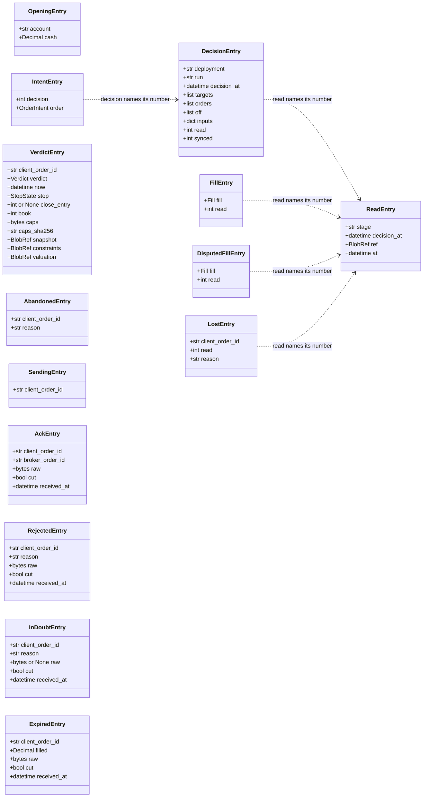

### The interfaces

The interfaces are Python `Protocol` classes. A `Protocol` names the methods a
type must have, and any class with those methods satisfies it without
inheriting from it. That is what lets a run swap the simulated broker for the
paper one without either knowing about the other.

`Progress` is the `report` the receive loop hands each handler. The handler
calls it to say it is not hung, and a clock's wait hears a stop through it, as
[How a component learns of a change](../design.md#how-a-component-learns-of-a-change)
says.

The figure below is a C4 code diagram.

```mermaid
classDiagram
    direction LR

    class DataSource {
        <<Protocol>>
        +snapshot(decision_at) Snapshot
    }
    class Clock {
        <<Protocol>>
        +now() datetime
        +monotonic() float
        +reading() ClockReading
        +wait_until(datetime, Progress)
    }
    class Progress {
        <<Protocol>>
        +\_\_call\_\_()
        +wait_for_stop(timeout) bool
    }
    class Bucket {
        <<Protocol>>
        +list(prefix) list
        +read(key, version) BucketObject
    }
    class BucketObject {
        +str key
        +bytes data
        +str or None version
        +str or None sha256
    }
    class Timer {
        <<Protocol>>
        +now() datetime
        +monotonic() float
        +after(seconds) object
    }
    class Queue {
        <<Protocol>>
        +receive(limit) list
        +done(Event)
        +extend(Event)
        +release(Event)
    }
    class Event {
        +str bucket
        +str key
        +EventKind kind
        +str or None etag
        +str or None sequencer
        +str handle
    }
    class Route {
        +str reader
        +EventKind kind
        +str key
        +str name
        +matches(EventKind, key) bool
    }
    class Broker {
        <<Protocol>>
        +str alias
        +submit(OrderIntent) Ack
        +find_order(OrderIntent, since, mapped) FoundOrder
        +orders(since) OrdersRead
        +lookup(broker_order_id) Ack
        +fills(since) FillsRead
        +positions() PositionsRead
        +open_orders() OrdersRead
        +account() CashRead
        +activities(since) RecordsRead
        +cancel(broker_order_id) Ack
        +clock() datetime
    }
    class AlphaModel {
        <<Protocol>>
        +forecast(Snapshot) ForecastSet
    }
    class RiskModel {
        <<Protocol>>
        +constraints(Book, Snapshot, HardCaps, Valuation) Constraints
    }
    class CostModel {
        <<Protocol>>
        +schedule(Snapshot) CostSchedule
    }
    class RiskGate {
        <<Protocol>>
        +check(OrderIntent, Book, Snapshot, Constraints, GateInputs, now) Verdict
        +loss(Book, Snapshot, Constraints, GateInputs, now) LossReading
    }
    class BlobStore {
        <<Protocol>>
        +create(key, data, sha256) str
        +get(key) bytes
        +head(key) StoredBlob
        +list(prefix, after) list
        +replace_if_match(key, data, sha256, etag) str
        +announce(key)
    }
    class Storage {
        -BlobStore store
        -Alerts alerts
        +put(StageKind, key, data, attempt) Stored
        +put_result(key, DecisionResult) DecisionResult
        +exists(key) bool
        +keep(key, data) BlobRef
        +read_blob(key) bytes
        +find_blob(key) bytes or None
        +read_result(key, decision_at) DecisionResult
        +read_output(result_key, DecisionResult, BlobRef, decision_at, entry) OutputFile
        +announce(key) bool
        +retry_held() list
        +unstored() list
        +halt_record(Halt) HaltRecord
    }
    class StageKind {
        <<enumeration>>
        DETERMINISTIC
        CAPTURING
    }
    class OutputFile {
        +BlobHeader header
        +list entries
        +bool trade_nothing
    }
    class Alerts {
        <<Protocol>>
        +alarm(reason)
        +heartbeat()
    }
    class Journal {
        -BlobStore store
        -str account
        -str writer
        +view(through) View
        +record(View, record, at) JournalAck and View
        +replay() Book
        +in_doubt() list
        +head() JournalAck or None
        +read(after) Iterator~JournalEntry~
        -build(body, built_at, on) JournalEntry
        -append(entry) JournalAck
    }
    class View {
        +str account
        +JournalAck through
        +datetime or None opened_at
        +datetime or None sent_at
        +dict orders
        +dict live
        +dict decisions
        +dict decided
        +dict reads
        +dict fills
        +list disputes
        +dict records
        +list unmatched
        +Book book
        +repeats(Fill) Repeat
        +record_repeats(BrokerRecord) Repeat
        +unmatched_repeats(kind, name, held) Repeat
        +unowned(Fill) str or None
        +acknowledged(broker_order_id) OrderRecord or None
    }
    class Account {
        -Journal journal
        -RiskGate gate
        -Controls controls
        +str alias
        +path(Broker, report) OrderPath
        +view(report) View
        +record(View, record, report) View
        +alarm(reason, report) str
        +settle(report)
        +unstored() list
    }
    class Controls {
        -BlobStore store
        +stopping(where, tries, with_stop) Stopping or None
        +stop(tries) StopState
    }
    class OrderPath {
        -Broker broker
        +send(client_order_id) OrderState
        +hold(client_order_ids) list
        +abandon(client_order_id, reason) OrderState
        +loss(deployment, run, decision_at) list
        +positions() PositionsRead
        +open_orders() OrdersRead
        +account() CashRead
        +activities(since) RecordsRead
        +fills(since) FillsRead
        +lookup(broker_order_id) Ack
        -submit(JournalAck) answer
    }
    class Monitoring {
        -Alerts alerts
        +alarm(reason)
        +report(run)
    }
    class core {
        <<module>>
        +reconcile(Book, orders, AccountRead) tuple
    }

    Journal o-- BlobStore
    Storage o-- BlobStore
    Storage o-- Alerts
    Monitoring o-- Alerts
    Account o-- Journal
    Account o-- RiskGate
    Account o-- Controls
    Account ..> OrderPath
    Controls o-- BlobStore
    OrderPath o-- Broker
    OrderPath ..> OrderState
    DataSource ..> Snapshot
    Clock ..> Progress
    Clock ..> ClockReading
    Bucket ..> BucketObject
    AlphaModel ..> ForecastSet
    RiskModel ..> Constraints
    CostModel ..> CostSchedule
    RiskGate ..> Verdict
    RiskGate ..> LossReading
    Broker ..> Ack
    Broker ..> FoundOrder
    Broker ..> PositionsRead
    Broker ..> OrdersRead
    Broker ..> FillsRead
    Broker ..> CashRead
    Broker ..> RecordsRead
    Journal ..> View
    Journal ..> JournalAck
    View ..> Book
    View ..> OrderRecord
    OrderPath ..> core
    Monitoring ..> core
```

### Ten choices for a reviewer to check

The two diagrams above make ten choices for a reviewer to check. Several are proposals for the issue that owns the piece, and each says so where it is one.

1. [A forecast is about a basket, not an instrument](#a-forecast-is-about-a-basket-not-an-instrument).
2. [A bar carries where it came from](#a-bar-carries-where-it-came-from).
3. [`Snapshot.require_fresh()` is how a module refuses a gap](#snapshotrequire_fresh-is-how-a-module-refuses-a-gap).
4. [Only `OrderPath` holds a `Broker`](#only-orderpath-holds-a-broker).
5. [The risk gate holds no state of its own](#the-risk-gate-holds-no-state-of-its-own).
6. [The risk model writes each decision's limits](#the-risk-model-writes-each-decisions-limits).
7. [The book comes from the journal](#the-book-comes-from-the-journal).
8. [The cost model writes a schedule rather than answering calls](#the-cost-model-writes-a-schedule-rather-than-answering-calls).
9. [How a target is sized](#how-a-target-is-sized).
10. [Every type that crosses between workers has a file form](#every-type-that-crosses-between-workers-has-a-file-form).

#### A forecast is about a basket, not an instrument

The Bollinger strategy forecasts a spread, which is two legs in a fixed ratio for the day. A `Basket` holds `{USO: 1, GLD: −h}`, so one forecast carries the whole position and portfolio construction never has to know it is a pair. A leg is a number of shares per unit of the basket, never an amount of dollars, so a model that weighs its legs in dollars divides each weight by the price it decided on.

**Table:** What each field of a forecast says

| Field | What it says |
| --- | --- |
| `basket` | Both legs, `{USO: 1, GLD: −h}`, whatever the direction. A flat forecast names them too, so a target built from it writes each leg as zero rather than leaving it out |
| `direction` | The unit, +1 to hold the basket long, −1 to hold it short and 0 to hold none. A flat position is direction 0, never a missing forecast |
| `horizon_sessions` | 1 for this strategy, because it remakes the forecast at each decision |
| `confidence` | 1 for this strategy, because its rule grades no strength |

##### What the model returns and its stage stores

The model returns a `ForecastSet`, its forecasts and the signals behind them, because both come from one calculation. A `Signal` is one value the model fitted, with the first and last session whose prices it read. The six this strategy writes are the hedge ratio, the spread, the spread's mean and standard deviation, the z-score and the unit. The types refuse a basket with no leg, a forecast out of its bounds, and a set with no forecast, no signal or two signals of one name.

Each strategy's alpha stage stores the forecasts in `forecast.json` and the signals in `signals.json`. Any halt the handler meets becomes the stage's result, whose header names each result and file it had read and storage had accepted, so the halt says what it was judged from.

#### A bar carries where it came from

##### What each field of a bar says

**Table:** The fields that say where a bar came from and when it closed

| Field | What it says |
| --- | --- |
| `origin` | Whether marketlake captured the bar or imported it |
| `vintage_id` | The vintage the bar was read from |
| `first_seen` | When the platform first held the bar |
| `basis` | Which price the series carries, such as `raw` for as traded or `adjusted` for numbers its source had already adjusted, where the word does not say for what |
| `end` | When the bar closed |
| `interval` | How long the bar is |
| `knowable_at` | The earliest the platform could have held the bar, as the rules below say |
| `fetched`, `fetched_at`, `fetched_end`, `fetched_end_at` | marketlake's `fetch_ts` and `fetch_end_ts` as received, each beside its UTC instant, and `None` where marketlake holds none |
| `source`, `source_as_of` | An imported row's source and the date that source recorded its values, and `None` on a captured row. With `basis` they are the bar's series, as `core.series_of` reads it, and a lookback that holds two series of one instrument [halts the decision](../design.md#a-lookback-that-crosses-a-change-of-series), but for the one change from Schwab's import to captured bars, which an exploratory comparison shows on one scale for GLD and USO alone |
| `volume` | The volume, or `None` where marketlake holds none, as on both Chan vintages |
| `excess_places` | The names of the prices received with more places than `Price` declares, each kept unrounded |

A bar also names each price's kind, the venues it covers and any delay from its source, and its volume how it was counted, in `price_kind`, `venues`, `delay` and `volume_counted`, with a field no source states recorded as `unstated` unless an owner's ruling that the contract's `read_from` names states it, as the rule that [a recorded price states what kind of price it is](../design.md#a-fill-is-measured-from-the-decision-and-a-position-depends-on-a-market-it-does-not-control) requires. A reader takes a field that holds no word as `unstated` too. The data module copies the four fields into each bar from its price-kind contract, `data/price_kinds.csv`, a tracked file that is dated and only ever added to, so a later row never changes what a recorded bar says. A needed bar of `unstated` kind halts the decision once its snapshot is stored. A decision whose newest captured bar is past its row's last session halts, holding a shadow or paper account until a person clears it, unless a later row covers that bar, which [#180](https://github.com/l3a0/ithildin-runtime/issues/180) renews.

`vintage_id` and `first_seen` come from the data engineer's duty, in [the charter](../team-charter.md), to store when each value became available (*Inside the Black Box*, Kindle location L3884). `end` and `interval` let one daily bar and minute bars of the same instrument sit side by side, keyed in a snapshot by instrument and interval.

##### Which bars a snapshot returns

The data source applies one rule in every mode: `snapshot(decision_at)` returns only bars whose `end` and knowable time are both at or before the decision time. Four rules set those times.

1. A minute bar's `end` is marketlake's `bar_ts` plus its interval.
2. A daily bar's `end` is its session's close from the calendar.
3. A captured bar's knowable time is marketlake's `fetch_end_ts`, when the answer arrived, because that is the earliest the platform could have held it. A captured bar with none halts the decision, and so does a stamp with no stated zone. `fetch_ts`, when the request left, is kept beside it. A daily bar is fetched after its session's close, and one still in flight at a decision reads as not yet landed.
4. An imported bar's knowable time is its `end`, even where its row carries fetch stamps. A vintage records only `source_as_of`, the date its source recorded the whole series, which is 2012-04-10 for both Chan vintages and 2026-11-22 for both Yahoo files. Read as the knowable time, it would leave no bar of a vintage recorded after its sessions knowable before any past decision, so a backtest over recorded history could never run. A backtest over imported rows states that assumption and names `source_as_of` as the date after which the vintage can carry corrections. USO's Yahoo prices before 2020-04-29 are eight times those that traded and its volume an eighth, as USO's row in `data/price_kinds.csv` states, on a factor in effect only from 2020-04-29. So a backtest there holds an eighth as many shares as the same dollars bought then. A per-share cost reads an eighth of what it was, a share cap binds late, and a share of the volume is unchanged. `adjusted` does not say the scale, because Chan's bars read `adjusted` too.

##### What a quote and a snapshot's flags carry

A `Quote` is one row of one capture, with what it was read under. `core.quote_faults` judges it, as [How a quote is judged](03-context-and-scope.md#how-a-quote-is-judged) says, and nothing in the record is judged.

**Table:** A quote's fields

| Field | What it holds |
| --- | --- |
| `bid`, `ask`, `last` | The price as received, or `None` where it was null, not finite or past the codec's digits |
| `volume` | The session's volume so far, or `None` where it was null or past the codec's integer |
| `bid_at`, `ask_at`, `last_at` | The UTC instant of Schwab's own stamp on each price, or `None` where the stamp is null or no instant |
| `fetched_at`, `captured_at` | When the request left and when the response landed, by the capture host's clock. The first is `None` where its stamp is null or no instant, and nothing reads it to decide |
| `realtime`, `status` | Schwab's flag and its security status, or `None` |
| `price_kind`, `last_kind`, `venues`, `volume_counted`, `normal_status` | Copied from the data module's quote-kind contract, `data/quote_kinds.csv`, a tracked file under the price-kind contract's rules. `price_kind` is the bid's and the ask's. Its first row, for Schwab's quotes as marketlake captures them, covers 2026-09-15 to 2027-02-25, and a quote of a session no row covers halts |
| `max_age`, `max_spread_share` | The maximum age in seconds and the maximum spread as a share of the midpoint that its strategies write, or `None` |
| `received` | Every column of the row by name, as text, a float as its shortest form and a null as `None` |
| `excess_places` | The names of the prices received with more places than `Price` declares, each kept unrounded |

A snapshot's quotes share one `captured_at`, and `Snapshot` refuses to be built with two. Six more of its fields say what its decision read of its quotes, from segments or from the sealed day.

1. `provisional` is true exactly when the decision read segments. A read of the sealed day is not provisional.
2. `segments` names each segment opened, by key, the bucket's version and the SHA-256 the bucket stored with it.
3. `partitions` names each sealed quotes partition linked, sorted, by the vintage id a bar's `vintage_id` uses.
4. `rows` holds every other row the cut 15 seconds before the decision kept, as text, whether or not the decision halts, because the gate can refuse a quote after the snapshot is stored. A row after the cut is in no snapshot, and marketlake's partition keeps it.
5. `faults` holds each reason the read of the quotes failed, in order.
6. `quotes_read_at` is the data worker's clock after the last answer of either read, and `None` exactly when the decision read no quote.

`Snapshot` refuses a provisional one that names a partition, one that names a segment and is not provisional, and one with no `quotes_read_at` that is provisional or names a partition.

`clock` is the reading of the machine's clock the decision was judged by, taken after the last answer the read waited on, as [The time servers](03-context-and-scope.md#the-time-servers) says. Its `answers` are `None` where nothing measured the clock, and otherwise hold two servers or more.

The data module's file format is 4. The codec refuses a record with a field it does not know or lacks, so a release on either side of this refuses the other's snapshot rather than misreading it.

A snapshot's `flags` map each flagged instrument to its `SpikeFlag` records, each holding the session, the price, the price it was judged against, the rule and a note, so monitoring's alert has a field to read. A bar's flag from the contradiction rule halts the decision once its snapshot is stored, a quote's adds no halt to the judge's, and a flag from the move rule or the below-the-low rule halts nothing. The price itself stays as received in its bar or its quote. A flag on a quote names the field `bid`, `ask` or `midpoint`.

#### `Snapshot.require_fresh()` is how a module refuses a gap

A snapshot is the set of bars and quotes one decision read, each bar pointing at the partition that holds it. A module calls `require_fresh(needed)` before reading, naming each instrument it needs and the intervals it reads of it, such as the daily bar. It raises `Halt` when any of them is absent from the snapshot or missing or stale. It also halts when any other instrument the snapshot holds is not fresh or holds no bar. So the default when something is absent is to stop, even when Data left an instrument or an interval out rather than marking it missing.

#### Only `OrderPath` holds a `Broker`

Every call to the broker goes through `OrderPath`.

##### Which calls reach the broker

`OrderPath` has one method per kind of call, and [the section on an order's path](#what-an-order-path-takes-and-what-it-answers) says what each takes.

- Sending an order, which is `send`.
- Asking the gate and journaling its answer with nothing sent, which is `hold`.
- Journaling that an order was never sent, which is `abandon`.
- Reading the day's loss with no order, which is `loss`.
- Reading the positions, the open orders, the cash, the broker's own records and the fills, and looking one order up.
- Settling an order of a plan whose send stage ended, which is `settle`: it abandons one that was never sent, and finds one in doubt in the broker's list and looks it up by the broker's id.

Three parts add the rest, now that `OrderPath.settle` settles an order in doubt. [#149](https://github.com/l3a0/ithildin-runtime/issues/149) cancels one, [#150](https://github.com/l3a0/ithildin-runtime/issues/150) serves the kill switch and [#153](https://github.com/l3a0/ithildin-runtime/issues/153) reads the broker's clock. The read `Broker.account` supplies cash.

Nothing else in the package is given a broker, and only the execution worker's entry point builds one. Two tests show it. The import rule keeps every other worker out of `execution`, and a sweep of the source, `tests/test_order_sweep.py`, fails on a submit, a cancel or a search for an order, one of six entries only the order path records, a change to the path from outside it in the spellings its tests plant, or an import of an adapter. The sweep reads what is written, so other spellings pass it. The fake broker catches none of those that replace the gate, because the approval is in the journal like any other. The fake broker reads the stored journal itself, and fails a test whenever an order reaches it with no approval, with no `sending` stored, twice, or other than as planned. The adapter wraps Alpaca's SDK, alpaca-py, so a test hands `OrderPath` a fake and no module sees the SDK's types.

##### What an order path takes, and what it answers

The worker builds one `Account` for each broker account and keeps it across decisions. It holds the journal, the gate, the controls and each answer the journal has not taken yet. `Account.path` gives the `OrderPath` for one decision's broker.

`send` takes a client order id and nothing else. The order, the deployment, the run, the decision time and the inputs all come from the `decision` entry the journal holds, so no caller can hand it an order that was not planned, or a looser limit. It answers the state the journal then shows the order in. A send that journals the order `Abandoned` and answers it says the order's strategy is off. An order the gate refused, the broker rejected or that is in doubt is an answer too, and [#146](https://github.com/l3a0/ithildin-runtime/issues/146)'s stage ends its plan on each. Anything else that stops an order halts the decision.

Five rules hold whatever a step does.

1. **One call sends an order.** Only the call whose `intent` the journal took goes further. An order that already has an entry is not sent again. Its state is the answer, apart from one left `Intended` or `Approved`, which halts, and the next decision's recover journals it `Abandoned`, as [How recover settles an unfinished plan](06-runtime.md#how-recover-settles-an-unfinished-plan) says.
2. **One acknowledgement sends one order.** The account holds the acknowledgement of each `sending` entry its own journal gave, and the private submit takes it out before it does anything else. So one that was used, belongs to another order or was made up from the journal's bytes sends nothing. The journal could not tell a second use apart, because an order whose answer was not stored is still `Sending`.
3. **No approval and no `sending` is recorded on a book that moved.** Each is the entry right after the one it was decided on. A number another writer took ends the order `abandoned` and halts the decision. After the `sending`, an entry stops the order where it moves this order, halts the book or is a newer `decision`. Any other does not, because the gate counted every open order at its worst case.
4. **An answer is kept until the journal takes it.** After the submit the account keeps the entry that says what became of the order, alarms where the store refuses it, and tries it again before any later send and at `Account.settle`, which recover and [#146](https://github.com/l3a0/ithildin-runtime/issues/146)'s stage call before their first view, and the worker once more as its loop ends. Nothing is sent while it still fails. An alarm about a kept entry that could not be sent is tried again at each of those too, until it goes out or the process ends, and one that fails again halts nothing. An alarm a stage or the worker sends through `Account.alarm` is kept and tried again the same way, and the worker's last error names one still owed. Any other alarm of the path is tried once, and its own halt says where it could not be sent. Where the journal has come to show something else of the order, such as another writer's rejection of one this process saw accepted, or the other way round, the entry stays kept until the process ends, and what the halt says of it is written down before a restart. One exception is an answer the journal refused and whose `in_doubt` landed in its place, with its bytes, before the journal moved on. It is done, with an alarm that says both. An order that may have a `sending` stored and was stopped before the call is kept the same way, because only that process knows nothing left. An alert channel that raises anything at all changes none of this, and neither does a clock read after the call. An error the path does not expect, such as `SystemExit` from the store, may be left to replay: an answer already given stays kept, an order not yet called is left in the state its last stored entry gives it, and the worker's own alarm says the error and names no order. Three answers are let go with no entry of their own bytes, each where another writer has since said what became of the order: an accepted order whose `ack` is already journaled under the same id, a rejection of an order already `Rejected`, and one read as a doubt that is already settled, whose alarm names both. Recover's settling of an order in doubt now writes such entries, and where those bytes go is [#211](https://github.com/l3a0/ithildin-runtime/issues/211)'s.
5. **Every call halts unless the broker's `alias` names the journal's account.** Nothing raises while an account is built, because a worker that fails to start is restarted by the host and read by no person.

##### How a call names an order

Every lookup and every cancel uses the broker's order id the journal mapped from the ack. An order in doubt has no ack, so `find_order` supplies its broker id first, by the adapter's own means, as design.md's [Orders the platform did not send](../design.md#orders-the-platform-did-not-send) says.

##### How a late fill is still fetched

`fills(since)` takes a time before any fill not yet journaled, as [From when fills are read](06-runtime.md#from-when-fills-are-read) says, so a fill the broker posts late is still fetched, and some fills are read twice. Each applies once, under its broker's fill id. `View.repeats` says which of the three a fill is.

1. A repeat with the same broker's order, instrument, shares, price and time is skipped. The other fields may differ, because a second endpoint may leave one out or write it another way.
2. A repeat that differs in one of those five is journaled as a `disputed_fill` beside the first. The book then halts, naming both contents, until a person ends the dispute, which [#203](https://github.com/l3a0/ithildin-runtime/issues/203) builds. Every other entry can still be journaled, so a dispute never holds up an answer, an abandonment or a cancel.
3. A repeat of a dispute already held is skipped, because a recover stage that halts on one reads it again at each decision. One with no shares or no price is refused as a `fill`, so a caller looks at the view's disputes first.

A fill that carries a correction identifier is refused as a `fill`, and recover keeps it as an `unmatched_fill`, until [#227](https://github.com/l3a0/ithildin-runtime/issues/227) writes the rule for one.

##### How a broker's record and what the platform did not send are kept

A broker moves cash on its own, and an order or a fill can reach the account that the platform never sent. Recover and the send stage each sort them into entries with `execution/outside.py`, through `execution/sync.py`'s one read, and the fold reads four kinds for them.

1. `outside_record` holds a fee, debit interest or a dividend inside its range, which moves the book's cash by its amount. `View.records` holds each by the broker's record id, and an identical repeat is skipped.
2. `unmatched_record`, `unmatched_fill` and `unmatched_order` each hold what no rule lets reach a book, kept as it came, with the platform's own words for why. `View.unmatched` holds each, and the book halts while any stands, naming each one.

A repeat of a held id with other content is kept beside the first as unmatched. The fold refuses a fill or a record kept as unmatched that is later applied, an applied fill later kept as unmatched, an applied record later kept as unmatched with its own content, and an order kept as unmatched that a later `ack` maps, and the reverse.

Like a dispute, an unmatched entry holds up no answer, abandonment or cancel, because every other entry can still be journaled beside it. The kill switch cancels every resting order, an order kept as unmatched included, as design.md's `## Decisions` records for [2026-10-31](../design.md#2026-10-31), and [#150](https://github.com/l3a0/ithildin-runtime/issues/150) builds it so that no hold stops a cancel. `execution/outside.py` is the one place an `outside_record` is built, because the fold reads no range, so an old entry replays the same after a range moves. A test fails any other call to `OutsideRecordEntry` under `src`, by name, through a module or under a renamed import.

##### What each call returns, and what is journaled first

`Journal.record` returns a `JournalAck` naming the entry's number and hash, beside the view after that entry. The private call that submits an order takes that acknowledgement alone, as [The code holds its own rules](../design.md#the-code-holds-its-own-rules-and-every-check-runs-in-production) says, and so will the one that sends a cancel ([#149](https://github.com/l3a0/ithildin-runtime/issues/149)).

Every `Broker` read and write returns its received bytes apart from the converted value. `OrderPath` journals a submit's bytes in the entry that says what the answer came to. A read's bytes are stored in an output file, whose hash a `read` entry journals before any value is used.

A call about one order answers an `Ack`, whose `outcome` is one of six.

**Table:** What a broker's answer to a submit comes to

| Outcome | What it says | The entry |
| --- | --- | --- |
| `accepted` | The broker has the order, under the id it gives | `ack` |
| `rejected` | The broker refused the order | `rejected` |
| `not_sent` | Proof that nothing left, such as a connection refused before any byte | `abandoned`, and the decision halts |
| `unknown` | Any answer the adapter cannot classify, and a refusal that says the broker already holds the id | `in_doubt` |
| `not_found` | A lookup found no order | `in_doubt` |
| `several` | A search for an order found more than one | `in_doubt` |

Six more things end `in_doubt`, and each alarms at once, naming the account by its alias, the order and when it went out. A broker's order id the journal takes is named too, where the answer is exactly an `Ack`.

1. An error the submit raises, whatever its type. An adapter's own halt does too, and then halts the decision with its reason.
2. An accepted order with no broker's id, with one another order holds, or with one the journal refuses.
3. A broker's copy of the order that differs from the order sent in its id, instrument, shares, type or time in force.
4. An answer that says two things of the order: that nothing was sent, with an id, a copy or bytes of the broker's, that it was rejected, with a copy that is not rejected or has shares filled, or that it was accepted, with a copy that is rejected. An order journaled as never sent leaves the book, so the next one would double it.
5. An answer of more than 65,536 bytes, whose first part is kept.
6. An answer that is not exactly an `Ack`, whose id, where it has one, is not exactly a `str`, whose bytes are not exactly `bytes`, or whose time is not exactly a `datetime` in UTC. A subclass is an adapter's own code, which would run wherever its value is used next.

Each read has a type of its own: `PositionsRead`, `OrdersRead`, `FillsRead`, `CashRead` and `RecordsRead`, which holds each `BrokerRecord` the broker booked on its own. A record carries the broker's own id, its kind as the adapter maps the broker's type to `RecordKind`, the cash it moved, a credit above zero, the instrument it concerns where there is one, and when the broker dated it. Each holds the pages as received, with the time each came, and says whether every page came. A read holds at least one page, since an empty answer is one the broker gave, and one past 4 MiB cannot say it is whole. The price of that cap is that a day whose list passes it halts until the cap is raised.

A read that fails raises `BrokerUnavailable`, which takes the error or its type, and carries the call's name and that type's name and nothing the broker or its library said. `OrderPath` turns any other error from a call into one, and an answer that is not exactly the read's own type, because the receive loop puts an uncaught error's text in an alarm and in a stored halt. A `Halt` an adapter raises passes through with its reason.

`orders(since)` reads a takeover's whole list, open and closed orders across every page, and the simulator's `find_order` reads it.

##### One function lists the differences from the broker

One reconciliation function in `core`, `core.reconcile(book, orders, account)`, lists every difference between a book and a broker's account. `account` is the `AccountRead` the caller stored, and `orders` are the journal's records of the book's open orders, because a book's open order carries no broker's id. It computes nothing it was not handed and reads no clock. Four stages call it.

1. Execution's recover stage.
2. Execution's send-stage sync ([#146](https://github.com/l3a0/ithildin-runtime/issues/146)).
3. Execution's reconcile after the close ([#151](https://github.com/l3a0/ithildin-runtime/issues/151)).
4. Monitoring's reconcile stage ([#11](https://github.com/l3a0/ithildin-runtime/issues/11)).

Each decides only what to do with the differences. Execution journals its own outcomes and halts on the rest, and monitoring alarms. Each caller first halts where a read did not come whole, because a missing row would read as a difference of its own. [#10](https://github.com/l3a0/ithildin-runtime/issues/10) holds how `core.reconcile` receives a takeover's stored order list, so it can flag a late order.

Every figure is compared exactly, with no tolerance.

**Table:** What `core.reconcile` compares, in the order it lists the differences

| What | How the two sides are matched | What counts as a difference |
| --- | --- | --- |
| Positions | By instrument, the sum of every strategy's book against the broker's. An instrument the book does not hold is zero there | Other shares. An instrument the broker does not list agrees with a sum of zero alone |
| Open orders | By the broker's order id | Another instrument, signed shares, filled total, client order id, type or time in force, a broker's state other than working, an order on one side alone, one the broker lists twice, and two records the caller hands that hold one broker's id. A record of no order the book holds open is left out, so a caller hands every order that has not ended. An order the book holds open with no record handed in, or with a record that holds no broker's id, such as one that is `Approved`, is on the book's side alone |
| Cash | One figure each | Any other figure |

What a difference says to a person holds none of the broker's text. It shows an instrument where that is a name, a broker's order id where it is one the journal takes, and a client order id where it is a stamp of the platform's. The broker's own words are in `account.json`.

##### How the broker's rate limit is shared

Alpaca's trading API [allows 200 requests a minute](https://alpaca.markets/support/usage-limit-api-calls) for each account, a figure [#10](https://github.com/l3a0/ithildin-runtime/issues/10) confirms on the paper account before anything relies on it. The budget that follows is this doc's proposal for [#10](https://github.com/l3a0/ithildin-runtime/issues/10).

**Table:** How execution splits the account's 200 requests a minute

| Share | Of the account's limit | Each instance's share, for three instances | What draws on it |
| --- | --- | --- | --- |
| The reserve | A quarter, 50 a minute | 16 a minute, rounded down | Cancels, and every read and lookup a cancel, a sort or a pair-keeping cancel needs, the kill switch's included |
| Orders and lookups | The rest | 50 a minute | New orders and other lookups, which never draw on the reserve |

Slice 1's one VM runs two execution instances, so each takes half of each share, 25 a minute of the reserve and 75 of the rest, and their shares together reach the limit. The table and the first sketch count the cluster's three. Each instance takes the count of execution instances from the release's table for its environment.

The first sketch draws that table to scale, for three instances.

![Animated sketch titled “How the account's 200 a minute are shared”, drawn to scale. A berry box “reserve: 50” takes the first quarter of a bar, and a black box “orders and lookups: the rest” takes the remainder. Three rows follow, one per instance, each a berry box “16” under the reserve and a black box “instance 1: 50”, “instance 2: 50” or “instance 3: 50” under the rest, set side by side so they tile the bar. The third reserve box stops just short of the reserve's edge. Two notes close it: “Each instance takes 16 of the reserve, rounded down, and 50 of the rest.” and “Together the shares stay under the limit, so no counter is shared.” The finished drawing holds for 12 seconds.](../figures/rate-limit-shares.gif)

Both shares are split evenly across the deployment's execution instances. Each instance holds two token buckets, one for its share of orders and lookups and one for its share of the reserve. Each bucket refills continuously and holds at most 10 tokens, so a burst cannot spend a minute's share in a second, and no counter is shared. The steady shares add up to at most the limit, but each bucket's 10 tokens come on top of its share, so the busiest minute can pass the limit by up to 10 requests for each bucket, 40 with two instances and 60 with three. [#10](https://github.com/l3a0/ithildin-runtime/issues/10) sizes the shares so that every bucket's tokens plus every share a minute stay under the account's limit. A request takes a token or waits the time the bucket names.

The second sketch follows a request through its instance's two buckets.

![Animated sketch titled “One instance, two token buckets”. A bucket with berry tokens is drawn and named “the reserve”, with a grey arrow into it labelled “refills all the time” and a dashed line labelled “holds at most 10 tokens”. An arrow brings “cancels, and the reads and lookups a cancel or a sort needs” into it, and an arrow out, labelled “takes a token”, leads to “goes to the broker”. A second bucket, “orders and lookups”, with the same refill and dashed line, takes “new orders and other lookups” and leads to “an order takes the account's lease only now, then the broker”. Last, a vermilion empty bucket with a cross is labelled “empty: the request waits the time the bucket names”. The finished drawing holds for 12 seconds.](../figures/rate-limit-buckets.gif)

An instance's share sets two thresholds.

1. An instance alarms when its requests pass 75% of its share.
2. An order that would pass its instance's share waits for the budget before the order path takes the account's lease, so a wait never holds the lease.

The third sketch draws both on one instance's share.

![Animated sketch titled “When an instance alarms, and when it waits”. A line runs from a tick labelled “none” to a heavier tick labelled “its share”. A thick berry bar labelled “its requests in a minute” fills most of it. A vermilion dashed line three quarters of the way along is labelled “75% of its share: the instance alarms”. Last, a note under the share's tick reads “an order that would pass its share waits for the budget, before the order path takes the account's lease”. How far the bar fills is illustrative. The finished drawing holds for 12 seconds.](../figures/rate-limit-alarm.gif)

**Table:** What a broker 429, its answer for too many requests, does on a submit and on a cancel

| The call | What the 429 means | What follows |
| --- | --- | --- |
| A submit | The order is left in doubt | A lookup settles it like any other order in doubt |
| A cancel | A refused cancel, where that account's latest scheduled contract-suite run shows a 429 on a cancel is definite. Otherwise the answer counts as lost | An alarm. Where the 429 is definite, execution journals a new cancel first and sends it under the lease, inside the reserve, and each such cancel counts toward rule 6's written number and its clock, which runs from the first cancel's entry. Where it counts as lost, the rule for a cancel whose answer is lost applies. In either case no stage resends a plan's own cancel, as rule 6 of [Faults are expected](../design.md#faults-are-expected-and-the-platform-checks-itself-while-it-runs) says |

#### The risk gate holds no state of its own

The gate keeps nothing from one check to the next, and reads no store, no clock and no mode. It is built with the stress records, which its release carries. Every check is handed the rest of what it weighs, and the diagram shows where its inputs come from, as the parts below describe. `OrderPath` does the reading.

The figure below is a C4 component diagram.

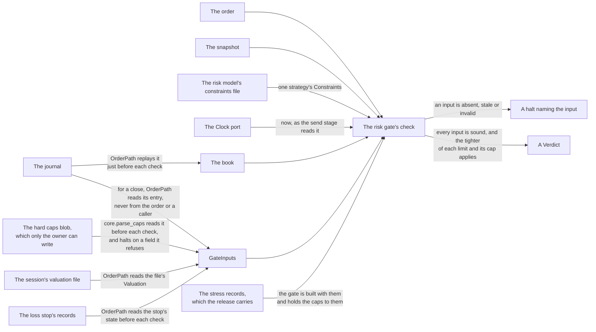

##### What the gate is handed

`check` takes six things, and `loss`, which reads the day's loss with no order, takes all but the first.

1. The order.
2. The snapshot.
3. The strategy's `Constraints`.
4. `now`, the send stage's reading of the `Clock` port when it hands the order over, the history clock in a backtest, which the gate compares with the cutoff.
5. The book, which the journal's replay gives. It names each instrument with an order in doubt, and each entry that corrected it.
6. A `GateInputs`, which holds the hard caps, the session's `Valuation`, the loss stop's state and, for a close, its close entry.

`OrderPath` reads the loss stop's state and hands it to the gate, as [What happens when the stop fires](06-runtime.md#what-happens-when-the-stop-fires) says. For a close it reads the entry from the journal, and any confirmation from the owner's record, never from the order or a caller, under the rule that a broker's own trade closes the whole position ([A fill is measured from the decision](../design.md#a-fill-is-measured-from-the-decision-and-a-position-depends-on-a-market-it-does-not-control)). The gate refuses every order handed a close entry until [#117](https://github.com/l3a0/ithildin-runtime/issues/117) reads one, and that issue places the owner's confirmation, which no field holds yet.

Every argument of `check` is journaled with its verdict, by value, by hash, or for the book, the order and a close entry by an earlier entry, so that the verdict can be computed again. The stress records are no argument and no entry holds them, so the verdict carries `stress_move`, the one the check used. The `verdict` entry and [the view through the entry before it](#a-view-is-one-reading-of-the-journal) are that form, and `OrderPath` journals it. `rebuilt` in `tests/support/order_world.py` works a sent order's answer out again from its `verdict` entry alone, with the second implementation in `tests/support/gate_oracle.py`.

##### What halts and what refuses

A halt says an input is absent, stale or invalid, so nothing can be concluded. A refusal says a limit worked. The gate raises every halt before it answers, so a refusal never hides one. The one state read as a refusal is a stop whose state could not be read, as [Which orders a stop refuses](06-runtime.md#which-orders-a-stop-refuses) says.

A refusal names the first of these that applies, so the same order always names the same limit.

1. The stop, in any state but absent, whoever placed the order.
2. A close entry.
3. An order in doubt on the same instrument.
4. An order that names no strategy, which has no position to count a worst loss against.
5. The seven limits, in the order of the table below. A figure at its limit passes, for all seven.

`Verdict` carries what a person needs to see why: the figure and its bound, whether the order adds, the strategy's worst loss with the order counted, the stress move the check used, the day's loss, and each of `max_position`, `max_gross` and `max_net` that is past. Figures are compared exactly and rounded only to be recorded. A worst loss rounds up, so it is never recorded smaller than it is. A verdict that contradicts itself, such as an approval that names a limit, raises an error as it is built.

##### How the gate values the book

`OrderPath` replays the book from the journal just before each check. So the gate counts every order already approved or sending, including those of an earlier attempt, each at its worst case for each limit. The order being checked is not yet in that book, and one whose id already is halts, because checking it would resend it.

Each instrument has one price, its **mark**, through `core.mark`. It is the midpoint of the instrument's quote where the snapshot holds one, and its newest daily bar's close where it holds none. The alpha model's signal reads it too, as [Which price a decision reads](01-introduction-and-goals.md#which-price-a-decision-reads) says. The day's loss is measured from V, the account's valuation at the prior session's closes, so a mark halts unless its price is of a session later than V's and no later than the decision's, and unless a quote's older stamp is later than V's close. A quote captured today can carry a stamp at or before it, under a maximum age longer than the night, and a book marked there would read no loss. The mark holds this and not the judge of a quote. A stamp later that evening passes, and how old one may be is its strategy's written maximum. A quote beside a bar of the decision's session halts, because nothing says which of the two is the mark. The gate judges the quote as of its own `now`, as [When the age is measured](03-context-and-scope.md#when-the-age-is-measured) says. `core.mark` halts on any daily bar of the instrument that ends or was knowable after the decision. It also calls `Snapshot.require_fresh()`, so once any instrument is priced, one that is not fresh halts.

##### What each limit compares

Each instrument has a range: what the account would hold if only its open sales filled, and if only its open buys did, the order included. `core.exposure` gives it, for the account or one strategy. An order already open counts at its unfilled remainder, and never twice.

**Table:** The seven limits, the exposure each bounds, and how it counts

| Field of `Constraints` | What it bounds | What the gate compares | Reads a price |
| --- | --- | --- | --- |
| `max_order_qty`, per instrument | One order's shares, such as one sized on a wrong price | The order's size | No |
| `max_position`, per instrument | Shares held in one instrument | The order's instrument, at the end of its range further from zero | No |
| `max_gross` | The account's dollars, long plus short | Each instrument's further end at its mark, summed | Yes |
| `max_open_orders` | Orders approved that have not ended | Every open order, and the one being checked | No |
| `max_net` | A leg left alone under the stress move | Every low end summed at its mark, and every high end, signed across instruments, whichever sum is further from zero | Yes |
| `loss_stop` | The day's loss past which every order is refused | V less the book's cash and each position at its mark | Yes |
| `moc_cutoff`, in minutes before the close | A market-on-close order sent too late to cancel its partner | The instant that many minutes before the close, against `now` | No |

`max_net` and the worst loss assume the stress move, as [the hold leaves it](#how-the-caps-are-held-to-the-stress-moves-record). `loss_stop` assumes nothing about a price between two decisions, so a loss can pass it by whatever the price moves in that time. The other five assume no move and bound what is sent or held.

The **worst loss** a verdict carries is the strategy's own: each leg's range, the order included, at its further end and its mark, summed over legs, times the stress move. A larger loss an exit rule fixes at a price level would count too, and the gate reads none, because no strategy has such an exit ([#33](https://github.com/l3a0/ithildin-runtime/issues/33)).

##### Which orders go out past a limit

An order either adds or only reduces, as `core.classify` says, under [What may go out while a limit is past](../design.md#rule-9-what-may-go-out-while-a-limit-is-past).

1. **One that adds** is refused while `max_position`, `max_gross` or `max_net` is past with it counted.
2. **One that only reduces** goes out past them, unless in some case of which other open orders fill it makes net larger and past its limit. A sale moves the sum of the low ends and a buy the sum of the high ends, so the gate reads that one sum before and after the order. A larger breach at the other end would hide the change, so that end is not read. Equal is not larger.

**Table:** Orders under one limit of 50, at marks of 1

| Limit | Book | Order | What decides | Answer |
| --- | --- | --- | --- | --- |
| `max_position` | Long 100 | Sale of 30, or of 100 | It only reduces, and the further end stays 100 | Passes |
| `max_position` | Long 100 | Sale of 101 | It crosses zero, so it adds | Refused at 100 |
| `max_gross` | GLD 100, USO 60 | Sale of all the GLD | It only reduces, and the further ends still sum to 160 | Passes |
| `max_net` | GLD 100, USO −30 | Sale of all the GLD | The low sum shrinks from 70 to −30 | Passes |
| `max_net` | GLD 120, USO −55 | Sale of all the GLD | The low sum shrinks from 65 to −55, past the limit and smaller | Passes |
| `max_net` | GLD 100, USO −30, all the GLD's sale working | Buy of all the USO | The high sum grows from 70 to 100, because the sale may not fill | Refused at 100 |
| `max_net` | GLD 100, USO −60 | Sale of all the GLD | The low sum grows from 40 to −60 | Refused at 60 |
| `max_net` | GLD 60, a buy of 100 GLD working, USO −60 | Sale of 60 GLD | The low sum grows from 0 to −60. The high sum stays 100 and would hide it | Refused at 60 |
| `max_net` | GLD 100 alone | Sale of 100 USO, its missing leg | It adds, and net is already past | Refused at 100 |

##### How the gate reads the cutoff

`moc_cutoff` is minutes before the close. The one calendar function in `core` turns it into a UTC instant from the decision's own session's close, so an early close moves the cutoff, and the gate compares only that instant. The gate refuses a market-on-close order past it, at the time execution hands it. That refusal is a backstop to execution's own clock checks, which journal an order past the cutoff `Abandoned`, as [Strategies, schedules and decisions](../design.md#strategies-schedules-and-decisions) says.

##### Where the limits come from

The caps are first held to the stress records, as [How the caps are held to the stress move's record](#how-the-caps-are-held-to-the-stress-moves-record) says. Each limit then has two sources, and the tighter applies: the constraints the risk model writes for a strategy, and the hard caps only the owner can write, in the form [The hard caps blob](08-crosscutting-concepts.md#the-hard-caps-blob) gives. The risk stage stores the tighter, as [The risk model writes each decision's limits](#the-risk-model-writes-each-decisions-limits) says, and the gate takes the tighter again itself, through `core.tighten`. So no `Constraints` can loosen a cap the gate is handed. `OrderPath` reads the blob as each order's send begins and again among the checks right before the broker call, and an order for which a limit changed between the two goes no further, so a cap the owner changes binds at the next one.

`core.tighten` first checks every field of both sources. Each must be present, finite and of the sign the field expects, and its caller halts otherwise, naming the source and the field. Nine checks go further.

1. The share lies strictly between 0 and 1, so 1 typed for 1% halts.
2. The stress move lies inside its sane range, whose lower end is above zero.
3. The stress move's vintage is a SHA-256, and its age a whole number of days from 1 to 365, since a larger one would switch the next check off. The gate and the risk stage halt a decision later than its last session plus that age. A last session after the decision passes this check, and [the hold](#how-the-caps-are-held-to-the-stress-moves-record) asks that it be the record's own.
4. V is above zero.
5. `max_order_qty` is at or above `max_position` for each instrument, since a lower one would refuse that position's only exit.
6. The two share caps of one source limit the same instruments, and the constraints' instruments are among the hard caps'. An order on an instrument the two do not both limit halts.
7. Each count, `max_open_orders` and `moc_cutoff`, is below 2**53, the largest a record can hold.
8. The share step is written as one of ten forms, 1, 0.1 and so on to 0.000000001. One written 1.0 halts, because a count rounded to its places would hold a tenth of a share.
9. The loss stop is above zero. V is rounded to four places and the book's cash is not, so a stop of zero would fire on the rounding: 0.333333333 shares bought at 57.1237 leave V 0.0000333 above the cash.

**Table:** Which value of each pair applies

| The pair | The one that applies |
| --- | --- |
| A maximum | The smaller maximum |
| The net cap, where the hard caps' is the share of V over the stress move the hold leaves, rounded down | The smaller |
| The loss stop | The smaller loss |
| The cutoff | The earlier cutoff, which is the larger number of minutes |

The price is that a limit is set in two places.

##### How the stress move is measured

`core/stress.py` holds the calculation, which reads bars and no store. A move over n sessions is |C(t+n) − C(t)| ÷ C(t), where C is a leg's close. It is one division that rounds up at eight places, so the rounding never raises the net cap. The prices carry float noise of their own, which is left standing. The stress move, **m**, is the largest move over two sessions across the legs, and the largest over one session is recorded beside it. Moves are compared as rounded, and a tie goes to the earliest date and then to the first leg by name.

1. **No move crosses a change of series**, which [A lookback that crosses a change of series](../design.md#a-lookback-that-crosses-a-change-of-series) defines. Every bar from the move's first to its last is of one series, and each move left out is listed. Two series can be on two scales, and a step of eight left in would read as a move of about 7.0. The price is that a move of the market across the change is in no m, so whoever commits a record reads each one left out. The command refuses a read across a seam nobody named, including the one change data passes from Schwab's import to captured bars.
2. **Legs may begin on different sessions and end on one.** A leg cut to a younger one's start can lose the move that sets m.
3. **It halts**, naming what is wrong, on a session missing or repeated, a close at or below zero, a leg with no bar or with no move left, legs whose last sessions differ, and an m of zero.

A leg can move further in one session than in two, so m can read less than one session did. Over the Chan vintages, 2006-04-26 to 2012-04-09, GLD's largest one-session move, 11.29% on 2008-09-17, is larger than its largest two-session one, 10.19%. USO still sets m at 17.98%, from 2008-12-30 to 2009-01-02, above both. These figures are exploratory, and `tests/test_stress.py` pins them. [#138](https://github.com/l3a0/ithildin-runtime/issues/138) asks the owner whether m reads one-session moves.

The command `python -m ithildinruntime.runtime.stress_move` reads the bars and prints one record, and [Measure a stress move](../what-a-person-runs.md#measure-a-stress-move) says how to run it. It reads through `data.LakeSource`, the read every decision makes, in three steps.

1. **Each leg's start.** A leg starts at its own `[data.first_sessions]` date, and no option moves it, because a later start lowers m. So the command first reads each leg alone, over the two sessions that end at its start, and data halts there if the lake lists an earlier partition, as [Where each series starts](../design.md#where-each-series-starts) says.
2. **Each series' span.** A `--seam` names each session a new series starts on. Each span between two seams is one read, so each read holds one series, data halts on a seam nobody named, the command refuses the one change data passes, from Schwab's import to captured bars, until that seam is named too, and the move rule judges each series against its own returns within that span. A leg whose series runs on past a seam has its move across it counted in m and judged by no read. The command refuses a named seam at which no leg changes series.
3. **The moves**, over the spans joined, so a seam one leg does not change at leaves nothing out on it.

Every read is at a stale lag of 0 and of one manifest, and any other manifest refuses the run. The price is that an import of days before a leg's start refuses each run until the strategy's file names the new start.

##### How the caps are held to the stress move's record

Nothing in the caps' own range tells a measured m from a mistyped one, and an m too small lets a lone leg lose more than the share the owner set. So each measurement leaves a record in a tracked file, as [The stress move's record](08-crosscutting-concepts.md#the-stress-moves-record) says, and `core.hold_to_record` holds the caps to those records. The gate's `check`, the risk model and portfolio construction each call it before they tighten a limit, and each is handed the records the release carries. So sizing and the gate read one net cap and one m.

The figure below is a C4 component diagram.

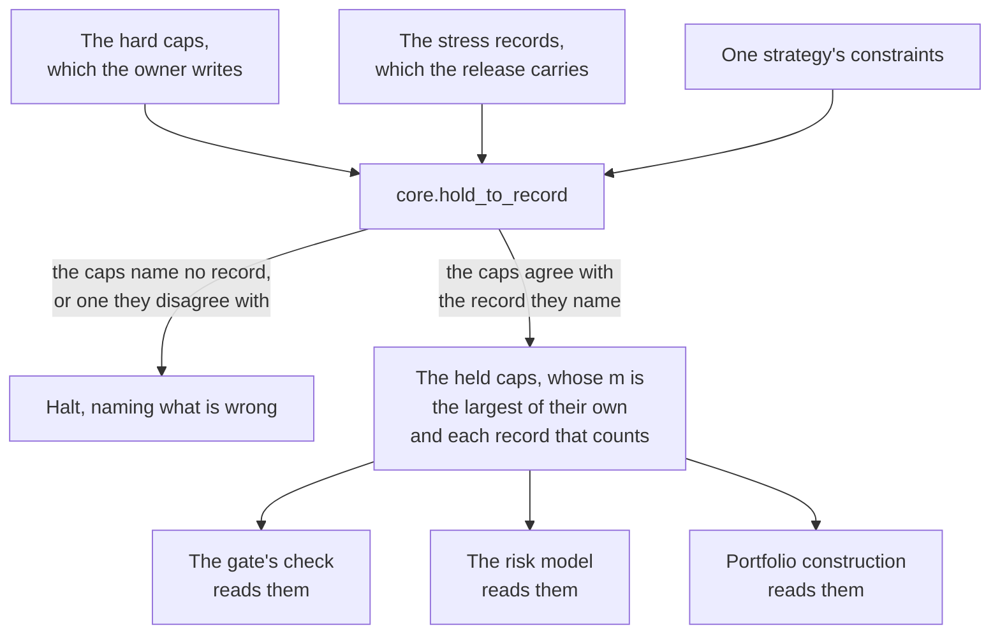

It first makes the checks `core.tighten` makes of the constraints and of the caps, in the same order. Then it halts on each of these.

1. A file of records that cannot be read, or one that holds none.
2. A `stress_vintage` of no record of the constraints' strategy.
3. A record that is withdrawn, quoting its reason.
4. A record whose legs are not exactly the instruments the constraints limit, since no measurement read the odd one.
5. A `stress_through` that is not the record's last session.
6. A `stress_move` below the record's.
7. A larger m, of any record that counts, above `stress_high`.

It gives back the caps with m the largest of their own and of every record that counts. A record counts when it is of the strategy, is not withdrawn, and names as the leg that made its move one the constraints limit. Its other legs do not matter, because that leg made the move. So a record can only tighten, and `Verdict` carries the m the check used.

The gate's `loss` does not hold the caps, because the day's loss reads no m. So where the owner rewrites the caps after the risk stage has run, and only the hold refuses them, `check` halts every order and the loss is still read.

The price is seven things.

1. **A raised record binds at once, and a release rolled back or a withdrawal releases it at once.** The net cap then grows with nothing halted. So the owner writes the caps' own `stress_move` up to a raise before its release runs, as [Raise the stress move](../what-a-person-runs.md#raise-the-stress-move) says, and [#11](https://github.com/l3a0/ithildin-runtime/issues/11) alerts while the held m is above the caps' own.
2. **A release rolled back past the record the caps name halts every order**, as one rolled back past a new cap does.
3. **A backtest can read a move its past could not have known.** A last session after a decision passes, because test 1's decisions run from 2006 to 2012, and a larger record binds whichever one the caps name. A result run while a record that counts ends after its first decision names each such record's last session and the m it was held to. It says how many sizings were cut by `max_gross` or `max_net`, how many halted at zero shares and how many orders `max_net` refused, because a larger m can shrink a target and leave no order to refuse. It says that every worst loss reads that m. It is labelled exploratory, and says it read a move after its decisions.
4. **The caps hold one vintage for an account.** Two strategies of other legs never share a vintage, so each strategy the named record is not of halts. With the smaller m's record named, the gate alone would approve that strategy's order against a book that holds the larger's leg. What stops that is the risk stage's halt on two strategies. So the change that lifts it says which record the caps name, with that case in its test.
5. **A larger record can refuse both exits of a pair already held.** A pair cut to the older cap can have each leg past the new one, and closing either first can then widen net. [Raise the stress move](../what-a-person-runs.md#raise-the-stress-move) has the owner look first.
6. **A leg the strategy holds and the constraints do not limit counts at the m of the legs they do**, whatever its own record holds. Portfolio construction halts on a held leg its forecast does not name, so no order forms.
7. **While the risk stage halts on the records, no decision tests the day's loss**, because the send stage tests it only on a decision that reaches it.

#### The risk model writes each decision's limits

Portfolio construction sizes a target within the limits, and the gate refuses an order that would go past them. So the limits have to be stored where portfolio construction can read them before it sizes. The risk stage does that. It is one stage for the whole deployment, named `risk`, because it reads the account's book.

##### What the risk stage reads and stores

It reads four files, each holding one entry.

**Table:** The four files the risk stage reads

| File | Stored by | Holds |
| --- | --- | --- |
| `snapshot.json` | Data | The decision's `Snapshot` |
| `book.json` | Execution's recover stage | The decision's `Book` |
| `caps.json` | The same | The `HardCaps` as recover parsed them, with the owner's blob named by its key and SHA-256 in the file's header |
| `valuation.json` | The same | The session's `Valuation`, which gives V |

It stores `constraints.json`, one `Constraints` per strategy. Each limit there is already the tighter of the strategy's own and the hard cap, through `core.tighten`. So `max_net` is the smaller of the strategy's and the share of V over the stress move the hold leaves, and a target is sized within a net cap no tracked file holds.

The stage never reads the owner's caps blob, which the owner can rewrite between two attempts at one decision. It reads the caps recover stored, so a second attempt writes the same bytes. `OrderPath` still reads the blob as each order's send begins, and hands the gate what it read. The price is that a cap the owner lowers after recover has run binds at the gate and not in the sizing, so a target sized within the older cap can be refused there.

##### Where a strategy's own limits come from

A strategy's own limits are the `[risk]` section of its tracked file. It holds each field of `Constraints` but the strategy's name, with the two share limits as tables keyed by instrument. `risk/model.py` holds the form. A limit there is what the strategy was tested under, and a hard cap is what the owner allows, so a limit in a tracked file only tightens. A test asserts that no tracked strategy file holds a field only the hard caps have, such as `share` or `stress_move`, a key named `holds` or `account`, or the text `accounts/`.

##### What halts the risk stage

A halt in data's result or in recover's is passed on. Every other halt the handler meets is the stage's own result, whose header names each result and file it had read and storage had accepted. The receive loop stores the few it raises itself, such as a decision whose strategies are not the table's, with no input named. The stage halts on each of these.

1. A `[risk]` section that is absent, leaves a field out, holds one the form lacks, names other instruments than the strategy's in a table, or holds a value `core` refuses. The check runs at each decision, so a bad section stops this stage and never the worker's start.
2. An input with no result or one storage refuses, a result that lists one of the four files other than once, a file storage refuses or that holds other than one entry, and a snapshot of another decision.
3. Caps or a valuation that `core.tighten` refuses, caps [the stress records do not hold](#how-the-caps-are-held-to-the-stress-moves-record), a V of any session but the one before the decision's, and a stress move past its age. A file of records that cannot be read halts each decision, and never the worker's start.
4. A book the snapshot cannot mark, for each instrument with a position or an open order, because no limit in dollars can be read for it. Its quote is judged at the decision time, because the stage reads no clock.
5. Two strategies in one deployment, because what scope each one's limits take is not decided.
6. A write storage refuses, such as constraints already stored with other bytes.

The stage does not hold V against the book's corrections or the entry it was replayed through, and does not check the book's open orders or orders in doubt. The gate does, at the send stage, so a target sized on a V the gate refuses sends nothing.

#### The book comes from the journal

The journal's entries, applied in order from the first, give the account's `Book`. The broker's positions, open orders and cash are read only in the places [The current book comes from the journal](06-runtime.md#the-current-book-comes-from-the-journal) lists. `Journal` lives in a package of its own, `ithildinruntime.journal`, which imports only `core`. Execution, monitoring, the supervisor and the `ithildin` tool are the only code that may import it. [The journal](08-crosscutting-concepts.md#the-journal) lists the six writers that append to the journal.

##### What the book holds

**Table:** Each field of `Book`, and what the entries make it

| Field | What it holds |
| --- | --- |
| `positions_by_strategy` | Each strategy's shares of each instrument, where they are not zero. A fill is filed under the strategy of its order |
| `open_orders_by_strategy` | Each order the gate approved that has not ended, at its unfilled remainder. An order only intended is not in the book, so the order being checked is never counted twice |
| `cash` | The opening cash less each fill's signed shares times its price, plus each `outside_record`'s amount, exact, with no rounding |
| `replayed_through` | The number of the last entry |
| `in_doubt` | Each instrument with an order that may or may not be with the broker. A `sending` entry with nothing after it is one |
| `corrections` | One `Correction` per entry that moved cash or a position by anything but the platform's own fill or a listed broker record, in order. No kind built so far is one, since an `outside_record` is a listed record, so it is empty until [#227](https://github.com/l3a0/ithildin-runtime/issues/227) builds a correction of a fill |

The gate reads two facts from `corrections`: the newest correction's number against the valuation's, and the newest one that moved a position against the close of the valuation's session. The list tells a deposit from a broker's trade behind it, so [#117](https://github.com/l3a0/ithildin-runtime/issues/117) can excuse the trade without excusing the deposit. The book carries no realised profit, because nothing reads one.

##### A view is one reading of the journal

`Journal.view()` reads to the journal's end and returns a `View`: the book, each order with its state and the entries that moved it, each decision, broker read, fill and dispute, and the number and hash it was read through. It reads to the end before it returns, so nothing is acted on ahead of a later entry's check, and an entry that halts stays unread and halts the next view too. A call with nothing new costs one listing.

A view never changes. It copies the positions, the cash and every order that has not ended, which do not grow with the journal. Orders that ended, decisions, reads and fills are kept once, and a view shows none whose entry is past its own.

`view(through=n)` gives the reading at an earlier entry, folded from the first, with nothing read past it. A `verdict` entry names the entry before it as its `book`, so that view holds the book and the order the gate was asked on. The entry holds the rest of what the gate was handed, but no entry holds the stress records it was built with, so the verdict's own `stress_move` stands for the caps' where its answer is rebuilt.

##### Nothing is stored that a replay would refuse

A halt at replay ends the account, because no entry can be deleted. So `Journal.record(view, record, at)` is the one way a writer adds an entry, and it works in these steps.

1. It builds the entry after the view it was handed, and no other, so a step is stored only on the reading it was decided on.
2. It applies that entry to the view in memory, and raises `Halt`, storing nothing, where a check fails or where the positions, the open orders or the cash would hold a value no record can hold.
3. It appends. A refused append leaves nothing in memory. Where another writer's entry holds that number, it raises `NumberTaken`, and the caller views the journal again and decides again.
4. It returns the acknowledgement and the view after the entry, which is never read back.

One `Journal` acknowledges one number once. Two calls on it that build the same bytes, as two threads under a history clock can, do not both hold it, so they cannot both send. Two `Journal`s stay apart by their writers, so each one that records has a writer of its own, in one process and across processes. A call whose answer was lost is safe to repeat, because it builds the same bytes. `record` halts for a `Journal` built with no writer, as a reader is, and on a view another `Journal` gave.

The figure below is a C4 dynamic diagram of one call.

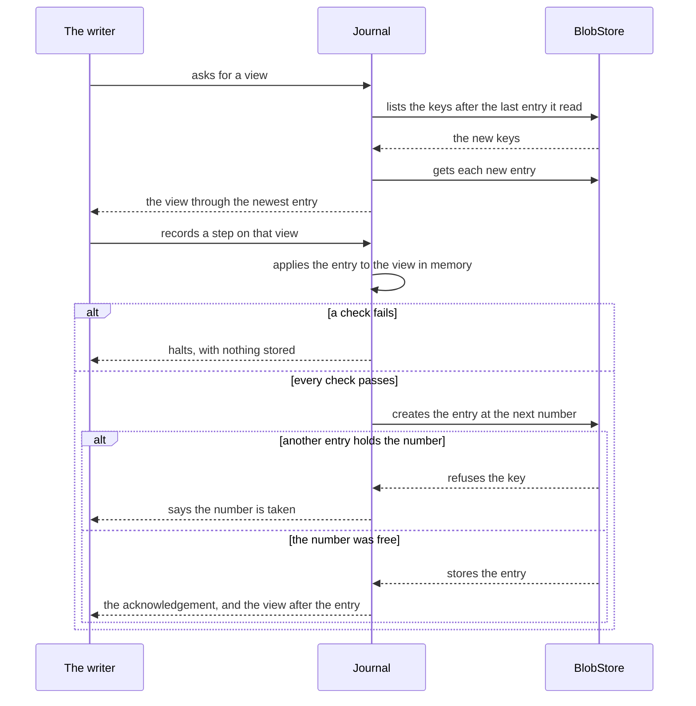

##### An empty journal is never a flat book

A journal with no entry halts when its book is read, because it looks the same as a wrong account or a lost store. Entry 1 is an `opening`, which names the account and its cash, and a journal whose first entry is another kind, or which holds a second `opening`, halts at the view. A person writes it on shadow and paper. The only other way to know an account is new is to ask the broker, whose empty answer looks like a lost one. The price is one command a person runs per account, and that a wrong one leaves that account alias unusable until [#151](https://github.com/l3a0/ithildin-runtime/issues/151), since no entry is ever deleted. [#146](https://github.com/l3a0/ithildin-runtime/issues/146) writes a backtest's, and [#11](https://github.com/l3a0/ithildin-runtime/issues/11) builds the command.

##### What the checks on an entry hold

Each entry that names an order is checked against the entries before it, at `record` and again at every replay, and halts naming the entry where one of these fails.

1. A `decision`'s orders each carry the stamp of that decision, of their own strategy and of their place in the plan, and none is of a strategy it names as off. Each decision time has one `decision` entry. Its `read` is an earlier `read` entry, and its `synced` any earlier entry.
2. An `intent`'s order equals the one its `decision` entry plans.
3. A `verdict`'s `book` is the entry before it.
4. An `ack`'s broker's order id is no other order's.
5. A `fill` names an earlier `read` entry and the broker's id of an acknowledged or part-filled order, in that order's instrument and on its side, under its client order id where the fill carries one, and takes its filled total no further than its quantity.
6. An `expired`'s filled total equals the order's fills.
7. An order moves only as [The life of an order](06-runtime.md#the-life-of-an-order) draws. `journal/orders.py` holds the one table of those moves, and a pair it does not hold halts naming the entry, the order and its state.
8. An `abandoned` of an order that is `Sending` comes from the writer of its `sending`. No other process can know that nothing left, and after it the order is out of the book.

##### A position's initial risk comes from the journal alone

The order and fill record cannot be recaptured, and every reader of a result measures it against the risk it took, so the journal alone must be enough to rebuild that risk. [A result is measured against the risk it took](../design.md#a-result-is-measured-against-the-risk-it-took-and-size-answers-to-what-the-owner-can-bear) defines a position's initial risk as the largest worst loss journaled on an order the gate passed and the platform sent or holds in doubt, from the order that takes the position off flat to the first point where every leg is flat by the derived position and no order is working or in doubt. `journal/initial_risk.py` holds the one calculation of it.

Here a strategy is flat when the book holds no share of it and it has no order `Sending`, `InDoubt`, `Acknowledged` or `PartlyFilled`. An `Intended` or `Approved` order has no `sending`, so nothing of it can have left, and it keeps no position open. `positions(journal)` reads an account's journal in these steps.

1. It folds the entries from the first with the journal's own fold, and reads each strategy's legs from the book each view gives, as the gate does. An entry the fold refuses halts the read with the fold's reason.
2. It keeps each approving verdict's worst loss under its order's client order id.
3. A `sending` entry of an order of a flat strategy opens a position, and every `sending` entry inside a position counts that order with its verdict's worst loss. An order counts whatever came after its sending, so one the broker rejected, one abandoned by the writer of its sending, one that expired unfilled, one still in doubt and one given up as `Lost` all count, and one refused or abandoned before its sending never does. Only a fill moves a strategy's shares, and a fill follows a `sending`, so no position opens any other way.
4. After each entry, a position whose strategy is flat closes at that entry. One still open at the journal's end has no closing entry.
5. At the end it reads the newest view's book, which halts on a journal with no entry, a fill in dispute or anything kept as unmatched. The read halts there rather than give a position that could close where the record does not say it did.

Two things bear on that last halt.

1. A report that reads it still completes, shows the figures this read gives as missing and alerts the owner, as [A result is measured against the risk it took](../design.md#a-result-is-measured-against-the-risk-it-took-and-size-answers-to-what-the-owner-can-bear) says of a figure that cannot be computed. [#48](https://github.com/l3a0/ithildin-runtime/issues/48) asks the same of the daily report in its item 6.
2. No entry releases a dispute or an unmatched entry yet. Before [#203](https://github.com/l3a0/ithildin-runtime/issues/203) ships the entry that ends a dispute, or [#151](https://github.com/l3a0/ithildin-runtime/issues/151) the one that releases an unmatched entry on [#150](https://github.com/l3a0/ithildin-runtime/issues/150)'s release test, this read must be taught to read it.

While a strategy with a position open holds no share, the read looks at its orders that have not ended, and one in a state outside the two unsent and four sent ones above halts it. The sent states are the order table's open states less its unsent ones, so a state a release adds to either set is read as that set is. What catches a new state is a test that writes out the unsent, sent and ended states and checks that together they are every state, so a state a release adds anywhere fails it until this read is told what the state is.

Initial risk is the largest figure a position counted, and missing where any one is not finite and positive. `core.Verdict` refuses an approval with no finite worst loss and an adding approval at or below zero, so only an approval that reduces can carry such a figure. A verdict entry written by hand with either figure `core.Verdict` refuses halts the read, because the fold cannot read it as a verdict. The figure below is a C4 code diagram of what the read gives.

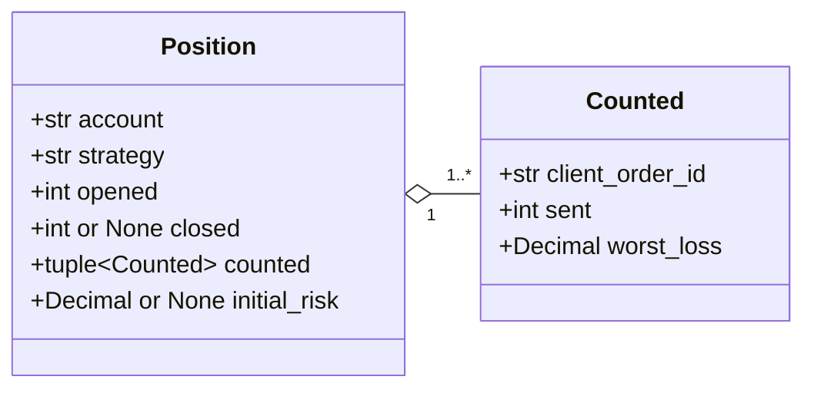

`opened` is the number of the `sending` entry that opened the position, and `closed` that of the entry after which it was flat, or `None` while it is open. `counted` holds each order in the order it was sent, so a report can name the order behind a missing figure. `initial_risk` is a property, which is `None` where the figure is missing.

#### The cost model writes a schedule rather than answering calls

Portfolio construction needs the cost of each trade it considers. Each module is a process of its own, so a call to the cost model per candidate trade would cross a process boundary every time. Instead each strategy's cost stage, `cost/<strategy>`, writes one `CostSchedule` per decision, and portfolio construction can work out each trade's cost from it by calling `estimate` in its own process. No rule weighs a cost in slice 1, so portfolio construction reads the schedule and calls no `estimate` yet.

##### What a schedule holds

A schedule maps each instrument the strategy trades to a list of terms. Each `CostTerm` holds one figure's parts and where they came from.

**Table:** What a `CostTerm` holds

| Field | What it holds |
| --- | --- |
| `kind` | `charge`, for a commission or a fee the broker books, or `gap`, for the estimate of the gap from the quote's midpoint to the fill. The two stay apart, as the commission line in [A fill is measured from the decision](../design.md#a-fill-is-measured-from-the-decision-and-a-position-depends-on-a-market-it-does-not-control) asks |
| `side` | `both`, or `sell` for a fee charged on sales alone |
| `fixed` | The cost of one trade, however large |
| `per_share` | The cost of each share |
| `per_dollar` | The cost of each dollar traded, such as 0.0000206 for the SEC's fee of $20.60 per million dollars sold, in force from 2026-04-04 ([advisory 2026-2](https://www.sec.gov/rules-regulations/fee-rate-advisories/2026-2)) |
| `source` | A dated published text, or `placeholder:` and the reason no such text was read |

##### How a trade's cost is worked out

`estimate(instrument, qty, price, kind)` reads a quantity that is negative for a sale, and the price the caller sizes the trade at. It sums `fixed`, plus `per_share` times the shares, plus `per_dollar` times the shares times the price, over each term of that kind that applies to the trade's side. With no kind named, it sums both kinds. Zero shares cost zero. The model reads no quote.

##### Where the figures come from

Each strategy's terms are the `[cost]` section of its tracked file, so they are the same in backtest, shadow, paper and live, and the schedule's header names them by its `release` and `config_hashes`. That pair is the cost model's version. No simulated fill calibrates a term.

A cost nobody wrote never reads as free. The cost stage halts, naming the strategy and the instrument, on a missing section, an instrument with no terms, one with no term of a kind that covers both sides, a term with a field missing, a negative figure, and a kind, a side or a source it cannot use. `cost/model.py` holds the whole list. A cost of zero is written as a term whose figures are zero. `estimate` halts too, on a trade in an instrument with no term of the kind asked for, or with either kind's term missing where none is named, on a price that is not above zero and on a quantity that is not finite. A test reads every tracked file's section, so a bad one fails CI before any run.

The price is that each strategy states the broker's fees in its own file, so a changed fee is an edit to every strategy's file and nothing alerts when a published fee lapses. A term also carries one figure for every date, so a backtest over dates with another fee charges today's.

#### How a target is sized

Portfolio construction turns each strategy's forecast into a target portfolio, the shares the strategy should hold after the decision. With one basket per strategy, equal risk weight comes down to one number, how many baskets to hold. One stage named `portfolio` does this for the whole deployment, and it sizes each strategy's target as if the account held nothing else. So the target reads no position, open order, cash, profit or account value, except through the limits. It is absolute, and the order manager and the gate count what is held and sent.

##### What the portfolio stage reads and stores

It reads the result of every stage below before it opens any file, in this order.

**Table:** Each file the portfolio stage reads

| File | Stored by | What portfolio construction takes from it |
| --- | --- | --- |
| `snapshot.json` | Data | Each leg's price |
| `book.json`, `valuation.json` and `caps.json` | Execution's recover stage | Which instruments each strategy holds or has an order in, the session V was valued at, and the stress move and the share step |
| `constraints.json` | Risk | Each strategy's limits, one `Constraints` per strategy |
| `forecast.json` | Each strategy's alpha stage | The basket and its direction |
| `schedule.json` | Each strategy's cost stage | Nothing yet. A strategy with no readable schedule halts, and no estimate is weighed, because every one is zero in slice 1 |

Each result must carry the configuration hashes the stage table gives its stage. Storage compares a file only with the result that lists it. So without that check a backtest rerun into one folder after G moved would size an older file's forecast with the newer G.

The stage stores two files, each with one entry per strategy, and computes both before it stores either.

1. `target.json` holds the `TargetPortfolio`. A flat forecast gives an explicit zero for each leg.
2. `sizing.json` holds the `Sizing`, the record of how the target came out that size. `wanted` is each leg's shares before any limit. `cut` names each limit that alone would make the target smaller, before rounding. Neither says whether the check after rounding sent every leg toward zero, which the target and the limits show.

##### How many baskets are held

A position of either direction is sized to G gross dollars, the one key of the `[portfolio]` section of the strategy's tracked file, `gross`. A basket's gross is the sum of its legs' dollars, each leg's shares times its mark, as a size. The mark is the price `core.mark` gives, the one the gate reads.

1. **G asks for a number of baskets**, G over one basket's gross.
2. **Three limits each bound that number.** Each of the two dollar limits is first divided by one plus the stress move, as [Why a dollar limit is read less room](#why-a-dollar-limit-is-read-less-room-for-one-stress-move) says. `max_position` bounds each leg's shares. `max_gross` bounds the legs' dollars. `max_net` bounds the larger of the long legs' dollars and the short legs' dollars, because the gate counts each leg with the other unfilled.
3. **The smallest of the four is taken**, so every leg shrinks together and the hedge between them holds.
4. **Each leg is rounded to the nearest step** of the account's share step, and a leg exactly half a step from two counts goes to the one nearer zero. Each share count is one division of exact products toward zero, whose remainder decides whether the count goes up a step, so a target that sits exactly on a limit or a step is kept.
5. **The rounded target is checked against each limit of step 2**: each leg's `max_position`, the legs' dollars against `max_gross`, and each side's dollars against `max_net`, both dollar limits read less room. Where it passes one, every leg is rounded toward zero instead. That target fits every limit, because the target before rounding does.
6. **A flat forecast is an explicit zero for every leg, and a held direction that comes to zero shares in every leg halts**, naming G and each limit that cut it. A zero there would sell the book because G is smaller than half a share, a price is wrong or V reads low.

The figure below is a C4 code diagram, of a forecast that holds a direction.

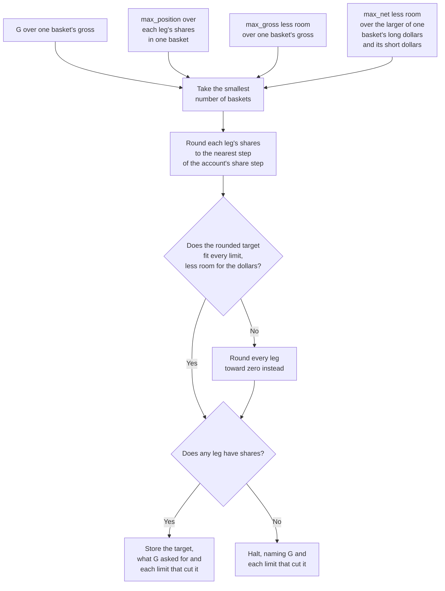

Take a basket of one share of USO against 0.4 of GLD short, with USO at $50, GLD at $100 and a G of $900. These figures are made up. One basket's gross is 50 + 40 = 90 dollars, so G asks for 10 baskets, which is 10 USO long and 4 GLD short. At a stress move of 0.25 a `max_net` of $500 is read as 500 ÷ 1.25 = 400 dollars. USO's side is the larger at 50 dollars a basket, so that limit allows 8 baskets, and the target is 8 USO and, with 3.2 rounded to the nearest share, 3 GLD short. At a `max_net` of $550, read as 440 dollars, the limit allows 8.8 baskets, and the nearest shares are 9 USO and 4 GLD. 9 USO is 450 dollars, past 440, so every leg goes toward zero instead, to 8 USO and 3 GLD.

One leg can round to zero beside one that does not, and that target stands. So step 6 halts only where every leg comes to less than half a step, or less than one step where step 5 sent every leg toward zero, cut by a limit or not. A target cut to less than what is held asks for a smaller position, and the gate decides each of its orders, as [Which orders go out past a limit](#which-orders-go-out-past-a-limit) says. The price is a hedge that is off by up to half a share of each leg, and by up to one share where step 5 rounds toward zero, a gross that can pass G by up to half a share of each leg, and that a limit lowered below a held position moves it only as far as the gate lets each order out. At G = $9,936 and the closes of 2026-10-28, GLD at $373.51 and USO at $166.57, half a share of GLD is 1.9% of G.

##### Why a dollar limit is read less room for one stress move

A dollar limit is read as the limit over one plus the stress move, with the stress move [the hold leaves](#how-the-caps-are-held-to-the-stress-moves-record). Cut exactly to a net cap, a pair the market then moves can be let in and not out: closing one leg widens net, and the gate refuses an order past the cap that widens it. With room, a pair resized at a decision still fits a limit that has not moved after a stress move against either leg, so neither `max_net` nor `max_gross` stops both legs leaving.

Room covers no more than that. An exit is still refused on a day the loss stop is past, which a stress move can bring, and where it is larger than `max_order_qty`. The net cap falls with V, so a full stress move against a lone leg can still leave the pair a little over it. A position the gate stops from resizing drifts for longer than two sessions. `max_position` counts shares and needs no room. The price is a target about a quarter under the limit, at the exploratory stress move of 34.7%, wherever a dollar limit binds.

The gate refuses and nothing here predicts it. A refused flip, straight from one side to the other, keeps the opposite position and is asked again at each decision until the forecast goes flat or the limit moves.

##### The step a share count moves in

`share_step` in the hard caps blob is the step a share count moves in on that account. It is the broker's rule for the account rather than a limit. Alpaca takes a fractional order only for the day, never at the closing auction, and takes no fractional short sale ([fractional trading](https://docs.alpaca.markets/docs/fractional-trading), [orders](https://docs.alpaca.markets/docs/orders-at-alpaca), read 2026-11-24). So paper's market-on-close legs are whole shares and its step is 1.

Test 1's account alone is written 0.000000001, because whole shares miss the replication's pinned return, as a test pins at a G of $10,000. Every other account, a backtest's and test 2's included, is written the step of the account it stands for, so nothing else sizes in a way paper never runs. The price is that one backtest account moves in a step no broker account does.

##### What halts the portfolio stage

A halt in any input is passed on, the first in the order the stage reads them. Every other halt the handler meets is the stage's own result, whose header names each result and file it had read and storage had accepted. The stage halts on each of these, the first it meets deciding, and all but the tenth and eleventh hold for a flat forecast too.

1. An input with no result, one storage refuses, or one that carries another configuration than the stage table's.
2. A result that lists a file other than once, a file storage refuses, a file with another number of entries than one, or for `constraints.json` other than one per strategy, and a snapshot of another decision. A file that carries the "trade nothing" mark has no entries, so it halts here: `TargetPortfolio` has no form for holding every position.
3. A `[portfolio]` section that is absent or holds anything but a `gross` above zero at four places or fewer.
4. A book that holds shares or an open order under a name the deployment does not run. Sized alone, two strategies' legs can net on the account, and then be let in and not out.
5. A forecast of another strategy, or a basket whose instruments are not exactly the strategy's.
6. An instrument the strategy holds shares of, or has an open order in, that the forecast does not name, because a target of zero there would sell a position nobody forecast.
7. A leg that is not a finite number, or a basket whose legs are all zero.
8. A V or a stress move the gate would refuse, limits or caps `core.tighten` refuses, caps [the stress records do not hold](#how-the-caps-are-held-to-the-stress-moves-record), a share step of another form than the ten, and a leg no limit names.
9. A leg `core.mark` cannot price, its quote judged at the decision time.
10. A share count, of the target or before any limit, too large for a record to hold.
11. A held direction sized to zero shares in every leg.
12. A write storage refuses, such as a target already stored with other bytes.

Risk's stage halts on two strategies in one deployment, so a target for each of two shows the files' form alone. [Strategies, schedules and decisions](../design.md#strategies-schedules-and-decisions) says what is proposed to lift that halt.

#### Every type that crosses between workers has a file form

##### How a type travels

Every type that crosses between workers has a file form, `AccountRead` and `SendOutcome` included. Each travels as an output file that begins with a `BlobHeader`, naming its inputs by key and SHA-256, and that its component's `DecisionResult` lists. A test writes each one and reads it back unchanged. A deterministic component's format is canonical, so the same inputs give the same bytes, as [File formats and keys](08-crosscutting-concepts.md#file-formats-and-keys) defines. Prices and quantities cross between workers as decimals, never floats, for the same reason.

##### How a halt crosses a worker's edge

`Halt` stays an exception inside a worker. At the worker's edge it becomes a `DecisionResult` that holds a `HaltRecord`.

**Table:** What a `HaltRecord` holds about where the halt came from

| Field | What it holds |
| --- | --- |
| `cause` | The halt the worker met, when it is passing one on. Empty when the worker found the problem itself |
| `found_outputs` | Each output file stored under the decision's prefix when the halt was written, a capturing stage's stored capture included |
| `unstored` | Each capture the process still held that is not stored, for any reason, such as S3 not answering or its key holding other bytes, by the key it was trying and its SHA-256. A `clear` of the halt is refused until each is stored or journaled as lost, as [A write S3 refuses or does not answer](../design.md#rule-1-a-write-s3-refuses-or-does-not-answer) says |

The supervisor writes the same record for a worker that failed, naming its restart records. The host's stop handler and the restarted worker write those records, as [Each blob names what made it](../design.md#rule-5-each-blob-names-what-made-it) says.

##### What a plan, a journal entry and a lease hold

- `Plan` holds the run's decisions, each with its time and the strategies deciding at it. One function in `core` builds it from the schedules and the trading calendar.
- `JournalEntry` is the one numbered record of what the platform did, chained to the entry before it.
- `Lease` names its holder down to the handler, and when it expires, and leaves those `null` while the lease is free. It carries `status` only on a plan's lease, where it holds the run's status, so an account's lease leaves it `null`. `count` rises by one on every rewrite, so no two writes hold the same bytes and S3's tag never repeats. `owed` is set only on an account's lease, from a take of an expired lease or a person's clear until the takeover's entry is journaled, so a release in between leaves the takeover owed. `owed_from` and `owed_expired` name the holder the takeover is owed from and when its lease ran out, kept across that release and through a later taker that dies holding the lease, and are `null` after a person's clear.

##### How the storage port rewrites a blob

`BlobStore` is the storage port, S3 in shadow, paper and live and a memory-backed folder in a backtest, and one contract test suite runs against both. A case in it writes, through `create` and through `replace_if_match`, bytes whose SHA-256 differs from the one sent, and both adapters refuse it. The emulator the S3 adapter's run uses does not check the SHA-256, so botocore's stubbed answer of S3's refusal shows the adapter's side there, and the suite's run against the test bucket on each push to `main` checks that S3 refuses it, as [How CI runs them](10-quality.md#how-ci-runs-them) says. `create` returns the stored blob's tag and `head` its stored time. `replace_if_match` rewrites a blob only while it still carries the tag it names, and returns the new tag. That is how a lease is taken, renewed, released and taken over, and it is the one rewrite the port allows. So a lease can be rewritten only on a tag.

**Table:** Which tag each rewrite of a lease names

| The rewrite | The tag it names |
| --- | --- |
| A first use's create | None. It is create-only, on a journal with no `sending` |
| A take | The one it read |
| A clear | The one it read |
| A renewal | The one its holder's own last write returned |
| The rewrite that clears `owed` after a takeover's entry | The one its holder's own last write returned |
| A release | The one its holder's own last write returned |

No worker deletes through the port. [#11](https://github.com/l3a0/ithildin-runtime/issues/11) names how `ithildin`'s deletes of a switch or an off switch reach S3, and [#203](https://github.com/l3a0/ithildin-runtime/issues/203) how its delete of a fired loss stop does. `Journal` writes through `BlobStore` too, for the account the broker adapter names, so the `journal` package has no storage port of its own.

## Package layout and the import rule

No worker module imports another worker module. Each imports only the shared code below it, `core` and, for the modules that write the journal, `journal`, and only `runtime` puts the modules together, so no module can reach a sibling's code or choose its own mode.

### Which module may import which

The figure below is a C4 component diagram.

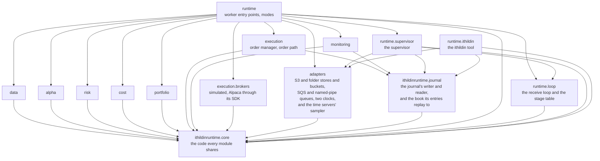

An arrow means "may import". The diagram draws four rules.

1. **No worker module imports another worker module.** The workers are data, alpha, risk, cost, portfolio, execution and monitoring. The code they share sits below them, in two packages, so no worker needs a sibling's code.
   1. `core`, which every module may import.
   2. `journal`, which holds `Journal` and imports only `core`. Only execution, monitoring, the supervisor and the `ithildin` tool may import it, and [The journal](08-crosscutting-concepts.md#the-journal) lists the six writers that append to the journal. Execution's `Account` builds the `Journal` its order paths share, and monitoring the one `Monitoring` holds, each from the `BlobStore` and the account it is handed. No code outside the four importers constructs one.

   `adapters`, `execution.brokers` and `runtime.loop` import nothing from `ithildinruntime` but `core`.

   These live in `core`:

   - the types that cross modules, such as `Forecast`, `Constraints` and `TargetPortfolio`;
   - the `Halt` exception, and `Stopped`, which ends a handler's wait on the clock when its loop is asked to stop;
   - every `Protocol`, including `RiskGate`;
   - the storage contract every worker uses:
     - the `BlobStore` port, writing a blob S3 refuses to replace, and the refusals every store gives;
     - `Storage`, which applies the rule for each `StageKind`, holds each capture S3 will not store, and runs the reader's checks on an `OutputFile`;
     - the blob header;
     - the decision result and its halt;
     - the plan;
     - the queue port;
     - the one codec and key builders that [File formats and keys](08-crosscutting-concepts.md#file-formats-and-keys) describes;
   - the calendar function, the lookups of the session a decision belongs to and of the one before it, and the plan builder, which read the trading sessions from a committed data file rather than a calendar library, as [Which clock a schedule follows](08-crosscutting-concepts.md#which-clock-a-schedule-follows-and-how-it-becomes-utc) says;
   - `require_utc`, the check that a time is UTC;
   - the names of data's stage and its snapshot, of the alpha and cost components and their output files, of the risk stage and its constraints, of execution's recover stage, its capture and the three files risk and portfolio construction read, of the portfolio stage and its two files, of the daily interval and of a price kind no source states, so a stage that reads them imports no other worker's module;
   - `StageRun` and `StageDecision`, the steps a model's stage takes to read another stage's result, hold it to the stage table's configuration hashes, read the files it lists, write its own files under one header, and turn a halt into its result. A capturing stage also stores a capture before it judges it, and goes on from its own stored files in a second attempt;
   - `parse_caps`, `check_constraints`, `require_current` and `tighten`, which read the hard caps blob, the share step included, check each field of a strategy's limits, refuse a V or a stress move a decision may not use, and take the tighter of each limit and its cap, and the decimal arithmetic limits are compared in, which is exact or halts;
   - `moves`, `largest_move` and `stress_vintage`, which measure the stress move and name the bars it read, the tracked stress records and their reader, and `hold_to_record`, which holds the caps to them, because the gate, the risk model and portfolio construction each call it;
   - `mark`, `exposure`, `classify`, `held` and `value_book`, the one price, range, adding-or-reducing, list of what is held and valuation, so the gate, the risk model, portfolio construction and execution each count a book one way, and the alpha model's signal reads the price its position is sized at, `quote_faults`, `require_quote`, `readable_until` and `midpoint`, the one judge of a quote, the last moment one can be read and the price read of one, because data judges the quote the mark values at, and `series_of` and `unstated_fields`, which data reads too, because no worker may import another;
   - `clock_faults`, the one rule that halts on a reading of the machine's clock, with `CLOCK_BOUND`, which is also added to every quote's age, `SYNC_BOUND`, `ANSWER_BOUND` and `DRIFT_PPM`, because data, execution and monitoring each judge a clock;
   - `reconcile`, the one comparison of a book and the journal's records of its open orders with the broker's account.

   `core` holds ports and no adapter, so no module can build an S3 store or an SQS queue and choose its own mode.
2. **Only `runtime` imports the modules together.**
   - The command that [measures a stress move](#how-the-stress-move-is-measured) lives there, in `runtime.stress_move`, because it reads through `data` and `adapters`. So does `runtime.quote_refusals`, which counts how often recorded quotes would be refused at a step of maximum ages and spreads, because it reads through `data`'s sealed read and `core`'s judge of a quote. [Count how often quotes would be refused](../what-a-person-runs.md#count-how-often-quotes-would-be-refused) says how to run it.
   - Each worker's entry point lives there, and so does the one receive loop every worker and the supervisor run. It picks the adapters for the mode it is given, and the execution worker's entry point hands the risk module's `RiskGate` to the order path.
   - The supervisor lives there too, in `runtime.supervisor`, and imports `core`, `journal`, `adapters` and the receive loop's module, `runtime.loop`, and nothing else. `runtime.loop` itself imports nothing from `ithildinruntime` but `core`, so the supervisor reaches no worker module through it.
   - The table that declares each stage's kind and inputs, and the function that generates the routes from it, live in `runtime.loop` beside the loop, because the supervisor reads the table too. Each worker's entry point adds its own stage's row. The `Route` type and its key matcher live in `core`, because the folder adapter matches routes to deliver its events.
   - The supervisor starts no worker itself. The host's path unit starts each worker's unit once the supervisor writes the local release file. It writes nothing but these, which `core`'s storage contract and queue and the `journal` package cover, apart from that file:
     - the local release file, in memory-backed storage on its VM;
     - the plan's lease, whose conditional writes carry the run's status;
     - the plan;
     - the journal entry for each lease it clears or takes over;
     - the journal entry for each capture lost when a worker's process died holding it, as [A write S3 refuses or does not answer](../design.md#rule-1-a-write-s3-refuses-or-does-not-answer) says;
     - its heartbeat;
     - the halts of workers that failed;
     - a halt of the run, with a halt for every decision left in the plan;
     - the run's stop.

     The one exception is its report to the session-ready check in CloudWatch, which goes through `adapters`.
   - Only the entry points read the plan's mode, and a module is handed only the decisions.
3. **Only `runtime` imports `execution.brokers`**, and only the execution worker's entry point builds a broker, which it hands to `OrderPath` alone.
4. **Only `runtime` imports `adapters`**, which holds the S3 and memory-backed folder stores, the S3 and folder read-only buckets, the SQS and named-pipe queues, the history and wall clocks, and the sampler that asks the time servers. So each of the outside libraries in the table below is imported in one module.

   **Table:** The one module that imports each of five outside libraries

   | Library | The only module that imports it |
   | --- | --- |
   | boto3 | `adapters` |
   | marketlake's package, of which `data` imports only `lake.loader`, `lake.unsealed`, `lake.paths`, `lake.manifest`, `lake.actions` and `lake.config`, so it cannot read marketlake's bucket around the read-only port | `data` |
   | pyarrow, which marketlake's reader returns its rows in | `data` |
   | Alpaca's SDK | `execution.brokers` |
   | rfc8785, the one codec's canonical JSON | `core` |

   The `ithildin` tool, which lives in `runtime.ithildin`, imports only `core`, `adapters` and `journal`. The supervisor imports those three and `runtime.loop`, as rule 2 says. The import test gives each of them that narrower arrow of its own and allows nothing more.

### How tests hold the rule

A test reads every module's imports with Python's `ast` module and fails on an arrow the diagram does not draw, an import of `journal` from a module other than its four importers included. A package's `__init__.py` runs whenever a module beneath it is imported, so the test holds it to the rule of every box beneath it too, and `runtime/__init__.py` and `execution/__init__.py` may import only `core`. A second test runs a day under the supervisor against a fake broker that fails on five things.

1. An order whose client order id has no approval in the journal.
2. An order whose `sending` entry is not yet stored in the journal.
3. A client order id it has already received.
4. An order that differs in any field from the one its `decision` entry plans.
5. A cancel whose `cancel` entry is not yet stored in the journal, since a cancel is journaled before it is sent, the kill switch's included. [#149](https://github.com/l3a0/ithildin-runtime/issues/149) adds this one with the cancels, and the fake broker refuses the other four today.

The day pulls the kill switch, rejects one leg of a pair and answers one cancel with a 429, so the kill switch's cancels, a pair-keeping cancel and a cancel retried after a 429 meet the fifth check. The fake broker applies the fifth check in every test that runs against it, so each other path that sends a cancel meets the check in the test that drives that path.

Together they turn acceptance test 3's claim that no order reaches the broker adapter without passing the gate into something executed rather than reviewed. That test, in [How the four acceptance tests exercise it](10-quality.md#how-the-four-acceptance-tests-exercise-it), checks that the risk gate refuses an order over each limit and that nothing bypasses it.

### What the rule costs

The price is two more tests to keep in step with the diagram, and a module that needs a sibling has to argue for a new arrow. The `journal` package adds one more package to that price, with four arrows into it for the test to hold.
