# Architecture, section 6: Runtime

This page is section 6 of [the architecture](README.md), in the order of the arc42 template. It answers what happens while the platform runs: a decision's data flow, a trading day, faults, and the life of an order and of a run.

## Contents

- [Data flow](#data-flow)
  - [What the data flow guarantees](#what-the-data-flow-guarantees)
- [One trading day](#one-trading-day)
  - [The day at a glance](#the-day-at-a-glance)
  - [The whole decision in order](#the-whole-decision-in-order)
  - [Before the first decision](#before-the-first-decision)
  - [Phase 1: read the data and recover](#phase-1-read-the-data-and-recover)
  - [Phase 2: decide](#phase-2-decide)
  - [Phase 3: send](#phase-3-send)
  - [After the close](#after-the-close)
  - [If an instance dies in the middle of a send](#if-an-instance-dies-in-the-middle-of-a-send)
- [When something is wrong](#when-something-is-wrong)
  - [A missing or stale bar](#a-missing-or-stale-bar)
  - [A restart before the data is ready](#a-restart-before-the-data-is-ready)
  - [The risk gate refuses an order](#the-risk-gate-refuses-an-order)
  - [The book and the broker disagree](#the-book-and-the-broker-disagree)
  - [The kill switch and the dead-man check](#the-kill-switch-and-the-dead-man-check)
  - [Every alarm and its drill](#every-alarm-and-its-drill)
- [The life of an order](#the-life-of-an-order)
  - [How an order leaves `InDoubt`](#how-an-order-leaves-indoubt)
  - [What the next decision does with `Abandoned` and `Lost`](#what-the-next-decision-does-with-abandoned-and-lost)
  - [What halts as unmatched](#what-halts-as-unmatched)
  - [What becomes of an order after its cancel](#what-becomes-of-an-order-after-its-cancel)
  - [How an order reaches `Cancelled`](#how-an-order-reaches-cancelled)
- [The life of a run](#the-life-of-a-run)
  - [What `Preparing` does](#what-preparing-does)
  - [Where the run's state is kept](#where-the-runs-state-is-kept)
  - [How a halt differs from a failure](#how-a-halt-differs-from-a-failure)
  - [Who clears a halt](#who-clears-a-halt)
  - [When the run stops](#when-the-run-stops)
  - [When the read after the close goes wrong](#when-the-read-after-the-close-goes-wrong)

## Data flow

A data flow diagram shows the components, the order they talk in, and each point where a call crosses a trust boundary. A trust boundary is a line where what a caller may do changes, such as the edge of execution, the only component that holds the broker key. Threat modeling starts from these crossings, because that is where data can be read, changed or forged, so each one needs a stated protection.

The dashed boxes are trust boundaries, the cylinders are stores, and the rounded boxes are things outside the platform. The numbers give the order of one decision on paper, and a sub-number, such as 9.2, names one arrow of a step that has several. Flow 0 happens before the session, and flow 15 whenever a person acts. In shadow, flows 6, 10 and 11 go to the simulated broker and cross nothing, and no broker key exists.

The figure below is a C4 container diagram.

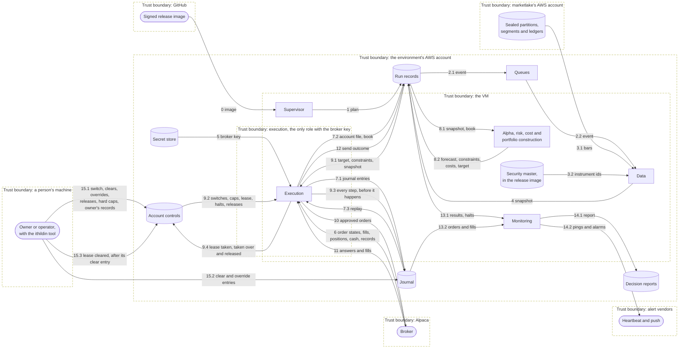

Flows outside one decision, such as pin writes and a failure's direct alarm route, are drawn in [Where it runs](07-deployment.md#where-it-runs).

**Table:** Each flow that crosses a trust boundary

| Flow | Crosses | What could go wrong | What protects it |
| --- | --- | --- | --- |
| 0 image | GitHub into the VM | A forged or altered release runs | The VM checks the pinned digest and its attestation, and refuses otherwise |
| 1, 4, 7.1, 7.2, 8.2, 9.3, 12, 14.1 writes | The VM into storage | A component overwrites or forges a record | Each component has its own role, every write is create-only with its SHA-256, and the journal chains by hash |
| 9.4 lease | The VM into storage | A holder that lost the lease rewrites it | Among the runtime's roles, only execution's rewrites an account's lease, a take on the tag it read and a renewal or a release on the tag its own last write returned, so a stale holder's write is refused. Execution creates one only where an absent lease allows it, and the bucket refuses every delete there |
| 7.3, 8.1, 9.1, 13.1, 13.2 reads | Storage into the VM | A component acts on a changed blob | Each read checks the SHA-256 its result or header lists, the journal also chains by hash, and a mismatch halts |
| 2.1, 2.2 event | Storage to a component's queue | A forged or lost event starts or starves a step | An event only wakes a component, which reads the stored blob itself, and a missing result alarms past its bound |
| 3.1 bars | marketlake's account into the VM | Bars are changed, withheld or stale | Only the data worker's role reads them, read only, each object's SHA-256 is checked, and a missing, stale or quarantined input halts |
| 5 broker key | Storage into execution | The key leaks to another process | Only execution's role reads it, it stays in memory and is never mounted, and a key has no withdrawal route |
| 6, 11 broker answers | Alpaca into execution | An answer is lost, or shows an order the platform did not send | A lookup settles doubt, reconciliation compares the journal with the broker, and an unmatched order or fill halts |
| 9.2 controls | Storage into execution | A switch or a halt is missed | Execution reads them right before each broker call, and an unreadable control halts |
| 10 orders | Execution to Alpaca | An order is sent twice, or around the gate | One order path through the gate, each step journaled before the send, and a client order id on every order |
| 14.2 pings and alarms | Monitoring to vendors | An alarm is lost or forged | Each environment holds only its own checks' addresses and its own push topic's address, and the dead-man check pages when pings stop. On paper and live the SNS subscription also holds the owner's email address, written by hand. No runtime VM, parameter or EventBridge route holds marketlake's topic address, no tracked file holds a push topic's, and [#11](https://github.com/l3a0/ithildin-runtime/issues/11) holds how an EventBridge target and the tool reach it, and whether OpenTofu state may hold that address |
| 15.1, 15.2, 15.3 person's writes | A person's machine into storage | Someone else acts as the owner | Each person has their own credential, on live only the owner's role writes the release, override and hard caps keys or clears a lease, on every account only the owner's role writes an owner's record, and CloudTrail records each write and delete |

The security master is the table that maps each ticker to the platform's own instrument id, so a vendor's renamed ticker does not become a new instrument. Every run record is kept after the run, and its header names the blobs it came from. That is what makes each decision readable afterwards.

### What the data flow guarantees

**Table:** The three rules at a glance

| Rule | What it prevents | Flows |
| --- | --- | --- |
| Only execution talks to the broker | An order sent around the gate, or a fill nobody journaled entering the book | 6, 10, 11 |
| The current book comes from the journal | The broker's view quietly replacing the platform's record | 6, 7.1, 7.3, 9.3 |
| Bars reach the models only after they are recorded | A model acting on a number nobody can read back | 3.1, 4, 8.1 |

#### Only execution talks to the broker

An order sent from anywhere else would escape the gate. So only execution talks to the broker. Several execution instances run, and any of them may send, but only while it holds the account's lease, so one sends at a time. The broker's acks, fills, positions, open orders and cash come back the same way. Monitoring reconciles against the account file execution wrote rather than asking the broker itself.

Every order carries the platform's stamp, a client order id naming its strategy and decision, or for a close its close entry. The journal maps the broker's order id to it on each ack, as design.md's `### Orders the platform did not send` says.

The figure below is a C4 dynamic diagram.

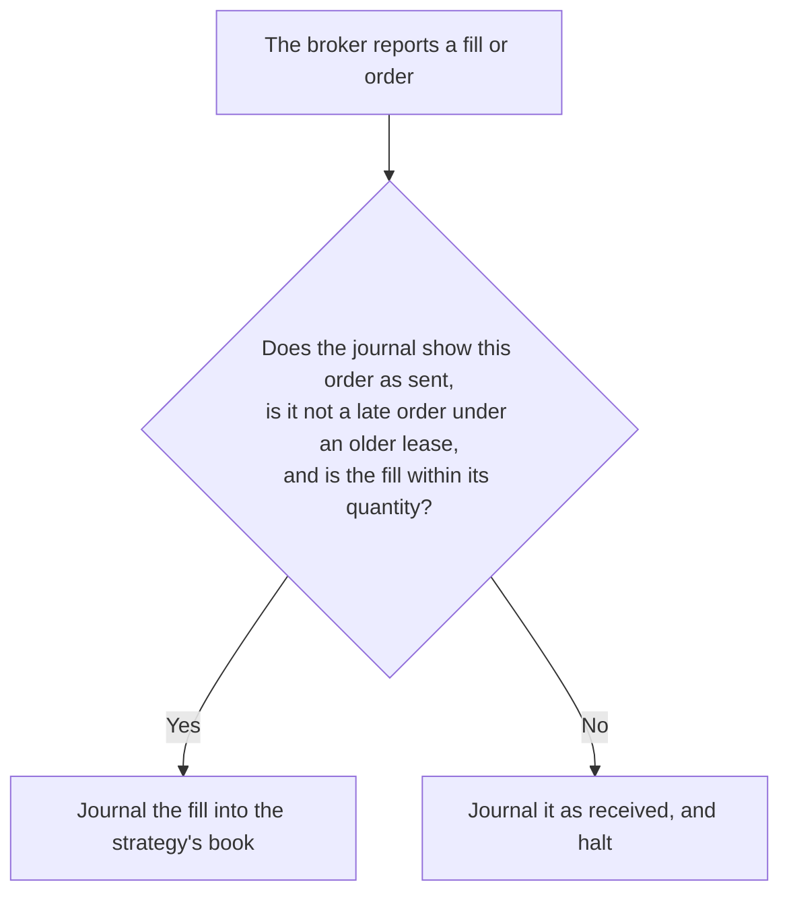

A broker's liquidation and a late order under an older lease take the "No" path too. Without the halt, a fill nobody journaled would enter the book and agree with the broker.

#### The current book comes from the journal

The book is the platform's own record of what it holds and what orders are open, so a broker's answer never replaces it quietly. Execution's recover stage replays it from the journal.

The broker's positions, open orders and cash are used in these places only:

1. The recover stage's reconcile.
2. Monitoring's second check.
3. The sync that opens the send stage.
4. A takeover's read of the broker's order list, which it stores.
5. The kill switch's read of open orders.
6. A sort's read of open orders.
7. The reconcile after the close. This doc proposes, for [#10](https://github.com/l3a0/ithildin-runtime/issues/10) and [#11](https://github.com/l3a0/ithildin-runtime/issues/11), that it compares positions, open orders and cash, and those issues hold the read.
8. A read of the broker's order list that gives an order in doubt its broker id. It supplies an id, checks each row against the order's `sending` entry, and never replaces the book.
9. The read of a leg's position and open orders just before each send of a close after a broker's trade, under [A fill is measured from the decision](../design.md#a-fill-is-measured-from-the-decision-and-a-position-depends-on-a-market-it-does-not-control).

The figure below is a C4 dynamic diagram.

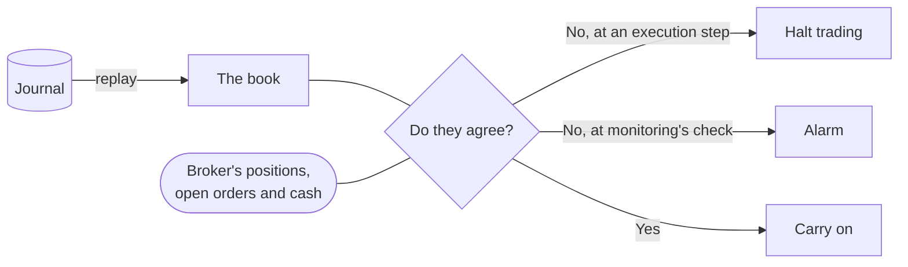

A disagreement at an execution step halts trading rather than quietly replacing the platform's record, and one at monitoring's check alarms.

#### Bars reach the models only after they are recorded

A number nobody can read back cannot be checked later. So a model never reads a feed directly, and the data worker records which bars it read first. Every number a model acted on can then be read back, from the snapshot for what the decision read, and from marketlake for the bars. Captured market data is the first of the three things [design.md](../design.md#premise) says cannot be recovered, and marketlake is where it is kept.

The figure below is a C4 dynamic diagram.

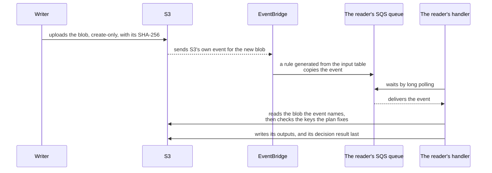

The diagram shows one write reaching one reader, so look for the event carrying only a hint and the handler reading the blob itself before it acts.

## One trading day

### The day at a glance

Every decision runs the same three phases, and one stage after the close ends the day. Phase 1 learns what is true at the broker, phase 2 decides what should be true, and phase 3 closes the gap.

The figure below is a C4 dynamic diagram.

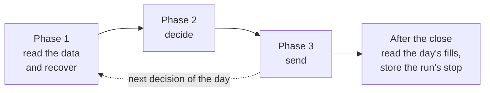

**Table:** Who acts in each phase, what it produces and what stops it

| Phase | Who acts | What it produces | What stops it |
| --- | --- | --- | --- |
| 1. Read the data and recover | Data and execution, with monitoring checking beside them | A snapshot of the bars read, and a book that agrees with the broker | Missing or stale data, or a book the broker disagrees with |
| 2. Decide | The alpha, risk and cost models, then portfolio construction | The target portfolio, within this decision's limits | A halt in any input, which each worker passes on |
| 3. Send | Execution, then monitoring | Orders at the broker, the decision's report and the heartbeat's ping | A failed check, a refused order or an order in doubt |
| After the close | Execution, then the supervisor | A result on each open order, then the run's stop | A read that fails or runs late, which pages the owner, or a difference, which halts and pages |

### The whole decision in order

A sequence diagram shows the same pieces in time order. This is one paper
decision with nothing wrong, for the skeleton's daily strategy. The
platform trades at any time of day and as often
as a strategy needs, so the time comes from the strategy's schedule, as
design.md's `### Strategies, schedules and decisions` says. The
skeleton trades the close, so the diagram draws its
decision at close−20, 15:40 on a full day, on marketlake's segments read before sealing, with
market-on-close orders that fill at the close. A strategy that decides
several times a day runs the same three phases once per decision, with the
workers left running between. The notes split it into three phases and a stage after the close. The host
keeps every worker running, the supervisor's plan starts the decision, and a
`par` block marks workers working at the same time. Each dashed arrow from
the blob store to a worker is S3's event for a blob, arriving on that worker's queue.

Alpaca rejects a market-on-close order "submitted after 3:50pm but before
7:00pm ET", so every order goes out by close−12, 15:48 on a full day, a
cutoff the owner's hard caps hold, as design.md's `### Strategies, schedules and decisions` says. That rule
also checks the cutoff again just before each broker call, and keeps a pair
whole by cancelling an accepted leg whose partner fails. The session's official daily bar arrives at marketlake's 18:30 sweep that evening. Monitoring then reports how far the decision's price and the fills sat from it.

The figure below is a C4 dynamic diagram.

```mermaid
sequenceDiagram
    autonumber
    participant S as Host, a systemd timer
    participant V as Supervisor
    participant F as Blob store
    participant D as Data
    participant X as Execution
    participant B as Broker
    participant J as Journal
    participant M as Monitoring
    participant A as Alpha model
    participant K as Risk model
    participant C as Cost model
    participant P as Portfolio construction

        S->>S: starts the supervisor instances' units
    V->>V: is the kill switch blob absent?
    V->>F: writes the run's plan once under the plan's lease,<br/>naming its release
    V->>S: writes the local release file,<br/>so its path unit starts each worker's unit
    F-->>D: sends an event for the plan
    F-->>X: sends an event for the plan
    F-->>M: sends an event for the plan
    F-->>A: sends an event for the plan
    F-->>K: sends an event for the plan
    F-->>C: sends an event for the plan
    F-->>P: sends an event for the plan
    X->>F: each instance runs its Startup checks, read only,<br/>before it plans or sends
    Note over V,M: Phase 1, read the data, then recover
    D->>F: stores the snapshot, naming each bar read,<br/>and data's decision result
    F-->>X: sends an event for data's result
    X->>B: asks about orders in doubt,<br/>reads fills since the last decision
    B-->>X: returns fills since the last decision
    X->>J: journals each fill
    X->>B: reads positions, open orders, cash<br/>and the broker's records
    B-->>X: returns positions, open orders, cash<br/>and the broker's records
    X->>J: journals each record as an outside entry
    X->>F: stores the account file, naming<br/>the journal entry it replayed through
    X->>X: does the book from the journal<br/>agree with the broker?
    X->>F: stores the reconciled book<br/>and execution's recover result
    F-->>M: sends an event for execution's recover result
    M->>F: stores monitoring's reconcile result,<br/>which no decision waits on
    Note over V,P: Phase 2, decide
    par
        F-->>A: sends an event for data's result
        A->>F: stores the forecast, hedge ratio, z-score<br/>and alpha's result
    and
        F-->>C: sends an event for data's result
        C->>F: stores the cost schedule and cost's result
    and
        F-->>K: sends events for data's and<br/>execution's recover results
        K->>F: stores the constraints and risk's result
    end
    F-->>P: sends events for alpha's, risk's, cost's<br/>and execution's recover results
    P->>F: stores the target portfolio and<br/>portfolio construction's result
    Note over X,J: Phase 3, send, in whichever execution instance<br/>receives the event
    F-->>X: sends an event for portfolio construction's result
    X->>F: writes a create-only claim on the send stage,<br/>naming its handler
    X->>B: reads positions, open orders, cash,<br/>the broker's records and fills since recover
    B-->>X: returns its state now
    X->>F: stores that read of the broker
    X->>J: journals its hash
    X->>J: journals any new fill under its fill id,<br/>and each new record as an outside entry
    X->>X: does the book from the journal<br/>agree with the broker?
    X->>X: runs the daily loss stop's test and the price spike<br/>flag's test, with no order needed,<br/>and creates stop.json from the result
    X->>X: the order manager plans the orders
    X->>J: journals the whole target portfolio and its<br/>planned orders, cancels and replacements
    X->>X: does the clock agree with the broker's,<br/>and is it before the cutoff?
    opt a resting order the plan cancels or replaces
        X->>F: takes the account's lease
        X->>J: journals the cancel
        X->>F: is no run or account halt stored or on the plan's lease,<br/>is its own send result empty, is the lease tag unchanged,<br/>and is it before the cancel cutoff?
        X->>B: cancels by the broker's order id<br/>that the journaled answer holds
        B-->>X: answers cancelled, filled first or accepted,<br/>or gives no answer
        opt accepted, or no answer
            X->>B: looks up once by the broker's order id
        end
        X->>J: journals the old order's outcome or its doubt,<br/>any fill included
        X->>F: releases the account's lease
    end
    loop each order the order manager plans,<br/>a replacement only if its old order settled
        X->>F: takes the account's lease
        X->>X: is the kill switch blob absent,<br/>and is it before the cutoff?
        X->>J: journals the intent
        X->>J: replays the book
        X->>X: runs the risk gate check
        X->>J: journals the approval
        X->>J: journals the sending entry
        X->>F: is the switch absent, the strategy not off,<br/>no run or account halt stored or on the plan's lease,<br/>its own send result empty, the lease tag unchanged,<br/>and is it before the cutoff?
        X->>B: sends the order, with its client order id
        B-->>X: answers
        X->>J: journals the broker's answer
        X->>F: releases the account's lease
    end
    X->>B: is every leg accepted?
    alt a leg rejected or unsent while another is accepted,<br/>or a leg's plan cancel stopped<br/>after its partner's was confirmed
        X->>F: takes the account's lease
        X->>J: journals each cancel
        X->>F: is the lease tag unchanged?
        X->>B: cancels the accepted legs
        X->>F: releases the account's lease
        loop a cancel's answer lost, inside the send stage's<br/>deadline, under design.md's rule<br/>for a cancel whose answer is lost
            X->>F: takes the account's lease
            X->>B: looks up by the broker's order id
            X->>J: journals the answer, and a new cancel<br/>when the rule for a cancel<br/>whose answer is lost allows one
            X->>F: is the lease tag unchanged?
            X->>B: sends the new cancel
            X->>J: journals its answer or its doubt
            X->>F: releases the account's lease
        end
    end
    X->>F: stores the send outcome<br/>and execution's send result
    F-->>M: sends an event for execution's result
    M->>F: stores the decision's report<br/>and monitoring's report result
    M->>M: reads the age of the jobs that run apart from a decision,<br/>and pages on one past its bound
    M->>M: pings the heartbeat service
    Note over V,J: After the close, once every decision has a result
    X->>B: reads the day's fills, positions, open orders,<br/>cash and the broker's records
    B-->>X: returns the day's fills, positions, open orders,<br/>cash and the broker's records
    X->>X: sorts what it read
    X->>J: journals each fill,<br/>and each record as an outside entry
    X->>X: reconciles the book
    X->>F: stores a result saying, for each order the journal<br/>holds as open, whether it is settled or still open
    V->>F: reads that result, and only then stores the run's stop
    Note over V,J: A read that fails or misses a written time<br/>pages the owner, and the supervisor stores no stop.<br/>A difference halts and pages whether or not<br/>the result and the stop follow
```

### Before the first decision

1. Each execution instance runs the charter's Startup step, the read-only checks listed there, in that order, as this doc proposes for [#11](https://github.com/l3a0/ithildin-runtime/issues/11).
2. It plans and sends nothing until they pass.
3. A halted instance whose digest and journal checks passed still takes a dead runner's send stage over, cancels a stranded leg and serves the kill switch, and [Every change can be undone or switched off](../design.md#every-change-can-be-undone-or-switched-off) says what else a failed check still serves.

### Phase 1: read the data and recover

A run that starts on a book the broker disagrees with would trade the wrong difference. So this phase ends in a comparison, and a difference halts.

1. **Data reads the bars.** It reads what the decision's lookback needs from marketlake, about 40 sessions of each ETF, and records which ones it read before any model sees them.
2. **Execution waits for that snapshot,** so it reads the broker at the decision's own time.
3. **Execution catches up.** It settles any order a crash left in doubt, and journals the fills that arrived since the last decision. This doc proposes, for [#10](https://github.com/l3a0/ithildin-runtime/issues/10), that it also reads the broker's records, such as fees and dividends, and journals each as an outside entry, ahead of the comparison.
4. **Execution lays out both sides.** It writes the strategies' books, replayed from the journal, beside the broker's positions, open orders and cash.
5. **Execution compares them,** position by position, order by order and cash against cash, and each stamped order's filled quantity against the journal's. A cash difference a listed record explains in full passes, and any other difference halts.
6. **Monitoring repeats the same check** for its report, and nothing waits on it.

### Phase 2: decide

The alpha, risk and cost models run at once, each on the blobs it needs. The risk model sets the constraints, meaning the limits for this decision. Portfolio construction builds the target portfolio within them.

The figure below is a C4 dynamic diagram.

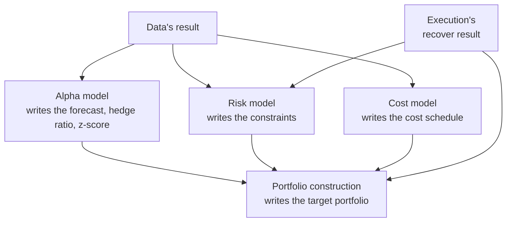

### Phase 3: send

This phase is the only one that touches the broker with an order, so it has the most checks. It has three parts: prepare once, send each order, and finish once.

The figure below is a C4 dynamic diagram.

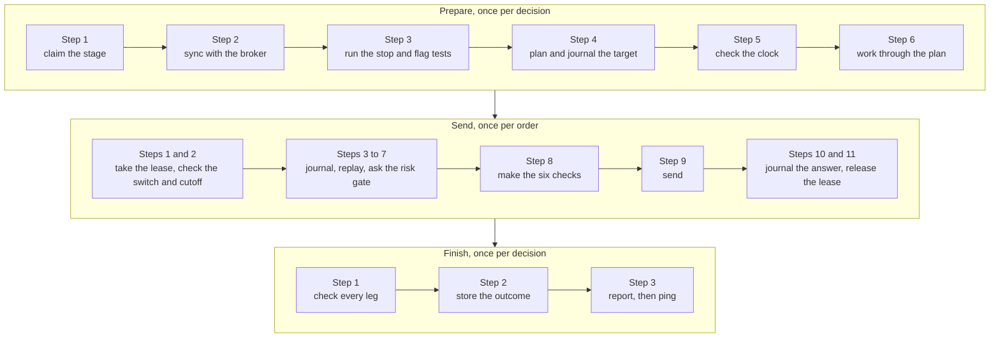

#### Prepare, once per decision

Three more checks sit inside these steps, as [How a rerun never doubles anything](../design.md#rule-9-how-a-rerun-never-doubles-anything) and [Who takes over a dead send stage](../design.md#rule-9-fifth-item-who-takes-over-a-dead-send-stage) say.

1. An instance checks the kill switch when it receives the event.
2. The sync settles each order in doubt.
3. Execution halts before it plans if an entry that changes the book, and that neither its sync nor its own order loop wrote, lies past the entry its sync names.

The steps run in this order.

1. **Claim the stage.** Whichever execution instance receives portfolio construction's result reads the target portfolio it lists, and writes a create-only claim on the send stage naming its handler. An instance that finds a claim it did not write never plans for that decision.
2. **Sync with the broker.** Every step fetches and syncs before changing state. So it fetches the broker's positions, open orders, cash and fills again. It stores that read and journals its hash before the comparison, as the sentence on every `Broker` read in [The interfaces](05-building-blocks.md#the-interfaces) says. It journals any fill that arrived since phase 1. This doc proposes, for [#10](https://github.com/l3a0/ithildin-runtime/issues/10), that it also reads the broker's records and journals each as an outside entry, ahead of the comparison. It then checks the journal's book against the broker. A fill of its own order brings the book up to date. Any order or fill the journal did not send is journaled as received and halts for a person.
3. **Run the daily loss stop's test and the price spike flag's test.** This doc proposes, for [#7](https://github.com/l3a0/ithildin-runtime/issues/7), that both run with no order needed, so a decision that plans no order still runs them, and that the stop's test creates `stop.json` from its result, as [The risk gate refuses an order](#the-risk-gate-refuses-an-order) says.
4. **Plan the orders and journal the target whole.** Each strategy's order manager turns the target minus that strategy's own positions and open orders into planned orders, cancels and replacements. One stored entry holds the target, the planned orders, cancels and replacements, each with its client order id, the journal entry it synced through, a hash of the broker state it fetched, and the instance running the send stage. A target portfolio names every instrument the book holds or the forecast names, with a flat leg as an explicit zero, and execution halts on one that leaves an instrument out. A strategy that is off when this step reads it gets no planned orders, cancels or replacements, so its resting orders are left to the sort, and the entry names it as off. A strategy is off when its off switch is set or, by this doc's proposal in [How a sort runs](../halts-and-drills.md#how-a-sort-runs), a strategy halt of its is unreleased, the same two things the check before each send reads. That never reads as a target of zero, so nothing it holds is sold, and the close after a broker's trade still goes out. An off switch or a strategy halt this step cannot read halts the decision. A switch set after this step is caught by the check before each send, as [What is checked right before a broker call](../design.md#rule-9-fourth-item-what-is-checked-right-before-a-broker-call) says.
5. **Check the clock.** Execution confirms its clock agrees with the broker's and that the market-on-close cutoff has not passed.
6. **Work through the plan.** The order manager carries out what step 4 journaled. It cancels a resting order of the strategy's that the target no longer wants, and replaces one that should change, sending the replacement only once the old order's cancel is settled.

#### Send, once per order

Each order goes through the order path alone, and the journal gains a line before the broker hears anything.

1. Take the account's lease.
2. Check the kill switch and the cutoff again.
3. Journal the intent.
4. Replay the book from the journal, so the risk gate sees every order already approved.
5. Ask the risk gate.
6. Journal the approval.
7. Journal that it is sending.
8. Make the six checks in the table below.
9. Send, with the order's client order id.
10. Journal the broker's answer: the ack, the rejection, or the order's doubt.
11. Release the lease by a conditional rewrite that clears its holder, so another instance's cancels wait for at most one order.

**Table:** The six checks made right before the broker call

| Check | What it reads | Passes when |
| --- | --- | --- |
| 1 | The kill switch | It is absent |
| 2 | The order's strategy | It is not switched off |
| 3 | The run's and the account's halts, and the plan's lease | No halt is stored, and the lease says the run is running |
| 4 | This instance's own send result | It is still empty |
| 5 | The account's lease | It still carries this instance's tag |
| 6 | The market-on-close cutoff | It has not passed |

Any check that fails journals the order `Abandoned` and halts the decision. One exception is a switched-off strategy, whose orders are abandoned while the account's other strategies keep sending. An order under a valid close entry reads these checks as [What is checked right before a broker call](../design.md#rule-9-fourth-item-what-is-checked-right-before-a-broker-call) says.

A cancel the plan asks for takes the same shape, as the sequence diagram above shows: take the lease, journal the cancel, check, call the broker, journal the outcome and release the lease.

#### Finish, once per decision

1. **Check every leg.** After the loop execution looks up each leg. It cancels any accepted leg whose partner was rejected or never sent, and any leg whose plan cancel was stopped after its partner's was confirmed.
2. **Store the send's outcome** and execution's send result.
3. **Report, then ping.** Monitoring writes the decision's report. It reads the age of the jobs that run apart from a decision, and pages on one past its bound, as [Faults are expected](../design.md#faults-are-expected-and-the-platform-checks-itself-while-it-runs) says. It pings the heartbeat service last, so a decision that dies or hangs never pings.

### After the close

Once every decision has a result, the day ends in three steps, which this doc proposes for [#10](https://github.com/l3a0/ithildin-runtime/issues/10) and [#11](https://github.com/l3a0/ithildin-runtime/issues/11).

1. Execution reads the day's fills and the broker's positions, open orders, cash and records, sorts what it finds as design.md's `Sorting what the broker reports` says, journals the fills and each record as an outside entry, and reconciles. A difference halts and pages with its reason. Execution journals the open halt the holding-halt check reads, and neither that write nor the page waits on the result or the stop. [#10](https://github.com/l3a0/ithildin-runtime/issues/10) and [#11](https://github.com/l3a0/ithildin-runtime/issues/11) hold whether those are still stored after it.
2. Execution stores a result naming each order the journal holds as open as settled or still open.
3. The supervisor reads that result, and only then stores the run's stop.

A read that fails or misses a written time pages the owner, and no stop is stored, as [The life of a run](#the-life-of-a-run) says.

### If an instance dies in the middle of a send

The journal entries carry the weight of hard limit 4, which says every order is journaled before it is sent. An order's `sending` entry is what makes a crash safe, because it tells the next instance that an order may have left.

The figure below is a C4 dynamic diagram.

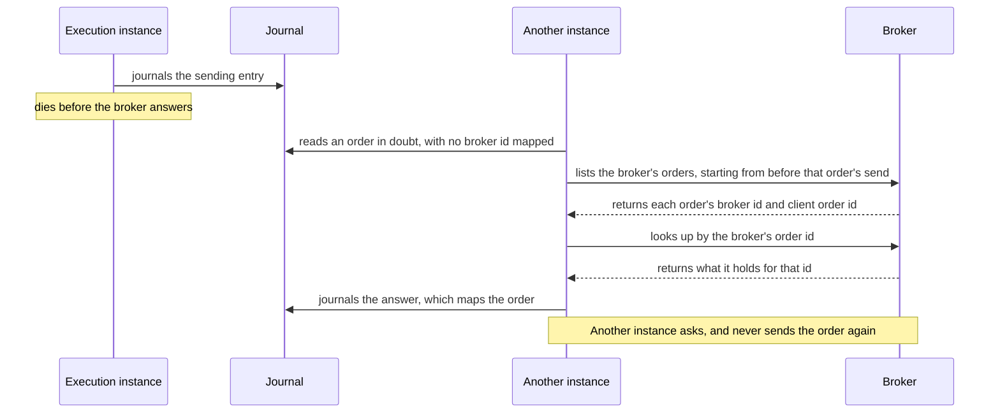

A client order id is an id the platform chooses and sends with the order. The broker gives the order an id of its own, and the journal maps one to the other on each ack. Every lookup goes by the broker's order id, because not every broker can find an order by a client order id.

An order in doubt has no ack, so the journal holds no broker id for it. `OrderPath` hands the adapter the order's intent through `find_order`, and the adapter answers with the broker's id, not found, or more than one. It also says whether its list was whole and gives each paired row it read, converted at the adapter to the platform's `BrokerOrder`, so `OrderPath` runs the match and the halts in one place. How it finds the order is the adapter's own, so a new broker changes no line of `OrderPath`. Three steps make Alpaca's lookup go by the broker's id too, and [#10](https://github.com/l3a0/ithildin-runtime/issues/10) builds them.

1. The adapter reads the broker's order list, open and closed orders alike, from the earliest `sending` entry in doubt, less a written overlap larger than the clock's bound, which [#10](https://github.com/l3a0/ithildin-runtime/issues/10) sets.
2. It returns the broker's order id from the row that carries the order's client order id.
3. `OrderPath` looks the order up by that id and journals the answer. Its ack maps the order like any other, apart from a late order under an older lease or an answer that disagrees with the `sending` entry, which halts first.

An order absent from a whole list stays `InDoubt`, because a request sent just before a crash can still arrive. A list that fails or stops early settles no order's state and halts new orders, a row already read still serves every cancel but a plan's own, and a row or an answer that disagrees with the `sending` entry halts, as design.md's `### Orders the platform did not send` says. Alpaca, the broker for paper and for live, names both ids in its [list of orders](https://docs.alpaca.markets/reference/getallorders-1), which returns at most 500 orders a call, and [#10](https://github.com/l3a0/ithildin-runtime/issues/10) confirms how the adapter pages through it.

A broker that takes no client order id gets an adapter that pairs on the order's details instead. It takes a row the journal has not mapped, matching the order's instrument, side, quantity and type inside the same window. That match is close to unique, because an account holds one portfolio, one holder of the lease sends, and the gate refuses a second order beside one in doubt. The journal's mapping stands in for the stamp there, and more than one match halts. This adapter is designed and not built, and it passes the broker suite before any such broker is used, on the terms design.md's `### Orders the platform did not send` gives.

Alpaca's [order reference](https://docs.alpaca.markets/reference/postorder) does not say whether it refuses a second order with the same client order id, so nothing here relies on that, and [#10](https://github.com/l3a0/ithildin-runtime/issues/10) tests it on the paper account as a second line of defence.

## When something is wrong

Hard limit 3 says missing input means stop, not flatten. One firm's execution
server rebooted before its alpha server, read "no signals" as "hold nothing",
and sold most of its book. The [charter](../team-charter.md) cites it at L4690, a
Kindle location in the owner's highlights of Narang's *Inside the Black Box*.
Each diagram below is one way a day goes wrong, and each ends with no new orders and the positions left as they were, apart from a broker's own trade, where the close after a broker's trade under [A fill is measured from the decision](../design.md#a-fill-is-measured-from-the-decision-and-a-position-depends-on-a-market-it-does-not-control) can close the whole position.

Every halt takes the same route.

1. The worker that finds the problem writes a halt as its decision result,
   with the reason, in place of its outputs. A capturing stage stores what it
   read first, and its halt names that file.
2. Every worker downstream finds that halt as its input's result, writes its
   own halt naming it, skips the decision and goes on to its next one.
3. Monitoring, which reads every component's results, journals every halt,
   raises an alarm on the halt that names no earlier one, once per reason in
   a run until a decision succeeds, writes the decision's report and pings the
   heartbeat service.

The same route runs in every mode, and the run goes on to its next decision,
which halts again if the cause is still there. A single crash is not a
failure: the host restarts the worker, which resumes from storage. A
failure is a missed deadline, a heartbeat stopped for longer than the limit set on [#11](https://github.com/l3a0/ithildin-runtime/issues/11), or
none of a component's instances healthy, and it takes the same route. The supervisor
writes the halt as the failed worker's result, stores a halt of the whole run, whose event reaches every worker, writes a halt for every decision left in the plan, and monitoring reports.

### A missing or stale bar

The figure below is a C4 dynamic diagram.

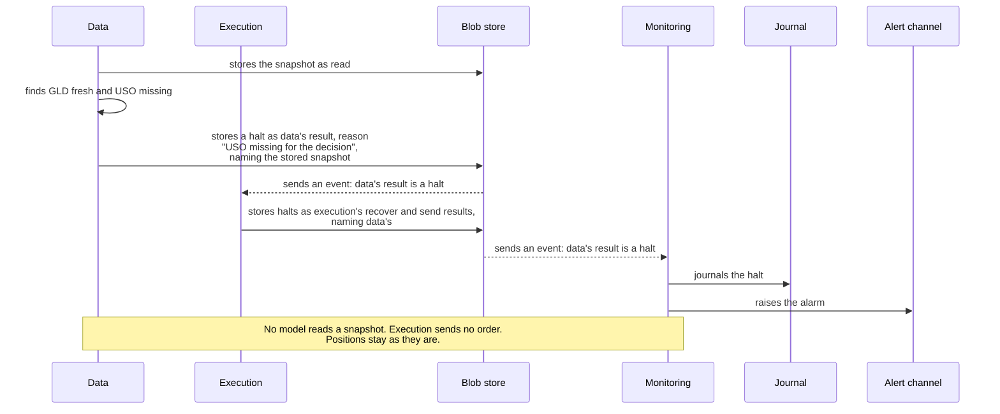

A stale bar takes the same path. Stale means the newest bar is older than the
decision time allows, which is how a feed that stopped looks when it keeps
answering. Data reports the gap and never fills it with the last close.
The charter gives the risk engineer the halt on stale data, so
[#7](https://github.com/l3a0/ithildin-runtime/issues/7) decides how old is too
old. Data applies that rule.

An empty answer halts the same way. If the alpha model writes a forecast file
with no entries and no "trade nothing" mark, portfolio construction halts rather
than reading the silence as a target of zero. A flat position is a forecast
with direction 0, never a missing forecast. The one exception is a forecast late at portfolio construction's deadline, under hard limit 3's written age, which the owner sets, which starts at 0 and which [a decision of 2026-11-06](../design.md#2026-11-06) sets out.

### A restart before the data is ready

The figure below is a C4 dynamic diagram.

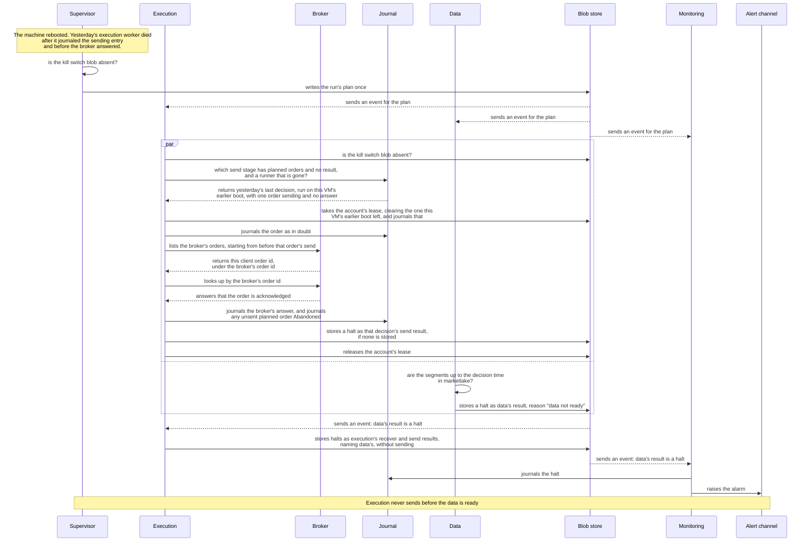

The restart runs the same first phase as any trading day.

1. On starting, execution settles the order the dead worker left half-sent, by
   asking the broker about it rather than sending it again, and halts that old
   decision, as [Who takes over a dead send stage](../design.md#rule-9-fifth-item-who-takes-over-a-dead-send-stage) says.
2. Data finds the segments up to the decision time not yet in marketlake and
   halts, so execution's recover stage, which waits for data's result, halts
   too.

The order in which the processes come up no longer matters. Execution may
start before data, as it does here, but it sends only what a target
portfolio asks for, and that cannot exist until a snapshot does. The charter
gives the operator the startup order: execution may send an order only once
every upstream worker has written a decision result that lists outputs, not a
halt, for the decision. Above a written age of 0, hard limit 3's exception covers a strategy's late forecast.
The pipeline makes that order something the platform cannot get wrong. "Not ready" is a halt, never an empty forecast.

### The risk gate refuses an order

The figure below is a C4 dynamic diagram.

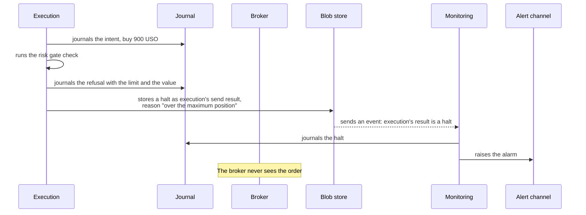

A refusal is final, and execution halts rather than sending the rest of its
orders, because portfolio construction sized the rest assuming this one would
go through. Nothing resizes the order to fit either, since an order cut down
to pass the risk gate is a trade nobody chose. Clearing the halt sends nothing more for that decision. If the refused order is a pair's second leg and the first is already accepted, execution cancels the accepted leg, as for any pair left with one leg. The cancel aims to land before the cancel cutoff, and one that goes late is still sent and its refusal journaled. The next decision plans again from the book. On a shadow or paper account, holding
the account after a refusal until a person clears it waits for a strategy
that decides minutes apart, as design.md's
`### Strategies, schedules and decisions` says. A refusal on live holds until the owner clears it.

#### The daily loss stop

A day's loss past a set limit has to end new trading for the account, and a price that recovers must not start it again. So the stop works through the same risk gate, and once it fires it holds until a person clears it.

#### How the day's loss is measured

The day's loss is the fall in the account's value at current prices, measured from its valuation at the prior session's official closes. The day's first decision stores that valuation.

Two gaps in that measure halt rather than read as no loss.

1. A decision halts when the valuation is missing, which this doc proposes for [#7](https://github.com/l3a0/ithildin-runtime/issues/7).
2. An uncomputable loss with positions held halts, and [#7](https://github.com/l3a0/ithildin-runtime/issues/7) holds how.

#### When the stop is tested

This doc proposes, for [#7](https://github.com/l3a0/ithildin-runtime/issues/7), that the send stage runs the stop's test and the price spike flag's test on every decision that reaches it, before any order is planned and with no order needed. So a decision that plans no order still tests the stop.

The stop has a stated limit: no decision tests the price move from close−20 to the close.

#### What happens when the stop fires

A fired stop latches, which means it stays fired whatever the price does next. This doc also proposes that for [#7](https://github.com/l3a0/ithildin-runtime/issues/7), in four steps.

1. The first time the send stage's test finds the day's loss past the stop, execution creates a blob at `accounts/<account>/stop.json` with a create-only write, as the kill switch is created, and journals it.
2. `OrderPath` reads that blob before every new order, as it reads the switch, and hands its state to the gate.
3. The gate refuses every new order while the blob exists, across sessions, so a price that recovers never resumes trading on its own.
4. `ithildin stop clear --account <a>` deletes the blob and journals the clear. On a live account only the owner may, and on shadow and paper the operator may too, as the charter's owner and risk engineer sections say.

The figure below is a C4 dynamic diagram.

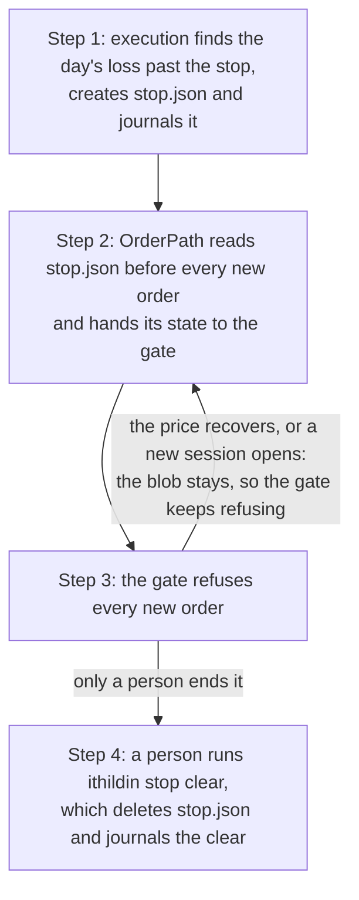

#### Which orders a stop refuses

A fired stop has one exception. The close after a broker's trade closes a whole position once the broker has made a trade of its own, under [A fill is measured from the decision](../design.md#a-fill-is-measured-from-the-decision-and-a-position-depends-on-a-market-it-does-not-control). That order passes a fired stop only under a valid close entry.

A failed read must not open that exception, so an unreadable stop holds the close too. Any answer other than "no such blob" reads as fired for a decision's order, and the state `OrderPath` hands the gate keeps fired and unreadable apart. [#7](https://github.com/l3a0/ithildin-runtime/issues/7) holds how.

**Table:** What the gate does with each answer from reading `stop.json`

| Answer from the read | The stop's state | A decision's new order | An order under a valid close entry |
| --- | --- | --- | --- |
| "No such blob" | Not fired | Passes this check | Passes this check |
| The blob | Fired | Refused | Passes this check |
| Any other answer | Unreadable | Refused | Not sent |

#### Why slice 1 only stops

[#7](https://github.com/l3a0/ithildin-runtime/issues/7) lists the limit as "an automatic unwind and stop". An unwind is itself a trade, so slice 1 stops only.

### The book and the broker disagree

The figure below is a C4 dynamic diagram.

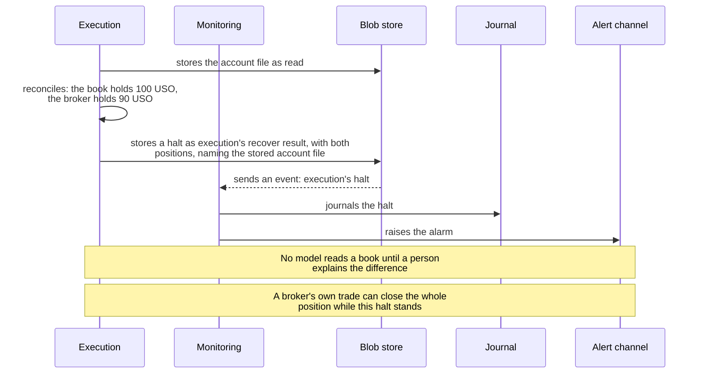

Execution trades the difference between a target and the book, so a book the broker disagrees with sends the wrong order. So the platform compares the two, and a difference it cannot explain halts trading until a person has.

#### Who compares the book with the broker

Two workers compare the broker with the sum of the strategies' books.

1. Execution's recover stage compares them before a decision trades.
2. Monitoring compares them again for its report.

Both compare positions, open orders and cash. So an order the broker holds and the journal marks lost or abandoned halts the day it appears, not the day it fills.

#### What each difference leads to

A mismatch in a position means one of two things: a fill the platform never journaled, or a position the broker changed on its own. Both need a person. The table below lists each case and what it needs.

**Table:** What the platform does with each thing the comparison finds

| What the comparison finds | What the platform does | What a person does |
| --- | --- | --- |
| A fill the platform never journaled | Halts | Explains the difference |
| A position the broker changed on its own | Halts | Explains the difference |
| A split or an assignment, in shadow or on paper | Halts. An outside entry from the broker's own record releases the halt once it explains the whole difference and any close has ended, under the rule that any difference from the broker halts trading ([Faults are expected](../design.md#faults-are-expected-and-the-platform-checks-itself-while-it-runs)) | Nothing for a split. An assignment leaves its strategy off until a person switches it back on |
| A broker's own trade, such as a forced close or a buy-in | Halts. The order that closes the rest of the position can go out before a person acts, under the close after a broker's trade ([A fill is measured from the decision](../design.md#a-fill-is-measured-from-the-decision-and-a-position-depends-on-a-market-it-does-not-control)) | On a live account, clears the halt once every leg has ended. In shadow and on paper the outside entry releases it then |
| An order the broker holds and the journal marks lost or abandoned | Halts the day it appears | Explains the difference |
| A broker record of a type on the closed list, with its amount in range | Journals it with no halt | Nothing |
| A broker record that leaves a difference unexplained | Halts | Explains the difference |
| By this doc's proposal for [#10](https://github.com/l3a0/ithildin-runtime/issues/10), a record that repeats a record id with different content | Halts | Explains the difference |

The closed list of record types, and the four cases that halt, are in [Strategies, schedules and decisions](../design.md#strategies-schedules-and-decisions).

#### Who owns reconciliation

Reconciliation lives on [#11](https://github.com/l3a0/ithildin-runtime/issues/11). The charter has the trading systems engineer write it, so that role reviews it there.

### The kill switch and the dead-man check

The figure below is a C4 dynamic diagram.

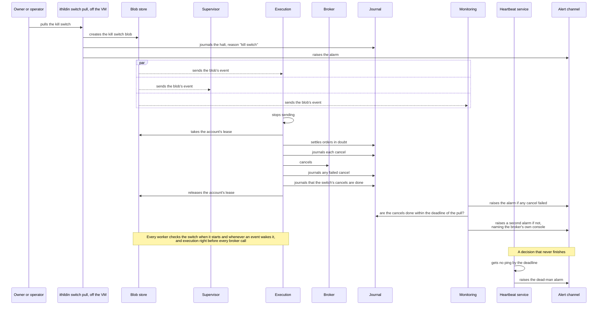

The two cover different failures.

1. **The kill switch** is for a run that is alive and doing something nobody
   wants.
2. **The dead-man check** is for a run that is not alive at all, including a
   supervisor that died, since monitoring pings only as each decision's last
   step. The check runs on the deployment's schedule, and its grace period has
   to exceed the longest chain of worker deadlines plus the report, or a slow,
   healthy decision alarms.

#### How a pull cancels

Pulling the kill switch cancels every resting order in the account, stamped or not.

##### What the kill switch is

The kill switch is a command, not a running process. It creates a blob at one key per broker account, and every worker reads that blob. The split of the kill switch work is on [#11](https://github.com/l3a0/ithildin-runtime/issues/11).

##### What happens after a pull

1. The blob's S3 event reaches the queues of execution, the supervisor and monitoring.
2. Whichever execution instance receives that event takes the account's lease. The lease is free after at most one order in flight, or on the lease's release.
3. That instance cancels every resting order in the account through the order path, stamped or not, so each cancel is journaled like any other step.

Monitoring's report says the switch is set.

##### What happens when execution is down at the pull

A starting execution instance checks the switch as soon as its digest and journal checks pass. If it finds the switch set, it takes the account's lease and cancels every resting order. So a switch pulled while execution is down still cancels once the host restarts it.

##### What happens when the switch cannot be read

A switch that cannot be read halts with the reason "kill switch unreadable" and the error, so the journal never mistakes a permission problem for a deliberate pull.

##### Why a pull also cancels market-on-close orders

Market-on-close orders rest at the broker from when they are sent, between close−20 and close−12, until the close. So a switch pulled in that window stops nothing already sent unless it also cancels them, which is why it does.

Cancelling an unfilled order sells nothing, so the pull is still a stop and not a flatten.

#### The cancel cutoff

The exchange stops taking cancels of closing-auction orders some minutes before the close, so a switch pulled after that cannot stop the fill, and execution's report of its cancels says so. The cancel cutoff is the earlier of Alpaca's and the exchange's. NYSE Arca, where GLD and USO list, refuses cancels of closing-auction orders from 15:59, as a [Lightspeed guide](https://lightspeed.com/support/lightspeed-trader-on-close-and-on-open-guide) and an [SEC filing](https://www.sec.gov/files/rules/sro/nyse/2018/34-84804.pdf) on its closing freeze describe. Alpaca's [order page](https://docs.alpaca.markets/docs/orders-at-alpaca) names no separate cancel cutoff, so this doc takes close−10, Alpaca's entry cutoff and 15:50 on a full day, as the cancel cutoff until Alpaca says otherwise. That is an assumption that errs early, and [#10](https://github.com/l3a0/ithildin-runtime/issues/10) confirms Alpaca's real one.

### Every alarm and its drill

Every alarm has one row, with the reason it writes and the drill that fires it, in [Halts and drills](../halts-and-drills.md#every-alarm-and-its-drill). The paper gate reads that list.

## The life of an order

A state diagram shows the states one thing can be in and what moves it between
them. Each transition is a journal entry written before the next step. An execution instance taking over a send stage whose runner died writes two of them after the fact, when it finds the gap, as [Who takes over a dead send stage](../design.md#rule-9-fifth-item-who-takes-over-a-dead-send-stage) says: `Abandoned` for an order a crash left without a `sending` entry, and the crash half of `InDoubt`.

The figure below is a C4 code diagram.

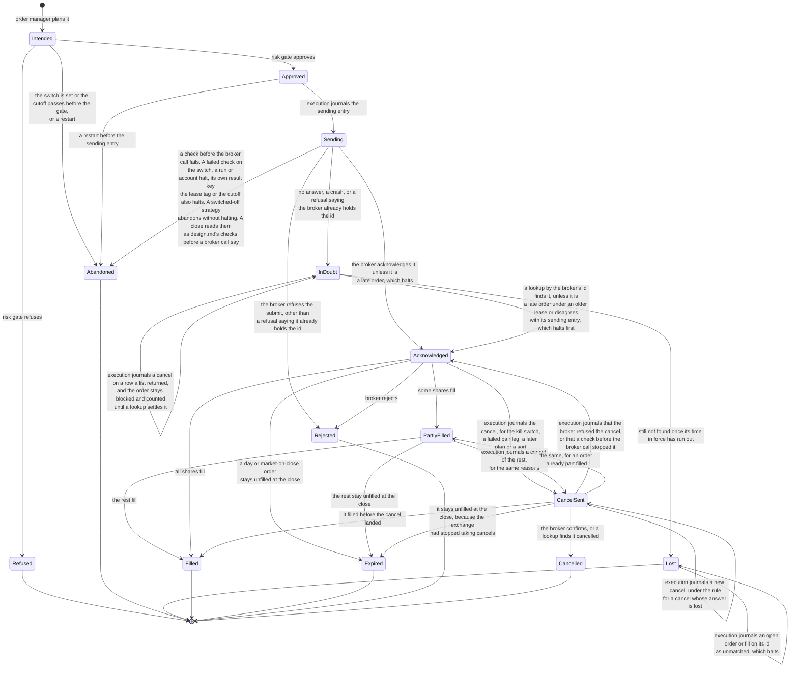

`Refused` is the platform's own risk gate saying no. `Rejected` is the broker
saying no.

### How an order leaves `InDoubt`

`InDoubt` is the state a crash between sending and the ack lands in. It lets the journal say "the platform does not know whether the broker has this order", rather than leaving the next decision to guess.

The only way out is to ask the broker, by the broker's order id, which the broker's order list supplies for an order with no ack. Sending the order again is never a way out.

A lookup that finds nothing, or a whole order list that does not show the order, keeps it `InDoubt`, counted at its worst case, until its time in force has run out, when it becomes `Lost`. It stays because a request sent just before a crash can still arrive after that read.

### What the next decision does with `Abandoned` and `Lost`

**Table:** The two end states the order manager plans around

| State | What it means | What the next decision's order manager does |
| --- | --- | --- |
| `Abandoned` | The order never reached the broker | Plans from the book as if the order had never existed |
| `Lost` | The platform stopped waiting, and sending is unproved | Plans from the book the same way |

### What halts as unmatched

An open order or a fill on an order the journal holds as `Lost` or `Abandoned` is journaled as received as unmatched and halts. So is a late order under an older lease.

### What becomes of an order after its cancel

**Table:** What happens to an order after each way its cancel can end

| How the cancel ends | What happens to the order |
| --- | --- |
| The broker reports it as pending | It stays `CancelSent`, still counted at its worst case |
| The broker refuses it | It returns to the state it was in, still counted, with the alarm for a cancel that failed |
| The answer is lost | It stays `CancelSent` |
| A check stops the cancel before the broker call | Execution journals that, and the order returns to the state it was in, still counted |

For a cancel whose answer is lost, [Faults are expected](../design.md#faults-are-expected-and-the-platform-checks-itself-while-it-runs) says when it is sent again and when it halts new orders. For a plan's cancel no stage resends yet, and the next recover stage settles what it can by lookup.

### How an order reaches `Cancelled`

`Cancelled` is reached four ways.

1. Through the kill switch.
2. When one leg of a pair is accepted and the other fails.
3. When a later decision's plan no longer wants an unfilled order or replaces it, as design.md's `### Strategies, schedules and decisions` says.
4. Through a sort, under a strategy's off switch or a halt that cancels this way, as [How a sort runs](../halts-and-drills.md#how-a-sort-runs) says.

A replacement is a new order with a stamp of its own, sent only once the old order's cancel is confirmed. Each way the cancel is journaled first, and the sync then counts it as the platform's own.

## The life of a run

One decision's chain moves through these states. In shadow, paper and live a
run is one trading day's decisions. In a backtest it is every decision of the
span. A halt ends only its own decision's chain.

The figure below is a C4 code diagram.

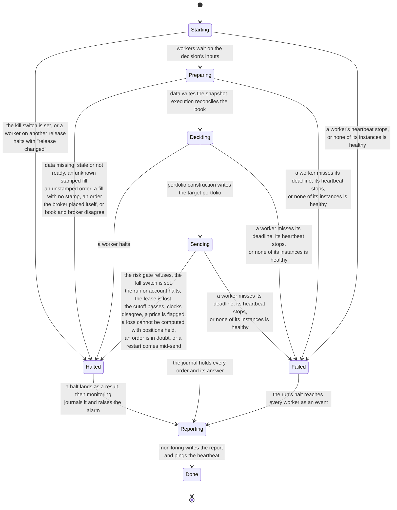

### What `Preparing` does

`Preparing` is the first phase of a decision, in two steps.

1. Data reads the snapshot.
2. Once that snapshot and its own send result for the decision before exist, execution settles orders in doubt, journals fills, writes the book and reconciles it with the broker.

Monitoring reconciles again, and no decision waits on it.

### Where the run's state is kept

The supervisor holds none of these states in memory. It reads them from storage: which components have a decision result, and whether a result is a halt.

- A restarted supervisor finds the state the same way, while the workers keep running.
- A worker the host restarts checks its own result key for each decision, reads the blobs that exist, and writes the ones that are missing.

### How a halt differs from a failure

A halt and a failure differ in what they stop.

- A halt stops one decision, and in every mode the run goes on to the next decision.
- A failure stops the whole run.

Both pass through `Reporting`, so a halted or failed decision still writes its report and its journal entry, and monitoring sends the alarm with its reason to the environment's push topic, which delivers each one. If monitoring itself is what failed, no ping arrives, and the dead-man check raises the alarm.

### Who clears a halt

A halt is final for its decision, which is this doc's choice. The owner or the operator clears it, and only the owner clears a live account's halt. Clearing never reruns the decision. The next decision starts fresh, and it halts again while the kill switch is set or the cause is still there.

### When the run stops

The run's stop waits for two things.

1. The market's close.
2. The run's read of the day's fills.

So execution serves a pull of the kill switch until the last moment a cancel could land, and the closing auction's fills are reconciled the same evening.

This doc proposes, for [#10](https://github.com/l3a0/ithildin-runtime/issues/10) and [#11](https://github.com/l3a0/ithildin-runtime/issues/11), that the read after the close runs in five steps. The same steps appear, grouped as three, under [After the close](#after-the-close).

1. Execution reads the day's fills and the broker's positions, open orders, cash and records.
2. It sorts what it finds as design.md's `Sorting what the broker reports` says.
3. It journals the fills and each record as an outside entry.
4. It reconciles, and stores a result naming each order the journal holds as open as settled or still open.
5. The supervisor reads that result before it stores the stop.

In shadow the read finds the market-on-close order open, which counts as read. [#10](https://github.com/l3a0/ithildin-runtime/issues/10) and [#11](https://github.com/l3a0/ithildin-runtime/issues/11) hold how.

The host's timer stops every unit after that stop.

### When the read after the close goes wrong

This doc also proposes, for [#10](https://github.com/l3a0/ithildin-runtime/issues/10) and [#11](https://github.com/l3a0/ithildin-runtime/issues/11), what happens in two cases. One of them journals a halt for the holding-halt check, which halts each later decision while the journal holds an unreleased halt whose cause holds the account, as [A halt is final for its decision](../design.md#rule-7-a-halt-is-final-for-its-decision) says.

**Table:** What happens when the read after the close goes wrong

| What goes wrong | What happens |
| --- | --- |
| The read fails or misses a written time | It pages the owner, the next recover stage, where execution settles orders and journals fills before a decision, reads the fills, and the host's timer ends the run, which [How a run stops](../design.md#rule-7-how-a-run-stops) proposes not to count as a clean shutdown |
| The read finds a difference | The difference halts and pages with its reason. Execution journals the open halt the holding-halt check reads, and neither that write nor the page waits on the result or the stop |
