# Architecture, section 6: Runtime

This page is section 6 of [the architecture](00-README.md), in the order of the arc42 template. It answers what happens while the platform runs: a decision's data flow, a trading day, faults, and the life of an order and of a run.

## Contents

- [Data flow](#data-flow)
  - [What the data flow guarantees](#what-the-data-flow-guarantees)
- [One trading day](#one-trading-day)
  - [The day at a glance](#the-day-at-a-glance)
  - [The whole decision in order](#the-whole-decision-in-order)
  - [Before the first decision](#before-the-first-decision)
  - [Phase 1: read the data and recover](#phase-1-read-the-data-and-recover)
  - [Phase 2: decide](#phase-2-decide)
  - [Phase 3: send](#phase-3-send)
  - [After the close](#after-the-close)
  - [If an instance dies in the middle of a send](#if-an-instance-dies-in-the-middle-of-a-send)
- [When something is wrong](#when-something-is-wrong)
  - [A missing or stale bar](#a-missing-or-stale-bar)
  - [A restart before the data is ready](#a-restart-before-the-data-is-ready)
  - [The risk gate refuses an order](#the-risk-gate-refuses-an-order)
  - [The book and the broker disagree](#the-book-and-the-broker-disagree)
  - [The kill switch and the dead-man check](#the-kill-switch-and-the-dead-man-check)
  - [Every alarm and its drill](#every-alarm-and-its-drill)
- [The life of an order](#the-life-of-an-order)
  - [How an order leaves `InDoubt`](#how-an-order-leaves-indoubt)
  - [What the next decision does with `Abandoned` and `Lost`](#what-the-next-decision-does-with-abandoned-and-lost)
  - [What halts as unmatched](#what-halts-as-unmatched)
  - [What becomes of an order after its cancel](#what-becomes-of-an-order-after-its-cancel)
  - [How an order reaches `Cancelled`](#how-an-order-reaches-cancelled)
- [The life of a run](#the-life-of-a-run)
  - [What `Preparing` does](#what-preparing-does)
  - [Where the run's state is kept](#where-the-runs-state-is-kept)
  - [How a halt differs from a failure](#how-a-halt-differs-from-a-failure)
  - [Who clears a halt](#who-clears-a-halt)
  - [When the run stops](#when-the-run-stops)
  - [When the read after the close goes wrong](#when-the-read-after-the-close-goes-wrong)

## Data flow

A data flow diagram shows the components, the order they talk in, and each point where a call crosses a trust boundary. A trust boundary is a line where what a caller may do changes, such as the edge of execution, the only component that holds the broker key. Threat modeling starts from these crossings, because that is where data can be read, changed or forged, so each one needs a stated protection.

Two figures follow. The first shows where each component runs, and the second the order they talk in. In both, the dashed boxes are trust boundaries, the cylinders are stores, and the rounded boxes are things outside the platform.

The figure below is a C4 deployment diagram. It places each component and store inside the VM or the AWS account that holds it, and draws the other systems outside. It draws no flows.

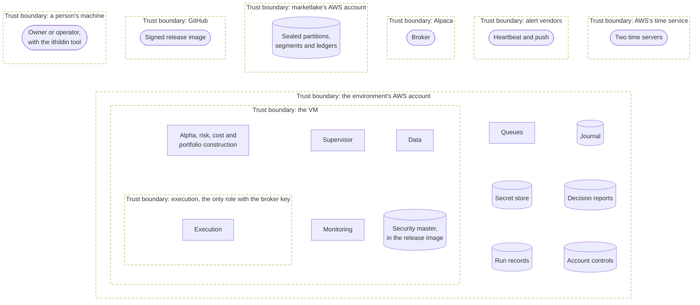

In the second figure, the numbers give the order of one decision on paper, and a sub-number, such as 9.2, names one arrow of a step that has several. Flow 0 happens before the session, and flow 15 whenever a person acts. Flow 16 runs on threads of each process's own, whether or not a decision is under way. In shadow, flows 6, 10 and 11 go to the simulated broker and cross nothing, and no broker key exists. Execution reads the hard caps in its recover stage and stores the book, the caps as read and the valuation for the risk model and portfolio construction, in flows 7.4 and 7.5.

The figure below is a C4 dynamic diagram. It draws the same components, stores and boundaries as the deployment diagram above, with the flows of one decision between them.

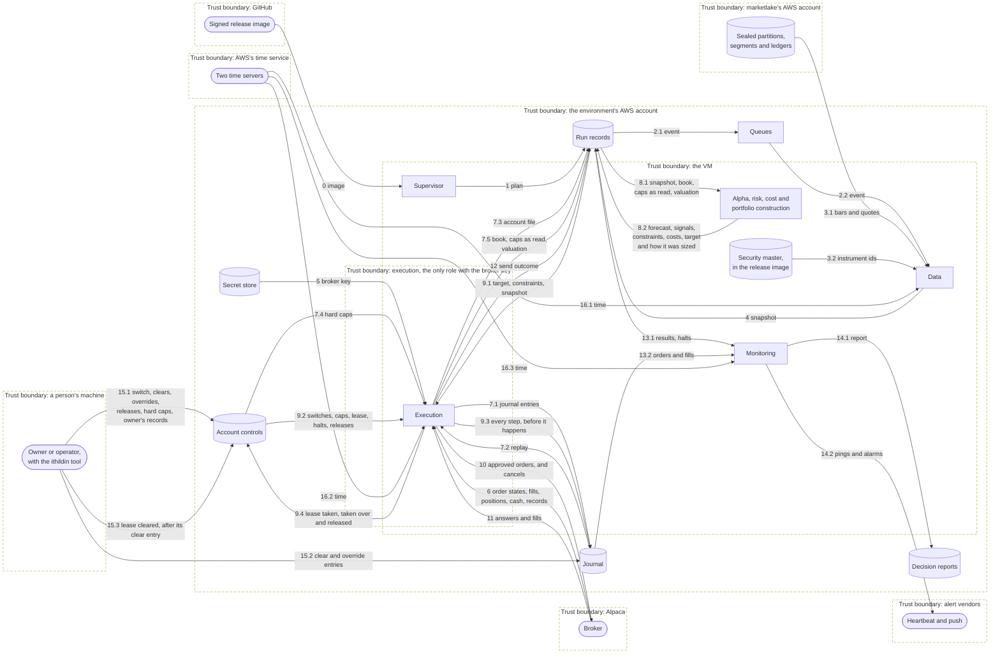

Flows outside one decision, such as pin writes and a failure's direct alarm route, are drawn in [Where it runs](07-deployment.md#where-it-runs).

The table below names each flow of the dynamic diagram that crosses a trust boundary, by its number there.

**Table:** Each flow that crosses a trust boundary

| Flow | Crosses | What could go wrong | What protects it |
| --- | --- | --- | --- |
| 0 image | GitHub into the VM | A forged or altered release runs | The VM checks the pinned digest and its attestation, and refuses otherwise |
| 1, 4, 7.1, 7.3, 7.5, 8.2, 9.3, 12, 14.1 writes | The VM into storage | A component overwrites or forges a record | Each component has its own role, every write is create-only with its SHA-256, and the journal chains by hash |
| 9.4 lease | The VM into storage | A holder that lost the lease rewrites it | Among the runtime's roles, only execution's rewrites an account's lease, a take on the tag it read and a renewal or a release on the tag its own last write returned, so a stale holder's write is refused. Execution creates one only where an absent lease allows it, and the bucket refuses every delete there |
| 7.2, 8.1, 9.1, 13.1, 13.2 reads | Storage into the VM | A component acts on a changed blob | Each read checks the SHA-256 its result or header lists, the journal also chains by hash, and a mismatch halts |
| 2.1, 2.2 event | Storage to a component's queue | A forged or lost event starts or starves a step | An event only wakes a component, which reads the stored blob itself, and a missing result alarms past its bound |
| 3.1 bars and quotes | marketlake's account into the VM | Bars or quotes are changed, withheld or stale | Only the data worker's role reads them, read only, each object's SHA-256 is checked, and a missing, stale or quarantined input halts |
| 5 broker key | Storage into execution | The key leaks to another process | Only execution's role reads it, it stays in memory and is never mounted, and a key has no withdrawal route |
| 6, 11 broker answers | Alpaca into execution | An answer is lost, or shows an order the platform did not send | A lookup settles doubt, reconciliation compares the journal with the broker, and an unmatched order or fill halts |
| 7.4, 9.2 controls | Storage into execution | A switch or a halt is missed, or a cap is | Execution reads the hard caps in its recover stage, for the risk model and portfolio construction, and again as each order's send begins. It reads them once more, with the other controls, right before each broker call, and an unreadable control halts |
| 10 orders and cancels | Execution to Alpaca | An order is sent twice or around the gate, or a cancel is sent with no record | One order path through the gate, each step journaled before the send, and a client order id on every order. A cancel skips the gate on purpose, so it is journaled first and sent only while the account's lease tag is unchanged |
| 14.2 pings and alarms | Monitoring to vendors | An alarm is lost or forged | Each environment holds only its own checks' addresses and its own push topic's address, and the dead-man check pages when pings stop. On paper and live the SNS subscription also holds the owner's email address, written by hand. No runtime VM, parameter or EventBridge route holds marketlake's topic address, no tracked file holds a push topic's, and [#11](https://github.com/l3a0/ithildin-runtime/issues/11) holds how an EventBridge target and the tool reach it, and whether OpenTofu state may hold that address |
| 15.1, 15.2, 15.3 person's writes | A person's machine into storage | Someone else acts as the owner | Each person has their own credential, on live only the owner's role writes the release and override keys or clears a lease, on every account only the owner's role writes the hard caps and an owner's record, and CloudTrail records each write and delete |
| 16.1, 16.2, 16.3 time | AWS's time service into data, execution and monitoring | An answer is forged, late, withheld or wrong, since nothing authenticates it | Both servers have to be fresh and within the bound, so one forged answer can only halt, apart from hiding what neither of the machine's clocks shows until the other server's next answer, or for 300 seconds without one. Both forged hide any fault. A reply counts only from the address asked and with the random bytes sent, its 48 bytes are checked by value, the public server's address rests on a lookup nothing authenticates and has to be a global one, and a handler reads the last answers from memory, as [The time servers](03-context-and-scope.md#the-time-servers) says. [#165](https://github.com/l3a0/ithildin-runtime/issues/165) builds execution's reading and [#11](https://github.com/l3a0/ithildin-runtime/issues/11) monitoring's |

The security master is the table that maps each ticker to the platform's own instrument id, so a vendor's renamed ticker does not become a new instrument. Every run record is kept after the run, and its header names the blobs it came from. That is what makes each decision readable afterwards.

### What the data flow guarantees

**Table:** The three rules at a glance

| Rule | What it prevents | Flows |
| --- | --- | --- |
| Only execution talks to the broker | An order sent around the gate, or a fill nobody journaled entering the book | 6, 10, 11 |
| The current book comes from the journal | The broker's view quietly replacing the platform's record | 6, 7.1, 7.2, 9.3 |
| Bars and quotes reach the models only after they are recorded | A model acting on a number nobody can read back | 3.1, 4, 8.1 |

#### Only execution talks to the broker

An order sent from anywhere else would escape the gate. So only execution talks to the broker. Several execution instances run, and any of them may send, but only while it holds the account's lease, so one sends at a time. The broker's acks, fills, positions, open orders and cash come back the same way. Monitoring reconciles against the account file execution wrote rather than asking the broker itself.

Every order carries the platform's stamp, a client order id naming its strategy and decision, or for a close its close entry. The journal maps the broker's order id to it on each ack, as design.md's `### Orders the platform did not send` says.

The figure below is a component-level flowchart of execution's check on each fill or order the broker reports.

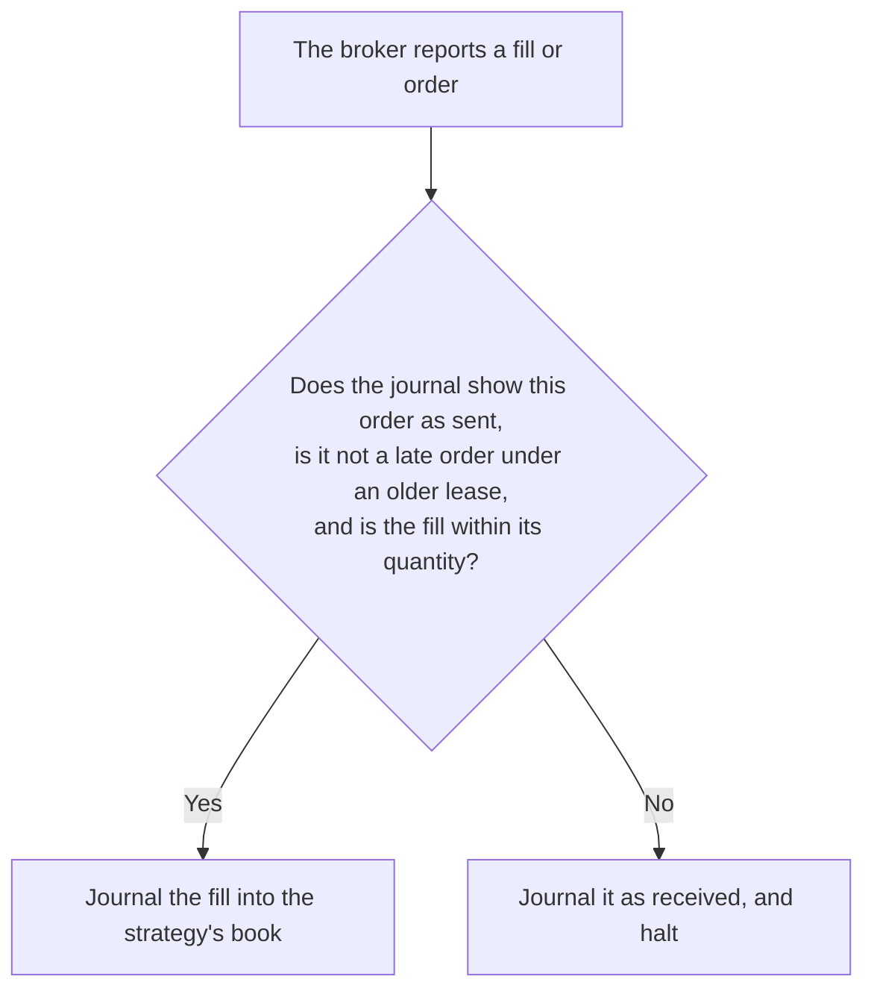

A broker's liquidation and a late order under an older lease take the "No" path too. Without the halt, a fill nobody journaled would enter the book and agree with the broker.

#### The current book comes from the journal

The book is the platform's own record of what it holds and what orders are open, so a broker's answer never replaces it quietly. Execution's recover stage replays it from the journal.

The broker's positions, open orders and cash are used in these places only:

1. The recover stage's reconcile.
2. Monitoring's second check.
3. The sync that opens the send stage.
4. A takeover's read of the broker's order list, which it stores.
5. The kill switch's read of open orders.
6. A sort's read of open orders.
7. The reconcile after the close. This doc proposes, for [#10](https://github.com/l3a0/ithildin-runtime/issues/10) and [#11](https://github.com/l3a0/ithildin-runtime/issues/11), that it compares positions, open orders and cash, and those issues hold the read.
8. A read of the broker's order list that gives an order in doubt its broker id. It supplies an id, checks each row against the order's `sending` entry, and never replaces the book.
9. The read of a leg's position and open orders just before each send of a close after a broker's trade, under [A fill is measured from the decision](../design.md#a-fill-is-measured-from-the-decision-and-a-position-depends-on-a-market-it-does-not-control).

The figure below is a component-level flowchart of the comparison between the book and the broker.

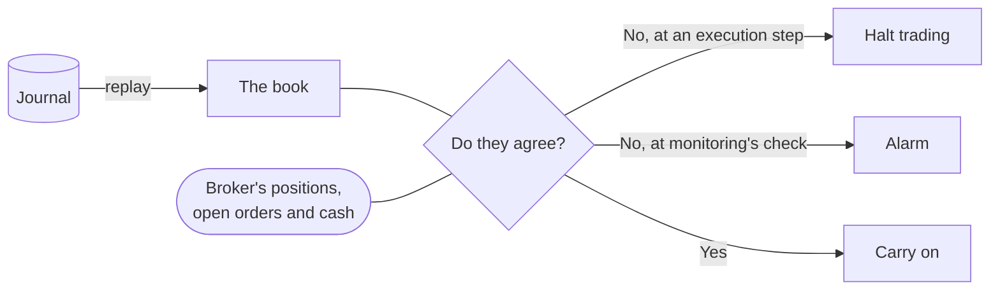

A disagreement at an execution step halts trading rather than quietly replacing the platform's record, and one at monitoring's check alarms.

#### Bars and quotes reach the models only after they are recorded

A number nobody can read back cannot be checked later. So a model never reads a feed directly, and the data worker records which bars and quotes it read first. Every number a model acted on can then be read back, from the snapshot for what the decision read, and from marketlake for the bars. Captured market data is the first of the three things [design.md](../design.md#premise) says cannot be recovered, and marketlake is where it is kept.

The figure below is a C4 dynamic diagram.

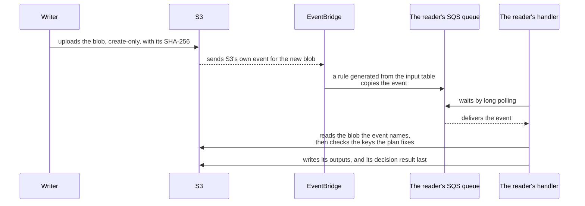

The diagram shows one write reaching one reader, so look for the event carrying only a hint and the handler reading the blob itself before it acts.

## One trading day

### The day at a glance

Every decision runs the same three phases, and one stage after the close ends the day. Phase 1 learns what is true at the broker, phase 2 decides what should be true, and phase 3 closes the gap.

The figure below is a C4 dynamic diagram.

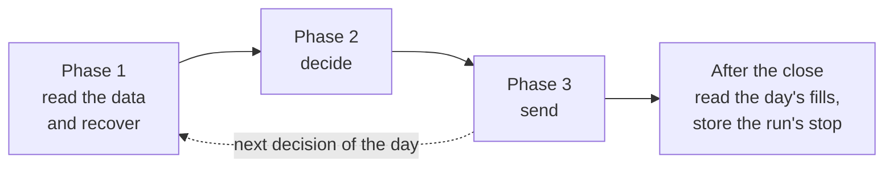

**Table:** Who acts in each phase, what it produces and what stops it

| Phase | Who acts | What it produces | What stops it |
| --- | --- | --- | --- |
| 1. Read the data and recover | Data and execution, with monitoring checking beside them | A snapshot of the bars and quotes read, and a book that agrees with the broker | Missing or stale data, or a book the broker disagrees with |
| 2. Decide | The alpha, risk and cost models, then portfolio construction | The target portfolio, within this decision's limits | A halt in any input, which each worker passes on, or one of its own |
| 3. Send | Execution, then monitoring | Orders at the broker, the decision's report and the heartbeat's ping | A failed check, a refused order or an order in doubt |
| After the close | Execution, then the supervisor | A result on each open order, then the run's stop | A read that fails or runs late, which pages the owner, or a difference, which halts and pages |

### The whole decision in order

A sequence diagram shows the same pieces in time order. This is one paper
decision with nothing wrong, for the skeleton's daily strategy. The
platform trades at any time of day and as often
as a strategy needs, so the time comes from the strategy's schedule, as
design.md's `### Strategies, schedules and decisions` says. The
skeleton trades the close, so the diagram draws its
decision at close−20, 15:40 on a full day, on marketlake's segments read before sealing, with
market-on-close orders that fill at the close. A strategy that decides
several times a day runs the same three phases once per decision, with the
workers left running between. The notes split it into three phases and a stage after the close. The host
keeps every worker running, the supervisor's plan starts the decision, and a
`par` block marks workers working at the same time. Each dashed arrow from
the blob store to a worker is S3's event for a blob, arriving on that worker's queue.

Alpaca [rejects a market-on-close order](https://docs.alpaca.markets/docs/orders-at-alpaca) "submitted after 3:50pm but before
7:00pm ET", so every market-on-close order on paper goes out by the cutoff in the paper account's hard caps. This doc proposes close−12 for it, 15:48 New York time on a full day, which waits on a ruling in [Proposals awaiting a ruling](09-decisions.md#proposals-awaiting-a-ruling). A simulated account's cutoff is the close itself, as design.md's `### Strategies, schedules and decisions` says. That rule
also checks the cutoff again just before each broker call, and keeps a pair
whole by cancelling an accepted leg whose partner fails. The session's official daily bar arrives at marketlake's 18:30 sweep that evening. Monitoring then reports how far the decision's price and the fills sat from it.

The figure below is a C4 dynamic diagram.

```mermaid
sequenceDiagram
    autonumber
    participant S as Host, a systemd timer
    participant V as Supervisor
    participant F as Blob store
    participant D as Data
    participant X as Execution
    participant B as Broker
    participant J as Journal
    participant M as Monitoring
    participant A as Alpha model
    participant K as Risk model
    participant C as Cost model
    participant P as Portfolio construction
    participant H as Heartbeat service
    participant L as Alert channel

        S->>S: starts the supervisor instances' units
    V->>F: is the kill switch blob absent?
    V->>F: writes the run's plan once under the plan's lease,<br/>naming its release
    V->>S: writes the local release file,<br/>so its path unit starts each worker's unit
    F-->>D: sends an event for the plan
    F-->>X: sends an event for the plan
    F-->>M: sends an event for the plan
    F-->>A: sends an event for the plan
    F-->>K: sends an event for the plan
    F-->>C: sends an event for the plan
    F-->>P: sends an event for the plan
    X->>F: each instance runs its Startup checks, read only,<br/>before it plans or sends
    Note over V,M: Phase 1, read the data, then recover
    D->>F: stores the snapshot, naming each bar and quote read,<br/>and data's decision result
    F-->>X: sends an event for data's result
    X->>B: asks about orders in doubt, which #35;147 builds
    B-->>X: returns each lookup's answer
    X->>J: journals each lookup's answer
    X->>B: reads positions, open orders, cash and<br/>the broker's records, then the fills,<br/>from before any not yet journaled
    B-->>X: returns positions, open orders, cash,<br/>the broker's records and the fills
    X->>F: stores the account file as read
    X->>J: journals the account file's hash, then each new record,<br/>fill and open order: a listed record moves the cash,<br/>and anything else is kept as unmatched, which halts
    X->>B: looks up each order it no longer lists
    B-->>X: returns how each one ended
    X->>J: journals each one that expired or was rejected
    X->>X: does the book from the journal<br/>agree with the broker?
    X->>F: reads the hard caps blob
    X->>F: stores the reconciled book, the hard caps as read,<br/>the session's valuation and execution's recover result
    F-->>M: sends an event for execution's recover result
    M->>F: stores monitoring's reconcile result,<br/>which no decision waits on
    Note over V,P: Phase 2, decide
    par
        F-->>A: sends an event for data's result
        A->>F: stores the forecast, then the signals<br/>behind it, then alpha's result
    and
        F-->>C: sends an event for data's result
        C->>F: stores each strategy's cost schedule<br/>and its cost stage's result
    and
        F-->>K: sends events for data's and<br/>execution's recover results
        K->>F: stores the constraints and risk's result
    end
    F-->>P: sends events for data's, alpha's, risk's, cost's<br/>and execution's recover results
    P->>F: stores the target portfolio, how it was sized<br/>and portfolio construction's result
    Note over X,J: Phase 3, send, in whichever execution instance<br/>receives the event
    F-->>X: sends an event for portfolio construction's result
    X->>F: writes a create-only claim on the send stage,<br/>naming its process's writer and a token of this call
    X->>B: reads positions, open orders, cash,<br/>the broker's records and fills since recover
    B-->>X: returns its state now
    X->>F: stores that read of the broker
    X->>J: journals its hash
    X->>J: journals any new fill under its fill id,<br/>and each new record as an outside entry
    X->>X: does the book from the journal<br/>agree with the broker?
    X->>X: runs the daily loss stop's test,<br/>with no order needed
    break the day's loss is past the stop
        Note over X,J: execution records the firing<br/>and halts the decision. The report, the ping<br/>and the read after the close still run
    end
    X->>X: the order manager plans the orders
    X->>J: journals the whole target portfolio and its<br/>planned orders, cancels and replacements
    X->>X: asks the risk gate about every planned order,<br/>and sends nothing where one is refused
    X->>B: asks the broker for its clock
    B-->>X: returns the broker's time
    X->>X: does the VM's clock agree with the broker's?
    X->>X: is it before the cutoff?
    opt a resting order the plan cancels or replaces
        X->>F: takes the account's lease
        X->>J: journals the cancel
        X->>F: is no run or account halt stored<br/>or on the plan's lease?
        X->>F: is its own send result empty?
        X->>F: is the lease tag unchanged?
        X->>X: is it before the cancel cutoff?
        X->>B: cancels by the broker's order id<br/>that the journaled answer holds
        B-->>X: answers cancelled, filled first or accepted,<br/>or gives no answer
        opt accepted, or no answer
            X->>B: looks up once by the broker's order id
        end
        X->>J: journals the old order's outcome or its doubt,<br/>any fill included
        X->>F: releases the account's lease
    end
    loop each order the order manager plans,<br/>a replacement only if its old order settled
        X->>F: takes the account's lease
        X->>J: finds the order in its plan
        X->>F: reads the hard caps
        X->>J: journals the intent
        X->>F: is the switch absent, no halt stored, its own<br/>send result empty and the strategy not off?
        X->>F: reads the files the plan was made from
        X->>X: is it before the order's last moment?
        X->>J: replays the book
        X->>F: has the loss stop not fired?
        X->>X: runs the risk gate check
        X->>J: journals the approval
        X->>X: is it before the order's last moment?
        X->>J: journals the sending entry
        X->>J: replays the book again
        X->>F: are the hard caps' limits unchanged?
        X->>F: is the switch absent?
        X->>F: is no run or account halt stored<br/>or on the plan's lease?
        X->>F: is its own send result empty?
        X->>F: is the lease tag unchanged?
        X->>F: has the loss stop not fired?
        X->>F: is the strategy not off,<br/>and no halt of its stored?
        X->>X: is it before the order's last moment?
        X->>B: sends the order, with its client order id
        B-->>X: answers
        X->>J: journals the broker's answer
        X->>F: releases the account's lease
    end
    X->>B: is every leg accepted?
    alt a leg rejected or unsent while another is accepted,<br/>or a leg's plan cancel stopped<br/>after its partner's was confirmed
        X->>F: takes the account's lease
        X->>J: journals each cancel
        loop each accepted leg
            X->>F: is the lease tag unchanged?
            X->>B: cancels the leg
            X->>J: journals its answer or its doubt
        end
        X->>F: releases the account's lease
        loop a cancel's answer lost, inside the send stage's<br/>deadline, under design.md's rule<br/>for a cancel whose answer is lost
            X->>F: takes the account's lease
            X->>B: looks up by the broker's order id
            X->>J: journals the answer, and a new cancel<br/>when the rule for a cancel<br/>whose answer is lost allows one
            opt a new cancel was journaled
                X->>F: is the lease tag unchanged?
                X->>B: sends the new cancel
                X->>J: journals its answer or its doubt
            end
            X->>F: releases the account's lease
        end
    end
    X->>F: stores the send outcome<br/>and execution's send result
    F-->>M: sends an event for execution's result
    M->>F: stores the decision's report<br/>and monitoring's report result
    M->>F: reads each job's last-run record
    opt a job that runs apart from a decision is past its bound
        M->>L: pages on it
    end
    M->>H: pings the heartbeat service
    Note over V,J: After the close, once every decision has a result
    X->>B: reads the day's fills, positions, open orders,<br/>cash and the broker's records
    B-->>X: returns the day's fills, positions, open orders,<br/>cash and the broker's records
    X->>X: sorts what it read
    X->>J: journals each fill,<br/>and each record as an outside entry
    X->>X: reconciles the book
    X->>F: stores a result saying, for each order the journal<br/>holds as open, whether it is settled or still open
    V->>F: reads that result, and only then stores the run's stop
    Note over V,J: A read that fails or misses a written time<br/>pages the owner, and the supervisor stores no stop.<br/>A difference halts and pages whether or not<br/>the result and the stop follow
```

### Before the first decision

1. Each execution instance runs the charter's Startup step, the read-only checks listed there, in that order, as this doc proposes for [#11](https://github.com/l3a0/ithildin-runtime/issues/11).
2. It plans and sends nothing until they pass.
3. A halted instance whose digest and journal checks passed still takes a dead runner's send stage over, cancels a stranded leg and serves the kill switch, and [Every change can be undone or switched off](../design.md#every-change-can-be-undone-or-switched-off) says what else a failed check still serves.

### Phase 1: read the data and recover

A run that starts on a book the broker disagrees with would trade the wrong difference. So this phase ends in a comparison, and a difference halts.

1. **Data reads the bars and the quotes.** It reads what the decision's lookback needs from marketlake, 60 sessions of each ETF, then, for a decision inside its session, one capture's quote of each, and records which ones it read before any model sees them.
2. **Execution waits for that snapshot,** and for its own send result of the decision before, a halt included, so it reads the broker at the decision's own time and after the last decision's orders went out.
3. **Execution recovers,** in the steps below. They end in a comparison of the book, replayed from the journal, with the broker's positions, open orders and cash. Ahead of the comparison, recover reads the broker's own records, such as fees and dividends, and journals each one. A fee, debit interest or a dividend inside its written range moves the book's cash, so a cash difference it explains in full passes, and any other difference halts. A record that halts enters no book's cash, a repeat with other content is kept beside the first, and a record posted late is still fetched, as design.md's `## Decisions` records for [2026-11-05](../design.md#2026-11-05), [2026-11-24](../design.md#2026-11-24) and [2026-11-26](../design.md#2026-11-26).
4. **Execution stores what the risk model and portfolio construction read:** the book, the hard caps as it read them and the session's valuation.
5. **Monitoring repeats the same check** for its report, and nothing waits on it.

#### What recover does, step by step

The stage is `execution/recover.py`, and its reads of the broker and what the journal takes from them, steps 3 and 5 to 7, are `execution/sync.py`'s, which the send stage runs too. It waits for the decision's time, having written nothing, and then works in this order.

1. It reads data's result and its snapshot, and passes a halt in either on.
2. It stores each answer this process still owes the journal, and takes one reading of the journal. It then settles each plan a send stage left unfinished, under the rule below, and sends none of its orders. An order that stays unsettled halts here.
3. It reads the broker's positions, open orders and cash, then the records the broker booked on its own, through `Broker.activities`, and then its fills. The records and the fills are asked from the same time, which `fills_since` gives. The fills come last, so a record or a fill that lands between two reads shows as a difference and never as a match.
4. It stores the five reads as one capture, `account.json`, before anything in them is compared.
5. It journals a `read` entry that names the capture, and then halts where any of the five did not come whole.
6. It journals what the broker listed, as `execution/outside.py` sorts it, and halts on anything that holds the account, ahead of any lookup.
    1. Each record the journal does not hold. A fee, debit interest or a dividend inside the range `execution/records.toml` writes for its kind is an `outside_record`, which moves the book's cash. Any other record is an `unmatched_record`: a deposit, a withdrawal, a type off the list, an amount outside its range, one with more places than cash holds, and a repeat of a held id with other content. An identical repeat is skipped.
    2. Each fill the journal does not hold. A fill of an order the platform sent is a `fill`, and a repeat whose content differs from the fill held under its id is a `disputed_fill`. Any other fill is an `unmatched_fill`: one of no order the platform acknowledged, one on an order that has ended, one past its order's quantity or on its other side, one for zero shares or at no price, and one carrying a correction's id, which no rule reads yet.
    3. Each open order under a broker's id no `ack` mapped, which is an `unmatched_order`.

    An unmatched entry moves nothing and is kept as it came. The book halts while one stands, so it holds the account until a person releases it, which [#151](https://github.com/l3a0/ithildin-runtime/issues/151) builds on [#150](https://github.com/l3a0/ithildin-runtime/issues/150)'s release test. Nothing is kept as unmatched while an order is `Sending` or `InDoubt`, because that order could own it, so the read halts instead. A record or a fill whose own id the journal refuses halts and is kept only in the capture.
7. It looks up, by the broker's id, each order the broker no longer lists and whose fills do not explain it. An order that `expired` or was `rejected` is journaled so. Any other answer halts.
8. It takes a second reading of the journal and compares it with the capture through `core.reconcile`. Any difference halts, with every one of them in the reason.
9. It reads the owner's hard caps.
10. It stores `caps.json`, `book.json` and `valuation.json`, each with one entry. The loop then stores its result.

A record the broker dates before the time the records are asked from is never fetched. That time is one day before the newest read a decision followed, or before the `sending` of the oldest order not yet ended where that is earlier, as `fills_since` says. So a record posted up to a day late is fetched again and skipped by its id, and one dated earlier is never captured and halts as a difference in cash. A split halts until [#191](https://github.com/l3a0/ithildin-runtime/issues/191) reconciles one. An order that both sides still hold open past its session's close alarms once in a process, and again after a restart, and halts nothing, because the comparison agrees.

Every halt after step 4 lists the capture in its result. A halt's reason or an alarm shows a broker's order or fill id where it is one the journal takes, an instrument where it is a name, and a client order id where it is a stamp of the platform's, and no other text of the broker's. An alarm goes once in a process, and again after a restart.

##### What a plan a crash left unfinished is

Each `decision` entry plans its orders together. A plan is unfinished where any of these is so.

1. An order of it is `Intended`, `Approved`, `Sending` or `InDoubt`.
2. An order of it has no entry while another of its orders has one.

A plan none of whose orders has an entry sent nothing and halts nothing.

##### How recover settles an unfinished plan

The receive loop runs recover only once the last decision's send stage has a result, a halt included, so the stage that left the plan has ended and its runner is finished or gone. Recover then settles each order of the plan through `OrderPath.settle`, which never sends one.

1. An order with no entry, `Intended` or `Approved` is journaled `Abandoned`, with an `intent` first where it has none, since nothing of it can have left.
2. A `Sending` order gets an `in_doubt` entry, the half of the move a crash leaves unwritten, because only the writer of a `sending` may journal that nothing left.
3. An `InDoubt` order is looked up, as [If an instance dies in the middle of a send](#if-an-instance-dies-in-the-middle-of-a-send) says.

An order a lookup leaves in doubt halts the decision, naming every order of the plan with its state and when its `sending` was stored, and an order that cannot be settled does not stop the orders after it. A journal that stops answering, where the path reports it as an outage, does stop them, because each would page the same outage again, and the halt names every order of the plans left. A store that fails while a lookup is stored is not yet reported so, which item 11 of [#211](https://github.com/l3a0/ithildin-runtime/issues/211) holds. Each order given up as `Lost`, and each halt, sends an alarm, once in a process for one cause and again after a restart, whichever decision's file the halt names. A crash writes no `in_doubt` entry, so that alarm can be the first a person hears of the order. Recover settles a plan before it reads what the broker lists, so an acknowledged order and an `unmatched_fill` never share one broker id.

##### From when fills are read

Recover asks for the fills since one day before the earlier of two times, and never since before the account was opened, with no day taken off that. Fills before the opening are in the account's opening cash.

1. The newest `read` entry of a recover whose decision has a `decision` entry after it, so its fills were all journaled. A `read` alone proves nothing, because a recover that stored one and then halted has journaled no fill of it.
2. The `sending` entry of the oldest order that has not ended.

With neither time, it asks since the opening, and a fill at that time itself is read.

##### What a second attempt goes on from

A crash, or a second instance, can run one decision's recover twice. A second attempt reads the broker again and goes on from what the first stored.

1. A read that differs is stored at the capture's next attempt number, with an alarm that says what differs. The first capture is the one that counts. Where the account moved between the two, in its positions, its open orders compared by the broker's id, its cash or a fill the first lacks, the attempt halts, because files made from the first would be stale. So does a later read that did not come whole, or that lacks a fill the first held without asking from after that fill's time. A read whose pages alone came later, or whose fills from a later time leave out one the first held, goes on.
2. A fill or an end another attempt journaled is seen on a new reading of the journal and not repeated.
3. `caps.json`, `book.json` and `valuation.json` are each read back where they are stored, and only a missing one is built. So the owner can rewrite the caps and the journal can grow between two attempts, and both attempts end in the same files. The caps' key and SHA-256 come from the stored file's header.
4. Where `book.json` is stored, the valuation is of that book and never of a new replay. A stored book that differs from this attempt's in anything but the journal entry it replayed through halts, and so does a stored valuation other than its book's.

A file of another release, format or configuration halts, because this release did not write its fields.

##### When the session's valuation is built

The first recover of a session values the book at the official closes of the session before, through `core.value_book`. A recover is the first where the journal's newest `sending` was not stored strictly after that session closed, because an order sent at the close itself belongs to the session that closed. A second decision in one session halts until [#183](https://github.com/l3a0/ithildin-runtime/issues/183) copies the first one's valuation, since no strategy decides twice a day.

#### Which modes build a broker

`runtime/execution_worker.py` is the one file that builds a broker, and the mode decides it.

**Table:** What the execution worker builds in each mode

| Mode | What it builds | What lifts the halt |
| --- | --- | --- |
| A backtest over a folder | The simulated broker, with no fault | Nothing halts, unless the stage table's row of recover is not the one the worker declares, which halts both stages, or its row of send is not, which halts send alone |
| Shadow | No broker. Every decision of each of its stages halts | Whichever of [#149](https://github.com/l3a0/ithildin-runtime/issues/149) to [#151](https://github.com/l3a0/ithildin-runtime/issues/151) and [#155](https://github.com/l3a0/ithildin-runtime/issues/155) closes last |
| Paper | The same | [#153](https://github.com/l3a0/ithildin-runtime/issues/153), once all of shadow's are closed |
| Live | The same | Only the owner switches an account to live |
| An unknown mode, and a backtest over any other store | The same | The configuration |

A mode with no broker halts each decision with its reason stored, and the worker starts all the same, because a start that fails only restarts it. A deploy to shadow starts on a merge, and nothing yet serves a kill switch, a second instance or a lone leg there. A backtest's account goes to no real store, where its opening entry and its simulated fills could never be deleted.

### Phase 2: decide

The alpha, risk and cost models run at once, each on the blobs it needs. The alpha model writes two files, the forecast and the signals behind it, which are the values it fitted, such as the hedge ratio and the z-score. The risk model writes the constraints, meaning the limits for this decision, each the tighter of the strategy's own and the owner's hard cap, with the stress move [held to the stress records](05-building-blocks.md#how-the-caps-are-held-to-the-stress-moves-record). Portfolio construction builds the target portfolio within them, at the snapshot's prices, as [How a target is sized](05-building-blocks.md#how-a-target-is-sized) says.

The figure below is a C4 dynamic diagram.

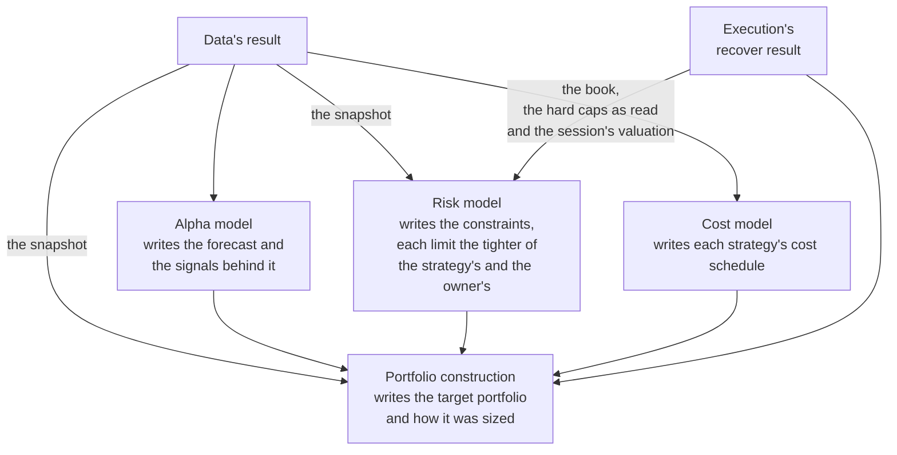

### Phase 3: send

This phase is the only one that touches the broker with an order, so it has the most checks. It has three parts: prepare once, send each order, and finish once.

The figure below is a component-level flowchart of the send stage's steps inside execution.

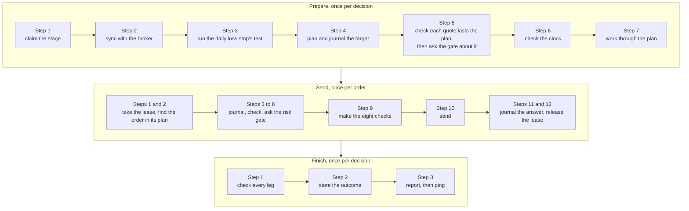

#### Prepare, once per decision

Three more checks sit inside these steps, as [How a rerun never doubles anything](../design.md#rule-9-how-a-rerun-never-doubles-anything) and [Who takes over a dead send stage](../design.md#rule-9-fifth-item-who-takes-over-a-dead-send-stage) say.

1. An instance checks the kill switch when it receives the event.
2. The sync halts on an order in doubt. Recover settles every one before the send stage runs, so only another writer's entry after recover's book can leave one, and taking such a book without halting is [#211](https://github.com/l3a0/ithildin-runtime/issues/211)'s.
3. Execution halts before it plans if an entry that changes the book, and that neither its sync nor its own order loop wrote, lies past the entry its sync names.

The steps run in this order.

1. **Claim the stage.** Whichever execution instance receives portfolio construction's result writes a create-only claim on the send stage, naming its process's writer and a token of this one call, so a second call in the same process never reads the first one's claim as its own. An instance that finds a claim it did not write never plans for that decision. It halts, and its reason names where each planned order of the decision stands, each order in doubt with the time its `sending` was stored, and each leg whose partner did not go. It alarms on each order in doubt, and then reads the day's loss, whose own halt joins the reason. All of that comes before any input is read, so an unreadable snapshot hides no order.
2. **Sync with the broker.** Every step fetches and syncs before changing state. So it fetches the broker's positions, open orders, cash and fills again, afresh on every attempt, and stores the read at `broker-read-<n>.json` with the first number left free. Until [#211](https://github.com/l3a0/ithildin-runtime/issues/211) lets another instance take a send stage over, a second attempt halts at the claim, so the read lands at `broker-read-1.json`. It stores that read and journals its hash before the comparison, as the sentence on every `Broker` read in [The interfaces](05-building-blocks.md#the-interfaces) says. It journals any fill that arrived since phase 1. It also reads the broker's records and journals each ahead of the comparison, a listed one inside its range as an outside entry and any other as unmatched, as recover does. It then checks the journal's book against the broker. A fill of its own order brings the book up to date. Any order or fill the journal did not send is journaled as received and halts for a person.
3. **Run the daily loss stop's test.** It is the gate's `loss`, which runs with no order needed, so a decision that plans no order still runs it. A reading past the stop fires it, as [The risk gate refuses an order](#the-risk-gate-refuses-an-order) says.
4. **Plan the orders and journal the target whole.** Each strategy's order manager turns the target minus that strategy's own positions and open orders into planned orders, cancels and replacements.
   - **What the stored entry holds.** One stored entry holds seven things.
     1. The target.
     2. The planned orders, cancels and replacements, each with its client order id.
     3. The journal entry it synced through.
     4. A hash and the time of the broker state it fetched.
     5. The instance running the send stage.
     6. Each strategy that is off.
     7. Each strategy whose late forecast reads as no change.
   - **What the target must name.** A target portfolio names every leg of its strategy's forecast, with a flat leg as an explicit zero. Portfolio construction halts on an instrument the strategy holds that the forecast does not name, so a target names everything its strategy's book holds, and execution halts on one that leaves an instrument out.
   - **What a strategy that is off gets.** A strategy that is off when this step reads it gets no planned orders, cancels or replacements. So its resting orders are left to the sort, and the entry names it as off. A strategy is off when either of two things holds, the same two things the check before each send reads.
     1. Its off switch is set.
     2. By this doc's proposal in [How a sort runs](../halts-and-drills.md#how-a-sort-runs), a strategy halt of its is unreleased.

     Being off never reads as a target of zero, so nothing it holds is sold, and the close after a broker's trade still goes out. An off switch or a strategy halt this step cannot read halts the decision. A switch set after this step is caught by the check before each send, as [What is checked right before a broker call](../design.md#rule-9-fourth-item-what-is-checked-right-before-a-broker-call) says.
   - **What a strategy whose late forecast reads as no change gets.** It also gets no planned orders, cancels or replacements, so its positions and working orders stand, and the entry names it as read as no change. A late forecast reads as no change where the owner's written age under hard limit 3 is above 0 and the strategy's last stored forecast is within it, counted from that forecast's decision. [#54](https://github.com/l3a0/ithildin-runtime/issues/54) holds how.
5. **Ask the gate about the whole plan.** First every quote the plan's gate checks will mark, of each instrument the account holds, has a working order in or the plan orders, must still pass its check at 5 seconds for each order of the plan past the clock's `now`. Where any of them already fails at that `now`, the whole plan is left to the gate. Where every one passes and one would not last, the decision halts before anything is asked, and every order of the plan is journaled `Abandoned`. A store that stops answering stops those abandons at the first it refuses, a journal that cannot be read takes none, and the next recover journals the rest where any order of the plan has an entry. On shadow and paper that halt holds no account, as [When the age is measured](03-context-and-scope.md#when-the-age-is-measured) says. Before any order is journaled as intended, the risk gate is asked about each planned order in turn, with each approved one counted open in the book the next is asked on. Nothing is stored by the asking. Where one order is refused or its check halts, nothing is sent and the decision halts. Each order then ends with one recorded outcome: the steps up to the gate's `verdict` run again for each order up to the refused one, every order still approved is journaled `Abandoned` with the reason that a partner was refused, and each order after it gets an `intent` and that `Abandoned`. Where the journal stops answering or cannot be read, the next recover journals those abandons instead, and a plan none of whose orders has an entry stays as it is, with nothing sent. The caps can be rewritten between the two asks, so an order the second ask approves is abandoned too. Where every order passes, each is asked again right before its own send, as the path always does.
6. **Check the clock.** Execution confirms its clock agrees with the broker's and that the market-on-close cutoff has not passed.
7. **Work through the plan.** The order manager carries out what step 4 journaled. It cancels a resting order of the strategy's that the target no longer wants, and replaces one that should change, sending the replacement only once the old order's cancel is settled.

#### What the first slice builds of these steps

`execution/send.py` builds steps 1 to 5 and step 7 for market-on-close orders alone, in the plan's order. Four parts wait on later issues.

1. Cancels and replacements, and so an open order under a target that wants a change, which halts until [#149](https://github.com/l3a0/ithildin-runtime/issues/149) builds them.
2. The clock's check against the broker, which is [#153](https://github.com/l3a0/ithildin-runtime/issues/153)'s and [#165](https://github.com/l3a0/ithildin-runtime/issues/165)'s.
3. A late forecast read as no change, which is [#54](https://github.com/l3a0/ithildin-runtime/issues/54)'s.
4. Taking a book that holds an order in doubt at the sync, which halts until [#211](https://github.com/l3a0/ithildin-runtime/issues/211) builds it. Recover settles every order in doubt before this stage runs.

A send that answers anything but `Acknowledged` ends that strategy's plan, whichever leg it was, and each later order of the strategy is journaled `Abandoned`. A strategy switched off before any leg of its reached the broker ends as partly sent, and the other strategies' orders go on. Any other answer, a switch with a leg at the broker, and any error halt the stage once each order not yet sent, from the one that failed on, is journaled `Abandoned`, with an alarm naming each leg's state. A plan of this decision that another writer journaled, and that is not this stage's, halts the stage before anything is asked, with an alarm naming both plans. A leg already at the broker is [#149](https://github.com/l3a0/ithildin-runtime/issues/149)'s to cancel, so until it is built no mode but a backtest runs, as [Which modes build a broker](#which-modes-build-a-broker) says. The stage's result holds a halt or the decision's outcome, never both, and the outcome names each order's end state, each strategy's end and each part of a position no order of the account's share step can trade.

#### Send, once per order

Each order goes through the order path alone, and the journal gains a line before the broker hears anything. The first step that fails decides what becomes of the order.

1. Take the account's lease, as [The account's lease, around each submit](#the-accounts-lease-around-each-submit) says. A lease another handler holds ends the order here with nothing journaled, and halts the decision with the holder named.
2. View the journal, find the order in its plan and read the hard caps afresh. An order in no plan, of a decision that is not the journal's newest, or off the account's share step, halts here with nothing journaled. One that has an entry already is not sent again, and one left `Intended` or `Approved` halts, and the next decision's recover journals it `Abandoned`, as [How recover settles an unfinished plan](#how-recover-settles-an-unfinished-plan) says.
3. Journal the intent. A number another writer took starts the order over, at most five times.
4. Check the kill switch, the halts, this decision's send result and the strategy's switch.
5. Read the snapshot, the constraints and the valuation, and halt unless each is the file the plan was made from. Check the order's last moment, its market-on-close cutoff or its session's close.
6. View the journal a second time, so the risk gate sees every order already approved, and then read the loss stop.
7. Ask the risk gate, and journal its answer. A quote it marked ends the order's last moment sooner, where the quote reaches its maximum age first. A refusal ends the order there. One that read a loss past its stop, or a loss stop that stands or cannot be read, halts the decision too.
8. Check the order's last moment again, and journal that it is sending.
9. Make the checks in the table below, on a third view. A pass in which any read had to be tried again, or that took longer than 5 seconds, is made again whole.
10. Send, with the order's client order id.
11. Journal the broker's answer: the ack, the rejection, or the order's doubt. An answer that proves nothing was sent journals the order `Abandoned` and halts the decision.
12. Release the lease by a conditional rewrite that clears its holder, whatever ended the send, so another instance's cancels wait for at most one order.

A fault in steps 4 to 9 journals the order `Abandoned`. The exceptions are an order another writer has moved, which is left as it is, an `Abandoned` that loses its number six times, a store that takes no entry, where the halt names what the journal last showed, and an error the path does not expect, which may leave the order in the state its last stored entry gives it. Once a `sending` may be stored, an `Abandoned` the store does not take is kept and tried again before the next send. An entry the store does not answer for is sent again unchanged. Each try of the `sending` and a check at the submit ends by the order's last moment, and each try of the `verdict` by its cutoff or close, and the order is stopped there however long another read took.

**Table:** The eight checks made right before the broker call

| Check | What it reads | Passes when |
| --- | --- | --- |
| 1 | The kill switch | It is absent |
| 2 | The order's strategy | It is not switched off, and no halt of its is stored |
| 3 | The run's and the account's halts, and the plan's lease | No halt is stored, and the lease says the run is running, once [#11](https://github.com/l3a0/ithildin-runtime/issues/11) builds it |
| 4 | The decision's own send result | It is still empty |
| 5 | The account's lease | It still carries this handler's own last tag, which a rewrite on that tag proves and which moves its expiry a period on |
| 6 | The loss stop | None has fired, and its state can be read |
| 7 | The hard caps | Their limits are the ones the gate was handed |
| 8 | The order's last moment: its market-on-close cutoff or its session's close, or the moment a quote the gate marked reaches its written maximum age where that is sooner | It has not passed |

Any check that fails journals the order `Abandoned` and halts the decision. One exception is a switched-off strategy, whose orders are abandoned while the account's other strategies keep sending. The checks on the strategy are read after every other blob, so a switch hides no halt that a blob read ahead of it would give. Until the two leases are read, no mode but a backtest may run, as [Which modes build a broker](#which-modes-build-a-broker) says. An order under a valid close entry reads these checks as [What is checked right before a broker call](../design.md#rule-9-fourth-item-what-is-checked-right-before-a-broker-call) says.

A cancel the plan asks for takes the same shape, as the sequence diagram above shows: take the lease, journal the cancel, check, call the broker, journal the outcome and release the lease.

#### The account's lease, around each submit

`execution/lease.py` holds the account's lease, and `OrderPath.send` holds it for one order, from before its first view of the journal until its answer or its doubt is journaled. The rules are design.md's [Who may send, the account's lease](../design.md#rule-9-who-may-send-the-accounts-lease), and the sequence of a take, a renewal refused and a takeover is drawn in [Alarms on leases and takeover](../halts-and-drills.md#alarms-on-leases-and-takeover). A send goes through six steps.

1. **Read the journal, then the lease.** That order keeps a first use apart from a lost lease. A lease that is absent while the journal holds a `sending` entry halts new orders and pages, and its one halt is stored at `accounts/<account>/halts/execution-lease_absent-<t>-<n>.json`, where `n` is the journal's newest entry and `t` the newest `sending`'s time, so two handlers that find it raise one halt. A lease absent from a journal with no `sending` is a first use, and the take creates it.
2. **Take it.** A free lease, or one whose holder's expiry is more than 5 seconds past, is rewritten on the tag that was read, naming this handler, with an expiry 30 seconds on. A lease another handler holds ends the order with nothing journaled and halts the decision with the holder named, until [#237](https://github.com/l3a0/ithildin-runtime/issues/237) builds the waiting.
3. **Take it over, where the take owes that.** A take of an expired lease, or of a free one whose `owed` is set, reads the broker's order list from the oldest `sending` still `Sending` or `InDoubt`, less 60 seconds, stores it at `runs/<deployment>/<run>/execution/takeovers/<UTC time>.json`, and journals a `takeover` entry naming it and each such order the list omits. It then clears `owed` and alarms. A step that fails halts new orders, and `owed` stays set, so the next take does the takeover again.
4. **Renew it at the fifth check.** Right before the broker call the lease is rewritten on this handler's own last tag, a period ahead. A rewrite the store refuses, because another handler took the lease over or the store did not answer, fails the check, so the order is journaled `Abandoned` and nothing is sent. No thread renews the lease on a clock, as this doc proposes for [#148](https://github.com/l3a0/ithildin-runtime/issues/148), because a send holds it for one order and each step before the call has a deadline of its own.
5. **Journal the answer.** An order a takeover named late can never be journaled `Acknowledged`, because the fold refuses its `ack`. That holds for the older holder's own answer, for a lookup's match and for any other writer.
6. **Release it.** A rewrite on this handler's own last tag clears the holder, whatever ended the send, and keeps `owed` as it found it. A lease another handler took over meanwhile is left alone.

#### Finish, once per decision

1. **Check every leg.** After the loop execution looks up each leg. It cancels any accepted leg whose partner was rejected or never sent, and any leg whose plan cancel was stopped after its partner's was confirmed.
2. **Store the send's outcome** and execution's send result.
3. **Report, then ping.** Monitoring writes the decision's report. It reads the age of the jobs that run apart from a decision, and pages on one past its bound, as [Faults are expected](../design.md#faults-are-expected-and-the-platform-checks-itself-while-it-runs) says. It pings the heartbeat service last, so a decision that dies or hangs never pings.

### After the close

Once every decision has a result, the day ends in three steps, which this doc proposes for [#10](https://github.com/l3a0/ithildin-runtime/issues/10) and [#11](https://github.com/l3a0/ithildin-runtime/issues/11).

1. Execution checks the day against the broker, in four parts.

   1. It reads the day's fills and the broker's positions, open orders, cash and records.
   2. It sorts what it finds, as design.md's `Sorting what the broker reports` says.
   3. It journals the fills, and each record as an outside entry.
   4. It reconciles.

   A difference halts and pages with its reason. Execution journals the open halt the holding-halt check reads, and neither that write nor the page waits on the result or the stop. [#10](https://github.com/l3a0/ithildin-runtime/issues/10) and [#11](https://github.com/l3a0/ithildin-runtime/issues/11) hold whether those are still stored after it.

2. Execution stores a result naming each order the journal holds as open as settled or still open.
3. The supervisor reads that result, and only then stores the run's stop.

A read that fails or misses a written time pages the owner, and no stop is stored, as [The life of a run](#the-life-of-a-run) says.

### If an instance dies in the middle of a send

The journal entries carry the weight of hard limit 4, which says every order is journaled before it is sent. An order's `sending` entry is what makes a crash safe, because it tells the next instance that an order may have left.

The figure below is a C4 dynamic diagram.

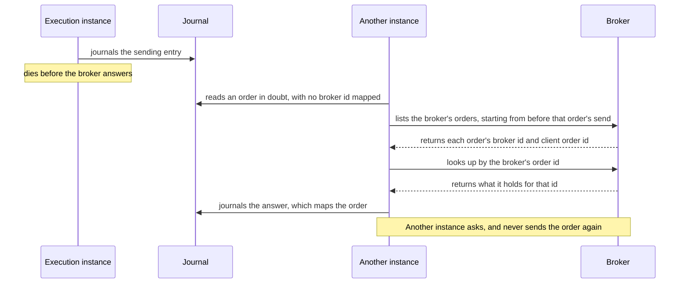

A client order id is an id the platform chooses and sends with the order. The broker gives the order an id of its own, and the journal maps one to the other on each ack. Every lookup goes by the broker's order id, because not every broker can find an order by a client order id.

An order in doubt has no ack, so the journal holds no broker id for it. `OrderPath` hands the adapter the order's intent through `find_order`. Beside the broker's raw bytes, the adapter's answer holds three things.

1. The broker's id, not found, or more than one.
2. Whether its list was whole.
3. Each paired row it read, converted at the adapter to the platform's `BrokerOrder`.

So `OrderPath` runs the match and the halts in one place. How the adapter finds the order is its own, so a new broker changes no line of `OrderPath`.

Three steps make every lookup go by the broker's id, Alpaca's included.

1. The adapter reads the broker's order list, open and closed orders alike, from the order's `sending` entry less a written overlap of 60 seconds, `OVERLAP` in `execution/order_path.py`. That is larger than twice the clock's bound of 1 second, since the broker dates an order by a clock of its own.
2. It returns the broker's order id from the row that carries the order's client order id.
3. `OrderPath` looks the order up by that id and journals the answer. Its ack maps the order like any other, apart from a late order under an older lease or an answer that disagrees with the `sending` entry, which halts first.

Each answer is stored as it came before anything judges it, at `lookup-<n>.json` under the recover stage's prefix with the first number left free, and a `read` entry names the file. The table below says what each answer comes to.

**Table:** What each answer about an order in doubt comes to

| The broker answers | What follows |
| --- | --- |
| The list fails | Nothing is stored or settled, and the decision halts naming the read |
| The list does not come whole | It is stored, nothing is settled, and the decision halts |
| A whole list omits a closing-auction order, asked for at or after its session's close plus twice the clock's bound | A `lost` entry names the list's `read` entry, and the order is `Lost`, with an alarm that says whether it was sent is unproved |
| A whole list omits the order, asked for earlier | It stays `InDoubt`, and the decision halts |
| A whole list omits an order whose time in force is not the closing auction | It stays `InDoubt`, and the decision halts, because a broker may hold a day order that came after its close for the next session's open. Giving one up waits on a contract test of the broker's, which [#153](https://github.com/l3a0/ithildin-runtime/issues/153) runs |
| More than one row, or one row that differs in client order id, instrument, quantity, whose sign is the side, type or time in force, or a row under an id the journal refuses | Each row the journal can key is journaled as an `unmatched_order` and holds the account, and the decision halts |
| One row that matches, whose lookup by the broker's id fails or answers anything but that order | It stays `InDoubt`, and the decision halts. A copy that differs is journaled as an `unmatched_order` |
| One row that matches, and a lookup that matches | The `ack` is journaled with the lookup's bytes, and recover goes on to read the order's fills like any other |

An order absent from a whole list stays `InDoubt` until its time in force has run out, because a request sent just before a crash can still arrive, and only a closing-auction order is given up then. The journal's fold holds both rules too, and refuses a `lost` whose list was asked for too early or of any other kind of order. A list that fails or stops early settles no order's state and halts new orders, a row already read is to serve every cancel but a plan's own once [#149](https://github.com/l3a0/ithildin-runtime/issues/149) builds cancels, and a row or an answer that disagrees with the `sending` entry halts, as design.md's `### Orders the platform did not send` says. Alpaca, the broker for paper and for live, names both ids in its [list of orders](https://docs.alpaca.markets/reference/getallorders-1), which returns at most 500 orders a call, and [#153](https://github.com/l3a0/ithildin-runtime/issues/153) confirms how the adapter pages through it.

A broker that takes no client order id gets an adapter that pairs on the order's details instead. It takes a row the journal has not mapped, matching the order's instrument, side, quantity and type inside the same window. That match is close to unique, because an account holds one portfolio, one holder of the lease sends, and the gate refuses a second order beside one in doubt. The journal's mapping stands in for the stamp there, and more than one match halts. This adapter is designed and not built, and it passes the broker suite before any such broker is used, on the terms design.md's `### Orders the platform did not send` gives.

Alpaca's [order reference](https://docs.alpaca.markets/reference/postorder) does not say whether it refuses a second order with the same client order id, so nothing here relies on that, and [#153](https://github.com/l3a0/ithildin-runtime/issues/153) leaves the test of it on the paper account to the owner, as a second line of defence.

## When something is wrong

Hard limit 3 says missing input means stop, not flatten. One firm's execution
server rebooted before its alpha server, read "no signals" as "hold nothing",
and sold most of its book. The [charter](../team-charter.md) cites it at L4690, a
Kindle location in the owner's highlights of Narang's *Inside the Black Box*.
Each diagram below is one way a day goes wrong, and each ends with no new orders and the positions left as they were, apart from a broker's own trade, where the close after a broker's trade under [A fill is measured from the decision](../design.md#a-fill-is-measured-from-the-decision-and-a-position-depends-on-a-market-it-does-not-control) can close the whole position.

Every halt takes the same route.

1. The worker that finds the problem writes a halt as its decision result,
   with the reason, in place of its outputs. A capturing stage stores what it
   read first, and its halt names that file.
2. Every worker downstream finds that halt as its input's result, writes its
   own halt naming it, skips the decision and goes on to its next one.
3. Monitoring, which reads every component's results, journals every halt,
   raises an alarm on the halt that names no earlier one, once per reason in
   a run until a decision succeeds, writes the decision's report and pings the
   heartbeat service.

The same route runs in every mode, and the run goes on to its next decision,
which halts again if the cause is still there. A single crash is not a
failure: the host restarts the worker, which resumes from storage. A
failure is a missed deadline, a heartbeat stopped for longer than the limit set on [#11](https://github.com/l3a0/ithildin-runtime/issues/11), or
none of a component's instances healthy, and it takes the same route. The supervisor
writes the halt as the failed worker's result, stores a halt of the whole run, whose event reaches every worker, writes a halt for every decision left in the plan, and monitoring reports.

### A missing or stale bar

The figure below is a C4 dynamic diagram.

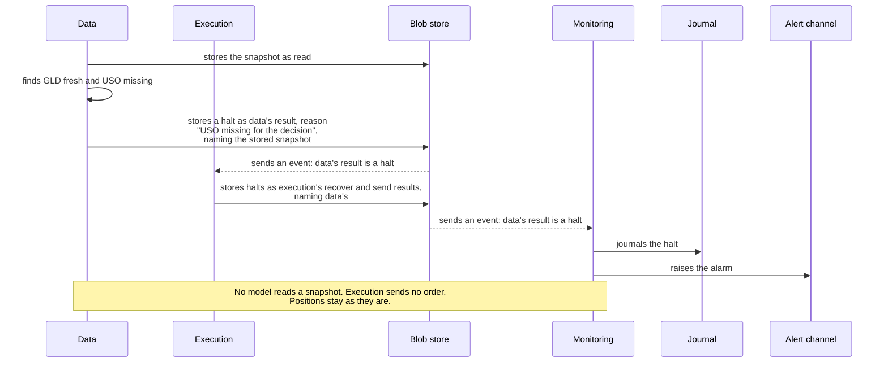

A stale bar takes the same path. Stale means the newest bar is older than the
decision time allows, which is how a feed that stopped looks when it keeps
answering. Data reports the gap and never fills it with the last close.
The charter gives the risk engineer the halt on stale data, and the lag a
sealed daily bar may have is 0 sessions. A decision at close−20 reads the bar of
the session before, and one at the close reads that session's own, so any lag
is a session that should be there and is not. A captured bar arrives after its
session's close, so on captured bars a decision at the close halts as stale. Data applies that rule, and
[How a quote is judged](03-context-and-scope.md#how-a-quote-is-judged) says how
old a quote may be.

An empty answer halts the same way. If the alpha model writes a forecast file
with no entries and no "trade nothing" mark, portfolio construction halts rather
than reading the silence as a target of zero. It halts on the mark too, because
a target portfolio has no form for holding every position, and no alpha model
writes the mark in slice 1. A flat position is a forecast
with direction 0, never a missing forecast. The one exception to this is hard limit 3's first, a forecast late at portfolio construction's deadline, under its written age, which the owner sets and which starts at 0, as the [2026-11-06](../design.md#2026-11-06) entries in design.md record.

### A restart before the data is ready

The figure below is a C4 dynamic diagram.

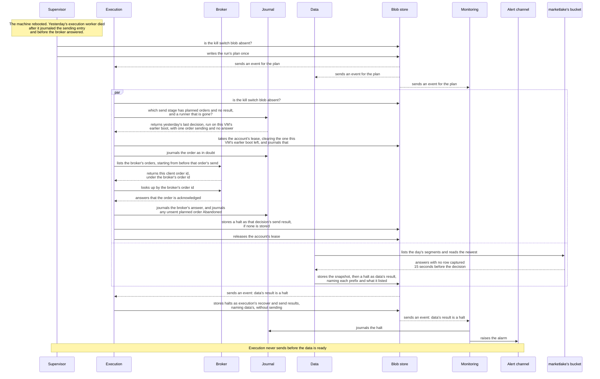

The restart runs the same first phase as any trading day.

1. On starting, execution settles the order the dead worker left half-sent, by
   asking the broker about it rather than sending it again, and halts that old
   decision, as [Who takes over a dead send stage](../design.md#rule-9-fifth-item-who-takes-over-a-dead-send-stage) says. Slice 1 settles it at the next decision's recover instead, once data's result is in, as [How recover settles an unfinished plan](#how-recover-settles-an-unfinished-plan) says, and settling on start is [#211](https://github.com/l3a0/ithildin-runtime/issues/211)'s.
2. Data finds no row captured by the cut, 15 seconds before the decision time,
   in the segments marketlake has uploaded, stores its snapshot and halts, so execution's recover stage,
   which waits for data's result, halts too.

The order in which the processes come up no longer matters. Execution may
start before data, as it does here, but it sends only what a target
portfolio asks for, and that cannot exist until a snapshot does. The charter
gives the operator the startup order: execution may send an order only once
every upstream worker has written a decision result that lists outputs, not a
halt, for the decision. Above a written age of 0, hard limit 3's first exception covers a strategy's late forecast.
The pipeline makes that order something the platform cannot get wrong. "Not ready" is a halt, never an empty forecast.

### The risk gate refuses an order

The figure below is a C4 dynamic diagram.

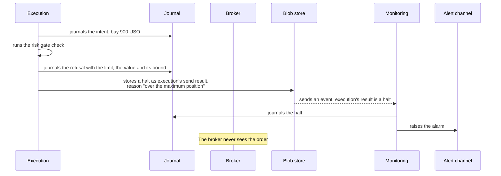

The gate has a second way to stop an order. An input that is absent, stale or
invalid raises a halt rather than a refusal, and every halt comes before every
refusal. So a refusal never hides such an input, apart from a stop whose state
could not be read, as
[What halts and what refuses](05-building-blocks.md#what-halts-and-what-refuses)
says. Execution then journals the
order `Abandoned` with the reason and halts the decision.

A refusal is final, and execution halts rather than sending the rest of its
orders, because portfolio construction sized the rest assuming this one would
go through. Nothing resizes the order to fit either, since an order cut down
to pass the risk gate is a trade nobody chose. Clearing the halt sends nothing more for that decision. The gate is asked about the whole plan before any order of it is journaled, so a refusal there sends neither leg of a pair. If the check right before a pair's second leg refuses it after the first was accepted, the decision halts with the accepted leg at the broker, and execution cancels it, as for any pair left with one leg, once [#149](https://github.com/l3a0/ithildin-runtime/issues/149) builds that cancel. The cancel aims to land before the cancel cutoff, and one that goes late is still sent and its refusal journaled. The next decision plans again from the book. On a shadow or paper account, holding
the account after a refusal until a person clears it waits for a strategy
that decides minutes apart, as design.md's
`### Strategies, schedules and decisions` says. A refusal on live holds until the owner clears it.

#### The daily loss stop

A day's loss past a set limit has to end new trading for the account, and a price that recovers must not start it again. So the stop works through the same risk gate, and once it fires it holds until a person clears it.

#### How the day's loss is measured

The day's loss is the account's valuation at the prior session's official closes, V, less the book's cash and each position at its mark. A fee counts as a loss. So does a fall on an ex-dividend date, and the payment, journaled on a later session, then hides that session's loss by its size. That gap stays open. Massive's dividend records, at its `/stocks/v1/dividends` endpoint, read on 2026-11-24, held none for GLD or USO and some for SPY, which the shadow run on [#16](https://github.com/l3a0/ithildin-runtime/issues/16) reads.

The mark is the midpoint of the instrument's quote, or its newest daily bar's close where the snapshot holds no quote of it, through `core.mark`, which the alpha model's signal reads and portfolio construction sizes with too. A split on the decision's own day leaves V and the bars before it and the quote after it, and the signal, the size and the day's loss read that step. The flag on a midpoint that moved is the only check on the prices that sees it. It halts nothing and misses a step within the written multiple, which [#46](https://github.com/l3a0/ithildin-runtime/issues/46) holds. Six gaps halt rather than read as no loss.

1. The valuation is missing, or is of any session but the one before the decision's. A decision at the close reads a snapshot that holds both sessions' bars, and V at that day's close would read a loss of zero.
2. The valuation was replayed past the book.
3. A held instrument, or one with an open order, has no quote and no bar later than V's session, or has a bar of a session later than the decision's or one that ends or was knowable after the decision.
4. An instrument's price is missing, stale, of unstated kind or not above zero, or its quote has any fault [How a quote is judged](03-context-and-scope.md#how-a-quote-is-judged) lists, or its quote's older stamp is at or before V's close, or it has a quote beside a bar of the decision's session. Once any instrument is priced, any other of the snapshot that is not fresh halts too, as [`Snapshot.require_fresh()`](05-building-blocks.md#snapshotrequire_fresh-is-how-a-module-refuses-a-gap) says.
5. Something other than the platform's own fills or a broker record [on the closed list](../design.md#strategies-schedules-and-decisions) moved the book's cash or a position after the valuation, such as a deposit or a person's override.
6. A position was corrected after V's session closed, whether or not V was built since, such as by a split's restatement. Marked at that session's close, the restated position would hide a loss.

The price of the last two is no trading for the rest of that session.

#### When the stop is tested

The send stage runs the stop's test on every decision that reaches it, before any order is planned and with no order needed. So a decision that plans no order still tests the stop. Every verdict carries the same reading, so a loss found while an order is checked counts too, whichever limit the verdict names.

The stop has a stated limit: no decision tests the price move from close−20 to the close.

#### What happens when the stop fires

A fired stop latches, which means it stays fired whatever the price does next. It takes four steps. Execution takes the first, `OrderPath` the second, the gate the third and a person the fourth.

1. The first time the send stage's test, or any verdict, reads the day's loss past the stop, execution records the firing and halts the decision. No order follows a firing until a person clears it, across a failed write and a restart, apart from the one exception [Which orders a stop refuses](#which-orders-a-stop-refuses) names.
2. `OrderPath` reads the stop's state before every new order, as it reads the switch, and hands it to the gate. The submit reads it again just before the broker's call.
3. The gate refuses every new order while a firing stands, across sessions and apart from that exception, so a price that recovers never resumes trading on its own.
4. `ithildin stop clear --account <a>` journals the clear and then deletes the blob. On a live account only the owner may, and on shadow and paper the operator may too, as the charter's owner and risk engineer sections say. [#203](https://github.com/l3a0/ithildin-runtime/issues/203) builds the command, and until then no route clears a firing.

The figure below is a C4 dynamic diagram.

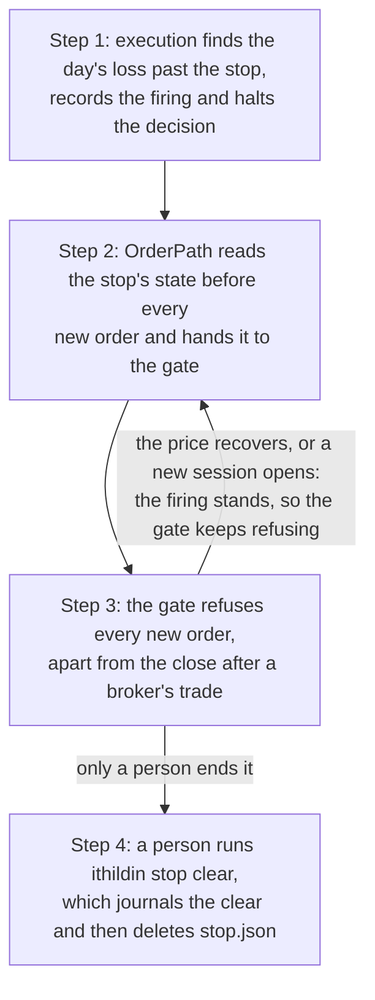

##### Where a firing is kept

A firing is kept in three places, and any one of them alone reads as fired. `execution/latch.py` writes and reads all three.

**Table:** The three records of a firing

| Record | What it is | When it is written | When it goes |
| --- | --- | --- | --- |
| Memory | The firing, held by the account's `Latch` | Before any write | Once the journal holds the firing |
| The journal | A `stop_fired` entry, its `stop_stored` and a `stop_cleared`, and any `verdict` that read the day's loss past its stop | First | Never. A `stop_cleared` covers the firing |
| The blob | `accounts/<account>/stop.json`, created with a create-only write as the kill switch is | Second, through `core.Storage`, which holds a blob S3 does not take and keeps the process alive until S3 stores it | When a person's clear deletes it |

A blob that cannot be read reads as unreadable, whatever the other two say, because an unreadable stop holds the close too. Deleting the blob by hand clears nothing, because the journal keeps the firing.

##### How a firing is written

1. Hold the firing in memory, with a fresh random id that its entry and its blob both carry. S3's tag is a hash of the bytes, so the id keeps two firings on one reading from sharing a tag. It is counted under the lock the submit marks its call under, and the submit compares the count its checks began with, so no firing of this process falls between the last check and the broker's call. A second process on the account waits on [#148](https://github.com/l3a0/ithildin-runtime/issues/148)'s lease.
2. Journal `stop_fired`, unless a firing stands already. That firing covers this reading, and nothing more is journaled for it.
3. Create the blob. Any blob already at the key stands for it.
4. Journal `stop_stored` with the blob's tag. A tag that a covered firing's `stop_stored` names belongs to a clear between its entry and its delete, so the new firing stays unstored until that blob is gone.

Each step runs whether the one before it failed or not. The alarm on the reading goes out first, so an outage that holds the writes does not hold the page. Each settle of the order path, before every send, hold, ask and loss, completes what is missing. It journals a firing held in memory, gives a past `verdict` that stands alone its `stop_fired`, gives a firing its blob and its `stop_stored`, and journals a firing for a blob no entry names. It lets go of a blob `core.Storage` holds once nothing needs it, so a held copy is not stored after a clear. A stage's own settle leaves the latch alone, so a blob S3 will not take holds up no read of the broker. The worker's last settle tries the firing once more, and names it among what it owes if the journal has not taken it. Its pages then tell the owner to pull the account's kill switch at once, because the host restarts execution on its own.

The price has three parts.

1. A settle with nothing owed costs one listing of the journal and one `head` of the blob, each tried once, before every order.
2. A crash while S3 refuses both the entry and the blob loses the firing, since the process held it alone. A clean end does not, because the receive loop keeps the process alive until S3 stores the blob, and the restarted worker reads that blob as fired. A host that kills the process first, such as at the unit's stop timeout that [#11](https://github.com/l3a0/ithildin-runtime/issues/11) sets, loses it as a crash does. The claim rests on the worker's loop and its account holding one storage contract, which the entry point [#200](https://github.com/l3a0/ithildin-runtime/issues/200) builds. A blob first held at the worker's last settle, after the loop has ended, keeps no process alive either, and the page that names the firing is all that survives it.
3. A crash while the journal refuses a firing and a clear is mid-delete loses that firing too.

##### When a clear counts

The journal's fold works out the state from those entries.

1. A `verdict` that read the loss past its stop belongs to the firing standing when it was journaled, or else to the first `stop_fired` after it. Until one comes it stands alone, as fired.
2. At most one firing stands, so a second `stop_fired` while one stands is refused.
3. A `stop_cleared` names the standing firing, and is refused unless that firing's `stop_stored` comes before it. A future number and a covered firing are refused too. So a clear counts only where a blob was stored for someone with the right to delete it.

The command takes four steps, which [#203](https://github.com/l3a0/ithildin-runtime/issues/203) builds.

1. Where no firing stands and the blob is a covered firing's, an earlier clear died before its delete, so it deletes that blob on its tag and journals nothing.
2. It completes the firing as the order path's settle before each send does, and stops unless the firing then has its `stop_stored`.
3. It journals `stop_cleared`.
4. It deletes the blob with `If-Match` on the tag the firing's `stop_stored` names.

A worker's journal credential can still write a `stop_stored` and a `stop_cleared`. [#11](https://github.com/l3a0/ithildin-runtime/issues/11)'s open question on which kinds each credential may write covers that, and a test fails any module under `src` that builds a `stop_cleared`.

##### A rerun reads the decision's own loss

The send stage reads each strategy's loss twice: at the decision's own time, from its stored inputs, and then at the clock's time. A rerun after the close so fires on the decision's own loss, where the gate's check of the clock against the session's close would halt first.

Where the send stage halts on another call's claim, the loss cannot be read and the journal holds no plan of the decision, the stop fires with no reading. The call that claimed the decision may have read the loss past its stop and died before its firing was stored, and only a plan proves the loss was read inside its bound. The price is a stop a person clears after a rerun whose first call halted before its loss and could not store that halt, and after a second process on the account until [#148](https://github.com/l3a0/ithildin-runtime/issues/148)'s lease.

#### Which orders a stop refuses

A fired stop has one exception. The close after a broker's trade closes a whole position once the broker has made a trade of its own, under [A fill is measured from the decision](../design.md#a-fill-is-measured-from-the-decision-and-a-position-depends-on-a-market-it-does-not-control). That order passes a fired stop only under a valid close entry. The gate cannot read one until [#117](https://github.com/l3a0/ithildin-runtime/issues/117) builds it, so until then it refuses every order handed a close entry, and no close can go out.

A failed read must not open that exception, so an unreadable stop holds the close too. Anything but an answer that no firing stands reads as fired for a decision's order, and the state `OrderPath` hands the gate keeps fired and unreadable apart.

**Table:** What the gate does with each state of the stop

| What `OrderPath` found | The stop's state | A decision's new order | An order under a valid close entry |
| --- | --- | --- | --- |
| No firing stands | `ABSENT` | Passes this check | Passes this check |
| A firing stands | `FIRED` | Refused | Passes this check |
| Whether one stands could not be read | `UNREADABLE` | Refused | Not sent |

#### Why slice 1 only stops

[#7](https://github.com/l3a0/ithildin-runtime/issues/7) lists the limit as "an automatic unwind and stop". An unwind is itself a trade, so slice 1 stops only, and [#124](https://github.com/l3a0/ithildin-runtime/issues/124) holds the unwind.

### The book and the broker disagree

The figure below is a C4 dynamic diagram.

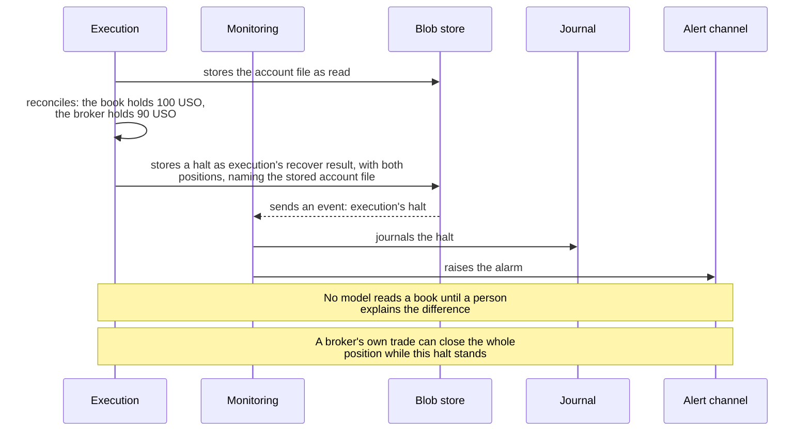

Execution trades the difference between a target and the book, so a book the broker disagrees with sends the wrong order. So the platform compares the two, and a difference it cannot explain halts trading until a person has.

#### Who compares the book with the broker

Two workers compare the broker with the sum of the strategies' books.

1. Execution's recover stage compares them before a decision trades, through `core.reconcile`, which [One function lists the differences from the broker](05-building-blocks.md#one-function-lists-the-differences-from-the-broker) describes.
2. Monitoring compares them again for its report, through the same function ([#11](https://github.com/l3a0/ithildin-runtime/issues/11)).

Both compare positions, open orders and cash, exactly and with no tolerance. So an order the broker holds and the journal marks lost or abandoned halts the day it appears, not the day it fills.

#### What each difference leads to

A mismatch in a position means one of two things: a fill the platform never journaled, or a position the broker changed on its own. Both need a person. The table below lists each case and what it needs.

**Table:** What the platform does with each thing the comparison finds

| What the comparison finds | What the platform does | What a person does |
| --- | --- | --- |
| A fill the platform never journaled | Halts | Explains the difference |
| A position the broker changed on its own | Halts | Explains the difference |
| A split or an assignment, in shadow or on paper | Halts. An outside entry from the broker's own record releases the halt once it explains the whole difference, any close has ended and, for a split, its two records agree, under the rule that any difference from the broker halts trading ([Faults are expected](../design.md#faults-are-expected-and-the-platform-checks-itself-while-it-runs)). Until the platform first has a record of splits, shadow does not halt on one in captured bars, since its broker restates nothing, and on paper no outside entry can release one, as [the rule on splits](../design.md#a-backtest-names-what-it-could-not-have-traded-and-each-model-states-how-it-fails) says | Nothing for a split, whose halt stays until its two records agree. An assignment leaves its strategy off until a person switches it back on |
| A broker's own trade, such as a forced close or a buy-in | Halts. The order that closes the rest of the position can go out before a person acts, under the close after a broker's trade ([A fill is measured from the decision](../design.md#a-fill-is-measured-from-the-decision-and-a-position-depends-on-a-market-it-does-not-control)) | On a live account, clears the halt once every leg has ended. In shadow and on paper the outside entry releases it then |
| An order the broker holds and the journal marks lost or abandoned | Halts the day it appears | Explains the difference |
| A broker record of a type on the closed list, with its amount in range | Journals it with no halt | Nothing |
| A broker record that leaves a difference unexplained | Halts | Explains the difference |
| A record that repeats a record id with different content | Halts | Explains the difference |

The closed list of record types, and the four cases that halt, are in [Strategies, schedules and decisions](../design.md#strategies-schedules-and-decisions).

#### Who owns reconciliation

Reconciliation lives on [#11](https://github.com/l3a0/ithildin-runtime/issues/11). The charter has the trading systems engineer write it, so that role reviews it there.

### The kill switch and the dead-man check

The figure below is a C4 dynamic diagram.

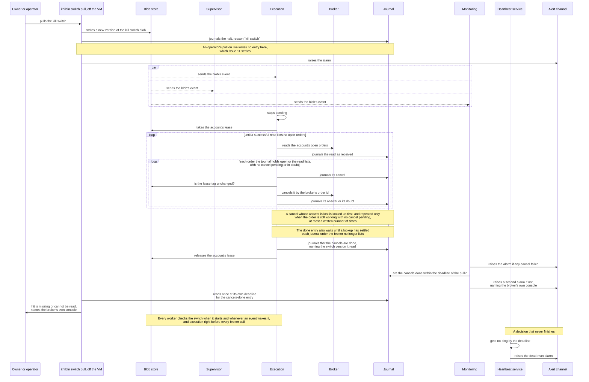

The two cover different failures.

1. **The kill switch** is for a run that is alive and doing something nobody
   wants.
2. **The dead-man check** is for a run that is not alive at all, including a
   supervisor that died, since monitoring pings only as each decision's last
   step. The check runs on the deployment's schedule, and its grace period has
   to exceed the longest chain of worker deadlines plus the report, or a slow,
   healthy decision alarms.

#### How a pull cancels

Pulling the kill switch cancels every resting order in the account, stamped or not.

##### What the kill switch is

The kill switch is a command, not a running process. It creates a blob at one key per broker account, and every worker reads that blob. The split of the kill switch work is on [#11](https://github.com/l3a0/ithildin-runtime/issues/11).

##### What happens after a pull

1. The blob's S3 event reaches the queues of execution, the supervisor and monitoring.
2. Whichever execution instance receives that event takes the account's lease. The lease is free after at most one order in flight, or on the lease's release.
3. That instance cancels every resting order in the account, stamped or not, through the order path and by the broker's order id: the union of the orders the journal holds open and the orders the broker lists, so an empty or failed answer never reads as nothing to cancel. Each cancel is journaled before it is sent and checks the lease's tag just before its broker call. A cancel whose answer is lost is looked up first, and repeated only when the lookup shows the order still working and no cancel pending, at most a written number of times, as rule 6 of [Faults are expected](../design.md#faults-are-expected-and-the-platform-checks-itself-while-it-runs) says. An order in doubt is cancelled once a row or a lookup gives its broker id. It reads the broker again, and cancels each order a later read lists that has no cancel pending or in doubt, until a successful read lists no open orders. It journals that the cancels are done only once that read lists none and a lookup has settled each journal order the broker no longer lists, as [Rule 10](../design.md#rule-10-the-kill-switch-is-a-blob) says. If that entry is not journaled by the pull's deadline, monitoring raises its second alarm.
4. `ithildin switch pull` reads the journal once at a deadline before the cancel cutoff, and names the broker's own console when the done entry is not there or cannot be read.

Monitoring's report says the switch is set.

##### What happens when the journal cannot be read or take a write

A pull sends no cancel the journal cannot hold, because an outside write with no record cannot be matched afterwards. Where the journal's entries cannot be read, or the store cannot take a write, execution sends no cancel and alarms, monitoring's second alarm fires at the pull's deadline, and `ithildin switch pull` names the broker's own console, where a person cancels by hand. [Rule 10: the kill switch is a blob](../design.md#rule-10-the-kill-switch-is-a-blob) and the [2026-11-07](../design.md#2026-11-07) entries in design.md hold the rule.

The same holds where the entries read and do not replay, because [every entry is recorded on a view](05-building-blocks.md#nothing-is-stored-that-a-replay-would-refuse) and there is none. Execution sends no cancel and alarms, and a person cancels at the broker's console, as entry 6 of [2026-11-25](../design.md#2026-11-25) says. [#150](https://github.com/l3a0/ithildin-runtime/issues/150) builds it.

##### What happens when execution is down at the pull

A starting execution instance checks the switch as soon as its digest and journal checks pass. If it finds the switch set, it takes the account's lease and cancels by the steps under [What happens after a pull](#what-happens-after-a-pull). So a switch pulled while execution is down still cancels once the host restarts it.

##### What happens when the switch cannot be read

A switch that cannot be read halts with the reason "kill switch unreadable" and the error, so the journal never mistakes a permission problem for a deliberate pull.

##### Why a pull also cancels market-on-close orders

Market-on-close orders are sent between close−20 and the cutoff, which this doc proposes as close−12, and rest at the broker until the close. So a switch pulled in that window stops nothing already sent unless it also cancels them, which is why it does.

Cancelling an unfilled order sells nothing, so the pull is still a stop and not a flatten.

#### The cancel cutoff

The exchange stops taking cancels of closing-auction orders some minutes before the close, so a switch pulled after that cannot stop the fill, and execution's report of its cancels says so. The cancel cutoff is the earlier of Alpaca's and the exchange's. NYSE Arca, where GLD and USO list, refuses cancels of closing-auction orders from 15:59, as a [Lightspeed guide](https://lightspeed.com/support/lightspeed-trader-on-close-and-on-open-guide) and an [SEC filing](https://www.sec.gov/files/rules/sro/nyse/2018/34-84804.pdf) on its closing freeze describe. Alpaca's [order page](https://docs.alpaca.markets/docs/orders-at-alpaca) names no separate cancel cutoff, so this doc takes close−10, Alpaca's entry cutoff and 15:50 on a full day, as the cancel cutoff until Alpaca says otherwise. That is an assumption that errs early, and [#10](https://github.com/l3a0/ithildin-runtime/issues/10) confirms Alpaca's real one.

### Every alarm and its drill

Every alarm has one row, with the reason it writes and the drill that fires it, in [Halts and drills](../halts-and-drills.md#every-alarm-and-its-drill). The paper gate reads that list.

## The life of an order

A state diagram shows the states one thing can be in and what moves it between
them. Each transition is a journal entry written before the next step. An execution instance taking over a send stage whose runner died writes two of them after the fact, when it finds the gap, as [Who takes over a dead send stage](../design.md#rule-9-fifth-item-who-takes-over-a-dead-send-stage) says: `Abandoned` for an order a crash left without a `sending` entry, and the crash half of `InDoubt`.

The figure below is a C4 code diagram.

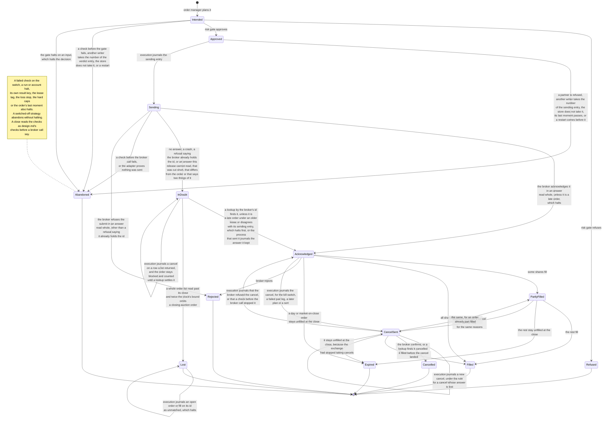

`Refused` is the platform's own risk gate saying no. `Rejected` is the broker
saying no.

`journal/orders.py` holds the moves built so far as one table, and an entry that asks for a move it does not hold halts, naming the entry, the order and its state. The moves of `CancelSent` and `Cancelled` arrive with [#149](https://github.com/l3a0/ithildin-runtime/issues/149). Nothing moves a `Lost` order on, and an open order or a fill on its broker's id is kept as unmatched, because no `ack` mapped the id.

### How an order leaves `InDoubt`

`InDoubt` is the state a crash between sending and the ack lands in. It lets the journal say "the platform does not know whether the broker has this order", rather than leaving the next decision to guess.

The way out is to ask the broker, by the broker's order id, which the broker's order list supplies for an order with no ack. The process that sent the order may also still hold the broker's answer, where the journal did not take it at the time, and journals it when it can. Sending the order again is never a way out.

A lookup that finds nothing, or a whole order list that does not show the order, keeps it `InDoubt`, counted at its worst case, until its time in force has run out. Only a whole order list read after that gives an order up, and only a closing-auction one, which then becomes `Lost`. A lookup that finds nothing keeps it in doubt and halts at any time. It stays because a request sent just before a crash can still arrive after that read. An order of any other kind stays `InDoubt` until a contract test of the broker's, which [#153](https://github.com/l3a0/ithildin-runtime/issues/153) runs, shows what a late one does.

### What the next decision does with `Abandoned` and `Lost`

**Table:** The two end states the order manager plans around

| State | What it means | What the next decision's order manager does |
| --- | --- | --- |
| `Abandoned` | The order never reached the broker | Plans from the book as if the order had never existed |
| `Lost` | The platform stopped waiting, and sending is unproved | Plans from the book the same way |

### What halts as unmatched

An open order or a fill on an order the journal holds as `Lost` or `Abandoned` is journaled as received as unmatched and halts. So is a late order under an older lease.

### What becomes of an order after its cancel

**Table:** What happens to an order after each way its cancel can end

| How the cancel ends | What happens to the order |
| --- | --- |
| The broker reports it as pending | It stays `CancelSent`, still counted at its worst case |
| The broker refuses it | It returns to the state it was in, still counted, with the alarm for a cancel that failed |
| The answer is lost | It stays `CancelSent` |
| A check stops the cancel before the broker call | Execution journals that, and the order returns to the state it was in, still counted |

For a cancel whose answer is lost, [Faults are expected](../design.md#faults-are-expected-and-the-platform-checks-itself-while-it-runs) says when it is sent again and when it halts new orders. For a plan's cancel no stage resends yet, and the next recover stage settles what it can by lookup.

### How an order reaches `Cancelled`

`Cancelled` is reached four ways.

1. Through the kill switch.
2. When one leg of a pair is accepted and the other fails.
3. When a later decision's plan no longer wants an unfilled order or replaces it, as design.md's `### Strategies, schedules and decisions` says.
4. Through a sort, under a strategy's off switch or a halt that cancels this way, as [How a sort runs](../halts-and-drills.md#how-a-sort-runs) says.

A replacement is a new order with a stamp of its own, sent only once the old order's cancel is confirmed. Each way the cancel is journaled first, and the sync then counts it as the platform's own.

## The life of a run

One decision's chain moves through these states. In shadow, paper and live a
run is one trading day's decisions. In a backtest it is every decision of the
span. A halt ends only its own decision's chain.

The figure below is a C4 code diagram.

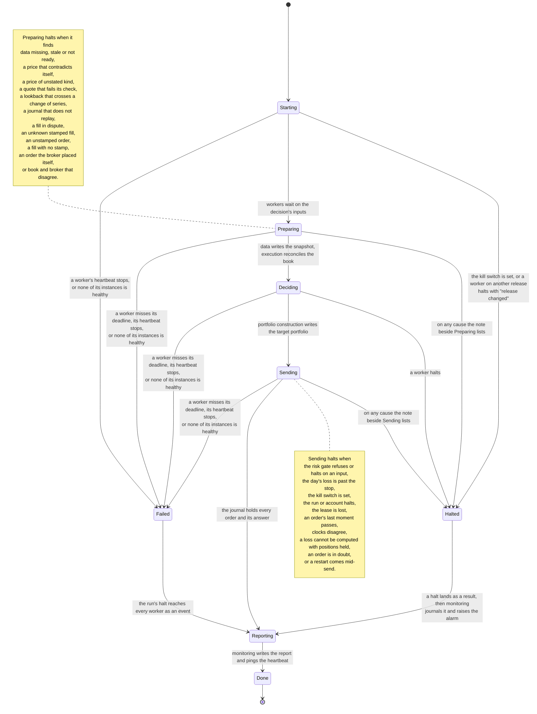

### What `Preparing` does

`Preparing` is the first phase of a decision, in two steps.

1. Data reads the snapshot.
2. Once that snapshot and its own send result for the decision before exist, execution settles orders in doubt, journals fills, writes the book and reconciles it with the broker.

Monitoring reconciles again, and no decision waits on it.

### Where the run's state is kept

The supervisor holds none of these states in memory. It reads them from storage: which components have a decision result, and whether a result is a halt.

- A restarted supervisor finds the state the same way, while the workers keep running.
- A worker the host restarts checks its own result key for each decision, reads the blobs that exist, and writes the ones that are missing.

### How a halt differs from a failure

A halt and a failure differ in what they stop.

- A halt stops one decision, and in every mode the run goes on to the next decision. A later decision halts too while the journal holds an open halt whose cause holds the account: on live every cause, and on shadow and paper the causes the account's hard caps name, as [Rule 7: a halt is final for its decision](../design.md#rule-7-a-halt-is-final-for-its-decision) says.
- A failure stops the whole run.

Both pass through `Reporting`, so a halted or failed decision still writes its report and its journal entry, and monitoring sends the alarm with its reason to the environment's push topic, which delivers each one. If monitoring itself is what failed, no ping arrives, and the dead-man check raises the alarm.

### Who clears a halt

A halt is final for its decision, which is this doc's choice. The owner or the operator clears it, and only the owner clears a live account's halt. Clearing never reruns the decision. The next decision starts fresh, and it halts again while the kill switch is set, the cause is still there, or the journal holds an open halt whose cause holds the account. On live every cause holds the account until the owner clears it, and on shadow and paper only the causes the account's hard caps name do, which are an order the platform did not send, a snapshot that cannot be stored or confirmed, and the two halts [A fill is measured from the decision](../design.md#a-fill-is-measured-from-the-decision-and-a-position-depends-on-a-market-it-does-not-control) keeps until a person clears them, a price of unstated kind and a quote that fails its age and status check, which [#150](https://github.com/l3a0/ithildin-runtime/issues/150) is asked to build. So on shadow and paper a bar the contradiction rule flags, or a lookback that crosses a change of series, halts only its own decision and needs no one to clear it. A quote that was good when the gate judged it is the exception to the age check's hold: one that reaches its maximum after the gate and before the broker call, or that would not last its plan's sends, halts only its own decision there too, as entry 12 of 2026-11-26 in [Decisions](../design.md#decisions) rules. A halt for a book that disagrees with the broker also stays open there until a person clears it. Where that rule lives is a proposal for [#11](https://github.com/l3a0/ithildin-runtime/issues/11).

### When the run stops

The run's stop waits for two things.

1. The market's close.
2. The run's read of the day's fills.

So execution serves a pull of the kill switch until the last moment a cancel could land, and the closing auction's fills are reconciled the same evening.

This doc proposes, for [#10](https://github.com/l3a0/ithildin-runtime/issues/10) and [#11](https://github.com/l3a0/ithildin-runtime/issues/11), that the read after the close runs in five steps. The same steps appear, grouped as three, under [After the close](#after-the-close).

1. Execution reads the day's fills and the broker's positions, open orders, cash and records.
2. It sorts what it finds as design.md's `Sorting what the broker reports` says.
3. It journals the fills and each record as an outside entry.
4. It reconciles, and stores a result naming each order the journal holds as open as settled or still open.
5. The supervisor reads that result before it stores the stop.

In shadow the read finds the market-on-close order open, which counts as read. [#10](https://github.com/l3a0/ithildin-runtime/issues/10) and [#11](https://github.com/l3a0/ithildin-runtime/issues/11) hold how.

The host's timer stops every unit after that stop.

### When the read after the close goes wrong

This doc also proposes, for [#10](https://github.com/l3a0/ithildin-runtime/issues/10) and [#11](https://github.com/l3a0/ithildin-runtime/issues/11), what happens in two cases. One of them journals a halt for the holding-halt check, which halts each later decision while the journal holds an unreleased halt whose cause holds the account, as [A halt is final for its decision](../design.md#rule-7-a-halt-is-final-for-its-decision) says.

**Table:** What happens when the read after the close goes wrong

| What goes wrong | What happens |
| --- | --- |
| The read fails or misses a written time | It pages the owner, the next recover stage, where execution settles orders and journals fills before a decision, reads the fills, and the host's timer ends the run, which [How a run stops](../design.md#rule-7-how-a-run-stops) proposes not to count as a clean shutdown |
| The read finds a difference | The difference halts and pages with its reason. Execution journals the open halt the holding-halt check reads, and neither that write nor the page waits on the result or the stop |
