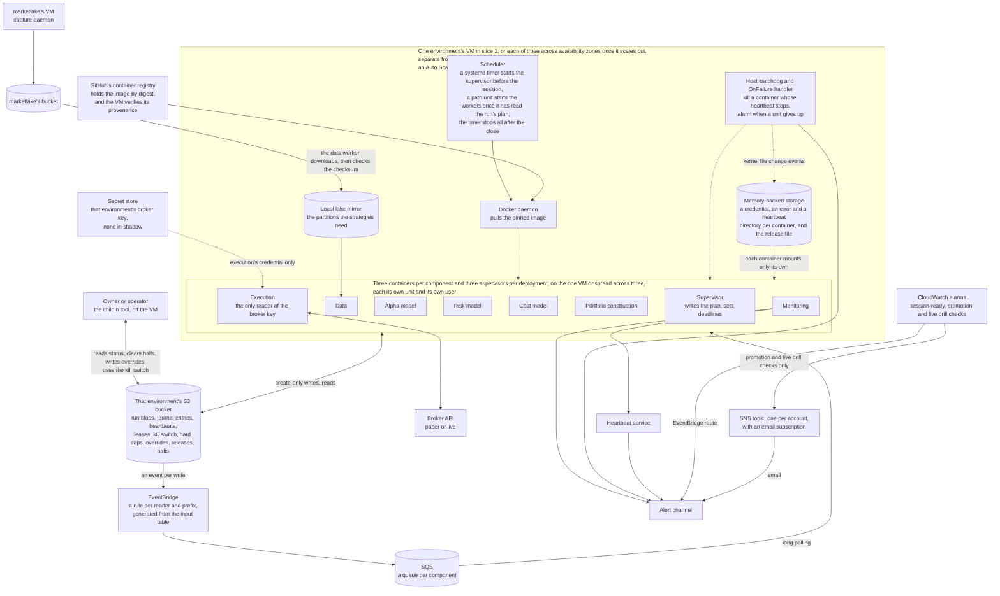
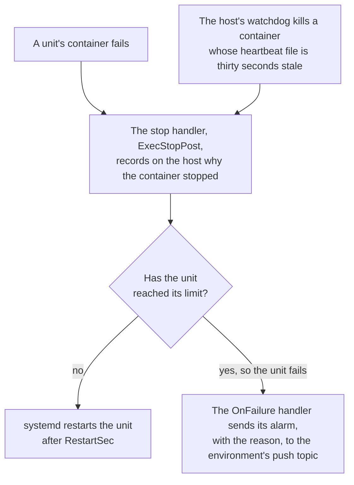
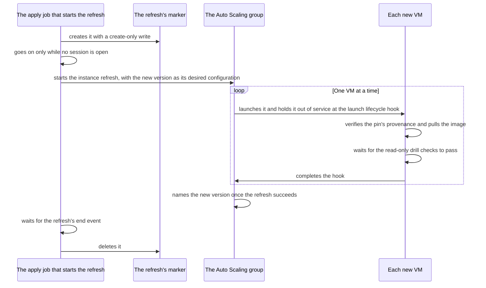
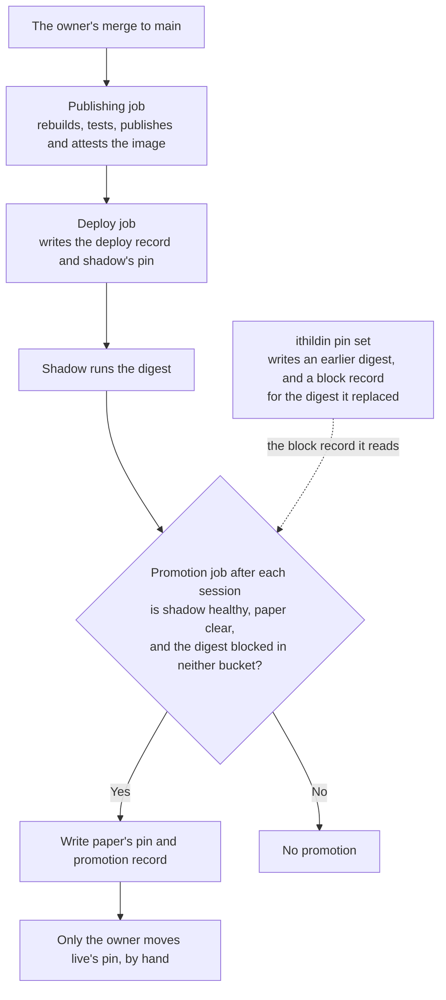
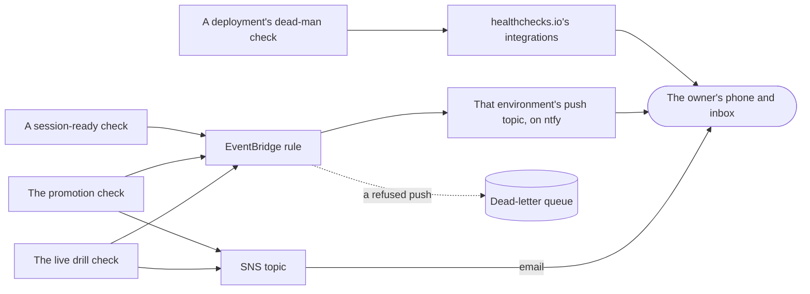

# Architecture, section 7: Deployment

This page is section 7 of [the architecture](00-README.md), in the order of the arc42 template. It answers which machine each piece runs on, what crosses each machine's edge, and how the four environments are kept apart.

## Contents

- [Where it runs](#where-it-runs)
  - [Rule 1: the pin names the release](#rule-1-the-pin-names-the-release)
  - [Rule 2: nothing the platform must keep lives only on the VM](#rule-2-nothing-the-platform-must-keep-lives-only-on-the-vm)
  - [Rule 3: the broker key lives in a secret store](#rule-3-the-broker-key-lives-in-a-secret-store)
  - [Rule 4: the kill switch and the hard caps are blobs](#rule-4-the-kill-switch-and-the-hard-caps-are-blobs)
  - [Rule 5: the runtime's credential does only what the rules need](#rule-5-the-runtimes-credential-does-only-what-the-rules-need)
  - [Rule 6: a rollback is a pin to an earlier digest](#rule-6-a-rollback-is-a-pin-to-an-earlier-digest)
  - [Rule 7: systemd keeps every process running, up to a limit](#rule-7-systemd-keeps-every-process-running-up-to-a-limit)
  - [Rule 8: the runtime has a VM of its own](#rule-8-the-runtime-has-a-vm-of-its-own)
  - [Rule 9: a replacement VM's supervisor reads the run's plan](#rule-9-a-replacement-vms-supervisor-reads-the-runs-plan)
  - [Rule 10: the release is one container image](#rule-10-the-release-is-one-container-image)
  - [Rule 11: an environment scales out to a cluster of three VMs](#rule-11-an-environment-scales-out-to-a-cluster-of-three-vms)
  - [Four environments](#four-environments)

## Where it runs

Losing a VM costs the platform nothing it must keep. The VM keeps no state that matters, and the storage is S3, so everything the platform must keep sits in the runtime's bucket. An Auto Scaling group replaces a lost VM by starting a new one on the release the run uses, as [An environment scales out to a cluster of three VMs](#rule-11-an-environment-scales-out-to-a-cluster-of-three-vms) says.

The deployment diagram below shows which machine each piece runs on and what crosses the machine's edge. It draws one environment, shadow, paper or live. Each of those has one VM in slice 1, scaling out to a cluster of three, and a bucket and roles of its own, as `### Four environments` says.

The figure below is a C4 deployment diagram.

Eleven rules hold the deployment to the premise and the hard limits.

### Rule 1: the pin names the release

**The pin names the release.** Each environment's VM runs the release its pin names. The owner's merge to `main` moves shadow's pin, a healthy shadow moves paper's, and only the owner moves live's, as `### Four environments` says. So the code that traded is always known.

The release also pins boto3, from a version whose botocore, [1.35.69](https://raw.githubusercontent.com/boto/botocore/1.35.69/CHANGELOG.rst) or later, sends both S3's refuse-if-it-exists condition and `If-Match` on a write.

### Rule 2: nothing the platform must keep lives only on the VM

**Nothing the platform must keep lives only on the VM.** Every blob a run writes and every journal entry is created in the runtime's bucket before anything relies on it. The VM's working directory holds only error output, heartbeat files, the local release file and the files the host's stop handler writes, and none of it is kept.

The journal is one of the three things the premise says cannot be recovered, so losing the VM must not take it. Captured bars, another of the three, live in marketlake, which backs up its own lake.

### Rule 3: the broker key lives in a secret store

**The broker key lives in a secret store, and only execution can read it.**

#### How the VM keeps other users from the key

- The execution worker runs as a Unix user of its own, started by a systemd unit with that user, never by a process that keeps root.
- Only root and one provisioning user can reach the VM's instance metadata service, because any process that can reach that service can fetch the VM's credentials. A firewall rule matched on the process's owner enforces that across reboots.
- Each VM has no inbound port, and Docker listens on its Unix socket alone. Every role is refused remote commands and remote sessions.
- At boot the provisioning step writes each worker user a credential file only that user can read, never carried in the VM's start-up data.
- Only the execution user's credential can read the secret store's broker path.

#### How execution holds the key, and the drill that tries every route to it

Execution reads the key from the store into its own memory, never into its environment, which other processes and child processes can see, and never into a file. It is a broker key with no withdrawal or transfer permission, which is hard limit 5.

[The drill on the broker key](../halts-and-drills.md#drills-with-no-alarm) on [#11](https://github.com/l3a0/ithildin-runtime/issues/11) tries each route to the key.

#### Where the key is stored, and why marketlake cannot reach it

The store is the one marketlake uses, AWS Systems Manager Parameter Store, holding the key as a `SecureString` parameter encrypted under KMS. The runtime sits outside marketlake's AWS account, in an account per environment. So each environment's broker key sits in that environment's own account, under the account's AWS managed `aws/ssm` key.

No marketlake role can reach it, because a role acts in another account only where that account grants it, and no runtime account grants one.

#### What guards the key inside each environment's account

Inside each environment's account four controls hold.

1. **Only the execution user reads the key.** A grant of `ssm:GetParameter` on the key's parameter goes to the execution user's credential alone.

   - Every other role in the account, the other workers', the operator's and the deploy roles, refuses `ssm:GetParameter`, `ssm:GetParameters` and `ssm:GetParameterHistory` on the broker path, `/ithildin/<environment>/broker/`.
   - Those roles also refuse `ssm:GetParametersByPath` on every path, because a recursive read of a parent path returns every parameter below it.
   - On every path under `/ithildin/`, every principal but the owner refuses `ssm:PutParameter`, `ssm:DeleteParameter`, `ssm:DeleteParameters`, `ssm:LabelParameterVersion`, `ssm:UnlabelParameterVersion`, `ssm:AddTagsToResource` and `ssm:RemoveTagsFromResource`, because a rewritten ping address silences a dead-man check and a rewritten alias points execution at another broker account.
2. **Service control policies bind each runtime account.** The accounts are members of one AWS organization, under a management account that holds nothing else, so a service control policy binds every principal in a runtime account, its root user included, as AWS's [service control policies page](https://docs.aws.amazon.com/organizations/latest/userguide/orgs_manage_policies_scps.html) says.

   - It refuses, to all but the owner's role, deleting a journal or run version and changing a runtime bucket's policy, versioning, Object Lock or notifications.
   - It refuses reading the broker path to all but the owner's role and that environment's execution role, each named by its full ARN, path included, because execution has to read its own key.
   - It refuses every IAM write on every role with a path to the broker key or to deploying or applying, and on the GitHub OIDC provider, to every principal but the owner's role, because rewriting a role's trust or policy would hand its reach to someone else, as [#32](https://github.com/l3a0/ithildin-runtime/issues/32) holds.
   - It refuses leaving the organization.

   The organization's centralized root access removes each member account's root password, so the management account is the one left to guard, and every principal in it is in scope, not only its root user.

   This doc proposes for [#11](https://github.com/l3a0/ithildin-runtime/issues/11) that `sts:AssumeRoot` and IAM Identity Center administration there are limited to the owner's identity, behind a hardware key, and that an alarm reads the organization trail for a service control policy detached or edited, a root password created and a permission set assigned.
3. **The parameter lives in us-east-1**, and the owner writes its value by hand through standard input, as marketlake writes its own. No OpenTofu configuration, state or variable ever holds it.
4. **A [drill](../halts-and-drills.md#drills-with-no-alarm)** tries to read the key with every role but execution's.

#### What the separate accounts cost

The price is these accounts.

- Four runtime accounts, test, shadow, paper and live.
- The organization's management account.
- A log-archive account for the organization trail, which no existing account can hold, as [Each environment has an AWS account of its own](#rule-11-each-environment-has-an-aws-account-of-its-own) says.

Each is set up once, with GitHub's deploy roles recreated in each and a read grant from marketlake's account for each environment's data role, as [The runtime has a VM of its own](#rule-8-the-runtime-has-a-vm-of-its-own) says.

The broker key moves out of marketlake's account. marketlake's refusals for the runtime's VM, key and queues, which [l3a0/marketlake#944](https://github.com/l3a0/marketlake/issues/944) held, are no longer on the runtime's path.

### Rule 4: the kill switch and the hard caps are blobs

**The kill switch and the hard caps are blobs.** Each blob's grants say who may create or write it and who may delete it.

#### Who pulls and clears the kill switch

The runtime's credential can create the switch, which pulls it, and can never delete it. Only the owner's credential clears a live account's switch, and the operator's may also clear a paper or shadow account's. Inside a live drill, the approved drill role pulls and clears it too, and only a job behind live's reviewer can assume that role. None of these credentials sits on the VM, and each environment's bucket policy exempts only those principals its own rule allows from its refusal of deletes on the switch's key, which on the live bucket is the owner and the approved drill role. Pulling the switch needs no deploy.

#### Who may create and delete a fired loss stop or a strategy's off switch

**Table:** Who may create and who may delete a fired loss stop's blob and a strategy's off switch

| Blob | Who may create it | Who may delete it |
| --- | --- | --- |
| A fired loss stop's blob, which takes the same grants as the switch | Execution's role, which may never delete it | The principals who may clear the switch, the owner alone on live and the operator too on shadow and paper |
| A strategy's off switch, which sits beside a fired loss stop's blob | Any person's credential | The principals who may clear the switch, the owner alone on live and the operator too on shadow and paper, the last being this doc's reading of the rule for the kill switch and a fired loss stop |

#### Who may write the hard caps and the releases

The hard caps blob can be written or deleted only by the owner's credential. An explicit refusal in the bucket's policy for every other principal enforces that, because raising a cap raises a capital limit, which hard limit 1 keeps for the owner. Copying an older version back counts as a write, so the same refusal covers it. Only the owner's credential may write `accounts/<account>/releases/`, under the same refusal.

### Rule 5: the runtime's credential does only what the rules need

**The runtime's credential does only what the rules need.**

**Table:** What each role may do under each prefix of the runtime's bucket

| Role | Prefix | Allowed action |
| --- | --- | --- |
| The runtime's credential | `runs/`, `journal/` and `sim/` | Create and read |
| The runtime's credential | `leases/` | Read |
| The runtime's credential | The switch and a fired loss stop, `accounts/<account>/switch.json` and `accounts/<account>/stop.json` | Create and read, never delete |
| The runtime's credential | The hard caps, the overrides and `accounts/<account>/releases/` | Read. No runtime role writes `accounts/<account>/releases/` |
| Execution's and monitoring's roles | `accounts/<account>/strategies/` and `accounts/<account>/halts/` | Read and list |
| The role that raises a halt | `accounts/<account>/strategies/<strategy>/halts/` and `accounts/<account>/halts/` | Create, never delete |
| The runtime's credential | `heartbeats/` and `restarts/` | Create |
| Monitoring's role alone | `load/`, a rewrite-planning page's records, which outlive every run and release | Create and read |
| Execution's role alone among the runtime's roles | `leases/accounts/` | Rewrite, only with `If-Match`, a take on the tag it read and a renewal or a release on the tag its own last write returned. Create with `If-None-Match`, only where an absent lease allows it, as this doc proposes for [#10](https://github.com/l3a0/ithildin-runtime/issues/10). No principal deletes a lease |
| The owner's role alone, on every account | The owner's records, under a prefix [#11](https://github.com/l3a0/ithildin-runtime/issues/11) names | Create. No role deletes one |
| Execution's and monitoring's roles | The owner's records | Read |
| The owner's and the operator's credentials | `leases/accounts/` | Clear an account's lease off the VM, a rewrite with `If-Match` on the tag it read, as [What a person runs](../what-a-person-runs.md#what-a-person-runs) says |
| The supervisor's role alone | `leases/plans/` | Create a plan's lease with `If-None-Match` and rewrite it with `If-Match` on its tag. No role deletes it |
| Every other role | `leases/` | Read at most |
| The credential whose job rolls out a new launch template version, the apply credential on shadow and the VM change credential on paper and live | The refresh marker, `markers/refresh.json` | Create, only with `If-None-Match`, and delete, only with `If-Match` on the tag its own create returned |
| The apply credential, as the cleanup of a stale refresh marker | `markers/refresh.json` | Delete, only with `If-Match` on the tag it read |
| The approved drill role, on live, for a drill that changes live's state | A drill's marker, `markers/drills/<drill>.json` | Create, only with `If-None-Match`, and delete, only with `If-Match` on the tag its own create returned or on the tag it read of a marker its group's earlier job left |
| Live's drill job's role, for the read-only checks | A drill's marker, `markers/drills/<drill>.json` | Create, only with `If-None-Match`, and delete, only with `If-Match` on the tag its own create returned or on the tag it read of a marker its group's earlier job left. Nothing else in the bucket |
| The runtime's credential | `markers/` | Read and list. No runtime role creates or deletes a marker |
| The runtime's credential | Each of those prefixes | List, without which S3 answers a missing key with "access denied" rather than "no such blob" |

The bucket's policy refuses a create under `markers/` that does not carry `If-None-Match`, which S3 lets a bucket policy require ([Enforce conditional writes on Amazon S3 buckets](https://docs.aws.amazon.com/AmazonS3/latest/userguide/conditional-writes-enforce.html)), and refuses every write there to a principal the rows above do not name, as [What the bucket's policy refuses, and to whom](#what-the-buckets-policy-refuses-and-to-whom) lists. So every marker is created only where none exists. Of two creates at one key, S3 lets the first to finish succeed and refuses the other with `412 Precondition Failed`, and a create that races a delete can get `409 Conflict` ([How to prevent object overwrites with conditional writes](https://docs.aws.amazon.com/AmazonS3/latest/userguide/conditional-writes.html)). A job whose create gets any answer but success holds no marker and deletes nothing. Every delete of a marker carries `If-Match` on the tag its own create returned, or for the cleanup the tag it read, which S3 refuses with `412 Precondition Failed` when the tag differs ([DeleteObject](https://docs.aws.amazon.com/AmazonS3/latest/API/API_DeleteObject.html)). So a job never deletes another job's marker.

A [drill](../halts-and-drills.md#drills-with-no-alarm) checks that. The lease grants are narrower than the rest, as this doc proposes for [#11](https://github.com/l3a0/ithildin-runtime/issues/11).

#### What the bucket's lifecycle expires, and where log lines go

The bucket's lifecycle expires heartbeats and the noncurrent versions of leases, and nothing else. Log lines go to a log store outside this bucket, which [#32](https://github.com/l3a0/ithildin-runtime/issues/32) holds.

#### Who can change the bucket's settings or delete a version

No credential the runtime holds can delete a version, or change any of these four, and no credential but the owner's can change those four.

1. The bucket's policy.
2. Its versioning.
3. Its lifecycle.
4. Its notification configuration.

#### What the bucket's policy refuses, and to whom

The bucket's policy, whose refusals name the runtime's principals, makes the eight refusals in this table.

**Table:** What the bucket's policy refuses, by the principal it refuses

| Refused to | What the policy refuses |
| --- | --- |
| The runtime's principals | Any write on the prefixes the table of what each role may do lists that lacks the refuse-if-it-exists condition, and any delete, while a lease may be rewritten with `If-Match` on its current tag, which takes, renews or releases it, or takes it over once expired |
| Every principal | Any delete under `leases/` |
| The owner's and the operator's principals | Any write under `leases/accounts/` that lacks `If-Match` |
| Any principal that is not one of that environment's own runtime, deploy, promotion, plan, apply or VM change roles, the owner's or the operator's, or on live the drill job's role and the approved drill role, matched on `aws:PrincipalArn` | Every S3 action on the bucket |
| The operator | Any version delete |
| Every principal | Any create under `markers/` that lacks `If-None-Match`, and any version delete there |
| Every principal but those the table of what each role may do names for `markers/` | Any create or delete under `markers/` |
| All but the owner | Changes to the policy itself |

An explicit refusal in a bucket policy overrides any role's own grant, so a role added later is refused without anyone remembering it.

#### How the release uploads each blob

The release writes every blob with one single-part upload, never a multipart one, so each blob is one request checked against one SHA-256, and the policy marks a multipart start so a stray one fails when it completes rather than halfway.

### Rule 6: a rollback is a pin to an earlier digest

**A rollback is a pin to an earlier digest.** Every blob carries a format version, and each release writes only formats the release before it can read, so the old release reads what the new one left. Mid-session, the person rolling back, the owner or on shadow and paper the operator, first pulls the kill switch or waits past the cancel cutoff, so nothing is left half sent. Then `ithildin pin set` writes the earlier digest, as `### Four environments` says. The VM keeps the session's digest until the session ends, so nobody needs to reach the VM, and the earlier release takes the next session.

### Rule 7: systemd keeps every process running, up to a limit

**systemd keeps every process running, up to a limit.** Each unit with a start limit restarts up to it, and the host alarms when a unit reaches its limit or fails. Execution's units, and capture's once this platform runs it, have no start limit.

#### Which units systemd runs

Each supervisor instance and each worker instance, three of each per deployment, has a unit of its own, the instances of each from one template unit, all part of one `ithildin.target`.

#### What limits a unit's restarts

Each unit carries four of systemd's restart settings.

1. `Restart=on-failure`.
2. A `StartLimitBurst`.
3. A `StartLimitIntervalSec` of a whole trading day, since systemd's default of ten seconds would never reach the limit for a process that crashes once a minute.
4. A `RestartSec` long enough to ride out a short restart of the Docker daemon, rather than spending the whole burst in a second.

#### Which units have no start limit

Execution's units, and capture's once this platform runs it, are the exception under [A release is checked where it runs](../design.md#a-release-is-checked-where-it-runs-and-nothing-heals-by-hiding-a-fault): they have no start limit and use a growing delay. Execution's also come up halted past the count and restart on any exit while a session is open, a clean one included, so something always serves a cancel. Capture never halts.

#### How the host catches a frozen worker

A watchdog on the host watches each worker's local heartbeat file with the kernel's file change events and kills a worker's container whose file is thirty seconds stale, because systemd's own watchdog cannot see a process inside a container. The worker's receive loop touches that file only while every busy handler is making progress.

#### What happens when a container fails or is killed

The flowchart below draws a unit that has a start limit. Each unit's stop handler, `ExecStopPost`, runs on the host and records why the container stopped, for the restart record [Each blob names what made it](../design.md#rule-5-each-blob-names-what-made-it) describes. The flowchart leaves out the alarm a restarted supervisor sends, which [How a failure reaches the owner](#how-a-failure-reaches-the-owner) names.

The figure below is a C4 dynamic diagram.

#### How a failure reaches the owner

An `OnFailure` handler on the host sends its alarm, with the reason, to the environment's push topic when any unit, or the Docker daemon itself, reaches its limit or fails, so a failure no container can see still reaches the owner, and each one arrives. A restarted supervisor alarms that it restarted, and the dead-man check covers systemd stopping too.

#### What stops the units after the close

A timer stops `ithildin.target` after the close, behind the supervisor's own stop, and a unit stopped that way stays down until the next day's timer starts the target.

### Rule 8: the runtime has a VM of its own

**The runtime has a VM of its own, apart from marketlake's.** The
runtime runs on a VM separate from the one
marketlake's capture daemon runs on, and downloads the parts of the lake its
strategies need. So a run on the runtime cannot starve capture, and a
failure on one VM leaves the other running.

#### When the data worker downloads from the lake

At each decision the data
worker downloads what that decision's lookback names and the mirror lacks.
For the skeleton's one daily decision that is once a day at close−20: the
previous session's sealed partition and the day's segments up to the
decision time. A strategy deciding once a minute fetches each new segment
as its decision comes.

#### How a partition reaches the mirror

For each partition a decision's lookback names, the data worker takes three steps.

1. It downloads the partition from marketlake's bucket into a local mirror.
2. It checks it against the checksum in marketlake's manifest.
3. It reads it through the same bar query.

Each decision compares a mirrored partition with its published checksum and treats a difference as absent. The mirror is a copy, so losing it costs only a
download.

#### How a segment read before sealing is checked

A capture segment read before sealing is checked against its manifest entry as the object carries it, the stored SHA-256 and metadata under `lake-live/`, not the bucket's `manifest.jsonl`, which only the nightly upload writes. The read credential
covers the segments' prefix too.

#### Which other marketlake files the mirror holds

The grant and the mirror cover every file marketlake's `is_reader_file` names, including `quarantine.jsonl`, `actions/corporate_actions.jsonl` and `reference/`, refreshed for each decision. The snapshot records each ledger's SHA-256.

#### What stops a decision that reads the lake

**Table:** What the data worker can find in the lake, and what happens to the decision

| The data worker finds | What happens |
| --- | --- |
| A partition not yet in the bucket | It is "data not ready", which halts |
| A partition that fails the check against the manifest's checksum | The decision halts |
| A capture segment read before sealing that does not match its manifest entry | The decision halts |
| An absent or unreadable file that `is_reader_file` names | The decision stops |
| A quarantined partition in the lookback | A test expects it to halt |

#### Who can read marketlake's bucket

Each environment's credential for marketlake's bucket reads and never writes, and each gets a row in design.md's `## Configuration` when
[#5](https://github.com/l3a0/ithildin-runtime/issues/5) first reads it. Each
environment has an AWS account of its own, so that credential is the
data worker's role in its environment's account, allowed by its own IAM
policy and by one read-only statement in marketlake's bucket policy that
names it, limited to the partitions, the segments, the manifest and the files `is_reader_file` names.

#### What the bucket policy's statement allows

The statement grants three actions.

1. `s3:GetObject`.
2. `s3:GetObjectVersion`, since the snapshot names each segment by its S3 version.
3. `s3:ListBucket`, limited by prefix to those keys, without which S3 answers a missing partition with "access denied" rather than "no such blob".

A [drill](../halts-and-drills.md#drills-with-no-alarm) checks
that, and the data worker reads "no such blob" as "data not ready".
marketlake's bucket is encrypted with SSE-S3, so no KMS key is shared.

### Rule 9: a replacement VM's supervisor reads the run's plan

**A replacement VM's supervisor reads the run's plan, then runs.**
The supervisor instance holding the plan's lease writes the plan, the
same in every mode, and a VM that starts later reads it and runs the release it
names, as [An environment scales out to a cluster of three VMs](#rule-11-an-environment-scales-out-to-a-cluster-of-three-vms) says. Once a VM has read the plan, there is nothing to
restore, because every worker finds
its place by checking its own keys in S3. A runbook on [#11](https://github.com/l3a0/ithildin-runtime/issues/11) says when a person clears an
account's lease early with `ithildin lease clear`.

### Rule 10: the release is one container image

**The release is one container image, and each component runs in a
container of its own.** This is this doc's proposal. One Docker image holds the whole runtime: one Python
version, every dependency installed from `uv.lock` with its hashes
enforced, and an entry point per worker. Each component runs as its own
container from that image, and the supervisor as one more, so a
backtest, CI and the VM run the same bytes.

#### Who starts and restarts each container

The supervisor only sends messages, as [How a run starts](../design.md#rule-7-how-a-run-starts) says, so it
needs no power over containers. A systemd unit per container, under [Systemd
keeps every process running, up to a limit](#rule-7-systemd-keeps-every-process-running-up-to-a-limit), starts the supervisor before the session and each worker once the supervisor has read the run's plan, restarts it when it exits or
its heartbeat stops, and stops it after the close. No container holds the
Docker socket or the system D-Bus, because either one is root on the
host.

#### How a component could move off the VM

Eventually each component could
run on a machine of its own, or serverless. Results, heartbeats and the events that announce them all pass through S3, EventBridge and SQS, so moving a component changes only where its container runs. The queue is a port in `core`, with SQS as its adapter in shadow, paper and live and a named pipe fed by the memory-backed folder in a backtest and in CI, both held to one contract test suite.

#### What follows from one image and a container per component

Five things follow.

1. **The pin is an image digest.** It names the
   digest of the image built from a commit. The plan records the digest, and
   each worker halts with "release changed" if its own differs. A [rollback](#rule-6-a-rollback-is-a-pin-to-an-earlier-digest) moves the pin to an earlier digest, which takes the next session and which the
   VM keeps pulled.
2. **Each container is fenced off by itself.** Each runs as its own
   non-root user, given by its unit, with every capability dropped, a
   read-only root file system and no way to gain privileges, and none
   runs privileged or shares the host's network, process ids or IPC.

   Each mounts only its own worker's credential directory, read-only
   from memory-backed storage, which the host's provisioning step
   refreshes inside that directory before the credentials expire, so a
   mounted directory sees each new file. Only execution's credential
   reads the broker key, which is fetched into memory and never mounted.
   Each worker's error output goes to a directory of its own, readable by
   its own user alone.

   Each component's SQS queue refuses every send unless `aws:SourceArn` is one of that environment's own rule ARNs, so no person's role sends to any queue. A refusal written on `aws:PrincipalArn` instead would also refuse EventBridge, which delivers as a service.

   Each queue also refuses every receive, delete or visibility change but by that component's own role, and every purge, attribute change, delete or permission change but by the owner. An allow-list alone would not do, because inside one account a role's own grant is enough.

   An event only wakes a worker to check the keys it builds from the plan, as [A worker resumes by reading what exists](../design.md#rule-3-a-worker-resumes-by-reading-what-exists) says.
3. **The instance's credentials never reach a container.** The instance
   is launched with IMDSv2 required and a token hop limit of 1, set
   explicitly, because AWS's own
   [defaults](https://docs.aws.amazon.com/AWSEC2/latest/UserGuide/configuring-IMDS-new-instances.html)
   give 2 for an AMI that requires IMDSv2, and 2 lets a container
   through. A `DOCKER-USER` firewall rule also drops traffic from
   Docker's bridges to the metadata service's addresses. [The drill on the metadata fence](../halts-and-drills.md#drills-with-no-alarm)
   tests this from inside each container.
4. **A restart writes its own record.** Each unit's stop handler on the
   host records why the container stopped, its count of restarts and
   the end of its error output, and the restarted worker, or monitoring
   if the worker does not come back, uploads that as its restart record.
   Stopping the Docker daemon stops every container, so a daemon restart
   is a failure of the run, which the host's `OnFailure` handler alarms
   on, and the daemon is never upgraded during a session.
5. **CI runs the same containers under their real unit files.** CI's second required check starts each worker's container and the supervisor's from its systemd unit, under the runner's own systemd and with the host's watchdog. So the restart path runs in what is tested, and the drills that crash, freeze or restart a worker run there as well as on the VM. A local backtest has no restart behaviour at all, so a crash fails it, and no second host that reimplements systemd gets written.

#### What CI runs on a pull request

CI builds the image on every pull request and runs the tests inside it,
in the two required checks [How CI runs them](10-quality.md#how-ci-runs-them) describes.

#### Why the guard on publishing is provenance

A branch of
this repository
can change a workflow, so no control on a pull request can promise that
it never publishes. The control is provenance.

#### Which jobs build and publish the image

Two jobs run only on a
push to `main`, never on `pull_request_target`, `workflow_run` or a
manual dispatch.

1. A test job rebuilds the image and runs the tests on it.
2. A publish job, which needs
   the test job, rebuilds the image, publishes it to GitHub's container
   registry tagged with its commit and attests its build provenance. It
   runs no project code beyond the image build. Signing runs where no test code can reach the token, and the VM and the deploy job require that signer. Its image build installs every dependency from
   wheels only, with `uv`'s `--no-build`, so the job that signs runs no
   dependency's build code either.

#### Which job holds which permission

**Table:** Which job holds each write permission

| Job | `packages: write` | `attestations: write` | `id-token: write` |
| --- | --- | --- | --- |
| The test job | No | No | Yes, for the test role alone |
| The publish job | Yes, and it alone | Yes, and it alone | Yes |
| Each deploy, promotion, plan, apply and VM change job | No | No | Yes, each in its own GitHub environment |
| Every other job | No | No | No. It reads only |

#### How a digest is checked before it becomes a pin

Before a digest becomes a pin, the deploy job, and the owner for live, runs `gh attestation verify` on it, requiring the publish workflow on
`refs/heads/main`, and the deploy runbook on
[#11](https://github.com/l3a0/ithildin-runtime/issues/11) refuses a
digest that fails.

#### What else the build pins and keeps out

- Every action is pinned to a full commit hash.
- The
  base image is pinned by digest, a bot proposes its updates, and a
  scheduled job rescans the digest the owner pinned.
- A `.dockerignore`
  keeps `.git`, `.venv`, `.env*` and `.claude/` out, and no secret enters
  the build through an argument or an environment variable.

#### How the image reaches each environment

The diagram under `### Four environments` draws the path from the owner's merge to each environment's pin.

The owner
makes the package public once after its first publish, so the VM pulls
by digest with no GitHub credential. The owner's merge deploys to shadow, a healthy shadow promotes to paper, and deploying to live stays the owner's by hand, as `### Four environments` says.

#### What the containers cost

The price is a Docker daemon on the VM, running as root, to patch outside
sessions, a unit per container to keep in step, an image build on every
pull request, and a verification step before each deploy. On Fargate the
same containers become tasks, each with its own role, and the queue
adapter stays SQS, as it already is on the VM.

### Rule 11: an environment scales out to a cluster of three VMs

**An environment scales out to a cluster of three VMs, and slice 1 runs one.** The containers spread across a cluster of three identical VMs in an EC2 Auto Scaling group, one in each of three availability zones. The cluster is the scale-out path, for a design load of 10 times slice 1's, while the MVP starts on a single VM, as design.md's `## Design for 10x, plan the rewrite before 100x, build at 1x` says.

#### How slice 1 runs on one VM

Slice 1 runs each environment's one VM in an Auto Scaling group of one, which replaces a lost VM without a person. That VM runs every instance of its deployment, under the units of [Systemd keeps every process running, up to a limit](#rule-7-systemd-keeps-every-process-running-up-to-a-limit), which give each supervisor instance and each worker instance a systemd unit of its own that restarts it, most of them up to a limit. Scaling out raises the group to three, one VM a zone, each running one supervisor instance and one instance of each component.

#### Which items hold for slice 1's one VM

The items below describe the cluster. These parts of them hold for the group of one as well:

- The first, second, fourth, sixth and seventh items.
- The third's test of whether a runner's VM has gone.
- The third's self-fence, a VM stopping its own units when its supervisor instances find their own last heartbeat past the limit.

#### Item 1: how a lost VM is replaced

**The group replaces a lost VM.** A VM that fails EC2's status checks or stops is terminated and replaced from the group's launch template. That template holds the VM image and the provisioning step that, at boot, writes each worker user a credential file only that user can read, as [The broker key lives in a secret store](#rule-3-the-broker-key-lives-in-a-secret-store) says. The replacement starts in the same zone while that zone is up and in another when it is not.

So a replacement needs no person to start, though mid-session its execution comes up halted and the session waits for the owner, as [A release is checked where it runs](../design.md#a-release-is-checked-where-it-runs-and-nothing-heals-by-hiding-a-fault) says.

#### Item 2: which release a VM that starts mid-session runs

**A VM joins the run its plan names.** A VM that starts mid-session runs the release the run's plan names. Its supervisor reads the plan as [Who changes a run](../design.md#rule-9-who-changes-a-run-the-plans-lease) says, and its path unit then starts its workers, which find their place by checking their keys in S3.

A VM that started on another release stops its units and starts them again on the plan's, and writes the reason "release differs from plan" to the restart record and to the host's direct alarm route.

#### Item 3: when a VM counts as gone, and when a VM fences itself

**A VM counts as gone when its supervisors go quiet.** Each supervisor instance's heartbeat blob names its VM. Another VM counts a VM as gone once no supervisor instance on it has written a heartbeat within a limit longer than a supervisor's restart, or once the group reports it terminated. Only then does an instance take over a send stage that VM's handler was running.

A VM whose supervisor instances find their own last heartbeat older than that limit, as after a freeze, stops its units, which start again as a fresh member. So a woken VM never carries on work another VM took over. This self-fence writes the reason "own heartbeat stale past limit" to the restart record and to the host's direct alarm route.

Execution's check of the account's lease tag before every broker call stops a woken VM's send even if it tried.

#### Item 4: what each VM keeps to itself

**The VMs share no disk.** Each keeps its own watchdog, heartbeat files, local release file and lake mirror, so losing one costs its mirror's download and nothing else.

#### Item 5: what a zone's outage takes

**A zone's outage takes only its own VM.** Each VM sits in a subnet of its own zone, and nothing a VM needs to reach S3, SQS or the secret store lives in only one zone.

#### Item 6: how a new VM image rolls out

**A new VM image rolls out by instance refresh, outside sessions.** A change to the VM itself, such as an OS patch, a Docker upgrade or a new machine image in the launch template, rolls out through the group's instance refresh. The apply that makes the new launch template version starts it, and on paper and live that apply waits for the owner. The rest of this item is this doc's proposal for [#11](https://github.com/l3a0/ithildin-runtime/issues/11), apart from four rules that [design.md's decisions](../design.md#decisions) settle.

1. The apply checks for an open session before it starts the refresh.
2. The apply passes the new version to the refresh as its desired configuration, and never changes the group's launch template itself. The group names a specific numbered version, never `$Latest` or `$Default`, and no AMI alias from Parameter Store.
3. An apply that refuses deletes its own marker and waits for the session to end.
4. The cleanup of a stale marker deletes it only once no refresh runs and every VM runs the version the group names.

Dynamic diagram: one refresh that passes, from its marker to the marker's deletion. It leaves out an apply refused because a session is open, when slice 1's group of one terminates its old VM, a VM whose checks fail, and a marker its job left behind, which the subsections below give.

##### When a refresh may run

An apply whose plan rolls out a new launch template version first creates a marker with a create-only write and refuses to go on while a session is open, by the same two-sided check that keeps a drill and a session apart. Only once that check passes does it start the refresh. The marker is the one key `markers/refresh.json` in the environment's bucket, so of two applies that start together only one creates it, as the bucket table in [The runtime's credential does only what the rules need](#rule-5-the-runtimes-credential-does-only-what-the-rules-need) says, and [How two applies are kept from meeting](#how-two-applies-are-kept-from-meeting) says what the other does. In that check each side writes first and checks second, so two that start together never both pass, as [How a drill and a live session never both pass](#how-a-drill-and-a-live-session-never-both-pass) says.

A session is open while its run's plan exists, its stop does not and its close has not passed by design.md's margin. That margin runs past the host's timer, so a run still reading the day's fills counts as open, as [What a lease is and when it is held](../design.md#rule-9-what-a-lease-is-and-when-it-is-held) says.

A session that finds the marker refuses to start, with the reason "session refused: instance refresh open". So a session never starts on a group with two VM images in it.

##### How two applies are kept from meeting

Every job that creates or deletes the refresh marker runs in one GitHub Actions concurrency group for its environment. That covers the apply or VM change job that rolls out a new launch template version, the cleanup, and the drill that tests the markers' grants. The cleanup is the apply workflow itself, run at `main`'s head, in every environment. The group sets `cancel-in-progress: false`, so GitHub never cancels a job of the group once it has started. GitHub's page on concurrency, read on 2026-11-09, gives the group three properties ([Control the concurrency of workflows and jobs](https://docs.github.com/en/actions/writing-workflows/choosing-what-your-workflow-does/control-the-concurrency-of-workflows-and-jobs)).

1. One job of the group runs at a time, and "at most one job or workflow run can be `pending`".
2. A newly queued job cancels any older one still pending.
3. A group is shared across the repository's workflows.

A newer job replacing an older pending one loses nothing, because every apply runs `main`'s head, and an apply whose commit is not `main`'s head refuses, which also covers GitHub's warning that "ordering is not guaranteed". So a marker that a newly started job finds belongs to a job that has ended. That job runs the cleanup's checks on it, as [What the cleanup checks before it deletes a stale marker](#what-the-cleanup-checks-before-it-deletes-a-stale-marker) says, before it creates its own. A create that still fails changes nothing and deletes nothing, and the job waits and runs again from its first step, as a refused apply does.

The group follows GitHub's view of a job, not its runner. A runner that still acts after GitHub has marked its job ended is not fenced, so a job re-reads its marker's tag just before it starts the refresh. That narrows the window and does not close it, as with the send to the broker under [Every fact has one writer](../design.md#every-fact-has-one-writer). [#11](https://github.com/l3a0/ithildin-runtime/issues/11) holds what a waiting job waits for, its time limit and alarm, and any further guard on that window.

##### Why the group's template changes only when its refresh succeeds

The apply creates a numbered version of the launch template and passes it to the refresh as its desired configuration. It never changes the group's launch template itself, and the group names a specific numbered version, never `$Latest` or `$Default`, and no AMI alias from Parameter Store. AWS's pages, read on 2026-11-09, give four reasons this works.

1. The group's settings change to the desired configuration only "once the instance refresh succeeds" ([StartInstanceRefresh](https://docs.aws.amazon.com/autoscaling/ec2/APIReference/API_StartInstanceRefresh.html)).
2. Automatic rollback "is only available if you specify a desired configuration", and restores "the configuration that you last saved on the Auto Scaling group before starting the instance refresh" ([Undo changes with a manual or auto rollback](https://docs.aws.amazon.com/autoscaling/ec2/userguide/instance-refresh-rollback.html)).
3. A rollback works only to "a specific numbered version", and is not available when the group uses `$Latest` or `$Default`, or a launch template that uses an AMI alias from Parameter Store ([Undo changes with a manual or auto rollback](https://docs.aws.amazon.com/autoscaling/ec2/userguide/instance-refresh-rollback.html)). A group that named `$Latest` would also take the new version the moment it was created.
4. A second refresh is refused with `InstanceRefreshInProgress` while one runs ([StartInstanceRefresh](https://docs.aws.amazon.com/autoscaling/ec2/APIReference/API_StartInstanceRefresh.html)).

So until a refresh succeeds, the group names the version its VMs ran before the refresh started, and a VM lost outside a refresh is replaced from that version, as [Item 1](#item-1-how-a-lost-vm-is-replaced) says. A job that dies before its refresh starts leaves the group as it was, and a refresh that has started runs to its end in AWS without the job.

After a rollback, the template's newest version holds the new image while the group still names the old one, so the next apply sees no change and starts no refresh. So the scheduled drift check compares the version the group names, and the version each VM runs, with the version the code makes, and reports any difference.

##### What a refused apply does

An apply that finds a session open changes nothing, in its whole plan. It deletes its own marker and alarms that the image did not roll out, naming the session it found and whether the delete succeeded. A delete that fails pages the owner at once, naming the marker, because the marker would stop the next session.

The apply then waits for the session to end and runs again from its first step, as a merge's apply that touches execution already waits for the session to end under [A release is checked where it runs](../design.md#a-release-is-checked-where-it-runs-and-nothing-heals-by-hiding-a-fault). So nobody has to start it again. Until it runs, the scheduled drift check reports the new launch template version as a difference from the code.

Deleting the marker means a refusal blocks no later session. A marker left behind would stop the next session from starting although no refresh runs.

##### How many VMs a refresh replaces at a time

**Table:** How a refresh replaces the VMs of each size of group

| Group | The refresh's setting | What happens |
| --- | --- | --- |
| The cluster of three | Keeps at least 66 percent of the group healthy | The refresh replaces one of the three VMs at a time, so two stay up throughout |
| Slice 1's group of one | Sets a maximum healthy percentage of 200 | The group starts the new VM beside the old one, and terminates the old one only once the new one completes its hook |

Though its new VM starts beside the old one, slice 1's group of one still refreshes only outside sessions.

##### How a new VM proves itself before it serves

A launch lifecycle hook holds each new VM out of service. The VM completes the hook only once three things have happened.

1. Its provisioning step has verified the pin's provenance. The pin names the release to run, as [The pin names the release](#rule-1-the-pin-names-the-release) says.
2. That step has pulled the image.
3. The read-only drill checks have passed.

The VM's role may complete the hook on its own group and nothing else in Auto Scaling.

##### What happens when a new VM's checks fail

A VM whose checks fail sets off four steps, in order.

1. The VM never completes the hook.
2. The hook's timeout abandons the VM.
3. The refresh fails.
4. The refresh's automatic rollback restores the earlier launch template version, which the group still names because the refresh did not succeed.

##### Who deletes the refresh's marker

The job that started the refresh waits for the refresh's end event and then deletes the marker. A refused apply deletes its marker before it exits, as [What a refused apply does](#what-a-refused-apply-does) says. A marker can still be left behind when its job dies between the write and the delete. `ithildin` gets no command for it, so the jobs in this table clear a stale marker.

**Table:** Who clears a stale refresh marker in each environment

| Environment | Who clears it |
| --- | --- |
| Shadow and paper | The next merge's apply job |
| Live | The apply workflow, run behind live's reviewer, the required reviewer on live's deploy environment, whom GitHub makes approve a run there before it goes ahead. The run uses the apply credential and records who started it |

##### What the cleanup checks before it deletes a stale marker

While a stale marker stays, no session starts, and a session that tries alarms with "session refused: instance refresh open". So the cleanup must not leave sessions blocked, and must not let one start on a group in two states. Three things hold, and [#11](https://github.com/l3a0/ithildin-runtime/issues/11#issuecomment-6750260870) holds how each is built.

1. The cleanup deletes a stale marker only once no refresh runs on the group and every VM runs the launch template version the group names. Where a VM differs, it keeps the marker, starts no refresh, and pages the owner, naming both versions.
2. A marker that outlives its job, and a cleanup that fails, page the owner, naming the marker.
3. The cleanup never deletes the marker of a job that is still running. The concurrency group holds this, because the cleanup runs in the same group as every job that writes the marker, as [How two applies are kept from meeting](#how-two-applies-are-kept-from-meeting) says.

##### What rolls back a VM image that fails after its refresh

A VM image that passes its refresh and fails later rolls back by a revert commit on `main`, approved like any VM change. That commit's apply runs the same session check, as [When a refresh may run](#when-a-refresh-may-run) describes, and only then starts a refresh whose desired configuration is the previous launch template version, outside sessions.

##### Why an app release never rolls out this way

An app release never rolls out this way, because two releases in one run write different bytes to one key, which the create-only rule turns into a halt. That rule lets each key be written only once, as [Processes and files](../design.md#processes-and-files) says. A release changes only at a session's start, through the pin and the promotion from shadow to paper to live.

#### Item 7: how Auto Scaling's events reach the owner

**Auto Scaling's own events reach the alert channel.** An EventBridge rule in each environment's account matches Auto Scaling's instance refresh failed, instance refresh cancelled, rollback started, rollback succeeded and rollback failed events, and its instance launch events, and sends each to the environment's push topic, as this doc proposes for [#11](https://github.com/l3a0/ithildin-runtime/issues/11). These alarms start in AWS rather than on a VM, so they reach the owner while no VM is up.

#### How big each VM is

[#11](https://github.com/l3a0/ithildin-runtime/issues/11) measures slice 1's use and sizes the machine so measured use stays at or under half its memory, as [Design ahead](../design.md#design-ahead-and-write-down-where-the-build-stops) asks.

**Table:** The machine each VM runs on, in slice 1 and in the cluster

| VM | Containers it runs | Machine | Price |
| --- | --- | --- | --- |
| Slice 1's one VM | 24, about 2.4 GB at an estimated 100 MB each | At the estimate, the sizing above means an 8 GB machine such as `t4g.large` | Roughly 7 cents an hour on demand, a figure to confirm against AWS's price list on [#11](https://github.com/l3a0/ithildin-runtime/issues/11) |
| Each of the cluster's three VMs | 8 | A 2 GB machine such as `t4g.small` | Roughly 2 cents an hour |

Both machines the table names are burstable: each earns CPU credits and spends them to run above a baseline, which [AWS's baseline table](https://docs.aws.amazon.com/AWSEC2/latest/UserGuide/burstable-credits-baseline-concepts.html) puts at 30% of each vCPU for `t4g.large` and 20% for `t4g.small`. So the measure of load counts CPU beside memory, shadow shows whether the named machine holds, and the machine stays as named.

#### What one VM risks until the cluster

Until load calls for the cluster, losing the VM or its zone stops the environment until the group starts a replacement, and mid-session until the owner releases execution's halt.

#### What scaling out costs, and what comes past it

Scaling out costs three VMs per environment, each on the machine the table names for the cluster, and subnets in three zones. It brings [five drills](../halts-and-drills.md#drills-with-no-alarm), which run before anything relies on the cluster. Each VM group has a written limit of deployments, and the next split past it is an account-to-group mapping in configuration, as design.md's `## Design for 10x, plan the rewrite before 100x, build at 1x` says.

### Four environments

Test, shadow, paper and live run in separate environments.

1. GitHub's CI is the test environment.
2. A merge to `main` deploys to shadow.
3. A healthy shadow then deploys to paper.
4. The last step, to live, is the owner's own, by hand, which hard limit 1 requires, since under it no agent places a live order or moves money.

Hard limit 6, in CLAUDE.md and in the charter, matches: merging to `main` is the owner's, a merge deploys to shadow and, once shadow is healthy, to paper, and deploying to live is the owner's, by hand.

What this section says an agent cannot reach, it says of the design. Until agents move off the owner's admin login, a move deferred on [#32](https://github.com/l3a0/ithildin-runtime/issues/32), those statements are rules agents follow, as [A release is checked where it runs](../design.md#a-release-is-checked-where-it-runs-and-nothing-heals-by-hiding-a-fault) says.

The owner's and the operator's credentials still span environments by design. One read-only grant lets the promotion job judge shadow. [Each environment has an AWS account of its own](#rule-11-each-environment-has-an-aws-account-of-its-own) says which AWS account each environment lives in.

#### Why each mode gets an environment of its own

Modes kept apart inside one VM and one bucket, by key prefix and by the account a lease names, would let one wrong role or one wrong prefix reach every mode: a drill could pull the live switch, or a shadow run could read a broker key. With an environment each, no runtime role of one environment can reach another environment's resources.

#### What this doc proposes beyond design.md

What `### Four environments` adds to the environments, accounts and pipeline that design.md's `## Decisions` settles is this doc's proposal for [#11](https://github.com/l3a0/ithildin-runtime/issues/11):

- the records a promotion reads
- a pin's form and checks
- each role's reach
- the trust rules
- the drills.

#### What an environment holds

An environment is a set of resources:

- a machine
- a bucket
- roles
- a broker credential
- a heartbeat check
- a release pin
- the EventBridge rules, SQS queues and dead-letter queues that carry its events.

Shadow, paper and live each run exactly one mode, the one with the same name. Test is GitHub's CI, which runs backtest mode among its checks, and backtest mode also runs on a developer's machine, outside every environment.

**Table:** What each of the four environments runs on

| Environment | Runs | Machine | Bucket | Broker credential | Release pin |
| --- | --- | --- | --- | --- | --- |
| Test | CI's checks on every pull request and every push to `main`, as [How CI runs them](10-quality.md#how-ci-runs-them) says | A GitHub runner, gone after each run | The test bucket and test queues, which only the store and queue suites' runs on `main` touch. Backtests keep the memory-backed folder | None | None. CI tests the commit it builds |
| Shadow | Shadow mode on live data | The shadow VM, scaling out to a cluster | The shadow bucket, with the shadow journal | None. Shadow fills in the simulator | Moved by the deploy job once the owner merges to `main` |
| Paper | Paper mode | The paper VM, scaling out to a cluster | The paper bucket, with the paper journal | Alpaca's paper key, readable by paper's execution user alone | Moved by the promotion job once shadow is healthy on the same digest |
| Live | Live mode, once the owner switches | The live VM, scaling out to a cluster | The live bucket, with the live journal | A live key at Alpaca, for the platform's own account, which nobody trades by hand. [What stops the live key from withdrawing money](#what-stops-the-live-key-from-withdrawing-money) says how hard limit 5 holds for it | Moved only by the owner, by hand |

Shadow, paper and live each have their own VM, bucket and roles, and shadow's simulated account never shares a machine with paper's broker key. The drills that try one environment's roles against another's run between every pair.

#### What stops the live key from withdrawing money

Alpaca's trading API offers whitelist endpoints and no published withdrawal route. So crypto is never enabled on the platform's account and no withdrawal address is whitelisted, proven by a read-only check of `GET /v2/account` and `GET /v2/wallets/whitelists` before the live gate and at each session's start and end after.

A whitelist entry the key adds between sessions turns approved on its own after 24 hours, so Alpaca's email to the owner warns of it and withdrawing needs the owner's web login, since [Alpaca removed the API route](https://docs.alpaca.markets/us/changelog/2026-07-10-crypto-withdrawal-fe07e7d).

That, with the rule that moving money out requires a human's sign-off, is how hard limit 5 holds, as [#10](https://github.com/l3a0/ithildin-runtime/issues/10) records. That limit says a broker credential never carries withdrawal or transfer permission.

#### What the runtime's VM and bucket mean on every architecture page

Where any architecture page says the runtime's VM or the runtime's bucket, it means the one in the environment at hand. The VM means that environment's one VM in slice 1, or each of its three VMs once it scales out to the cluster in [An environment scales out to a cluster of three VMs](#rule-11-an-environment-scales-out-to-a-cluster-of-three-vms).

#### How a digest moves from a merge to paper

The figure below is a C4 dynamic diagram.

The diagram shows a digest's path from a merge to paper, so look for the rollback's block record, which is why the next promotion cannot undo a rollback.

#### The rules that keep the environments apart

Eleven rules keep the environments apart. Rules 1 to 8 follow as a list, and rules 9, 10 and 11 follow it under headings of their own.

1. **A merge deploys to shadow, and a healthy shadow promotes to paper.** CI runs the tests on every pull request, with no AWS credential.

   When the owner merges a pull request to `main`, the publishing job of [The release is one container image](#rule-10-the-release-is-one-container-image) rebuilds the image, runs the tests again with the store and queue suites' runs against the test bucket and queues, publishes the image and attests its provenance.

   A deploy job then takes these steps.

   1. It confirms through GitHub's API that its commit belongs to a merged pull request.
   2. It compares its commit with `main`'s head at run time and refuses otherwise.
   3. It refuses a blocked digest.
   4. It verifies the attestation.
   5. It writes a deploy record for the digest, which only the deploy role can write.
   6. It writes the digest as shadow's pin.

   A promotion job runs on a schedule after each session, with no manual trigger and no input naming a digest. It takes these steps.

   1. It reads shadow's records.
   2. It verifies the digest's attestation.
   3. It requires shadow's deploy record for it.
   4. It writes the digest as paper's pin once shadow is healthy on it and paper is clear.

   So a digest reaches paper only through an owner's merge.

   Live's pin moves only by the owner's hand, which is hard limit 1, and the board sits before the first switch to live. The owner pins live only a digest that has run on paper.

2. **Healthy is counted, never read from silence.** Shadow is healthy on a digest when all of these hold on that digest.

   - At least N sessions ran.
   - At least M decisions wrote a result that lists outputs rather than a halt.
   - healthchecks.io's read-only API shows every expected ping received, meaning the check's `n_pings` rose by the plan's expected pings over those sessions and its status changes show no `down`.
   - Every one of those decisions' orders matched what a replay of the same day emits.

   A marked decision never counts toward M.

   For slice 1, N is one session and M is one decision. Health is counted per digest, so a larger N would stall paper while merges come faster than every N sessions, and a bad promotion costs a halted paper session and no money. N rises once merges come less often than weekly, or the first time a defect gets past shadow.

   The promotion fires once per digest, and writes a promotion record holding the counts beside paper's pin. It refuses while paper has any of the following, and alarms with that reason.

   - An open halt.
   - A set switch.
   - An override not yet applied.
   - An account's lease held by a lost VM.

   A read that fails refuses too. A strategy's off switch on paper does not block it, because switching one strategy off says nothing against the digest.

3. **A digest has run in an environment** when a run there recorded it in its plan, and that run's decisions finished without a "release changed" or restart-limit halt.

4. **A pin is a bare digest, read once a session, and a rollback holds.** Each pin is a blob in its own environment's bucket holding only a `sha256:` digest in its `digest` field, and the VM builds `ghcr.io/l3a0/ithildin-runtime@` and the digest itself, refusing anything else.

   Before every container start, whatever named the digest, a pin, a run's plan or a restart, the VM makes two checks on it.

   1. Its attestation names the publishing workflow on `refs/heads/main`, verified from the bundle stored beside the image so the VM needs no GitHub credential, against a trusted root, an expected signer and a pinned verifier that ship in the VM's image rather than in the registry the image came from.
   2. The environment holds a deploy record, a promotion record or an earlier run for it.

   A digest that fails either check halts the session with "release pin not trusted" and alarms. The checks run here because a pin is a plain S3 write, so a check inside a tool can be skipped by writing the pin directly.

   The VM then resolves the pin once into a release file in memory-backed storage, beside the bundle it verified, and every unit start and restart that session uses them, so a restart on the same VM reaches no outside service. A replacement VM that starts mid-session runs the release the run's plan names, so a pin moved since the session started waits for the next session, as [An environment scales out to a cluster of three VMs](#rule-11-an-environment-scales-out-to-a-cluster-of-three-vms) says. A VM that finds its pin missing or unreadable fails its unit with "release pin missing or unreadable", which the host's `OnFailure` handler sends.

   A rollback is `ithildin pin set`, which writes an earlier digest the environment has run, and a block record for the digest it replaced, both in the bucket of the environment it rolls back. The promotion job reads the block records in shadow's bucket and in paper's, and refuses a digest blocked in either. A block read that fails refuses the promotion and alarms, rather than reading as no block. So the next promotion cannot undo a rollback of either environment.

   The owner or the operator runs `ithildin pin set` on shadow and paper, and only the owner on live.

5. **Each role reaches only its own environment's resources, by ARN and path, never by tag.** Each bucket's policy refuses every principal but that environment's own runtime, deploy, promotion, plan, apply and VM change roles, the owner's and the operator's, and on live the drill job's role and the approved drill role, matched on `aws:PrincipalArn`, as [The runtime's credential does only what the rules need](#rule-5-the-runtimes-credential-does-only-what-the-rules-need) says.

   A deploy role may only put its own environment's pin, create its deploy record under `release/deploys/` and read `release/blocked/`.

   The operator may put shadow's and paper's pin, and create-only block records and pin changes, and none of live's. Those are plain S3 writes, so the operator could write a pin without `ithildin pin set`, which is why the VM and the promotion job check every pin themselves. On the live bucket the operator may pull the switch. It may also create a strategy's off switch and read, which is this doc's proposal, since both only stop trading.

   The promotion role may only do three things.

   1. Put paper's pin and promotion record.
   2. Read paper's switch, hard caps, overrides, leases, results, halts, strategy halts, journal, releases and block records.
   3. Read shadow's plans, results, halts, heartbeats, block records and deploy records, which shadow's policy names as its one grant across environments.

   Each broker key sits under its environment's `/ithildin/<environment>/broker/`, granted to that environment's execution role by the parameter's full ARN. The refusals of [The broker key lives in a secret store](#rule-3-the-broker-key-lives-in-a-secret-store), which keep every role but execution's from reading a broker key, cover every broker path. Ping addresses and the address of the environment's own push topic sit apart, under `/ithildin/<environment>/heartbeat/`, and each environment holds only its checks' own UUID addresses, never the project's ping key, another environment's topic address or marketlake's.

   Each environment's worker roles trust only that environment's VM role, by its exact ARN. Every role but the owner's refuses two actions.

   1. `iam:PassRole` on every runtime role, apart from the VM change credential, and on shadow the apply credential, on the VM's role alone, for EC2.
   2. `sts:AssumeRole` on another environment's roles.

   Every VM and volume carries a tag naming its environment, and every principal but the owner's refuses to add, change or remove it.

   The test role acts on the test bucket and test queues alone, with no SSM, EC2, IAM or EventBridge action, and carries the refusals of [The broker key lives in a secret store](#rule-3-the-broker-key-lives-in-a-secret-store), which keep it from reading a broker key.

   The tags and paths are this doc's proposal.

6. **GitHub's tokens reach a role only from one workflow file on `main`.** The repository's OIDC subject template includes `context`, which carries `environment:<name>` for a job that runs in a GitHub environment, and the calling workflow's `job_workflow_ref`. Each deploy, promotion, publish, plan, apply and VM change role's trust matches both exactly: its own GitHub environment, and its one workflow file on `refs/heads/main`. The test job runs in no deploy environment, so its token matches none of those roles.

   The deploy, promotion and infrastructure workflows have no `pull_request_target`, `workflow_run`, `issues` or `issue_comment` trigger, check out only the commit that started them, and read no event payload. Each GitHub environment's branch rule names `main` alone, with no tag rule.

   The test role trusts one workflow on `refs/heads/main`, each scheduled read-only role trusts one workflow and one event on `main`, and such a job never runs on `pull_request_target` or `workflow_run`.

   So a workflow added later on `main`, such as the board's, cannot reach these roles.

7. **The environment is read once, at the edge.** The release carries one table naming each environment's bucket, key paths, deployments, account aliases and each account's VM group, with each alias in exactly one environment. The mapping from an alias to a broker account stays under the environment's parameter path, because the image and the repository are public.

   The provisioning step that [The broker key lives in a secret store](#rule-3-the-broker-key-lives-in-a-secret-store) runs at boot writes four things to the VM's memory-backed storage.

   1. The environment's name.
   2. Its credentials.
   3. Its ping addresses.
   4. Its own push topic's address.

   So the `OnFailure` handler needs no SSM call while the host fails. None of them goes into a unit's settings, which `systemctl show` lets any user read. Only `runtime`'s entry points read them, and turn them into adapter arguments, so a module gets a `BlobStore`, a broker and an alert adapter and never the environment's name.

   The mode follows from the environment, and the supervisor halts on a plan whose mode differs from its environment's.

   Each environment downloads into its own mirror with its own read-only credential for marketlake's bucket. Each environment's EventBridge rules match only its own bucket's events, and each queue's policy admits only those rules, so no event crosses environments.

8. **The `ithildin` tool finds the environment from the account.** It looks the account up in the same table, and a halt's id carries its deployment, so a command reaches the bucket that account lives in. It refuses an account the table does not name. So a switch pull for a live account cannot land in the paper bucket, and the pull stays one command.

#### Rule 9: every running environment has its own heartbeat check

**Every running environment has its own heartbeat check, and the pipeline has a CloudWatch alarm.** Each deployment gets a check on healthchecks.io named after its environment and deployment, whose description carries the first command to run, its runbook row and the broker's console, so the push on a phone says what to do. The promotion job reports each run to a CloudWatch alarm of its own, so a dropped schedule alarms.

##### How many heartbeat checks there are

Test needs no check, because a failed CI run is its alarm. Slice 1 runs one deployment in each of shadow, paper and live, so that is one check each, and each portfolio added on the way to 10x adds a check, a change of configuration.

##### Who can pause a heartbeat check

The checks sit in marketlake's healthchecks.io project, so the runbook on [#11](https://github.com/l3a0/ithildin-runtime/issues/11) confirms that marketlake holds only ping addresses there, and no API key that could pause a check. The promotion job reads the project with a read-only API key, which cannot pause or delete a check. The key is stored only in the promotion job's GitHub environment, and named in design.md's `## Configuration` when the job is built. A [drill](../halts-and-drills.md#drills-with-no-alarm) confirms that.

##### What the promotion job does with the check count

This doc proposes, for [#11](https://github.com/l3a0/ithildin-runtime/issues/11), that the promotion job reads the check count, and that a count it cannot read pages rather than reads as zero, and [#11](https://github.com/l3a0/ithildin-runtime/issues/11) holds how.

##### What the session-ready check catches

Each environment also gets a session-ready check in CloudWatch, due at the session timer plus a margin. The supervisor reports to it once it has written or read the plan and has heard the plan's own event. So a VM that never booted, or an event path dead since the open, alarms in the morning rather than after the cutoff.

#### Rule 9: how each check reaches the owner

The deployment checks stay on healthchecks.io, outside AWS, because they must still page during an AWS outage. The session-ready checks, the promotion check and the live drill check are [CloudWatch alarms](https://docs.aws.amazon.com/AmazonCloudWatch/latest/monitoring/AlarmThatSendsEmail.html) that treat missing data as a failure and reach their environment's push topic by the EventBridge route. That keeps marketlake's shared healthchecks.io project at 12 checks, marketlake's nine and the three deployment checks, of the free plan's 20, under the 75% limit of 15. The count is the shared project's, so a check either repository adds moves it.

**Table:** How each check reaches the owner

| Check | Push | Email |
| --- | --- | --- |
| A deployment's dead-man check | healthchecks.io's ntfy integration | healthchecks.io's email integration |
| A session-ready check | Its environment's push topic, by the EventBridge route | None |
| The promotion check | Its environment's push topic, by the EventBridge route | An SNS topic, on every firing |
| The live drill check | Its environment's push topic, by the EventBridge route | An SNS topic, on every firing |

The figure below is a C4 container diagram.

A [drill](../halts-and-drills.md#drills-with-no-alarm) confirms that a push arrives on each environment's push topic, because the phone subscribes to each of the three by hand and a dead subscription looks like silence.

#### Rule 9: email on two checks

The promotion check and the live drill check each have a second alarm action, an email through an SNS topic.

##### Which accounts send the email

As this doc proposes for [#11](https://github.com/l3a0/ithildin-runtime/issues/11), paper's account holds the promotion check and live's holds the live drill check, so test and shadow hold neither alarm and need no topic.

##### How the email route is set up

Four things hold for the email.

1. There is one SNS topic per AWS account, and it needs no new credential.
2. The email goes out on every firing, not only when a push fails, so it also covers a fault on the route to ntfy.
3. The owner writes each email subscription by hand, so the address enters no tracked file and no OpenTofu state.
4. A subscription [sends nothing until it is confirmed](https://docs.aws.amazon.com/sns/latest/dg/sns-email-notifications.html).

   The owner confirms it with `aws sns confirm-subscription --authenticate-on-unsubscribe true`, once per account, in place of the emailed link's click. So [cancelling it needs an AWS sign-in](https://docs.aws.amazon.com/sns/latest/api/API_ConfirmSubscription.html), and a stray click or a mail scanner cannot end the route through the link in an alert.

   The command takes the token from the emailed link without opening it, and a subscription confirmed by the link is removed and subscribed again.

   A [drill](../halts-and-drills.md#drills-with-no-alarm) confirms that it was confirmed that way and that an email arrives.

##### What the two services and the hand-set email cost

Keeping checks on two services and adding email by hand has five prices.

1. Alerts are set up in two places.
2. The CloudWatch alarms go quiet with AWS, and so does their email.
3. The session-ready pages have no email path.
4. The phone's three subscriptions and each email subscription's confirmation are hand steps that a drill has to watch. The email itself costs nothing at this volume, since [SNS's FAQ](https://aws.amazon.com/sns/faqs/) states no charge for the first 1,000 email notifications each month.
5. A subscription lost after a drill, to a signed removal, a replaced topic or a change on the phone, sends nothing until that drill's next run finds it, and [#11](https://github.com/l3a0/ithildin-runtime/issues/11) holds that drill's turn on shadow and paper.

#### Rule 9: what each CloudWatch check guarantees

This doc proposes, for [#11](https://github.com/l3a0/ithildin-runtime/issues/11), what each CloudWatch check guarantees, and [#11](https://github.com/l3a0/ithildin-runtime/issues/11) holds how.

1. It pages for a report due and missed, stays quiet on a day none is due, and pages again on the next due day it misses.

   A due time moves with an early close where the report's own time does, and [#11](https://github.com/l3a0/ithildin-runtime/issues/11) says which.

   A schedule it cannot read, or one that is empty or has run out, pages. On the promotion check and the live drill check, each of those pages also sends the email.

   CloudWatch [runs an alarm's actions](https://docs.aws.amazon.com/AmazonCloudWatch/latest/monitoring/AlarmThatSendsEmail.html) and [sends its state-change event](https://docs.aws.amazon.com/AmazonCloudWatch/latest/monitoring/cloudwatch-and-eventbridge.html) only when the alarm changes state. So an alarm still in alarm on a second missed day sends neither, and [#11](https://github.com/l3a0/ithildin-runtime/issues/11) holds how a repeat reaches both routes.
2. Its reporter holds only the grant for its own metric.
3. An EventBridge rule carries the alarm's change to that environment's push topic, and the page carries the three lines [From an alarm to a command](../what-a-person-runs.md#from-an-alarm-to-a-command) requires. The email carries the same three lines.

   1. The first line names the environment, the account, the decision and the reason.
   2. The second line is the command to run first.
   3. The third line names the alarm's row in [Every alarm and its drill](../halts-and-drills.md#every-alarm-and-its-drill).

4. A push the topic refuses stays on the rule's dead-letter queue.

   On the promotion check and the live drill check the email still reaches the owner, while the subscription lives.

   For every other page on the push route, [#11](https://github.com/l3a0/ithildin-runtime/issues/11) holds how the owner learns of it, including when monitoring is down or the topic refuses monitoring's own push.
5. Each SNS topic's policy admits only its own account's alarm of the two.

#### Rule 10: what the drills check

**Every drill that depends on an environment's own resources runs in each environment that has them.** These are:

- the dead-man check
- the session-ready check
- the host's `OnFailure` handler
- the Docker daemon
- the pin
- the bucket policy
- the key paths
- the metadata fence
- CloudTrail
- the operator's grants
- the event rules, queues and their policies
- the CloudWatch route to the push topic
- the SNS route to email where an environment has one
- the route that carries Auto Scaling's refresh and launch events to the alert channel ([An environment scales out to a cluster of three VMs](#rule-11-an-environment-scales-out-to-a-cluster-of-three-vms))

[Drills with no alarm](../halts-and-drills.md#drills-with-no-alarm) lists the drill that grows with each environment.

#### Rule 10: when drills run

##### When each environment runs its drills

**Table:** When each environment runs its drills

| Environment | When its drills run |
| --- | --- |
| Test | Drills that depend only on code run once, in test |
| Shadow | Before paper's gate |
| Paper | Before paper's gate |
| Live | Before the owner switches, in a live session started with the kill switch already set. After the switch only while no live session is open: on a fixed schedule, and after any apply in the environment's account or any host patch |

##### How often each kind of drill runs

Drills that end in a clear only the owner can make run once a month, and the rest run more often. After an apply the read-only checks run at once, and the owner-cleared drills keep their monthly turn, with the time one takes recorded on paper.

##### How a drill and a live session never both pass

A drill and a session's supervisor each write first and check second.

**Table:** What a drill and a session's supervisor each do, in order

| Step | A drill | A session's supervisor |
| --- | --- | --- |
| First | Creates a marker with a create-only write | Writes the plan |
| Then | Refuses to go on while live has a session open, or its account lease is held | Halts the run while a drill's marker exists or until whatever the last drill left behind checks clean |

A session is open here when a run's plan exists, its stop does not and its close has not passed by design.md's margin. So a drill and a session that start together never both pass. A drill's marker is `markers/drills/<drill>.json`, so two runs of one drill never both hold it, and a session's supervisor lists `markers/drills/` to find any. The approved drill role creates it for a drill that changes live's state, and live's drill job's role for the read-only checks, which also run only while no live session is open. The jobs that write one drill's marker run in one concurrency group, as the refresh marker's jobs do under [How two applies are kept from meeting](#how-two-applies-are-kept-from-meeting). So a marker a newly started drill job finds belongs to a job that has ended, and the new job deletes it, on the tag it read, before it creates its own. A drill that refuses deletes its own marker before it exits, so a refusal leaves nothing for the next session to find.

##### How an overdue drill reaches the owner

Each drill records when it last ran, and the job raises one overdue through the live drill check, where [#11](https://github.com/l3a0/ithildin-runtime/issues/11) holds how the drill's name reaches the page.

#### Rule 10: who runs them

A live drill's job runs unattended only the read-only checks, which change nothing, under a role that can assume no other. It reminds the owner when a drill that changes live's state is due. That drill runs as a job behind live's reviewer under the approved drill role, so the owner approves it rather than running it. Live's drills are paper's drill code, chosen by the environment table, and their scheduled job reports to a CloudWatch alarm of its own.

The owner approves every live drill that changes live's state, and only a run the owner approved pulls and clears the live switch in one. No agent session starts or approves a drill on live. The one exception is the check of the operator's credential, which must run under the operator's role, so the owner runs it by hand, as [The broker key lives in a secret store](#rule-3-the-broker-key-lives-in-a-secret-store) and the drills page say.

#### Rule 10: how an environment's infrastructure is applied

Each environment's infrastructure is applied by a plan of its own. A bad apply rolls back by a revert commit that applies the previous configuration, which never removes an event rule. That environment's read-only checks run again after every apply, while live's owner-cleared drills keep their monthly turn.

##### What an apply puts on the host

Nothing deploys yet. When it does, the host's Unix users, unit files, firewall rules and memory-backed directories come from the environment's infrastructure plan, through the instance's launch configuration, and so do its SQS queues and its EventBridge rules, generated from the routes. A change to any of them is an apply, followed by that environment's read-only checks. A release whose routes need a new rule waits for that apply, because the session-start check refuses it.

##### Which credentials each runtime account holds

With detail this doc proposes for [#11](https://github.com/l3a0/ithildin-runtime/issues/11), each runtime account holds three credentials.

1. **The plan credential** is assumed only by the infrastructure workflow's plan job on `main`, through the OIDC trust of [Four environments](#four-environments), which lets GitHub's tokens reach a role only from one workflow file on `main`. It reads what a plan compares.

   It holds neither `ReadOnlyAccess` nor any `ssm:Get*`, because merged code runs in that job, and either grant would let it read the environment's secrets.

   A pull request's run holds no AWS credential.
2. **The apply credential** is assumed only by the apply job on `main`, in that environment's GitHub environment, once the owner's merge reaches `main`, and on live once the owner approves.

   On paper and live it holds no write on the launch template or the VM's role.
3. **The VM change credential**, on paper and live, is assumed only by a job in the `paper-vm` or `live-vm` GitHub environment, behind the owner's approval. It can change the launch template and pass the VM's role.

   Reach to the VM counts as reach to that environment's broker key. That is why it stays behind that approval, and why it is the one exception to the refusals that bind every principal ([A release is checked where it runs](../design.md#a-release-is-checked-where-it-runs-and-nothing-heals-by-hiding-a-fault)). Among those refusals, no role that applies the code may change who can act as the principal that may read a broker credential.

   On shadow, which holds no broker key, the apply credential does this.

##### Who approves an apply

Shadow's and paper's applies follow the owner's merge with no second approval, a paper VM change apart, and live's is approved by the owner alone.

#### Rule 11: each environment has an AWS account of its own

**Each environment has an AWS account of its own.** Test, shadow, paper and live each run in an AWS account of their own, members of one organization, so an IAM mistake in one environment's account cannot reach another's, and the drill in [What the drills check](#rule-10-what-the-drills-check) checks that every such try fails at the account's edge.

##### How the owner, the operator and the promotion job reach each account

The owner and the operator reach each account through a role of their own in it. The promotion job's one read of shadow's bucket crosses from paper's account through a statement in shadow's bucket policy naming the promotion role, limited to the records it judges.

##### Where the record of every account's API calls lives

An organization trail records every account's API calls in one place, for the drills that read CloudTrail. It writes them to a bucket in a log-archive account of its own, so no principal of a runtime account can change the record of its own calls. Three kinds of existing account fail as the home of that bucket.

1. **A runtime account** fails because its own principals could change a record kept there.
2. **The management account** fails because it holds no workload, as [The broker key lives in a secret store](#rule-3-the-broker-key-lives-in-a-secret-store) says of an account that holds nothing else.
3. **The journal replica's account** fails because it holds a different kind of data, the records a replay of the book needs.

#### The price of four environments

The first price is the VMs, which grow in three stages.

**Table:** How many VMs the environments run

| When | VMs |
| --- | --- |
| Slice 1 | One per running environment, one for shadow and one for paper, each running three instances of each component and of the supervisor |
| Once live exists | A third |
| Once load calls for the cluster of [An environment scales out to a cluster of three VMs](#rule-11-an-environment-scales-out-to-a-cluster-of-three-vms) | Three VMs per environment |

Live's rules and drills here are designed now and built at the live gate, which slice 1 does not reach, and that deferral is written on [#11](https://github.com/l3a0/ithildin-runtime/issues/11).

The rest of the price comes in three parts.

1. Each environment also needs its own bucket, roles, heartbeat check, pin, rules and queues.
2. The deploy, promotion, plan, apply and VM change jobs hold AWS roles in a public repository's workflows, guarded by the trust rules of [Four environments](#four-environments), under which GitHub's tokens reach a role only from one workflow file on `main`.
3. The drills run once per environment and grow with each pair.
