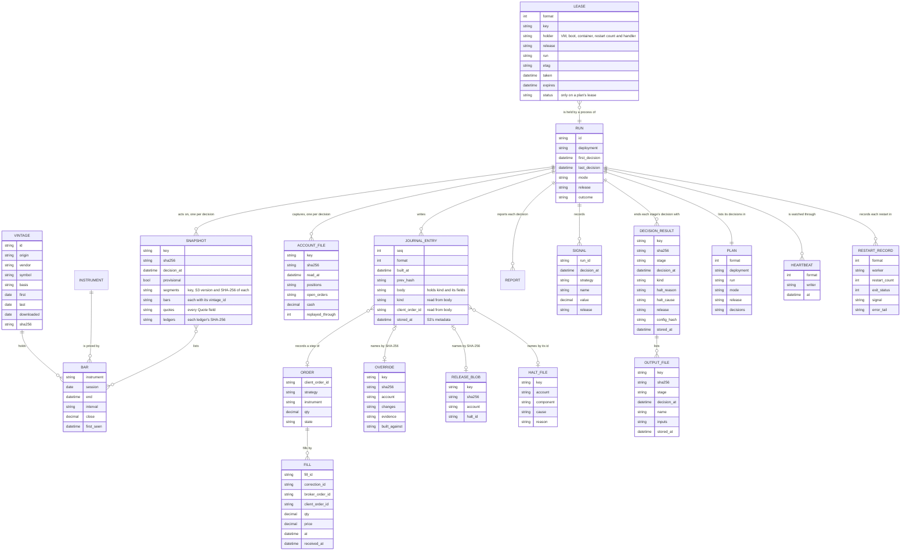
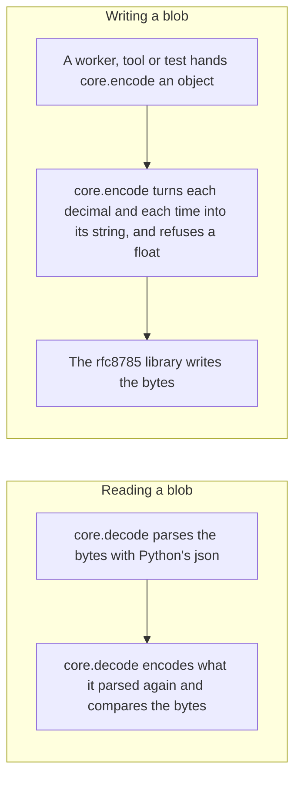
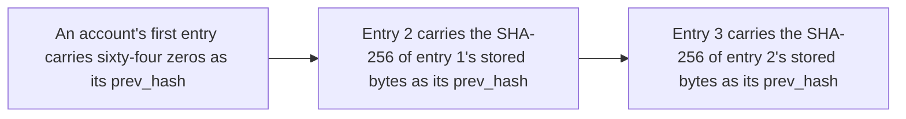

# Architecture, section 8: Crosscutting concepts

This page is section 8 of [the architecture](00-README.md), in the order of the arc42 template. It answers what is stored, where, and in which format, for every component.

## Contents

- [What is stored](#what-is-stored)
  - [Where each entity is kept](#where-each-entity-is-kept)
  - [How recorded blobs are checked](#how-recorded-blobs-are-checked)
  - [File formats and keys](#file-formats-and-keys)

## What is stored

An entity-relationship diagram shows what is kept and how the records point at
each other. A pair of bars at a line's end means exactly one, and a circle with a
crow's foot means zero or more.

The figure below is a C4 code diagram.

### Where each entity is kept

The entities live in eight stores, one of them kept by marketlake, and each keeps its own rule. Five of them are the cylinders in the diagram under [Data flow](06-runtime.md#data-flow), by the same names.

1. [marketlake](#marketlake-holds-vintage-and-bar) holds `VINTAGE` and `BAR`.
2. [Run records](#run-records) hold `SNAPSHOT`, `ACCOUNT_FILE`, `SIGNAL`, `DECISION_RESULT` and `OUTPUT_FILE`.
3. [The security master](#the-security-master) holds `INSTRUMENT`.
4. [The journal](#the-journal) holds `JOURNAL_ENTRY`.
5. [Decision reports](#decision-reports) hold `RUN` and `REPORT`.
6. [The simulated broker's account](#the-simulated-brokers-account) holds the simulator's orders and positions, as proposed for [#10](https://github.com/l3a0/ithildin-runtime/issues/10).
7. [Account controls](#account-controls), the account's own blobs, hold `LEASE`, `OVERRIDE`, `RELEASE_BLOB`, `HALT_FILE`, the kill switch, the strategies' off switches, a fired loss stop and the hard caps.
8. [Split records and saved broker statements](#split-records-and-saved-broker-statements) are recorded facts, whose place is not yet written.

#### marketlake holds `VINTAGE` and `BAR`

Every bar, captured or imported, lives there, with its source and checksum in marketlake's manifest.

A repair can overwrite a partition, whose old copy marketlake's bucket versioning keeps, so [#16](https://github.com/l3a0/ithildin-runtime/issues/16) says lake partitions are not vintages. A bar's `vintage_id` is therefore its partition's path and S3 version id, which together name one copy, and a re-read fetches by that version.

marketlake's lake is private and backed up off the machine, which is what the premise asks of captured bars, and it keeps them out of this public repository. The checksums this repository commits are the partition checksums a snapshot records, for any run a test or a report pins.

Imported history from quantitative-trading arrives with that repository's own checksums, from its [`data/vintages.jsonl`](https://github.com/l3a0/quantitative-trading/blob/19aadbeb9730bf34f724af5688669b6bc208d136/data/vintages.jsonl), so the import can prove it read the recorded bytes. [l3a0/marketlake#938](https://github.com/l3a0/marketlake/issues/938) built the import.

#### Run records

Run records serve two purposes. They are how the workers pass work to each other, since each stage's output is the next stage's input, and they are the record of what each decision saw and did.

Run records hold `SNAPSHOT`, `ACCOUNT_FILE`, `SIGNAL`, `DECISION_RESULT` and `OUTPUT_FILE`, as blobs in S3 under the run's prefix, each written once at a key fixed by the run, the stage, the decision and, for an output file, its name.

- A snapshot lists the marketlake bars one decision read, by partition, or by segment for a read before sealing, each with its checksum, holds every `Quote` field and each bar's `vintage_id`, and marks a read before sealing provisional.
- A signal record holds a value the run computed, such as the hedge ratio, the z-score or the forecast, keyed by run, component, decision and name.
- Each blob's header names the blobs it came from, and a halt says why a decision stopped.

**Table:** Which blobs can be regenerated

| Blobs | Can they be regenerated? |
| --- | --- |
| A deterministic component's blobs | Yes, from marketlake, the journal and the code |
| Data's snapshots, execution's account files, the send stage's broker reads, a takeover's broker order list and the order list that maps an order in doubt | No. They capture what was true at the moment, so all are recorded data |
| The restart records the host's stop handler writes | No, but they are diagnostics rather than recorded data. They are kept as long as the operator sets, as design.md's `### Data has a cost, except the data that cannot be recaptured` says. The price is that a record not yet uploaded when its VM is lost is lost with it |
| A backtest's blobs | Yes. They sit in a memory-backed folder and vanish when it ends, because a backtest can be regenerated |

The blobs also make a question such as "how did the backtest's z-score on a decision differ from the shadow run's" a lookup rather than a recomputation.

#### The security master

The security master holds `INSTRUMENT`. It is a small committed file that changes only through a pull request. The file ships in the release image, so the digest records the mapping. This doc proposes, for [#5](https://github.com/l3a0/ithildin-runtime/issues/5), that rows only add, an id is never reused or removed, and a rename is a dated row, and [#5](https://github.com/l3a0/ithildin-runtime/issues/5) holds how. The price is that a renamed ticker needs a release.

#### The journal

The journal holds `JOURNAL_ENTRY`. It is the one numbered log: one per broker account, outside every run, because the book is replayed from it across runs.

Each entry is a blob at a key fixed by the account and its sequence number. It holds these, so the entry itself is the record.

- Its number.
- The time it was built, to the microsecond.
- Its body.
- The hash of the entry before it.

Its own hash is the SHA-256 of those bytes, as [File formats and keys](#file-formats-and-keys) says. `Journal`, in the `journal` package, writes through `BlobStore` for the account the broker adapter names. `ORDER` and `FILL` are read from journal entries rather than kept as records of their own. Each entry is stored before the step it records happens.

Six writers can append.

1. The `ithildin` tool.
2. The supervisor, when it clears a lease or takes one over, and when it journals as lost a capture whose worker's process died holding it, as [A write S3 refuses or does not answer](../design.md#rule-1-a-write-s3-refuses-or-does-not-answer) says.
3. Monitoring.
4. Execution.
5. In a VM image rollback the owner overrides for an emergency, the rollback's credential, for the journal entry of the kill switch pull that rollback makes.
6. In a live drill the owner approved, the approved drill role, for the journal entries of its own kill switch pull and its own clear.

Only execution, monitoring, the supervisor and the `ithildin` tool may import the `journal` package, so the rollback's credential and the approved drill role may write their entries only by running one of them. [#11](https://github.com/l3a0/ithildin-runtime/issues/11) settles which, and how the drill's pull carries its run id and its clear stays bound to the tag of its own pull, as [Rule 10](../design.md#rule-10-the-kill-switch-is-a-blob) requires.

As this doc proposes for [#10](https://github.com/l3a0/ithildin-runtime/issues/10), S3's refusal of an existing key is what keeps two of them from taking one number: the writer that is refused reads the new entries, decides its step again, and takes the next number.

Changing an entry would break the link from the entry after it. Beside that link, the bucket does four things, so an edit cannot hide.

1. It refuses any replacement or delete by every principal, the owner's included.
2. It keeps every version.
3. It locks each entry with S3 Object Lock.
4. It alarms on a delete event.

Before live, the live journal, every override, every release, every halt and every recorded capture are replicated to a bucket in a second AWS account, as [The replica before live](../design.md#rule-1-the-replica-before-live) says.

#### Decision reports

Decision reports hold `RUN` and `REPORT`. A `REPORT` is the report monitoring writes for each decision. A report is computed from the journal and the snapshot, so losing one costs nothing. The run writes it to S3 for the owner to read, not as a record.

#### The simulated broker's account

One blob per simulated account per call, written before the call returns, outside every run, holds the orders, open and closed, with both ids and each submission time, and the positions the simulator keeps.

The simulated broker's adapter reads and writes it through a `BlobStore` the entry point hands it, so execution's own outputs are the same whichever broker it holds. Backtest and shadow use the same form, so an order still resting when a shadow run ends is there in the next run, or on a new VM. Each simulated account has its own lease and kill switch, so a backtest never shares the paper account's.

This is a proposal for [#10](https://github.com/l3a0/ithildin-runtime/issues/10).

#### Account controls

Outside every run, account controls, the account's own blobs, hold `LEASE`, `OVERRIDE`, `RELEASE_BLOB`, `HALT_FILE`, the kill switch, each strategy's off switch, a fired loss stop and the hard caps blob. They sit at keys fixed by the account or the deployment under prefixes of their own, with the rules [The kill switch and the hard caps are blobs](07-deployment.md#rule-4-the-kill-switch-and-the-hard-caps-are-blobs) and [The runtime's credential does only what the rules need](07-deployment.md#rule-5-the-runtimes-credential-does-only-what-the-rules-need) give.

#### Where the plan, heartbeats and restart records sit, and what the lifecycle expires

`PLAN` sits under the run's prefix. `HEARTBEAT` and `RESTART_RECORD` sit under prefixes of their own, keyed by writer and time and by worker and restart count.

The bucket's lifecycle expires heartbeats and the noncurrent versions a lease's rewrites leave under `leases/`, and nothing else. A snapshot a decision read sits under its run's prefix with data's other outputs and is recorded data, so no lifecycle rule may match it, as design.md's `### Data has a cost, except the data that cannot be recaptured` says.

#### Split records and saved broker statements

Split records and saved broker statements are recorded facts. Wherever they sit, nothing may overwrite or silently drop one, every read verifies its checksum, and a copy leaves the machine from the first session. Where that is, is not yet written. [#46](https://github.com/l3a0/ithildin-runtime/issues/46) starts the one place for split records from marketlake's ledger and asks [#5](https://github.com/l3a0/ithildin-runtime/issues/5) to close the ways that ledger can lose a record, or say why it cannot be the place. One way [#46](https://github.com/l3a0/ithildin-runtime/issues/46) does not list is the `actions` lifecycle rule in marketlake's `infra/live/bucket.tf`, which expires a replaced version of the ledger after 30 days. No issue holds the place for saved broker statements yet.

### How recorded blobs are checked

S3 checks every blob at rest on its own schedule and repairs corruption from redundant copies, so no job of the platform's reads blobs back. Three checks remain, as [Faults are expected](../design.md#faults-are-expected-and-the-platform-checks-itself-while-it-runs) says.

1. Every write through `BlobStore` sends its SHA-256, and S3 refuses an upload whose bytes do not match it.
2. Before live, a recorded blob not found in the second account's bucket within a written bound raises an alarm that reaches the owner.
3. A restore drill restores to a scratch place and checks counts and checksums, on a schedule whose maximum interval sits beside the code. A mismatch it finds pages at once, naming the key and both hashes or the prefix and both counts. A blob missing because of a removal under a legal duty to delete, such as a vendor's license terms, which appends its own record, is expected and no mismatch. Monitoring also pages when its last passing run is older than that interval, and a run that fails before it compares is no passing run.

This doc proposes, for [#11](https://github.com/l3a0/ithildin-runtime/issues/11), that it holds the restore drill and the replication alarm, their routes to the owner and their drills, which its body does not yet name. Each drill shows its alarm firing and leaves nothing in live's journal, captures or replica that a replay reads.

### File formats and keys

Two rules lean on exact bytes.

1. A deterministic stage that is run again must write the same bytes, because S3 refuses the second write and the worker then compares SHA-256s, alarming on a difference.
2. The journal chains each entry to the hash of the one before it.

Both fail if the same values can be written two ways, such as a different key order, a float printed with one more digit, or a time in another zone. So `core` defines the file form of every type, which [#22](https://github.com/l3a0/ithildin-runtime/issues/22) builds as this subsection describes.

#### Who writes and reads a blob

**One codec in `core` writes and reads every blob.** `core.encode` turns an object into bytes and `core.decode` turns bytes of a named kind back into an object. No worker, tool or test calls a JSON library itself. Two workers that each followed the standard library would differ: Python's `json` sorts keys by code point where RFC 8785, the JSON Canonicalization Scheme, sorts by UTF-16 units, and `Decimal(0.1)` carries fifty-five digits of the float behind it. Each field's type in `core` declares how the codec writes it, and `core`'s storage contract holds one key builder for each row of the key table below, so no module puts a key together from strings.

**The codec writes its bytes with a published RFC 8785 library rather than an encoder of its own.** The library is Trail of Bits' [`rfc8785`](https://github.com/trailofbits/rfc8785.py), a pure-Python implementation with no dependencies of its own, pinned at an exact version, 0.1.4, its latest release on 2026-11-08. A run of that version on Python 3.12 showed that it sorts keys by UTF-16 units, and that it refuses a `Decimal`, a NaN, an infinity and an integer whose magnitude is 2⁵³ or more, as [its source](https://github.com/trailofbits/rfc8785.py/blob/v0.1.4/src/rfc8785/_impl.py) also shows. It does print a float, so `core.encode` turns each decimal and each time into its string, and refuses a float before the library sees the value. The library only encodes, so `core.decode` parses with Python's `json` and checks the bytes by encoding what it parsed again.

The figure below is a component-level flowchart of the codec's two paths, in order.

The price is a third-party library on the path that writes the journal, where a change in its output would break the hash chain. A test encodes committed fixture values and compares the bytes, so an upgrade that changes them fails CI before it ships.

#### What a blob's bytes look like

**Every blob is canonical JSON.** The encoding follows RFC 8785, the JSON Canonicalization Scheme, for encoding, whitespace and key order, and adds rules of its own for numbers, times and empty fields.

1. UTF-8, with no whitespace outside strings, as RFC 8785 requires.
2. Object keys sorted by their UTF-16 code units, as RFC 8785 sorts them.
3. No JSON floats. RFC 8785 prints a number in its shortest double form, which cannot hold most decimal prices exactly, and it recommends a string for a number that needs more precision than a double holds. So every decimal quantity, such as a price, a share count, a dollar amount, a hedge ratio or a z-score, is a JSON string in plain decimal notation, such as `"123.4500"`. Integers below 2⁵³, such as a sequence number or a bar's volume, are JSON integers. Share counts are decimals, because the GLD leg is fractional.
4. Every time the platform writes is UTC, in RFC 3339 with a `Z` and six fractional digits, truncated, such as `"2026-11-02T20:40:01.123456Z"`. A decision's time is UTC too, such as the 15:40 decision on 2026-11-02 at `"2026-11-02T20:40:00.000000Z"`. A session date is the exchange's trading date, such as `"2026-11-02"`, because it names a session rather than an instant.
5. A field with no value is `null`, never left out, so a reader can tell an empty field from a format that lacks it. A list keeps its order when the order means something, such as a plan's decisions, and is sorted by its key when it does not, such as a header's inputs, which is this doc's rule rather than RFC 8785's.

#### Why not another format

**Only canonical JSON passes both tests.** The first test is whether the same values give the same bytes across releases and languages, which both rules that lean on exact bytes need. A second test is whether a person can read a blob straight from S3.

**Table:** The formats weighed for the blobs, against the two tests

| Format | Same bytes for the same values | Readable from S3 |
| --- | --- | --- |
| Parquet | No. Its writer records its own version in each file, in [the footer's `created_by` field](https://github.com/apache/parquet-format/blob/master/src/main/thrift/parquet.thrift), so the same values change bytes across releases | No, it is binary |
| Protocol Buffers | No. [Its documentation](https://protobuf.dev/programming-guides/serialization-not-canonical/) says its serialization "is not (and cannot be) canonical" | No, it is binary |
| CBOR with [RFC 8949's deterministic encoding](https://www.rfc-editor.org/rfc/rfc8949#section-4.2) | Yes, with rules of the platform's own for decimals and times, as JSON needs too. RFC 8949 leaves the deterministic form of a decimal fraction to the application, and [the IETF's common profile](https://datatracker.ietf.org/doc/draft-ietf-cbor-cde/) expired as a draft | No, it is binary |
| Canonical JSON after RFC 8785, with the five rules above | Yes | Yes |

#### How a value received from outside is kept

**A value received from outside is kept exactly as it arrived.** A fill's quantity and price, a position, an open order's quantity, and marketlake's bar and quote values are stored as the decimal string the broker or marketlake sent, never passed through a float and never rounded, and so is a time received from outside, with its UTC instant written beside it.

The journal and the snapshot are the only records of what the broker and the market said, so a rounded copy would lose a value that cannot be recaptured: at four places, a leftover position of `0.00004` would record as zero, and the book replayed from rounded fills would drift from the broker's. A received value with more places than its field declares is flagged in the record, never rounded.

marketlake stores prices as 64-bit floats, so for its values "as sent" means the float's shortest round-trip text, `Decimal(repr(x))`, through one converter in `core` that never rounds. The converter refuses, rather than rewrites, a string in any form but ASCII digits with an optional minus, fraction and exponent, and the codec refuses a decimal past a size limit a test pins, so a hostile value cannot make a writer allocate gigabytes. A refused value halts its read, and the raw bytes beside it keep what arrived. `core.to_decimal` below is for computed values only, and a test pins that a five-place price and `0.00004` survive the round trip.

A received body is stored whole and unchanged, in a form canonical JSON can hold, a body that is not valid UTF-8 included. It is kept as exact bytes in one of two forms, with a field naming which.

1. A body that is valid UTF-8 is stored as text, which canonical JSON returns byte for byte.
2. Any other body is stored as base64.

A body that cannot be stored halts, and is held as a capture under [Rule 1: a write S3 refuses or does not answer](../design.md#rule-1-a-write-s3-refuses-or-does-not-answer).

#### Which clock a schedule follows, and how it becomes UTC

**Two rules are stated on the exchange's clock, and resolved to UTC once.** They follow New York's clock because the market does.

1. The host's timer, which starts the run before the session and stops it after the close.
2. The heartbeat check's cron expression.

A rule written in UTC would move by an hour against the close each time the clocks change. So each is written as the exchange's local time, and one calendar function in `core` turns it into a UTC instant for each session.

**The calendar function takes the trading sessions as data.** `core` imports no calendar library, because the usual one, `exchange_calendars` 4.13.2, would pull pandas and numpy into every worker. The table of sessions and their closes is a committed data file, checked by its SHA-256, which a script regenerates from `exchange_calendars` at a pinned version. An early close is the case that matters: on 2026-11-27 the close is 18:00 UTC, three hours before a normal day's, so close−20 falls at 17:40 UTC that day and at 20:40 UTC on 2026-11-30.

Five rules hold the table.

1. A session missing from the table halts.
2. The table runs from the first session any committed backtest reads through the end of the next calendar year.
3. The table names the range it covers, and a date outside it halts, since a missing input stops trading (hard limit 3).
4. The plan builder reports how many sessions the table has left, so an alarm can fire before a run meets its end. [#11](https://github.com/l3a0/ithildin-runtime/issues/11) sets that bound and builds the alarm.
5. A closure announced after the table was cut reads as a session with no data, which halts, since a missing input stops trading (hard limit 3).

A time stated as minutes before the close resolves through the same function from that session's close. Two such times are a strategy's close−20 decision and the market-on-close cutoff, which is close−12 in the hard caps this doc recommends, under Alpaca's close−10. The plan, every key, every timestamp the platform writes and every comparison hold only that instant.

The promotion job's schedule is a GitHub Actions cron, which runs in UTC, so it runs at 22:00 UTC, after the close in both summer and winter.

#### How a computed value is rounded

**A value the platform computes is rounded once, in one place.** The types in `core` hold `Decimal`.

- A statistic, such as the alpha model's hedge ratio and z-score or the cost model's estimate, may be computed in floats and converted at the stage's output by `core.to_decimal`, which takes the float's shortest form and rounds it half to even to the field's declared places.
- The risk gate, the order manager, `Journal.replay` and reconciliation compute in `Decimal` throughout, and the quantity journaled for an order is the exact string the broker adapter sends and the gate checks.

A `dict` field's values take the declared places of their value type, such as a share count in `TargetPortfolio.shares`. A field's declared places never shrink in a later release.

The price is that a value computed in floats that falls exactly on a rounding boundary can round differently under another release's numeric library. A run never mixes releases, because a worker on another release halts with "release changed", so the difference can appear only between runs, where the header's `release` explains it.

#### What an output file holds

**Every output file has a header and a body.** Each output file is one object with two members, `header`, the `BlobHeader`, and `body`. The header's `format` is a number per kind, raised when that kind's fields change. A blob stored at a key of its own rather than as a stage's output file, such as a plan, a lease, a heartbeat, a restart record or a journal entry, carries a `format` field of its own instead, so every blob a later release reads names its format. [A rollback is a pin to an earlier digest](07-deployment.md#rule-6-a-rollback-is-a-pin-to-an-earlier-digest) requires that each release writes only formats the release before it can read. Each hash is lowercase hex SHA-256, and each writer sends it as the upload's SHA-256 checksum, so S3 checks it before it stores the blob.

#### How a journal entry is hashed and checked

**A journal entry hashes its whole blob.** Each entry is one blob holding `seq`, `format`, `built_at`, `prev_hash` and `body`. Its hash is the SHA-256 of those bytes exactly as stored, which the next entry carries as its `prev_hash`, and the first entry of an account carries sixty-four zeros. A hash of the body alone would leave an entry's number and its link outside what the next entry vouches for.

The figure below is a C4 code diagram.

A blob cannot hold its own hash, so `JournalEntry.hash()` computes it as the SHA-256 of the entry's canonical encoding, and it is the one function that does. A reader trusts that hash only because `core.decode` refuses bytes that are not the canonical encoding of what it parsed, so the hash of a decoded entry is the hash of the bytes S3 returned. A reader also checks three things, and halts otherwise.

1. That those bytes are the canonical encoding of what it parsed.
2. That each key's number equals the `seq` inside it.
3. That it knows the entry's `format`.

Every journal format ever written stays readable by every later release, because the book can always be replayed from the first entry, even when a rebuild starts from a book snapshot, and each format has a committed fixture entry and a test that replays it.

#### What a journal entry's body holds, and how a retry is recognised

The `body` holds a `kind`, such as `intent`, `sending`, `fill`, `outside_order`, `outside_fill`, `unmatched_order`, `unmatched_fill`, `cancel`, `sort`, `sort_done`, `override`, `clear` or `switch_pull`, and that kind's fields.

A writer builds an entry once and resends the same bytes on a retry, so a live process recognises its own earlier attempt by hash. A process that restarted builds new bytes, so before it appends it checks the field that names the step against the journal instead.

**Table:** The field a restarted writer checks against the journal before it appends, by kind of entry

| Kind of entry | The field it checks |
| --- | --- |
| `intent` and `sending` | The client order id |
| `cancel` | The broker's order id and what tells this cancel from an earlier one on the same order, because an order the platform did not stamp has no client order id and one order can carry several cancels. [#10](https://github.com/l3a0/ithildin-runtime/issues/10) names that key. A `cancel` entry with no journaled answer is a cancel whose answer is lost, so a restarted writer looks it up before any new cancel, as rule 6 of [Faults are expected](../design.md#faults-are-expected-and-the-platform-checks-itself-while-it-runs) says |
| `fill` and `outside_fill` | The broker's fill id and correction identifier together, with an identical repeat skipped and a differing one journaled, which halts |
| `outside_order` | The broker's order id |
| `unmatched_fill` and `unmatched_order` | The broker's fill or order id |
| An outside entry with no order or fill | The broker's own record id |
| `sort` and `sort_done` | The off switch's or halt's id |
| `override` | The override blob's SHA-256 |
| `clear` | The halt's id with the release hash, counting only a valid release as already done |
| A halt's own entry | The firing's id |

A switch already pulled makes `switch_pull` say so rather than journal it twice.

#### Where each blob is stored

Every key below sits in its environment's bucket, as [Four environments](07-deployment.md#four-environments) says. Deployments and accounts appear by the alias the release's table gives them, never by a broker's account number.

A create-only write that S3 refuses, whose stored SHA-256 differs from the writer's, alarms, as [Every alarm and its drill](../halts-and-drills.md#every-alarm-and-its-drill) lists. For a capturing stage, data's snapshot and execution's recover stage, the differing capture is also stored at the next attempt number, by `core`'s key builder for that row, and named in the decision result, so a second read of a source that may not come again is kept rather than discarded.

**Table:** The key each store writes under

| Store | Key |
| --- | --- |
| A run's plan, which only the supervisor's role may create | `runs/<deployment>/<run>/plan.json` |
| The session-start comparison's result, holding the sequence number and hash it compared | `runs/<deployment>/<run>/comparison.json` |
| A halt of the run, and the run's stop | `runs/<deployment>/<run>/halt.json`, `runs/<deployment>/<run>/stop.json` |
| A stage's decision result, which holds its halt when it has one | `runs/<deployment>/<run>/<decision>/<stage>/result.json` |
| A stage's output file, including data's snapshot, alpha's signal records and monitoring's report | `runs/<deployment>/<run>/<decision>/<stage>/<name>.json` |
| The account's `Valuation`, an output of the day's first recover stage, by this doc's proposal for [#7](https://github.com/l3a0/ithildin-runtime/issues/7) and [#10](https://github.com/l3a0/ithildin-runtime/issues/10) | `runs/<deployment>/<run>/<decision>/execution/recover/valuation.json` |
| A send stage's broker read, one for each attempt | `runs/<deployment>/<run>/<decision>/execution/send/broker-read-<n>.json` |
| A capturing stage's later capture that differs from its first | `runs/<deployment>/<run>/<decision>/<stage>/<name>.attempt-<n>.json`, with `n` counting from 2 |
| A takeover's broker order list, a capture named by the journaled takeover entry, whose form [#10](https://github.com/l3a0/ithildin-runtime/issues/10) holds | `runs/<deployment>/<run>/execution/takeovers/<UTC time>.json` |
| The order list that maps an order in doubt | [#10](https://github.com/l3a0/ithildin-runtime/issues/10) holds the key |
| A send stage's claim, naming the handler running it | `runs/<deployment>/<run>/<decision>/execution/send/claim.json` |
| A journal entry | `journal/<account>/<seq>.json`, with `seq` padded to twelve digits |
| A journal checkpoint | `journal/<account>/checkpoints/<seq>.json`, with `seq` padded to twelve digits |
| A book snapshot, derived | `accounts/<account>/books/<seq>.json`, with `seq` padded to twelve digits |
| The simulated account, written before each call returns | `sim/<account>/<decision>/<call>.json`, with the call padded to four digits |
| The plan's lease, holding the run's status | `leases/plans/<deployment>/<run>.json` |
| The account's lease | `leases/accounts/<account>.json` |
| The kill switch | `accounts/<account>/switch.json` |
| A fired loss stop, which holds until a person clears it | `accounts/<account>/stop.json` |
| A halt that names the account and outlives a session, such as the one [Faults are expected](../design.md#faults-are-expected-and-the-platform-checks-itself-while-it-runs) holds on an unsettled cancel | `accounts/<account>/halts/<component>-<cause>-<timestamp>-<count>.json` |
| A strategy's off switch | `accounts/<account>/strategies/<strategy>/off.json` |
| A strategy halt the platform raises, by this doc's proposal for [#33](https://github.com/l3a0/ithildin-runtime/issues/33) | `accounts/<account>/strategies/<strategy>/halts/<component>-<cause>-<timestamp>-<count>.json` |
| The hard caps | `accounts/<account>/caps.json` |
| An override | `accounts/<account>/overrides/<sha256>.json` |
| A live release | `accounts/<account>/releases/<sha256>.json` |
| An owner's record confirming a broker's trade, under a prefix [#11](https://github.com/l3a0/ithildin-runtime/issues/11) names | [#11](https://github.com/l3a0/ithildin-runtime/issues/11) holds the key |
| A rewrite-planning page's claim and its sent record, one for each load parameter and level in the environment | `load/<parameter>-<level>/claim.json`, `load/<parameter>-<level>/sent.json` |
| A heartbeat | `heartbeats/<deployment>/<writer>/<UTC time>.json` |
| A restart record | `restarts/<deployment>/<run>/<worker>/<boot>/<count>.json`, with the count padded to six digits |
| The release pin, deploy records, block records, promotion records and pin changes | `release/pin.json`, `release/deploys/<digest>.json`, `release/blocked/<digest>.json`, `release/promotions/<digest>.json`, `release/changes/<UTC time>.json` |

#### What each part of a key stands for

**Table:** What each part of a key stands for

| Part | What it stands for |
| --- | --- |
| `<run>` | The session date in shadow, paper and live, and the span's first and last session dates, as `2006-04-26_2012-04-09`, in a backtest, built by one function in `core` |
| `<decision>` | The decision's UTC time in the compact form `20261102T204000Z`, so it sorts in order |
| `<timestamp>` | A halt firing's UTC second in the compact form `20261105T204100Z`, so a halt's key sorts in order |
| `<UTC time>` | A UTC time to the microsecond, in the compact form `20261102T204001.123456Z`, so it sorts in order |
| `<boot>` | The boot id of the VM that wrote the record, so a replacement VM whose restart count starts again never meets an earlier record's key |
| `<seq>` | The journal entry's sequence number. Every key that carries it pads it to twelve digits, the journal entry's own key, a checkpoint's and a book snapshot's, so a listing sorts them in order. Twelve digits of sequence number cover a million million entries, which at thirty entries a minute around the clock last tens of thousands of years |

`core`'s key builders refuse a part that would make two rows' keys the same, such as a `-` inside a halt key's component or cause, or an output named `result`, `claim` or like an attempt.

A halt's id is the key of the result that holds it, `<deployment>/<run>/<decision>/<stage>`, or for a halt held in a folder its name. The prefixes are the ones the grants of [The runtime's credential does only what the rules need](07-deployment.md#rule-5-the-runtimes-credential-does-only-what-the-rules-need) and the bucket's lifecycle name, with `release/` read by each VM's role for its own pin, as [Four environments](07-deployment.md#four-environments) says.
