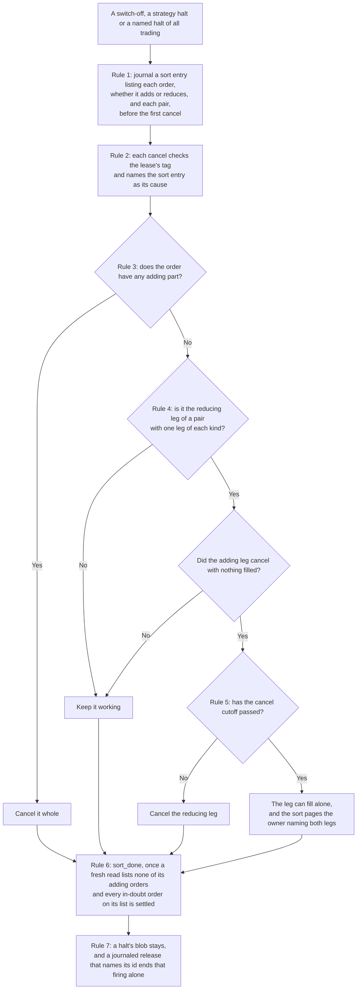
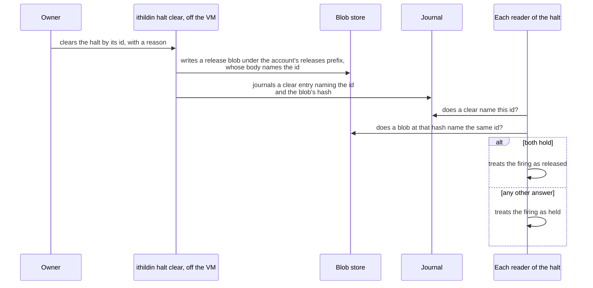
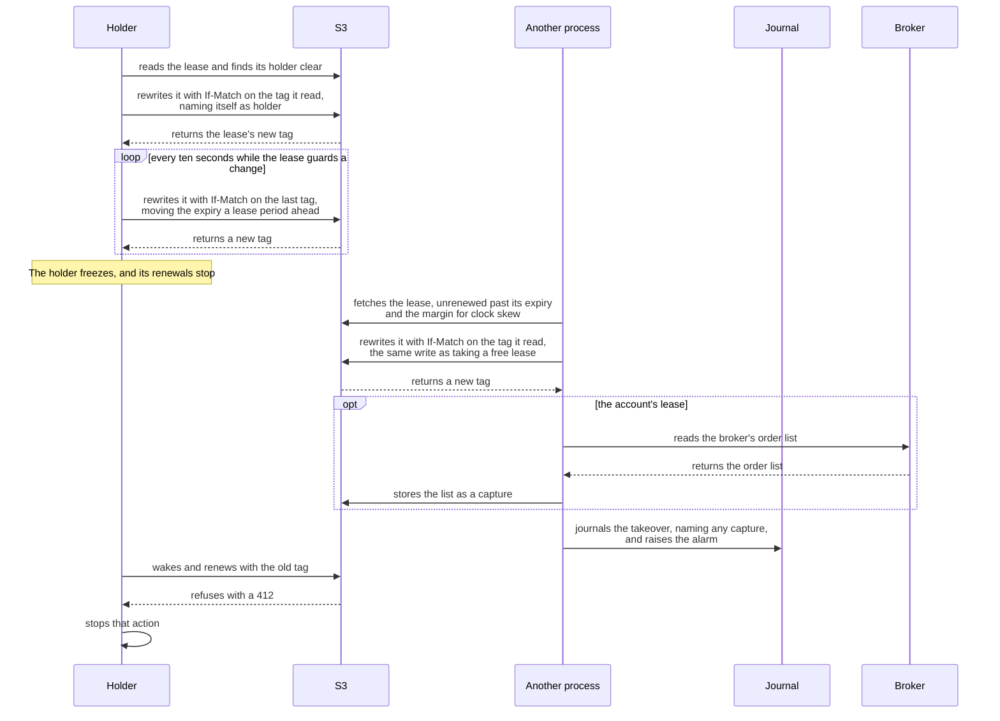

# Halts and drills

This document is the one place that holds the steps of a sort and every drill's steps. A rule elsewhere may say a drill must exist, and its steps sit here. [design.md](design.md#every-change-can-be-undone-or-switched-off) states what must hold, [architecture/06-runtime.md](architecture/06-runtime.md#every-alarm-and-its-drill) shows where it sits, and the issues that build each piece link here. So a change to a step lands here, and the three stay short.

## Contents

- [How a sort runs](#how-a-sort-runs)
- [Every alarm and its drill](#every-alarm-and-its-drill)
  - [Alarms on data](#alarms-on-data)
  - [Alarms on the order path](#alarms-on-the-order-path)
  - [Alarms on leases and takeover](#alarms-on-leases-and-takeover)
  - [Alarms on deployment and release](#alarms-on-deployment-and-release)
  - [Alarms on storage and backups](#alarms-on-storage-and-backups)
  - [Alarms on operations](#alarms-on-operations)
  - [Alarms on strategy samples](#alarms-on-strategy-samples)
  - [Alarms on a fill and a quote](#alarms-on-a-fill-and-a-quote)
  - [How a drill counts toward a gate](#how-a-drill-counts-toward-a-gate)
- [Drills with no alarm](#drills-with-no-alarm)
  - [What each environment drills as it arrives](#what-each-environment-drills-as-it-arrives)

## How a sort runs

A sort is execution's pass that cancels a strategy's adding orders and keeps its reducing ones. A switch-off, a strategy halt or a named halt of all trading starts one.

This doc proposes how execution carries that out, for [#10](https://github.com/l3a0/ithildin-runtime/issues/10) and [#33](https://github.com/l3a0/ithildin-runtime/issues/33), apart from what stands as decided: the filled leg in rule 4, the reducing leg left to fill alone in rule 5, monitoring's read in rule 6, and what a halt of all trading sorts. The same steps serve every halt that cancels this way, which [A strategy is judged over a sample](design.md#a-strategy-is-judged-over-a-sample-and-runs-unchanged-through-it) names. A halt that stops all trading sorts every order in the account, and an order that traces to nothing counts as adding, so it is cancelled. It cancels only when the journal read succeeded, because an unreadable journal is missing input, so the sort halts and cancels nothing. The price is that an order placed by hand at the broker's console is cancelled and has to be placed again. Seven rules carry a **sort**, the vocabulary's name for this pass over a strategy's orders.

1. **A sort is an item of its own, journaled whole before its first cancel.** The off switch's event becomes an item, the account, the strategy and the firing's id rule 7 defines, rather than a stage and a decision. Before its first cancel, execution journals a `sort` entry listing each order, whether it adds or reduces, and each pair, which the planned entry names. A redelivered event or a restart resumes that list and never sorts again, so a pair a crash split is still finished. A starting instance and each recover stage resume any sort with no `sort_done` entry, past its deadline too, and start one for any unreleased firing of a cause rule 7 names that has none. Switching the strategy back on, or releasing the firing, ends its sort: execution journals `sort_done` with the unfinished list and cancels nothing more. So before a resumed sort's next cancel, execution checks for that, since execution can be down when either lands. Only a read that proves the release, or for a switch-off proves another current version or no `off.json`, ends the sort. Any other answer leaves the sort running and its cancel goes out.
2. **Its cancels follow the rules every cancel follows.** Each checks the lease's tag and names the `sort` entry as its cause. No clock or cutoff reading stops a sort's adding cancel or a pair-keeping cancel. Only the lease's tag and a proved release do, and [#10](https://github.com/l3a0/ithildin-runtime/issues/10) holds how. Rule 5's cutoff stops only a reducing leg's cancel, and there a cutoff that cannot be computed, or that reads a clock which failed its check, counts as not passed, so the cancel goes out. A broker's refusal of a late cancel is journaled. A stored halt stops none of them, and rule 1's check on a resumed sort is the one other way they stop. The sort's handler carries out [the rule for a cancel whose answer is lost](design.md#faults-are-expected-and-the-platform-checks-itself-while-it-runs) on a lost answer, inside the sort's deadline, and holds no lease between tries. An order already `CancelSent` stays under [the rule for a cancel whose answer is lost](design.md#faults-are-expected-and-the-platform-checks-itself-while-it-runs) and counts as not yet cancelled, so it never gets a second cancel without a lookup.
3. **An order with any adding part counts as adding.** It is cancelled whole, which covers an order that crosses zero.
4. **A pair with one leg of each kind cancels its adding leg first.** The reducing leg's cancel goes once the broker's answer or a lookup shows the adding order cancelled with nothing filled. Any fill on the adding leg, whatever its size, leaves the reducing leg working, so a filled leg keeps its partner, as the one exception to the kept leg being cancelled too. After a small partial fill the imbalance is the reducing quantity less the fill. A market-on-close order at a real broker has no fill before the close, so in slice 1 this arises only on a paper account that fills one early. An adding cancel or in-doubt adding leg still unsettled at the sort's deadline leaves the reducing leg working, journals that, and the sort's alarm names both legs, as the page under [the rule for a cancel whose answer is lost](design.md#faults-are-expected-and-the-platform-checks-itself-while-it-runs) does for a cancel it holds. If that cancel later settles with nothing filled, the reducing leg's cancel still goes out, under rule 5's cutoff. A partly filled reducing leg has the rest cancelled. Two adding legs, or an adding leg whose partner already filled, are cancelled as adding orders, and the leg left alone is bounded by `max_net` and alarmed after the close as a stranded leg is.
5. **A sort has a latest start for a pair.** The window is the cancel cutoff less the measured time to confirm a cancel. Inside it the adding cancel still goes out, the reducing leg's cancel can be stopped at the cutoff, and that leg can then fill alone. The price is one leg open at the close, reported that day, so the sort journals this case and pages the owner naming both legs. This doc proposes, for [#10](https://github.com/l3a0/ithildin-runtime/issues/10), that the same entry and page follow whenever the cutoff stops a reducing leg's cancel. That includes the cancel rule 4 sends once an adding cancel left unsettled at the sort's deadline settles late with nothing filled, so a switch-off made well before the window can end in this case too.
6. **A sort ends the way the kill switch's cancels end.** It journals `sort_done` only after a fresh read lists none of its adding orders and every in-doubt order on its list is settled, and it sorts each order that lands in the meantime. Monitoring's deadline starts on the switch's or the halt's event, the deadline [#33](https://github.com/l3a0/ithildin-runtime/issues/33) gives a switch-off, and because that event can be lost, monitoring also lists every cause rule 7 names and starts the deadline on any unreleased firing it finds with no `sort_done` entry, since nothing that rides on the event can catch a lost event. A list or a journal read that fails pages the owner, since a read that cannot run starts no deadline. That read is the one exception to the rule of no polling, and it stays narrow: monitoring is the only reader and it only reads, a read can only start the alarm deadline and never act on an order, and it runs only during the session, about once a minute, because an interval near ten minutes would miss the whole window from the decision to the cancel cutoff. The deadline alarms naming the broker's console if that entry has not appeared. The entry lists each order cancelled, kept or in doubt, each pair's outcome, and the positions left open, and an alarm raised from it gives those and the person's next step.
7. **A halt the platform raises reaches execution as a blob, one for each firing.** A sort has three kinds of cause.
   1. An off switch.
   2. A strategy halt.
   3. A halt of all trading that [A strategy is judged over a sample](design.md#a-strategy-is-judged-over-a-sample-and-runs-unchanged-through-it) names.

   The parts of this rule below say where each halt is stored, how each firing is named and written, what releases it, and which halts start a sort.

   - **Where a strategy halt is stored.** A strategy halt is created at `accounts/<account>/strategies/<strategy>/halts/<component>-<cause>-<timestamp>-<count>.json` by the component that raises it, which gains that one grant, and execution reads it beside the off switch, so a strategy with either is off. The blob stays, and a journaled release names its id and ends that firing alone.
   - **What happens when a halt fires again.** A named halt that fires again after a release writes a new blob, so a new event fires, and each `sort` and `sort_done` entry keys on the firing's id, so an earlier `sort_done` never answers a later firing.
   - **How each firing is named.** Each firing has one id. A switch-off's is the S3 version of its `off.json`, which its journal entry records, so an off, on, off sequence gives two firings, and the tool and monitoring read the sort of the current one. A halt's id is its name, `<component>-<cause>-<timestamp>-<count>`, made of four parts.
     1. The component that raised it.
     2. Its cause.
     3. The firing's UTC second, such as `20261105T204100Z`.
     4. That component and cause's running count on the account, which comes from a list of the folder. A failed list never stops a halt being raised, and [#33](https://github.com/l3a0/ithildin-runtime/issues/33) holds how the count is then set.
   - **Which is written first, the blob or its journal entry.** The blob comes first and its journal entry after it, as a switch-off's does. So a crash between them leaves a stored halt that refuses a submit and reaches monitoring's list, and the raiser or execution's recover stage journals the missing entry, while monitoring only pages. A journal that cannot be read therefore stops no halt.
   - **When a raiser that restarts reuses a firing.** A raiser that restarts reuses a firing of its component, cause and subject only on a read that proves it unreleased, and any other answer writes a new blob. The price is that a race can still leave two firings for one event, and each is released on its own, which fails closed.
   - **The hold after a stop.** This doc proposes, for [#33](https://github.com/l3a0/ithildin-runtime/issues/33), that the hold after a stop is one strategy halt per strategy, raised by the first execution instance to start.
   - **Where a halt of all trading is stored.** A named halt of all trading is stored under `accounts/<account>/halts/` the same way, at `<component>-<cause>-<timestamp>-<count>.json`, which already stops every strategy. A submit and a plan's cancel read a halt in that folder as stored until it is released, because no role may delete the blob.
   - **What releases a firing.** A firing is released when the journal holds a `clear` naming its id and, on an account whose hard caps blob sets `release_needs_blob`, that entry names the hash of a blob at `accounts/<account>/releases/<sha256>.json` whose body names the same id. Only the owner's role may write that prefix, as an override works. An absent or unreadable `release_needs_blob` reads as set, and live sets it. An outside entry that explains the whole difference also releases a split's or an assignment's firing where the hard caps allow it, as [Faults are expected](design.md#faults-are-expected-and-the-platform-checks-itself-while-it-runs) says. An absent or unreadable setting refuses, so the firing stays held. A firing raised because S3 would not store a capture, or any halt over a capture a process held when it died, is also held until the condition in [Rule 1: a write S3 refuses or does not answer](design.md#rule-1-a-write-s3-refuses-or-does-not-answer) holds, and a `clear` written before then is refused and releases nothing.
   - **Who uses the release test.** This one test, with that condition for that cause, applies to every halt on the account, a stage's halt and an unmatched entry included, and every reader uses it: a submit, a plan's cancel, the holding-halt check, a sort's start and resume, monitoring's deadline, `ithildin strategy on`, `ithildin status`, the promotion job and a raiser's lookup. So a journal entry from anyone but the owner cannot end a live halt.
   - **Which halts start a sort.** The event of either a strategy halt or a named halt of all trading starts the sort, as the off switch's does. Every other halt in `accounts/<account>/halts/`, such as the one [Faults are expected](design.md#faults-are-expected-and-the-platform-checks-itself-while-it-runs) holds on an unsettled cancel, starts none and keeps every working order.

The figure below is a component-level flowchart of the sort inside execution.

The diagram shows one sort in the order of the seven rules, so look for the reducing leg, whose cancel waits for the adding leg's outcome.

The figure below is a C4 dynamic diagram.

The diagram shows the release of a live halt from rule 7, so look for the second read, which is why a journal entry alone cannot end the halt.

## Every alarm and its drill

The charter's paper gate asks for every alarm to fire in a drill first. An
alarm reads zero while it is healthy, so only a drill shows it works. This
shape adds alarms that one process would not need, and each one gets a row
here, with the issue that builds its drill.

Test 1 to test 4 are the acceptance tests in [architecture/10-quality.md](architecture/10-quality.md#how-the-four-acceptance-tests-exercise-it).

### Alarms on data

**Table:** Data alarms, the reason each writes, and its drill

| Alarm | Reason it writes | Drill | Built on | Gate |
| --- | --- | --- | --- | --- |
| Missing or stale bar | The instrument and its state | A replay with a bar removed or aged, test 2 | [#5](https://github.com/l3a0/ithildin-runtime/issues/5), [#11](https://github.com/l3a0/ithildin-runtime/issues/11) | paper |
| Data not ready | "data not ready" | A run whose segments up to the decision time are missing, test 2 | [#11](https://github.com/l3a0/ithildin-runtime/issues/11) | paper |
| A traded or held instrument whose price carries a spike flag | The instrument and both prices | A provisional segment with one spiked quote | [#5](https://github.com/l3a0/ithildin-runtime/issues/5), [#7](https://github.com/l3a0/ithildin-runtime/issues/7) | paper |
| A capture segment whose SHA-256 does not match its object's stored SHA-256 and metadata under `lake-live/`, or a sealed partition whose SHA-256 does not match marketlake's manifest | The file's key and both hashes | Change a byte in a copy of a segment the data worker downloads, and in a copy of a sealed partition, each expecting the decision halted and no order sent | [#5](https://github.com/l3a0/ithildin-runtime/issues/5) | paper |
| The sealed day differs from what a provisional read saw | The ticker, the minute and both values, or the row the sealed day quarantined or lacks | Change or quarantine a sealed row a run's snapshot used, and land a sealed row after the used one, at or before the decision time | [#11](https://github.com/l3a0/ithildin-runtime/issues/11) | paper |
| A provisional snapshot with no stored comparison result past the written bound, or a sealed day that never arrives | The snapshot, the day and the bound | Withhold a day's sealed rows from a run's next session, and stop monitoring's comparison, each expecting a page and no decision stopped | [#5](https://github.com/l3a0/ithildin-runtime/issues/5), [#11](https://github.com/l3a0/ithildin-runtime/issues/11) | paper |

### Alarms on the order path

**Table:** Order path alarms, the reason each writes, and its drill

| Alarm | Reason it writes | Drill | Built on | Gate |
| --- | --- | --- | --- | --- |
| Risk gate refusal | The limit and the value | One order over each limit, test 3 | [#7](https://github.com/l3a0/ithildin-runtime/issues/7) | paper |
| An order or fill the platform did not send | The broker's order or fill id, and what it received | The steps under [Drill for an order or fill the platform did not send](#drill-for-an-order-or-fill-the-platform-did-not-send) | [#10](https://github.com/l3a0/ithildin-runtime/issues/10) | paper |
| Book and broker disagree | Both positions, both sets of open orders, or both cash figures | A simulated broker account edited by hand, once in a position and once in its cash, expecting the account file stored and named in the halt. Repeat each after the send stage and before the day's read after the close, expecting the same halt and its push. Repeat with the result's write refused, with the stop withheld, and with the stop's event ahead of the halt's, expecting the same push. After each repeat, restore the account before the next session, expecting its first order refused until the halt is cleared | [#11](https://github.com/l3a0/ithildin-runtime/issues/11) | paper |
| The broker moved between execution's recover and send stages in a way the platform did not ask for | Both positions, both sets of open orders, or both cash figures, at the send stage | A simulated broker account edited by hand between the stages | [#10](https://github.com/l3a0/ithildin-runtime/issues/10) | paper |
| A broker cash record that halts: a type off the list, a record that leaves a difference unexplained, an amount outside its range, a repeated record id with different content, which design.md proposes for [#10](https://github.com/l3a0/ithildin-runtime/issues/10), or a deposit or withdrawal | The record id, its type, its amount and the range | A broker double feeds each one, expecting the halt and the push and, apart from the record that leaves a difference unexplained, none of it in a book's cash, and feeds a listed charge, expecting no halt | [#10](https://github.com/l3a0/ithildin-runtime/issues/10) | paper |
| A target portfolio that leaves out an instrument the book holds | The instrument | A target portfolio file written without one leg | [#9](https://github.com/l3a0/ithildin-runtime/issues/9) | paper |
| A bad constraints file or hard cap | The field and its value | A file with a missing field, a NaN and a wrong sign | [#7](https://github.com/l3a0/ithildin-runtime/issues/7) | paper |
| A send that would start after the market-on-close cutoff | The decision time, the cutoff and the clock's time | A test clock set past the cutoff before the order loop, and one that crosses it after the first leg's ack | [#10](https://github.com/l3a0/ithildin-runtime/issues/10) | paper |
| The VM's clock differs from the broker's by more than the tolerance | Both times | A test clock skewed by three minutes. A test clock skewed past the assumed cutoff during a sort and a pair's cancel, expecting both cancels sent and a broker's refusal journaled | [#10](https://github.com/l3a0/ithildin-runtime/issues/10) | paper |
| A pair with one leg accepted and another rejected or unsent | Each leg's client order id and state | A broker double that rejects the second leg on the submit, and one that rejects it after acknowledging it | [#10](https://github.com/l3a0/ithildin-runtime/issues/10) | paper |
| Execution restarted between a pair's legs | The decision and each leg's state | Kill execution after the first leg's ack, and again after it restarts, and expect leg 2 never sent and leg 1 cancelled before the cancel cutoff | [#11](https://github.com/l3a0/ithildin-runtime/issues/11) | paper |
| After the close, a pair whose filled legs differ from the planned hedge | Each leg's fill | A broker double that fills one leg in part | [#11](https://github.com/l3a0/ithildin-runtime/issues/11) | paper |
| The day's fills were not read by their deadline | The account, the run and the read's error | A broker double that does not answer the read after the close, expecting the page, no stop stored and the fills journaled at the next recover stage | [#11](https://github.com/l3a0/ithildin-runtime/issues/11) | paper |
| The loss stop fired and latched | "loss stop", the day's loss, the stop and the valuation it was measured from | Fire the stop in a replay, let the price recover within the session and into the next, and expect the next order refused until `ithildin stop clear`. Run a decision past the stop that plans no order, then let the price recover, expecting the blob, the alarm and the next order refused | [#7](https://github.com/l3a0/ithildin-runtime/issues/7) | paper |
| Kill switch pulled | "kill switch", and how many resting orders it cancelled, stamped and not | Pull it before a run, test 4 | [#11](https://github.com/l3a0/ithildin-runtime/issues/11) | paper |
| Kill switch unreadable | "kill switch unreadable" and the error | Deny the runtime's credential read access to the switch blob | [#11](https://github.com/l3a0/ithildin-runtime/issues/11) | paper |
| A journal entry that changes the book lies past the send stage's sync, or an override whose blob is missing, whose hash differs or whose book has moved | The entry, the sync entry and the override's key | Write an override between the sync and the first send, and one naming stale book values | [#10](https://github.com/l3a0/ithildin-runtime/issues/10) | paper |
| The broker key cannot be read | The secret store's answer | Deny the execution user's read of the secret | [#10](https://github.com/l3a0/ithildin-runtime/issues/10) | paper |
| A cancel failed or timed out | How many orders were cancelled and which failed | A broker double that refuses a cancel | [#11](https://github.com/l3a0/ithildin-runtime/issues/11) | paper |
| A plan's cancel left `CancelSent` after its one lookup, and its replacement abandoned | The old order's client order id, the cancel's answer and the replacement's | A broker double that fills an order while its cancel is in flight, expecting the replacement cut by that fill, one that never answers the cancel, and one that loses the answer and then fills the old order, expecting no resend and no replacement sent before the old order settles | [#10](https://github.com/l3a0/ithildin-runtime/issues/10) | paper |
| An order first journaled `InDoubt`, again once it is in doubt past its limit, which design.md proposes as the smaller of 30 minutes and the time left before the cancel cutoff, and an order list that fails or stops early | The order, its client order id, when it was sent, each list read and lookup tried, and any list that failed or stopped early | A simulated broker that never acknowledges an order, expecting the first alarm at once and the halt from the supervisor's deadline, once early in the session and once close to the cancel cutoff, and an order list that fails partway, expecting new orders stopped, the read named and a cancel on a row already read still sent | [#10](https://github.com/l3a0/ithildin-runtime/issues/10) | paper |
| A strategy switched off, raised by the `ithildin` tool when it creates the off switch | "strategy off", the strategy, who switched it and its resting orders | The steps under [Drill for a strategy switched off](#drill-for-a-strategy-switched-off) | [#11](https://github.com/l3a0/ithildin-runtime/issues/11) | paper |
| A strategy's off switch unreadable | "strategy off switch unreadable" and the error | Deny execution's role read access to `accounts/<account>/strategies/` before a decision, expecting the decision halted at the planning step and no order sent. Deny it again between the planning step and the first send, expecting that strategy's orders abandoned and the decision halted | [#11](https://github.com/l3a0/ithildin-runtime/issues/11) | paper |
| Broker requests pass 75% of an execution instance's share | The instance, its count this minute and its share | A replay that floods lookups past the threshold | [#10](https://github.com/l3a0/ithildin-runtime/issues/10) | paper |
| An order or fill without the platform's stamp, found by the account check at a session's start or end | The order or fill as the broker reports it, and the kill switch pull it caused | Place an order by hand on the paper account between sessions, expecting it journaled as unmatched at the next session's start, the switch pulled and the order cancelled | [#10](https://github.com/l3a0/ithildin-runtime/issues/10) | live |
| An order the journal holds open that the broker no longer lists, in a state its time in force does not explain | The client order id and the broker's answer | A simulated broker that drops a good-till-cancelled order | [#10](https://github.com/l3a0/ithildin-runtime/issues/10) | paper |
| The cancel cutoff stopped a sort's cancel of a reducing leg, which can now fill alone | The strategy, both legs' client order ids, the quantity that can still fill alone and the `max_net` that bounds it, and the person's next step: the platform sends no further cancel for this leg. Its cutoff is close−10, an assumption that errs early until [#10](https://github.com/l3a0/ithildin-runtime/issues/10) confirms Alpaca's, so a cancel in the broker's console, or a kill switch pull, which cancels every resting order in the account, can still try until the exchange stops taking cancels, as [The cancel cutoff](architecture/06-runtime.md#the-cancel-cutoff) says. Otherwise the position stays open after the close until a person acts | The two cutoff cases under item 3 of [Drill for a strategy switched off](#drill-for-a-strategy-switched-off) | [#11](https://github.com/l3a0/ithildin-runtime/issues/11) | paper |
| A sort has no `sort_done` entry within its deadline | The account, the strategy, its orders still resting and the broker's console as the next step | Turn off the bucket's EventBridge delivery and switch a strategy off, expecting the tool's warning and monitoring's alarm from its own read. Repeat with a halt the platform raises, and kill execution between a pair's two cancels, expecting a start that resumes the journaled list | [#11](https://github.com/l3a0/ithildin-runtime/issues/11) | paper |
| A sort finished, raised from its `sort_done` entry | Each order cancelled, kept or in doubt, each pair's outcome, the positions left open and the person's next step | Every switch-off drill reads this text, and one switches the strategy back on mid-sort, expecting the unfinished list journaled and no more cancels | [#11](https://github.com/l3a0/ithildin-runtime/issues/11) | paper |
| A second switch-off finds no `sort_done` of its own | The strategy, the firing's id and its orders still resting | Switch a strategy off, on and off again with an adding order working, once with the event lost, expecting a new `sort_done` and no earlier outcome printed | [#33](https://github.com/l3a0/ithildin-runtime/issues/33) | paper |
| A halt of all trading fires again after its release | The cause and the firing's id | Fire a named halt, release it and fire it again, expecting a new sort and a submit refused until the second release | [#33](https://github.com/l3a0/ithildin-runtime/issues/33) | paper |
| A stored halt with no journal entry | The blob's name | Kill a raiser between its blob and its entry, expecting a refused submit, a page from monitoring, and the recover stage journaling the entry. Deny a raiser's list of the folder, expecting the halt raised all the same | [#33](https://github.com/l3a0/ithildin-runtime/issues/33) | paper |
| A journal `clear` on a live account with no owner's release blob | The halt's id and who wrote the entry | Append a `clear` as the owner on a bucket under the live policy, once with no blob and once naming an old release's hash, expecting no change to a submit, a plan's cancel, the holding-halt check on a stage halt and an unmatched entry, or a resumed sort. Then try the same append as the operator, expecting S3 to refuse it | [#33](https://github.com/l3a0/ithildin-runtime/issues/33) | live |
| Monitoring cannot list a sort's causes or read the journal | The key it failed on | Deny monitoring's role the list during a session, expecting a page | [#11](https://github.com/l3a0/ithildin-runtime/issues/11) | paper |
| A list row or a lookup answer disagrees with an order's `sending` entry, or two rows pair with one order | The order, both records and the field that differs | A broker double that returns a mismatched row and then two rows, each expecting the halt and no change to the book | [#10](https://github.com/l3a0/ithildin-runtime/issues/10) | paper |
| An order or cancel traces to nothing | The order or cancel, and that all trading is halted until the owner confirms | Inject an untraced order, and an order placed at the broker's console, expecting the halt and the sort it starts, and again with the journal unreadable, expecting the halt and no cancel | [#33](https://github.com/l3a0/ithildin-runtime/issues/33) | paper |
| The hold after a stop with no clean-shutdown record | Each open position, and that a person confirms with `ithildin halt clear` | Stop every instance with no clean-shutdown record, expecting the hold, its sort and the page | [#33](https://github.com/l3a0/ithildin-runtime/issues/33) | paper |
| The kill switch was pulled and execution has not journaled its cancels done within the deadline | The account and the orders still resting | Pull the switch with execution crash-looping on start. Then rest an order at the broker, deny execution's role its writes under `journal/`, leaving the tool and monitoring able to read, and pull it again, expecting the order still resting and no cancel sent, the page of the row `A write S3 refuses` naming the broker's console, and this alarm at the pull's deadline. Last, deny the tool its journal read and pull again, expecting the tool to name the broker's console at its deadline | [#11](https://github.com/l3a0/ithildin-runtime/issues/11) | paper |
| A marked input or order refused as misrouting on paper or live | The marked record, what refused it and the owner's step | Feed paper's gate a decision built on a marked input, and hand paper's broker adapter a marked order, each expecting the refusal, a journaled "provably not sent", a halt that waits for the owner, and the push | [#11](https://github.com/l3a0/ithildin-runtime/issues/11) | paper |
| A breaker opened on the feed, the broker or the store | The dependency, its failures, the halt it stored and the owner's step, or with the store down only that no cancel can go and the broker's interface | Fail each dependency past its written number, expecting new orders halted, a cancel passing through while the store takes its entry, a read as the recovery probe and the page. With the store itself down, expect no cancel sent and the page of the row `A write S3 refuses`, naming the broker's interface | [#10](https://github.com/l3a0/ithildin-runtime/issues/10) | paper |
| A pull whose event never reached execution | No "cancels done" at the tool's deadline | Turn off the bucket's EventBridge delivery and pull the switch, expecting the tool's warning to cancel at the broker's console, pull past the tool's deadline, expecting the console named at once, and kill the tool after it writes the blob, expecting cancels through the blob's event. One gap stays: if the tool dies after writing the blob while S3's delivery to EventBridge is off, only the CloudTrail data event for the switch's write remains, which monitoring reads at its next start | [#11](https://github.com/l3a0/ithildin-runtime/issues/11) | paper |

#### Drill for an order or fill the platform did not send

1. A simulated broker that reports an unstamped order, a stamped fill with no `sending` entry, a fill past its order's quantity, an open order and a fill on a `Lost` order and a liquidation, each expected to be journaled as received, to halt every later decision until cleared, and, while resting, to be cancelled by a switch pull.
2. Repeat with a split an outside entry explains in full, expecting the halt released in shadow and on paper, and with the setting a live account holds, and with that setting absent or unreadable, each expecting the halt to stay until the owner clears it.

#### Drill for a strategy switched off

1. Switch one strategy off before a decision, with another still trading and two of its orders resting. Expect the planned entry to name it as off with no orders, cancels or replacements, nothing it holds sold, the other's orders sent, a resting order that adds to a position cancelled, and one that reduces a position printed and left resting. Switch it on, then off again between the planning step and the first send, expecting its new orders abandoned and the other's sent, and then switch it back on. On shadow and paper the owner switches it on, until the owner rules on the proposal that the operator may too.
2. Repeat with a pair with one leg of each kind, expecting the adding leg cancelled and then the reducing leg.
3. Under the proposal in [How a sort runs](#how-a-sort-runs), repeat on the replay fault list with a broker double that fills the adding leg whole, then in part, each expecting the reducing leg left working, one that never answers the adding leg's cancel, expecting the reducing leg left working and both legs named on the page under [the rule for a cancel whose answer is lost](design.md#faults-are-expected-and-the-platform-checks-itself-while-it-runs), and one that lands an in-doubt adding order after the first read, expecting it sorted. Two cases on the same list reach the cutoff.
   1. Switch a strategy off inside the window between the sort's latest start and the cancel cutoff, where [rule 5 of How a sort runs](#how-a-sort-runs) lets the cutoff stop the reducing leg's cancel. Use a clock that passed its check and a broker double that fills the reducing leg at the close. Expect the adding cancel sent, no reducing cancel sent, the case journaled, the page naming both legs, and after the close the alarm for a pair whose filled legs differ from the planned hedge.
   2. Switch a strategy off well before the window, with a broker double that settles the adding leg's cancel with nothing filled only after the sort's deadline and the cutoff have both passed, and fills the reducing leg at the close. This is the late case the proposal in rule 5 adds, and its expected page rests on that proposal, which the owner rules on in [#10](https://github.com/l3a0/ithildin-runtime/issues/10). Expect the sort's alarm at its deadline naming both legs, and then the same outcomes as case 1.
4. Paper proves only the clean cancel of both legs.

### Alarms on leases and takeover

The figure below is a C4 dynamic diagram.

The diagram shows a lease's take, renewal and takeover, so look for the 412 that a frozen holder meets when it wakes. A release is one more rewrite with `If-Match` on the holder's last tag, which clears the holder and leaves the lease in place.

**Table:** Lease and takeover alarms, the reason each writes, and its drill

| Alarm | Reason it writes | Drill | Built on | Gate |
| --- | --- | --- | --- | --- |
| The account's or the plan's lease taken over after it expired unrenewed | The old holder's VM, boot, container and run, and when it last renewed | The steps under [Drill for a lease taken over](#drill-for-a-lease-taken-over) | [#11](https://github.com/l3a0/ithildin-runtime/issues/11) | paper |
| A takeover's broker list read, capture write or journal write failed | The failed step, the order or capture it left unread, whether the halt releases itself or, with the store down, only that no cancel can go and the broker's interface | The failed-read, failed-capture and failed-journal step under [Drill for a lease taken over](#drill-for-a-lease-taken-over) | [#10](https://github.com/l3a0/ithildin-runtime/issues/10) | paper |
| The Auto Scaling group replaced the VM | The VM, its zone and the group's activity | Terminate the VM outside a session, expecting the group to start a replacement that joins the next run. Terminate it after leg 1's ack during a session, expecting the halted execution on the replacement to take the stage over, cancel leg 1 and serve a pull, and record the replacement's time against the cancel cutoff. Counting a VM of the cluster as gone, and a zone going down, are [scale-out drills](#drills-with-no-alarm) of [An environment scales out to a cluster of three VMs](architecture/07-deployment.md#rule-11-an-environment-scales-out-to-a-cluster-of-three-vms) | [#11](https://github.com/l3a0/ithildin-runtime/issues/11) | paper |
| A supervisor cannot take the plan's lease by its deadline | The lease's holder, the write it holds the lease for, and whether the host shows its container gone | Freeze a supervisor instance while it holds the plan's lease mid-halt, with the deadline shorter than the lease period | [#11](https://github.com/l3a0/ithildin-runtime/issues/11) | paper |
| Work put back on the queue past its limit because the account's lease stays held | The lease's holder, the order it holds the lease for, the item's receive count, and whether the host shows the holder's container gone | Freeze an execution instance while it holds the lease, expecting the waiting item back on the queue until the takeover and the alarm once its receive count passes the limit. Run two instances against one paper account, with a plan and a pull at once, expecting the journal to show one holder at each broker call and orders of one decision sent by both. Drop the event of a lease's release, expecting the work done when its item comes back. Deliver a take's and a renewal's event to an idle instance, expecting it to read the lease, find it held and go no further | [#10](https://github.com/l3a0/ithildin-runtime/issues/10), [#11](https://github.com/l3a0/ithildin-runtime/issues/11) | paper |
| An account's lease absent while its journal holds a `sending` or cancel entry | The account, the lease's key and the journal's head | On a test account whose journal holds such an entry and whose lease was never created, send a new order, expecting new orders halted and the page. On a second such account, let a cancel find the absence first, expecting the same halt and page, the cancel sent, and the next new order refused. Start two instances on an account whose journal holds neither, expecting one create to land, the other to meet a 412 and no alarm. Try a plain write and a plain create as each person, expecting each refused | [#10](https://github.com/l3a0/ithildin-runtime/issues/10) | paper |
| Execution past its restart count with a send stage unfinished | Each accepted leg, the cancel cutoff and the broker's console | Execution crash-looping after leg 1's ack, expecting the push before the cancel cutoff. One execution instance of two past its count, which comes up halted, expecting the other instance to take the send stage over and cancel leg 1 before the cancel cutoff, with the run going on | [#11](https://github.com/l3a0/ithildin-runtime/issues/11) | paper |
| A VM stopped its own units because its supervisor instances' own last heartbeat was past the limit | "own heartbeat stale past limit", from the restart record and the host's direct route | Freeze a VM past the limit, in the cluster and in slice 1's group of one, expecting its units stopped and restarted as a fresh member when it wakes | [#11](https://github.com/l3a0/ithildin-runtime/issues/11) | paper |

#### Drill for a lease taken over

1. Freeze an execution container while it holds the account's lease mid-send, expecting another execution instance to take the lease over after the lease period and the send stage once the host shows the frozen container gone or restarted, and the frozen container's next send refused by the tag check.
2. The same drill across VMs is one of the [scale-out drills](#drills-with-no-alarm) of [An environment scales out to a cluster of three VMs](architecture/07-deployment.md#rule-11-an-environment-scales-out-to-a-cluster-of-three-vms).
3. Freeze execution between its tag check and its send, expecting the new holder to look that order up, and one that lands after the order list it read at takeover to halt with that order named.
4. Kill the new holder after its takeover, expecting the stored order list and the takeover entry to survive, and the next holder's lookup of a late order to halt before `Acknowledged`.
5. Freeze a supervisor instance holding the plan's lease mid-halt, expecting another instance to take the lease over and finish the halt, and the frozen instance's next status write refused by the tag check.
6. Fail the new holder's broker list read, then its capture's write, then only its takeover entry's journal write, expecting new orders halted, every cancel but a plan's own sent, the plan's cancel stopped, and the alarm raised with its reason read back. With the store down through a takeover, expect no cancel sent and the page of the row `A write S3 refuses`, naming the broker's interface. Then release the halt, and separately restart the holder, with the takeover unfinished, each expecting new orders still refused until a list is stored and a takeover entry journaled, and with the setting a live account holds, expect no self-release. Let the store and the entry land, expecting the next new order to go.
7. Deliver a late order's ack after the takeover, expecting a halt with that order named and no `Acknowledged` entry.
8. Let a late order first appear in the day's read after the close, expecting a halt with that order named and none of its fills in a book.
9. Under the proposal in [Every fact has one writer](design.md#every-fact-has-one-writer) that a late order under an older lease halts, stop the holder's VM after its tag check, run `ithildin lease clear`, and expect the next holder to store the broker's order list and journal a takeover entry before it acts. Kill the tool between its journal entry and its rewrite, and expect the entry journaled and the lease still held. Refuse the tool's journal write, and time it out, each expecting the lease still held. Let a new holder take the lease between the entry and the rewrite, and expect that lease to survive and the command to report it. Run the tool against a holder still running, expecting refusal.

### Alarms on deployment and release

**Table:** Deployment and release alarms, the reason each writes, and its drill

| Alarm | Reason it writes | Drill | Built on | Gate |
| --- | --- | --- | --- | --- |
| An instance refresh failed, was cancelled, rolled back or was refused, or its rollback failed | The refresh, the launch template versions, and the VM whose checks failed, or the open session or next start that refused the apply | Refresh with an image whose checks fail. Apply a new image during a session, and again inside the bound before the next start, expecting the group's launch template unchanged and the apply to run in the next window. Open a session between the apply's two checks, expecting the second to refuse. Deny the apply its read of `runs/`, expecting it to count as outside the window and alarm. Work out the next start across a change of daylight saving time, expecting the timer's next firing. Run a refresh past the bound, expecting a page. Kill an apply before its refresh starts and again after, expecting the group to name the version every VM runs once no refresh runs. Start two applies together, expecting the second to wait in the concurrency group and then roll out `main`'s newest version | [#11](https://github.com/l3a0/ithildin-runtime/issues/11) | paper |
| An apply that touches execution refused outside the window between sessions | The apply, and the open session or next start it found | Merge an apply that touches execution during a session, and again inside the bound before the next start, expecting it to change nothing and run in the next window. Open a session between its two checks, expecting the second to refuse. Deny it its read of `runs/`, and give it a next start it cannot work out, expecting it to count as outside the window and alarm each time. Run one past the bound, expecting a page | [#32](https://github.com/l3a0/ithildin-runtime/issues/32) | paper |
| A VM image rolled back during a session under the owner's emergency override | The override's reason, the switch pull, execution's entry saying the cancels are done, and the refresh | Roll a bad image back by revert during a paper session with the owner's override, expecting the switch pulled, the refresh started only once the cancels are done, each new VM's execution halted until the owner releases it, and the switch still set after. Make the pull's check miss its deadline, expecting the pull's alarm and no refresh. Run it with the switch already set and an earlier entry saying the cancels are done, expecting a new switch version and the refresh to wait for an entry naming it. Leave an order resting at the pull while the refresh terminates the VM holding the account's lease, expecting only cancels at the broker. Leave one account of the environment unpulled, expecting no refresh. Try a delete of the switch and a pull of another environment's account with the rollback's credential, expecting refusal, and simulate the shadow and live grants. Try the override from every principal but the owner, expecting refusal | [#32](https://github.com/l3a0/ithildin-runtime/issues/32) | paper |
| The live account's configuration differs from the settings the hard caps blob pins | Each setting that differs, its pinned value and the broker's | Change the paper account's shorting setting, expecting the alarm and a halt at the next check | [#10](https://github.com/l3a0/ithildin-runtime/issues/10) | live |
| Crypto enabled, or a withdrawal address whitelisted, on the live account | The account's crypto status and every whitelist entry, with its state | Add a whitelist entry on the paper account, which offers the same two reads, expecting the alarm and a halt at the next session's start or end | [#10](https://github.com/l3a0/ithildin-runtime/issues/10) | live |
| A worker or the supervisor on a different release | Both releases, and the broker's interface as the owner's step | Restart one worker mid-run under another digest | [#11](https://github.com/l3a0/ithildin-runtime/issues/11) | paper |
| A VM's release pin is missing or unreadable | "release pin missing or unreadable", from the host's handler, and the broker's interface as the owner's step | Boot a VM whose pin is deleted, and one whose role cannot read it, in each of shadow and paper | [#11](https://github.com/l3a0/ithildin-runtime/issues/11) | paper |
| A VM's release pin is missing or unreadable | "release pin missing or unreadable", from the host's handler, and the broker's interface as the owner's step | Boot a VM whose pin is deleted, and one whose role cannot read it, on live | [#11](https://github.com/l3a0/ithildin-runtime/issues/11) | live |
| The promotion job stopped running | The page's three lines, from the alarm's description | Disable the promotion schedule for a day. Run a weekend with none due, expecting no page, a missed Monday, expecting one page, two due days missed in a row, expecting a page on each, a weekday market holiday, expecting no page, an early close, expecting no page when the report arrives by that day's due time and a page at that day's due time when it does not, and a schedule that is unreadable, empty or run out, each expecting a page. Assert that each page's three lines arrived by push and by email | [#11](https://github.com/l3a0/ithildin-runtime/issues/11) | paper |
| A drift check found a difference | The resource and the difference | Change a resource by hand in the test account and run the check. Roll a refresh back there, expecting the version the group names reported as a difference from the version the code makes | [#32](https://github.com/l3a0/ithildin-runtime/issues/32) | paper |
| A configuration key outside the committed list | The key, which the halt-state monitor reads | Add a key outside the list to a test environment's tracked configuration, expecting new orders halted, cancels served and a wait for the owner | [#32](https://github.com/l3a0/ithildin-runtime/issues/32) | paper |
| A deployment state that cannot be read | What could not be read | Feed a deploy an unreadable state in CI | [#32](https://github.com/l3a0/ithildin-runtime/issues/32) | paper |
| A session refused because an instance refresh is open | "session refused: instance refresh open" and the refresh AWS reports | Start a session while a refresh runs, after one is cancelled, after one whose rollback failed, and after one that succeeded, expecting the refusal three times and then a normal start. Deny the runtime's role its read of Auto Scaling's refresh status, expecting the session to refuse rather than start | [#11](https://github.com/l3a0/ithildin-runtime/issues/11) | paper |
| A VM restarted its units on the release the run's plan names | "release differs from plan", from the restart record and the host's direct route | Move the pin between two VMs' boots, expecting the later VM to restart its units on the plan's release | [#11](https://github.com/l3a0/ithildin-runtime/issues/11) | paper |
| A service control policy detached or edited, a root password created, or a permission set assigned, anywhere in the organization | The event, the principal and the account, from the organization trail | Detach and edit a test policy on a test account, and assign a test permission set | [#11](https://github.com/l3a0/ithildin-runtime/issues/11) | paper |
| A VM's pin names a digest without a valid attestation, or with no deploy record, promotion record or earlier run in that environment | "release pin not trusted" and the digest, and the broker's interface as the owner's step | Write an unattested digest to paper's pin with the operator's credential, directly, and expect the session to halt | [#11](https://github.com/l3a0/ithildin-runtime/issues/11) | paper |
| A promotion refused because a block record could not be read | The bucket and S3's answer | Deny the promotion role's read of one bucket's block records | [#11](https://github.com/l3a0/ithildin-runtime/issues/11) | paper |
| A promotion refused because paper is not clear | The open halt, set switch, pending override or held lease | Run a promotion with paper's switch set | [#11](https://github.com/l3a0/ithildin-runtime/issues/11) | paper |
| A rule the release's routes need is missing | "event rules do not match release" and the rule | Delete one rule, then start a session | [#11](https://github.com/l3a0/ithildin-runtime/issues/11) | paper |

### Alarms on storage and backups

**Table:** Storage and backup alarms, the reason each writes, and its drill

| Alarm | Reason it writes | Drill | Built on | Gate |
| --- | --- | --- | --- | --- |
| A write S3 refuses for a reason other than an existing key, or does not answer by the deadline, apart from a lease answer the lease rules handle | The key and S3's answer, each capture not yet stored, and the broker's interface as the owner's step | Point a run at a bucket the credential cannot write, and block the S3 endpoint mid-run, expecting a push naming the broker's console, and a `clear` journaled during the outage refused with a submit still refused, and that `clear` still releasing nothing, even once the condition in [Rule 1: a write S3 refuses or does not answer](design.md#rule-1-a-write-s3-refuses-or-does-not-answer) holds, until a new `clear` releases the halt. Then, as part of the supervisor on [#11](https://github.com/l3a0/ithildin-runtime/issues/11), block S3 mid-run, kill the halted worker while it holds a capture at an attempt key, restore S3, and expect the capture stored or journaled as lost before any `clear` releases the halt | [#79](https://github.com/l3a0/ithildin-runtime/issues/79), and [#11](https://github.com/l3a0/ithildin-runtime/issues/11) for the lost entry | paper |
| An object under live's journal or recorded captures whose retention ends within the set window, or that lacks its legal hold | The key, its retention date and its hold | Write a test object in a drill bucket with a retention date inside the window and no hold | [#11](https://github.com/l3a0/ithildin-runtime/issues/11) | live |
| A journal key shows a delete marker or a second version, or S3 reports a delete under the journal's prefix | The key and its versions | Try to delete the newest entry of a test journal with the operator's credential, expecting refusal, and delete one with a test principal allowed to, expecting the alarm | [#10](https://github.com/l3a0/ithildin-runtime/issues/10) | paper |
| The journal's head differs from the replica's at the same sequence number, or a book snapshot differs from a full replay | The two hashes and the sequence number, or the snapshot's sequence number and each differing position | Alter a replica entry in a test account, and a book snapshot in a test bucket, expecting the alarm and a halt | [#10](https://github.com/l3a0/ithildin-runtime/issues/10) | live |
| A journal entry whose `prev_hash` does not match the SHA-256 of the entry before it, whose bytes are not canonical, whose format is unknown, or a gap in its numbers | The account and the sequence number, and the broker's interface as the owner's step | Alter an entry in a copy of the journal | [#10](https://github.com/l3a0/ithildin-runtime/issues/10) | paper |
| An output file that is missing, or whose SHA-256 does not match the decision result listing it | The file and the result | Change a byte in a copy of an output file | [#79](https://github.com/l3a0/ithildin-runtime/issues/79) | paper |
| A deterministic step that writes different bytes for the same inputs, or any create-only write S3 refuses whose stored SHA-256 differs | The key and both SHA-256s, and for a capturing stage the attempt key it stored the second capture at | Run a step that puts the clock time in its output, and resume data's stage with a fresh read that differs from its stored snapshot, expecting the second read stored at its attempt key and named in the decision result | [#79](https://github.com/l3a0/ithildin-runtime/issues/79) | paper |
| A blob for the wrong decision, or an output file with no entries and no "trade nothing" mark | The key and the decision | Write one by hand | [#79](https://github.com/l3a0/ithildin-runtime/issues/79) | paper |
| The newest off-machine copy's age passes its bound | The copy, its age and the bound | Stop the copy to a test bucket, expecting the alarm | [#11](https://github.com/l3a0/ithildin-runtime/issues/11) | paper |
| The restore drill found a count or checksum that differs | The blob's key and both hashes, or the prefix and both counts | A drill [#11](https://github.com/l3a0/ithildin-runtime/issues/11) writes, showing each kind of mismatch reported | [#11](https://github.com/l3a0/ithildin-runtime/issues/11) | paper |
| A recorded blob was not found in the second account's bucket within its written bound | The blob's key | A drill [#11](https://github.com/l3a0/ithildin-runtime/issues/11) writes, run first in paper and then by the owner on live, showing the alarm firing and leaving nothing in live's journal, captures or replica that a replay reads | [#11](https://github.com/l3a0/ithildin-runtime/issues/11) | live |
| A protected store missing, created again, empty or behind, or a comparison with a copy that cannot finish | The store, the copy, whether any instance can serve, and the broker's interface when none can | Remove or empty each store in the test account, block a copy, and make a journal store's first-start record unreadable | [#32](https://github.com/l3a0/ithildin-runtime/issues/32) | paper |

### Alarms on operations

**Table:** Operations alarms, the reason each writes, and its drill

| Alarm | Reason it writes | Drill | Built on | Gate |
| --- | --- | --- | --- | --- |
| Monitoring killed after it claimed an alarm and before its push | The halt the alarm names | Kill monitoring right after its claim is stored, expecting the restarted instance or another to push the alarm, and a second push only when no sent record exists | [#11](https://github.com/l3a0/ithildin-runtime/issues/11) | paper |
| A handler failed with an error it did not handle | The worker, the stage, the decision and the error | A handler that raises on one decision while another handler of the same worker finishes its own | [#81](https://github.com/l3a0/ithildin-runtime/issues/81) | paper |
| A worker restarted | Its exit status or signal and the end of its error output, from its restart record | Kill a worker mid-decision, and expect it back within seconds and the decision finished | [#11](https://github.com/l3a0/ithildin-runtime/issues/11) | paper |
| Load nears the 1x limit: a stage's run time passes 75% of its deadline, the day's decisions, counted across every deployment of the environment as design.md counts them, pass 75% of the written limit, which design.md puts at a decision a minute for each deployment, 293 of a full session's 390 for slice 1's one deployment until the build writes its own, the VM's memory use passes 75%, the VM's CPU use passes 75%, the deployments on a VM group pass 75% of its written limit, or, where that limit is one deployment, a second is listed for the group, or the checks in the healthchecks.io project marketlake shares pass 15, which is 75% of the free plan's 20 | The stage, its run times against its deadline, the day's decision count, the VM's memory use, the VM's CPU use, the deployments against the group's limit and the project's check count | Slow a stage with a test delay until it passes 75% of its deadline, run a test plan with the decision limit set low in configuration so the day's count passes 75% of it, feed a test memory reading and a test CPU reading above 75%, list a test deployment count above 75% of the group's limit, list a test check count above 15, and fail the count's read, expecting a page | [#11](https://github.com/l3a0/ithildin-runtime/issues/11) | paper |
| Load reaches the level where the rewrite's planning starts: 8 portfolios in an environment, as design.md's `## Design for 10x, plan the rewrite before 100x, build at 1x` proposes | The load parameter, the level, the measured load and the environment | Feed a test count at the level and expect one page, then start a second session above the level and expect none | [#11](https://github.com/l3a0/ithildin-runtime/issues/11) | paper |
| A worker missed its deadline | The worker and the deadline | A worker that sleeps past it, and an EventBridge rule deleted so a worker never hears of its input | [#11](https://github.com/l3a0/ithildin-runtime/issues/11) | paper |
| No supervisor instance's heartbeat is fresh | Each instance's last heartbeat and restart records | Stop every supervisor unit mid-run, expecting the alarm, stop one, expecting none, and fail a run, expecting it to raise one alarm and no second one for the supervisors that exit after it | [#10](https://github.com/l3a0/ithildin-runtime/issues/10), [#11](https://github.com/l3a0/ithildin-runtime/issues/11) | paper |
| A worker's heartbeat stopped, or its restart limit reached | The worker, its last heartbeat and its restart records | Freeze a worker with the host watchdog stopped, and expect the alarm after the heartbeat limit; freeze one with the watchdog running, and expect a restart within thirty seconds; make one crash on start until its restart limit; delay heartbeat events by sixty seconds, and expect no kill and no failure. Freeze one instance of two, and in a separate run crash one of two of a component other than execution past its restart limit, each time expecting an alarm naming that instance while the other finishes every decision and the run does not fail | [#11](https://github.com/l3a0/ithildin-runtime/issues/11) | paper |
| A worker other than execution exits cleanly before it has a result for every decision in the plan, so its unit does not restart it | The worker, the instance and its last heartbeat | One instance of two that exits after its first decision, expecting an alarm naming it while the other finishes the run, and every instance of one component exiting so, expecting the supervisor's heartbeat check to fail the run | [#11](https://github.com/l3a0/ithildin-runtime/issues/11) | paper |
| Every execution instance exits cleanly during a session | The instances and their last heartbeats | Exit each one, expecting each to restart rather than the run to fail | [#32](https://github.com/l3a0/ithildin-runtime/issues/32) | paper |
| A supervisor restarted mid-run | The plan it found and each worker's last heartbeat | Kill one supervisor instance between two decisions | [#11](https://github.com/l3a0/ithildin-runtime/issues/11) | paper |
| The Docker daemon stopped or restarted mid-run | The daemon's state and the run's last decision | Restart the daemon during a decision, in each of shadow and paper | [#11](https://github.com/l3a0/ithildin-runtime/issues/11) | paper |
| The Docker daemon stopped or restarted mid-run | The daemon's state and the run's last decision | Restart the daemon during a decision, on live | [#11](https://github.com/l3a0/ithildin-runtime/issues/11) | live |
| A unit or the Docker daemon reached its limit | The unit and its last exit, from the host's handler, and the broker's interface as the owner's step | Freeze every supervisor instance, make every one crash on start after the plan exists, and raise two host alarms in a row, expecting a push for each, in each of shadow and paper | [#11](https://github.com/l3a0/ithildin-runtime/issues/11) | paper |
| A unit or the Docker daemon reached its limit | The unit and its last exit, from the host's handler, and the broker's interface as the owner's step | Freeze every supervisor instance, make every one crash on start after the plan exists, and raise two host alarms in a row, expecting a push for each, on live | [#11](https://github.com/l3a0/ithildin-runtime/issues/11) | live |
| A person's journal entry names an identity that differs from the one AWS recorded for its write | The entry and both identities | Write an entry with a forged name | [#11](https://github.com/l3a0/ithildin-runtime/issues/11) | paper |
| A live drill is overdue | The drill and when it last ran | Let a drill's monthly turn pass unrun on live, expecting the page by push and by email | [#11](https://github.com/l3a0/ithildin-runtime/issues/11) | live |
| A session-ready check's report is late | The page's three lines, from the alarm's description | Keep a VM from booting past the session timer plus its margin, and turn off the bucket's EventBridge delivery before a session, each expecting the alarm in the morning, each run against shadow's and paper's checks. Run a weekend with none due, expecting no page, a missed Monday, expecting one page, two due days missed in a row, expecting a page on each, a weekday market holiday, expecting no page, an early close, expecting no page when the report arrives by that day's due time and a page at that day's due time when it does not, and a schedule that is unreadable, empty or run out, each expecting a page. Assert that each page's three lines arrived | [#11](https://github.com/l3a0/ithildin-runtime/issues/11) | paper |
| A session-ready check's report is late | The page's three lines, from the alarm's description | Keep a VM from booting past the session timer plus its margin, and turn off the bucket's EventBridge delivery before a session, each expecting the alarm in the morning, each run against live's check. Run a weekend with none due, expecting no page, a missed Monday, expecting one page, two due days missed in a row, expecting a page on each, a weekday market holiday, expecting no page, an early close, expecting no page when the report arrives by that day's due time and a page at that day's due time when it does not, and a schedule that is unreadable, empty or run out, each expecting a page. Assert that each page's three lines arrived | [#11](https://github.com/l3a0/ithildin-runtime/issues/11) | live |
| The time service's offset against reference time or the age of its last sync passes its bound | The offset, the sync age and the bound | Block the time servers on the paper host, expecting the sync-age halt, and feed a clock offset past its bound, expecting the offset halt, each with the reading recorded | [#11](https://github.com/l3a0/ithildin-runtime/issues/11) | paper |
| A scheduled check's result is missing past its bound, the drift check's among them | The check and its last result's time | Stop a scheduled check, the synthetic event and the restore drill, one at a time, and deny the read of each one's last result, expecting the alarm each time. Deny, and time out, the read of each job [Faults are expected, and the platform checks itself while it runs](design.md#faults-are-expected-and-the-platform-checks-itself-while-it-runs) lists, expecting the alarm and one page across two entries | [#32](https://github.com/l3a0/ithildin-runtime/issues/32) | paper |
| The log buffer's fill or the shipping lag passes 75% of its bound | The component, the fill and the lag | Stall the log store, expecting the alarm before a line drops | [#32](https://github.com/l3a0/ithildin-runtime/issues/32) | paper |
| A component's restarts pass the written count over a session or a day, or a component the order path depends on restarts during a session | The component, its count and its last exit | A crash loop slower than the cap's window | [#32](https://github.com/l3a0/ithildin-runtime/issues/32) | paper |
| A restart or scaling switch found off at a session's start, flipped or unreadable | The component and the switch's position | Flip the switch, and deny its read | [#32](https://github.com/l3a0/ithildin-runtime/issues/32) | paper |
| Live's drill job stopped running | The page's three lines, from the alarm's description | Disable the drill schedule past one interval, against live's check. Run a weekend with none due, expecting no page, a missed Monday, expecting one page, two due days missed in a row, expecting a page on each, a weekday market holiday, expecting no page, an early close, expecting no page when the report arrives by that day's due time and a page at that day's due time when it does not, and a schedule that is unreadable, empty or run out, each expecting a page. Assert that each page's three lines arrived by push and by email | [#11](https://github.com/l3a0/ithildin-runtime/issues/11) | live |
| A drill refused because a session is open on live | "drill refused: session open" and the open run's plan, or the next start | Start a drill while a live session is open, inside the bound before the next start, and while live's account lease is held, expecting the refusal each time. Open a session between a drill's two checks, expecting the second to refuse. Deny the drill its read of `runs/`, expecting it to count as outside the window. Run a drill past the bound, expecting a page | [#11](https://github.com/l3a0/ithildin-runtime/issues/11) | live |
| A live session refused because a drill left something behind | "session refused: drill not clean" and what failed the check | Start a session after a drill that leaves the switch set, after a drill that leaves the route to the push topic broken, and after one that leaves the email subscription gone | [#11](https://github.com/l3a0/ithildin-runtime/issues/11) | live |
| The plan's own event did not reach the supervisor in time | "event delivery: plan event not received" | Turn off the bucket's EventBridge delivery, and deny the supervisor's queue's policy to its rule | [#11](https://github.com/l3a0/ithildin-runtime/issues/11) | paper |
| A dead-letter queue holds an event, or EventBridge reports failed deliveries | The rule, the queue and the count | Deny a queue's policy to its rule, and break the CloudWatch route's push target with the topic healthy, expecting the event on the queue and monitoring's page, in each of shadow and paper. Restore the route, expecting a push through it to arrive | [#11](https://github.com/l3a0/ithildin-runtime/issues/11) | paper |
| A dead-letter queue holds an event, or EventBridge reports failed deliveries | The rule, the queue and the count | The same steps on live | [#11](https://github.com/l3a0/ithildin-runtime/issues/11) | live |
| A decision's event delay passes its share of the time before the cutoff | Each step's delay | Delay events in the folder adapter past the share | [#11](https://github.com/l3a0/ithildin-runtime/issues/11) | paper |
| Dead-man | None. The heartbeat service raises it, and its check's description names the broker's console | A day of two decisions whose second ping is skipped, test 4, a halted day followed by a dead VM, and an empty plan with monitoring stopped, each run against shadow's and paper's checks, an empty plan with monitoring running, expecting no alarm, and an early close, expecting no alarm when its decision and ping-only entry both ping and the alarm when the ping-only entry is skipped | [#11](https://github.com/l3a0/ithildin-runtime/issues/11) | paper |
| Dead-man | None. The heartbeat service raises it, and its check's description names the broker's console | A day of two decisions whose second ping is skipped, test 4, a halted day followed by a dead VM, and an empty plan with monitoring stopped, each run against live's check, an empty plan with monitoring running, expecting no alarm, and an early close, expecting no alarm when its decision and ping-only entry both ping and the alarm when the ping-only entry is skipped | [#11](https://github.com/l3a0/ithildin-runtime/issues/11) | live |

### Alarms on strategy samples

**Table:** Strategy sample alarms, the reason each writes, and its drill

| Alarm | Reason it writes | Drill | Built on | Gate |
| --- | --- | --- | --- | --- |
| A strategy's outcome match found a dropped or duplicated outcome | The strategy, the decision's id, the open position and the owner's step | Drop one outcome and duplicate one, each expecting that strategy halted and the others trading | [#33](https://github.com/l3a0/ithildin-runtime/issues/33) | paper |
| A strategy's retiring result was reached, or its measure could not be computed | The strategy, the result or the missing measure, and the owner's step | Inject a result under a drill's journal entry on a strategy with no open sample, and an absent measure, as [#33](https://github.com/l3a0/ithildin-runtime/issues/33)'s fault list says | [#33](https://github.com/l3a0/ithildin-runtime/issues/33) | paper |
| A retiring check, an outcome match, or the check of orders back to their causes has stopped | Which check, its last run and what the stale halt stopped | Stop each check, expecting the strategy's halt, or for orders back to their causes a halt of all trading, and monitoring's alarm | [#33](https://github.com/l3a0/ithildin-runtime/issues/33) | paper |
| An invalid stress move, or a lost registration | The strategy, the value or the registration, and that nothing was cancelled | Feed a bad stress move, and lose a registration once the journal shows its sample opened | [#33](https://github.com/l3a0/ithildin-runtime/issues/33) | paper |
| An adding order the gate passed has no finite positive worst loss journaled | The strategy, the order, and that nothing was cancelled | Journal a passed adding order with no worst loss, expecting new orders halted, every working order kept and the owner's step | [#33](https://github.com/l3a0/ithildin-runtime/issues/33) | paper |
| A strategy's forecast stayed missing past the written age in hard limit 3, that missing input means stop, not flatten | The strategy, its last stored forecast and the age | In a drill with the age above 0, stop a strategy's forecasts, expecting its positions and working orders held, each reading recorded, no new order, and the strategy's halt and the page past the age, with the other strategies trading | [#54](https://github.com/l3a0/ithildin-runtime/issues/54) | Before the age leaves 0 |
| The daily report's last run is past its bound | The report's last run and the bound | Stop the report on a normal day and on a halted day, expecting monitoring's alarm at the next decision or ping-only entry, and that decision's ping still sent. Deny the read of the report's last run, expecting the alarm, and one page across two entries | [#11](https://github.com/l3a0/ithildin-runtime/issues/11) | paper |
| A paper session's comparison with its replay found an error: paper sent an order the replay did not emit, or the replay emitted one that no journaled record explains | The strategy, the session, the order, and the next step, in which a session holding the operator's role switches the strategy off | Copy a recorded paper session into shadow's marked loop and plant there an order its replay does not emit, expecting the found error with the strategy, the session, the order and the next step named, and the session marked as a drill. On Paper, prove the alert route with no planted value entering Paper's records | [#57](https://github.com/l3a0/ithildin-runtime/issues/57) | paper |
| A paper session's comparison cannot read the session's recorded inputs, journaled orders or fills | The session and what could not be read, and that the session does not read as a match | Deny the comparison's read of one input, expecting the alert and no match recorded | [#57](https://github.com/l3a0/ithildin-runtime/issues/57) | paper |
| A paper session the journal records has no comparison result within its bound | The session, the bound, and the check's own reading of the journal | Remove a session's result, and once deny the check's read of the journal, expecting the alert each time and never a reading of no sessions | [#57](https://github.com/l3a0/ithildin-runtime/issues/57) | paper |

### Alarms on a fill and a quote

Each row here has fired before a sample opens on Paper, under [A fill is measured from the decision](design.md#a-fill-is-measured-from-the-decision-and-a-position-depends-on-a-market-it-does-not-control). Each drill meets the three conditions that section states.

1. Its bad input, stopped check or removed value stays in shadow's marked loop, and a failed write's fault strikes only shadow's own stores.
2. Paper's own alert route is proved with no planted value entering Paper's records.
3. A session the drill halted is named as a drill.

[#50](https://github.com/l3a0/ithildin-runtime/issues/50) asks each issue what these rows need.

**Table:** Fill and quote alarms, the reason each writes, and its drill

| Alarm | Reason it writes | Drill | Built on | Gate |
| --- | --- | --- | --- | --- |
| A price of unstated kind | The price and its source | Feed a price with no stated kind, expecting the halt and its reason read back | [#5](https://github.com/l3a0/ithildin-runtime/issues/5) | paper |
| A quote fails the age and status check | The quote, its stamp and status, the clock's bound and the written maximum age | Feed a quote whose age plus the clock's bound is within its maximum, expecting no halt, then one whose age is within the maximum and whose age plus the bound is past it, one with no usable stamp and one whose status is not normal, each expecting the halt | [#5](https://github.com/l3a0/ithildin-runtime/issues/5) and [#16](https://github.com/l3a0/ithildin-runtime/issues/16) | paper |
| An order entry names no snapshot | The order | Journal an order entry with no snapshot, expecting the halt and no order sent | [#10](https://github.com/l3a0/ithildin-runtime/issues/10) | paper |
| A write of a snapshot or a halt failed | What failed to write and what the process still holds | Fail each write on shadow's own stores, expecting the page and the process held | [#10](https://github.com/l3a0/ithildin-runtime/issues/10) | paper |
| A lone leg | The legs and the net exposure | Leave one leg of a pair unfilled, expecting the alert | [#10](https://github.com/l3a0/ithildin-runtime/issues/10) and [#11](https://github.com/l3a0/ithildin-runtime/issues/11) | paper |
| A lone-leg time or bound is missing | The value that is missing | Remove each value, expecting the alert | [#11](https://github.com/l3a0/ithildin-runtime/issues/11) | paper |
| A report figure is missing | The figure | Remove a figure's input, expecting the report to complete with the figure shown missing, and the alert | [#11](https://github.com/l3a0/ithildin-runtime/issues/11) | paper |
| The check of fills went silent | The check's last run and its bound | Stop the check, and deny and time out the read of its last run, each expecting monitoring's alarm past its bound | [#11](https://github.com/l3a0/ithildin-runtime/issues/11) | paper |
| The close after a broker's trade | The close entry and each leg's outcome | A simulated broker's type whose contract case rests on its own recorded response, expecting the close | [#10](https://github.com/l3a0/ithildin-runtime/issues/10) | paper |
| No close can start | The instrument and the strategies holding it | Two strategies hold the instrument, expecting the page | [#10](https://github.com/l3a0/ithildin-runtime/issues/10) | paper |
| A close waits for the owner's confirmation | The outside entry and the owner's step | An ordinary fill type with a recorded case and a type with none, expecting the page, then the close the confirmation starts. The drill's report says no real broker's record has run | [#10](https://github.com/l3a0/ithildin-runtime/issues/10) | paper |
| A close under a fired stop or a retiring check's switch-off | The close entry and the stop | Fire each, expecting the close out beside a decision's order the gate refuses. With the stop's state unreadable, expect the close held | [#7](https://github.com/l3a0/ithildin-runtime/issues/7) and [#10](https://github.com/l3a0/ithildin-runtime/issues/10) | paper |
| A leg of a close stays open | The leg, its outcome and the owner's step | Leave a leg open, switch off by hand during a close with another strategy switched on, and kill the process between a close entry or a leg's outcome and its page, expecting the page each time | [#10](https://github.com/l3a0/ithildin-runtime/issues/10) | paper |
| A close's wait is missing | The value that is missing | Remove the value from shadow's configuration, expecting the alert | [#11](https://github.com/l3a0/ithildin-runtime/issues/11) | paper |
| The count of closes disagrees | The entry, outcome or page withheld | Withhold a close entry behind an outside entry that can start one, an outcome behind a close entry, and a page's record, each expecting the halt and alert | [#11](https://github.com/l3a0/ithildin-runtime/issues/11) | paper |
| A page route fails during a close | The route and the page | Keep the fault in shadow's marked loop, expecting a release refused until the route returns and the next run recording the page | [#11](https://github.com/l3a0/ithildin-runtime/issues/11) | paper |

### How a drill counts toward a gate

Each deadline that the supervisor enforces is set on
[#11](https://github.com/l3a0/ithildin-runtime/issues/11), beside the
heartbeat's grace period, which has to exceed them. Each drill writes a
create-only record in its environment's bucket naming the row, the
environment, the digest, the time, whether the row's expected outcome was asserted and, for a row with an alarm, whether the push arrived and, on the rows `The promotion job stopped running`, `Live's drill job stopped running` and `A live drill is overdue`, whether the email arrived. On those two rows, on `A live drill is overdue`, on `The push topic` and on `An email subscription`, the owner confirms each arrival on the phone or in the inbox, and on the last also how the subscription was confirmed, and the record names who confirmed and when. This doc proposes, for [#11](https://github.com/l3a0/ithildin-runtime/issues/11), that the owner's confirmation holds for any digest for 31 days, counted from its time to the gate's read or the sample's opening, so that hand step stays monthly, while the rest of each record stays on the digest under test. A record passes when each of those holds. The paper gate's list holds every row of the tables above and of [Drills with no alarm](#drills-with-no-alarm) whose Gate is `paper` with no passing record on the digest under test, and the live gate's the same for `live`. A row passes only on a passing record from each environment its steps name. A row that names none passes on a passing record from each environment [When drills run](architecture/07-deployment.md#environment-rule-10-when-drills-run) says it runs in, up to its Gate. A row that section runs in test alone and that has an alarm also needs shadow's record, because test's record passes on its outcome and shadow's carries the push. A row under [Alarms on a fill and a quote](#alarms-on-a-fill-and-a-quote) passes a gate on shadow's record on the digest under test. Before a sample opens, each such row also needs shadow's record on the digest the sample opens on, and paper's passing record of `The push topic` on that digest, both older than that opening. No sample opens without them, and [#41](https://github.com/l3a0/ithildin-runtime/issues/41) is asked to say what refuses one. Rows that share a name are told apart by their Gate. A row whose Gate names the cluster joins neither list, and passes before anything relies on the cluster, and a row whose Gate names the age joins neither list until [#54](https://github.com/l3a0/ithildin-runtime/issues/54), which holds its pass rule, is built. `ithildin
status` lists the next gate's rows.

The three rows on a paper session's comparison with its replay, under [Alarms on strategy samples](#alarms-on-strategy-samples), stay on the paper gate's list and also gate a sample's opening. Rule 6 of design.md's [A backtest uses nothing it could not have known](design.md#a-backtest-uses-nothing-it-could-not-have-known-and-each-figure-it-quotes-has-one-definition) asks for them to fire before a sample opens on Paper, and this doc adds that each needs paper's passing record on the digest the sample opens on, older than that opening.

## Drills with no alarm

A drill here proves a grant, a fence, an alert route, a scale-out path, a rollback, or what a restart or a failed Startup check leaves running, so it has no row in the tables above. [architecture/07-deployment.md](architecture/07-deployment.md#where-it-runs) says what each one guards. Each drill here is built on [#11](https://github.com/l3a0/ithildin-runtime/issues/11), or on the issue its row names.

**Table:** Each drill with no alarm, its steps and its gate

| Drill | Steps | Gate |
| --- | --- | --- |
| The drill on CloudTrail | Try `cloudtrail:StopLogging`, `DeleteTrail`, `UpdateTrail` and `PutEventSelectors` as each principal but the owner, expecting each refused, in each of shadow and paper | paper |
| The drill on CloudTrail | The same steps as the row above, on live | live |
| The owner's profile | Try the owner's profile from an agent session, expecting failure | paper |
| The drill on the broker key | Have a worker other than execution try each route to the key, the metadata service, the start-up data, another process's environment, the unit's settings, an inbound port, Docker from outside its socket, a remote command and a remote session, expecting every one to fail, in each of shadow and paper | paper |
| The drill on the broker key | The same steps as the row above, on live | live |
| Reading the broker key | Try to read the key without decryption with every role in the account but execution's, directly, by a recursive read from `/` and through its history, from a role that can assume no other, with marketlake's roles from marketlake's account, and with a role at another path that reuses the execution role's name, expecting "access denied" every time, in each of shadow and paper | paper |
| Reading the broker key | The same steps as the row above, on live | live |
| An absent switch | Read an absent switch with the list right on the switch's prefix in each of shadow and paper, expecting "no such blob" | paper |
| An absent switch | Read an absent switch with the list right on the switch's prefix on live, expecting "no such blob" | live |
| An absent partition | Read an absent partition with the data worker's grant on marketlake's bucket in each of shadow and paper, expecting "no such blob" | paper |
| An absent partition | Read an absent partition with live's data worker's grant on marketlake's bucket, expecting "no such blob" | live |
| The approved drill role | Under the role on live, try to delete a switch it did not create, write a fired loss stop, write a strategy's off switch and read the broker key's path, expecting each refused. Start a drill while the switch is already set, expecting the drill to refuse. Delete the switch with no `If-Match` and delete one of its versions, and write a journal entry with no `If-None-Match`, expecting the policy's access-denied answer each time rather than S3's failed precondition | live |
| The drill on the metadata fence | From inside each container, send a token request and a tokenless request to the metadata service, each expected to fail, and try a read of another container's mounts, in each of shadow and paper | paper |
| The drill on the metadata fence | The same steps as the row above, on live | live |
| Scale-out 1 | Terminate a VM mid-decision, expecting the other two to finish the decision and the group to replace the VM | Before anything relies on the cluster |
| Scale-out 2 | Take one zone's subnet down, expecting the group to start its VM in another zone | Before anything relies on the cluster |
| Scale-out 3 | Freeze a VM past the limit, expecting its units stopped when it wakes | Before anything relies on the cluster |
| Scale-out 4 | Refresh with an image whose checks fail, expecting the hook to abandon the new VM, the refresh to roll back with two VMs up throughout, and a new image applied during a session to be refused, with the launch template unchanged | Before anything relies on the cluster |
| Scale-out 5 | Refresh to a good image, then roll back by a revert commit that applies the previous launch template version, and forward again, expecting each refresh to finish outside a session with the group healthy throughout. This one also runs on slice 1's group of one, because the charter's paper gate asks for a VM image rolled back and forward again | paper |
| The heartbeat service's read-only key | Try to pause a check with the promotion job's read-only API key, expecting refusal | paper |
| The push topic | Send a push through the stored address and through the CloudWatch route, in each of shadow and paper, expecting each to arrive on the phone on that environment's own topic. The record holds no address | paper |
| The push topic | The same steps as the row above, on live | live |
| An email subscription | On paper, which holds the promotion check, read the SNS topic's [count of confirmed subscriptions](https://docs.aws.amazon.com/sns/latest/api/API_GetTopicAttributes.html), expecting one, and have the owner read only the subscription's [`ConfirmationWasAuthenticated`](https://docs.aws.amazon.com/sns/latest/api/API_GetSubscriptionAttributes.html), expecting true, which shows it was confirmed by the signed command rather than by the emailed link. Have the owner [try an unsigned unsubscribe](https://docs.aws.amazon.com/sns/latest/api/API_Unsubscribe.html) of that same subscription, expecting an authorization refusal and the count still one, which shows the sign-in requirement holds. Any other answer fails the drill, and if the call succeeds the owner subscribes and confirms again by the steps in [Confirm an alarm email subscription](what-a-person-runs.md#confirm-an-alarm-email-subscription). Then, under the proposal in [What each CloudWatch check guarantees](architecture/07-deployment.md#environment-rule-9-what-each-cloudwatch-check-guarantees), publish as another principal, expecting refusal, and fire the alarm with the route to the push topic broken, expecting the email and its three lines. Restore the route, expecting a push through it to arrive. The record holds the count and that value, and never the address | paper |
| An email subscription | The same steps as the row above, on live, which holds the live drill check | live |
| Roll the last release back and forward again | On paper, roll the release back with `ithildin pin set`, then forward to the digest it replaced once `ithildin pin unblock` lifts the block, expecting each session after each move to run the pinned digest. Then repeat during a paper session by the steps in [Roll a release back during a session](what-a-person-runs.md#roll-a-release-back-during-a-session), expecting the kill switch's cancels journaled and no new order sent after the pulls, the session ending on its own digest, and the next session running the earlier digest and sending no order until the switches are cleared. [#11](https://github.com/l3a0/ithildin-runtime/issues/11) holds the full steps | paper |
| Roll an infrastructure change back and forward again | On paper, apply a change that creates a protected store and write an object into it, then revert it by a revert commit and apply it again. Expect the drift check to report no difference after each apply, the store detached and never destroyed by the revert, and brought back by its recorded id on the second apply with the object at its original version id. [#32](https://github.com/l3a0/ithildin-runtime/issues/32) holds the full steps | paper |
| Flip a restart switch, then crash the component | For each component, flip its restart switch and then kill it, expecting the outcome [A release is checked where it runs](design.md#a-release-is-checked-where-it-runs-and-nothing-heals-by-hiding-a-fault) gives that component: a component the order path depends on halts trading, pages and waits for the owner, any other component pages and stays down, execution restarts halted, and capture, once this platform runs it, keeps restarting. [#32](https://github.com/l3a0/ithildin-runtime/issues/32) holds the switch's record | paper |
| Kill execution with its switch off | Expect execution killed with its switch off to come up halted, as the charter's Paper row names, serving the kill switch and every cancel but a plan's own, waiting for the owner and paging, naming the broker's interface only when that restart fails, as [A release is checked where it runs](design.md#a-release-is-checked-where-it-runs-and-nothing-heals-by-hiding-a-fault) says. The steps, and the cancel and the kill switch pull each run sends to show what is served, are left to [#32](https://github.com/l3a0/ithildin-runtime/issues/32) | paper |
| A release fails a Startup check | Expect the outcome the charter's Paper row names for each of three cases. A release that fails a Startup check other than its own digest, journal and store checks sends no order, leaves every cancel but a plan's own and the kill switch served, and halts new orders. One that makes a store finding halts new orders and pages naming the store, and the broker's interface when no instance can serve. One that fails its own digest or journal check serves nothing and pages the owner naming the broker's interface. The steps, the route to paper, and the cancel and the kill switch pull each case sends to show what is served, are left to [#32](https://github.com/l3a0/ithildin-runtime/issues/32) | paper |
| What each environment drills as it arrives | The steps under [What each environment drills as it arrives](#what-each-environment-drills-as-it-arrives), in each of shadow and paper | paper |
| What each environment drills as it arrives | The steps under [What each environment drills as it arrives](#what-each-environment-drills-as-it-arrives), on live | live |

### What each environment drills as it arrives

The drill in [The broker key lives in a secret store](architecture/07-deployment.md#rule-3-the-broker-key-lives-in-a-secret-store) grows to try each environment's roles
against every other environment's bucket, key and VM, by each route this section lists for the key and by assuming or passing another environment's role, sends to every other environment's queues with every other environment's rules and roles, and expects "access denied" every time. It also checks five more things.

1. Each environment's monitoring role and VM role read their own ping
   addresses and their own push topic's address, every other role is refused, another environment's among them, no parameter holds the project's ping key, marketlake's topic address or another environment's, and no EventBridge target names marketlake's topic or another environment's.
2. The operator's credential is refused every broker key, every live write it is not granted, and `ssm:SendCommand` on every runtime VM. On live the owner runs this check under the operator's role, tests the two live writes that role holds, by pulling the switch and by switching a strategy off while no session runs, and clears both.
3. A deploy role is refused every key but its pin, its deploy record and its read of block records, and a deploy is refused a blocked digest.
4. A promotion is refused while paper's switch is set, and a rollback's block refuses the rolled-back digest at the next promotion, drilled once rolling paper back and once rolling shadow back after its digest met the healthy counts.
5. A pin moved mid-session leaves a restarted worker on the session's
   digest.
