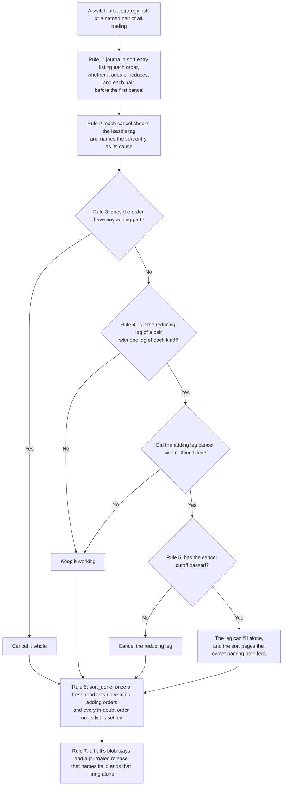
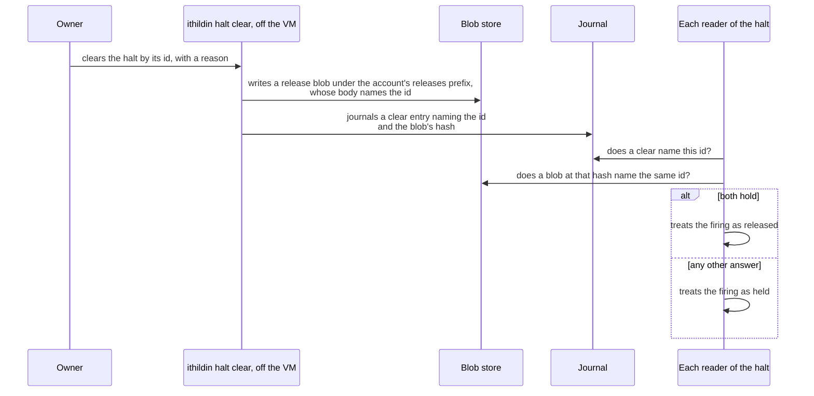
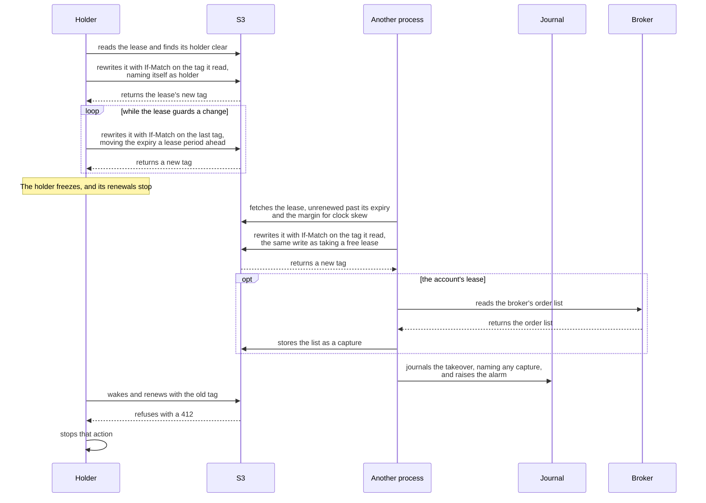

# Halts and drills

This document is the one place that holds the steps of a sort and every drill's steps. A rule elsewhere may say a drill must exist, and its steps sit here. [design.md](design.md#every-change-can-be-undone-or-switched-off) states what must hold, [architecture/06-runtime.md](architecture/06-runtime.md#every-alarm-and-its-drill) shows where it sits, and the issues that build each piece link here. So a change to a step lands here, and the three stay short.

## Contents

- [How a sort runs](#how-a-sort-runs)
- [Every alarm and its drill](#every-alarm-and-its-drill)
  - [Alarms on data](#alarms-on-data)
  - [What the sealed read does with each answer](#what-the-sealed-read-does-with-each-answer)
  - [Alarms on the alpha model](#alarms-on-the-alpha-model)
  - [Alarms on the order path](#alarms-on-the-order-path)
  - [Alarms on leases and takeover](#alarms-on-leases-and-takeover)
  - [Alarms on deployment and release](#alarms-on-deployment-and-release)
  - [Alarms on storage and backups](#alarms-on-storage-and-backups)
  - [Alarms on operations](#alarms-on-operations)
  - [Alarms on strategy samples](#alarms-on-strategy-samples)
  - [Alarms on a fill and a quote](#alarms-on-a-fill-and-a-quote)
  - [How a drill counts toward a gate](#how-a-drill-counts-toward-a-gate)
- [Drills with no alarm](#drills-with-no-alarm)
  - [What each environment drills as it arrives](#what-each-environment-drills-as-it-arrives)

## How a sort runs

A sort is execution's pass that cancels a strategy's adding orders and keeps its reducing ones. A switch-off, a strategy halt or a named halt of all trading starts one.

This doc proposes how execution carries that out, for [#10](https://github.com/l3a0/ithildin-runtime/issues/10) and [#33](https://github.com/l3a0/ithildin-runtime/issues/33), apart from what stands as decided: the filled leg in rule 4, the reducing leg left to fill alone in rule 5, monitoring's read in rule 6, and what a halt of all trading sorts. The same steps serve every halt that cancels this way, which [A strategy is judged over a sample](design.md#a-strategy-is-judged-over-a-sample-and-runs-unchanged-through-it) names. A halt that stops all trading sorts every order in the account, and an order that traces to nothing counts as adding, so it is cancelled. It cancels only when the journal read succeeded, because an unreadable journal is missing input, so the sort halts and cancels nothing. The price is that an order placed by hand at the broker's console is cancelled and has to be placed again. Seven rules carry a **sort**, the vocabulary's name for this pass over a strategy's orders.

1. **A sort is an item of its own, journaled whole before its first cancel.** The off switch's event becomes an item, the account, the strategy and the firing's id rule 7 defines, rather than a stage and a decision. Before its first cancel, execution journals a `sort` entry listing each order, whether it adds or reduces, and each pair, which the planned entry names. A redelivered event or a restart resumes that list and never sorts again, so a pair a crash split is still finished. A starting instance and each recover stage resume any sort with no `sort_done` entry, past its deadline too, and start one for any unreleased firing of a cause rule 7 names that has none. Switching the strategy back on, or releasing the firing, ends its sort: execution journals `sort_done` with the unfinished list and cancels nothing more. So before a resumed sort's next cancel, execution checks for that, since execution can be down when either lands. Only a read that proves the release, or for a switch-off proves another current version or no `off.json`, ends the sort. Any other answer leaves the sort running and its cancel goes out.
2. **Its cancels follow the rules every cancel follows.** Each checks the lease's tag and names the `sort` entry as its cause. No clock or cutoff reading stops a sort's adding cancel or a pair-keeping cancel. Only the lease's tag and a proved release do, and [#10](https://github.com/l3a0/ithildin-runtime/issues/10) holds how. Rule 5's cutoff stops only a reducing leg's cancel, and there a cutoff that cannot be computed, or that reads a clock which failed its check, counts as not passed, so the cancel goes out. A broker's refusal of a late cancel is journaled. A stored halt stops none of them, and rule 1's check on a resumed sort is the one other way they stop. The sort's handler carries out [the rule for a cancel whose answer is lost](design.md#faults-are-expected-and-the-platform-checks-itself-while-it-runs) on a lost answer, inside the sort's deadline, and holds no lease between tries. An order already `CancelSent` stays under [the rule for a cancel whose answer is lost](design.md#faults-are-expected-and-the-platform-checks-itself-while-it-runs) and counts as not yet cancelled, so it never gets a second cancel without a lookup.
3. **An order with any adding part counts as adding.** It is cancelled whole, which covers an order that crosses zero.
4. **A pair with one leg of each kind cancels its adding leg first.** The reducing leg's cancel goes once the broker's answer or a lookup shows the adding order cancelled with nothing filled. Any fill on the adding leg, whatever its size, leaves the reducing leg working, so a filled leg keeps its partner, as the one exception to the kept leg being cancelled too. After a small partial fill the imbalance is the reducing quantity less the fill. A market-on-close order at a real broker has no fill before the close, so in slice 1 this arises only on a paper account that fills one early. An adding cancel or in-doubt adding leg still unsettled at the sort's deadline leaves the reducing leg working, journals that, and the sort's alarm names both legs, as the page under [the rule for a cancel whose answer is lost](design.md#faults-are-expected-and-the-platform-checks-itself-while-it-runs) does for a cancel it holds. If that cancel later settles with nothing filled, the reducing leg's cancel still goes out, under rule 5's cutoff. A partly filled reducing leg has the rest cancelled. Two adding legs, or an adding leg whose partner already filled, are cancelled as adding orders, and the leg left alone is bounded by `max_net`, or where net was already past it no larger than before, and alarmed after the close as a stranded leg is.
5. **A sort has a latest start for a pair.** The window is the cancel cutoff less the measured time to confirm a cancel. Inside it the adding cancel still goes out, the reducing leg's cancel can be stopped at the cutoff, and that leg can then fill alone. The price is one leg open at the close, reported that day, so the sort journals this case and pages the owner naming both legs. This doc proposes, for [#10](https://github.com/l3a0/ithildin-runtime/issues/10), that the same entry and page follow whenever the cutoff stops a reducing leg's cancel. That includes the cancel rule 4 sends once an adding cancel left unsettled at the sort's deadline settles late with nothing filled, so a switch-off made well before the window can end in this case too.
6. **A sort ends the way the kill switch's cancels end.** It journals `sort_done` only after a fresh read lists none of its adding orders and every in-doubt order on its list is settled, and it sorts each order that lands in the meantime. Monitoring's deadline starts on the switch's or the halt's event, the deadline [#33](https://github.com/l3a0/ithildin-runtime/issues/33) gives a switch-off, and because that event can be lost, monitoring also lists every cause rule 7 names and starts the deadline on any unreleased firing it finds with no `sort_done` entry, since nothing that rides on the event can catch a lost event. A list or a journal read that fails pages the owner, since a read that cannot run starts no deadline. That read is the one exception to the rule of no polling, and it stays narrow: monitoring is the only reader and it only reads, a read can only start the alarm deadline and never act on an order, and it runs only during the session, about once a minute, because an interval near ten minutes would miss the whole window from the decision to the cancel cutoff. The deadline alarms naming the broker's console if that entry has not appeared. The entry lists each order cancelled, kept or in doubt, each pair's outcome, and the positions left open, and an alarm raised from it gives those and the person's next step.
7. **A halt the platform raises reaches execution as a blob, one for each firing.** A sort has three kinds of cause.
   1. An off switch.
   2. A strategy halt.
   3. A halt of all trading that [A strategy is judged over a sample](design.md#a-strategy-is-judged-over-a-sample-and-runs-unchanged-through-it) names.

   The parts of this rule below say where each halt is stored, how each firing is named and written, what releases it, and which halts start a sort.

   - **Where a strategy halt is stored.** A strategy halt is created at `accounts/<account>/strategies/<strategy>/halts/<component>-<cause>-<timestamp>-<count>.json` by the component that raises it, which gains that one grant, and execution reads it beside the off switch, so a strategy with either is off. The blob stays, and a journaled release names its id and ends that firing alone.
   - **What happens when a halt fires again.** A named halt that fires again after a release writes a new blob, so a new event fires, and each `sort` and `sort_done` entry keys on the firing's id, so an earlier `sort_done` never answers a later firing.
   - **How each firing is named.** Each firing has one id. A switch-off's is the S3 version of its `off.json`, which its journal entry records, so an off, on, off sequence gives two firings, and the tool and monitoring read the sort of the current one. A halt's id is its name, `<component>-<cause>-<timestamp>-<count>`, made of four parts.
     1. The component that raised it.
     2. Its cause.
     3. The firing's UTC second, such as `20261105T204100Z`.
     4. That component and cause's running count on the account, which comes from a list of the folder. A failed list never stops a halt being raised, and [#33](https://github.com/l3a0/ithildin-runtime/issues/33) holds how the count is then set.
   - **Which is written first, the blob or its journal entry.** The blob comes first and its journal entry after it, as a switch-off's does. So a crash between them leaves a stored halt that refuses a submit and reaches monitoring's list, and the raiser or execution's recover stage journals the missing entry, while monitoring only pages. A journal that cannot be read therefore stops no halt.
   - **When a raiser that restarts reuses a firing.** A raiser that restarts reuses a firing of its component, cause and subject only on a read that proves it unreleased, and any other answer writes a new blob. The price is that a race can still leave two firings for one event, and each is released on its own, which fails closed.
   - **The hold after a stop.** This doc proposes, for [#33](https://github.com/l3a0/ithildin-runtime/issues/33), that the hold after a stop is one strategy halt per strategy, raised by the first execution instance to start.
   - **Where a halt of all trading is stored.** A named halt of all trading is stored under `accounts/<account>/halts/` the same way, at `<component>-<cause>-<timestamp>-<count>.json`, which already stops every strategy. A submit and a plan's cancel read a halt in that folder as stored until it is released, because no role may delete the blob.
   - **What releases a firing.** A firing is released when the journal holds a `clear` naming its id and, on an account whose hard caps blob sets `release_needs_blob`, that entry names the hash of a blob at `accounts/<account>/releases/<sha256>.json` whose body names the same id. Only the owner's role may write that prefix, as an override works. An absent or unreadable `release_needs_blob` reads as set, and live sets it. An outside entry also releases a split's or an assignment's firing, once the conditions in [Faults are expected](design.md#faults-are-expected-and-the-platform-checks-itself-while-it-runs) hold, where the hard caps allow it, as [Faults are expected](design.md#faults-are-expected-and-the-platform-checks-itself-while-it-runs) says. An absent or unreadable setting refuses, so the firing stays held. A firing raised because S3 would not store a capture, or any halt over a capture a process held when it died, is also held until the condition in [Rule 1: a write S3 refuses or does not answer](design.md#rule-1-a-write-s3-refuses-or-does-not-answer) holds, and a `clear` written before then is refused and releases nothing.
   - **Who uses the release test.** This one test, with that condition for that cause, applies to every halt on the account, a stage's halt and an unmatched entry included, and every reader uses it: a submit, a plan's cancel, the holding-halt check, a sort's start and resume, monitoring's deadline, `ithildin strategy on`, `ithildin status`, the promotion job and a raiser's lookup. So a journal entry from anyone but the owner cannot end a live halt.
   - **Which halts start a sort.** The event of either a strategy halt or a named halt of all trading starts the sort, as the off switch's does. Every other halt in `accounts/<account>/halts/`, such as the one [Faults are expected](design.md#faults-are-expected-and-the-platform-checks-itself-while-it-runs) holds on an unsettled cancel, starts none and keeps every working order.

The figure below is a component-level flowchart of the sort inside execution.

The diagram shows one sort in the order of the seven rules, so look for the reducing leg, whose cancel waits for the adding leg's outcome.

The figure below is a C4 dynamic diagram.

The diagram shows the release of a live halt from rule 7, so look for the second read, which is why a journal entry alone cannot end the halt.

## Every alarm and its drill

The charter's paper gate asks for every alarm to fire in a drill first. An
alarm reads zero while it is healthy, so only a drill shows it works. This
shape adds alarms that one process would not need, and each one gets a row
here, with the issue that builds its drill.

Test 1 to test 4 are the acceptance tests in [architecture/10-quality.md](architecture/10-quality.md#how-the-four-acceptance-tests-exercise-it).

### Alarms on data

**Table:** Data alarms, the reason each writes, and its drill

| Alarm | Reason it writes | Drill | Built on | Gate |
| --- | --- | --- | --- | --- |
| Missing or stale bar, or an instrument a redelivered first capture lacks or holds no bar for | The instrument and its state | A replay with a bar removed or aged, test 2, and `tests/test_data_stage.py`'s and `tests/test_data_source.py`'s cases for a first capture that lacks an instrument or its bars | [#5](https://github.com/l3a0/ithildin-runtime/issues/5), [#11](https://github.com/l3a0/ithildin-runtime/issues/11) | paper |
| A redelivered decision whose first capture cannot be read back, does not match its stored SHA-256, is no snapshot or holds other than one, was written by another release or under other strategy configuration hashes, or holds a flag other than the move rule's that its bars and quotes do not raise | The capture's key and which it was, with both hashes, both releases, both sets of configuration hashes, or the flag as recorded | `tests/test_data_stage.py`'s redelivery cases for each, and `tests/test_data_source.py`'s `judge` cases for a stored flag, expecting the halt named for the capture that counts | [#5](https://github.com/l3a0/ithildin-runtime/issues/5) | paper |
| Data not ready: no segment of an instrument, no row captured by the cut 15 seconds before the decision, or no capture every instrument has | Each prefix, the segments listed and opened, each instrument's newest capture and the cut. [What the read does with each answer](architecture/03-context-and-scope.md#what-the-read-does-with-each-answer) says what ends each halt | `tests/test_data_quotes.py`'s `test_8_each_answer_stores_the_snapshot_and_then_halts`, its cases `no_listing`, `one_leg_stopped` and `all_gaps`, and test 2's run whose segments are missing, each expecting the stored snapshot and the halt | [#100](https://github.com/l3a0/ithildin-runtime/issues/100), [#11](https://github.com/l3a0/ithildin-runtime/issues/11) | paper |
| A capture segment the bucket does not give, or marketlake's reader refuses: a listing or a download with no answer or refused, twice, any other error of either, a listed key that is gone, a segment with no version or no stored SHA-256, a torn segment, a day marketlake withholds, a published column of another type, two rows of one instrument at the capture taken, or a lake root that cannot be written | The key, the prefix or the instrument, and the answer or the error's type | `test_8_each_answer_stores_the_snapshot_and_then_halts`' other cases, expecting the stored snapshot with every row the other instrument's read returned and the halt, and `tests/test_data_segments.py`'s `test_2` cases for the reason each answer gives, a lake root that cannot be written among them | [#100](https://github.com/l3a0/ithildin-runtime/issues/100) | paper |
| A row of a schema version the pinned marketlake does not read, which halts every decision inside a session until a release raises the pin | The segment, the versions, and that the marketlake pin is raised | `test_8_each_answer_stores_the_snapshot_and_then_halts`' case `newer_version` | [#100](https://github.com/l3a0/ithildin-runtime/issues/100) | paper |
| A captured bar with no `fetch_end_ts`, so no knowable time | The ticker and the session | `tests/test_data_source.py`'s `test_4_a_captured_bar_with_no_fetch_end_halts` | [#100](https://github.com/l3a0/ithildin-runtime/issues/100) | paper |
| `data/quote_kinds.csv` states no kind or no normal status for the session, as a row that lapsed leaves it, or holds two rows for it, which halts every decision inside a session until a release adds one | The instrument, the source and the session | `tests/test_data_quotes.py`'s `test_28_a_lapsed_last_session_halts_every_decision_inside_a_session` and `tests/test_data_segments.py`'s `test_2_two_kind_rows_for_the_day_are_a_fault_that_keeps_the_rows` | [#100](https://github.com/l3a0/ithildin-runtime/issues/100) | paper |
| A strategy's file writes no maximum age and spread of a quote, or two strategies that share an instrument write different ones, which halts every decision inside a session, or every decision | The instrument and the two keys, or each strategy with its value | `tests/test_data_quotes.py`'s `test_6` cases, expecting the halt with neither bucket called, and `tests/test_data_settings.py`'s cases for two strategies | [#100](https://github.com/l3a0/ithildin-runtime/issues/100) | paper |
| A bar whose prices contradict each other, such as a price at or below zero or a high below the close, which halts its decision and holds no shadow or paper account, or a quote's, such as an ask below its bid, which the judge halts on. [What a quote that fails its check stops](#what-a-quote-that-fails-its-check-stops) says what that halt holds | The instrument, the session, the field and both prices | `tests/test_data_source.py`'s and `tests/test_data_stage.py`'s cases for a contradicting bar, and `tests/test_data_quotes.py`'s for a contradicting quote, expecting the stored snapshot with the flag and the halt | [#5](https://github.com/l3a0/ithildin-runtime/issues/5), [#100](https://github.com/l3a0/ithildin-runtime/issues/100) | paper |
| Two consecutive bars of one instrument in a lookback that are [of two series](design.md#a-lookback-that-crosses-a-change-of-series), other than Schwab's import and the captured bars from the session it is adjusted to, which halts every decision until the change leaves the lookback and holds no shadow or paper account. A position is held meanwhile, with no strategy exit sent and the day's loss not tested, and only the owner's act bounds it. [#158](https://github.com/l3a0/ithildin-runtime/issues/158) asks what that act is | The instrument, both sessions and both series | `tests/test_data_series.py`'s cases, one of them through the receive loop, expecting the stored snapshot, the halt and the alpha stage passing it on, and `tests/test_data_one_scale.py`'s for the change that passes and every change beside it that halts | [#136](https://github.com/l3a0/ithildin-runtime/issues/136) | paper |
| A close, or a quote's midpoint, past the written multiple of the lookback's standard deviation, which alerts and halts nothing | The instrument, the session and both prices | A sealed bar with a spiked close, and a provisional segment with one spiked quote, as `test_8_a_spiked_midpoint_is_flagged_beside_its_unchanged_price_and_halts_nothing` writes it, and a split planted in captured bars, as `tests/test_captured_bars.py`'s `test_3_a_split_in_the_window_is_flagged_and_the_decision_forecasts` plants it, each expecting the alert, the flag in the stored snapshot and the decision trading on the price | [#5](https://github.com/l3a0/ithildin-runtime/issues/5), [#100](https://github.com/l3a0/ithildin-runtime/issues/100), [#11](https://github.com/l3a0/ithildin-runtime/issues/11) | paper |
| A close below its bar's low, which alerts and halts nothing | The instrument, the session, the price and the low | A sealed daily bar in the lookback with its close below its low and within the move rule's multiple, as `tests/test_data_source.py`'s and `tests/test_data_stage.py`'s cases write it, expecting the alert, the flag in the stored snapshot and the decision trading on the price | [#5](https://github.com/l3a0/ithildin-runtime/issues/5), [#11](https://github.com/l3a0/ithildin-runtime/issues/11) | paper |
| A capture segment whose bytes do not hash to the SHA-256 the bucket stored with it, on a second download too, or a sealed partition whose SHA-256 does not match marketlake's manifest | The file's key and both hashes | Read a segment through a bucket that serves changed bytes beside the stored digest, once, expecting the second download to pass, and twice, expecting the halt. Change a byte in a copy of a sealed partition. Each halt expects no order sent | [#5](https://github.com/l3a0/ithildin-runtime/issues/5), [#100](https://github.com/l3a0/ithildin-runtime/issues/100) | paper |
| A reader file the manifest lists and the bucket does not hold, or a manifest that lists no `quarantine.jsonl` or no `actions/corporate_actions.jsonl` | The file's key | `tests/test_data_source.py`'s cases for test 11, which remove each ledger and expect the halt before any read | [#5](https://github.com/l3a0/ithildin-runtime/issues/5) | paper |
| A manifest cut short, not ending in a newline, damaged on the way, or not downloaded | `manifest.jsonl` and what was wrong with it | `tests/test_data_source.py`'s cases for test 10, one of them with an older copy held in the mirror | [#5](https://github.com/l3a0/ithildin-runtime/issues/5) | paper |
| A quarantined partition in the lookback | The partition's key | `tests/test_data_source.py`'s case for test 11 that quarantines a lookback partition | [#5](https://github.com/l3a0/ithildin-runtime/issues/5) | paper |
| Two rows for one session, or any other answer from `load_bars` that the data module halts on | The ticker, the session and the error | `tests/test_data_source.py`'s cases for tests 7 and 8 | [#5](https://github.com/l3a0/ithildin-runtime/issues/5) | paper |
| An instrument with no security master row valid on a session of its lookback | The instrument and the session | `tests/test_data_source.py`'s cases for test 17 | [#5](https://github.com/l3a0/ithildin-runtime/issues/5) | paper |
| A strategy's file with no `[data]` section, or with a `[data]` section data refuses, which halts every strategy of the deployment | The strategy, the file and the key, or every file and the reason where `DataSettings` refuses a value itself | `tests/test_data_settings.py`'s `test_2` cases for each refusal, and its `test_7` cases through the receive loop, expecting each decision's halt stored with no snapshot | [#110](https://github.com/l3a0/ithildin-runtime/issues/110) | paper |
| Strategies of one deployment whose files write a different lookback, stale lag or spike multiple, or a different first session for an instrument both trade | The key, and each strategy with its value | `tests/test_data_settings.py`'s `test_3` cases for each key, and its `test_7` case for two strategies | [#110](https://github.com/l3a0/ithildin-runtime/issues/110) | paper |
| A first session that cuts a decision's lookback where the manifest lists an earlier daily partition of the instrument | The instrument, the first session, the earliest such partition, and the manifest's SHA-256 and bucket version | `tests/test_data_source.py`'s cases for a first session that cuts a lookback, and `tests/test_data_stage.py`'s redelivery under one written late since the first capture | [#110](https://github.com/l3a0/ithildin-runtime/issues/110) | paper |
| A file the bucket reports with no version or no stored SHA-256 | The file's key | `tests/test_data_source.py`'s case that strips each from a download | [#5](https://github.com/l3a0/ithildin-runtime/issues/5) | paper |
| A fetch stamp with no zone | The ticker, the session and the stamp | `tests/test_data_source.py`'s case for test 4 with a stamp that names no zone | [#5](https://github.com/l3a0/ithildin-runtime/issues/5) | paper |
| The sealed day differs from what a provisional read saw | The ticker, the minute and both values, or the row the sealed day quarantined or lacks | Change or quarantine a sealed row a run's snapshot used, and land a sealed row after the used one, at or before the cut 15 seconds before the decision | [#11](https://github.com/l3a0/ithildin-runtime/issues/11) | paper |
| A fault of the read of a sealed day: an instrument whose quotes partition is not listed beside one whose is, a partition with no row of the session's equity close, neither a data row nor a gap row tagged `spot_close`, one quarantined, gone from the bucket or of other bytes than the manifest's, an unreadable stamp at a minute, a row of another ticker, a published column of another type, an instrument with no ticker, two rows of `data/quote_kinds.csv` for the day, two rows at the capture taken, no capture every instrument has by the cut, or any other error of `load_quotes`, `captured_by` or the mirror | The partition's key and what was wrong, a minute as its UTC instant, or the error's type with its words in the log alone. [What the sealed read does with each answer](#what-the-sealed-read-does-with-each-answer) says what ends each halt | `tests/test_data_sealed.py`'s `test_5_each_answer` cases through data's stage, expecting the stored snapshot with the partitions linked and the rows the cut kept, and its `test_2_an_instrument_with_no_ticker_is_a_fault_under_either_read`, `test_5_two_kinds_rows_are_a_fault`, `test_2_a_close_with_no_tagged_row_still_faults`, `test_4_one_leg_that_stopped` and other `test_2` and `test_5` cases for the others | [#132](https://github.com/l3a0/ithildin-runtime/issues/132) | paper |
| The largest time a day's capture segments took to reach the bucket is above 13 seconds, past the margin `CAPTURE_LAG` leaves, so a replay can read a capture live did not. It halts nothing | The day, the largest time and its segment. [Measure the capture lag](what-a-person-runs.md#measure-the-capture-lag) says what moves the constant | Plant a listing with a segment that reached the bucket 14 seconds after its cycle's start, and expect the page | [#11](https://github.com/l3a0/ithildin-runtime/issues/11) | paper |
| A provisional snapshot with no stored comparison result past the written bound, or a sealed day that never arrives | The snapshot, the day and the bound | Withhold a day's sealed rows from a run's next session, and stop monitoring's comparison, each expecting a page and no decision stopped | [#5](https://github.com/l3a0/ithildin-runtime/issues/5), [#11](https://github.com/l3a0/ithildin-runtime/issues/11) | paper |

### What the sealed read does with each answer

A decision reads the sealed day where its manifest lists a quotes partition of
the session's day, as [Which read a decision uses](architecture/03-context-and-scope.md#which-read-a-decision-uses)
says. Its faults never take the snapshot's place. Every fault sits beside a
stored snapshot, and a fault in a round of five minutes ends the walk once every
leg's turn in it is done. A refusal of `captured_by`, which returns no row, loses
that minute's rows from the snapshot, and the partition's vintage id names the
bytes. A stop and `MemoryError` leave the read.

**Table:** What the sealed read does with each answer, and what ends the halt

| Answer | What happens | Ended by |
| --- | --- | --- |
| `SnapAbsent` with nothing unreadable | No row at that minute | Nothing halts |
| `SnapAbsent` with an unreadable stamp | A fault naming the partition, the minute and the count | marketlake |
| `PartitionQuarantined` | A fault naming the partition's key. The read never passes `include_quarantined` | marketlake's sign-off |
| No data row of the equity close in a listed partition, and a gap row tagged `spot_close` there | The day reads as sealed after the close, because marketlake writes that row only once the close has passed, and the log says so | Nothing halts |
| No row of the equity close in a listed partition, neither a data row nor a gap row tagged `spot_close` | A fault naming the key and that it holds no row of the session's equity close | marketlake's seal of it, or nothing where no cycle recorded the close |
| Any other error of `load_quotes`, `captured_by` or the sealed read's own checks but `MemoryError` | A fault naming the key, the minute and the error's type. The log holds its words, because several hold the lake root's path | marketlake, or a release that raises the pin |
| A listed partition the bucket lacks, or bytes that differ from the manifest | A fault with the mirror's words | The next upload |
| A bucket that refuses or does not answer, or a file with no version or stored SHA-256 | A fault with the mirror's words | The next decision, or the grant |
| Any other error of the mirror, such as expired credentials or a full disk | A fault naming the key and the error's type | The next decision, or the machine's operator |
| A row of another ticker or of none, a published column of another type, two rows at the capture | A fault naming it, with every row the cut kept | A release, or marketlake |
| An instrument with no partition listed beside one with, or with no ticker, or two rows of `data/quote_kinds.csv` for the day | A fault naming it | marketlake's seal, or a release |
| No capture every instrument has by the cut | A fault naming each partition, the minutes read, each instrument's newest capture and the cut | Nothing in a replay |

### Alarms on the alpha model

Each row halts one strategy's alpha stage for its decision and leaves its positions as they are. Each drill names its cases, in `tests/test_alpha.py` or `tests/test_alpha_quotes.py`, which read the stored halt's reason, its inputs and its empty cause. One row differs. The read of data's snapshot is the same code in the alpha, cost, risk and portfolio stages, so its cases are in `tests/test_cost.py`. Their stored halt names data's result, and the snapshot where storage accepted it.

**Table:** Alpha alarms, the reason each writes, and its drill

| Alarm | Reason it writes | Drill | Built on | Gate |
| --- | --- | --- | --- | --- |
| A leg of the strategy that is missing, stale or has no daily bar in the snapshot the alpha stage reads, or any other instrument in it that is missing, stale or has no bar | The instrument and its state | The cases `a-leg-missing`, `a-leg-data-calls-missing`, `a-leg-stale`, `no-daily-bar` and `another-instrument-stale` | [#6](https://github.com/l3a0/ithildin-runtime/issues/6) | paper |
| Two legs whose bars name different sessions | The strategy, both legs and the first session that differs | The cases `one-leg-a-session-short`, `one-leg-with-a-gap`, `one-leg-out-of-order`, and those of each leg that end `beside-the-others-bar-of-the-session` | [#6](https://github.com/l3a0/ithildin-runtime/issues/6), [#114](https://github.com/l3a0/ithildin-runtime/issues/114) | paper |
| A newest bar of neither the decision's own session nor the one before it | The strategy, the decision's session and the newest bar's | The cases `a-newest-bar-two-sessions-back`, `a-newest-bar-after-the-decision` and `a-newest-bar-two-sessions-back-under-good-quotes` | [#6](https://github.com/l3a0/ithildin-runtime/issues/6), [#114](https://github.com/l3a0/ithildin-runtime/issues/114) | paper |
| A leg with no [decision price](architecture/01-introduction-and-goals.md#which-price-a-decision-reads): no quote and no bar of the decision's session, both at once, a quote with a fault or with a stamp at or before the last session's close, two bars of the decision's session, one that leaves a price-kind field unstated or has no close above zero, or a bar that ends or was knowable after the decision. Data halts first, for every strategy, on an absent or faulty quote, a price-kind field left unstated and a price at or below zero, and returns none of the other bars named here. So from data's own snapshots this fires on a stamp at or before the last close, or, from the close to the next open, where a strategy writes a stale lag above 0 | The strategy, the decision's session and `core.mark`'s own reason, which names the instrument and what was wrong | The cases of `tests/test_alpha_quotes.py`'s `HALTS` whose reason says the strategy has no price, and the cases `a-newest-bar-of-the-day-before`, `a-newest-bar-that-ends-after-the-open`, `a-newest-bar-that-ends-a-second-after-the-decision`, `two-newest-bars-of-one-session`, and those that start `a-newest-bar-of-USO` or `a-newest-bar-of-GLD` | [#114](https://github.com/l3a0/ithildin-runtime/issues/114) | paper |
| A decision the calendar holds no session for, or no session before its own | The strategy and the calendar's own reason | The cases `a-decision-past-the-calendar` and `a-decision-on-the-calendars-first-session` | [#6](https://github.com/l3a0/ithildin-runtime/issues/6), [#114](https://github.com/l3a0/ithildin-runtime/issues/114) | paper |
| A data result that lists its snapshot other than once, or a snapshot file that does not hold exactly one snapshot, or whose snapshot is of another decision, which halts the cost, risk and portfolio stages too | The snapshot's key and what was wrong | `tests/test_cost.py`'s cases for a snapshot listed other than once, a file that holds other than one, and one of another decision | [#6](https://github.com/l3a0/ithildin-runtime/issues/6), [#8](https://github.com/l3a0/ithildin-runtime/issues/8), [#115](https://github.com/l3a0/ithildin-runtime/issues/115) | paper |
| Fewer prices than the newest z-score reads, the decision price among them | The strategy, the sessions it reads and how many the snapshot holds to the decision's own | The cases `too-few-sessions` and `too-few-prices-with-the-decision-price-among-them` | [#6](https://github.com/l3a0/ithildin-runtime/issues/6), [#114](https://github.com/l3a0/ithildin-runtime/issues/114) | paper |
| A window of the hedging leg's prices that are all equal, or a band window whose spreads do not move | The strategy, the session and the price or the standard deviation | The cases `a-hedging-leg-that-does-not-move` and `a-band-that-does-not-move`, and `test_3_a_midpoint_equal_to_the_closes_before_it_halts` | [#6](https://github.com/l3a0/ithildin-runtime/issues/6), [#114](https://github.com/l3a0/ithildin-runtime/issues/114) | paper |
| A window of prices that ends before it settles which unit is held | The strategy and the sessions whose z-scores it read | The case `an-unsettled-window` | [#6](https://github.com/l3a0/ithildin-runtime/issues/6) | paper |
| A statistic the codec cannot hold | The strategy, the decision and the error | The case `a-figure-past-the-codec` | [#6](https://github.com/l3a0/ithildin-runtime/issues/6) | paper |
| A forecast that names another strategy | The stage and both strategies | `test_a_forecast_of_another_strategy_halts` | [#6](https://github.com/l3a0/ithildin-runtime/issues/6) | paper |
| A strategy's alpha section is missing, leaves a key out, or holds one its model refuses, such as an entry no z-score can reach, which would read flat at every decision | The strategy, its file, the key and what is wrong | The cases of `test_a_section_the_model_refuses_halts_with_its_inputs_and_no_cause`, and one run through the receive loop expecting the halt stored. In a test environment, a strategy with no alpha section, expecting the stored halt and the push | [#6](https://github.com/l3a0/ithildin-runtime/issues/6), [#11](https://github.com/l3a0/ithildin-runtime/issues/11) | paper |

### Alarms on the order path

**Table:** Order path alarms, the reason each writes, and its drill

| Alarm | Reason it writes | Drill | Built on | Gate |
| --- | --- | --- | --- | --- |
| Risk gate refusal | The limit, and for one of the seven its figure and its bound | One order over each limit, test 3. `tests/test_gate.py` holds each limit one step below, at and above, and `tests/test_order_path.py`'s fake broker fails any test where an order reaches it with no approval | [#7](https://github.com/l3a0/ithildin-runtime/issues/7), [#143](https://github.com/l3a0/ithildin-runtime/issues/143) | paper |
| An order approved while `max_position`, `max_gross` or `max_net` is past, raised once a decision, whether or not the send stage halted | Each limit that is past, its figure and its bound, from the decision's journaled verdicts | Lower a cap below a holding in a replay and sell part of it, expecting the order out and the alarm. `test_2_past_names_each_limit_over_its_bound_in_the_tables_order` holds what the verdict says | [#7](https://github.com/l3a0/ithildin-runtime/issues/7), [#10](https://github.com/l3a0/ithildin-runtime/issues/10), [#11](https://github.com/l3a0/ithildin-runtime/issues/11) | paper |
| An order or fill the platform did not send | The broker's order or fill id, and what it received | The steps under [Drill for an order or fill the platform did not send](#drill-for-an-order-or-fill-the-platform-did-not-send) | [#10](https://github.com/l3a0/ithildin-runtime/issues/10) | paper |
| Book and broker disagree | Each difference, with both positions, both orders or both cash figures, and the account file that holds the broker's side | `test_2_a_difference_halts_naming_both_sides` and the cases of `tests/test_reconcile.py` hold recover's halt. Drilled by these tests alone. The drill on a running worker is [on #11](https://github.com/l3a0/ithildin-runtime/issues/11#issuecomment-7177596053). Recover halts the one decision, and the hold until a person clears it is [#150](https://github.com/l3a0/ithildin-runtime/issues/150)'s | [#145](https://github.com/l3a0/ithildin-runtime/issues/145), [#150](https://github.com/l3a0/ithildin-runtime/issues/150), [#11](https://github.com/l3a0/ithildin-runtime/issues/11) | paper |
| The broker moved between execution's recover and send stages in a way the platform did not ask for, apart from a fee, debit interest or a dividend inside its range, which the send stage journals from the broker's record and which explains the cash it moved | Both positions, both sets of open orders, or both cash figures, at the send stage | `test_the_broker_moving_between_recover_and_send_halts_before_any_plan` in `tests/test_send.py`, and `test_a_fee_booked_between_recover_and_send_is_explained_only_by_its_record` in `tests/test_broker_records.py` for the record, through the simulator's faults. A hand edit of a simulated account's log halts as a log that cannot be read, so the drill on a running worker is on paper, once [#153](https://github.com/l3a0/ithildin-runtime/issues/153) builds it | [#10](https://github.com/l3a0/ithildin-runtime/issues/10), [#146](https://github.com/l3a0/ithildin-runtime/issues/146) | paper |
| The send stage's claim on a decision is another call's | The claim's key, each planned order's state, each order in doubt with the time its `sending` was stored, each leg whose partner did not go, and the day's loss where it halts. An alarm goes for each order in doubt | `test_a_claim_another_call_holds_halts_naming_every_planned_order`, `test_a_claim_names_an_order_in_doubt_and_alarms_on_it`, `test_a_claim_alarms_on_a_leg_a_kill_left_sending`, `test_a_claim_names_every_planned_order_however_the_loss_reads` and `test_a_kill_after_any_write_and_a_rerun_send_each_order_once_at_most` in `tests/test_send.py`. The next decision's recover settles what the stage left, and when another instance may take over is [#211](https://github.com/l3a0/ithildin-runtime/issues/211)'s | [#146](https://github.com/l3a0/ithildin-runtime/issues/146) | paper |
| A strategy's `[execution]` section is missing, empty, holds a key other than `order`, or names an order type other than `market_on_close` and `market` | The strategy, its file and the key or the type | `test_an_execution_section_it_cannot_read_halts_naming_the_strategy` in `tests/test_orders.py` and `test_a_strategy_with_no_execution_section_halts_before_any_entry` in `tests/test_send.py` | [#146](https://github.com/l3a0/ithildin-runtime/issues/146) | paper |
| An open order of a strategy in an instrument whose target needs another order | The strategy, the instrument and the shares still needed | `test_an_open_order_under_a_gap_halts` in `tests/test_orders.py`. [#149](https://github.com/l3a0/ithildin-runtime/issues/149) builds the cancel and replacement that lift it | [#146](https://github.com/l3a0/ithildin-runtime/issues/146) | paper |
| A plan of more than 99 orders | The count and the 99 one decision may plan | `test_a_plan_of_more_than_99_orders_halts`, at 98, 99 and 100 | [#146](https://github.com/l3a0/ithildin-runtime/issues/146) | paper |
| A partner refused when the gate is asked about the whole plan, so nothing is sent | The refused order, its limit, and for one of the seven its figure and its bound, or the reason its check halted. Every order of the plan ends `Refused` or `Abandoned`. A journal that stops answering meanwhile stops the abandons and pages that nothing is sent. The next recover journals an order left `Intended` or `Approved`, or with no entry beside one that has an entry, `Abandoned`, and a plan none of whose orders has an entry stays as it is, with nothing sent. An outage the path meets inside an order's own checks can page more than once, which item 11 of [#211](https://github.com/l3a0/ithildin-runtime/issues/211) holds | `test_a_second_leg_the_gate_refuses_sends_nothing_and_ends_every_order`, `test_a_check_that_raises_sends_nothing`, `test_a_leg_refused_at_the_ask_and_approved_after_is_abandoned_and_never_sent` and `test_a_refused_plan_stops_its_writes_at_the_first_outage` and `test_a_refused_plan_whose_journal_cannot_be_read_still_pages_that_nothing_is_sent` in `tests/test_send.py`, and `test_2_a_plan_a_crash_left_is_settled_and_nothing_is_sent` and `test_2_a_plan_that_stands_halts_nothing` in `tests/test_recover.py` | [#146](https://github.com/l3a0/ithildin-runtime/issues/146) | paper |
| A quote the plan's gate checks will mark, of an instrument the account holds, has a working order in or the plan orders, that passes now and would not last 5 seconds for each order of the plan, so nothing is asked or sent | Each such quote's fault at that moment, the margin, the number of orders and the clock's time. Every order of the plan ends `Abandoned` unless the journal refuses its entry, and the halt names each one refused and then says nothing of the next decision. A store that stops answering stops the abandons at the first it refuses, so a later order is not tried, and its outage pages before the page that nothing is sent. A journal that cannot be read takes no abandon. Where its fold refuses an entry, the one page that nothing is sent names why, and where its store stops answering, the outage pages first. It holds no shadow or paper account, and on live the owner clears it. Where any order of the plan has an entry, the next recover settles the plan, journaling each order with no entry `Abandoned`, as the row for a plan a send stage left unfinished says. A plan none of whose orders has an entry stays as it is, with nothing sent. Where any such quote already fails at that time, the whole plan is the gate's to halt, and a send slower than the margin still halts the partner at its own check | `test_a_pair_halts_before_its_first_order_where_a_quote_would_not_last_ten_seconds` a microsecond either side of the margin, `test_a_held_leg_the_plan_does_not_order_halts_it_too`, `test_the_margin_is_five_seconds_for_each_order`, `test_a_quote_already_past_its_age_at_now_is_left_to_the_gate`, `test_an_ordered_quote_of_another_status_is_left_to_the_gate`, `test_a_quote_that_fails_at_now_leaves_the_whole_plan_to_the_gate`, `test_an_instrument_neither_held_nor_ordered_is_not_checked`, `test_an_abandon_the_store_refuses_is_named_in_the_halt_and_the_alarm`, `test_the_next_decision_after_a_refused_abandon_reads_what_the_journal_holds`, `test_a_quote_halt_whose_journal_cannot_be_read_abandons_nothing_and_promises_nothing` and `test_a_plan_with_no_order_sends_and_alarms_nothing` in `tests/test_send_quotes.py` | [#206](https://github.com/l3a0/ithildin-runtime/issues/206) | paper |
| A send that answers anything but `Acknowledged`, or raises, once another order of the plan may be at the broker | Each order not yet sent, from the one that failed on, abandoned, and every leg's state, its `sending` time where it has one. Where the journal cannot be read, the legs this call saw acknowledged, the rest as not known, and the orders after the one that failed as not journaled abandoned and not sent. The order whose call failed is never called unsent unless the path stopped it before the broker's call. A journal that stops answering, where the path reports it as an outage, pages once for the outage and once naming the legs, and stops every later write. An outage the path meets inside an order's own checks can still page more than once, and one outage type through the whole order path is item 11 of [#211](https://github.com/l3a0/ithildin-runtime/issues/211) | `test_a_second_leg_refused_at_its_send_halts_with_the_first_at_the_broker`, `test_an_off_switch_after_the_first_leg_went_halts`, `test_a_leg_the_broker_rejects_or_leaves_in_doubt_ends_the_plan`, `test_a_kill_switch_pulled_before_the_second_leg_halts_with_the_first_at_the_broker`, `test_a_send_that_raises_after_a_sending_abandons_the_rest_and_names_each_leg`, `test_a_failure_whose_journal_cannot_be_read_still_names_its_cause_and_every_leg`, `test_a_journal_that_turns_unreadable_after_the_abandons_names_the_legs_this_call_saw`, `test_a_leg_the_broker_took_whose_ack_the_journal_lost_is_never_called_unsent`, `test_an_outage_the_path_raises_stops_every_write_and_pages_the_legs_once`, `test_a_first_leg_whose_call_failed_with_the_journal_gone_leaves_the_second_unsent` and `test_a_journal_whose_fold_refuses_an_entry_names_its_cause_and_every_leg_in_order`. [#149](https://github.com/l3a0/ithildin-runtime/issues/149) cancels the leg left at the broker | [#146](https://github.com/l3a0/ithildin-runtime/issues/146) | paper |
| A plan of the decision in the journal that is not the send stage's own, which only a second writer past the claim can leave | The entry, and both plans' orders and quantities | `test_another_writers_plan_for_this_decision_is_never_sent_as_this_ones`, which also holds the alarm. No drill runs it on a running worker, so the test is its only drill. The claim keeps another call of the stage from planning the decision. The account's lease, which [#148](https://github.com/l3a0/ithildin-runtime/issues/148) builds, keeps two handlers from sending at once and does not stop a second plan | [#146](https://github.com/l3a0/ithildin-runtime/issues/146) | paper |
| A broker cash record that halts: a type off the list, a record that leaves a difference unexplained, an amount outside its range or with more places than cash holds, a repeated record id with different content, or a deposit or withdrawal | The record id, its kind, its amount and the range, and that the account is held until a person releases it. Nothing releases the hold until [#151](https://github.com/l3a0/ithildin-runtime/issues/151) builds the release on [#150](https://github.com/l3a0/ithildin-runtime/issues/150)'s release test, and clearing recover's halt does not end it, because the next recover halts on the same entry | `tests/test_broker_records.py` feeds each one through a broker that wraps the simulator. Each is kept as an `unmatched_record` that holds every later decision, with none of it in a book's cash, apart from the record that leaves a difference unexplained, which is journaled as an `outside_record` and halts on the cash comparison. It feeds a listed charge inside its range, expecting no halt. A record whose own id the journal refuses halts and is kept only in the capture, as `test_1_a_record_whose_id_the_journal_refuses_halts_and_is_not_journaled` holds. Paper books no fee or dividend, so a running worker never reaches this | [#10](https://github.com/l3a0/ithildin-runtime/issues/10), [#151](https://github.com/l3a0/ithildin-runtime/issues/151) | paper |
| `execution/records.toml`, the closed list's ranges, cannot be read: a file that is absent, not TOML, of another format, naming other kinds than the closed list, or holding a bound that is no amount of dollars and cents in quotes or a least above its most. Recover and the send stage halt every decision ahead of any record | The file and what is wrong with it. The file ships inside the release, so only a release fixes it, and meanwhile a person rolls back with `ithildin pin set` to the last release whose recover read the file, as [Roll a release back during a session](what-a-person-runs.md#roll-a-release-back-during-a-session) says | `test_a_ranges_file_that_is_wrong_halts`, `test_a_missing_ranges_file_halts` and `test_a_bad_ranges_file_halts_every_decision_ahead_of_any_record` in `tests/test_broker_records.py` | [#151](https://github.com/l3a0/ithildin-runtime/issues/151) | paper |
| A fill or an open order the platform did not send, read while one of its orders is `Sending` or `InDoubt`, which could own it. Nothing is kept as unmatched, and the read halts. Recover settles every plan a send stage left unfinished before it reads the broker, so this one covers a `sending` written between that step and the read | The fill or the order, and the order that may be with the broker under no id the journal holds. Look that order up on the broker's site at once, because it may be live, as the row for a plan a send stage left unfinished says | `test_3_nothing_is_kept_as_unmatched_while_an_order_is_in_doubt` in `tests/test_broker_records.py`. The next recover settles the order, as [#147](https://github.com/l3a0/ithildin-runtime/issues/147) built | [#151](https://github.com/l3a0/ithildin-runtime/issues/151), [#147](https://github.com/l3a0/ithildin-runtime/issues/147) | paper |
| A target portfolio that leaves out an instrument the book holds | The instrument | A target portfolio file written without one leg | [#10](https://github.com/l3a0/ithildin-runtime/issues/10) | paper |
| A strategy's `[portfolio]` section is missing, or holds anything but a `gross` above zero at four places or fewer, at any direction of its forecast | The strategy, its file and the key | `tests/test_portfolio.py`'s `BAD_SECTIONS`, and `test_5_a_strategy_with_no_section_halts_the_stage_and_not_the_workers_start`, which reads the stored halt. In a test environment, a strategy with no `[portfolio]` section, expecting the stored halt and the push | [#9](https://github.com/l3a0/ithildin-runtime/issues/9), [#11](https://github.com/l3a0/ithildin-runtime/issues/11) | paper |
| Portfolio construction cannot read its inputs: a result that is missing or of another configuration than the stage table's, a file listed other than once, of other than one entry or with the "trade nothing" mark, constraints of other strategies than the deployment's, or a snapshot of another decision | The result or the file, and what was wrong | `tests/test_portfolio.py`'s cases that start `test_5_a_result` and `test_5_a_file`, `test_5_constraints_of_other_strategies_than_the_deployments_halt`, `test_5_a_snapshot_of_another_decision_halts` and `test_7_a_file_whose_header_is_not_its_results_halts`, which read the halt's reason and its inputs | [#9](https://github.com/l3a0/ithildin-runtime/issues/9) | paper |
| A book that holds shares, or an open order, under a name the deployment does not run. The risk stage halts first on an instrument data does not read | The instrument and the name | The cases `another-strategys-shares` and `another-strategys-order` of `FAULTS`, in `tests/test_portfolio.py` | [#9](https://github.com/l3a0/ithildin-runtime/issues/9) | paper |
| A forecast of another strategy, a basket of other instruments than the strategy's, an instrument the strategy holds that its forecast does not name, a leg that is not finite, or a basket whose legs are all zero. The risk stage halts first on a held instrument data does not read | The strategy and the instrument or the leg | `FAULTS` in `tests/test_portfolio.py`, with `test_5_a_leg_that_is_not_finite_halts` in memory, because the codec refuses such a leg first | [#9](https://github.com/l3a0/ithildin-runtime/issues/9) | paper |
| Portfolio construction cannot use a V, a stress move, a limit, a price or a share step: one the gate would refuse, caps the stress records do not hold, a leg no limit names, a leg with no mark, or a step of another form than the ten. The risk stage halts first on each of these but the price of a leg the book does not hold | The valuation's session, the field or the instrument | `test_5_limits_no_decision_may_use_halt`, `test_the_hold_halts_a_sizing_at_every_direction`, `test_5_a_share_step_of_another_form_halts` and `test_5_a_leg_with_no_price_halts` | [#9](https://github.com/l3a0/ithildin-runtime/issues/9) | paper |
| A forecast that holds a direction and a target that comes to zero shares in every leg, cut by a limit or not. The position is held, and the owner closes it by hand: a sale at the broker's console, then `ithildin override` to record it, then `ithildin halt clear` | The strategy, the direction, `gross` and each limit that cut it | `test_5_a_held_direction_sized_to_nothing_halts_naming_g_and_what_cut_it`, for a G below a share, caps that leave no share of any leg and a V read 100 times low | [#9](https://github.com/l3a0/ithildin-runtime/issues/9) | paper |
| A share count, of a target or before any limit, too large for a record to hold | The strategy, the instrument and the places | `test_5_a_count_past_what_a_record_holds_halts` | [#9](https://github.com/l3a0/ithildin-runtime/issues/9) | paper |
| A limit cut a target to less than its strategy holds, so the decision asks to sell part of a position its forecast holds. It is an alert and no halt, and the gate decides each order | The strategy, each limit in `sizing.json`'s `cut`, and the shares held and targeted | In a test environment, a V read 100 times low against a held position, expecting the alert. No order goes to the paper account until this drill has fired it, which [#10](https://github.com/l3a0/ithildin-runtime/issues/10) holds. `test_5_a_v_read_low_that_leaves_one_share_is_sized_to_it` and `test_5_a_cap_below_one_share_of_one_leg_asks_for_the_other_alone` hold that the target and its record say so | [#9](https://github.com/l3a0/ithildin-runtime/issues/9), [#11](https://github.com/l3a0/ithildin-runtime/issues/11) | paper |
| A bad constraints file or hard cap, a strategy's bad or missing `[risk]` section, a caps blob that cannot be read, or one of another account | The source, or the strategy and its file, the field and the start of its value, and for another account's blob the account asked for alone | A file with a missing field, a NaN and a wrong sign. `tests/test_limits.py` holds each field of both sources, and `tests/test_risk.py`'s `BAD_SECTIONS` each refusal of a section. `test_2_a_section_the_model_refuses_halts_the_stage_and_not_the_workers_start` reads the halt the risk stage returns. `test_2_a_caps_blob_missing_or_refused` reads the halt recover returns, with its account file stored. In a test environment, a strategy with no `[risk]` section, expecting the stored halt and the push | [#7](https://github.com/l3a0/ithildin-runtime/issues/7), [#10](https://github.com/l3a0/ithildin-runtime/issues/10), [#11](https://github.com/l3a0/ithildin-runtime/issues/11), [#115](https://github.com/l3a0/ithildin-runtime/issues/115) | paper |
| The risk stage cannot write a decision's limits: a book, caps or valuation that recover did not store, a file of other than one entry, a snapshot of another decision, a V that is not above zero or is of another session, a stress move past its age, caps the stress records do not hold, an instrument of the strategy's that the caps do not limit, a held or ordered instrument with no mark, or two strategies in one deployment | The file, the valuation, the stress move's last session, the instrument or the strategies | `tests/test_risk.py`'s cases that start `test_3`, which read the stored halt's reason, its inputs and its empty cause, and `test_the_model_halts_on_caps_no_record_holds` | [#10](https://github.com/l3a0/ithildin-runtime/issues/10), [#115](https://github.com/l3a0/ithildin-runtime/issues/115) | paper |
| The gate cannot value the book: no valuation, one of another session, one that is not above zero or one replayed past the book, or an instrument held, ordered or with an open order that has no quote and whose newest bar is not later than the valuation's session, or whose newest bar is on no session, any bar of which is later than the decision, whose price is of unstated kind or no price, or whose quote fails its check as of the gate's `now`, carries a stamp at or before V's close, or stands beside a bar of the decision's session, or any other instrument of the snapshot that is not fresh. `core.value_book` halts the same way where a position has no bar of the session it values | The valuation's session, value or entry, or the instrument and its bar | `tests/test_gate.py`'s cases `no-valuation`, `an-older-valuation`, `a-valuation-of-today`, `a-valuation-replayed-past-the-book`, `a-held-legs-mark-no-later-than-v` and `a-bar-after-the-decision`, those of `LEG_HALTS` and those that start `test_4_a_quote`, `test_4_a_spread` and `test_4_from_flat`, and `tests/test_valuing.py`'s and `tests/test_quotes.py`'s cases of a price | [#7](https://github.com/l3a0/ithildin-runtime/issues/7), [#10](https://github.com/l3a0/ithildin-runtime/issues/10) | paper |
| The book was corrected since the valuation, or a position was corrected since its session closed, which would hide a loss | The entry, or the correction's time, and the valuation's | The cases `a-correction-after-v` and `a-reposition-after-vs-session` | [#7](https://github.com/l3a0/ithildin-runtime/issues/7), [#10](https://github.com/l3a0/ithildin-runtime/issues/10) | paper |
| The stress records cannot be read, or hold none: a file that is absent or cannot be read, such as one that is not TOML, a key unknown or left out, a value of another form, a leg that is none of its record's instruments, a last session its series do not end at, or two records of one strategy and vintage. The risk stage halts first, so no decision tests the day's loss meanwhile | The file, and the record and the key where the fault is in one. A file that holds no record is named by "there is no stress record" alone | `tests/test_stress.py`'s `BAD` and `test_4_each_key_left_out_halts_naming_it`, and `test_a_file_of_no_use_lets_the_worker_start_and_halts_its_decision` in `tests/test_risk.py` and `tests/test_portfolio.py`, which read the stored halt | [#116](https://github.com/l3a0/ithildin-runtime/issues/116), [#10](https://github.com/l3a0/ithildin-runtime/issues/10) | paper |
| The hard caps' vintage is of no record of the strategy, which a release rolled back past that record brings | The vintage and the strategy | The cases `another-vintage` and `another-strategys-vintage` of `REFUSED` in `tests/test_stress.py`, `another-vintage` of `NOT_HELD` in `tests/test_gate.py`, and `a-vintage-of-no-record` of `FAULTS` in `tests/test_portfolio.py` | [#116](https://github.com/l3a0/ithildin-runtime/issues/116), [#10](https://github.com/l3a0/ithildin-runtime/issues/10) | paper |
| The hard caps name a stress record that is withdrawn | The vintage and the record's reason | The case `a-withdrawn-record` of `REFUSED`, and `withdrawn` of `NOT_HELD` | [#116](https://github.com/l3a0/ithildin-runtime/issues/116), [#10](https://github.com/l3a0/ithildin-runtime/issues/10) | paper |
| The stress record the hard caps name is of other legs than the constraints limit | The vintage and one instrument the two do not both name | The cases `other-legs`, `fewer-legs` and `more-legs` of `REFUSED`, and `test_a_third_leg_no_measurement_read_halts` | [#116](https://github.com/l3a0/ithildin-runtime/issues/116), [#10](https://github.com/l3a0/ithildin-runtime/issues/10) | paper |
| The hard caps' `stress_through` is not its record's last session | Both dates | The cases `another-last-session` and `a-later-last-session` of `REFUSED` | [#116](https://github.com/l3a0/ithildin-runtime/issues/116), [#10](https://github.com/l3a0/ithildin-runtime/issues/10) | paper |
| The hard caps' stress move is below its record's | Both values | The case `one-step-below` of `REFUSED` | [#116](https://github.com/l3a0/ithildin-runtime/issues/116), [#10](https://github.com/l3a0/ithildin-runtime/issues/10) | paper |
| A larger stress record is above the hard caps' `stress_high` | The bound, the record's stress move and its vintage | The case `a-larger-one-past-stress-high` of `REFUSED`, and `past-stress-high` of `NOT_HELD` | [#116](https://github.com/l3a0/ithildin-runtime/issues/116), [#10](https://github.com/l3a0/ithildin-runtime/issues/10) | paper |
| The stress move's vintage is past its age | Its last session, the days since and the days allowed | `test_5_the_stress_moves_age_inside_at_and_past_its_bound` | [#7](https://github.com/l3a0/ithildin-runtime/issues/7), [#10](https://github.com/l3a0/ithildin-runtime/issues/10) | paper |
| An order the gate cannot read: zero shares, a type and time in force it does not know, an instrument the constraints and the hard caps do not both limit, another strategy's, no client order id, an id already open, or one the book holds another order under, which a caller of `core.exposure` meets | The order's client order id and what is wrong | `tests/test_gate.py`'s cases for each | [#7](https://github.com/l3a0/ithildin-runtime/issues/7), [#10](https://github.com/l3a0/ithildin-runtime/issues/10) | paper |
| An order checked before its decision or after its session's close | The clock's time, the decision's and the close | The cases that start `now-` | [#7](https://github.com/l3a0/ithildin-runtime/issues/7), [#10](https://github.com/l3a0/ithildin-runtime/issues/10) | paper |
| A figure the gate cannot compute or record exactly, or an input of the wrong kind, such as a book that holds a value that is not finite, an entry number that is not a whole number, an open order filed under another strategy or an instrument in doubt with no open order in it, a stop state that names none, or a cutoff that reaches back past any date | The figure or the field, and its value | The cases `a-position-not-finite`, `a-position-past-the-arithmetics-digits`, `an-open-order-filed-under-another-strategy`, `in-doubt-with-no-open-order` and `a-stop-that-names-no-state`, and `test_1_a_cutoff_is_one_instant_and_one_that_is_no_time_halts` | [#7](https://github.com/l3a0/ithildin-runtime/issues/7), [#10](https://github.com/l3a0/ithildin-runtime/issues/10) | paper |
| A send past its order's last moment: its market-on-close cutoff or its session's close, or the moment a quote the gate marked reaches its maximum age where that is sooner | The order, whose id names the decision, its last moment with what sets it, and the clock's time | A test clock set past the cutoff before the order loop, and one that crosses it after the first leg's ack. `test_8_the_cutoff` and `test_8_an_order_for_the_day_goes_out_until_its_sessions_close` set it a microsecond below, at and above each, at each of the three reads, and `test_5_a_quote_that_ages_after_the_gate_stops_the_order` does for a quote after the gate | [#143](https://github.com/l3a0/ithildin-runtime/issues/143), [#146](https://github.com/l3a0/ithildin-runtime/issues/146) | paper |
| The VM's clock differs from the broker's by more than the tolerance | Both times | A test clock skewed by three minutes. A test clock skewed past the assumed cutoff during a sort and a pair's cancel, expecting both cancels sent and a broker's refusal journaled | [#10](https://github.com/l3a0/ithildin-runtime/issues/10) | paper |
| A pair with one leg accepted and another rejected or unsent | Each leg's client order id and state | A broker double that rejects the second leg on the submit, and one that rejects it after acknowledging it | [#10](https://github.com/l3a0/ithildin-runtime/issues/10) | paper |
| Execution restarted between a pair's legs | The decision and each leg's state | Kill execution after the first leg's ack, and again after it restarts, and expect leg 2 never sent and leg 1 cancelled before the cancel cutoff | [#11](https://github.com/l3a0/ithildin-runtime/issues/11) | paper |
| After the close, a pair whose filled legs differ from the planned hedge | Each leg's fill | A broker double that fills one leg in part | [#11](https://github.com/l3a0/ithildin-runtime/issues/11) | paper |
| The day's fills were not read by their deadline | The account, the run and the read's error | A broker double that does not answer the read after the close, expecting the page, no stop stored and the fills journaled at the next recover stage | [#11](https://github.com/l3a0/ithildin-runtime/issues/11) | paper |
| The loss stop fired and latched | "loss stop stands", the entry that fired it, the day's loss, the stop, the valuation it was measured from and `ithildin stop clear --account <a>`, which no route can run until [#203](https://github.com/l3a0/ithildin-runtime/issues/203) builds it, so the account stays stopped until then. A firing a write refused says which write, and one S3 would not take names `stop.json` as held. A claim halt whose loss cannot be read, with no plan in the journal, pages "the loss stop fired with no reading". A worker that ends with a firing the journal has not taken pages to pull the account's kill switch at once, since the host restarts execution on its own | Fire the stop in a replay, let the price recover within the session and into the next, and expect the next order refused until `ithildin stop clear`. Run a decision past the stop that plans no order, then let the price recover, expecting the firing recorded, the alarm and the next order refused. Fail each write of the firing in turn and together and restart, expecting the next order refused. `tests/test_latch.py`, `test_a_loss_stop_that_fired_refuses_the_next_sessions_order_until_a_clear` and `test_a_claim_with_no_plan_whose_loss_cannot_be_read_fires_the_stop_and_pages` in `tests/test_send.py`, and the `test_10` cases of `tests/test_execution_worker.py` on a firing at the worker's end, run each of these, a clear on a firing with one record, a clear that died before its delete, a reading inside a clear and a blob deleted by hand, with the clear made by hand until [#203](https://github.com/l3a0/ithildin-runtime/issues/203) builds the command | [#156](https://github.com/l3a0/ithildin-runtime/issues/156), [#203](https://github.com/l3a0/ithildin-runtime/issues/203) | paper |
| Kill switch pulled | "kill switch", and how many resting orders it cancelled, stamped and not | Pull it before a run, test 4 | [#11](https://github.com/l3a0/ithildin-runtime/issues/11) | paper |
| A control of an order stands or cannot be read: the kill switch, a halt of the account or the run, this decision's own send result, or the loss stop. A send result that stands says another run of the stage finished, so nothing more goes out and its result is read | The control's name with "stands", and the file's name for a halt of the account, or "unreadable" and the error's code, such as "kill switch unreadable" | Deny the runtime's credential read access to the switch blob. `tests/test_order_inputs.py` refuses each control at each of its two reads, and `tests/test_order_path.py` stores each before every store call and while every later read waits, expecting the order abandoned, or refused where the loss stop stands at the gate, the decision halted and no broker call. The plan's lease joins these with [#11](https://github.com/l3a0/ithildin-runtime/issues/11). The account's lease's tag is the fifth check, which the renewal reads, and `test_a_lease_taken_over_before_the_broker_call_ends_the_order_unsent` holds it | [#143](https://github.com/l3a0/ithildin-runtime/issues/143), [#11](https://github.com/l3a0/ithildin-runtime/issues/11) | paper |
| An answer of the broker's, or that an order was never sent, that the journal did not take | The account, the order, the broker's id where there is one, whether it was sent, not sent or perhaps sent and when, and the owner's step. The page can stand alone, because the entry may land when it is tried again or the process may die first, so the journal says which | Refuse the entry after a submit, expecting the alarm, no later order sent while it fails, and the entry stored at the next stage's start, as `tests/test_order_path.py`'s cases of a store down from each call on. Where the journal shows something else of the order, expect it named at every send until the process ends, and the halt's words written to the change log before a restart, apart from an answer the journal refused and whose `in_doubt` had landed in its place, which ends with an alarm. An error the path does not expect pages as the worker's own, which names no order, and the process may hold the answer of one left `Sending`. So an order the journal shows `Sending` is looked up on the broker's site at once, and execution's next stage, which settles first, runs before any restart. `test_2_a_store_call_that_ends_in_more_than_an_exception_is_left_to_replay` shows what is left | [#143](https://github.com/l3a0/ithildin-runtime/issues/143), [#147](https://github.com/l3a0/ithildin-runtime/issues/147) | paper |
| An answer kept as in doubt that the journal shows settled, or an answer the journal refuses, such as an id another order holds | The order, and what the journal shows or refused | `test_2_a_kept_doubt_whose_order_moved_on_is_done_with_an_alarm` and `test_7_a_stand_in_whose_answer_was_lost_is_done_with_its_alarm` | [#143](https://github.com/l3a0/ithildin-runtime/issues/143) | paper |
| An alarm about an order could not be sent | The halt of the send or the stage that raised it says so, apart from one raised while a kept entry is settled or while recover gives an order up as `Lost`, which halts nothing. One about a kept entry or a `Lost` order, and one a stage or the worker sends through `Account.alarm`, is tried again at each later send and stage until it goes out or the process ends, and the worker's last error names one still owed. One that fails again halts nothing. Any other is tried once, as an outage's is, whose halt says the alarm went nowhere | `test_6_an_alarm_lost_with_the_store_goes_out_when_the_channel_is_back`, `test_6_an_alarm_lost_while_an_answer_is_settled_is_tried_again`, `test_2_an_alarm_about_a_lost_order_that_could_not_be_sent_is_owed` and `test_10_an_alarm_the_channel_will_not_take_is_named_as_the_process_ends` | [#143](https://github.com/l3a0/ithildin-runtime/issues/143), [#11](https://github.com/l3a0/ithildin-runtime/issues/11) | paper |
| The adapter proved that an order was not sent, such as a connection refused | The order, with "could not be sent to the broker" | `test_6_an_order_the_adapter_proves_was_not_sent`, expecting the order abandoned and the decision halted | [#143](https://github.com/l3a0/ithildin-runtime/issues/143), [#144](https://github.com/l3a0/ithildin-runtime/issues/144) | paper |
| The hard caps' limits changed between the start of an order's send and the broker call, or could not be read again there | The order, or the store's code, or what is wrong with the blob | `test_7_a_cap_lowered_before_the_call_stops_the_order` and `test_7_caps_that_cannot_be_read_again_stop_the_order`, expecting the order abandoned and the decision halted. The next decision reads the new caps | [#143](https://github.com/l3a0/ithildin-runtime/issues/143) | paper |
| A number of an order's `verdict` or `sending` that another writer took | The order and which entry, and the state the journal shows it in where another writer moved it | Another writer's entry right before each, as `test_7_another_writers_entry_between_each_pair_of_calls` does, expecting the order abandoned with no broker call. An `intent` that loses its number starts over up to five times and then halts, and the entry after a broker's answer is appended until it lands | [#143](https://github.com/l3a0/ithildin-runtime/issues/143) | paper |
| An order that cannot be sent as it stands: in no plan, of a decision that is not the journal's newest, left `Intended` or `Approved`, off the account's share step, or whose approval or `sending` the submit cannot confirm | The order and which | `test_5_an_order_off_the_share_step_halts_with_nothing_journaled`, `test_7_an_older_decisions_order_is_not_sent_after_a_newer_one_is_journaled`, `test_2_a_kill_at_a_store_call` and the cases of `test_4` | [#143](https://github.com/l3a0/ithildin-runtime/issues/143), [#147](https://github.com/l3a0/ithildin-runtime/issues/147) | paper |
| The checks of an order were not all read in one pass: in every pass a read was tried again, or the pass took longer than 5 seconds | The order, and both causes | `test_7_checks_that_never_come_in_one_pass_end_by_their_deadline` and `test_7_checks_that_are_always_slow_end_by_their_deadline`, expecting the order abandoned and the decision halted. Read the store's latency and its refusals to tell them apart | [#143](https://github.com/l3a0/ithildin-runtime/issues/143) | paper |
| The day's loss read past its stop, with an order or with none. The stop fires and latches, as the row on the latch says | The day's loss, the stop and the session of the valuation it was measured from | `test_9_a_loss_past_its_bound_halts_there_and_on_a_verdict` | [#143](https://github.com/l3a0/ithildin-runtime/issues/143), [#156](https://github.com/l3a0/ithildin-runtime/issues/156) | paper |
| An order path whose broker names another account than its journal or whose alias cannot be read, or an account alias no journal is kept under | The account's alias, or the type of error, and never what the broker named | Hand a path a broker of another alias, expecting every call of it halted and the worker started | [#143](https://github.com/l3a0/ithildin-runtime/issues/143) | paper |
| An order of a plan a send stage left unfinished that recover cannot settle: an order list that fails or does not come whole, a row or a lookup that disagrees with the order's `sending` entry or two rows for one order, a lookup by the broker's id that fails, a whole list asked for before the order could no longer arrive, a whole list that omits an order of any kind but the closing auction, which a broker may hold for the next open, or a row under an id the journal refuses. Each order with no entry, `Intended` or `Approved` is journaled `Abandoned` first, and each `Sending` one `InDoubt`. A refused `abandoned` of a plan halted before its first order can leave such orders too, and none of its orders was sent. Look each order still in doubt up on the broker's site at once, because a crash writes no `in_doubt` entry and this can be the first page about it | The account, the decision, each order of the plan with its state and when its `sending` was stored, and the stored answer that halted, in the halt and in an alarm for each, which goes once in a process and again after a restart. A journal that stops answering mid-settle, where the path reports it as an outage, pages once for the outage and once naming every order of the plans left. A store that fails while a lookup is stored is not yet reported so, and can page per order, which item 11 of [#211](https://github.com/l3a0/ithildin-runtime/issues/211) holds. An order given up as `Lost` alarms too, saying whether it was sent is unproved. Monitoring alarms on the halts once for a run with one reason, as [Rule 7](design.md#rule-7-monitoring-tells-the-owner-once) says, and until [#11](https://github.com/l3a0/ithildin-runtime/issues/11) builds it this stage's alarm is the only page | The cases of `test_2_a_plan_a_crash_left_is_settled_and_nothing_is_sent`, `test_2_a_store_that_stops_answering_mid_settle_pages_once_and_names_every_order` and `test_2_a_cause_that_stands_pages_once_in_a_process_whatever_file_each_decision_stores`, `test_2_a_row_kept_as_unmatched_pages_once_across_two_decisions`, `test_2_an_outage_after_an_order_that_could_not_be_settled_keeps_that_order_s_cause`, `test_2_a_store_that_stops_answering_while_a_row_is_kept_as_unmatched_stops_settling` and `test_2_an_order_of_the_day_a_list_omits_is_never_given_up_as_lost` in `tests/test_recover.py`, each case of `tests/test_settle.py`, and the restart cases of `tests/test_trading_faults.py`. Drilled by these tests alone. The drill on a running worker is [on #11](https://github.com/l3a0/ithildin-runtime/issues/11#issuecomment-7177596053) | [#145](https://github.com/l3a0/ithildin-runtime/issues/145), [#147](https://github.com/l3a0/ithildin-runtime/issues/147), [#11](https://github.com/l3a0/ithildin-runtime/issues/11) | paper |
| A read of the broker that recover could not make, or that did not come whole. A short read is stored and never compared | The call and the kind of error, or each read that is short and the account file | `test_2_a_read_that_fails` and `test_2_a_read_that_stops_early_is_stored_and_never_compared`. Drilled by these tests alone until a broker exists whose reads a person can refuse, at [#153](https://github.com/l3a0/ithildin-runtime/issues/153), since the worker hands the simulator no fault | [#145](https://github.com/l3a0/ithildin-runtime/issues/145), [#11](https://github.com/l3a0/ithildin-runtime/issues/11) | paper |
| A fill that names no order the platform acknowledged, or does not match its order in its client order id, instrument, side or shares, or is for zero shares, at a price not above zero, on an order that has ended, or carries a correction's id. It is journaled as an `unmatched_fill`, which holds every later decision until a person releases it. One whose own id the journal refuses is kept only in the capture | The fill's id, the broker's order and the field that differs, and never the broker's text. Nothing releases the hold until [#151](https://github.com/l3a0/ithildin-runtime/issues/151) builds the release on [#150](https://github.com/l3a0/ithildin-runtime/issues/150)'s release test, and clearing recover's halt does not end it, because the next recover halts on the same entry | `test_2_a_fill_no_order_of_the_platforms_takes_is_kept_as_unmatched_and_holds` and `test_2_a_fill_whose_id_the_journal_refuses_halts_and_is_not_journaled`. On paper, once [#153](https://github.com/l3a0/ithildin-runtime/issues/153) builds it, an order placed by hand on the broker's site, expecting the halt and the push | [#145](https://github.com/l3a0/ithildin-runtime/issues/145), [#151](https://github.com/l3a0/ithildin-runtime/issues/151), [#227](https://github.com/l3a0/ithildin-runtime/issues/227), [#11](https://github.com/l3a0/ithildin-runtime/issues/11) | paper |
| An order the broker no longer lists, whose fills do not explain it and whose lookup says anything but expired or rejected, such as cancelled | The order, the broker's id and what the lookup says | `test_2_any_other_answer_to_a_lookup_halts` and `test_4_a_fill_a_halted_recover_did_not_journal_is_applied_once` | [#145](https://github.com/l3a0/ithildin-runtime/issues/145), [#149](https://github.com/l3a0/ithildin-runtime/issues/149) | paper |
| An order that the book and the broker both hold open past its session's close. It halts nothing, because the two agree. On a simulated account, no bar of its session has come | The account, the order and the close | `test_4_an_order_kept_working_across_decisions_is_filled_once` and `test_4_an_order_open_past_its_session_pages_once_in_a_process`, expecting one alarm in a process for each such order and none once it fills | [#145](https://github.com/l3a0/ithildin-runtime/issues/145), [#11](https://github.com/l3a0/ithildin-runtime/issues/11) | paper |
| A second decision in one session, whose valuation [#183](https://github.com/l3a0/ithildin-runtime/issues/183) copies from the first's | When the newest order was sent, and both sessions | `test_6_a_second_decision_in_one_session_halts` | [#145](https://github.com/l3a0/ithildin-runtime/issues/145), [#183](https://github.com/l3a0/ithildin-runtime/issues/183) | paper |
| Recover's valuation cannot be built, because the snapshot holds no one close, of stated kind, of a held instrument for the session valued | The instrument and the session | `test_2_a_held_instrument_with_no_bar_of_the_session_valued_halts` | [#145](https://github.com/l3a0/ithildin-runtime/issues/145) | paper |
| A file an earlier attempt of recover stored that this release cannot read, or that another release, format or configuration wrote, so nothing goes on from it, or that was read back as other bytes than it was stored with, or a stored caps file that names no caps blob, or a stored book or valuation other than this attempt's own, apart from the journal entry the book was replayed through | The file's key, and which of the three differs | `test_3_a_file_of_another_release_or_configuration_halts` `test_3_a_stored_file_this_release_cannot_read_halts`, `test_3_a_caps_file_that_names_no_blob_halts`, `test_3_a_stored_book_other_than_the_journals_halts`, `test_3_a_stored_valuation_other_than_its_books_halts` and `test_a_file_read_back_as_other_bytes_than_it_was_stored_with_halts` | [#145](https://github.com/l3a0/ithildin-runtime/issues/145) | paper |
| A read of the broker that recover cannot store, because a value in it is one no record holds, such as a share count that is not a number | The account file's key and that what was read is no `AccountRead`, and never a value of it | The cases of `test_10_no_word_of_the_brokers_is_in_a_halt` and `test_a_capture_the_codec_refuses_halts_with_nothing_of_what_it_held` | [#145](https://github.com/l3a0/ithildin-runtime/issues/145), [#153](https://github.com/l3a0/ithildin-runtime/issues/153) | paper |
| A second attempt at one decision whose read of the broker shows the account moved since the first, in its positions, its open orders compared by the broker's id, its cash or a fill the first lacks, or that lacks a fill the first held without asking from after that fill's time, or that did not come whole. The first capture counts, and files made from it would be stale | Both files and what moved, beside the alarm on the later capture | `test_3_a_second_read_in_which_the_account_moved_halts_on_each_part`, `test_3_a_second_read_in_which_the_account_moved_is_stored_and_halts`, `test_3_a_second_read_that_did_not_come_whole_halts`, `test_3_a_second_read_that_lost_a_fill_under_the_same_bound_halts` and `test_3_a_fill_gone_at_the_later_bound_itself_counts_as_a_move` | [#145](https://github.com/l3a0/ithildin-runtime/issues/145) | paper |
| An entry of recover's that loses its journal number to other writers 100 times in a row | The count | `test_7_an_entry_that_loses_its_number_a_hundred_times_halts` | [#145](https://github.com/l3a0/ithildin-runtime/issues/145), [#148](https://github.com/l3a0/ithildin-runtime/issues/148) | paper |
| The journal could not be read by recover, or did not take an entry of it. Nothing recover read is lost, because its capture is stored first | The account, the kind of entry, the store's code and the owner's step, in an alarm of its own, since no halt blob may be stored either | `test_2_a_journal_that_cannot_be_read_alarms_with_the_owners_step` and `test_2_an_entry_the_store_does_not_take_alarms_with_the_owners_step` | [#145](https://github.com/l3a0/ithildin-runtime/issues/145), [#11](https://github.com/l3a0/ithildin-runtime/issues/11) | paper |
| An execution worker that builds no broker, so each decision of each of its stages halts: on shadow, on paper, on live, in an unknown mode, and in a backtest over any store but a folder, and under a stage table whose row of recover is not the one the worker declares. A row of send that is not the worker's halts send alone | The mode, and the parts of [#10](https://github.com/l3a0/ithildin-runtime/issues/10) that lift it, or that the table's row of recover is not the one it declares and must be `RECOVER_ROW`, which captures, reads data, keeps the plan's order and follows `execution/send`, or that its row of send must be `SEND_ROW` | `test_9_every_other_mode_halts_each_decision_and_builds_no_broker`, `test_9_a_table_whose_recover_row_is_another_halts_each_decision` and `test_9_a_table_whose_send_row_is_another_halts_send_alone`. The first deploy to shadow drills it, since shadow halts every decision until those parts close. The change that closes the last of those parts takes it out of the worker's list and of this test, and nothing else notices one that closed | [#145](https://github.com/l3a0/ithildin-runtime/issues/145), [#147](https://github.com/l3a0/ithildin-runtime/issues/147), [#153](https://github.com/l3a0/ithildin-runtime/issues/153) | paper |
| An execution process that ends while its journal lacks an answer of the broker's, which only that process knew. The order replays as `Sending`, and the next recover looks it up and settles it, halting where it stays in doubt, as [How recover settles an unfinished plan](architecture/06-runtime.md#how-recover-settles-an-unfinished-plan) says | Each entry that was kept and each alarm the channel would not take, in words, in an alarm named for the account with the owner's step, sent before the last tries and again where they fail, and in the error the process ends with, which also names each alarm the channel refused. A last settle that raises an error other than a halt, with nothing owed, ends it with an alarm and an error naming the error's type and the owner's step, and the error says where that alarm was not sent | `test_10_an_answer_that_is_lost_with_the_process_alarms_and_ends_it_with_an_error`, `test_10_an_alarm_the_channel_will_not_take_is_named_as_the_process_ends`, `test_10_an_answer_and_its_alarm_both_lost_are_named_as_the_process_ends`, `test_10_a_last_settle_that_fails_with_nothing_owed_ends_with_an_error` and `test_10_a_failed_last_settle_whose_alarm_is_refused_says_so`. Drilled by these tests alone. The drill on a running worker is [on #11](https://github.com/l3a0/ithildin-runtime/issues/11#issuecomment-7177596053) | [#145](https://github.com/l3a0/ithildin-runtime/issues/145), [#11](https://github.com/l3a0/ithildin-runtime/issues/11) | paper |
| A simulated account's log that cannot be read: no call at all, a gap at a process's first call, or a call of a later format, not canonical, of another account, or not the one before it with its events applied. Every call of that broker halts, so no recover finishes, and an order sent meanwhile is in doubt, with an alarm that names only the kind of error. The bucket refuses a delete and an overwrite under `sim/`, so the way out is another account, opened as [#146](https://github.com/l3a0/ithildin-runtime/issues/146) says. A lost newest call is not seen here, and recover's comparison finds it | The account, the call's number and what is wrong with it, or "never opened, or its log is lost" | `tests/test_simulated_log.py` removes each call before the newest, and all of them, and changes one in each way, expecting every call halted, a send in doubt and nothing written. `test_2_a_simulated_log_that_cannot_be_read_halts_recover` and `test_2_a_lost_newest_call_of_the_simulator_is_a_difference` hold what recover does with each. Drilled by these tests alone. The drill on a running worker is [on #11](https://github.com/l3a0/ithildin-runtime/issues/11#issuecomment-7177596053) | [#144](https://github.com/l3a0/ithildin-runtime/issues/144), [#145](https://github.com/l3a0/ithildin-runtime/issues/145), [#11](https://github.com/l3a0/ithildin-runtime/issues/11) | paper |
| A simulated broker whose clock gives no UTC time or reads before its account's newest call or its prices' decision, or that is handed an order of another decision than its prices. A call stored under a fast clock holds the account until that time passes. A cancel and the reads of the orders go on, as [What fills, and when](architecture/05-building-blocks.md#what-fills-and-when) says | The account, and both times where there are two | `tests/test_broker_cases.py`'s cases numbered 12, and `test_6_an_order_of_another_decision_than_the_prices_halts`. Drilled by `test_2_a_simulator_whose_clock_reads_before_its_newest_call_halts_recover` alone until shadow builds a broker, because the backtest that builds one runs under the history clock, which no person can set | [#144](https://github.com/l3a0/ithildin-runtime/issues/144), [#145](https://github.com/l3a0/ithildin-runtime/issues/145), [#11](https://github.com/l3a0/ithildin-runtime/issues/11) | paper |
| A simulated order whose price cannot be read, because data's result or snapshot for the decision is missing, stale or lacks its instrument. Every call that needs the price halts until a decision's snapshot can be read. A result that holds data's own halt stops recover before any call of the broker | The account, the order past its close where there is one, and what could not be read | `test_3_a_missing_result_halts_a_call_with_an_order_past_its_close`, `test_3_an_order_for_an_instrument_the_snapshot_lost_halts_until_it_is_back`, `test_3_an_order_whose_prices_cannot_be_read_is_in_doubt_and_not_held` and `test_12_no_price_stops_a_cancel_of_another_order`. Drilled by these tests alone. The drill on a running worker is [on #11](https://github.com/l3a0/ithildin-runtime/issues/11#issuecomment-7177596053) | [#144](https://github.com/l3a0/ithildin-runtime/issues/144), [#145](https://github.com/l3a0/ithildin-runtime/issues/145), [#11](https://github.com/l3a0/ithildin-runtime/issues/11) | paper |
| A call of the simulated broker that lost its number to other calls 101 times, or whose create S3 says raced as often. Nothing of it is stored. Read the account's lease, since two processes that act at once are what it stops | For a send, in doubt, the kind of error alone. For any other call, its name and the store's error, such as `Conflict` | `test_4_a_call_that_loses_its_number_too_often_has_no_answer` and `test_4_a_cancel_whose_number_another_process_keeps_taking`. `test_7_a_second_instance_between_any_two_store_calls` runs two of recover over one account. Drilled by these tests alone. The drill on a running worker is [on #11](https://github.com/l3a0/ithildin-runtime/issues/11#issuecomment-7177596053) | [#144](https://github.com/l3a0/ithildin-runtime/issues/144), [#145](https://github.com/l3a0/ithildin-runtime/issues/145), [#148](https://github.com/l3a0/ithildin-runtime/issues/148), [#11](https://github.com/l3a0/ithildin-runtime/issues/11) | paper |
| A journal whose entries read and chain and do not replay: an entry of a kind this release does not know, with no kind or a malformed writer, whose fields are not its kind's, past a bound, or failing a check against the entries before it, or an account with no entry at all | The account and the entry's number, with the kind and what is wrong with it, or that the journal holds no entry. Every entry is recorded on a view, so no order and no cancel goes out until the journal replays, and the page names the broker's own interface. An account with no entry takes an `opening` alone, and this doc proposes the same page for it, for [#150](https://github.com/l3a0/ithildin-runtime/issues/150) | `tests/test_journal_book.py`'s cases that start `test_3` and `test_4`, where each refused entry is planted and the next view halts. `tests/test_journal_entries.py`'s unknown kind, missing kind and malformed writer cases. `test_a_journal_with_no_entry_has_a_view_and_no_book`. In a test environment, an entry of an unknown kind, expecting every stage that reads the book to halt and the push | [#142](https://github.com/l3a0/ithildin-runtime/issues/142), [#145](https://github.com/l3a0/ithildin-runtime/issues/145), [#11](https://github.com/l3a0/ithildin-runtime/issues/11) | paper |
| A fill in dispute, a repeat whose broker's order, instrument, shares, price or time differs from the fill applied | The fill's id, and both contents with the number of the entry that holds each | `test_4_a_repeat_that_differs_is_a_dispute_and_the_book_halts`. In a test environment, plant a fill and a `read` whose file holds it at another price, expecting the second journaled, every later decision halted and the push, with an order's answer still journaled | [#142](https://github.com/l3a0/ithildin-runtime/issues/142), [#145](https://github.com/l3a0/ithildin-runtime/issues/145), [#11](https://github.com/l3a0/ithildin-runtime/issues/11) | paper |
| A journal entry that changes the book lies past the send stage's sync, or an override whose blob is missing, whose hash differs or whose book has moved | The entry, the sync entry and the override's key | Write an override between the sync and the first send, and one naming stale book values | [#10](https://github.com/l3a0/ithildin-runtime/issues/10) | paper |
| The broker key cannot be read | The secret store's answer | Deny the execution user's read of the secret | [#10](https://github.com/l3a0/ithildin-runtime/issues/10) | paper |
| A cancel failed or timed out | How many orders were cancelled and which failed | A broker double that refuses a cancel | [#11](https://github.com/l3a0/ithildin-runtime/issues/11) | paper |
| A plan's cancel left `CancelSent` after its one lookup, and its replacement abandoned | The old order's client order id, the cancel's answer and the replacement's | A broker double that fills an order while its cancel is in flight, expecting the replacement cut by that fill, one that never answers the cancel, and one that loses the answer and then fills the old order, expecting no resend and no replacement sent before the old order settles | [#10](https://github.com/l3a0/ithildin-runtime/issues/10) | paper |
| An order first journaled `InDoubt`, again once it is in doubt past its limit, which design.md proposes as the smaller of 30 minutes and the time left before the cancel cutoff, and an order list that fails or stops early | The account, the order, when it was sent, what its answer came to, each list read and lookup tried, and any list that failed or stopped early | A simulated broker that never acknowledges an order, expecting the first alarm at once and the halt from the supervisor's deadline, once early in the session and once close to the cancel cutoff, and an order list that fails partway, expecting new orders stopped, the read named and a cancel on a row already read still sent. `tests/test_order_path.py` answers a submit with each outcome, an error of each kind and a copy that differs in each field, expecting the first alarm for each, with no word of the broker's in it. A crash writes no `in_doubt` entry, so the next recover's alarm is the first page about such an order, as the row on a plan a send stage left unfinished says. `tests/test_settle.py` fails the order list and cuts it short, expecting nothing settled, the read named and the decision halted | [#143](https://github.com/l3a0/ithildin-runtime/issues/143), [#145](https://github.com/l3a0/ithildin-runtime/issues/145), [#147](https://github.com/l3a0/ithildin-runtime/issues/147) | paper |
| A strategy switched off, raised by the `ithildin` tool when it creates the off switch | "strategy off", the strategy, who switched it and its resting orders | The steps under [Drill for a strategy switched off](#drill-for-a-strategy-switched-off) | [#11](https://github.com/l3a0/ithildin-runtime/issues/11) | paper |
| A strategy's off switch, or the folder of its halts, unreadable | "strategy off switch unreadable" or "strategy halt unreadable", and the error's code | Deny execution's role read access to `accounts/<account>/strategies/` before a decision, expecting the decision halted at the planning step and no order sent. Deny it again between the planning step and the first send, expecting that strategy's orders abandoned and the decision halted. `tests/test_order_inputs.py` refuses the switch and the folder at each of their two reads | [#143](https://github.com/l3a0/ithildin-runtime/issues/143), [#11](https://github.com/l3a0/ithildin-runtime/issues/11) | paper |
| Broker requests pass 75% of an execution instance's share | The instance, its count this minute and its share | A replay that floods lookups past the threshold | [#10](https://github.com/l3a0/ithildin-runtime/issues/10) | paper |
| An order or fill without the platform's stamp, found by the account check at a session's start or end | The order or fill as the broker reports it, and the kill switch pull it caused | Place an order by hand on the paper account between sessions, expecting it journaled as unmatched at the next session's start, the switch pulled and the order cancelled | [#10](https://github.com/l3a0/ithildin-runtime/issues/10) | live |
| An order the journal holds open that the broker no longer lists, in a state its time in force does not explain | The client order id and the broker's answer | A simulated broker that drops a good-till-cancelled order | [#10](https://github.com/l3a0/ithildin-runtime/issues/10) | paper |
| The cancel cutoff stopped a sort's cancel of a reducing leg, which can now fill alone | The strategy, both legs' client order ids, the quantity that can still fill alone and the `max_net` that bounds it unless net was already past it, and the person's next step: the platform sends no further cancel for this leg. Its cutoff is close−10, an assumption that errs early until [#10](https://github.com/l3a0/ithildin-runtime/issues/10) confirms Alpaca's, so a cancel in the broker's console, or a kill switch pull, which cancels every resting order in the account, can still try until the real cutoff, the earlier of Alpaca's and the exchange's, as [The cancel cutoff](architecture/06-runtime.md#the-cancel-cutoff) says. Otherwise the position stays open after the close until a person acts | The two cutoff cases under item 3 of [Drill for a strategy switched off](#drill-for-a-strategy-switched-off) | [#11](https://github.com/l3a0/ithildin-runtime/issues/11) | paper |
| A sort has no `sort_done` entry within its deadline | The account, the strategy, its orders still resting and the broker's console as the next step | Turn off the bucket's EventBridge delivery and switch a strategy off, expecting the tool's warning and monitoring's alarm from its own read. Repeat with a halt the platform raises, and kill execution between a pair's two cancels, expecting a start that resumes the journaled list | [#11](https://github.com/l3a0/ithildin-runtime/issues/11) | paper |
| A sort finished, raised from its `sort_done` entry | Each order cancelled, kept or in doubt, each pair's outcome, the positions left open and the person's next step | Every switch-off drill reads this text, and one switches the strategy back on mid-sort, expecting the unfinished list journaled and no more cancels | [#11](https://github.com/l3a0/ithildin-runtime/issues/11) | paper |
| A second switch-off finds no `sort_done` of its own | The strategy, the firing's id and its orders still resting | Switch a strategy off, on and off again with an adding order working, once with the event lost, expecting a new `sort_done` and no earlier outcome printed | [#33](https://github.com/l3a0/ithildin-runtime/issues/33) | paper |
| A halt of all trading fires again after its release | The cause and the firing's id | Fire a named halt, release it and fire it again, expecting a new sort and a submit refused until the second release | [#33](https://github.com/l3a0/ithildin-runtime/issues/33) | paper |
| A stored halt with no journal entry | The blob's name | Kill a raiser between its blob and its entry, expecting a refused submit, a page from monitoring, and the recover stage journaling the entry. Deny a raiser's list of the folder, expecting the halt raised all the same | [#33](https://github.com/l3a0/ithildin-runtime/issues/33) | paper |
| A journal `clear` on a live account with no owner's release blob | The halt's id and who wrote the entry | Append a `clear` as the owner on a bucket under the live policy, once with no blob and once naming an old release's hash, expecting no change to a submit, a plan's cancel, the holding-halt check on a stage halt and an unmatched entry, or a resumed sort. Then try the same append as the operator, expecting S3 to refuse it | [#33](https://github.com/l3a0/ithildin-runtime/issues/33) | live |
| Monitoring cannot list a sort's causes or read the journal | The key it failed on | Deny monitoring's role the list during a session, expecting a page | [#11](https://github.com/l3a0/ithildin-runtime/issues/11) | paper |
| A list row or a lookup answer disagrees with an order's `sending` entry, or two rows pair with one order | The order, both records and the field that differs | A broker double that returns a mismatched row and then two rows, each expecting the halt and no change to the book | [#10](https://github.com/l3a0/ithildin-runtime/issues/10) | paper |
| An order or cancel traces to nothing | The order or cancel, and that all trading is halted until the owner confirms | Inject an untraced order, and an order placed at the broker's console, expecting the halt and the sort it starts, and again with the journal unreadable, expecting the halt and no cancel | [#33](https://github.com/l3a0/ithildin-runtime/issues/33) | paper |
| The hold after a stop with no clean-shutdown record | Each open position, and that a person confirms with `ithildin halt clear` | Stop every instance with no clean-shutdown record, expecting the hold, its sort and the page | [#33](https://github.com/l3a0/ithildin-runtime/issues/33) | paper |
| The kill switch was pulled and execution has not journaled its cancels done within the deadline | The account and the orders still resting | Pull the switch with execution crash-looping on start. Then rest an order at the broker, deny execution's role its writes under `journal/`, leaving the tool and monitoring able to read, and pull it again, expecting the order still resting and no cancel sent, the page of the row `A write S3 refuses` naming the broker's console, and this alarm at the pull's deadline. Last, deny the tool its journal read and pull again, expecting the tool to name the broker's console at its deadline | [#11](https://github.com/l3a0/ithildin-runtime/issues/11) | paper |
| A marked input or order refused as misrouting on paper or live | The marked record, what refused it and the owner's step | Feed paper's gate a decision built on a marked input, and hand paper's broker adapter a marked order, each expecting the refusal, a journaled "provably not sent", a halt that waits for the owner, and the push | [#11](https://github.com/l3a0/ithildin-runtime/issues/11) | paper |
| A breaker opened on the feed, the broker or the store | The dependency, its failures, the halt it stored and the owner's step, or with the store down only that no cancel can go and the broker's interface | Fail each dependency past its written number, expecting new orders halted, a cancel passing through while the store takes its entry, a read as the recovery probe and the page. With the store itself down, expect no cancel sent and the page of the row `A write S3 refuses`, naming the broker's interface | [#10](https://github.com/l3a0/ithildin-runtime/issues/10) | paper |
| A pull whose event never reached execution | No "cancels done" at the tool's deadline | Turn off the bucket's EventBridge delivery and pull the switch, expecting the tool's warning to cancel at the broker's console, pull past the tool's deadline, expecting the console named at once, and kill the tool after it writes the blob, expecting cancels through the blob's event. One gap stays: if the tool dies after writing the blob while S3's delivery to EventBridge is off, only the CloudTrail data event for the switch's write remains, which monitoring reads at its next start | [#11](https://github.com/l3a0/ithildin-runtime/issues/11) | paper |

#### Drill for an order or fill the platform did not send

Recover's tests hold the first half of step 1 today: `tests/test_broker_records.py` and `tests/test_recover.py` feed an unstamped open order, a fill of no order the platform acknowledged and a fill past its order's quantity, and each is journaled as received and holds every later decision. The send stage holds it too, in `test_an_order_the_platform_did_not_send_between_recover_and_send_sends_nothing` and `test_a_fill_of_no_order_between_recover_and_send_sends_nothing` in `tests/test_broker_records.py`. The release waits for [#151](https://github.com/l3a0/ithildin-runtime/issues/151), which builds it on [#150](https://github.com/l3a0/ithildin-runtime/issues/150)'s release test, and the cancel by a switch pull waits for [#150](https://github.com/l3a0/ithildin-runtime/issues/150). A fill on an order given up as `Lost` is kept as unmatched the same way, which `test_a_fill_on_an_order_given_up_as_lost_is_kept_as_unmatched_and_halts` in `tests/test_settle.py` holds.

1. A simulated broker that reports an unstamped order, a stamped fill with no `sending` entry, a fill past its order's quantity, an open order and a fill on a `Lost` order and a liquidation, each expected to be journaled as received, to halt every later decision until released, and, while resting, to be cancelled by a switch pull.
2. Repeat with an assignment and with a split that an outside entry may release under [Faults are expected](design.md#faults-are-expected-and-the-platform-checks-itself-while-it-runs), expecting the halt released in shadow and on paper, and with a split whose two records do not agree, expecting the halt to stay. Repeat with the setting a live account holds, and with that setting absent or unreadable, each expecting the halt to stay until the owner clears it.

#### Drill for a strategy switched off

1. Switch one strategy off before a decision, with another still trading and two of its orders resting. Expect the planned entry to name it as off with no orders, cancels or replacements, nothing it holds sold, the other's orders sent, a resting order that adds to a position cancelled, and one that reduces a position printed and left resting. Switch it on, then off again between the planning step and the first send, expecting its new orders abandoned and the other's sent, and then switch it back on. On shadow and paper the owner switches it on, until the owner rules on the proposal that the operator may too.
2. Repeat with a pair with one leg of each kind, expecting the adding leg cancelled and then the reducing leg.
3. Under the proposal in [How a sort runs](#how-a-sort-runs), repeat on the replay fault list with a broker double that fills the adding leg whole, then in part, each expecting the reducing leg left working, one that never answers the adding leg's cancel, expecting the reducing leg left working and both legs named on the page under [the rule for a cancel whose answer is lost](design.md#faults-are-expected-and-the-platform-checks-itself-while-it-runs), and one that lands an in-doubt adding order after the first read, expecting it sorted. Two cases on the same list reach the cutoff.
   1. Switch a strategy off inside the window between the sort's latest start and the cancel cutoff, where [rule 5 of How a sort runs](#how-a-sort-runs) lets the cutoff stop the reducing leg's cancel. Use a clock that passed its check and a broker double that fills the reducing leg at the close. Expect the adding cancel sent, no reducing cancel sent, the case journaled, the page naming both legs, and after the close the alarm for a pair whose filled legs differ from the planned hedge.
   2. Switch a strategy off well before the window, with a broker double that settles the adding leg's cancel with nothing filled only after the sort's deadline and the cutoff have both passed, and fills the reducing leg at the close. This is the late case the proposal in rule 5 adds, and its expected page rests on that proposal, which the owner rules on in [#10](https://github.com/l3a0/ithildin-runtime/issues/10). Expect the sort's alarm at its deadline naming both legs, and then the same outcomes as case 1.
4. Paper proves only the clean cancel of both legs.

### Alarms on leases and takeover

The figure below is a C4 dynamic diagram.

The diagram shows a lease's take, renewal and takeover, so look for the 412 that a frozen holder meets when it wakes. The plan's lease is renewed every ten seconds, and the account's lease right before each broker call. A release is one more rewrite with `If-Match` on the holder's last tag, which clears the holder and leaves the lease in place.

**Table:** Lease and takeover alarms, the reason each writes, and its drill

| Alarm | Reason it writes | Drill | Built on | Gate |
| --- | --- | --- | --- | --- |
| The account's or the plan's lease taken over after it expired unrenewed | For the account's lease, the old holder's handler, its run, when its lease ran out, the key of the broker's order list stored and each late order. A takeover owed after an earlier one left it owed names the holder it was owed from, and any taker that held the lease last with the takeover still owed. The VM, boot and container join once [#200](https://github.com/l3a0/ithildin-runtime/issues/200) hands them in. For the plan's lease, the old holder's VM, boot, container and run, and when it last renewed | `test_a_take_of_an_expired_lease_stores_the_list_and_journals_the_takeover_first` and `test_a_takeover_whose_closing_rewrite_fails_has_alarmed_and_halts` and `test_a_takeover_owed_names_its_holder_and_the_taker_that_died_holding_it`, then the steps under [Drill for a lease taken over](#drill-for-a-lease-taken-over) | [#148](https://github.com/l3a0/ithildin-runtime/issues/148), [#11](https://github.com/l3a0/ithildin-runtime/issues/11) | paper |
| A takeover's broker list read, capture write or journal write failed, or its list did not come whole | The failed step, the order or capture it left unread, whether the halt releases itself or, with the store down, only that no cancel can go and the broker's interface. A list stored before the halt, as one that did not come whole is, is named by its key in the reason, since no entry names it | The failed-read, not-whole, failed-capture and failed-journal step under [Drill for a lease taken over](#drill-for-a-lease-taken-over). On the order path, `test_a_failed_takeover_halts_new_orders_and_the_next_take_owes_it` fails each step and lets the next take journal the takeover still owed | [#148](https://github.com/l3a0/ithildin-runtime/issues/148), [#10](https://github.com/l3a0/ithildin-runtime/issues/10) | paper |
| The Auto Scaling group replaced the VM | The VM, its zone and the group's activity | Terminate the VM outside a session, expecting the group to start a replacement that joins the next run. Terminate it after leg 1's ack during a session, expecting the halted execution on the replacement to take the stage over, cancel leg 1 and serve a pull, and record the replacement's time against the cancel cutoff. Counting a VM of the cluster as gone, and a zone going down, are [scale-out drills](#drills-with-no-alarm) of [An environment scales out to a cluster of three VMs](architecture/07-deployment.md#rule-11-an-environment-scales-out-to-a-cluster-of-three-vms) | [#11](https://github.com/l3a0/ithildin-runtime/issues/11) | paper |
| A supervisor cannot take the plan's lease by its deadline | The lease's holder, the write it holds the lease for, and whether the host shows its container gone | Freeze a supervisor instance while it holds the plan's lease mid-halt, with the deadline shorter than the lease period | [#11](https://github.com/l3a0/ithildin-runtime/issues/11) | paper |
| Work put back on the queue past its limit because the account's lease stays held | The lease's holder, the order it holds the lease for, the item's receive count, and whether the host shows the holder's container gone | Freeze an execution instance while it holds the lease, expecting the waiting item back on the queue until the takeover and the alarm once its receive count passes the limit. Run two instances against one paper account, with a plan and a pull at once, expecting the journal to show one holder at each broker call and orders of one decision sent by both. Drop the event of a lease's release, expecting the work done when its item comes back. Deliver a take's and a renewal's event to an idle instance, expecting it to read the lease, find it held and go no further | [#10](https://github.com/l3a0/ithildin-runtime/issues/10), [#11](https://github.com/l3a0/ithildin-runtime/issues/11) | paper |
| An account's lease absent while its journal holds a `sending` or cancel entry | The account, the lease's key and the journal's head | On a test account whose journal holds such an entry and whose lease was never created, send a new order, expecting new orders halted and the page. On a second such account, let a cancel find the absence first, expecting the same halt and page, the cancel sent, and the next new order refused. Start two instances on an account whose journal holds neither, expecting one create to land, the other to meet a 412 and no alarm. Try a plain write and a plain create as each person, expecting each refused. On the order path, `test_an_absent_lease_with_a_sending_in_the_journal_halts_new_orders_and_pages` and `test_two_handlers_that_find_the_lease_absent_raise_one_halt` hold the halt, its one key and the page, and `test_a_first_use_that_races_another_first_use_does_not_read_as_a_lost_lease` the order of the reads | [#148](https://github.com/l3a0/ithildin-runtime/issues/148), [#10](https://github.com/l3a0/ithildin-runtime/issues/10) | paper |
| A send finds the account's lease held by a handler whose expiry, with the margin for clock skew, has not passed | The holder, its run and release, when its lease expires, and when a takeover becomes possible, 5 seconds after that. The order path journals nothing of the order, the send stage journals it `Abandoned`, and the decision halts. A process that dies holding the lease halts every decision for up to 35 seconds after its last write, and each is abandoned rather than delayed until [#237](https://github.com/l3a0/ithildin-runtime/issues/237) builds the waiting. A release the store refused pages on its own, with the time the lease expires no earlier than, so a process that meets its own earlier lease as held reads why. A release that finds the lease gone says the next take halts on it as absent where the journal holds a sending, and otherwise starts it anew | `test_a_lease_another_handler_holds_ends_the_order_with_nothing_journaled` and `test_a_lease_still_inside_its_margin_is_not_taken_over` in `tests/test_order_lease.py`, `test_a_release_the_store_does_not_answer_leaves_the_lease_to_expire`, `test_a_release_the_store_refuses_after_a_send_that_halted_still_pages`, `test_a_release_another_handler_refused_pages_without_an_outage` and `test_a_release_that_finds_the_lease_gone_says_what_the_next_take_does` there for the release's page, and `test_a_lease_another_handler_holds_abandons_the_plan_and_halts_naming_the_holder` in `tests/test_send.py`. Waiting for the holder instead is [#237](https://github.com/l3a0/ithildin-runtime/issues/237)'s | [#148](https://github.com/l3a0/ithildin-runtime/issues/148) | paper |
| The renewal right before a broker call refused, because another handler took the lease over, a write of this handler's own landed with its answer lost, the lease is gone from its key, or the store did not answer | That the lease was rewritten since this handler's last answered write of it, so its renewal was refused: another handler took it over after its expiry, or a write of this handler's own landed with its answer lost. A lease gone from its key says the next take halts on it as absent where the journal holds a sending. A store that did not answer pages as an outage with the owner's step. The order is journaled `Abandoned` and nothing is sent | `test_a_lease_taken_over_before_the_broker_call_ends_the_order_unsent`, and `test_a_renewal_the_store_never_answers_is_an_outage_that_pages` for a store that does not answer, `test_a_renewal_that_finds_the_lease_gone_sends_nothing` and `test_a_renewal_unanswered_that_finds_the_lease_gone_on_reading_back_sends_nothing` for a lease gone from its key | [#148](https://github.com/l3a0/ithildin-runtime/issues/148) | paper |
| The store does not answer the take of the account's lease, or the rewrite that clears `owed` after a takeover, or that rewrite finds the lease gone or rewritten by another handler | "the account's lease could not be read or taken" for the take, and "the account's lease's rewrite after its takeover was not stored" for the rewrite that clears `owed`, each with the store's code and the owner's step. A take that landed unanswered names a handler nobody runs, and expires into a takeover. A rewrite after a takeover that finds the lease gone says so in one page, and the next take halts on it as absent where the journal holds a sending, and otherwise starts it anew. One that finds another handler's rewrite halts in one page after the takeover's own alarm, "the account's lease now carries another handler's rewrite", which says this handler's takeover entry stands and a handler that took the lease over after this one's ran out journals one of its own before it acts if it has not already, and tries no release | `test_2_a_store_down_from_a_call_on` in `tests/test_order_path.py`, and `test_a_take_whose_create_lands_after_its_tries_leaves_the_lease_to_expire` and `test_a_takeover_whose_closing_rewrite_fails_has_alarmed_and_halts` in `tests/test_order_lease.py`, and `test_a_takeover_whose_closing_rewrite_finds_the_lease_gone_names_the_absence` in `tests/test_order_lease.py` | [#148](https://github.com/l3a0/ithildin-runtime/issues/148) | paper |
| A late order under an older lease: the broker took an order a takeover found sent with no answer and absent from the list it stored | The order and the takeover's entry. Its `ack` is refused, so it is never `Acknowledged`, whether the older holder's own answer, a lookup's match or a reconcile finds it. The sync's read of the broker halts on one it lists among its open orders or fills. Each halt says the order may be working at the broker, so a person looks it up there | `test_4_the_older_holders_own_answer_is_never_journaled_acknowledged`, `test_4_a_lookup_that_finds_a_late_order_halts_before_acknowledged`, `test_4_a_reconcile_names_a_late_order_the_broker_lists_open`, `test_4_the_brokers_read_that_lists_a_late_order_halts_naming_it` and `test_the_pause_scenario_leaves_exactly_one_order_at_the_broker`, then the drill's step 7 | [#148](https://github.com/l3a0/ithildin-runtime/issues/148) | paper |
| Execution past its restart count with a send stage unfinished | Each accepted leg, the cancel cutoff and the broker's console | Execution crash-looping after leg 1's ack, expecting the push before the cancel cutoff. One execution instance of two past its count, which comes up halted, expecting the other instance to take the send stage over and cancel leg 1 before the cancel cutoff, with the run going on | [#11](https://github.com/l3a0/ithildin-runtime/issues/11) | paper |
| A VM stopped its own units because its supervisor instances' own last heartbeat was past the limit | "own heartbeat stale past limit", from the restart record and the host's direct route | Freeze a VM past the limit, in the cluster and in slice 1's group of one, expecting its units stopped and restarted as a fresh member when it wakes | [#11](https://github.com/l3a0/ithildin-runtime/issues/11) | paper |

#### Drill for a lease taken over

1. Freeze an execution container while it holds the account's lease mid-send, expecting another execution instance to take the lease over after the lease period and the send stage once the host shows the frozen container gone or restarted, and the frozen container's next send refused by the tag check.
2. The same drill across VMs is one of the [scale-out drills](#drills-with-no-alarm) of [An environment scales out to a cluster of three VMs](architecture/07-deployment.md#rule-11-an-environment-scales-out-to-a-cluster-of-three-vms).
3. Freeze execution between its tag check and its send, expecting the new holder to look that order up, and one that lands after the order list it read at takeover to halt with that order named and the step to look it up at the broker.
4. Kill the new holder after its takeover, expecting the stored order list and the takeover entry to survive, and the next holder's lookup of a late order to halt before `Acknowledged`, with the step to look it up at the broker.
5. Freeze a supervisor instance holding the plan's lease mid-halt, expecting another instance to take the lease over and finish the halt, and the frozen instance's next status write refused by the tag check.
6. Fail the new holder's broker list read, then let it come back not whole, then fail its capture's write, then only its takeover entry's journal write, expecting new orders halted, every cancel but a plan's own sent, the plan's cancel stopped, and the alarm raised with its reason read back. With the store down through a takeover, expect no cancel sent and the page of the row `A write S3 refuses`, naming the broker's interface. Then release the halt, and separately restart the holder, with the takeover unfinished, each expecting new orders still refused until a list is stored and a takeover entry journaled, and with the setting a live account holds, expect no self-release. Let the store and the entry land, expecting the next new order to go.
7. Deliver a late order's ack after the takeover, expecting a halt with that order named, the step to look it up at the broker, and no `Acknowledged` entry.
8. Let a late order first appear in the day's read after the close, expecting a halt with that order named and none of its fills in a book.
9. Under the proposal in [Every fact has one writer](design.md#every-fact-has-one-writer) that a late order under an older lease halts, stop the holder's VM after its tag check, run `ithildin lease clear`, and expect the next holder to store the broker's order list and journal a takeover entry before it acts. Kill the tool between its journal entry and its rewrite, and expect the entry journaled and the lease still held. Refuse the tool's journal write, and time it out, each expecting the lease still held. Let a new holder take the lease between the entry and the rewrite, and expect that lease to survive and the command to report it. Run the tool against a holder still running, expecting refusal.

### Alarms on deployment and release

**Table:** Deployment and release alarms, the reason each writes, and its drill

| Alarm | Reason it writes | Drill | Built on | Gate |
| --- | --- | --- | --- | --- |
| An instance refresh failed, was cancelled, rolled back or was refused, or its rollback failed | The refresh, the launch template versions, and the VM whose checks failed, or the open session or next start that refused the apply | Refresh with an image whose checks fail. Apply a new image during a session, and again inside the bound before the next start, expecting the group's launch template unchanged and the apply to run in the next window. Open a session between the apply's two checks, expecting the second to refuse. Deny the apply its read of `runs/`, expecting it to count as outside the window and alarm. Work out the next start across a change of daylight saving time, expecting the timer's next firing. Run a refresh past the bound, expecting a page. Kill an apply before its refresh starts and again after, expecting the group to name the version every VM runs once no refresh runs. Start two applies together, expecting the second to wait in the concurrency group and then roll out `main`'s newest version | [#11](https://github.com/l3a0/ithildin-runtime/issues/11) | paper |
| An apply that touches execution refused outside the window between sessions | The apply, and the open session or next start it found | Merge an apply that touches execution during a session, and again inside the bound before the next start, expecting it to change nothing and run in the next window. Open a session between its two checks, expecting the second to refuse. Deny it its read of `runs/`, and give it a next start it cannot work out, expecting it to count as outside the window and alarm each time. Run one past the bound, expecting a page | [#32](https://github.com/l3a0/ithildin-runtime/issues/32) | paper |
| A VM image rolled back during a session under the owner's emergency override | The override's reason, the switch pull, execution's entry saying the cancels are done, and the refresh | Roll a bad image back by revert during a paper session with the owner's override, expecting the switch pulled, the refresh started only once the cancels are done, each new VM's execution halted until the owner releases it, and the switch still set after. Make the pull's check miss its deadline, expecting the pull's alarm and no refresh. Run it with the switch already set and an earlier entry saying the cancels are done, expecting a new switch version and the refresh to wait for an entry naming it. Leave an order resting at the pull while the refresh terminates the VM holding the account's lease, expecting only cancels at the broker. Leave one account of the environment unpulled, expecting no refresh. Try a delete of the switch and a pull of another environment's account with the rollback's credential, expecting refusal, and simulate the shadow and live grants. Try the override from every principal but the owner, expecting refusal | [#32](https://github.com/l3a0/ithildin-runtime/issues/32) | paper |
| The live account's configuration differs from the settings the hard caps blob pins | Each setting that differs, its pinned value and the broker's | Change the paper account's shorting setting, expecting the alarm and a halt at the next check | [#10](https://github.com/l3a0/ithildin-runtime/issues/10) | live |
| Crypto enabled, or a withdrawal address whitelisted, on the live account | The account's crypto status and every whitelist entry, with its state | Add a whitelist entry on the paper account, which offers the same two reads, expecting the alarm and a halt at the next session's start or end | [#10](https://github.com/l3a0/ithildin-runtime/issues/10) | live |
| A worker or the supervisor on a different release | Both releases, and the broker's interface as the owner's step | Restart one worker mid-run under another digest | [#11](https://github.com/l3a0/ithildin-runtime/issues/11) | paper |
| A VM's release pin is missing or unreadable | "release pin missing or unreadable", from the host's handler, and the broker's interface as the owner's step | Boot a VM whose pin is deleted, and one whose role cannot read it, in each of shadow and paper | [#11](https://github.com/l3a0/ithildin-runtime/issues/11) | paper |
| A VM's release pin is missing or unreadable | "release pin missing or unreadable", from the host's handler, and the broker's interface as the owner's step | Boot a VM whose pin is deleted, and one whose role cannot read it, on live | [#11](https://github.com/l3a0/ithildin-runtime/issues/11) | live |
| The promotion job stopped running | The page's three lines, from the alarm's description | Disable the promotion schedule for a day. Run a weekend with none due, expecting no page, a missed Monday, expecting one page, two due days missed in a row, expecting a page on each, a weekday market holiday, expecting no page, an early close, expecting no page when the report arrives by that day's due time and a page at that day's due time when it does not, and a schedule that is unreadable, empty or run out, each expecting a page. Assert that each page's three lines arrived by push and by email | [#11](https://github.com/l3a0/ithildin-runtime/issues/11) | paper |
| A drift check found a difference | The resource and the difference | Change a resource by hand in the test account and run the check. Roll a refresh back there, expecting the version the group names reported as a difference from the version the code makes | [#32](https://github.com/l3a0/ithildin-runtime/issues/32) | paper |
| A configuration key outside the committed list | The key, which the halt-state monitor reads | Add a key outside the list to a test environment's tracked configuration, expecting new orders halted, cancels served and a wait for the owner | [#32](https://github.com/l3a0/ithildin-runtime/issues/32) | paper |
| A strategy's cost section is missing, leaves an instrument or a figure out, or holds one the cost model refuses, which halts that strategy's cost stage | The strategy, its file, the instrument and what is wrong | `tests/test_cost.py`'s cases for each, expecting the model's halt, with one run through the receive loop expecting it stored. In a test environment, a strategy with no cost section, expecting the stored halt and the push | [#8](https://github.com/l3a0/ithildin-runtime/issues/8), [#11](https://github.com/l3a0/ithildin-runtime/issues/11) | paper |
| A deployment state that cannot be read | What could not be read | Feed a deploy an unreadable state in CI | [#32](https://github.com/l3a0/ithildin-runtime/issues/32) | paper |
| A session refused because an instance refresh is open | "session refused: instance refresh open" and the refresh AWS reports | Start a session while a refresh runs, after one is cancelled, after one whose rollback failed, and after one that succeeded, expecting the refusal three times and then a normal start. Deny the runtime's role its read of Auto Scaling's refresh status, expecting the session to refuse rather than start | [#11](https://github.com/l3a0/ithildin-runtime/issues/11) | paper |
| A VM restarted its units on the release the run's plan names | "release differs from plan", from the restart record and the host's direct route | Move the pin between two VMs' boots, expecting the later VM to restart its units on the plan's release | [#11](https://github.com/l3a0/ithildin-runtime/issues/11) | paper |
| A service control policy detached or edited, a root password created, or a permission set assigned, anywhere in the organization | The event, the principal and the account, from the organization trail | Detach and edit a test policy on a test account, and assign a test permission set | [#11](https://github.com/l3a0/ithildin-runtime/issues/11) | paper |
| A VM's pin names a digest without a valid attestation, or with no deploy record, promotion record or earlier run in that environment | "release pin not trusted" and the digest, and the broker's interface as the owner's step | Write an unattested digest to paper's pin with the operator's credential, directly, and expect the session to halt | [#11](https://github.com/l3a0/ithildin-runtime/issues/11) | paper |
| A promotion refused because a block record could not be read | The bucket and S3's answer | Deny the promotion role's read of one bucket's block records | [#11](https://github.com/l3a0/ithildin-runtime/issues/11) | paper |
| A promotion refused because paper is not clear | The open halt, set switch, pending override or held lease | Run a promotion with paper's switch set | [#11](https://github.com/l3a0/ithildin-runtime/issues/11) | paper |
| A rule the release's routes need is missing | "event rules do not match release" and the rule | Delete one rule, then start a session | [#11](https://github.com/l3a0/ithildin-runtime/issues/11) | paper |

### Alarms on storage and backups

**Table:** Storage and backup alarms, the reason each writes, and its drill

| Alarm | Reason it writes | Drill | Built on | Gate |
| --- | --- | --- | --- | --- |
| A write S3 refuses for a reason other than an existing key, or a write or read S3 does not answer by the deadline, apart from a lease answer the lease rules handle | The key and S3's answer, each capture not yet stored, and the broker's interface as the owner's step. For a journal entry or a view of the journal, the account and the store's code, such as `403 AccessDenied`, in place of the key, the answer and the captures | Point a run at a bucket the credential cannot write, block the S3 endpoint mid-run, and block it while a worker waits to read its input, expecting a push naming the broker's console, and a `clear` journaled during the outage refused with a submit still refused, and that `clear` still releasing nothing, even once the condition in [Rule 1: a write S3 refuses or does not answer](design.md#rule-1-a-write-s3-refuses-or-does-not-answer) holds, until a new `clear` releases the halt. Then, as part of the supervisor on [#11](https://github.com/l3a0/ithildin-runtime/issues/11), block S3 mid-run, kill the halted worker while it holds a capture at an attempt key, restore S3, and expect the capture stored or journaled as lost before any `clear` releases the halt | [#79](https://github.com/l3a0/ithildin-runtime/issues/79), and [#11](https://github.com/l3a0/ithildin-runtime/issues/11) for the lost entry | paper |
| An object under live's journal or recorded captures whose retention ends within the set window, or that lacks its legal hold | The key, its retention date and its hold | Write a test object in a drill bucket with a retention date inside the window and no hold | [#11](https://github.com/l3a0/ithildin-runtime/issues/11) | live |
| A journal key shows a delete marker or a second version, or S3 reports a delete under the journal's prefix | The key and its versions | Try to delete the newest entry of a test journal with the operator's credential, expecting refusal, and delete one with a test principal allowed to, expecting the alarm | [#10](https://github.com/l3a0/ithildin-runtime/issues/10) | paper |
| The journal's head differs from the replica's at the same sequence number, or a book snapshot differs from a full replay | The two hashes and the sequence number, or the snapshot's sequence number and each differing position | Alter a replica entry in a test account, and a book snapshot in a test bucket, expecting the alarm and a halt | [#10](https://github.com/l3a0/ithildin-runtime/issues/10) | live |
| A journal entry whose `prev_hash` does not match the SHA-256 of the entry before it, whose bytes are not canonical, whose format is unknown, or whose key's number differs from the `seq` inside it, a gap in its numbers, a key listed at or below the entry last read, or a key under the journal's prefix that is not an entry's or a checkpoint's | The account and the sequence number, and the broker's interface as the owner's step | `tests/test_journal.py`'s link and format cases and `tests/test_journal_book.py`'s cases of a listing. Alter an entry in a copy of the journal | [#10](https://github.com/l3a0/ithildin-runtime/issues/10) | paper |
| An output file that is missing, or whose SHA-256 does not match the decision result listing it | The file and the result | Change a byte in a copy of an output file | [#79](https://github.com/l3a0/ithildin-runtime/issues/79) | paper |
| A deterministic step that writes different bytes for the same inputs, or any create-only write S3 refuses whose stored SHA-256 differs, apart from a journal entry another writer took, which two writers racing for a number explains | The key and both SHA-256s, and for a capturing stage the attempt key it stored the second capture at | Run a step that puts the clock time in its output, and resume data's stage with a fresh read that differs from its stored snapshot, expecting the second read stored at its attempt key and named in the decision result | [#79](https://github.com/l3a0/ithildin-runtime/issues/79) | paper |
| A blob for the wrong decision, or an output file with no entries and no "trade nothing" mark | The key and the decision | Write one by hand | [#79](https://github.com/l3a0/ithildin-runtime/issues/79) | paper |
| The newest off-machine copy's age passes its bound | The copy, its age and the bound | Stop the copy to a test bucket, expecting the alarm | [#11](https://github.com/l3a0/ithildin-runtime/issues/11) | paper |
| The restore drill found a count or checksum that differs | The blob's key and both hashes, or the prefix and both counts | A drill [#11](https://github.com/l3a0/ithildin-runtime/issues/11) writes, showing each kind of mismatch reported | [#11](https://github.com/l3a0/ithildin-runtime/issues/11) | paper |
| A recorded blob was not found in the second account's bucket within its written bound | The blob's key | A drill [#11](https://github.com/l3a0/ithildin-runtime/issues/11) writes, run first in paper and then by the owner on live, showing the alarm firing and leaving nothing in live's journal, captures or replica that a replay reads | [#11](https://github.com/l3a0/ithildin-runtime/issues/11) | live |
| A protected store missing, created again, empty or behind, or a comparison with a copy that cannot finish | The store, the copy, whether any instance can serve, and the broker's interface when none can | Remove or empty each store in the test account, block a copy, and make a journal store's first-start record unreadable | [#32](https://github.com/l3a0/ithildin-runtime/issues/32) | paper |

### Alarms on operations

**Table:** Operations alarms, the reason each writes, and its drill

| Alarm | Reason it writes | Drill | Built on | Gate |
| --- | --- | --- | --- | --- |
| Monitoring killed after it claimed an alarm and before its push | The halt the alarm names | Kill monitoring right after its claim is stored, expecting the restarted instance or another to push the alarm, and a second push only when no sent record exists | [#11](https://github.com/l3a0/ithildin-runtime/issues/11) | paper |
| A handler failed with an error it did not handle | The worker, the stage, the decision, the error and each capture not yet stored | A handler that raises on one decision while another handler of the same worker finishes its own, one that ends on `SystemExit`, expecting one start, one stored halt and one alarm, and an alert channel that raises `SystemExit`, expecting the halt stored all the same | [#81](https://github.com/l3a0/ithildin-runtime/issues/81), [#121](https://github.com/l3a0/ithildin-runtime/issues/121) | paper |
| A worker could not finish an item, because an error in a handler's thread left it with no result stored or held | The worker, the stage, the decision, the error and what the item had ended with | A halt that cannot be built, from an ordinary error, a `SystemExit` and a stop nobody asked, each expecting one start, this alarm after any alarm for the handler's own error, the item's event back on its queue and the loop ending so the host restarts it | [#121](https://github.com/l3a0/ithildin-runtime/issues/121) | paper |
| A worker stopped receiving: its queue raised an error that is not an unavailable queue, or refused every receive for longer than the loop's `deaf_after`, or a delete, extend or release raised such an error | The worker, the error or the queue's last answer, and how long the queue refused in a row | A queue that raises a `KeyError` on receive, one that refuses every receive with AccessDenied past the bound, and one whose delete, extend or release raises, each expecting the alarm and the loop ending so the host restarts it, and a pool busy past the bound and then refused once, before or after a refusal, expecting no alarm. While a backlog keeps every handler busy on a queue that answers nothing, one alarm that the queue has answered no receive comes within the bound, and the loop ends once the work runs out | [#81](https://github.com/l3a0/ithildin-runtime/issues/81) | paper |
| A worker stopped receiving and holds a halt or a capture S3 has not stored | The worker, why it stopped receiving, the key of each blob it holds, that a kill by the host loses them, and that a capture S3 keeps answering with an error holds it until a person acts | A halt S3 refuses, from a handler that raises and from one whose result S3 refuses, a stop while S3 refuses a capture, and a queue failure while a handler that then captures is still within the stop timeout, each expecting one such alarm, the process alive and beating, and its exit once S3 stores them, an alert channel that refuses the alarm, expecting it sent again until the channel takes it, a capture S3 keeps answering with an error, expecting the process held and beating and no alarm that drops it, and a handler past the stop timeout, expecting the process to end without waiting for it | [#81](https://github.com/l3a0/ithildin-runtime/issues/81) | paper |
| A worker could not store a halt | The worker, the key, the error and what the item had ended with, such as the halt's own reason | A store call that does not answer and one that ends on `SystemExit`, for a halt a handler raises, one it returns and one that replaces a result, each expecting this alarm once, the alarm of the row above, and the halt stored once the store answers | [#121](https://github.com/l3a0/ithildin-runtime/issues/121) | paper |
| A halt a worker held was answered by S3 and not stored | The worker, the key, what S3 answered or the result found at the key, and the halt's own reason, which the loop's failure also carries | A held halt whose key comes to hold bytes nothing reads, and one whose key comes to hold another result, each expecting this alarm once, after the alarms of the two rows above, and the loop ending | [#81](https://github.com/l3a0/ithildin-runtime/issues/81) | paper |
| A worker restarted | Its exit status or signal and the end of its error output, from its restart record | Kill a worker mid-decision, and expect it back within seconds and the decision finished | [#11](https://github.com/l3a0/ithildin-runtime/issues/11) | paper |
| The test account's actual cost for the month, counted before AWS credits, passes its budget of 5 US dollars | AWS Budgets' own message, naming the budget, its limit and the spend, through the alarm topic `ithildin-test-alarms` | Lower the budget below the month's spend, expect the email at the confirmed address, then put the limit back and expect the alarm armed again. The steps are in [Drill the budget alarm](what-a-person-runs.md#drill-the-budget-alarm). Until that email has arrived once, the alarm is not trusted | [#98](https://github.com/l3a0/ithildin-runtime/issues/98) | Before [#98](https://github.com/l3a0/ithildin-runtime/issues/98) closes |
| Load nears the 1x limit: a stage's run time passes 75% of its deadline, the day's decisions, counted across every deployment of the environment as design.md counts them, pass 75% of the written limit, which design.md puts at a decision a minute for each deployment, 293 of a full session's 390 for slice 1's one deployment until the build writes its own, the VM's memory use passes 75%, the VM's CPU use passes 75%, the deployments on a VM group pass 75% of its written limit, or, where that limit is one deployment, a second is listed for the group, or the checks in the healthchecks.io project marketlake shares pass 15, which is 75% of the free plan's 20 | The stage, its run times against its deadline, the day's decision count, the VM's memory use, the VM's CPU use, the deployments against the group's limit and the project's check count | Slow a stage with a test delay until it passes 75% of its deadline, run a test plan with the decision limit set low in configuration so the day's count passes 75% of it, feed a test memory reading and a test CPU reading above 75%, list a test deployment count above 75% of the group's limit, list a test check count above 15, and fail the count's read, expecting a page | [#11](https://github.com/l3a0/ithildin-runtime/issues/11) | paper |
| Load reaches the level where the rewrite's planning starts: 8 portfolios in an environment, as design.md's `## Design for 10x, plan the rewrite before 100x, build at 1x` proposes | The load parameter, the level, the measured load and the environment | Feed a test count at the level and expect one page, then start a second session above the level and expect none | [#11](https://github.com/l3a0/ithildin-runtime/issues/11) | paper |
| A worker missed its deadline | The worker and the deadline | A worker that sleeps past it, and an EventBridge rule deleted so a worker never hears of its input | [#11](https://github.com/l3a0/ithildin-runtime/issues/11) | paper |
| No supervisor instance's heartbeat is fresh | Each instance's last heartbeat and restart records | Stop every supervisor unit mid-run, expecting the alarm, stop one, expecting none, and fail a run, expecting it to raise one alarm and no second one for the supervisors that exit after it | [#10](https://github.com/l3a0/ithildin-runtime/issues/10), [#11](https://github.com/l3a0/ithildin-runtime/issues/11) | paper |
| A worker's heartbeat stopped, or its restart limit reached | The worker, its last heartbeat and its restart records | Freeze a worker with the host watchdog stopped, and expect the alarm after the heartbeat limit; freeze one with the watchdog running, and expect a restart within thirty seconds; make one crash on start until its restart limit; delay heartbeat events by sixty seconds, and expect no kill and no failure. Freeze one instance of two, and in a separate run crash one of two of a component other than execution past its restart limit, each time expecting an alarm naming that instance while the other finishes every decision and the run does not fail | [#11](https://github.com/l3a0/ithildin-runtime/issues/11) | paper |
| A worker other than execution exits cleanly before it has a result for every decision in the plan, so its unit does not restart it | The worker, the instance and its last heartbeat | One instance of two that exits after its first decision, expecting an alarm naming it while the other finishes the run, and every instance of one component exiting so, expecting the supervisor's heartbeat check to fail the run | [#11](https://github.com/l3a0/ithildin-runtime/issues/11) | paper |
| Every execution instance exits cleanly during a session | The instances and their last heartbeats | Exit each one, expecting each to restart rather than the run to fail | [#32](https://github.com/l3a0/ithildin-runtime/issues/32) | paper |
| A supervisor restarted mid-run | The plan it found and each worker's last heartbeat | Kill one supervisor instance between two decisions | [#11](https://github.com/l3a0/ithildin-runtime/issues/11) | paper |
| The Docker daemon stopped or restarted mid-run | The daemon's state and the run's last decision | Restart the daemon during a decision, in each of shadow and paper | [#11](https://github.com/l3a0/ithildin-runtime/issues/11) | paper |
| The Docker daemon stopped or restarted mid-run | The daemon's state and the run's last decision | Restart the daemon during a decision, on live | [#11](https://github.com/l3a0/ithildin-runtime/issues/11) | live |
| A unit or the Docker daemon reached its limit | The unit and its last exit, from the host's handler, and the broker's interface as the owner's step | Freeze every supervisor instance, make every one crash on start after the plan exists, and raise two host alarms in a row, expecting a push for each, in each of shadow and paper | [#11](https://github.com/l3a0/ithildin-runtime/issues/11) | paper |
| A unit or the Docker daemon reached its limit | The unit and its last exit, from the host's handler, and the broker's interface as the owner's step | Freeze every supervisor instance, make every one crash on start after the plan exists, and raise two host alarms in a row, expecting a push for each, on live | [#11](https://github.com/l3a0/ithildin-runtime/issues/11) | live |
| A person's journal entry names an identity that differs from the one AWS recorded for its write | The entry and both identities | Write an entry with a forged name | [#11](https://github.com/l3a0/ithildin-runtime/issues/11) | paper |
| A live drill is overdue | The drill and when it last ran | Let a drill's monthly turn pass unrun on live, expecting the page by push and by email | [#11](https://github.com/l3a0/ithildin-runtime/issues/11) | live |
| A session-ready check's report is late | The page's three lines, from the alarm's description | Keep a VM from booting past the session timer plus its margin, and turn off the bucket's EventBridge delivery before a session, each expecting the alarm in the morning, each run against shadow's and paper's checks. Run a weekend with none due, expecting no page, a missed Monday, expecting one page, two due days missed in a row, expecting a page on each, a weekday market holiday, expecting no page, an early close, expecting no page when the report arrives by that day's due time and a page at that day's due time when it does not, and a schedule that is unreadable, empty or run out, each expecting a page. Assert that each page's three lines arrived | [#11](https://github.com/l3a0/ithildin-runtime/issues/11) | paper |
| A session-ready check's report is late | The page's three lines, from the alarm's description | Keep a VM from booting past the session timer plus its margin, and turn off the bucket's EventBridge delivery before a session, each expecting the alarm in the morning, each run against live's check. Run a weekend with none due, expecting no page, a missed Monday, expecting one page, two due days missed in a row, expecting a page on each, a weekday market holiday, expecting no page, an early close, expecting no page when the report arrives by that day's due time and a page at that day's due time when it does not, and a schedule that is unreadable, empty or run out, each expecting a page. Assert that each page's three lines arrived | [#11](https://github.com/l3a0/ithildin-runtime/issues/11) | live |
| The machine's clock is past its bound of a time server, a server's last answer is too old, a server has given no answer, or no time server was asked | The server, with the offset, its error and the bound, or the age, the bound and why the newest ask to end failed, or that no time server was asked | `tests/test_clock.py`'s `test_8` and `test_9` cases, and on a host the cases [#166](https://github.com/l3a0/ithildin-runtime/issues/166) lists, on shadow first and then on paper, each expecting the push, the halt with the snapshot named, the reading recorded and a cancel and the kill switch still served. [#11](https://github.com/l3a0/ithildin-runtime/issues/11)'s test of each entry point covers the last of the four | [#134](https://github.com/l3a0/ithildin-runtime/issues/134), [#11](https://github.com/l3a0/ithildin-runtime/issues/11), [#165](https://github.com/l3a0/ithildin-runtime/issues/165) and [#166](https://github.com/l3a0/ithildin-runtime/issues/166) | paper |
| A scheduled check's result is missing past its bound, the drift check's among them | The check and its last result's time | Stop a scheduled check, the synthetic event and the restore drill, one at a time, and deny the read of each one's last result, expecting the alarm each time. Deny, and time out, the read of each job [Faults are expected, and the platform checks itself while it runs](design.md#faults-are-expected-and-the-platform-checks-itself-while-it-runs) lists, expecting the alarm and one page across two entries | [#32](https://github.com/l3a0/ithildin-runtime/issues/32) | paper |
| The log buffer's fill or the shipping lag passes 75% of its bound | The component, the fill and the lag | Stall the log store, expecting the alarm before a line drops | [#32](https://github.com/l3a0/ithildin-runtime/issues/32) | paper |
| A component's restarts pass the written count over a session or a day, or a component the order path depends on restarts during a session | The component, its count and its last exit | A crash loop slower than the cap's window | [#32](https://github.com/l3a0/ithildin-runtime/issues/32) | paper |
| A restart or scaling switch found off at a session's start, flipped or unreadable | The component and the switch's position | Flip the switch, and deny its read | [#32](https://github.com/l3a0/ithildin-runtime/issues/32) | paper |
| Live's drill job stopped running | The page's three lines, from the alarm's description | Disable the drill schedule past one interval, against live's check. Run a weekend with none due, expecting no page, a missed Monday, expecting one page, two due days missed in a row, expecting a page on each, a weekday market holiday, expecting no page, an early close, expecting no page when the report arrives by that day's due time and a page at that day's due time when it does not, and a schedule that is unreadable, empty or run out, each expecting a page. Assert that each page's three lines arrived by push and by email | [#11](https://github.com/l3a0/ithildin-runtime/issues/11) | live |
| A drill refused because a session is open on live | "drill refused: session open" and the open run's plan, or the next start | Start a drill while a live session is open, inside the bound before the next start, and while live's account lease is held, expecting the refusal each time. Open a session between a drill's two checks, expecting the second to refuse. Deny the drill its read of `runs/`, expecting it to count as outside the window. Run a drill past the bound, expecting a page | [#11](https://github.com/l3a0/ithildin-runtime/issues/11) | live |
| A live session refused because a drill left something behind | "session refused: drill not clean" and what failed the check | Start a session after a drill that leaves the switch set, after a drill that leaves the route to the push topic broken, and after one that leaves the email subscription gone | [#11](https://github.com/l3a0/ithildin-runtime/issues/11) | live |
| The plan's own event did not reach the supervisor in time | "event delivery: plan event not received" | Turn off the bucket's EventBridge delivery, and deny the supervisor's queue's policy to its rule | [#11](https://github.com/l3a0/ithildin-runtime/issues/11) | paper |
| A dead-letter queue holds an event, or EventBridge reports failed deliveries | The rule, the queue and the count | Deny a queue's policy to its rule, and break the CloudWatch route's push target with the topic healthy, expecting the event on the queue and monitoring's page, in each of shadow and paper. Restore the route, expecting a push through it to arrive | [#11](https://github.com/l3a0/ithildin-runtime/issues/11) | paper |
| A dead-letter queue holds an event, or EventBridge reports failed deliveries | The rule, the queue and the count | The same steps on live | [#11](https://github.com/l3a0/ithildin-runtime/issues/11) | live |
| A decision's event delay passes its share of the time before the cutoff | Each step's delay | Delay events in the folder adapter past the share | [#11](https://github.com/l3a0/ithildin-runtime/issues/11) | paper |
| Dead-man | None. The heartbeat service raises it, and its check's description names the broker's console | A day of two decisions whose second ping is skipped, test 4, a halted day followed by a dead VM, and an empty plan with monitoring stopped, each run against shadow's and paper's checks, an empty plan with monitoring running, expecting no alarm, and an early close, expecting no alarm when its decision and ping-only entry both ping and the alarm when the ping-only entry is skipped | [#11](https://github.com/l3a0/ithildin-runtime/issues/11) | paper |
| Dead-man | None. The heartbeat service raises it, and its check's description names the broker's console | A day of two decisions whose second ping is skipped, test 4, a halted day followed by a dead VM, and an empty plan with monitoring stopped, each run against live's check, an empty plan with monitoring running, expecting no alarm, and an early close, expecting no alarm when its decision and ping-only entry both ping and the alarm when the ping-only entry is skipped | [#11](https://github.com/l3a0/ithildin-runtime/issues/11) | live |

### Alarms on strategy samples

**Table:** Strategy sample alarms, the reason each writes, and its drill

| Alarm | Reason it writes | Drill | Built on | Gate |
| --- | --- | --- | --- | --- |
| A strategy's outcome match found a dropped or duplicated outcome | The strategy, the decision's id, the open position and the owner's step | Drop one outcome and duplicate one, each expecting that strategy halted and the others trading | [#33](https://github.com/l3a0/ithildin-runtime/issues/33) | paper |
| A strategy's retiring result was reached, or its measure could not be computed | The strategy, the result or the missing measure, and the owner's step | Inject a result under a drill's journal entry on a strategy with no open sample, and an absent measure, as [#33](https://github.com/l3a0/ithildin-runtime/issues/33)'s fault list says | [#33](https://github.com/l3a0/ithildin-runtime/issues/33) | paper |
| A retiring check, an outcome match, or the check of orders back to their causes has stopped | Which check, its last run and what the stale halt stopped | Stop each check, expecting the strategy's halt, or for orders back to their causes a halt of all trading, and monitoring's alarm | [#33](https://github.com/l3a0/ithildin-runtime/issues/33) | paper |
| An invalid stress move, or a lost registration | The strategy, the value or the registration, and that nothing was cancelled | Feed a bad stress move, and lose a registration once the journal shows its sample opened | [#33](https://github.com/l3a0/ithildin-runtime/issues/33) | paper |
| An adding order the gate passed has no finite positive worst loss journaled | The strategy, the order, and that nothing was cancelled | Journal a passed adding order with no worst loss, expecting new orders halted, every working order kept and the owner's step | [#33](https://github.com/l3a0/ithildin-runtime/issues/33) | paper |
| A strategy's forecast stayed missing past the written age in hard limit 3, that missing input means stop, not flatten | The strategy, its last stored forecast and the age | In a drill with the age above 0, stop a strategy's forecasts, expecting its positions and working orders held, each reading recorded, no new order, and the strategy's halt and the page past the age, with the other strategies trading | [#54](https://github.com/l3a0/ithildin-runtime/issues/54) | Before the age leaves 0 |
| The daily report's last run is past its bound | The report's last run and the bound | Stop the report on a normal day and on a halted day, expecting monitoring's alarm at the next decision or ping-only entry, and that decision's ping still sent. Deny the read of the report's last run, expecting the alarm, and one page across two entries | [#11](https://github.com/l3a0/ithildin-runtime/issues/11) | paper |
| A paper session's comparison with its replay found an error: paper sent an order the replay did not emit, or the replay emitted one that no journaled record explains | The strategy, the session, the order, and the next step, in which a session holding the operator's role switches the strategy off | Copy a recorded paper session into shadow's marked loop and plant there an order its replay does not emit, expecting the found error with the strategy, the session, the order and the next step named, and the session marked as a drill. On Paper, prove the alert route with no planted value entering Paper's records | [#57](https://github.com/l3a0/ithildin-runtime/issues/57) | paper |
| A paper session's comparison cannot read the session's recorded inputs, journaled orders or fills | The session and what could not be read, and that the session does not read as a match | Deny the comparison's read of one input, expecting the alert and no match recorded | [#57](https://github.com/l3a0/ithildin-runtime/issues/57) | paper |
| A paper session the journal records has no comparison result within its bound | The session, the bound, and the check's own reading of the journal | Remove a session's result, and once deny the check's read of the journal, expecting the alert each time and never a reading of no sessions | [#57](https://github.com/l3a0/ithildin-runtime/issues/57) | paper |

### Alarms on a fill and a quote

Each row here has fired before a sample opens on Paper, under [A fill is measured from the decision](design.md#a-fill-is-measured-from-the-decision-and-a-position-depends-on-a-market-it-does-not-control). Each drill meets the three conditions that section states.

1. Its bad input, stopped check or removed value stays in shadow's marked loop, and a failed write's fault strikes only shadow's own stores.
2. Paper's own alert route is proved with no planted value entering Paper's records.
3. A session the drill halted is named as a drill.

[#50](https://github.com/l3a0/ithildin-runtime/issues/50) asks each issue what these rows need.

**Table:** Fill and quote alarms, the reason each writes, and its drill

| Alarm | Reason it writes | Drill | Built on | Gate |
| --- | --- | --- | --- | --- |
| A price of unstated kind | The price and its source | Feed a bar and a quote with no stated kind, each expecting the halt and its reason read back | [#5](https://github.com/l3a0/ithildin-runtime/issues/5) and [#100](https://github.com/l3a0/ithildin-runtime/issues/100) | paper |
| A quote fails the age and status check, its written widest spread and a crossed, non-positive or missing price among it | The quote, its stamp and status, the clock's bound and the written maximum age, or both sides, with the written share for a wide quote, or the one side as received | Feed a quote whose age plus the clock's bound is within its maximum, expecting no halt, then one whose age is within the maximum and whose age plus the bound is past it, one with no usable stamp and one whose status is not normal, each expecting the halt and the account held until a person clears it. Feed one whose spread is at its written share, expecting no halt, then one a step past it, one whose ask is a step below its bid, one with a side at zero and one with no bid, each expecting the same | [#100](https://github.com/l3a0/ithildin-runtime/issues/100), [#16](https://github.com/l3a0/ithildin-runtime/issues/16) and [#150](https://github.com/l3a0/ithildin-runtime/issues/150) | paper |
| A `decision` entry names no snapshot, constraints or valuation, or names another file than the one stored, or the stored constraints hold none of the order's strategy or two | The entry's number, the name and both files, or the constraints file and how many it holds of the strategy | Journal a plan that leaves each out and one that names another, expecting the order abandoned, the halt and no broker call, as `tests/test_order_inputs.py` does | [#143](https://github.com/l3a0/ithildin-runtime/issues/143) | paper |
| A write of a snapshot or a halt failed | What failed to write and what the process still holds | Fail each write on shadow's own stores, expecting the page and the process held | [#10](https://github.com/l3a0/ithildin-runtime/issues/10) | paper |
| A lone leg | The legs and the net exposure | Leave one leg of a pair unfilled, expecting the alert | [#10](https://github.com/l3a0/ithildin-runtime/issues/10) and [#11](https://github.com/l3a0/ithildin-runtime/issues/11) | paper |
| A lone-leg time or bound is missing | The value that is missing | Remove each value, expecting the alert | [#11](https://github.com/l3a0/ithildin-runtime/issues/11) | paper |
| A report figure is missing | The figure | Remove a figure's input, expecting the report to complete with the figure shown missing, and the alert | [#11](https://github.com/l3a0/ithildin-runtime/issues/11) | paper |
| The check of fills went silent | The check's last run and its bound | Stop the check, and deny and time out the read of its last run, each expecting monitoring's alarm past its bound | [#11](https://github.com/l3a0/ithildin-runtime/issues/11) | paper |
| The close after a broker's trade | The close entry and each leg's outcome | A simulated broker's type whose contract case rests on its own recorded response, expecting the close | [#10](https://github.com/l3a0/ithildin-runtime/issues/10) | paper |
| No close can start | The instrument and the strategies holding it | Two strategies hold the instrument, expecting the page | [#10](https://github.com/l3a0/ithildin-runtime/issues/10) | paper |
| A close waits for the owner's confirmation | The outside entry and the owner's step | An ordinary fill type with a recorded case and a type with none, expecting the page, then the close the confirmation starts. The drill's report says no real broker's record has run | [#10](https://github.com/l3a0/ithildin-runtime/issues/10) | paper |
| A close under a fired stop or a retiring check's switch-off | The close entry and the stop | Fire each, expecting the close out beside a decision's order the gate refuses. With the stop's state unreadable, expect the close held | [#117](https://github.com/l3a0/ithildin-runtime/issues/117) and [#10](https://github.com/l3a0/ithildin-runtime/issues/10) | paper |
| A leg of a close stays open | The leg, its outcome and the owner's step | Leave a leg open, switch off by hand during a close with another strategy switched on, and kill the process between a close entry or a leg's outcome and its page, expecting the page each time | [#10](https://github.com/l3a0/ithildin-runtime/issues/10) | paper |
| A close's wait is missing | The value that is missing | Remove the value from shadow's configuration, expecting the alert | [#11](https://github.com/l3a0/ithildin-runtime/issues/11) | paper |
| The count of closes disagrees | The entry, outcome or page withheld | Withhold a close entry behind an outside entry that can start one, an outcome behind a close entry, and a page's record, each expecting the halt and alert | [#11](https://github.com/l3a0/ithildin-runtime/issues/11) | paper |
| A page route fails during a close | The route and the page | Keep the fault in shadow's marked loop, expecting a release refused until the route returns and the next run recording the page | [#11](https://github.com/l3a0/ithildin-runtime/issues/11) | paper |

#### What a quote that fails its check stops

The gate marks each instrument held, working or ordered, and an order and the loss
reading halt where one of them has no mark, a person's order and one that only
reduces included. [How the gate values the book](architecture/05-building-blocks.md#how-the-gate-values-the-book)
says when a quote is no mark, and any fault [How a quote is judged](architecture/03-context-and-scope.md#how-a-quote-is-judged)
lists leaves none. A quote that fails its age and status check, the spread
and a crossed, non-positive or missing price among it, also holds the account until a person clears it, as
[A fill is measured from the decision](design.md#a-fill-is-measured-from-the-decision-and-a-position-depends-on-a-market-it-does-not-control)
says, which names the cancels that still go out. [#150](https://github.com/l3a0/ithildin-runtime/issues/150) is asked to build that
hold. Two halts stop an order on a quote that was good when the gate judged it. One
reaches its maximum age after the gate, before the broker call, and stops its order as
a last moment that has passed. The other would not last the plan's sends, and halts the
plan before its first order, as [When the age is measured](architecture/03-context-and-scope.md#when-the-age-is-measured)
says. Neither holds a shadow or paper account. Each halts its decision and alerts the
owner, and once recover has settled any plan left unfinished, the next decision trades on
its own quotes. On live, as with every cause,
the account is held until the owner clears it.

The next decision acts once its own quotes pass and a person has cleared any hold.
Until then only the owner's act bounds the position, and
[#158](https://github.com/l3a0/ithildin-runtime/issues/158) asks what that act is.

### How a drill counts toward a gate

Each deadline that the supervisor enforces is set on
[#11](https://github.com/l3a0/ithildin-runtime/issues/11), beside the
heartbeat's grace period, which has to exceed them. Each drill writes a
create-only record in its environment's bucket naming the row, the
environment, the digest, the time, whether the row's expected outcome was asserted and, for a row with an alarm, whether the push arrived and, on the rows `The promotion job stopped running`, `Live's drill job stopped running` and `A live drill is overdue`, whether the email arrived. On those two rows, on `A live drill is overdue`, on `The push topic` and on `An email subscription`, the owner confirms each arrival on the phone or in the inbox, and on the last also how the subscription was confirmed, and the record names who confirmed and when. This doc proposes, for [#11](https://github.com/l3a0/ithildin-runtime/issues/11), that the owner's confirmation holds for any digest for 31 days, counted from its time to the gate's read or the sample's opening, so that hand step stays monthly, while the rest of each record stays on the digest under test. A record passes when each of those holds. The paper gate's list holds every row of the tables above and of [Drills with no alarm](#drills-with-no-alarm) whose Gate is `paper` with no passing record on the digest under test, and the live gate's the same for `live`. A row passes only on a passing record from each environment its steps name. A row that names none passes on a passing record from each environment [When drills run](architecture/07-deployment.md#environment-rule-10-when-drills-run) says it runs in, up to its Gate. A row that section runs in test alone and that has an alarm also needs shadow's record, because test's record passes on its outcome and shadow's carries the push. A row under [Alarms on a fill and a quote](#alarms-on-a-fill-and-a-quote) passes a gate on shadow's record on the digest under test. Before a sample opens, each such row also needs shadow's record on the digest the sample opens on, and paper's passing record of `The push topic` on that digest, both older than that opening. No sample opens without them, and [#41](https://github.com/l3a0/ithildin-runtime/issues/41) is asked to say what refuses one. Rows that share a name are told apart by their Gate. A row whose Gate names the cluster joins neither list, and passes before anything relies on the cluster, and a row whose Gate names the age joins neither list until [#54](https://github.com/l3a0/ithildin-runtime/issues/54), which holds its pass rule, is built. A row whose Gate is before [#78](https://github.com/l3a0/ithildin-runtime/issues/78) or [#98](https://github.com/l3a0/ithildin-runtime/issues/98) closes drills the test environment once, joins neither list, and passes on what its record on that issue states, with no shadow record. That issue closes only once a record states a pass. Its record is a comment on that issue in place of a blob in the bucket, because the test bucket empties itself, and it names the row, the commit, the outcome and, for the budget alarm, who saw the email and when. The issue is public, so the record names no address, account id, ARN or queue URL, and it summarises command output rather than pasting it. Drilling the budget alarm once leaves a subscription removed later unnoticed until the month the alarm should fire. `ithildin
status` lists the next gate's rows.

The three rows on a paper session's comparison with its replay, under [Alarms on strategy samples](#alarms-on-strategy-samples), stay on the paper gate's list and also gate a sample's opening. Rule 6 of design.md's [A backtest uses nothing it could not have known](design.md#a-backtest-uses-nothing-it-could-not-have-known-and-each-figure-it-quotes-has-one-definition) asks for them to fire before a sample opens on Paper, and this doc adds that each needs paper's passing record on the digest the sample opens on, older than that opening.

## Drills with no alarm

A drill here proves a grant, a fence, an alert route, a scale-out path, a rollback, or what a restart or a failed Startup check leaves running, so it has no row in the tables above. [architecture/07-deployment.md](architecture/07-deployment.md#where-it-runs) says what each one guards. Each drill here is built on [#11](https://github.com/l3a0/ithildin-runtime/issues/11), or on the issue its row names.

**Table:** Each drill with no alarm, its steps and its gate

| Drill | Steps | Gate |
| --- | --- | --- |
| The drill on CloudTrail | Try `cloudtrail:StopLogging`, `DeleteTrail`, `UpdateTrail` and `PutEventSelectors` as each principal but the owner, expecting each refused, in each of shadow and paper | paper |
| The drill on CloudTrail | The same steps as the row above, on live | live |
| The owner's profile | Try the owner's profile from an agent session, expecting failure | paper |
| The test environment's rollback | Merge a harmless change under `infra/test` and then its revert, and expect each merge's apply to have run and the change to show and then go. A green run alone does not pass it, because a skipped apply leaves the run green. The steps are in [Drill the rollback](what-a-person-runs.md#drill-the-rollback), and the drill is built on [#78](https://github.com/l3a0/ithildin-runtime/issues/78) | Before [#78](https://github.com/l3a0/ithildin-runtime/issues/78) closes |
| The drill on the broker key | Have a worker other than execution try each route to the key, the metadata service, the start-up data, another process's environment, the unit's settings, an inbound port, Docker from outside its socket, a remote command and a remote session, expecting every one to fail, in each of shadow and paper | paper |
| The drill on the broker key | The same steps as the row above, on live | live |
| Reading the broker key | Try to read the key without decryption with every role in the account but execution's, directly, by a recursive read from `/` and through its history, from a role that can assume no other, with marketlake's roles from marketlake's account, and with a role at another path that reuses the execution role's name, expecting "access denied" every time, in each of shadow and paper | paper |
| Reading the broker key | The same steps as the row above, on live | live |
| An absent switch | Read an absent switch with the list right on the switch's prefix in each of shadow and paper, expecting "no such blob" | paper |
| An absent switch | Read an absent switch with the list right on the switch's prefix on live, expecting "no such blob" | live |
| An absent partition | With the data worker's grant on marketlake's bucket in each of shadow and paper, read an absent partition, expecting "no such blob", list `<prefix>-live/`, expecting the day's segments, read one of them, and read it again at the version that answer named | paper |
| An absent partition | The same steps as the row above, on live | live |
| The approved drill role | Under the role on live, try to delete a switch it did not create, write a fired loss stop, write a strategy's off switch and read the broker key's path, expecting each refused. Start a drill while the switch is already set, expecting the drill to refuse. Delete the switch with no `If-Match` and delete one of its versions, and write a journal entry with no `If-None-Match`, expecting the policy's access-denied answer each time rather than S3's failed precondition | live |
| The drill on the metadata fence | From inside each container, send a token request and a tokenless request to the metadata service, each expected to fail, and try a read of another container's mounts, in each of shadow and paper | paper |
| The drill on the metadata fence | The same steps as the row above, on live | live |
| Scale-out 1 | Terminate a VM mid-decision, expecting the other two to finish the decision and the group to replace the VM | Before anything relies on the cluster |
| Scale-out 2 | Take one zone's subnet down, expecting the group to start its VM in another zone | Before anything relies on the cluster |
| Scale-out 3 | Freeze a VM past the limit, expecting its units stopped when it wakes | Before anything relies on the cluster |
| Scale-out 4 | Refresh with an image whose checks fail, expecting the hook to abandon the new VM, the refresh to roll back with two VMs up throughout, and a new image applied during a session to be refused, with the launch template unchanged | Before anything relies on the cluster |
| Scale-out 5 | Refresh to a good image, then roll back by a revert commit that applies the previous launch template version, and forward again, expecting each refresh to finish outside a session with the group healthy throughout. This one also runs on slice 1's group of one, because the charter's paper gate asks for a VM image rolled back and forward again | paper |
| The heartbeat service's read-only key | Try to pause a check with the promotion job's read-only API key, expecting refusal | paper |
| The push topic | Send a push through the stored address and through the CloudWatch route, in each of shadow and paper, expecting each to arrive on the phone on that environment's own topic. The record holds no address | paper |
| The push topic | The same steps as the row above, on live | live |
| An email subscription | On paper, which holds the promotion check, read the SNS topic's [count of confirmed subscriptions](https://docs.aws.amazon.com/sns/latest/api/API_GetTopicAttributes.html), expecting one, and have the owner read only the subscription's [`ConfirmationWasAuthenticated`](https://docs.aws.amazon.com/sns/latest/api/API_GetSubscriptionAttributes.html), expecting true, which shows it was confirmed by the signed command rather than by the emailed link. Have the owner [try an unsigned unsubscribe](https://docs.aws.amazon.com/sns/latest/api/API_Unsubscribe.html) of that same subscription, expecting an authorization refusal and the count still one, which shows the sign-in requirement holds. Any other answer fails the drill, and if the call succeeds the owner subscribes and confirms again by the steps in [Confirm an alarm email subscription](what-a-person-runs.md#confirm-an-alarm-email-subscription). Then, under the proposal in [What each CloudWatch check guarantees](architecture/07-deployment.md#environment-rule-9-what-each-cloudwatch-check-guarantees), publish as another principal, expecting refusal, and fire the alarm with the route to the push topic broken, expecting the email and its three lines. Restore the route, expecting a push through it to arrive. The record holds the count and that value, and never the address | paper |
| An email subscription | The same steps as the row above, on live, which holds the live drill check | live |
| Roll the last release back and forward again | On paper, roll the release back with `ithildin pin set`, then forward to the digest it replaced once `ithildin pin unblock` lifts the block, expecting each session after each move to run the pinned digest. Then repeat during a paper session by the steps in [Roll a release back during a session](what-a-person-runs.md#roll-a-release-back-during-a-session), expecting the kill switch's cancels journaled and no new order sent after the pulls, the session ending on its own digest, and the next session running the earlier digest and sending no order until the switches are cleared. Repeat once more, waiting past the cancel cutoff in place of the pulls, with no merge to `main` before the next session, expecting no order sent after the cutoff, the session to end on its own digest and the next session to run the earlier digest. [#11](https://github.com/l3a0/ithildin-runtime/issues/11) holds the full steps | paper |
| Roll an infrastructure change back and forward again | On paper, apply a change that creates a protected store and write an object into it, then revert it by a revert commit and apply it again. Expect the drift check to report no difference after each apply, the store detached and never destroyed by the revert, and brought back by its recorded id on the second apply with the object at its original version id. [#32](https://github.com/l3a0/ithildin-runtime/issues/32) holds the full steps | paper |
| Flip a restart switch, then crash the component | For each component, flip its restart switch and then kill it, expecting the outcome [A release is checked where it runs](design.md#a-release-is-checked-where-it-runs-and-nothing-heals-by-hiding-a-fault) gives that component: a component the order path depends on halts trading, pages and waits for the owner, any other component pages and stays down, execution restarts halted, and capture, once this platform runs it, keeps restarting. [#32](https://github.com/l3a0/ithildin-runtime/issues/32) holds the switch's record | paper |
| Kill execution with its switch off | Expect execution killed with its switch off to come up halted, as the charter's Paper row names, serving the kill switch and every cancel but a plan's own, waiting for the owner and paging, naming the broker's interface only when that restart fails, as [A release is checked where it runs](design.md#a-release-is-checked-where-it-runs-and-nothing-heals-by-hiding-a-fault) says. The steps, and the cancel and the kill switch pull each run sends to show what is served, are left to [#32](https://github.com/l3a0/ithildin-runtime/issues/32) | paper |
| A release fails a Startup check | Expect the outcome the charter's Paper row names for each of three cases. A release that fails a Startup check other than its own digest, journal and store checks sends no order, leaves every cancel but a plan's own and the kill switch served, and halts new orders. One that makes a store finding halts new orders and pages naming the store, and the broker's interface when no instance can serve. One that fails its own digest or journal check serves nothing and pages the owner naming the broker's interface. The steps, the route to paper, and the cancel and the kill switch pull each case sends to show what is served, are left to [#32](https://github.com/l3a0/ithildin-runtime/issues/32) | paper |
| What each environment drills as it arrives | The steps under [What each environment drills as it arrives](#what-each-environment-drills-as-it-arrives), in each of shadow and paper | paper |
| What each environment drills as it arrives | The steps under [What each environment drills as it arrives](#what-each-environment-drills-as-it-arrives), on live | live |

### What each environment drills as it arrives

The drill in [The broker key lives in a secret store](architecture/07-deployment.md#rule-3-the-broker-key-lives-in-a-secret-store) grows to try each environment's roles
against every other environment's bucket, key and VM, by each route this section lists for the key and by assuming or passing another environment's role, sends to every other environment's queues with every other environment's rules and roles, and expects "access denied" every time. It also checks five more things.

1. Each environment's monitoring role and VM role read their own ping
   addresses and their own push topic's address, every other role is refused, another environment's among them, no parameter holds the project's ping key, marketlake's topic address or another environment's, and no EventBridge target names marketlake's topic or another environment's.
2. The operator's credential is refused every broker key, every live write it is not granted, and `ssm:SendCommand` on every runtime VM. On live the owner runs this check under the operator's role, tests the two live writes that role holds, by pulling the switch and by switching a strategy off while no session runs, and clears both.
3. A deploy role is refused every key but its pin, its deploy record and its read of block records, and a deploy is refused a blocked digest.
4. A promotion is refused while paper's switch is set, and a rollback's block refuses the rolled-back digest at the next promotion, drilled once rolling paper back and once rolling shadow back after its digest met the healthy counts.
5. A pin moved mid-session leaves a restarted worker on the session's
   digest.
